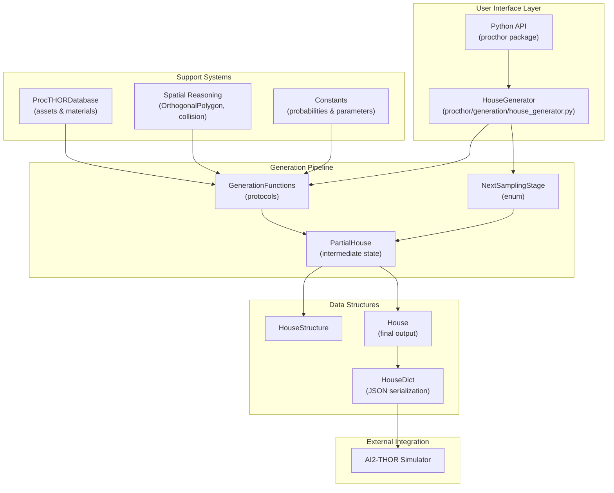
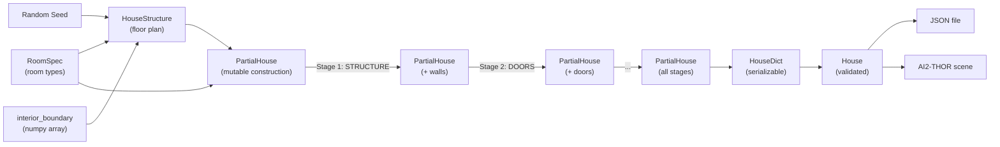
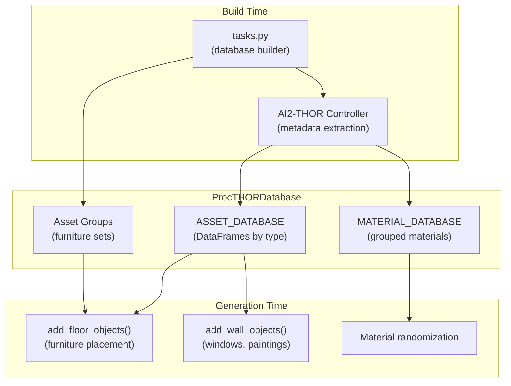
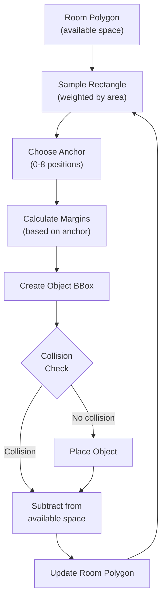
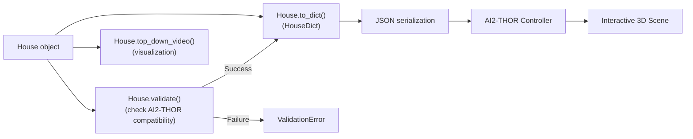

<!-- source: DeepWiki mcp.deepwiki.com · repo allenai/procthor · page 1 Overview · fetched 2026-10-26 -->

# Overview

<details>
<summary>Relevant source files</summary>

The following files were used as context for generating this wiki page:

- [README.md](README.md)

</details>


## Purpose and Scope

This page provides a high-level introduction to ProcTHOR, its architecture, and core design principles. ProcTHOR is a system for procedurally generating interactive, diverse, and semantically plausible 3D house environments for embodied AI research. Generated houses are fully compatible with the AI2-THOR simulation environment.

This overview covers the major system components, their relationships, and how data flows through the generation pipeline. For detailed information about specific subsystems, refer to:
- Generation pipeline mechanics: [Core Generation System](#2)
- Individual generation stages: [Generation Stages](#3)
- Spatial reasoning and collision detection: [Spatial Reasoning Systems](#4)
- Asset and material databases: [Database System](#5)
- Configuration parameters: [Configuration and Constants](#6)
- Practical usage examples: [Usage Guide](#10)

**Sources:** [README.md:1-51]()

---

## What is ProcTHOR?

ProcTHOR is a procedural generation system that creates realistic 3D houses suitable for training and evaluating embodied AI agents. The system generates houses by:

1. **Sampling floor plans** with diverse room layouts and wall configurations
2. **Placing structural elements** including doors, windows, lights, and exterior walls
3. **Furnishing rooms** with semantically appropriate objects (furniture, appliances, decorations)
4. **Randomizing materials and colors** to create visual diversity
5. **Validating scenes** for physical plausibility and AI2-THOR compatibility

Generated houses are represented as structured data (JSON-serializable dictionaries) that AI2-THOR can load and render as interactive 3D environments.

**Sources:** [README.md:5-9]()

---

## System Architecture

The ProcTHOR system consists of six major subsystems that work together to produce complete houses:

| Subsystem | Primary Components | Responsibility |
|-----------|-------------------|----------------|
| **User Interface** | `HouseGenerator`, Python API | Orchestrate generation, expose public API |
| **Generation Pipeline** | `PartialHouse`, `GenerationFunctions`, `NextSamplingStage` | Execute staged generation process |
| **Data Structures** | `House`, `HouseDict`, `HouseStructure` | Represent houses at various stages |
| **Spatial Reasoning** | `OrthogonalPolygon`, collision detection, rectangle sampling | Ensure physically plausible placement |
| **Database** | `ProcTHORDatabase`, `ASSET_DATABASE`, `MATERIAL_DATABASE` | Provide assets, materials, and metadata |
| **Configuration** | Constants in `constants.py` | Control probabilities and parameters |

### High-Level Component Diagram



**Sources:** [procthor/generation/house_generator.py](), [procthor/generation/__init__.py](), [procthor/databases/__init__.py]()

---

## Generation Pipeline Overview

The core of ProcTHOR is a **staged generation pipeline** that constructs houses incrementally. The pipeline is controlled by the `NextSamplingStage` enumeration, which defines the sequence of operations:

### Pipeline Stages


Each stage:
- Receives a `PartialHouse` object containing all data from previous stages
- Executes a specific generation function (e.g., `add_doors`, `add_floor_objects`)
- Updates the `PartialHouse` with new components
- Advances to the next stage

The staged architecture enables:
- **Modularity**: Each stage can be customized or replaced
- **Debuggability**: Generation can be paused/inspected at any stage
- **Reproducibility**: Same seed produces identical houses
- **Extensibility**: New stages can be added to the pipeline

**Sources:** [procthor/generation/house_generator.py](), [procthor/generation/objects.py]()

---

## Key Data Structures

ProcTHOR uses several data structures to represent houses at different levels of completeness:

| Structure | Type | Purpose | Mutability |
|-----------|------|---------|------------|
| `RoomSpec` | Input | Specifies desired room types and counts | Immutable |
| `HouseStructure` | Intermediate | Contains floor plan and wall geometry | Immutable |
| `PartialHouse` | Intermediate | Accumulates components during generation | Mutable |
| `HouseDict` | Serialization | JSON-compatible dictionary representation | Immutable |
| `House` | Output | Validated, complete house specification | Immutable |

### Data Flow Through Structures



The `PartialHouse` is the central data structure during generation. It maintains:
- All components added so far (walls, doors, windows, objects)
- Available space for placement (via `OrthogonalPolygon` objects)
- Current generation stage
- Random number generator state

**Sources:** [procthor/generation/house_generator.py](), [procthor/databases/asset_database.py]()

---

## Database System

ProcTHOR relies on a comprehensive database system (`ProcTHORDatabase`) that provides:

| Database Component | Content | Usage |
|-------------------|---------|-------|
| `ASSET_DATABASE` | Object metadata from AI2-THOR (size, receptacles, spawn rules) | Asset selection during object placement |
| `MATERIAL_DATABASE` | Material definitions grouped by type (wood, tile, fabric, etc.) | Material randomization for walls, floors, objects |
| Asset Groups | Curated furniture sets (e.g., dining table + chairs) | Cohesive room furnishing |
| Receptacles | Parent-child object relationships | Placing small objects inside/on furniture |
| Wall Holes | Window and door specifications | Exterior wall object placement |
| Placement Annotations | Room-specific spawn rules | Ensuring semantic plausibility |

The database is **data-driven**: all assets and materials come from AI2-THOR's catalog, extracted via the `tasks.py` build script. This ensures compatibility and allows the system to automatically support new AI2-THOR assets.

### Database Generation and Consumption



**Sources:** [procthor/databases/__init__.py](), [procthor/databases/asset_database.py](), [tasks.py]()

---

## Spatial Reasoning System

To ensure physically plausible object placement, ProcTHOR implements a sophisticated spatial reasoning system. The core abstractions are:

### Key Spatial Primitives

| Primitive | File/Class | Purpose |
|-----------|------------|---------|
| `OrthogonalPolygon` | `procthor/utils/types.py` | Represents axis-aligned room boundaries and available space |
| `BoundingBox` | `procthor/utils/types.py` | 3D axis-aligned bounding boxes for collision detection |
| `Polygon` (Shapely) | External library | General polygon operations (intersection, subtraction) |
| `Vector3` | `procthor/utils/types.py` | 3D position representation |

### Collision Avoidance Strategy



The system uses **polygon subtraction** to dynamically track available space. When an object is placed:
1. Its bounding box (with margins) is converted to a polygon
2. This polygon is subtracted from the room's available space polygon
3. Future placements only consider the remaining space

This approach naturally handles:
- **Collision avoidance**: Objects cannot overlap
- **Spatial constraints**: Furniture near walls leaves appropriate gaps
- **Placement density**: Rooms fill up naturally without explicit density limits

**Sources:** [procthor/utils/types.py](), [procthor/generation/objects.py]()

---

## Configuration and Probability System

ProcTHOR generates diverse scenes through a carefully designed probability system. All tunable parameters are defined in `procthor/constants.py`:

### Categories of Constants

| Category | Examples | Purpose |
|----------|----------|---------|
| **Probability** | `P_CHOOSE_EDGE`, `P_LARGEST_RECTANGLE`, `P_CHOOSE_ASSET_GROUP` | Control stochastic decisions during generation |
| **Spatial** | `MARGIN`, `PADDING_AGAINST_WALL`, `MIN_FLOOR_POSITION` | Define spacing rules and minimum sizes |
| **Scene Structure** | `SCHEMA`, `OUTDOOR_ROOM_ID`, `EMPTY_ROOM_ID` | Define scene metadata and special room IDs |
| **Visual** | `P_ALL_WALLS_SAME`, `P_SAMPLE_SOLID_WALL_COLOR` | Control material and color uniformity |

By adjusting these constants, users can tune the **aesthetic character** of generated houses without modifying the core algorithms. For example:
- Increasing `P_CHOOSE_EDGE` creates more wall-adjacent furniture
- Increasing `P_ALL_WALLS_SAME` creates more uniform color palettes
- Decreasing `P_CHOOSE_ASSET_GROUP` reduces furniture set cohesion

**Sources:** [procthor/constants.py]()

---

## Integration with AI2-THOR

ProcTHOR's primary output is a `House` object that can be loaded into AI2-THOR for simulation:

### Integration Points



The `House.validate()` method:
- Loads the house into AI2-THOR
- Checks for reachability and physical stability
- Verifies that critical objects are accessible
- Ensures the scene meets quality criteria

This validation step is crucial for ensuring that generated houses are suitable for embodied AI research, where agents must navigate and interact with objects.

**Sources:** [procthor/generation/house_generator.py]()

---

## Entry Points and Usage

Users interact with ProcTHOR through two primary interfaces:

### 1. Python API (Programmatic)

```python
from procthor.generation import HouseGenerator

# Create generator with default configuration
generator = HouseGenerator()

# Generate a house
house = generator.sample()

# Validate and save
house.validate()
house.to_json("output/house.json")
```

### 2. Command-Line Interface

```bash
python scripts/example.py
```

The example script demonstrates:
- Instantiating `HouseGenerator`
- Generating multiple houses with different room specifications
- Saving houses to disk
- Visualizing houses as top-down videos

**Sources:** [README.md:11-22](), [scripts/example.py]()

---

## Design Principles

ProcTHOR's architecture is guided by several key principles:

### 1. **Staged Pipeline**
Generation proceeds through well-defined stages, each building on the previous. This enables modularity, debuggability, and extensibility.

### 2. **Data-Driven Configuration**
Assets, materials, and placement rules come from external databases rather than hard-coded logic. This allows the system to adapt as AI2-THOR evolves.

### 3. **Probability-Driven Diversity**
Stochastic decisions at every stage create infinite variety. Probability constants provide intuitive control over generation characteristics.

### 4. **Spatial Plausibility**
Sophisticated collision detection and spatial reasoning ensure that generated houses are physically plausible and navigable by AI agents.

### 5. **Semantic Consistency**
Room-specific asset filters and placement annotations ensure that objects appear in semantically appropriate locations (e.g., stoves only in kitchens).

### 6. **Reproducibility**
All randomness is controlled by a seed value. The same seed always produces an identical house, enabling reproducible experiments.

These principles work together to create a system that is both **powerful** (capable of generating millions of unique houses) and **controllable** (users can tune generation characteristics without modifying code).

**Sources:** [procthor/generation/house_generator.py](), [procthor/constants.py]()

---

## System Output

The final output of the ProcTHOR system is a `House` object with the following characteristics:

| Property | Description |
|----------|-------------|
| **Completeness** | Contains all structural elements (walls, doors, windows), lighting, and furnished rooms |
| **Validity** | Passes AI2-THOR validation checks (reachability, stability, object accessibility) |
| **Serializability** | Can be converted to JSON and loaded into AI2-THOR |
| **Metadata** | Includes schema version, room specifications, and generation parameters |
| **Visualization** | Can generate top-down video showing room layout and objects |

Houses are typically 50-500KB in JSON format (compressed) and contain 50-300 objects depending on the number and size of rooms.

**Sources:** [procthor/generation/house_generator.py]()

---

## Repository Structure Summary

The ProcTHOR codebase is organized as follows:

| Directory/File | Purpose |
|----------------|---------|
| `procthor/generation/` | Core generation pipeline (`HouseGenerator`, stage functions) |
| `procthor/databases/` | Database system (`ProcTHORDatabase`, asset/material databases) |
| `procthor/utils/` | Utility classes (`OrthogonalPolygon`, collision detection, geometry) |
| `procthor/constants.py` | Configuration constants (probabilities, spatial parameters) |
| `procthor/upgrade/` | Schema versioning system (`HouseUpgradeManager`) |
| `tasks.py` | Database generation script |
| `scripts/example.py` | Example usage demonstrating house generation |
| `.github/workflows/` | CI/CD pipeline for automated PyPI releases |

**Sources:** [README.md](), [procthor/]()

---

## Next Steps

To dive deeper into specific subsystems:

- **Understand the generation pipeline**: See [Core Generation System](#2) for details on `HouseGenerator` orchestration and stage progression
- **Learn about individual stages**: See [Generation Stages](#3) for detailed documentation of each generation function
- **Explore spatial reasoning**: See [Spatial Reasoning Systems](#4) for collision detection and placement algorithms
- **Understand the database**: See [Database System](#5) for asset and material database architecture
- **Customize generation**: See [Configuration and Constants](#6) for tunable parameters
- **Use ProcTHOR**: See [Usage Guide](#10) for practical examples and API reference

**Sources:** [README.md](), [procthor/generation/__init__.py]()

---

