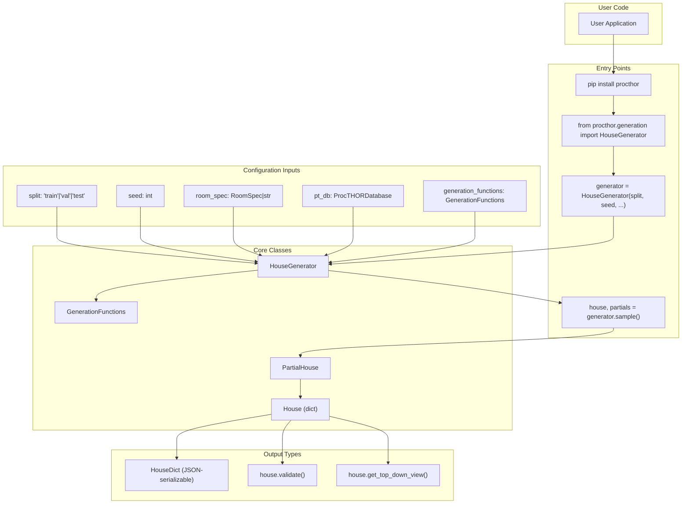
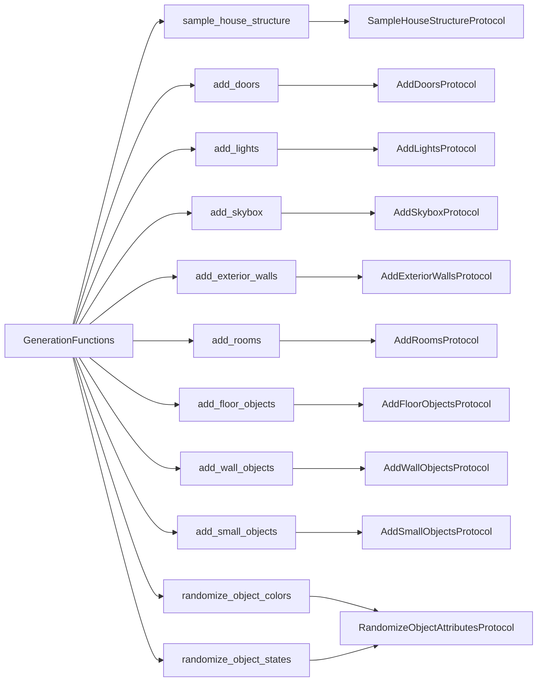
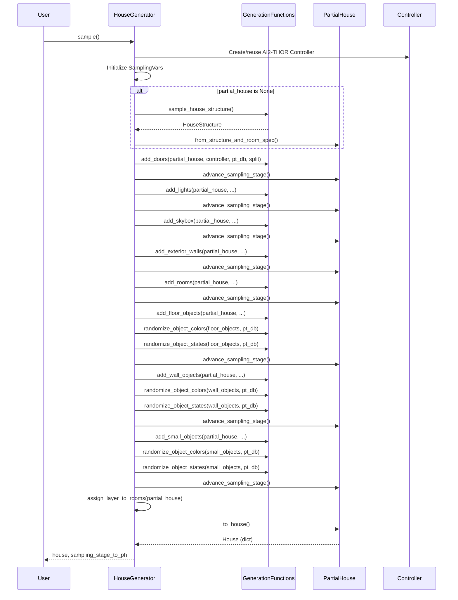
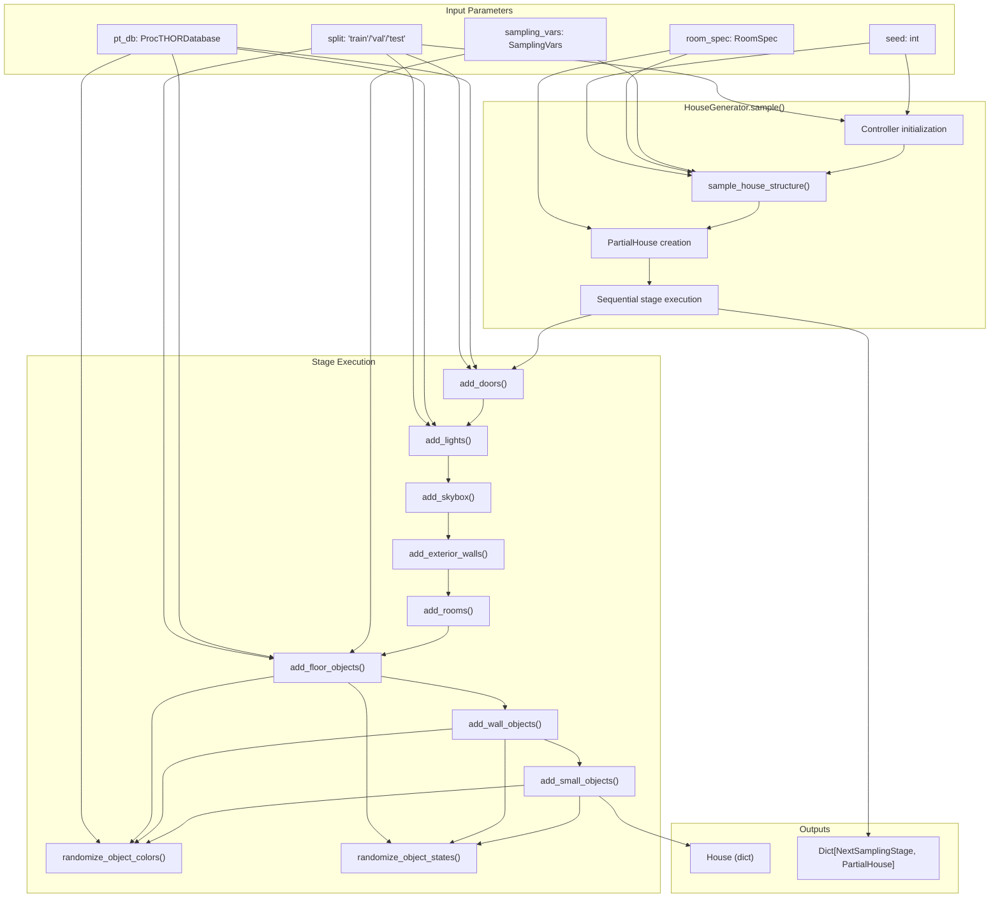

<!-- source: DeepWiki mcp.deepwiki.com · repo allenai/procthor · page 10 Usage Guide · fetched 2026-10-26 -->

# Usage Guide

<details>
<summary>Relevant source files</summary>

The following files were used as context for generating this wiki page:

- [README.md](README.md)
- [procthor/generation/__init__.py](procthor/generation/__init__.py)

</details>


This document provides practical instructions for using ProcTHOR to generate procedurally-created houses programmatically. It covers installation, basic usage patterns, customization options, and working with generated house objects. 

For detailed implementation of individual generation stages, see [Core Generation System](#2). For information about the database system that provides assets and materials, see [Database System](#5). For schema versioning and migration, see [Versioning and Schema Migration](#7).

---

## Scope and Purpose

This guide addresses:
- Installing the `procthor` package
- Creating a `HouseGenerator` instance
- Generating houses with the `sample()` method
- Customizing generation through parameters and custom functions
- Validating, serializing, and visualizing generated houses

The subpages provide detailed coverage:
- [Installation](#10.1) - Environment setup and dependencies
- [Basic Usage](#10.2) - Example-driven quick start
- [Customization](#10.3) - Providing custom `GenerationFunctions`
- [Working with Generated Houses](#10.4) - Validation, serialization, visualization

---

## Quick Start

### Installation and First House

The simplest workflow involves installing via PyPI and using the default generation pipeline:

```bash
pip install procthor
```

```python
from procthor.generation import HouseGenerator

# Create generator
generator = HouseGenerator(split="train", seed=42)

# Generate house
house, _ = generator.sample()

# Access house properties
print(f"Rooms: {len(house['rooms'])}")
print(f"Objects: {len(house['objects'])}")
```

The `scripts/example.py` file provides a complete working example that can be run directly:

```bash
export PYTHONPATH=$PYTHONPATH:$PWD
python scripts/example.py
```

**Sources:** [README.md:11-22](), [procthor/generation/__init__.py:84-304]()

---

## User Interaction Model

The following diagram shows how users interact with ProcTHOR's main entry points and what code entities are involved:



**Sources:** [README.md:11-22](), [procthor/generation/__init__.py:84-304]()

---

## Key Classes and Parameters

### HouseGenerator

The `HouseGenerator` class is the main orchestrator for house generation. Located at [procthor/generation/__init__.py:84-304](), it provides the following initialization parameters:

| Parameter | Type | Required | Description |
|-----------|------|----------|-------------|
| `split` | `"train"`, `"val"`, or `"test"` | Yes | Determines dataset split for asset sampling |
| `seed` | `int` | No | Random seed for reproducibility; auto-generated if None |
| `room_spec` | `RoomSpec` or `str` | No | Explicit room configuration or room spec name |
| `room_spec_sampler` | `RoomSpecSampler` | No | Custom sampler for room specifications |
| `interior_boundary` | `np.array` | No | Pre-defined interior boundary array |
| `controller` | `Controller` | No | AI2-THOR controller instance; created automatically if None |
| `partial_house` | `PartialHouse` | No | Resume generation from intermediate state |
| `pt_db` | `ProcTHORDatabase` | No | Custom database; defaults to `DEFAULT_PROCTHOR_DATABASE` |
| `generation_functions` | `GenerationFunctions` | No | Custom stage implementations |

**Sources:** [procthor/generation/__init__.py:84-96]()

### GenerationFunctions

The `GenerationFunctions` class (lines 52-65) encapsulates all stage-specific generation functions, allowing customization of individual pipeline stages:



Each field corresponds to a protocol (see [procthor/generation/protocols.py]()) that defines the function signature. The default implementations are automatically created by `_create_default_generation_functions()` at [procthor/generation/__init__.py:67-80]().

**Sources:** [procthor/generation/__init__.py:52-80]()

---

## Generation Workflow

The `sample()` method at [procthor/generation/__init__.py:121-304]() orchestrates the complete generation pipeline:



**Sources:** [procthor/generation/__init__.py:121-304]()

---

## Method Signatures and Return Values

### sample() Method

```python
def sample(
    self,
    partial_house: Optional[PartialHouse] = None,
    return_partial_houses: bool = False,
    sampling_vars: Optional[SamplingVars] = None,
    next_sampling_stage: Optional[NextSamplingStage] = NextSamplingStage.STRUCTURE,
) -> Tuple[House, Dict[NextSamplingStage, PartialHouse]]:
```

**Parameters:**

| Parameter | Type | Default | Description |
|-----------|------|---------|-------------|
| `partial_house` | `PartialHouse` | `None` | Resume generation from this intermediate state |
| `return_partial_houses` | `bool` | `False` | Return intermediate `PartialHouse` snapshots for each stage |
| `sampling_vars` | `SamplingVars` | `None` | Override sampling parameters like `max_floor_objects` |
| `next_sampling_stage` | `NextSamplingStage` | `STRUCTURE` | Starting stage for generation |

**Returns:**
- `house`: A `House` object (dictionary) containing the complete house specification
- `sampling_stage_to_ph`: Dictionary mapping `NextSamplingStage` to `PartialHouse` snapshots

**Sources:** [procthor/generation/__init__.py:121-128]()

---

## Common Usage Patterns

### Basic Generation with Seed

```python
from procthor.generation import HouseGenerator

# Generate reproducible house
generator = HouseGenerator(split="train", seed=42)
house, _ = generator.sample()
```

### Specifying Room Configuration

```python
# Use named room spec
generator = HouseGenerator(split="train", room_spec="2bed1bath")
house, _ = generator.sample()

# Or create custom RoomSpec
from procthor.generation import RoomSpec

custom_spec = RoomSpec(
    room_type_map={
        0: "LivingRoom",
        1: "Kitchen",
        2: "Bedroom"
    }
)
generator = HouseGenerator(split="train", room_spec=custom_spec)
house, _ = generator.sample()
```

### Capturing Intermediate States

```python
generator = HouseGenerator(split="train", seed=42)
house, stage_to_partial = generator.sample(return_partial_houses=True)

# Access intermediate states
from procthor.generation.house import NextSamplingStage

after_doors = stage_to_partial[NextSamplingStage.DOORS]
after_floor_objects = stage_to_partial[NextSamplingStage.FLOOR_OBJS]

# Inspect intermediate state
print(f"Doors: {len(after_doors.doors)}")
print(f"Floor objects: {len(after_floor_objects.objects)}")
```

### Customizing Sampling Parameters

```python
from procthor.utils.types import SamplingVars

# Override default sampling parameters
sampling_vars = SamplingVars(
    max_floor_objects=50,  # Default varies
    interior_boundary_scale=1.2  # Scale the interior boundary
)

generator = HouseGenerator(split="train", seed=42)
house, _ = generator.sample(sampling_vars=sampling_vars)
```

**Sources:** [procthor/generation/__init__.py:121-304]()

---

## Data Flow: Parameters to Outputs

The following diagram shows how input parameters flow through the generation system to produce outputs:



**Sources:** [procthor/generation/__init__.py:121-304]()

---

## Error Handling and Validation

### Floorplan Generation Failures

The structure generation stage uses rejection sampling with up to 10 attempts (lines 157-172):

```python
# From HouseGenerator.sample()
for _ in range(10):
    try:
        house_structure = gfs.sample_house_structure(
            interior_boundary=interior_boundary,
            room_ids=room_ids,
            room_spec=room_spec,
            interior_boundary_scale=sampling_vars.interior_boundary_scale,
        )
        break
    except InvalidFloorplan:
        pass
else:
    raise Exception(
        f"Failed to generate interior boundary and floorplan"
        "for room_spec={room_spec}!"
    )
```

If all attempts fail, an `Exception` is raised indicating that a valid floorplan could not be generated for the given `room_spec`.

### Split Validation

The `split` parameter is validated at initialization (lines 97-100):

```python
@split.validator
def _valid_split(self, attribute: Attribute, value: Split) -> None:
    if value not in {"train", "val", "test"}:
        raise ValueError(f'split={value} must be in {{"train", "val", "test"}}')
```

**Sources:** [procthor/generation/__init__.py:97-100](), [procthor/generation/__init__.py:157-172]()

---

## Controller Management

### Automatic Controller Creation

If no `controller` is provided, the `sample()` method automatically creates an AI2-THOR `Controller` instance with low quality settings (lines 129-135):

```python
if self.controller is None:
    # NOTE: assumes images are never used by this Controller.
    self.controller = Controller(quality="Low", **PROCTHOR_INITIALIZATION)
    if self.seed is not None:
        self.controller.step(
            action="SetRandomSeed", seed=self.seed, renderImage=False
        )
```

The `PROCTHOR_INITIALIZATION` constant (from [procthor/constants.py]()) provides default initialization parameters for AI2-THOR.

### Manual Controller Provision

Users can provide their own `Controller` instance if they need specific settings:

```python
from ai2thor.controller import Controller
from procthor.generation import HouseGenerator
from procthor.constants import PROCTHOR_INITIALIZATION

# Create custom controller
controller = Controller(
    quality="Ultra",
    **PROCTHOR_INITIALIZATION
)

# Use with generator
generator = HouseGenerator(
    split="train",
    controller=controller
)
house, _ = generator.sample()
```

**Sources:** [procthor/generation/__init__.py:129-135]()

---

## Random Seed Management

### Seed Setting

The `set_seed()` method (lines 113-119) sets the random seed globally for Python's `random` module, NumPy, and the AI2-THOR controller:

```python
def set_seed(self, seed: int) -> None:
    # TODO: Probably should not be done on a global level
    self.seed = seed
    random.seed(seed)
    np.random.seed(seed)
    if self.controller is not None:
        self.controller.step(action="SetRandomSeed", seed=seed, renderImage=False)
```

### Automatic Seed Generation

If no seed is provided during initialization, one is automatically generated (lines 103-105):

```python
if self.seed is None:
    self.seed = random.randint(0, 2**15)
    logging.debug(f"Using seed {self.seed}")
```

**Sources:** [procthor/generation/__init__.py:102-119]()

---

## Complete Example: Custom Generation

This example demonstrates creating a custom house with specific configuration:

```python
from procthor.generation import HouseGenerator, RoomSpec
from procthor.utils.types import SamplingVars

# Define custom room configuration
room_spec = RoomSpec(
    room_type_map={
        0: "LivingRoom",
        1: "Kitchen",
        2: "Bedroom",
        3: "Bathroom"
    }
)

# Configure sampling parameters
sampling_vars = SamplingVars(
    max_floor_objects=40,
    interior_boundary_scale=1.0
)

# Create generator with custom settings
generator = HouseGenerator(
    split="train",
    seed=12345,
    room_spec=room_spec
)

# Generate house and capture intermediates
house, stage_to_partial = generator.sample(
    return_partial_houses=True,
    sampling_vars=sampling_vars
)

# Access results
print(f"Generated house with {len(house['rooms'])} rooms")
print(f"Total objects: {len(house['objects'])}")

# Inspect intermediate state
from procthor.generation.house import NextSamplingStage
after_structure = stage_to_partial[NextSamplingStage.STRUCTURE]
print(f"Ceiling height: {after_structure.house_structure.ceiling_height}")
```

**Sources:** [procthor/generation/__init__.py:84-304]()

---

## Summary

The primary usage workflow consists of:

1. **Initialize** `HouseGenerator` with `split`, optional `seed`, and optional configuration
2. **Call** `sample()` to execute the generation pipeline
3. **Receive** a `House` dictionary and optional intermediate `PartialHouse` states
4. **Use** the generated house for validation, visualization, or AI2-THOR simulation

For detailed information on:
- Installation procedures, see [Installation](#10.1)
- Example-driven tutorials, see [Basic Usage](#10.2)
- Implementing custom generation stages, see [Customization](#10.3)
- Working with output houses, see [Working with Generated Houses](#10.4)

**Sources:** [README.md:11-22](), [procthor/generation/__init__.py:84-304]()

---

