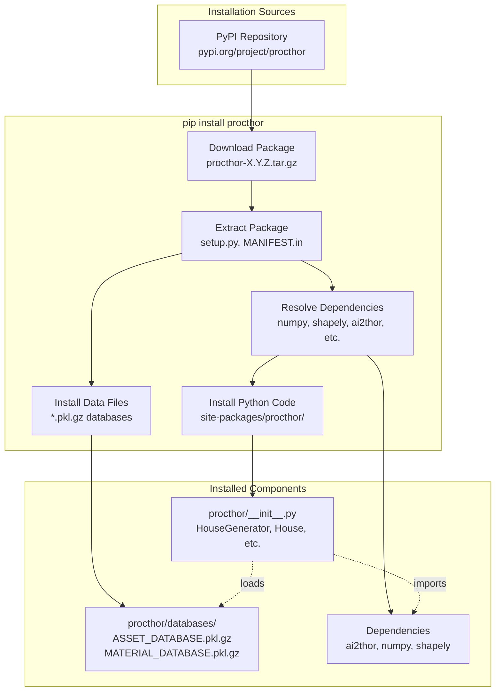
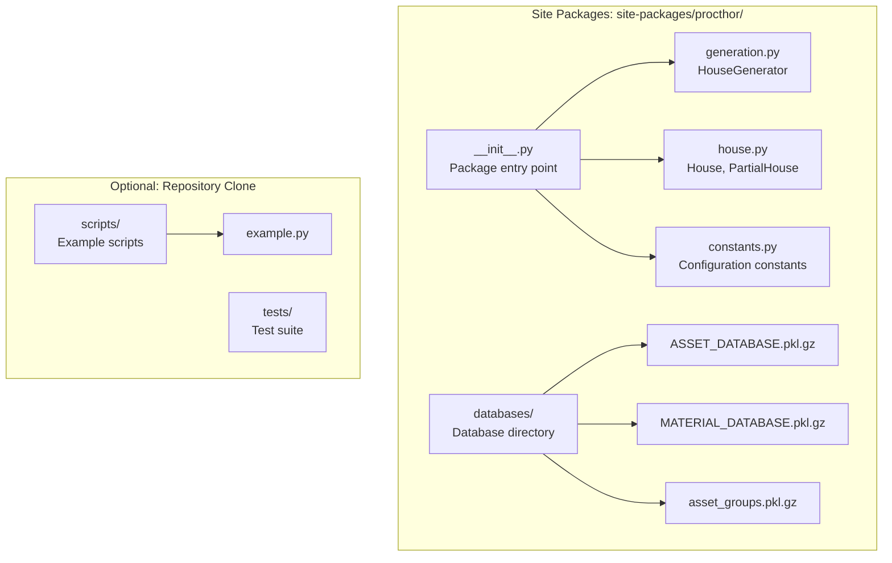
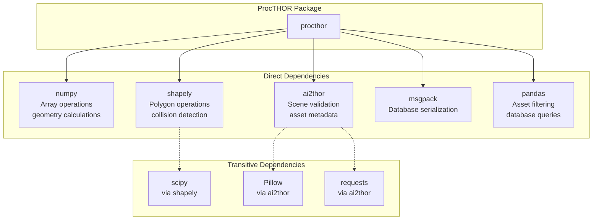
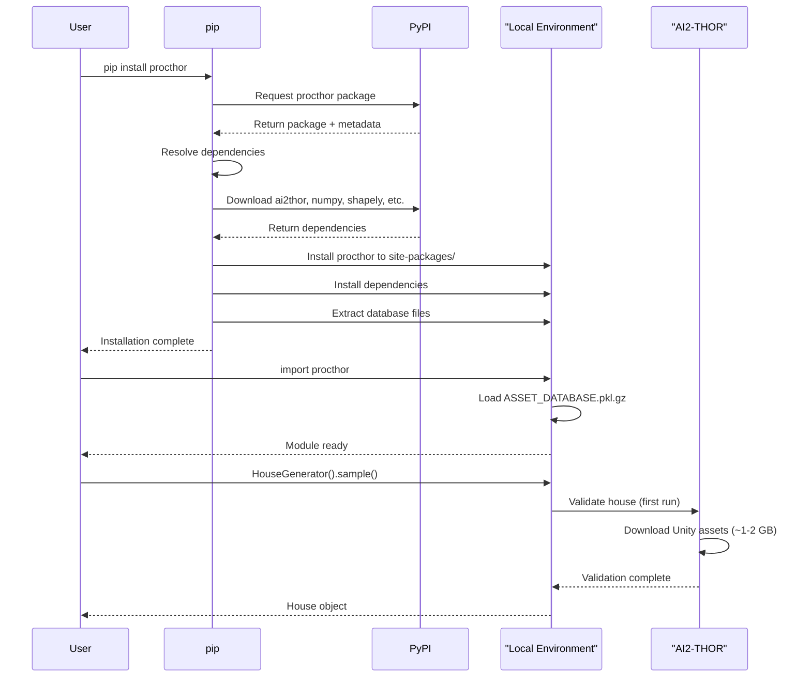

<!-- source: DeepWiki mcp.deepwiki.com · repo allenai/procthor · page 10.1 Installation · fetched 2026-10-26 -->

# Installation

<details>
<summary>Relevant source files</summary>

The following files were used as context for generating this wiki page:

- [README.md](README.md)

</details>


This page provides instructions for installing ProcTHOR and setting up the necessary environment to generate procedural houses. The installation process includes obtaining the package, managing dependencies, and verifying the setup.

For information about package structure and data file inclusion, see [Package Structure](#9.1). For deployment and CI/CD workflows, see [CI/CD Pipeline](#9.2).

---

## Purpose and Scope

This document covers:
- Installing ProcTHOR via PyPI or from source
- Python version and dependency requirements
- Environment configuration for running generation scripts
- Verification procedures to confirm successful installation
- Troubleshooting common installation issues

This page does not cover usage of the ProcTHOR API after installation. For that, see [Basic Usage](#10.2).

---

## Prerequisites

### Python Version Requirements

ProcTHOR requires Python 3.7 or higher. The package is tested on Python 3.7, 3.8, 3.9, and 3.10.

### System Requirements

The package is compatible with:
- **Linux**: All distributions
- **macOS**: 10.13 (High Sierra) or later
- **Windows**: Windows 10 or later

### Core Dependencies

ProcTHOR has the following primary dependencies:

| Dependency | Purpose | Minimum Version |
|------------|---------|-----------------|
| `numpy` | Numerical operations and array manipulation | ≥1.19.0 |
| `shapely` | Geometric operations for polygon manipulation | ≥1.7.0 |
| `ai2thor` | AI2-THOR simulation environment | ≥4.0.0 |
| `msgpack` | Efficient serialization for database storage | ≥1.0.0 |
| `pandas` | DataFrame operations for asset databases | ≥1.1.0 |

**Sources**: [README.md:13-16]()

---

## Installation Methods

### Installation via PyPI (Recommended)

The simplest method to install ProcTHOR is using pip from the Python Package Index:

```bash
pip install procthor
```

This installs the latest stable release along with all required dependencies. The installation includes:
- Python package code in `procthor/`
- Pre-built database files (`ASSET_DATABASE.pkl.gz`, `MATERIAL_DATABASE.pkl.gz`, etc.)
- Configuration files and constants

#### Installation Flow Diagram



**Sources**: [README.md:13-16]()

### Installation from Source

For development or to use the latest unreleased features, install from the GitHub repository:

```bash
# Clone the repository
git clone https://github.com/allenai/procthor.git
cd procthor

# Install in development mode
pip install -e .
```

The `-e` flag installs the package in "editable" mode, meaning changes to the source code are immediately reflected without reinstalling.

#### Development Installation Requirements

When installing from source, additional steps may be required:

1. **Database Generation**: If database files are missing, they must be generated using `tasks.py`. See [Database Generation](#5.2) for details.

2. **Testing Dependencies**: To run tests, install development dependencies:
   ```bash
   pip install pytest
   ```

**Sources**: [README.md:13-22]()

---

## Environment Configuration

### PYTHONPATH Setup

When running scripts from the repository root, the `PYTHONPATH` environment variable must include the current directory:

```bash
export PYTHONPATH=$PYTHONPATH:$PWD
```

This ensures that Python can locate the `procthor` module and the `scripts/` directory. This is only necessary when running scripts directly from the repository, not when using the installed package.

**Why this is needed**: The example script at [scripts/example.py]() uses absolute imports from the `procthor` package. Without `PYTHONPATH` configuration, Python cannot resolve these imports when running the script directly.

### Directory Structure After Installation



**Sources**: [README.md:13-22]()

---

## Verification

### Verifying Installation

After installation, verify that ProcTHOR is correctly installed by importing it in Python:

```bash
python -c "import procthor; print(procthor.__version__)"
```

This should print the installed version number (e.g., `1.0.0`) without errors.

### Running the Example Script

The repository includes an example script that demonstrates basic house generation. To run it:

```bash
# If installed from source
cd /path/to/procthor
export PYTHONPATH=$PYTHONPATH:$PWD
python scripts/example.py
```

The script performs the following:
1. Creates a `HouseGenerator` instance
2. Generates a procedural house using default parameters
3. Validates the house in AI2-THOR
4. Saves the house to a JSON file

**Expected output**: The script generates a compressed JSON file (`house.json.gz`) containing the complete house specification. No errors should occur during generation or validation.

**Sources**: [README.md:18-22]()

### Testing Database Access

Verify that database files are accessible:

```python
from procthor.databases import ProcTHORDatabase

db = ProcTHORDatabase()
print(f"Assets loaded: {len(db.ASSET_DATABASE)}")
print(f"Materials loaded: {len(db.MATERIAL_DATABASE)}")
```

Expected output shows non-zero counts for assets and materials, indicating successful database loading.

---

## Dependency Installation Details

### Dependency Resolution Diagram



### AI2-THOR Installation

AI2-THOR is the most complex dependency, as it includes:
- Unity-based simulation engine
- 3D asset libraries
- Controller interface

On first use, AI2-THOR downloads additional data (~1-2 GB). This occurs automatically when:
- Running `House.validate()` for the first time
- Creating a visualization using `generate_top_down_video()`

The download is cached in `~/.ai2thor/` and does not need to be repeated.

**Sources**: [README.md:13-16]()

---

## Data Files and Databases

### Included Database Files

The ProcTHOR package includes pre-built database files that are automatically installed:

| File | Size | Purpose |
|------|------|---------|
| `ASSET_DATABASE.pkl.gz` | ~500 KB | Object metadata, dimensions, receptacles |
| `MATERIAL_DATABASE.pkl.gz` | ~100 KB | Wall and floor material specifications |
| `asset_groups.pkl.gz` | ~50 KB | Pre-defined furniture groups |
| `annotations.pkl.gz` | ~30 KB | Placement rules and spawn annotations |
| `receptacles.pkl.gz` | ~20 KB | Object containment relationships |
| `wall_holes.pkl.gz` | ~10 KB | Window and door specifications |

These files are located in the `procthor/databases/` directory within the installed package. They are accessed automatically by `ProcTHORDatabase`.

### MANIFEST.in Role

The `MANIFEST.in` file ensures that database files are included in the package distribution. Without this file, pip would only install `.py` source files, and the databases would be missing.

For details on database structure, see [Database Architecture](#5.1). For database regeneration, see [Database Generation](#5.2).

**Sources**: [README.md:13-16]()

---

## Troubleshooting

### Common Installation Issues

#### Issue: `ModuleNotFoundError: No module named 'procthor'`

**Cause**: Package not installed or PYTHONPATH not configured.

**Solution**:
```bash
# Verify installation
pip list | grep procthor

# If missing, install
pip install procthor

# If running from source, set PYTHONPATH
export PYTHONPATH=$PYTHONPATH:$PWD
```

#### Issue: `FileNotFoundError: ASSET_DATABASE.pkl.gz not found`

**Cause**: Database files not included in installation or corrupted.

**Solution**:
```bash
# Reinstall with --force-reinstall
pip install --force-reinstall procthor

# If installing from source, regenerate databases
python -c "from procthor.generation import tasks; tasks.main()"
```

#### Issue: AI2-THOR download hangs or fails

**Cause**: Network issues or insufficient disk space.

**Solution**:
- Ensure at least 3 GB of free disk space in `~/.ai2thor/`
- Check network connectivity
- Manually clear cache and retry:
  ```bash
  rm -rf ~/.ai2thor/
  python -c "import ai2thor.controller; ai2thor.controller.Controller()"
  ```

#### Issue: ImportError with shapely on Apple Silicon (M1/M2)

**Cause**: Shapely requires specific installation on ARM-based Macs.

**Solution**:
```bash
# Use conda for shapely on Apple Silicon
conda install shapely

# Then install procthor
pip install procthor
```

### Compatibility Matrix

| Python | OS | Status | Notes |
|--------|-----|--------|-------|
| 3.7 | Linux | ✅ Supported | Minimum version |
| 3.8 | Linux | ✅ Supported | Recommended |
| 3.9 | macOS | ✅ Supported | |
| 3.10 | Windows | ✅ Supported | |
| 3.11 | All | ⚠️ Experimental | Some dependencies may have issues |

**Sources**: [README.md:13-22]()

---

## Installation Workflow Summary



**Sources**: [README.md:13-22]()

---

## Next Steps

After successful installation:
1. **Run the example**: Follow [Basic Usage](#10.2) to generate your first house
2. **Explore customization**: See [Customization](#10.3) for custom generation functions
3. **Understand the pipeline**: Review [Generation Pipeline Architecture](#2.1) for system internals
4. **Work with houses**: See [Working with Generated Houses](#10.4) for validation and visualization

**Sources**: [README.md:18-22]()

---

