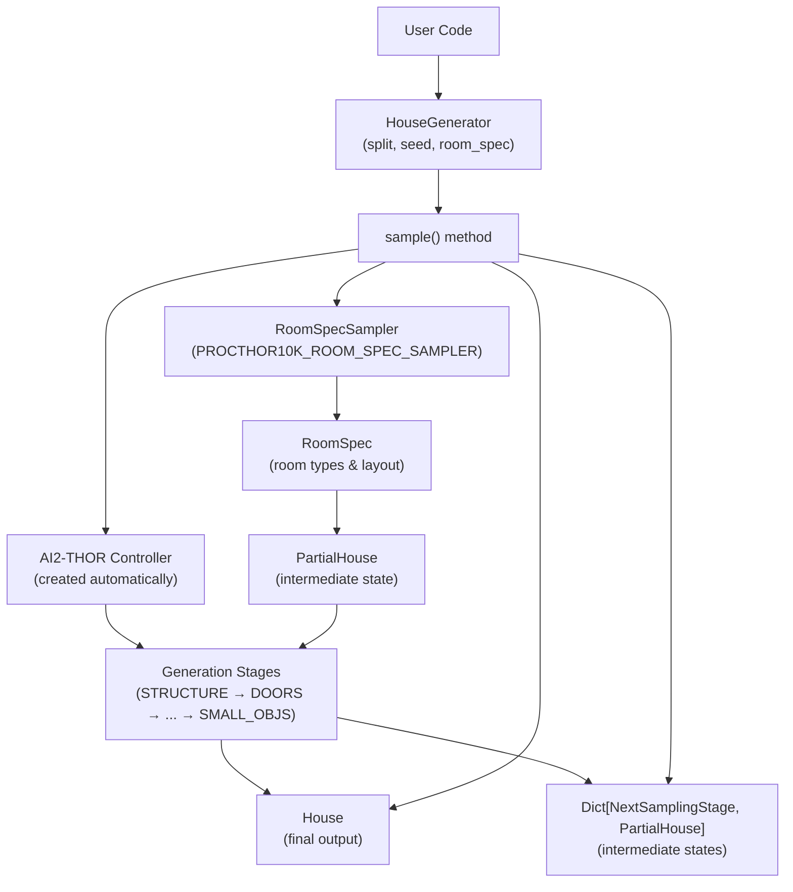
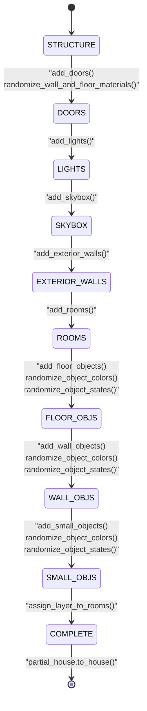

<!-- source: DeepWiki mcp.deepwiki.com · repo allenai/procthor · page 10.2 Basic Usage · fetched 2026-10-26 -->

# Basic Usage

<details>
<summary>Relevant source files</summary>

The following files were used as context for generating this wiki page:

- [README.md](README.md)
- [procthor/generation/__init__.py](procthor/generation/__init__.py)

</details>


This document provides an example-driven guide to generating houses using the `HouseGenerator` class. It covers the minimal workflow for creating a procedurally generated house and explains the core parameters and return values.

For installation instructions, see [Installation](#10.1). For advanced customization of the generation pipeline, see [Customization](#10.3). For working with the generated `House` objects (validation, serialization, visualization), see [Working with Generated Houses](#10.4).

## Minimal Example

The simplest way to generate a house requires only two lines of code:

```python
from procthor.generation import HouseGenerator

# Create generator with a split designation
generator = HouseGenerator(split="train")

# Generate a house
house, _ = generator.sample()
```

This code creates a `HouseGenerator` configured for the training split and generates a complete house with randomized structure, rooms, furniture, and decorations. The underscore variable receives a dictionary of intermediate `PartialHouse` objects that can be ignored for basic usage.

**Sources:** [README.md:11-22](), [procthor/generation/__init__.py:84-127]()

## HouseGenerator Class

The `HouseGenerator` class orchestrates the entire generation pipeline. It accepts several initialization parameters that control the generation process.

### Initialization Parameters

The following table describes the key parameters accepted by `HouseGenerator`:

| Parameter | Type | Required | Default | Description |
|-----------|------|----------|---------|-------------|
| `split` | `str` | Yes | — | Must be one of `"train"`, `"val"`, or `"test"` |
| `seed` | `int` | No | Random | Random seed for reproducible generation |
| `room_spec` | `RoomSpec` or `str` | No | Sampled | Specifies room types and layout |
| `room_spec_sampler` | `RoomSpecSampler` | No | `PROCTHOR10K_ROOM_SPEC_SAMPLER` | Sampler for generating `RoomSpec` |
| `interior_boundary` | `np.array` | No | `None` | Pre-specified interior boundary polygon |
| `controller` | `Controller` | No | Auto-created | AI2-THOR controller instance |
| `pt_db` | `ProcTHORDatabase` | No | `DEFAULT_PROCTHOR_DATABASE` | Asset and material database |
| `generation_functions` | `GenerationFunctions` | No | Default functions | Stage-specific generation functions |

The `split` parameter is validated to ensure it is one of the three allowed values [procthor/generation/__init__.py:97-100](). If no `seed` is provided, a random one is generated [procthor/generation/__init__.py:103-107]().

**Sources:** [procthor/generation/__init__.py:83-111]()

## Generation Workflow

The following diagram illustrates the workflow from creating a `HouseGenerator` to obtaining a complete `House`:



**Sources:** [procthor/generation/__init__.py:121-304]()

## The sample() Method

The `sample()` method is the primary interface for house generation. It orchestrates all generation stages and returns the final output.

### Method Signature

```python
def sample(
    self,
    partial_house: Optional[PartialHouse] = None,
    return_partial_houses: bool = False,
    sampling_vars: Optional[SamplingVars] = None,
    next_sampling_stage: Optional[NextSamplingStage] = NextSamplingStage.STRUCTURE,
) -> Tuple[House, Dict[NextSamplingStage, PartialHouse]]:
```

### Parameters

| Parameter | Type | Default | Description |
|-----------|------|---------|-------------|
| `partial_house` | `PartialHouse` | `None` | Resume generation from an existing partial house |
| `return_partial_houses` | `bool` | `False` | If `True`, returns snapshots at each generation stage |
| `sampling_vars` | `SamplingVars` | Auto-sampled | Controls stochastic generation parameters |
| `next_sampling_stage` | `NextSamplingStage` | `STRUCTURE` | Starting stage for generation |

### Return Value

The method returns a tuple `(house, stage_dict)`:
- **`house`**: A complete `House` object ready for validation or serialization
- **`stage_dict`**: A dictionary mapping `NextSamplingStage` enum values to `PartialHouse` snapshots

**Sources:** [procthor/generation/__init__.py:121-127]()

## Generation Stages Flow

The `sample()` method progresses through a fixed sequence of generation stages. The following diagram shows the stage progression:



Each stage invokes a corresponding method from the `GenerationFunctions` object [procthor/generation/__init__.py:67-80](). The progression is sequential and cannot be skipped (though generation can be resumed from any stage by passing a `partial_house` parameter).

**Sources:** [procthor/generation/__init__.py:142-304]()

## Working with Seeds

Seeds ensure reproducible generation. When a seed is set, the same sequence of houses can be regenerated.

### Setting a Seed at Initialization

```python
generator = HouseGenerator(split="train", seed=42)
house, _ = generator.sample()
```

### Changing the Seed Dynamically

The `set_seed()` method allows changing the seed after initialization:

```python
generator = HouseGenerator(split="train")
generator.set_seed(12345)
house, _ = generator.sample()
```

The `set_seed()` method [procthor/generation/__init__.py:113-119]() sets the seed for:
- Python's `random` module
- NumPy's random number generator
- The AI2-THOR controller (if it exists)

This ensures all stochastic decisions during generation are reproducible.

**Sources:** [procthor/generation/__init__.py:102-119]()

## Specifying Room Types

By default, the `HouseGenerator` samples a random `RoomSpec` from the `PROCTHOR10K_ROOM_SPEC_SAMPLER` [procthor/generation/__init__.py:108-111](). You can override this by providing a specific room configuration.

### Using a Named RoomSpec

The `PROCTHOR10K_ROOM_SPEC_SAMPLER` contains pre-defined room specifications that can be accessed by name:

```python
generator = HouseGenerator(split="train", room_spec="1bed1bath")
house, _ = generator.sample()
```

When a string is passed as `room_spec`, it is looked up in the `room_spec_sampler` [procthor/generation/__init__.py:110-111]().

### Using a Custom RoomSpec

You can also construct a `RoomSpec` object directly:

```python
from procthor.generation import RoomSpec

room_spec = RoomSpec(
    room_type_map={
        "room|0": "LivingRoom",
        "room|1": "Kitchen",
        "room|2": "Bedroom"
    }
)

generator = HouseGenerator(split="train", room_spec=room_spec)
house, _ = generator.sample()
```

The `room_type_map` dictionary maps room IDs to room type strings. The room IDs must follow the format `"room|<number>"`.

**Sources:** [procthor/generation/__init__.py:87-111](), [procthor/generation/__init__.py:143-152]()

## Controller Management

The `HouseGenerator` automatically creates an AI2-THOR `Controller` instance if one is not provided [procthor/generation/__init__.py:129-135]():

```python
if self.controller is None:
    self.controller = Controller(quality="Low", **PROCTHOR_INITIALIZATION)
    if self.seed is not None:
        self.controller.step(
            action="SetRandomSeed", seed=self.seed, renderImage=False
        )
```

The controller is initialized with:
- **Low quality rendering**: Since the controller is used for metadata queries, not visualization
- **`PROCTHOR_INITIALIZATION`**: Default initialization parameters from [procthor/constants.py]()
- **Seed propagation**: If a seed is set, it is applied to the controller

You can provide your own controller if you need specific initialization parameters:

```python
from ai2thor.controller import Controller

controller = Controller(
    quality="Ultra",
    width=800,
    height=600
)

generator = HouseGenerator(split="train", controller=controller)
house, _ = generator.sample()
```

**Sources:** [procthor/generation/__init__.py:129-135]()

## Understanding Partial Houses

The second return value from `sample()` is a dictionary that maps generation stages to `PartialHouse` snapshots. By default, this dictionary contains only the final stage:

```python
house, stage_dict = generator.sample()
# stage_dict contains only: {NextSamplingStage.COMPLETE: final_partial_house}
```

To capture intermediate states at every stage, set `return_partial_houses=True`:

```python
house, stage_dict = generator.sample(return_partial_houses=True)

# stage_dict now contains:
# {
#   NextSamplingStage.STRUCTURE: ...,
#   NextSamplingStage.DOORS: ...,
#   NextSamplingStage.LIGHTS: ...,
#   ...
# }
```

This is useful for debugging or analyzing the generation process at specific stages [procthor/generation/__init__.py:182-196]().

**Sources:** [procthor/generation/__init__.py:121-127](), [procthor/generation/__init__.py:182-196](), [procthor/generation/__init__.py:302-304]()

## Complete Example

The following example demonstrates a typical workflow with all common parameters:

```python
from procthor.generation import HouseGenerator

# Initialize generator with specific configuration
generator = HouseGenerator(
    split="train",           # Training split
    seed=42,                 # Reproducible generation
    room_spec="2bed1bath"    # Two-bedroom, one-bathroom house
)

# Generate a house
house, stage_dict = generator.sample(return_partial_houses=False)

# The house object is now ready for use
print(f"Generated house with {len(house.rooms)} rooms")
print(f"Total objects: {len(house.objects)}")

# Generate another house with the same generator
generator.set_seed(43)
house2, _ = generator.sample()
```

This example creates a generator, generates a house with a specific room layout, examines the output, and generates a second house with a different seed.

**Sources:** [README.md:11-22](), [procthor/generation/__init__.py:84-304]()

---

