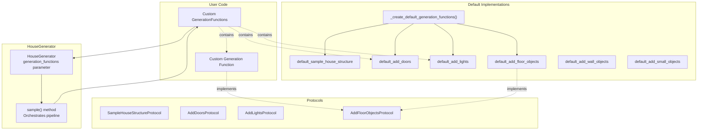
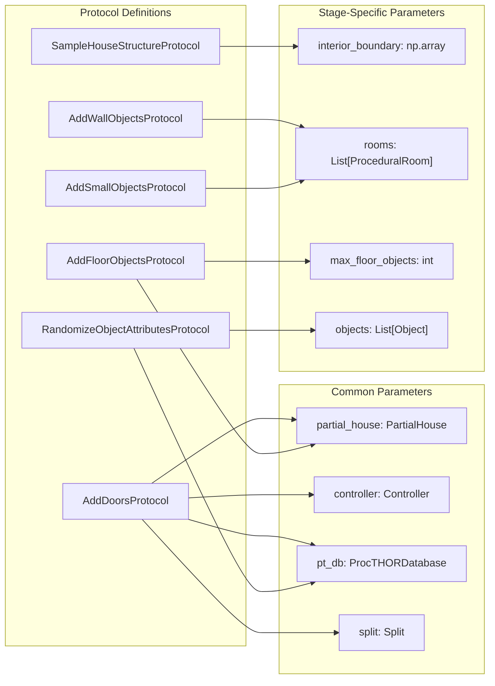
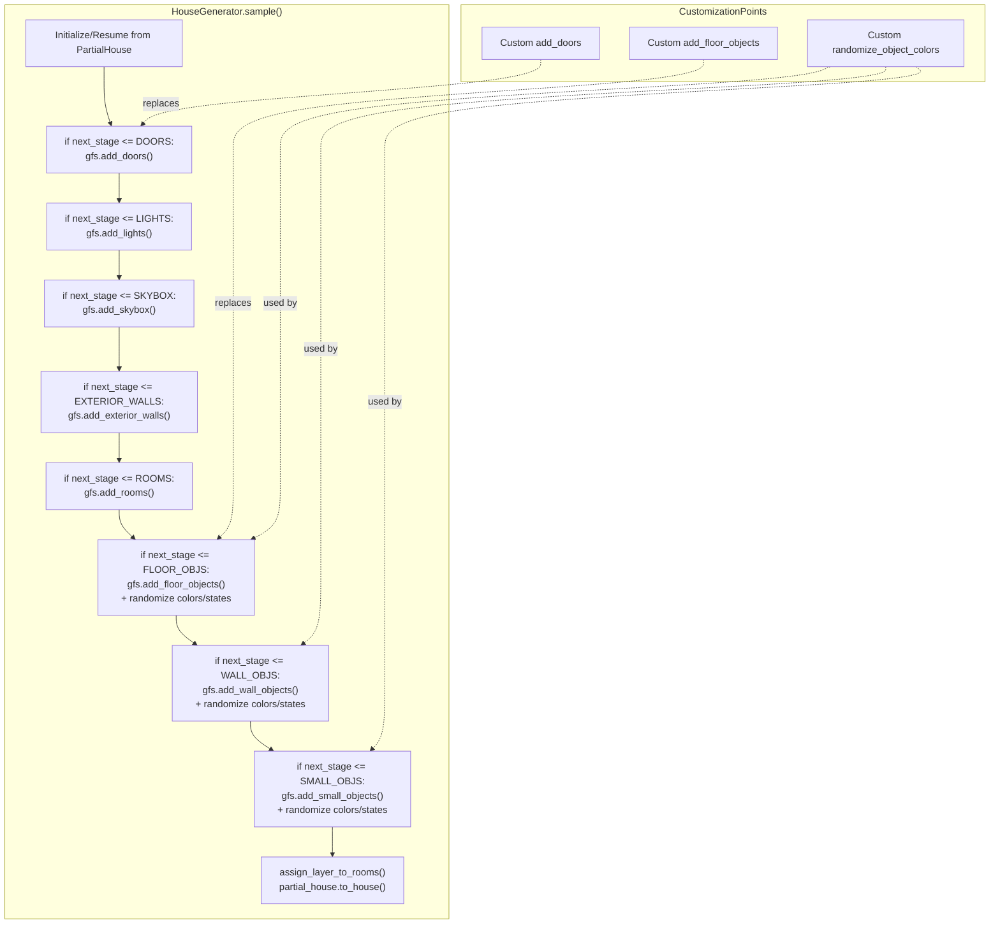

<!-- source: DeepWiki mcp.deepwiki.com · repo allenai/procthor · page 10.3 Customization · fetched 2026-10-26 -->

# Customization

<details>
<summary>Relevant source files</summary>

The following files were used as context for generating this wiki page:

- [procthor/generation/__init__.py](procthor/generation/__init__.py)

</details>


This page explains how to customize ProcTHOR's generation process by providing custom generation functions. While the default generation functions produce diverse, realistic houses, users may need to modify specific stages to meet particular research requirements, impose additional constraints, or experiment with alternative generation strategies.

For basic usage of the default generation pipeline, see [Basic Usage](#10.2). For working with the output of generation, see [Working with Generated Houses](#10.4).

---

## Customization Architecture

ProcTHOR's generation system is designed for extensibility through the `GenerationFunctions` class, which encapsulates all stage-specific generation logic. The `HouseGenerator` orchestrator calls these functions in sequence, allowing users to replace individual stages while preserving the overall pipeline structure.



**Diagram: Customization Architecture**

The key insight is that `GenerationFunctions` is a data class containing function references. Users can construct a `GenerationFunctions` instance with a mix of custom and default functions, then pass it to `HouseGenerator` via the `generation_functions` parameter.

**Sources:** [procthor/generation/__init__.py:52-95]()

---

## GenerationFunctions Structure

The `GenerationFunctions` class defines ten function slots corresponding to the major generation stages:

| Field | Type | Purpose | Default Implementation |
|-------|------|---------|----------------------|
| `sample_house_structure` | `SampleHouseStructureProtocol` | Generate floorplan and walls | `default_sample_house_structure` |
| `add_doors` | `AddDoorsProtocol` | Place doors between rooms | `default_add_doors` |
| `add_lights` | `AddLightsProtocol` | Add ceiling lights | `default_add_lights` |
| `add_skybox` | `AddSkyboxProtocol` | Select skybox asset | `default_add_skybox` |
| `add_exterior_walls` | `AddExteriorWallsProtocol` | Create exterior walls | `default_add_exterior_walls` |
| `add_rooms` | `AddRoomsProtocol` | Initialize room objects | `default_add_rooms` |
| `add_floor_objects` | `AddFloorObjectsProtocol` | Place large furniture | `default_add_floor_objects` |
| `add_wall_objects` | `AddWallObjectsProtocol` | Place windows, paintings, TVs | `default_add_wall_objects` |
| `add_small_objects` | `AddSmallObjectsProtocol` | Place small decorative objects | `default_add_small_objects` |
| `randomize_object_colors` | `RandomizeObjectAttributesProtocol` | Randomize object colors | `default_randomize_object_colors` |
| `randomize_object_states` | `RandomizeObjectAttributesProtocol` | Randomize object states (open/closed) | `default_randomize_object_states` |

Each function is called at a specific point in the generation pipeline [procthor/generation/__init__.py:198-299](). The orchestrator provides appropriate parameters to each function, including the `PartialHouse` object that accumulates state across stages.

**Sources:** [procthor/generation/__init__.py:52-80]()

---

## Protocol System

Each generation function must conform to a protocol that specifies its signature and expected behavior. Protocols are defined using Python's `typing.Protocol` mechanism and are located throughout the generation modules.



**Diagram: Protocol Parameter Patterns**

### Common Protocol Patterns

Most generation functions follow a similar signature pattern:

```python
def custom_generation_function(
    partial_house: PartialHouse,
    controller: Controller,
    pt_db: ProcTHORDatabase,
    split: Split,
    **kwargs
) -> Optional[ReturnType]:
    # Implementation
    pass
```

Key parameters:
- **`partial_house`**: The accumulating house state. Functions modify this object in-place by adding doors, objects, materials, etc.
- **`controller`**: AI2-THOR controller for querying asset metadata and validating placements
- **`pt_db`**: ProcTHORDatabase providing access to assets, materials, and placement rules
- **`split`**: Data split (`"train"`, `"val"`, or `"test"`) for consistent train/test asset separation
- **`kwargs`**: Stage-specific parameters (e.g., `floor_polygons`, `max_floor_objects`, `rooms`)

**Sources:** [procthor/generation/protocols.py]() (imported at [procthor/generation/__init__.py:34-45]())

---

## Creating Custom Generation Functions

### Example 1: Custom Floor Object Placement

This example shows how to replace the floor object placement logic to always place a specific set of objects:

```python
from procthor.generation import HouseGenerator, GenerationFunctions
from procthor.generation import default_add_doors, default_add_lights, default_add_skybox
from procthor.generation import default_add_exterior_walls, default_add_rooms
from procthor.generation import default_add_wall_objects, default_add_small_objects
from procthor.generation import default_sample_house_structure
from procthor.generation import default_randomize_object_colors, default_randomize_object_states
from procthor.databases import DEFAULT_PROCTHOR_DATABASE
from procthor.generation.objects import sample_object_or_asset_group_from_id
from ai2thor.controller import Controller

def custom_add_floor_objects(
    partial_house,
    controller: Controller,
    pt_db,
    split: str,
    max_floor_objects: int,
    **kwargs
):
    """Place only sofas in living rooms."""
    for room in partial_house.rooms:
        if room.room_type == "LivingRoom":
            # Get available sofas from database
            sofa_assets = pt_db.ASSET_DATABASE[
                pt_db.ASSET_DATABASE["assetType"] == "Sofa"
            ]
            
            # Try to place one sofa
            if len(sofa_assets) > 0:
                asset_id = sofa_assets.sample(1).iloc[0]["assetId"]
                obj = sample_object_or_asset_group_from_id(
                    asset_id=asset_id,
                    room=room,
                    controller=controller,
                    pt_db=pt_db,
                )
                if obj is not None:
                    partial_house.objects.append(obj)

# Create custom GenerationFunctions
custom_gf = GenerationFunctions(
    sample_house_structure=default_sample_house_structure,
    add_doors=default_add_doors,
    add_lights=default_add_lights,
    add_skybox=default_add_skybox,
    add_exterior_walls=default_add_exterior_walls,
    add_rooms=default_add_rooms,
    add_floor_objects=custom_add_floor_objects,  # Custom function
    add_wall_objects=default_add_wall_objects,
    add_small_objects=default_add_small_objects,
    randomize_object_colors=default_randomize_object_colors,
    randomize_object_states=default_randomize_object_states,
)

# Use custom generation functions
generator = HouseGenerator(
    split="train",
    generation_functions=custom_gf
)
house, _ = generator.sample()
```

**Sources:** [procthor/generation/__init__.py:256-267](), [procthor/generation/objects.py]()

### Example 2: Custom Material Randomization

Replace the default material randomization to use only specific material groups:

```python
def custom_randomize_materials(partial_house, pt_db, **kwargs):
    """Use only wood materials for all walls."""
    wood_materials = pt_db.MATERIAL_DATABASE[
        pt_db.MATERIAL_DATABASE["materialGroup"] == "Wood"
    ]
    
    if len(wood_materials) > 0:
        material = wood_materials.sample(1).iloc[0]
        for wall in partial_house.walls:
            wall["material"] = {
                "name": material["material"],
                "color": None,
                "unlit": False
            }
```

Note that material randomization is called within `add_doors` [procthor/generation/__init__.py:207](), so you would need to either:
1. Create a custom `add_doors` function that calls `randomize_wall_and_floor_materials` with custom logic, or
2. Modify materials in a subsequent stage (e.g., in a custom `add_exterior_walls` function)

**Sources:** [procthor/generation/materials.py](), [procthor/generation/__init__.py:207]()

### Example 3: Extending Default Behavior

Often, you want to preserve default behavior but add additional logic:

```python
from procthor.generation.small_objects import default_add_small_objects

def extended_add_small_objects(partial_house, controller, pt_db, split, rooms, **kwargs):
    """Add default small objects, then add custom decorations."""
    # Call default implementation
    default_add_small_objects(
        partial_house=partial_house,
        controller=controller,
        pt_db=pt_db,
        split=split,
        rooms=rooms,
    )
    
    # Add custom logic
    for room in rooms:
        if room.room_type == "Bedroom":
            # Add a clock to every bedroom wall
            # ... custom placement logic ...
            pass
```

This pattern allows incremental customization without reimplementing entire stages.

**Sources:** [procthor/generation/small_objects.py]()

---

## Advanced Customization Patterns

### Partial Pipeline Execution

The `HouseGenerator.sample()` method supports resuming generation from a specific stage using a `PartialHouse` object. This enables multi-step customization workflows:

```python
# Generate structure and doors
generator = HouseGenerator(split="train")
partial_house = generator.partial_house

# Sample only up to doors stage
house, stage_map = generator.sample(
    partial_house=partial_house,
    return_partial_houses=True,
    next_sampling_stage=NextSamplingStage.DOORS
)

# Inspect partial house after doors
partial_after_doors = stage_map[NextSamplingStage.LIGHTS]

# Modify the partial house
# ... custom modifications ...

# Resume generation from lights stage
house, _ = generator.sample(
    partial_house=partial_after_doors,
    next_sampling_stage=NextSamplingStage.LIGHTS
)
```

The `return_partial_houses` parameter causes `sample()` to return a dictionary mapping each `NextSamplingStage` to the `PartialHouse` state at that point [procthor/generation/__init__.py:182-196]().

**Sources:** [procthor/generation/__init__.py:121-304]()

### Custom Room Specifications

Combine custom generation functions with custom `RoomSpec` objects to control both room layout and object placement:

```python
from procthor.generation.room_specs import RoomSpec

# Define a specific room layout
custom_room_spec = RoomSpec(
    room_type_map={
        0: "LivingRoom",
        1: "Kitchen",
        2: "Bedroom"
    },
    # ... other room spec parameters
)

# Create generator with custom room spec and custom functions
generator = HouseGenerator(
    split="train",
    room_spec=custom_room_spec,
    generation_functions=custom_gf
)
```

**Sources:** [procthor/generation/room_specs.py](), [procthor/generation/__init__.py:146-154]()

### Accessing Generation Context

Custom generation functions receive the full context needed to make informed decisions:

```python
def context_aware_add_floor_objects(
    partial_house,
    controller,
    pt_db,
    split,
    max_floor_objects,
    **kwargs
):
    """Use generation context to inform placement."""
    # Access house structure
    ceiling_height = partial_house.house_structure.ceiling_height
    xz_poly_map = partial_house.house_structure.xz_poly_map
    
    # Access existing components
    existing_doors = partial_house.doors
    existing_walls = partial_house.walls
    
    # Access room information
    room_spec = partial_house.room_spec
    room_type_map = room_spec.room_type_map
    
    # Access database for asset filtering
    assets = pt_db.ASSET_DATABASE
    materials = pt_db.MATERIAL_DATABASE
    
    # Make context-aware decisions
    for room in partial_house.rooms:
        room_type = room.room_type
        # ... use context to customize placement ...
```

**Sources:** [procthor/generation/house.py](), [procthor/generation/__init__.py:198-304]()

---

## Integration with Default Pipeline



**Diagram: Custom Functions in Pipeline Execution**

The `HouseGenerator.sample()` method calls generation functions from the `GenerationFunctions` object through the `gfs` reference [procthor/generation/__init__.py:142](). Each stage is guarded by a conditional check on `partial_house.next_sampling_stage` [procthor/generation/__init__.py:199-285](), allowing resumable generation.

After object placement stages (floor, wall, small), the pipeline automatically calls `randomize_object_colors` and `randomize_object_states` on the newly added objects [procthor/generation/__init__.py:266-267](), [procthor/generation/__init__.py:282-283](), [procthor/generation/__init__.py:297-298]().

**Sources:** [procthor/generation/__init__.py:121-304]()

---

## Best Practices

### 1. Preserve Protocol Contracts

Custom generation functions must maintain the expected return types and side effects:

- Functions that modify `partial_house` should do so in-place
- Functions that return data (e.g., `add_doors` returns `door_polygons`) must return the expected type
- Functions should not advance `partial_house.next_sampling_stage` (the orchestrator handles this)

### 2. Use Database Resources

Leverage the `ProcTHORDatabase` for consistent asset and material selection:

```python
def data_driven_placement(partial_house, controller, pt_db, split, **kwargs):
    # Filter assets by room type
    assets_for_room = pt_db.ASSET_DATABASE[
        pt_db.ASSET_DATABASE["receptacleTypes"].notna()
    ]
    
    # Use placement annotations
    # ... reference pt_db.placement_annotations
```

This ensures your custom logic respects train/test splits and asset compatibility rules.

**Sources:** [procthor/databases/procthor_database.py]()

### 3. Handle Edge Cases

Default implementations include extensive edge case handling (collision resolution, retry logic, boundary checks). When creating custom functions, consider:

- What happens if no valid placement exists?
- How to handle rooms of different sizes?
- Collision detection with existing objects
- Boundary violations

### 4. Maintain Reproducibility

If you modify `partial_house.objects` or other lists, ensure your logic respects the random seed:

```python
import random

def reproducible_custom_function(partial_house, **kwargs):
    # random module is already seeded by HouseGenerator
    choice = random.choice([...])
    # Operations will be reproducible across runs with same seed
```

The `HouseGenerator` sets the random seed in `__attrs_post_init__` [procthor/generation/__init__.py:102-119](), so all random operations within generation functions will be deterministic.

**Sources:** [procthor/generation/__init__.py:113-119]()

### 5. Test with Validation

After customization, validate generated houses to ensure AI2-THOR compatibility:

```python
house, _ = generator.sample()

# Validate the house
is_valid = house.validate(controller)

if not is_valid:
    print("House failed validation")
    # Investigate and adjust custom logic
```

See [House Validation](#8.1) for details on the validation system.

**Sources:** [procthor/generation/house.py]()

---

## Example: Complete Custom Pipeline

This example demonstrates a complete customization that modifies multiple stages:

```python
from procthor.generation import (
    HouseGenerator, GenerationFunctions,
    default_sample_house_structure, default_add_doors,
    default_add_lights, default_add_skybox,
    default_add_exterior_walls, default_add_rooms,
    default_add_wall_objects, default_add_small_objects,
    default_randomize_object_colors, default_randomize_object_states
)

# Custom floor object placement: only essential furniture
def minimalist_floor_objects(partial_house, controller, pt_db, split, max_floor_objects, **kwargs):
    essential_types = ["Sofa", "Bed", "DiningTable"]
    
    for room in partial_house.rooms:
        room_type = room.room_type
        
        # Select one essential furniture type per room
        if room_type == "LivingRoom":
            target_type = "Sofa"
        elif room_type == "Bedroom":
            target_type = "Bed"
        elif room_type == "Kitchen":
            target_type = "DiningTable"
        else:
            continue
        
        # Get assets of target type
        assets = pt_db.ASSET_DATABASE[pt_db.ASSET_DATABASE["assetType"] == target_type]
        
        if len(assets) > 0:
            # Place one instance
            # ... placement logic similar to default implementation ...
            pass

# Custom object colors: monochrome palette
def monochrome_colors(objects, pt_db, **kwargs):
    """Apply only black, white, or gray colors."""
    for obj in objects:
        if "color" in obj and obj["color"] is not None:
            # Set to random grayscale
            gray_value = random.choice([0.0, 0.3, 0.5, 0.7, 1.0])
            obj["color"] = {
                "r": gray_value,
                "g": gray_value,
                "b": gray_value
            }

# Assemble custom generation functions
custom_gf = GenerationFunctions(
    sample_house_structure=default_sample_house_structure,
    add_doors=default_add_doors,
    add_lights=default_add_lights,
    add_skybox=default_add_skybox,
    add_exterior_walls=default_add_exterior_walls,
    add_rooms=default_add_rooms,
    add_floor_objects=minimalist_floor_objects,
    add_wall_objects=default_add_wall_objects,
    add_small_objects=default_add_small_objects,
    randomize_object_colors=monochrome_colors,
    randomize_object_states=default_randomize_object_states,
)

# Create generator
generator = HouseGenerator(
    split="train",
    seed=42,
    generation_functions=custom_gf
)

# Generate with custom pipeline
house, _ = generator.sample()
```

This pattern—selective replacement of generation functions—enables flexible customization while leveraging the robust default implementations for unchanged stages.

**Sources:** [procthor/generation/__init__.py:52-95]()

---

