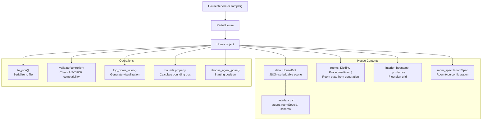
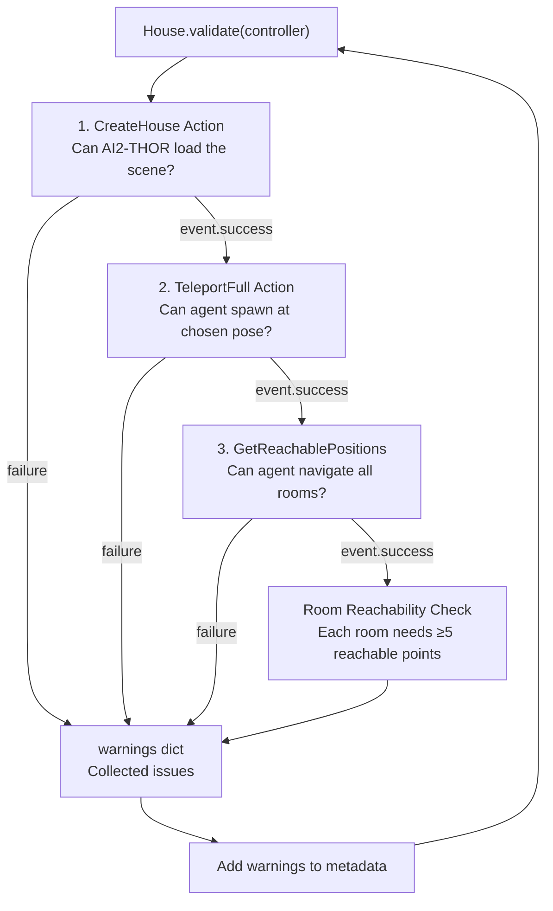
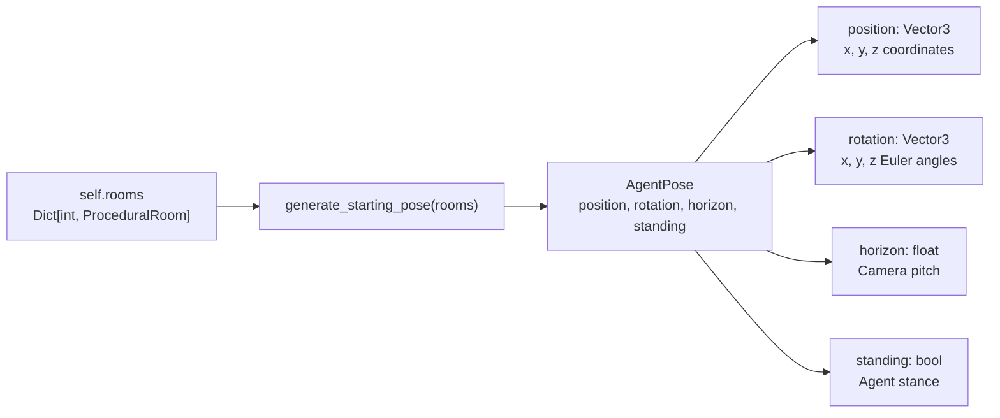
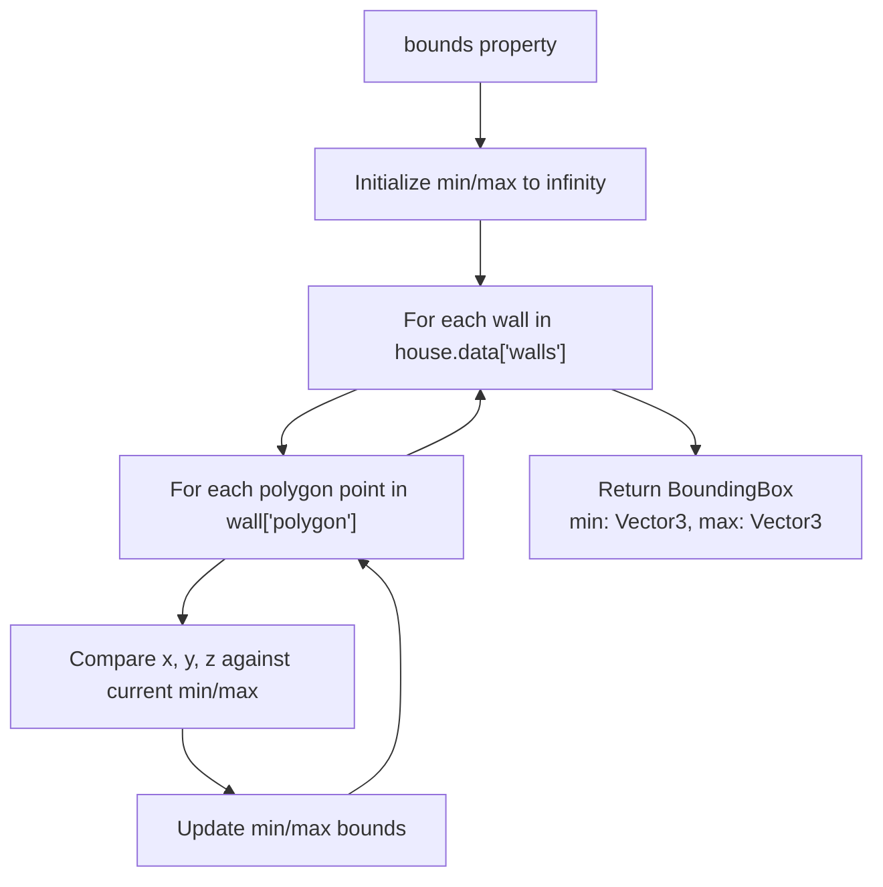
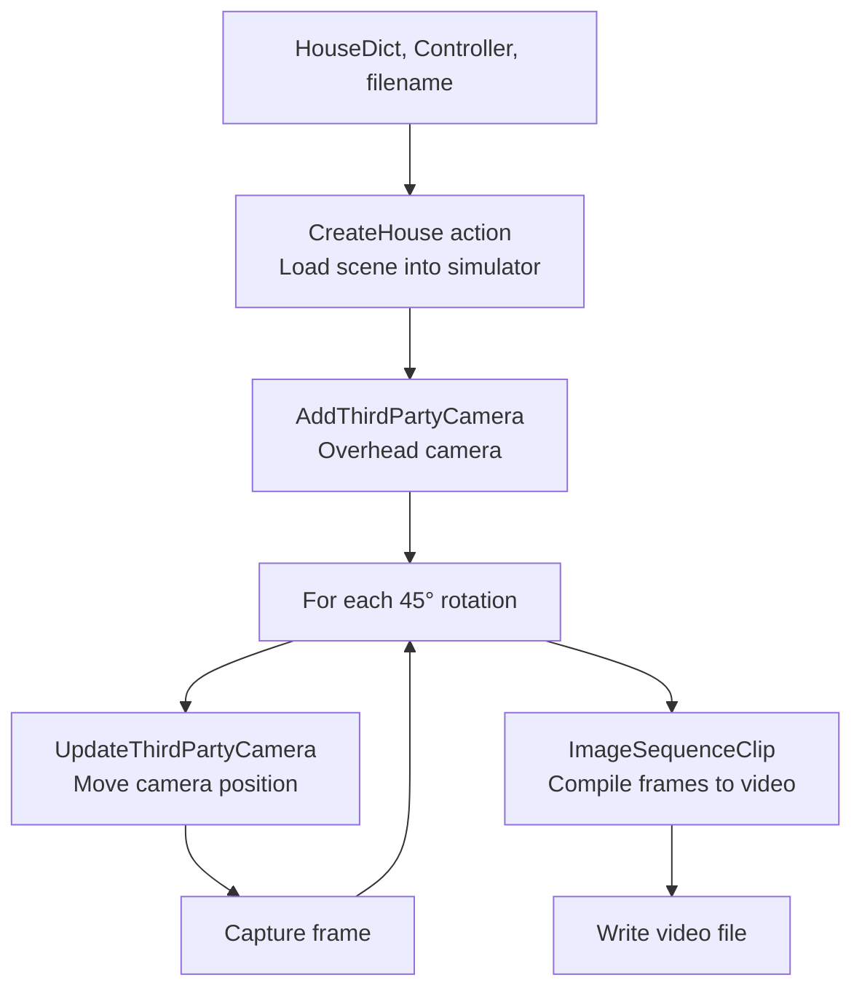
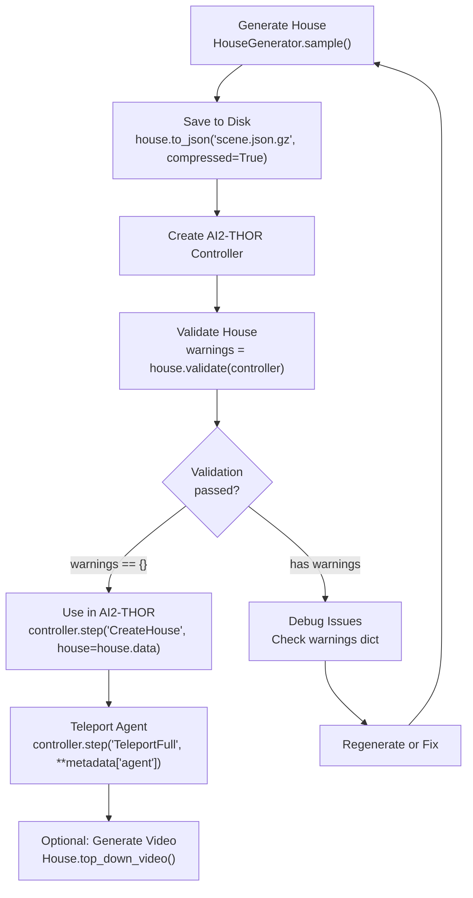

<!-- source: DeepWiki mcp.deepwiki.com · repo allenai/procthor · page 10.4 Working with Generated Houses · fetched 2026-10-26 -->

# Working with Generated Houses

<details>
<summary>Relevant source files</summary>

The following files were used as context for generating this wiki page:

- [procthor/generation/house.py](procthor/generation/house.py)

</details>


This page covers practical operations on `House` objects after generation is complete. Once `HouseGenerator.sample()` or `PartialHouse.to_house()` produces a `House` object, you can serialize it to JSON, validate it in AI2-THOR, generate visualizations, and access metadata. 

For information on generating houses, see [Basic Usage](#10.2). For the internal structure of the `House` class, see [Data Structures](#2.2). For schema versioning and migrations, see [Versioning and Schema Migration](#7).

## House Object Overview

The `House` class [procthor/generation/house.py:50-209]() is the final output of the generation pipeline. It wraps a `HouseDict` (JSON-serializable dictionary) along with auxiliary data structures used during generation.



**Sources:** [procthor/generation/house.py:50-67]()

## Serialization

### Saving to JSON

The `to_json()` method [procthor/generation/house.py:68-79]() serializes the `HouseDict` to a JSON file. It supports both compressed and uncompressed formats.

| Format | File Extension | Use Case |
|--------|---------------|----------|
| Uncompressed | `.json` | Human-readable, debugging |
| Compressed | `.json.gz` | Storage, distribution |

**Example Usage:**

```python
# Uncompressed JSON
house.to_json("my_house.json")

# Compressed JSON (gzip)
house.to_json("my_house.json.gz", compressed=True)

# Get JSON string without saving
json_string = house.to_json()
```

The serialized format contains:
- `walls`: Wall polygon definitions
- `doors`: Door placements and assets
- `windows`: Window placements
- `objects`: All placed objects with positions, rotations, materials
- `rooms`: Room types and floor polygons
- `proceduralParameters`: Lighting and collision settings
- `metadata`: Schema version, agent pose, room spec ID

**Sources:** [procthor/generation/house.py:68-79]()

### Loading Houses

To load a serialized house back into Python:

```python
import json
import gzip

# Load uncompressed JSON
with open("my_house.json", "r") as f:
    house_dict = json.load(f)

# Load compressed JSON
with gzip.open("my_house.json.gz", "rt", encoding="UTF-8") as f:
    house_dict = json.load(f)

# Use directly with AI2-THOR controller
controller.step(action="CreateHouse", house=house_dict)
```

Note that loaded `HouseDict` objects can be passed directly to AI2-THOR but do not include the auxiliary structures (`rooms`, `interior_boundary`, `room_spec`) from the original `House` object.

**Sources:** [procthor/generation/house.py:68-79]()

## Validation

### Checking AI2-THOR Compatibility

The `validate()` method [procthor/generation/house.py:102-164]() tests whether the generated house is functional in AI2-THOR. It performs three critical checks:



**Validation Logic:**

1. **Scene Creation** [procthor/generation/house.py:108-116](): Attempts `CreateHouse` action. If this fails, the house has structural issues (invalid polygons, malformed data).

2. **Agent Teleport** [procthor/generation/house.py:117-126](): Tests teleporting to the pre-selected agent pose from `metadata.agent`. Failure indicates the starting position is blocked or invalid.

3. **Room Navigation** [procthor/generation/house.py:127-158](): 
   - Gets all reachable positions in the house
   - Maps each position to its containing room
   - Verifies each room has at least 5 reachable points
   - Reports any unnavigable rooms

**Return Value:**

Returns a `Dict[str, str]` of warnings/errors. An empty dictionary indicates full validation success. Warnings are also stored in `house.data["metadata"]["warnings"]` [procthor/generation/house.py:162]().

**Example Usage:**

```python
from ai2thor.controller import Controller
from procthor.constants import PROCTHOR_INITIALIZATION

controller = Controller(**PROCTHOR_INITIALIZATION)
warnings = house.validate(controller)

if not warnings:
    print("House validated successfully!")
else:
    print(f"Validation issues: {warnings}")
    # Example output: {"RoomsNotNavigable": "Rooms [2, 5] / 8 are not navigable."}
```

**Sources:** [procthor/generation/house.py:102-164]()

## Metadata Access

### Accessing Scene Metadata

The `House` object automatically adds metadata when created [procthor/generation/house.py:57-66](). This metadata is stored in `house.data["metadata"]`:

| Field | Type | Description |
|-------|------|-------------|
| `agent` | `AgentPose` | Starting position and orientation |
| `roomSpecId` | `str` | Identifier for room configuration |
| `schema` | `str` | Schema version (e.g., "2.0.0") |
| `warnings` | `Dict[str, str]` | Validation warnings (added by `validate()`) |

**Example Usage:**

```python
# Access metadata
metadata = house.data["metadata"]

print(f"Schema version: {metadata['schema']}")
print(f"Room spec ID: {metadata['roomSpecId']}")

# Get agent starting pose
agent_pose = metadata["agent"]
print(f"Agent position: {agent_pose['position']}")
print(f"Agent rotation: {agent_pose['rotation']}")
print(f"Agent horizon: {agent_pose['horizon']}")
print(f"Agent standing: {agent_pose['standing']}")
```

**Sources:** [procthor/generation/house.py:61-66]()

### Agent Pose Selection

The `choose_agent_pose()` method [procthor/generation/house.py:98-100]() selects a valid starting position for the agent. This is automatically called during `House` construction and stored in metadata.



The `generate_starting_pose()` function [procthor/generation/agent.py]() (referenced but not shown in provided files) selects a position within a navigable room's polygon.

**Sources:** [procthor/generation/house.py:98-100]()

## Spatial Queries

### Bounding Box Calculation

The `bounds` property [procthor/generation/house.py:82-96]() computes the axis-aligned bounding box of the entire house by examining all wall polygons:



**Example Usage:**

```python
bounds = house.bounds

print(f"House dimensions:")
print(f"  X: {bounds['min']['x']:.2f} to {bounds['max']['x']:.2f}")
print(f"  Y: {bounds['min']['y']:.2f} to {bounds['max']['y']:.2f}")
print(f"  Z: {bounds['min']['z']:.2f} to {bounds['max']['z']:.2f}")

# Calculate house size
width = bounds['max']['x'] - bounds['min']['x']
height = bounds['max']['y'] - bounds['min']['y']
depth = bounds['max']['z'] - bounds['min']['z']
print(f"House size: {width:.2f}m × {height:.2f}m × {depth:.2f}m")
```

**Sources:** [procthor/generation/house.py:82-96]()

## Visualization

### Top-Down Video Generation

The `top_down_video()` static method [procthor/generation/house.py:167-208]() creates a rotating top-down view of the house. This requires an AI2-THOR controller with third-party camera support.



**Camera Configuration:**

The method positions the camera above the house center and rotates through 8 angles (0°, 45°, 90°, ..., 315°):

- **Position**: `(center_x + dist*sin(θ), max_height + 1.5, center_z + dist*cos(θ))`
- **Rotation**: `(65° pitch, θ yaw, 0° roll)`
- **Distance**: 2.75 meters from center
- **Frame Rate**: 2 FPS

**Example Usage:**

```python
from ai2thor.controller import Controller
from procthor.constants import PROCTHOR_INITIALIZATION

controller = Controller(width=1024, height=1024, **PROCTHOR_INITIALIZATION)

House.top_down_video(
    data=house.data,
    controller=controller,
    filename="my_house_video.mp4",
    width=1024,
    height=1024
)
```

**Note:** The implementation at [procthor/generation/house.py:184]() contains a `NotImplementedError` for calculating `max_meters`. This suggests the method may need updates before use.

**Sources:** [procthor/generation/house.py:167-208]()

## Integration Workflow

The following diagram shows a typical workflow for working with generated houses:



**Sources:** [procthor/generation/house.py:50-209]()

## Common Operations Summary

| Operation | Method/Property | Returns | Use Case |
|-----------|----------------|---------|----------|
| Save house | `to_json(filename)` | `str` | Persist generated house |
| Compress house | `to_json(filename, compressed=True)` | `str` | Save disk space |
| Validate house | `validate(controller)` | `Dict[str, str]` | Check AI2-THOR compatibility |
| Get bounds | `bounds` | `BoundingBox` | Calculate house dimensions |
| Get metadata | `data["metadata"]` | `dict` | Access agent pose, schema version |
| Get agent pose | `choose_agent_pose()` | `AgentPose` | Generate starting position |
| Create video | `top_down_video(data, controller, filename)` | `None` | Visualize house |

**Sources:** [procthor/generation/house.py:50-209]()