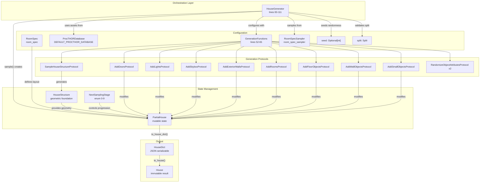
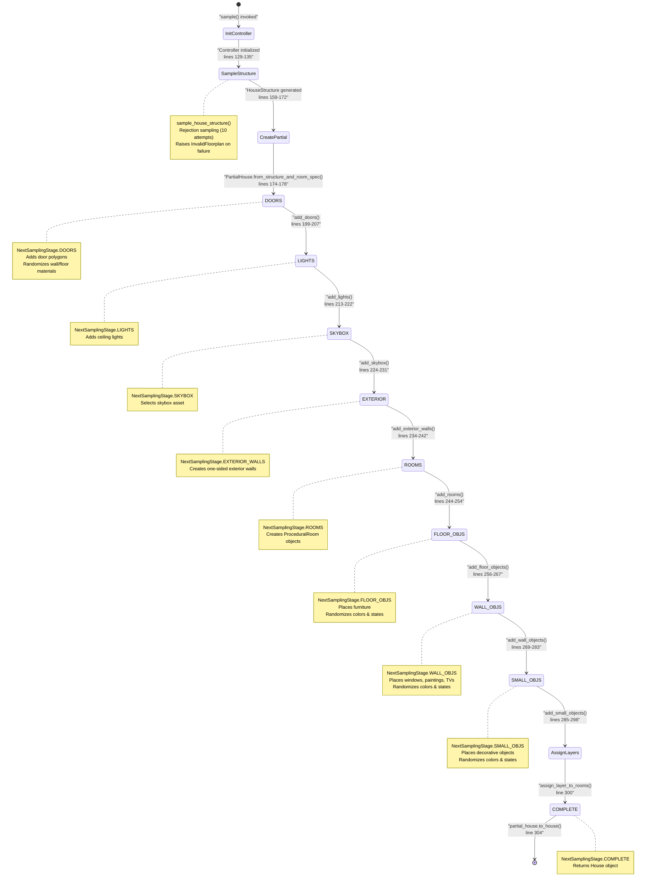
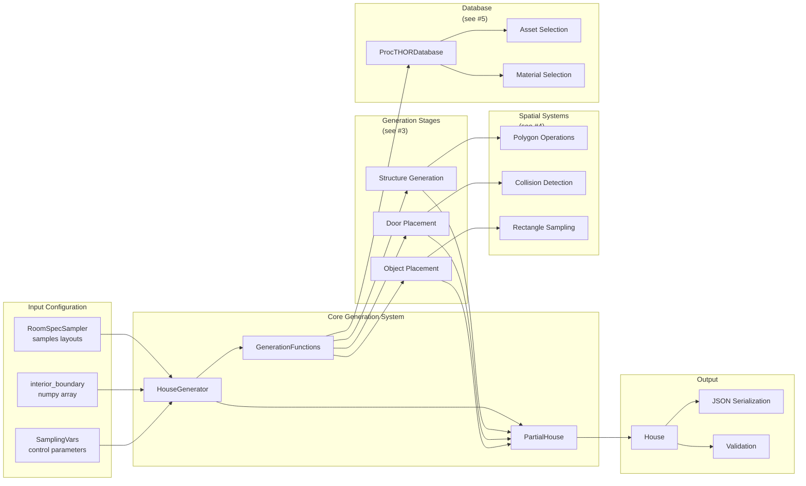

<!-- source: DeepWiki mcp.deepwiki.com · repo allenai/procthor · page 2 Core Generation System · fetched 2026-10-26 -->

# Core Generation System

<details>
<summary>Relevant source files</summary>

The following files were used as context for generating this wiki page:

- [procthor/generation/__init__.py](procthor/generation/__init__.py)
- [procthor/generation/house.py](procthor/generation/house.py)

</details>


## Purpose and Scope

The Core Generation System is the central orchestration mechanism of ProcTHOR, responsible for coordinating the procedural generation of 3D house environments. This document describes the `HouseGenerator` class, the `GenerationFunctions` protocol system, and the staged pipeline architecture that transforms input specifications into complete, validated house structures.

For details on individual generation stages (structure, doors, objects, etc.), see [Generation Stages](#3). For information about the data structures used throughout generation (`House`, `PartialHouse`, `HouseStructure`), see [Data Structures](#2.2). For details on how stages progress and state accumulates, see [Stage Progression and State Management](#2.3).

## System Overview

The core generation system implements a **pipeline architecture** where house generation proceeds through a fixed sequence of stages. Each stage adds specific components (walls, doors, objects, etc.) to an intermediate `PartialHouse` representation, which is ultimately converted to an immutable `House` object.

### Key Components

| Component | Type | Purpose |
|-----------|------|---------|
| `HouseGenerator` | Class | Orchestrates the entire generation pipeline and manages state |
| `GenerationFunctions` | Data class | Collection of protocol-conforming functions for each stage |
| `PartialHouse` | Class | Mutable intermediate representation that accumulates components |
| `NextSamplingStage` | Enum | Controls progression through the 9 generation stages |
| `House` | Class | Final immutable output containing complete house specification |
| `HouseStructure` | Class | Geometric foundation (floorplan, walls, boundaries) |

Sources: [procthor/generation/__init__.py:52-95](), [procthor/generation/house.py:40-47](), [procthor/generation/house.py:50-56](), [procthor/generation/house.py:211-228](), [procthor/generation/house.py:230-244]()

## Core Architecture

The following diagram illustrates the relationships between the main components of the core generation system:



**Figure 1: Core Generation System Architecture** - The `HouseGenerator` orchestrates generation by invoking protocol functions from `GenerationFunctions`, which progressively build up a `PartialHouse` through defined stages controlled by `NextSamplingStage`.

Sources: [procthor/generation/__init__.py:83-111](), [procthor/generation/__init__.py:52-80](), [procthor/generation/house.py:230-293]()

## HouseGenerator Class

The `HouseGenerator` class is the primary entry point for procedural house generation. It maintains configuration state, manages randomness, and coordinates the execution of all generation stages through its `sample()` method.

### Class Definition

```python
@define
class HouseGenerator:
    split: Split = field()
    seed: Optional[int] = None
    room_spec: Optional[Union[RoomSpec, str]] = None
    room_spec_sampler: Optional[RoomSpecSampler] = None
    interior_boundary: Optional[np.array] = None
    controller: Optional[Controller] = None
    partial_house: Optional[PartialHouse] = None
    pt_db: ProcTHORDatabase = DEFAULT_PROCTHOR_DATABASE
    generation_functions: GenerationFunctions = Factory(_create_default_generation_functions)
```

### Key Attributes

| Attribute | Type | Purpose |
|-----------|------|---------|
| `split` | `Split` | Train/val/test split designation (validated to be one of these three values) |
| `seed` | `Optional[int]` | Random seed for reproducibility (auto-generated if None) |
| `room_spec` | `Optional[Union[RoomSpec, str]]` | Specific room configuration or identifier |
| `room_spec_sampler` | `Optional[RoomSpecSampler]` | Sampler for generating room specifications |
| `controller` | `Optional[Controller]` | AI2-THOR controller instance (lazily initialized) |
| `pt_db` | `ProcTHORDatabase` | Asset and material database |
| `generation_functions` | `GenerationFunctions` | Customizable stage implementations |
| `partial_house` | `Optional[PartialHouse]` | Can be provided to resume from a specific stage |

### Initialization Behavior

The `__attrs_post_init__()` method performs automatic configuration:

1. **Seed Management** [lines 103-107](): If no seed is provided, generates a random seed in range [0, 2^15]
2. **Room Spec Sampler** [lines 108-109](): Defaults to `PROCTHOR10K_ROOM_SPEC_SAMPLER` if not provided
3. **String Resolution** [lines 110-111](): If `room_spec` is a string, looks it up in the sampler

Sources: [procthor/generation/__init__.py:83-111]()

## GenerationFunctions Class

The `GenerationFunctions` class is a data container that holds references to all stage implementation functions. This design enables customization—users can replace individual stage functions while keeping the rest of the pipeline intact.

### Structure

```python
@define
class GenerationFunctions:
    sample_house_structure: SampleHouseStructureProtocol
    add_doors: AddDoorsProtocol
    add_lights: AddLightsProtocol
    add_skybox: AddSkyboxProtocol
    add_exterior_walls: AddExteriorWallsProtocol
    add_rooms: AddRoomsProtocol
    add_floor_objects: AddFloorObjectsProtocol
    add_wall_objects: AddWallObjectsProtocol
    add_small_objects: AddSmallObjectsProtocol
    randomize_object_colors: RandomizeObjectAttributesProtocol
    randomize_object_states: RandomizeObjectAttributesProtocol
```

### Protocol-Based Design

Each field is typed with a protocol (defined in `procthor/generation/protocols.py`) that specifies the expected function signature. This provides:

- **Type Safety**: Static type checkers can verify that custom implementations match expected signatures
- **Modularity**: Individual stages can be replaced without modifying the orchestration logic
- **Testability**: Stages can be tested in isolation with mock implementations

### Default Implementation Factory

The `_create_default_generation_functions()` helper [lines 67-80]() instantiates a `GenerationFunctions` object with all default implementations:

| Field | Default Implementation |
|-------|------------------------|
| `sample_house_structure` | `default_sample_house_structure` |
| `add_doors` | `default_add_doors` |
| `add_lights` | `default_add_lights` |
| `add_skybox` | `default_add_skybox` |
| `add_exterior_walls` | `default_add_exterior_walls` |
| `add_rooms` | `default_add_rooms` |
| `add_floor_objects` | `default_add_floor_objects` |
| `add_wall_objects` | `default_add_wall_objects` |
| `add_small_objects` | `default_add_small_objects` |
| `randomize_object_colors` | `default_randomize_object_colors` |
| `randomize_object_states` | `default_randomize_object_states` |

Sources: [procthor/generation/__init__.py:52-80]()

## The Generation Pipeline

The `sample()` method [lines 121-304]() implements the complete generation pipeline as a sequential state machine. It can either start from scratch or resume from a provided `PartialHouse` at any stage.

### Method Signature

```python
def sample(
    self,
    partial_house: Optional[PartialHouse] = None,
    return_partial_houses: bool = False,
    sampling_vars: Optional[SamplingVars] = None,
    next_sampling_stage: Optional[NextSamplingStage] = NextSamplingStage.STRUCTURE,
) -> Tuple[House, Dict[NextSamplingStage, PartialHouse]]
```

### Parameters

| Parameter | Type | Purpose |
|-----------|------|---------|
| `partial_house` | `Optional[PartialHouse]` | Resume from this intermediate state (if None, starts from scratch) |
| `return_partial_houses` | `bool` | Whether to return snapshots of `PartialHouse` at each stage |
| `sampling_vars` | `Optional[SamplingVars]` | Control parameters (e.g., `max_floor_objects`) |
| `next_sampling_stage` | `Optional[NextSamplingStage]` | Starting stage (only used when `partial_house` is None) |

### Return Values

Returns a tuple containing:
1. **`House`**: The final, complete house specification
2. **`Dict[NextSamplingStage, PartialHouse]`**: Dictionary mapping stages to their `PartialHouse` snapshots (useful for debugging or resumption)

### Pipeline Stages

The following diagram shows the sequential progression through all stages:



**Figure 2: Generation Pipeline State Machine** - Shows the sequential flow through all 9 stages, with `NextSamplingStage` controlling progression and `advance_and_record_partial()` context manager handling state transitions.

Sources: [procthor/generation/__init__.py:121-304]()

## Stage Execution Pattern

Each stage follows a consistent execution pattern using a context manager:

```python
@contextmanager
def advance_and_record_partial(partial_house: PartialHouse):
    try:
        yield None
    finally:
        partial_house.advance_sampling_stage()
        if return_partial_houses:
            sampling_stage_to_ph[partial_house.next_sampling_stage] = copy.deepcopy(partial_house)
```

This pattern [lines 187-196]() ensures:
1. **Automatic Stage Advancement**: `advance_sampling_stage()` is always called, even if the stage function raises an exception
2. **Optional Snapshotting**: If `return_partial_houses=True`, a deep copy is saved at each stage
3. **Consistent State Management**: The `next_sampling_stage` field always reflects the current position in the pipeline

### Example Stage Execution

```python
if partial_house.next_sampling_stage <= NextSamplingStage.DOORS:
    with advance_and_record_partial(partial_house):
        door_polygons = gfs.add_doors(
            partial_house=partial_house,
            controller=self.controller,
            pt_db=self.pt_db,
            split=self.split,
        )
        randomize_wall_and_floor_materials(partial_house, pt_db=self.pt_db)
```

The conditional check allows resumption—if the `PartialHouse` has already progressed past this stage, it is skipped.

Sources: [procthor/generation/__init__.py:187-207]()

## Controller Management

The `HouseGenerator` lazily initializes an AI2-THOR `Controller` [lines 129-135]():

```python
if self.controller is None:
    # NOTE: assumes images are never used by this Controller.
    self.controller = Controller(quality="Low", **PROCTHOR_INITIALIZATION)
    if self.seed is not None:
        self.controller.step(
            action="SetRandomSeed", seed=self.seed, renderImage=False
        )
```

**Key Points**:
- **Lazy Initialization**: Controller is only created when `sample()` is first called
- **Low Quality**: Uses `quality="Low"` since the controller is only used for metadata, not rendering
- **Seed Synchronization**: Sets the controller's random seed to match the generator's seed
- **No Rendering**: All `step()` calls use `renderImage=False` for performance

The controller is reused across multiple `sample()` calls on the same `HouseGenerator` instance.

Sources: [procthor/generation/__init__.py:129-135]()

## Rejection Sampling for Structure Generation

House structure generation uses **rejection sampling** to handle invalid floorplans [lines 156-172]():

```python
room_ids = set(room_spec.room_type_map.keys())
for _ in range(10):
    try:
        house_structure = gfs.sample_house_structure(
            interior_boundary=interior_boundary,
            room_ids=room_ids,
            room_spec=room_spec,
            interior_boundary_scale=sampling_vars.interior_boundary_scale,
        )
        break
    except InvalidFloorplan:
        pass
else:
    raise Exception(
        f"Failed to generate interior boundary and floorplan"
        "for room_spec={room_spec}!"
    )
```

The system attempts structure generation up to 10 times before giving up. This accounts for:
- Invalid room configurations
- Geometric constraints that cannot be satisfied
- Randomness in the sampling process

Sources: [procthor/generation/__init__.py:156-172]()

## Seed Management

The `set_seed()` method [lines 113-119]() provides centralized seed control:

```python
def set_seed(self, seed: int) -> None:
    # TODO: Probably should not be done on a global level
    self.seed = seed
    random.seed(seed)
    np.random.seed(seed)
    if self.controller is not None:
        self.controller.step(action="SetRandomSeed", seed=seed, renderImage=False)
```

**Important**: This sets **global** random state for both Python's `random` module and NumPy. The TODO comment indicates this is recognized as a design limitation—ideally, each `HouseGenerator` would maintain isolated random state.

Sources: [procthor/generation/__init__.py:113-119]()

## Object Randomization

Object color and state randomization occurs in three batches [lines 265-298]():

1. **Floor Objects** [lines 265-267](): After `add_floor_objects()` completes
2. **Wall Objects** [lines 281-283](): After `add_wall_objects()` completes  
3. **Small Objects** [lines 297-298](): After `add_small_objects()` completes

This batched approach ensures that only newly added objects are randomized, preserving the state of previously placed objects.

Sources: [procthor/generation/__init__.py:265-298]()

## NextSamplingStage Enum

The `NextSamplingStage` enum [lines 211-228]() defines the 10 possible states of the generation pipeline:

```python
@total_ordering
class NextSamplingStage(enum.Enum):
    STRUCTURE = 0
    DOORS = 1
    LIGHTS = 2
    SKYBOX = 3
    EXTERIOR_WALLS = 4
    ROOMS = 5
    FLOOR_OBJS = 6
    WALL_OBJS = 7
    SMALL_OBJS = 8
    COMPLETE = 9
```

### Design Features

- **Total Ordering**: The `@total_ordering` decorator enables comparison operations (`<`, `<=`, `>`, `>=`)
- **Sequential Values**: Values 0-9 provide a natural ordering
- **Explicit Stages**: Each stage has a descriptive name matching its generation function

### Usage in Stage Control

Stages are checked using comparison operators:

```python
if partial_house.next_sampling_stage <= NextSamplingStage.DOORS:
    # Execute door stage
```

This allows for flexible resumption—stages that have already been completed are skipped.

Sources: [procthor/generation/house.py:211-228]()

## Integration Points

The following diagram shows how the core generation system integrates with other ProcTHOR subsystems:



**Figure 3: Core System Integration** - The `HouseGenerator` serves as the central integration point, coordinating between input configuration, generation stages, spatial systems, and the asset database to produce validated `House` outputs.

Sources: [procthor/generation/__init__.py:83-304]()

## Summary

The Core Generation System provides:

1. **Orchestration**: `HouseGenerator` manages the complete generation lifecycle
2. **Modularity**: `GenerationFunctions` enables stage-level customization via protocols
3. **State Management**: `PartialHouse` accumulates components through defined stages
4. **Resumability**: `NextSamplingStage` controls progression and enables resumption from any point
5. **Reproducibility**: Comprehensive seed management ensures deterministic generation

The system's design separates concerns cleanly—orchestration logic is isolated in `HouseGenerator`, stage implementations follow protocol contracts, and state accumulation is managed by `PartialHouse`. This architecture enables both flexibility (custom stage implementations) and reliability (consistent progression through well-defined stages).

---

