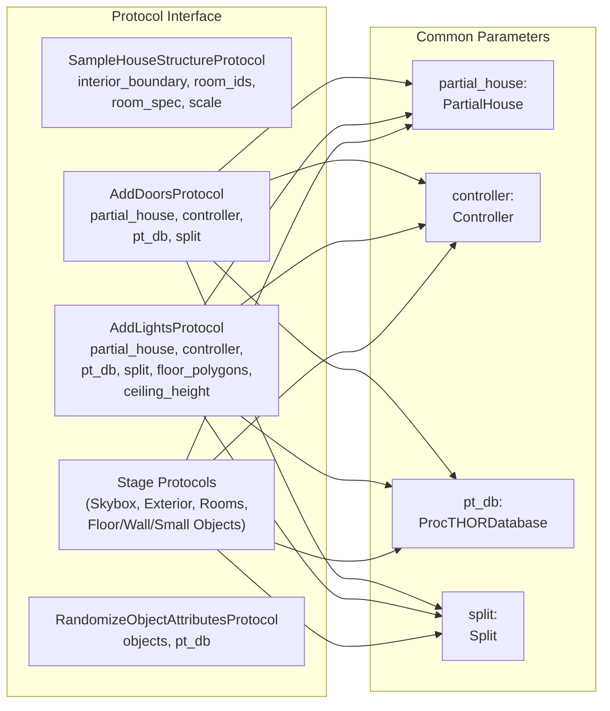
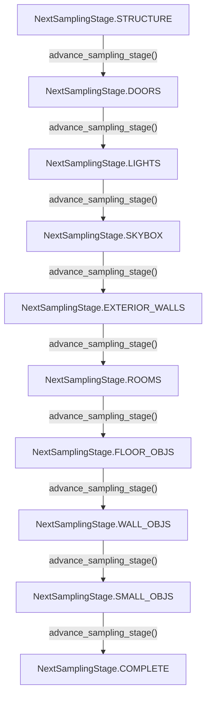
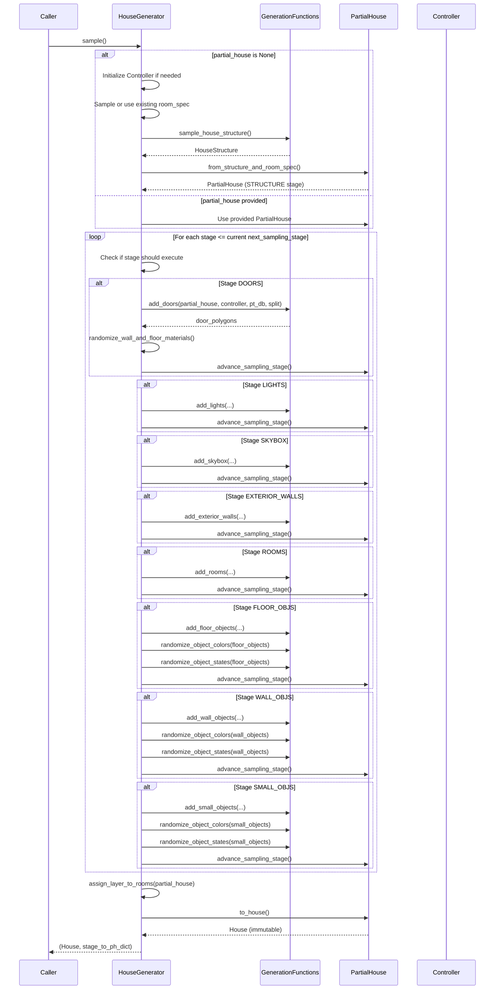
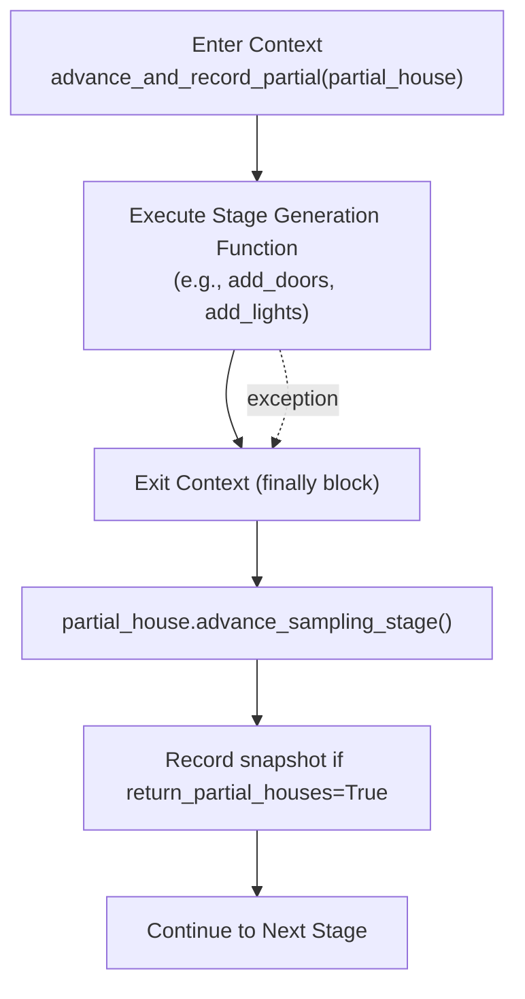
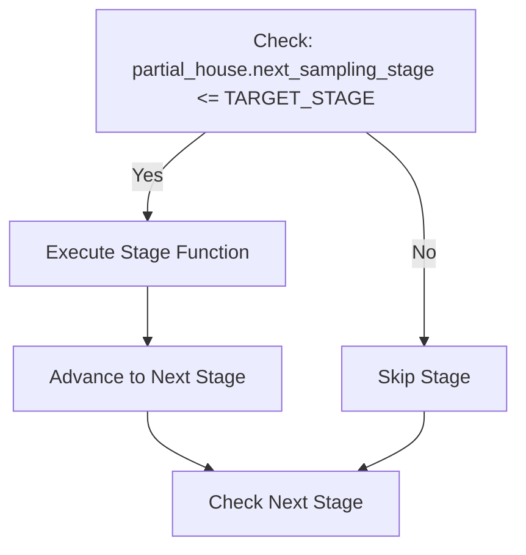

<!-- source: DeepWiki mcp.deepwiki.com · repo allenai/procthor · page 2.1 Generation Pipeline Architecture · fetched 2026-10-26 -->

# Generation Pipeline Architecture

<details>
<summary>Relevant source files</summary>

The following files were used as context for generating this wiki page:

- [procthor/generation/__init__.py](procthor/generation/__init__.py)

</details>


## Purpose and Scope

This document describes the core orchestration system that coordinates procedural house generation in ProcTHOR. It covers the `HouseGenerator` class, the `GenerationFunctions` protocol system, and the `NextSamplingStage` enum that drives sequential pipeline progression. This page focuses on the architectural framework and control flow; for details on the intermediate data structures that flow through the pipeline, see [Data Structures](#2.2). For information on specific generation algorithms at each stage, see [Generation Stages](#3).

---

## Architecture Overview

The generation pipeline is implemented as a staged orchestration system where a central `HouseGenerator` class coordinates the execution of discrete generation functions. The system progresses through nine well-defined stages, each building upon the previous stage's output. The pipeline operates on a `PartialHouse` object that accumulates components as it advances through stages, ultimately converting to an immutable `House` object.

### Core Components Relationship

```mermaid
graph TB
    HG["HouseGenerator"]
    GF["GenerationFunctions"]
    PH["PartialHouse"]
    NSS["NextSamplingStage"]
    
    subgraph "Protocols"
        SHSP["SampleHouseStructureProtocol"]
        ADP["AddDoorsProtocol"]
        ALP["AddLightsProtocol"]
        ASP["AddSkyboxProtocol"]
        AEWP["AddExteriorWallsProtocol"]
        ARP["AddRoomsProtocol"]
        AFOP["AddFloorObjectsProtocol"]
        AWOP["AddWallObjectsProtocol"]
        ASOP["AddSmallObjectsProtocol"]
        ROAP["RandomizeObjectAttributesProtocol"]
    end
    
    subgraph "Default Implementations"
        DSH["default_sample_house_structure"]
        DAD["default_add_doors"]
        DAL["default_add_lights"]
        DAS["default_add_skybox"]
        DAEW["default_add_exterior_walls"]
        DAR["default_add_rooms"]
        DAFO["default_add_floor_objects"]
        DAWO["default_add_wall_objects"]
        DASO["default_add_small_objects"]
        DROC["default_randomize_object_colors"]
        DROS["default_randomize_object_states"]
    end
    
    HG -->|"orchestrates"| GF
    HG -->|"mutates"| PH
    HG -->|"checks"| NSS
    
    GF -->|"sample_house_structure"| SHSP
    GF -->|"add_doors"| ADP
    GF -->|"add_lights"| ALP
    GF -->|"add_skybox"| ASP
    GF -->|"add_exterior_walls"| AEWP
    GF -->|"add_rooms"| ARP
    GF -->|"add_floor_objects"| AFOP
    GF -->|"add_wall_objects"| AWOP
    GF -->|"add_small_objects"| ASOP
    GF -->|"randomize_object_colors"| ROAP
    GF -->|"randomize_object_states"| ROAP
    
    SHSP -.default.-> DSH
    ADP -.default.-> DAD
    ALP -.default.-> DAL
    ASP -.default.-> DAS
    AEWP -.default.-> DAEW
    ARP -.default.-> DAR
    AFOP -.default.-> DAFO
    AWOP -.default.-> DAWO
    ASOP -.default.-> DASO
    ROAP -.default.-> DROC
    ROAP -.default.-> DROS
    
    PH -->|"tracks"| NSS
```



**Sources:** [procthor/generation/__init__.py:52-80](), [procthor/generation/__init__.py:84-95]()

---

## HouseGenerator Class

The `HouseGenerator` class serves as the main entry point for procedural house generation. It maintains generation state and orchestrates the execution of all generation stages through its `sample()` method.

### Class Attributes

| Attribute | Type | Purpose |
|-----------|------|---------|
| `split` | `Split` | Dataset split ("train", "val", or "test") for asset sampling |
| `seed` | `Optional[int]` | Random seed for reproducible generation |
| `room_spec` | `Optional[Union[RoomSpec, str]]` | Room type specification or identifier |
| `room_spec_sampler` | `Optional[RoomSpecSampler]` | Sampler for generating room specifications |
| `interior_boundary` | `Optional[np.array]` | Pre-defined interior boundary polygon |
| `controller` | `Optional[Controller]` | AI2-THOR controller for validation |
| `partial_house` | `Optional[PartialHouse]` | Resume generation from existing state |
| `pt_db` | `ProcTHORDatabase` | Asset and material database |
| `generation_functions` | `GenerationFunctions` | Customizable generation function implementations |

### Initialization and Seed Management

The `HouseGenerator` initializes with automatic seed generation if none is provided, and sets global random state for reproducibility:

```
__attrs_post_init__() → Initialize seed, room_spec_sampler
    ├─ Generate random seed if None (0 to 2^15)
    ├─ Call set_seed() to set global random state
    ├─ Initialize room_spec_sampler if None (uses PROCTHOR10K_ROOM_SPEC_SAMPLER)
    └─ Convert string room_spec to RoomSpec object if needed
```

The `set_seed()` method [procthor/generation/__init__.py:113-119]() sets random seeds globally:
- Python `random.seed()`
- NumPy `np.random.seed()`
- AI2-THOR controller's internal RNG (if controller exists)

**Sources:** [procthor/generation/__init__.py:84-119]()

---

## GenerationFunctions and Protocol System

The `GenerationFunctions` class is a simple dataclass that aggregates all generation function implementations. Each function is typed with a corresponding protocol that defines its expected signature and behavior.

### Protocol Definitions



### Protocol Categories

The protocols are organized into three categories:

1. **Structure Protocol**: `SampleHouseStructureProtocol` generates the base house structure including floor plan, walls, and geometric primitives.

2. **Component Addition Protocols**: Each stage has a dedicated protocol:
   - `AddDoorsProtocol` - Door placement between rooms
   - `AddLightsProtocol` - Ceiling light placement
   - `AddSkyboxProtocol` - Skybox selection
   - `AddExteriorWallsProtocol` - Exterior wall generation
   - `AddRoomsProtocol` - Room initialization for object placement
   - `AddFloorObjectsProtocol` - Large furniture placement
   - `AddWallObjectsProtocol` - Windows, paintings, wall-mounted items
   - `AddSmallObjectsProtocol` - Small decorative objects

3. **Randomization Protocols**: `RandomizeObjectAttributesProtocol` is reused for both:
   - `randomize_object_colors` - Color randomization for specific object types
   - `randomize_object_states` - Open/closed state randomization

### Default Implementation Factory

The `_create_default_generation_functions()` factory [procthor/generation/__init__.py:67-80]() creates a `GenerationFunctions` instance with default implementations for all protocols. Users can override individual functions by creating a custom `GenerationFunctions` instance.

**Sources:** [procthor/generation/__init__.py:34-49](), [procthor/generation/__init__.py:52-80]()

---

## NextSamplingStage Progression

The `NextSamplingStage` enum defines the sequential stages of the generation pipeline. The `PartialHouse` object tracks which stage should execute next via its `next_sampling_stage` attribute.

### Stage Enumeration



### Stage Ordering Rationale

The stages are strictly ordered to ensure dependencies are satisfied:

| Stage | Dependencies | Output |
|-------|-------------|--------|
| STRUCTURE | None | Floor plan, walls, XZ polygon map |
| DOORS | Walls, room boundaries | Door placements, room connections |
| LIGHTS | Room polygons, ceiling height | Ceiling lights |
| SKYBOX | None | Skybox asset selection |
| EXTERIOR_WALLS | Interior walls, materials | One-sided exterior walls |
| ROOMS | Floor polygons, doors | Initialized ProceduralRoom objects |
| FLOOR_OBJS | Rooms, available floor space | Large furniture and objects |
| WALL_OBJS | Exterior walls, room boundaries | Windows, paintings, wall-mounted TVs |
| SMALL_OBJS | Rooms, receptacles | Small decorative objects |
| COMPLETE | All previous stages | Ready for conversion to House |

**Sources:** [procthor/generation/house.py]() (NextSamplingStage enum)

---

## Pipeline Execution Flow

The `HouseGenerator.sample()` method [procthor/generation/__init__.py:121-304]() implements the complete pipeline execution logic. It supports both fresh generation and resumption from an existing `PartialHouse`.

### Sample Method Signature

```python
def sample(
    self,
    partial_house: Optional[PartialHouse] = None,
    return_partial_houses: bool = False,
    sampling_vars: Optional[SamplingVars] = None,
    next_sampling_stage: Optional[NextSamplingStage] = NextSamplingStage.STRUCTURE,
) -> Tuple[House, Dict[NextSamplingStage, PartialHouse]]
```

### Execution Sequence Diagram



### Structure Generation with Rejection Sampling

The initial structure generation [procthor/generation/__init__.py:156-172]() uses rejection sampling to handle invalid floor plans:

```
for retry in range(10):
    try:
        house_structure = sample_house_structure(
            interior_boundary, room_ids, room_spec, scale
        )
        break
    except InvalidFloorplan:
        continue
else:
    raise Exception("Failed to generate valid floorplan")
```

This ensures that the pipeline only proceeds with geometrically valid floor plans.

**Sources:** [procthor/generation/__init__.py:121-304]()

---

## Stage Advancement Context Manager

The `advance_and_record_partial()` context manager [procthor/generation/__init__.py:188-196]() encapsulates the pattern of executing a stage and then advancing to the next stage. It ensures that stage advancement always occurs, even if an exception is raised during generation.

### Context Manager Pattern



### Implementation Details

```python
@contextmanager
def advance_and_record_partial(partial_house: PartialHouse):
    try:
        yield None
    finally:
        partial_house.advance_sampling_stage()
        if return_partial_houses:
            sampling_stage_to_ph[partial_house.next_sampling_stage] = copy.deepcopy(partial_house)
```

This pattern is used consistently for all stages:

```python
with advance_and_record_partial(partial_house):
    gfs.add_doors(...)
    randomize_wall_and_floor_materials(...)
```

The `finally` block ensures that:
1. Stage advancement always occurs
2. A deep copy is captured if intermediate snapshots are requested
3. The `partial_house.next_sampling_stage` is updated for the next iteration

**Sources:** [procthor/generation/__init__.py:188-196](), [procthor/generation/__init__.py:199-298]()

---

## Stage Conditional Execution

Each stage checks whether it should execute based on the `PartialHouse.next_sampling_stage` value. This enables resumption from any stage by providing a `PartialHouse` with the appropriate `next_sampling_stage` set.

### Conditional Execution Logic



### Example: Door Stage Execution

```python
if partial_house.next_sampling_stage <= NextSamplingStage.DOORS:
    with advance_and_record_partial(partial_house):
        door_polygons = gfs.add_doors(
            partial_house=partial_house,
            controller=self.controller,
            pt_db=self.pt_db,
            split=self.split,
        )
        randomize_wall_and_floor_materials(partial_house, pt_db=self.pt_db)
```

This pattern means:
- If `next_sampling_stage == STRUCTURE`, door stage executes (STRUCTURE < DOORS)
- If `next_sampling_stage == DOORS`, door stage executes (DOORS <= DOORS)
- If `next_sampling_stage == LIGHTS`, door stage skips (LIGHTS > DOORS)

### Stage Ordering Assertion

For resumed generation, the code asserts [procthor/generation/__init__.py:180]():
```python
assert partial_house.next_sampling_stage.value > NextSamplingStage.STRUCTURE
```

This prevents attempting to regenerate the structure when resuming from a partial house.

**Sources:** [procthor/generation/__init__.py:199-298]()

---

## Material and Object Randomization Integration

Material and object randomization occur at specific points in the pipeline:

### Material Randomization

Wall and floor materials are randomized immediately after door placement [procthor/generation/__init__.py:207]():
```python
randomize_wall_and_floor_materials(partial_house, pt_db=self.pt_db)
```

This occurs in the DOORS stage because:
1. Walls must exist (from STRUCTURE stage)
2. Doors define room boundaries that affect material assignment
3. Materials must be set before EXTERIOR_WALLS stage (which references them)

### Object Attribute Randomization

Object colors and states are randomized immediately after objects are added, grouped by object category:

| Object Category | Randomization Point | Object Set |
|----------------|---------------------|------------|
| Floor Objects | After FLOOR_OBJS stage | `partial_house.objects[:]` (all objects so far) |
| Wall Objects | After WALL_OBJS stage | `partial_house.objects[len(floor_objects):]` (only wall objects) |
| Small Objects | After SMALL_OBJS stage | `partial_house.objects[len(floor_objects) + len(wall_objects):]` (only small objects) |

This incremental approach ensures that:
- Each object type is randomized exactly once
- Randomization occurs immediately after placement
- Object indices remain consistent throughout pipeline

**Sources:** [procthor/generation/__init__.py:207](), [procthor/generation/__init__.py:266-267](), [procthor/generation/__init__.py:282-283](), [procthor/generation/__init__.py:297-298]()

---

## Layer Assignment Post-Processing

After all generation stages complete, the `assign_layer_to_rooms()` function [procthor/generation/__init__.py:300]() performs a final post-processing step to assign collision layers to rooms. This is a separate step from the staged pipeline and executes unconditionally after all stages complete.

**Sources:** [procthor/generation/__init__.py:300]()

---

## Return Values and State Snapshots

The `sample()` method returns a tuple `(House, Dict[NextSamplingStage, PartialHouse])`:

1. **House**: The final immutable house specification, obtained by calling `partial_house.to_house()` [procthor/generation/__init__.py:304]()

2. **Stage Snapshots Dictionary**: Maps each `NextSamplingStage` to a `PartialHouse` snapshot at that stage
   - Populated only if `return_partial_houses=True`
   - Contains deep copies to prevent mutation
   - Useful for debugging, visualization, or resuming generation from intermediate points

### Snapshot Dictionary Structure

```
{
    NextSamplingStage.STRUCTURE: PartialHouse (after structure generation),
    NextSamplingStage.DOORS: PartialHouse (after door placement),
    NextSamplingStage.LIGHTS: PartialHouse (after light placement),
    ...
    NextSamplingStage.COMPLETE: PartialHouse (final state before conversion)
}
```

The final `COMPLETE` stage snapshot is always included [procthor/generation/__init__.py:302](), regardless of the `return_partial_houses` flag.

**Sources:** [procthor/generation/__init__.py:302-304]()

---

## Controller Initialization

The `HouseGenerator` lazily initializes the AI2-THOR `Controller` during the first `sample()` call if not already provided [procthor/generation/__init__.py:129-135]():

```python
if self.controller is None:
    self.controller = Controller(quality="Low", **PROCTHOR_INITIALIZATION)
    if self.seed is not None:
        self.controller.step(action="SetRandomSeed", seed=self.seed, renderImage=False)
```

Controller initialization:
- Uses "Low" quality to minimize rendering overhead
- Applies `PROCTHOR_INITIALIZATION` constants for environment configuration
- Sets the random seed for reproducible AI2-THOR internal behavior
- Disables image rendering (`renderImage=False`) since the controller is used only for metadata queries during generation

**Sources:** [procthor/generation/__init__.py:129-135]()

---

## Default Function Implementations Summary

The default implementations provide complete, tested generation logic for all stages:

| Protocol | Default Implementation | Module |
|----------|----------------------|--------|
| `SampleHouseStructureProtocol` | `default_sample_house_structure` | `generation.generation` |
| `AddDoorsProtocol` | `default_add_doors` | `generation.doors` |
| `AddLightsProtocol` | `default_add_lights` | `generation.lights` |
| `AddSkyboxProtocol` | `default_add_skybox` | `generation.skyboxes` |
| `AddExteriorWallsProtocol` | `default_add_exterior_walls` | `generation.exterior_walls` |
| `AddRoomsProtocol` | `default_add_rooms` | `generation.objects` |
| `AddFloorObjectsProtocol` | `default_add_floor_objects` | `generation.objects` |
| `AddWallObjectsProtocol` | `default_add_wall_objects` | `generation.wall_objects` |
| `AddSmallObjectsProtocol` | `default_add_small_objects` | `generation.small_objects` |
| `RandomizeObjectAttributesProtocol` (colors) | `default_randomize_object_colors` | `generation.color_objects` |
| `RandomizeObjectAttributesProtocol` (states) | `default_randomize_object_states` | `generation.object_states` |

These implementations are imported [procthor/generation/__init__.py:16-49]() and composed into the default `GenerationFunctions` instance.

**Sources:** [procthor/generation/__init__.py:16-49](), [procthor/generation/__init__.py:67-80]()

---

