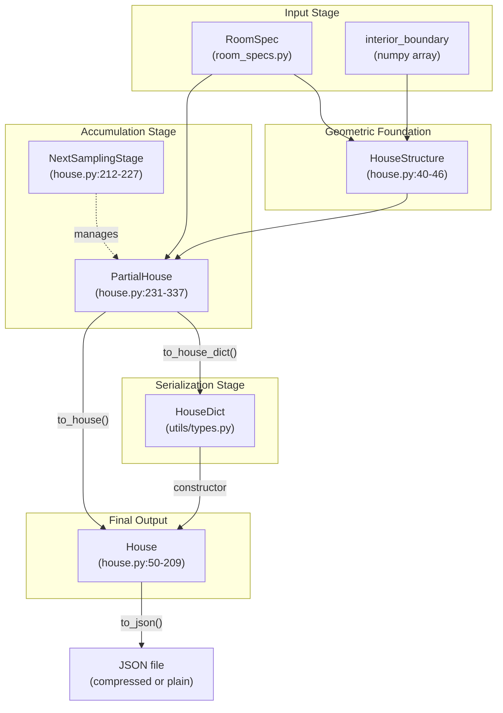
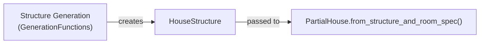
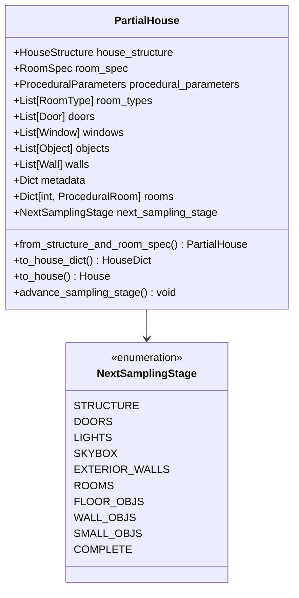
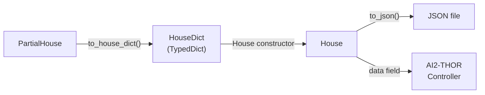
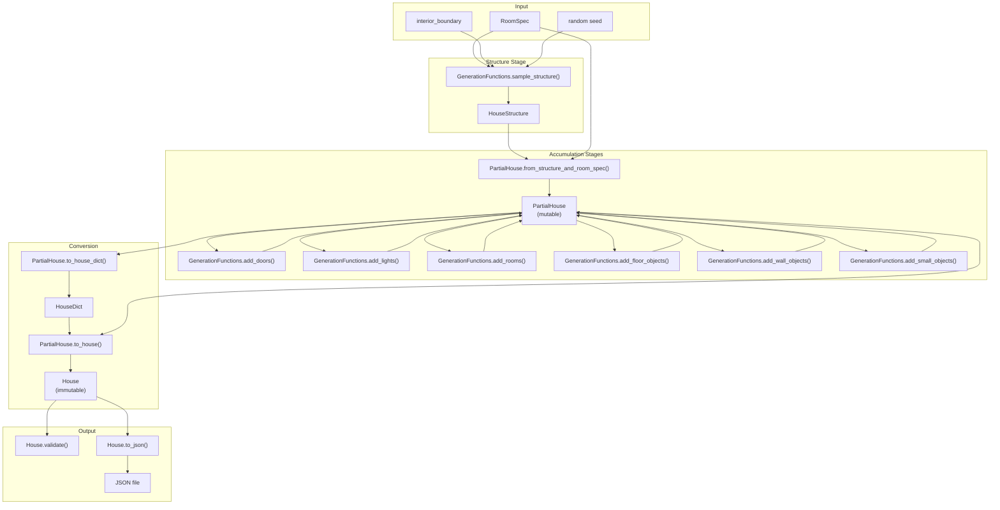

<!-- source: DeepWiki mcp.deepwiki.com · repo allenai/procthor · page 2.2 Data Structures · fetched 2026-10-26 -->

# Data Structures

<details>
<summary>Relevant source files</summary>

The following files were used as context for generating this wiki page:

- [procthor/generation/house.py](procthor/generation/house.py)

</details>


## Purpose and Scope

This document describes the core data structures used to represent houses at different stages of the generation pipeline. These structures form the backbone of ProcTHOR's generation system, transforming from geometric primitives through intermediate accumulation to final validated output.

For information about how these structures are populated through the generation pipeline, see [Stage Progression and State Management](#2.3). For details on the generation orchestration, see [Generation Pipeline Architecture](#2.1).

---

## Data Structure Hierarchy

The generation system uses four primary data structures that represent progressively more complete house representations:



**Sources:** [procthor/generation/house.py:1-337]()

---

## HouseStructure

`HouseStructure` is an immutable data class that represents the geometric foundation of a house after the structure generation stage. It contains the raw geometric data needed for all subsequent generation stages.

### Fields

| Field | Type | Description |
|-------|------|-------------|
| `interior_boundary` | `np.ndarray` | 2D boolean array marking interior vs exterior space |
| `floorplan` | `np.ndarray` | 2D integer array mapping grid cells to room IDs |
| `rowcol_walls` | `Dict[Tuple[int, int], List[Tuple[int, int]]]` | Maps grid positions to wall segments |
| `boundary_groups` | `Dict[Tuple[int, int], List[Tuple[float, float]]]` | Groups of boundary coordinates for room polygons |
| `xz_poly_map` | `Dict[int, List[Tuple[float, float]]]` | Maps room IDs to 2D polygon vertices (x, z coordinates) |
| `ceiling_height` | `float` | Height of ceilings in meters |

### Creation and Usage

`HouseStructure` is created during the STRUCTURE generation stage and passed to `PartialHouse.from_structure_and_room_spec()`. The `xz_poly_map` is particularly important as it defines the precise room boundaries used for wall generation and spatial reasoning throughout the pipeline.



**Sources:** [procthor/generation/house.py:39-46]()

---

## PartialHouse

`PartialHouse` is a mutable data class that accumulates components as the house progresses through generation stages. It serves as the working state container for the entire generation pipeline.

### Structure



**Sources:** [procthor/generation/house.py:230-337]()

### Core Fields

These fields are always present:

| Field | Type | Description |
|-------|------|-------------|
| `house_structure` | `HouseStructure` | Geometric foundation from structure generation |
| `room_spec` | `RoomSpec` | Specification defining room types and layout |
| `procedural_parameters` | `ProceduralParameters` | Runtime parameters (lights, reflections, collider thickness) |
| `next_sampling_stage` | `NextSamplingStage` | Tracks which generation stage to execute next |

### Optional Fields (Populated During Generation)

These fields are `None` initially and populated as generation progresses:

| Field | Type | When Populated | Description |
|-------|------|----------------|-------------|
| `room_types` | `Optional[List[RoomType]]` | STRUCTURE stage | Room metadata including floor polygons |
| `doors` | `Optional[List[Door]]` | DOORS stage | Door objects connecting rooms |
| `windows` | `Optional[List[Window]]` | WALL_OBJS stage | Window objects on exterior walls |
| `objects` | `Optional[List[Object]]` | FLOOR_OBJS, WALL_OBJS, SMALL_OBJS stages | All placed objects |
| `walls` | `Optional[List[Wall]]` | STRUCTURE stage | Wall geometry with polygons |
| `metadata` | `Optional[Dict[str, Any]]` | Throughout pipeline | Schema version and other metadata |
| `rooms` | `Optional[Dict[int, ProceduralRoom]]` | ROOMS stage | Room objects for spatial reasoning |

### Initialization

The `from_structure_and_room_spec()` class method creates a `PartialHouse` from a completed `HouseStructure`. This method:

1. Generates `Wall` objects from the `xz_poly_map` in the structure [procthor/generation/house.py:252-266]()
2. Creates `RoomType` entries with floor polygons [procthor/generation/house.py:271-282]()
3. Initializes `procedural_parameters` with default values [procthor/generation/house.py:285-290]()
4. Sets `next_sampling_stage` to `NextSamplingStage.DOORS` [procthor/generation/house.py:291]()

### Conversion Methods

**`to_house_dict()`** [procthor/generation/house.py:295-311]()

Converts the `PartialHouse` to a `HouseDict` (JSON-serializable dictionary) by mapping internal field names to the expected AI2-THOR format:

| Internal Field | HouseDict Key |
|---------------|---------------|
| `room_types` | `rooms` |
| `doors` | `doors` |
| `windows` | `windows` |
| `objects` | `objects` |
| `walls` | `walls` |
| `procedural_parameters` | `proceduralParameters` |
| `metadata` | `metadata` |

**`to_house()`** [procthor/generation/house.py:313-324]()

Converts the `PartialHouse` to a final immutable `House` object. This method asserts that all required fields are populated before conversion, ensuring the house is complete.

**Sources:** [procthor/generation/house.py:230-337]()

---

## HouseDict

`HouseDict` is a `TypedDict` representing the JSON-serializable structure consumed by AI2-THOR. It follows the AI2-THOR house schema exactly.

### Structure

| Key | Type | Description |
|-----|------|-------------|
| `rooms` | `List[RoomType]` | Room definitions with floor polygons |
| `walls` | `List[Wall]` | Wall geometry as 3D polygons |
| `doors` | `List[Door]` | Door objects with positions and assets |
| `windows` | `List[Window]` | Window objects on walls |
| `objects` | `List[Object]` | All placed objects with transforms |
| `proceduralParameters` | `ProceduralParameters` | Lighting and physics parameters |
| `metadata` | `Dict[str, Any]` | Schema version, agent pose, room spec ID |

### Relationship to House



**Sources:** [procthor/utils/types.py]() (referenced in [procthor/generation/house.py:21]())

---

## House

`House` is the final immutable data class representing a complete, validated house. It wraps a `HouseDict` with additional metadata and provides validation and serialization methods.

### Fields

| Field | Type | Description |
|-------|------|-------------|
| `data` | `HouseDict` | The complete house specification |
| `rooms` | `Dict[int, ProceduralRoom]` | Room objects for spatial queries |
| `interior_boundary` | `np.array` | Original interior boundary from structure generation |
| `room_spec` | `RoomSpec` | Original room specification |
| `add_metadata` | `bool` | Whether to automatically add metadata (default: True) |

### Methods

#### Metadata Generation

**`_add_metadata()`** [procthor/generation/house.py:61-66]()

Automatically populates the `metadata` field with:
- `agent`: Starting agent pose generated by `choose_agent_pose()`
- `roomSpecId`: Identifier from the room specification
- `schema`: Current schema version constant

#### Agent Pose Selection

**`choose_agent_pose()`** [procthor/generation/house.py:98-100]()

Generates a starting position for the default agent by calling `generate_starting_pose()` with the rooms dictionary.

#### Bounds Calculation

**`bounds` property** [procthor/generation/house.py:81-96]()

Computes the axis-aligned bounding box encompassing all walls in the house:

```python
BoundingBox(
    min=Vector3(x=..., y=..., z=...),
    max=Vector3(x=..., y=..., z=...)
)
```

#### Validation

**`validate(controller: Controller)`** [procthor/generation/house.py:102-164]()

Validates the house using an AI2-THOR controller:

1. Creates the house in AI2-THOR
2. Teleports to the starting agent position
3. Gets reachable positions
4. Verifies each room has at least 5 reachable positions

Returns a dictionary of warnings/errors and stores them in `data["metadata"]["warnings"]`.

#### Serialization

**`to_json(filename: Optional[str], compressed: bool)`** [procthor/generation/house.py:68-79]()

Serializes the house to JSON format. Supports:
- Plain JSON files (`.json`)
- Compressed JSON files (`.json.gz`) using gzip

**Sources:** [procthor/generation/house.py:49-209]()

---

## NextSamplingStage

`NextSamplingStage` is an ordered enumeration that defines the sequence of generation stages. It implements total ordering to allow stage comparison.

### Values

| Value | Stage | Description |
|-------|-------|-------------|
| 0 | `STRUCTURE` | Generate floor plan and walls |
| 1 | `DOORS` | Place doors between rooms |
| 2 | `LIGHTS` | Add ceiling lights |
| 3 | `SKYBOX` | Select skybox asset |
| 4 | `EXTERIOR_WALLS` | Create exterior wall geometry |
| 5 | `ROOMS` | Initialize ProceduralRoom objects |
| 6 | `FLOOR_OBJS` | Place floor objects (furniture) |
| 7 | `WALL_OBJS` | Place wall objects (windows, paintings, TVs) |
| 8 | `SMALL_OBJS` | Place small decorative objects |
| 9 | `COMPLETE` | All stages complete |

### Stage Advancement

`PartialHouse.advance_sampling_stage()` [procthor/generation/house.py:326-334]() increments the stage by finding the next enum value. The `COMPLETE` stage is terminal.

**Sources:** [procthor/generation/house.py:211-227]()

---

## Supporting Types

The data structures reference several types defined in `procthor.utils.types`:

### Geometric Types

| Type | Description |
|------|-------------|
| `Vector3` | 3D coordinate with `x`, `y`, `z` fields |
| `BoundingBox` | Axis-aligned box with `min` and `max` Vector3 |

### Scene Component Types

| Type | Description |
|------|-------------|
| `Wall` | Wall definition with `id`, `roomId`, `polygon`, `material` |
| `Door` | Door with `id`, `room0`, `room1`, `openness`, `assetId` |
| `Window` | Window with `id`, `room0`, `room1`, `wall0`, `holePolygon` |
| `Object` | Placed object with `id`, `assetId`, `position`, `rotation` |
| `RoomType` | Room metadata with `id`, `roomType`, `floorPolygon`, `children` |

### Parameters

| Type | Description |
|------|-------------|
| `ProceduralParameters` | Runtime parameters including lights, reflections, collider thickness |

**Sources:** [procthor/utils/types.py]() (imported in [procthor/generation/house.py:18-28]())

---

## State Transformation Pipeline

The complete transformation pipeline shows how data flows from initial specifications to final output:



### Key Transformation Points

1. **Structure → PartialHouse**: `PartialHouse.from_structure_and_room_spec()` creates initial walls and room types [procthor/generation/house.py:246-293]()

2. **PartialHouse → HouseDict**: `to_house_dict()` remaps field names to AI2-THOR schema [procthor/generation/house.py:295-311]()

3. **PartialHouse → House**: `to_house()` performs final validation and creates immutable output [procthor/generation/house.py:313-324]()

4. **House → JSON**: `to_json()` serializes for storage or AI2-THOR consumption [procthor/generation/house.py:68-79]()

**Sources:** [procthor/generation/house.py:1-337]()

---

