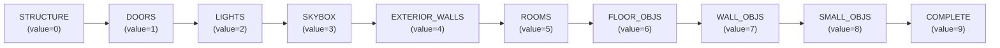
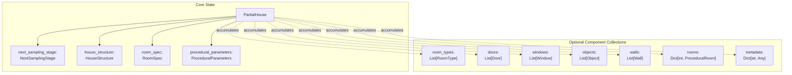
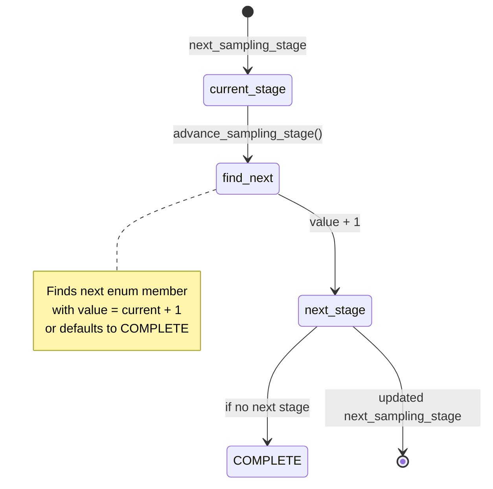
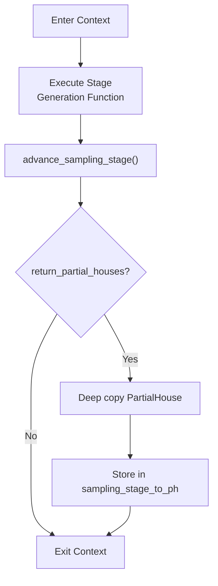
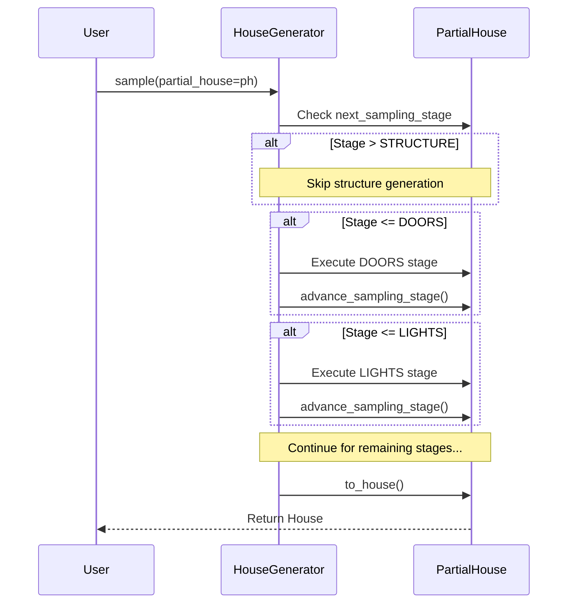
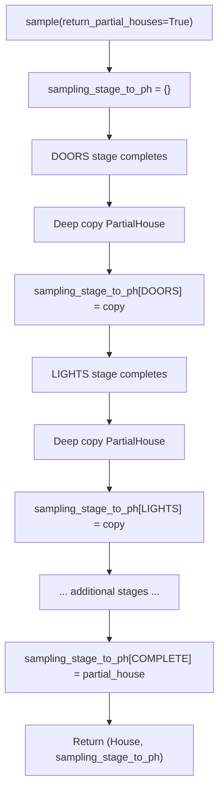
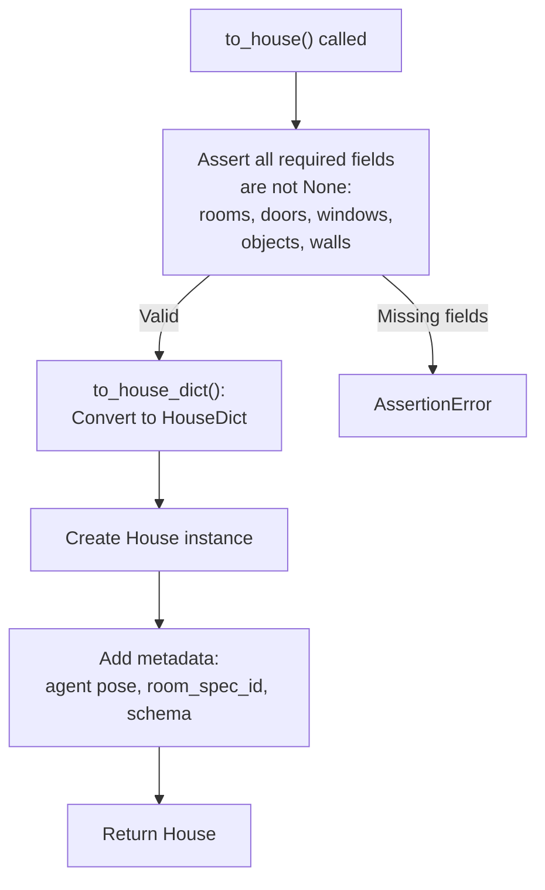
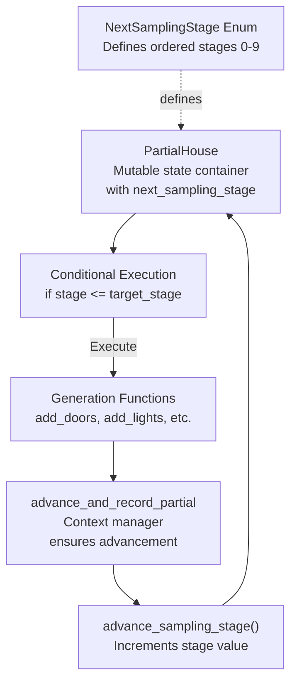

<!-- source: DeepWiki mcp.deepwiki.com · repo allenai/procthor · page 2.3 Stage Progression and State Management · fetched 2026-10-26 -->

# Stage Progression and State Management

<details>
<summary>Relevant source files</summary>

The following files were used as context for generating this wiki page:

- [procthor/generation/__init__.py](procthor/generation/__init__.py)
- [procthor/generation/house.py](procthor/generation/house.py)

</details>


## Purpose and Scope

This document explains how ProcTHOR manages the sequential progression through generation stages and accumulates intermediate state during house generation. The system uses a state machine pattern where a `PartialHouse` object advances through well-defined stages, each adding specific components to the house specification.

For details on individual generation stages (structure, doors, objects, etc.), see [Generation Stages](#3). For information on the `HouseGenerator` orchestration, see [Generation Pipeline Architecture](#2.1). For details on final `House` and `HouseDict` representations, see [Data Structures](#2.2).

---

## NextSamplingStage Enumeration

The `NextSamplingStage` enum defines the ordered sequence of generation stages. It uses Python's `@total_ordering` decorator to enable comparison operations between stages.

### Stage Definition



**Stage Ordering and Comparison**

Each stage has an integer value enabling ordered comparisons. The `__lt__` method at [procthor/generation/house.py:224-227]() allows statements like `stage <= NextSamplingStage.DOORS` to determine if a stage should execute.

| Stage | Value | Primary Responsibility |
|-------|-------|------------------------|
| `STRUCTURE` | 0 | Initial state, structure already generated |
| `DOORS` | 1 | Door placement and material randomization |
| `LIGHTS` | 2 | Ceiling light placement |
| `SKYBOX` | 3 | Skybox asset selection |
| `EXTERIOR_WALLS` | 4 | Exterior wall object creation |
| `ROOMS` | 5 | ProceduralRoom object initialization |
| `FLOOR_OBJS` | 6 | Large furniture and floor object placement |
| `WALL_OBJS` | 7 | Windows, paintings, wall-mounted TVs |
| `SMALL_OBJS` | 8 | Small decorative objects |
| `COMPLETE` | 9 | All generation finished, ready for conversion to House |

**Sources:** [procthor/generation/house.py:211-228]()

---

## PartialHouse State Container

The `PartialHouse` class serves as the mutable state container that accumulates components as generation progresses through stages. It holds both completed components and the current stage position.

### State Fields by Category



### Initialization from Structure

The `PartialHouse.from_structure_and_room_spec()` class method at [procthor/generation/house.py:246-293]() creates an initial state with:

- **Walls**: Generated from `xz_poly_map` boundaries
- **Room Types**: One `RoomType` per room with floor polygon
- **Objects**: Empty list
- **Procedural Parameters**: Default values for colliders and receptacles
- **Next Sampling Stage**: Set to `NextSamplingStage.DOORS` (skipping STRUCTURE)
- **Metadata**: Schema version

**Sources:** [procthor/generation/house.py:230-338]()

---

## Stage Advancement Mechanism

Stage progression is controlled by the `advance_sampling_stage()` method and enforced by conditional execution guards in `HouseGenerator.sample()`.

### Advancement Logic



The `advance_sampling_stage()` method at [procthor/generation/house.py:326-334]() uses a generator expression to find the next `NextSamplingStage` enum member:

```python
self.next_sampling_stage = next(
    (nss for nss in NextSamplingStage 
     if nss.value == self.next_sampling_stage.value + 1),
    self.next_sampling_stage.COMPLETE,
)
```

### Context Manager Pattern

The `advance_and_record_partial()` context manager at [procthor/generation/__init__.py:187-196]() ensures stages always advance and can optionally record intermediate states:



This pattern guarantees that:
1. Stage advancement always occurs after generation functions execute
2. Partial house snapshots are captured if requested
3. Stage progression is exception-safe (finally block)

**Sources:** [procthor/generation/__init__.py:187-196](), [procthor/generation/house.py:326-334]()

---

## Conditional Stage Execution

The `HouseGenerator.sample()` method at [procthor/generation/__init__.py:121-304]() uses comparison operators to conditionally execute stages based on `next_sampling_stage`.

### Execution Flow with Stage Guards

```mermaid
graph TD
    START["sample() called"]
    CHECK_PH{"partial_house<br/>provided?"}
    CREATE_PH["Create new PartialHouse<br/>from structure"]
    USE_PH["Use provided<br/>PartialHouse"]
    
    CHECK_DOORS{"next_sampling_stage<br/><= DOORS?"}
    EXEC_DOORS["Execute add_doors()<br/>randomize materials"]
    ADV_DOORS["advance_sampling_stage()"]
    
    CHECK_LIGHTS{"next_sampling_stage<br/><= LIGHTS?"}
    EXEC_LIGHTS["Execute add_lights()"]
    ADV_LIGHTS["advance_sampling_stage()"]
    
    CHECK_SKYBOX{"next_sampling_stage<br/><= SKYBOX?"}
    EXEC_SKYBOX["Execute add_skybox()"]
    ADV_SKYBOX["advance_sampling_stage()"]
    
    CHECK_EXT{"next_sampling_stage<br/><= EXTERIOR_WALLS?"}
    EXEC_EXT["Execute add_exterior_walls()"]
    ADV_EXT["advance_sampling_stage()"]
    
    CHECK_ROOMS{"next_sampling_stage<br/><= ROOMS?"}
    EXEC_ROOMS["Execute add_rooms()"]
    ADV_ROOMS["advance_sampling_stage()"]
    
    MORE["... FLOOR_OBJS,<br/>WALL_OBJS,<br/>SMALL_OBJS ..."]
    
    ASSIGN_LAYERS["assign_layer_to_rooms()"]
    TO_HOUSE["partial_house.to_house()"]
    RETURN["Return House<br/>and stage snapshots"]
    
    START --> CHECK_PH
    CHECK_PH -->|No| CREATE_PH
    CHECK_PH -->|Yes| USE_PH
    CREATE_PH --> CHECK_DOORS
    USE_PH --> CHECK_DOORS
    
    CHECK_DOORS -->|Yes| EXEC_DOORS
    CHECK_DOORS -->|No| CHECK_LIGHTS
    EXEC_DOORS --> ADV_DOORS
    ADV_DOORS --> CHECK_LIGHTS
    
    CHECK_LIGHTS -->|Yes| EXEC_LIGHTS
    CHECK_LIGHTS -->|No| CHECK_SKYBOX
    EXEC_LIGHTS --> ADV_LIGHTS
    ADV_LIGHTS --> CHECK_SKYBOX
    
    CHECK_SKYBOX -->|Yes| EXEC_SKYBOX
    CHECK_SKYBOX -->|No| CHECK_EXT
    EXEC_SKYBOX --> ADV_SKYBOX
    ADV_SKYBOX --> CHECK_EXT
    
    CHECK_EXT -->|Yes| EXEC_EXT
    CHECK_EXT -->|No| CHECK_ROOMS
    EXEC_EXT --> ADV_EXT
    ADV_EXT --> CHECK_ROOMS
    
    CHECK_ROOMS -->|Yes| EXEC_ROOMS
    CHECK_ROOMS -->|No| MORE
    EXEC_ROOMS --> ADV_ROOMS
    ADV_ROOMS --> MORE
    
    MORE --> ASSIGN_LAYERS
    ASSIGN_LAYERS --> TO_HOUSE
    TO_HOUSE --> RETURN
```



Each stage execution follows this pattern at [procthor/generation/__init__.py:199-207]():

```python
if partial_house.next_sampling_stage <= NextSamplingStage.DOORS:
    with advance_and_record_partial(partial_house):
        door_polygons = gfs.add_doors(
            partial_house=partial_house,
            controller=self.controller,
            pt_db=self.pt_db,
            split=self.split,
        )
        randomize_wall_and_floor_materials(partial_house, pt_db=self.pt_db)
```

**Sources:** [procthor/generation/__init__.py:198-304]()

---

## State Accumulation Patterns

Different stages populate different fields of `PartialHouse`. The accumulation follows a pattern where early stages provide infrastructure and later stages add objects.

### Component Addition by Stage

| Stage | Fields Modified | Description |
|-------|----------------|-------------|
| `DOORS` | `doors` list, wall materials | Adds `Door` objects, modifies wall/floor materials |
| `LIGHTS` | `procedural_parameters.lights` | Adds light specifications to parameters |
| `SKYBOX` | `metadata` | Adds skybox asset reference |
| `EXTERIOR_WALLS` | `objects` list | Adds exterior wall planes as objects |
| `ROOMS` | `rooms` dict | Creates `ProceduralRoom` instances with spatial data |
| `FLOOR_OBJS` | `objects` list | Appends furniture and large floor objects |
| `WALL_OBJS` | `objects` list, `windows` list | Appends wall-mounted objects and windows |
| `SMALL_OBJS` | `objects` list | Appends small decorative objects |

### Object List Growth Pattern

```mermaid
graph LR
    subgraph "Stage FLOOR_OBJS"
        FL_START["objects = []"]
        FL_ADD["add_floor_objects()"]
        FL_END["objects = [f1, f2, ..., fn]"]
    end
    
    subgraph "Stage WALL_OBJS"
        WL_START["objects = [f1, f2, ..., fn]"]
        WL_ADD["add_wall_objects()"]
        WL_END["objects = [f1, ..., fn, w1, ..., wm]"]
    end
    
    subgraph "Stage SMALL_OBJS"
        SM_START["objects = [f1, ..., fn, w1, ..., wm]"]
        SM_ADD["add_small_objects()"]
        SM_END["objects = [f1, ..., fn, w1, ..., wm, s1, ..., sk]"]
    end
    
    FL_START --> FL_ADD --> FL_END
    FL_END --> WL_START
    WL_START --> WL_ADD --> WL_END
    WL_END --> SM_START
    SM_START --> SM_ADD --> SM_END
```



The `HouseGenerator.sample()` method tracks object list slices at [procthor/generation/__init__.py:265-298]():

- **Floor objects**: `objects[:]` captured after FLOOR_OBJS stage
- **Wall objects**: `objects[len(floor_objects):]` captured after WALL_OBJS stage  
- **Small objects**: `objects[len(floor_objects) + len(wall_objects):]` captured after SMALL_OBJS stage

This enables stage-specific randomization of colors and states for each object category.

**Sources:** [procthor/generation/__init__.py:256-298]()

---

## Resumable Generation

The stage progression system supports resuming generation from any intermediate stage by providing a pre-populated `PartialHouse`.

### Resume Mechanism



**Resume Requirements**

At [procthor/generation/__init__.py:179-180](), the system validates resume state:

```python
else:
    assert partial_house.next_sampling_stage.value > NextSamplingStage.STRUCTURE
```

This ensures:
- Structure must already be generated
- All prerequisite fields must be populated
- Stage value indicates which stages to execute

**Use Cases for Resumable Generation:**

1. **Debugging**: Generate up to a specific stage, inspect state, modify, and continue
2. **A/B Testing**: Generate multiple variants from the same base structure
3. **Incremental Refinement**: Add objects progressively without regenerating structure
4. **Partial Regeneration**: Regenerate only later stages (e.g., re-place objects with same floor plan)

**Sources:** [procthor/generation/__init__.py:143-180]()

---

## Recording Intermediate States

The `return_partial_houses` parameter enables capturing snapshots of `PartialHouse` at each stage for inspection or debugging.

### Snapshot Collection

When `return_partial_houses=True` is passed to `sample()`, the system returns a dictionary mapping stages to deep copies of the partial house:



The implementation at [procthor/generation/__init__.py:182-196]() uses deep copy to ensure snapshots are independent:

```python
if return_partial_houses:
    sampling_stage_to_ph[partial_house.next_sampling_stage] = copy.deepcopy(
        partial_house
    )
```

The final snapshot at stage `COMPLETE` stores the original `PartialHouse` reference (not a copy) at [procthor/generation/__init__.py:302]().

**Sources:** [procthor/generation/__init__.py:182-196](), [procthor/generation/__init__.py:302]()

---

## Conversion to Final House

Once all stages complete, the `PartialHouse.to_house()` method at [procthor/generation/house.py:313-324]() converts the mutable state to an immutable `House` object.

### Conversion Requirements and Process



**Field Validation**

The assertion at [procthor/generation/house.py:314-317]() ensures completeness:

```python
assert all(
    getattr(self, k) is not None
    for k in ["rooms", "doors", "windows", "objects", "walls"]
)
```

**HouseDict Serialization**

The `to_house_dict()` method at [procthor/generation/house.py:295-311]() maps internal field names to API-compatible names:

| Internal Field | HouseDict Key |
|----------------|---------------|
| `room_types` | `rooms` |
| `doors` | `doors` |
| `windows` | `windows` |
| `objects` | `objects` |
| `walls` | `walls` |
| `procedural_parameters` | `proceduralParameters` |
| `metadata` | `metadata` |

**Sources:** [procthor/generation/house.py:295-324]()

---

## Summary: Stage Progression Flow

The complete stage progression system combines enumeration, state container, advancement logic, and conditional execution:



**Key Properties:**

1. **Strict Ordering**: Stages must execute in sequence due to dependencies
2. **Incremental State**: Each stage adds to `PartialHouse` without modifying previous components
3. **Resumability**: Can start from any stage with appropriate pre-populated state
4. **Observability**: Can capture snapshots at each stage for debugging
5. **Type Safety**: Enum-based stages prevent invalid progressions
6. **Exception Safety**: Finally blocks ensure stage advancement occurs

**Sources:** [procthor/generation/__init__.py:121-304](), [procthor/generation/house.py:211-338]()

---

