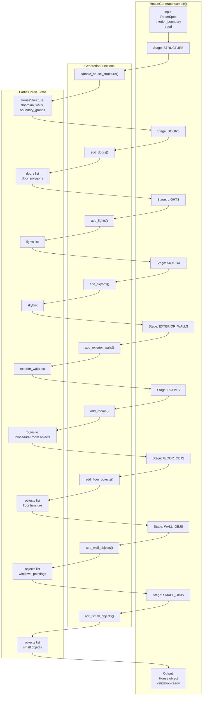
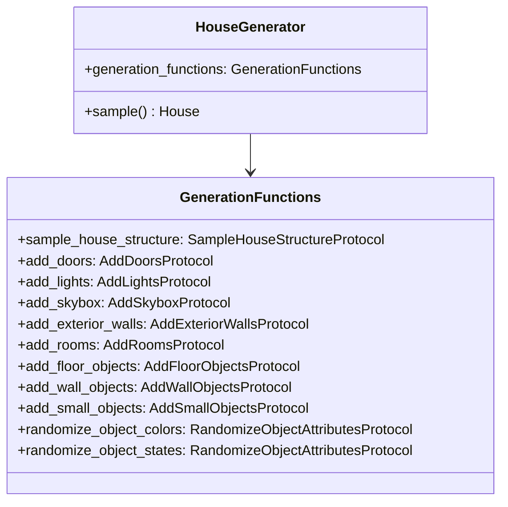
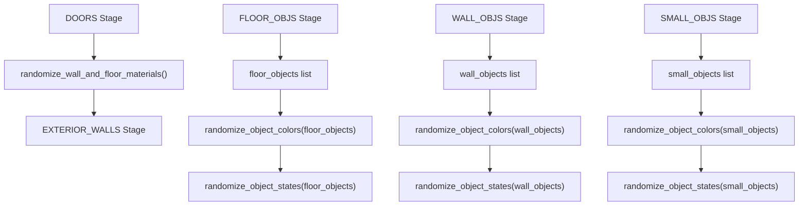
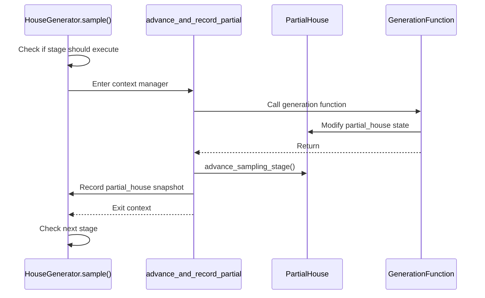

<!-- source: DeepWiki mcp.deepwiki.com · repo allenai/procthor · page 3 Generation Stages · fetched 2026-10-26 -->

# Generation Stages

Relevant source files

The following files were used as context for generating this wiki page:

- [procthor/generation/__init__.py](procthor/generation/__init__.py)
- [procthor/generation/generation.py](procthor/generation/generation.py)

## Purpose and Scope

This document provides an overview of the sequential generation stages that transform a `RoomSpec` into a complete `House` object. Each stage builds upon the previous, progressively adding geometric structure, objects, and visual details to the procedurally generated environment.

For implementation details of the orchestration system that controls stage progression, see [Core Generation System](#2). For detailed documentation of individual stages, see the child pages [3.1](#3.1) through [3.8](#3.8). For spatial reasoning systems used across stages, see [Spatial Reasoning Systems](#4).

**Sources:** [procthor/generation/__init__.py:1-305]()

## Staged Generation Architecture

ProcTHOR uses a strictly sequential pipeline where each stage produces specific outputs that subsequent stages depend on. The generation process is controlled by the `HouseGenerator` class, which orchestrates a series of generation functions while maintaining intermediate state in a `PartialHouse` object.

The staged approach provides several benefits:
- **Resumability**: Generation can be paused and resumed at any stage
- **Debugging**: Intermediate outputs can be inspected after each stage
- **Customization**: Individual stage functions can be replaced without affecting others
- **Determinism**: The same seed produces identical results at each stage

**Sources:** [procthor/generation/__init__.py:84-304]()

## Stage Progression Enumeration

The `NextSamplingStage` enumeration defines the complete sequence of generation stages. The `PartialHouse` object tracks which stage should execute next via the `next_sampling_stage` attribute, advancing through the pipeline using the `advance_sampling_stage()` method.

```mermaid
graph LR
    STRUCTURE["NextSamplingStage.STRUCTURE"]
    DOORS["NextSamplingStage.DOORS"]
    LIGHTS["NextSamplingStage.LIGHTS"]
    SKYBOX["NextSamplingStage.SKYBOX"]
    EXTERIOR["NextSamplingStage.EXTERIOR_WALLS"]
    ROOMS["NextSamplingStage.ROOMS"]
    FLOOR["NextSamplingStage.FLOOR_OBJS"]
    WALL["NextSamplingStage.WALL_OBJS"]
    SMALL["NextSamplingStage.SMALL_OBJS"]
    COMPLETE["NextSamplingStage.COMPLETE"]
    
    STRUCTURE --> DOORS
    DOORS --> LIGHTS
    LIGHTS --> SKYBOX
    SKYBOX --> EXTERIOR
    EXTERIOR --> ROOMS
    ROOMS --> FLOOR
    FLOOR --> WALL
    WALL --> SMALL
    SMALL --> COMPLETE
```

**Diagram: NextSamplingStage Sequential Progression**

The enumeration uses integer values to enable comparison operations (e.g., `next_sampling_stage <= NextSamplingStage.DOORS`), allowing the generator to conditionally execute stages when resuming from a partial house.

**Sources:** [procthor/generation/house.py](), [procthor/generation/__init__.py:199-299]()

## Generation Pipeline Overview

The following diagram maps each stage to its implementation function and primary outputs:

**Diagram: Stage-to-Function-to-State Mapping**

**Sources:** [procthor/generation/__init__.py:121-304]()

## Stage Outputs and Dependencies

The following table summarizes what each stage produces and what subsequent stages require:

| Stage | Implementation Function | Primary Outputs | Key Dependencies |
|-------|------------------------|-----------------|------------------|
| **STRUCTURE** | `default_sample_house_structure()` | `HouseStructure` (floorplan, walls, boundary_groups, xz_poly_map, ceiling_height) | RoomSpec, interior_boundary |
| **DOORS** | `default_add_doors()` | Door objects, door_polygons | Wall positions, room connections |
| **LIGHTS** | `default_add_lights()` | Ceiling lights | Floor polygons, ceiling_height |
| **SKYBOX** | `default_add_skybox()` | Skybox asset | None |
| **EXTERIOR_WALLS** | `default_add_exterior_walls()` | Exterior wall objects | boundary_groups, wall materials |
| **ROOMS** | `default_add_rooms()` | ProceduralRoom objects | Floor polygons, door_polygons, room_type_map |
| **FLOOR_OBJS** | `default_add_floor_objects()` | Furniture and large floor objects | ProceduralRoom polygons, ASSET_DATABASE |
| **WALL_OBJS** | `default_add_wall_objects()` | Windows, paintings, wall-mounted TVs | Room boundaries, ceiling_height, exterior walls |
| **SMALL_OBJS** | `default_add_small_objects()` | Small decorative objects | Receptacle objects from previous stages |

**Sources:** [procthor/generation/__init__.py:159-304](), [procthor/generation/generation.py:185-222]()

## GenerationFunctions Class

The `GenerationFunctions` dataclass holds references to all stage implementation functions, enabling customization of the generation pipeline. Each function follows a protocol interface defined in `procthor/generation/protocols.py`.

**Diagram: GenerationFunctions Structure**

Default implementations are created by `_create_default_generation_functions()` which returns a `GenerationFunctions` instance with the standard generation pipeline. Users can provide custom implementations by passing a modified `GenerationFunctions` object to the `HouseGenerator` constructor.

**Sources:** [procthor/generation/__init__.py:52-80]()

## Structure Generation Stage

The structure generation stage establishes the geometric foundation for the entire house. This stage is unique because it executes before a `PartialHouse` exists, producing a `HouseStructure` object that is then used to initialize the `PartialHouse`.

**Key Operations:**
1. Sample or use provided `interior_boundary` (2D numpy array)
2. Generate floorplan using `generate_floorplan()` with room placement algorithm
3. Find walls between rooms using `find_walls()` 
4. Consolidate adjacent wall segments using `consolidate_walls()`
5. Scale boundary groups by `interior_boundary_scale` factor
6. Create XZ polygon map using `get_xz_poly_map()` for each room
7. Sample ceiling height

The output `HouseStructure` contains:
- `interior_boundary`: Original or sampled boundary array
- `floorplan`: 2D array with room IDs
- `rowcol_walls`: Wall segments in row/col coordinates
- `boundary_groups`: Consolidated walls grouped by adjacent room pairs
- `xz_poly_map`: Ordered polygon vertices for each room in XZ plane
- `ceiling_height`: Sampled vertical dimension

**Sources:** [procthor/generation/generation.py:185-222](), [procthor/generation/__init__.py:159-177]()

## Material and Object Randomization

Unlike other stages that execute once in sequence, material and object randomization occurs at multiple points in the pipeline:

**Material Randomization:**
- Executes during the DOORS stage via `randomize_wall_and_floor_materials()`
- Applies before exterior walls are added
- Controls wall texture/color uniformity based on probability constants

**Object Attribute Randomization:**
- Executes after FLOOR_OBJS, WALL_OBJS, and SMALL_OBJS stages
- Two separate operations:
  - `randomize_object_colors()`: Sets colors for vases, bottles, statues, etc.
  - `randomize_object_states()`: Sets open/closed states for objects
- Applied to newly added objects from each stage

**Diagram: Randomization Execution Points**

This design ensures that object attributes are randomized immediately after placement, while materials are set early so that exterior walls inherit the correct materials.

**Sources:** [procthor/generation/__init__.py:207-298]()

## Stage Execution Control Flow

The `HouseGenerator.sample()` method uses conditional execution to support resumable generation. Each stage checks if it should execute using a comparison: `if partial_house.next_sampling_stage <= NextSamplingStage.STAGE_NAME`.

The `advance_and_record_partial()` context manager handles stage advancement:

**Diagram: Stage Execution Pattern**

This pattern ensures:
- State is only modified within the try block
- Stage advancement always occurs (in finally block)
- Snapshots are captured after each stage completes
- Errors don't leave the system in an inconsistent state

**Sources:** [procthor/generation/__init__.py:187-196]()

## Final Processing

After all generation stages complete, two final operations occur:

1. **Layer Assignment** (`assign_layer_to_rooms()`): Assigns rendering layers to room objects for proper occlusion and rendering order in AI2-THOR.

2. **House Conversion** (`partial_house.to_house()`): Converts the mutable `PartialHouse` to an immutable `House` object, which includes validation and serialization capabilities.

The `sample()` method returns both the final `House` object and (optionally) a dictionary mapping each `NextSamplingStage` to the `PartialHouse` snapshot at that stage, enabling inspection of intermediate states.

**Sources:** [procthor/generation/__init__.py:300-304]()

---

