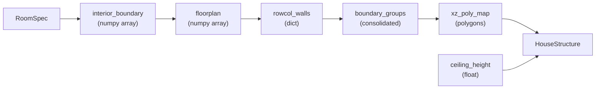
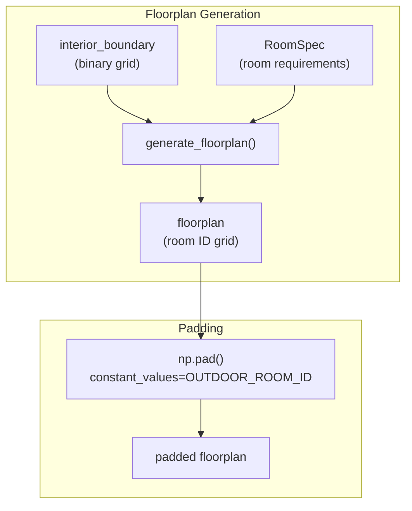
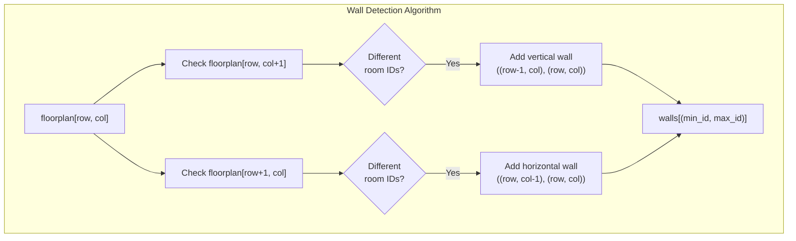
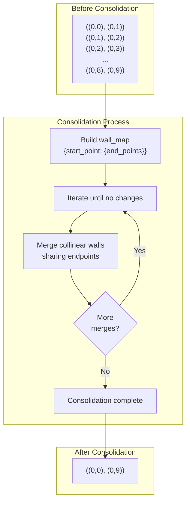
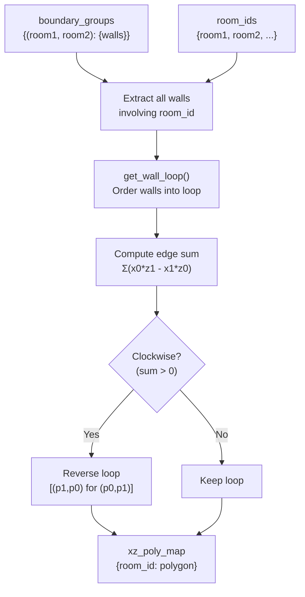
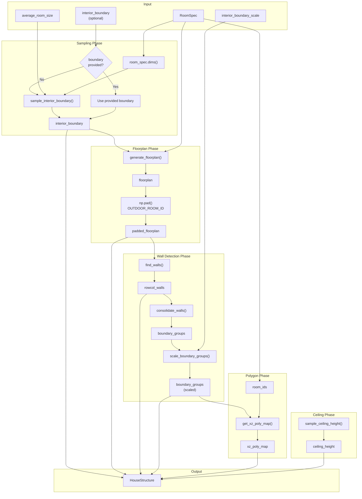

<!-- source: DeepWiki mcp.deepwiki.com · repo allenai/procthor · page 3.1 Structure Generation · fetched 2026-10-26 -->

# Structure Generation

<details>
<summary>Relevant source files</summary>

The following files were used as context for generating this wiki page:

- [procthor/generation/generation.py](procthor/generation/generation.py)

</details>


## Purpose and Scope

Structure generation is the first stage in the ProcTHOR house generation pipeline. This stage creates the fundamental geometric layout of a house, including the 2D floorplan, wall boundaries, and room polygons. The output of this stage is a `HouseStructure` object containing all geometric primitives needed by subsequent generation stages.

This document covers the algorithms for sampling interior boundaries, generating floorplans, detecting walls, consolidating wall segments, and creating XZ polygon representations. For door placement between rooms, see [Door Placement](#3.2). For material assignment to walls and floors, see [Material Randomization](#3.7).

## Overview

Structure generation transforms a high-level room specification into concrete geometric data through a sequential pipeline:



The primary entry point is `default_sample_house_structure()` [procthor/generation/generation.py:185-222](), which orchestrates all sub-stages and returns a complete `HouseStructure`. This function is called by the `HouseGenerator` during the structure generation stage.

**Sources:** [procthor/generation/generation.py:185-222]()

## Interior Boundary Sampling

The interior boundary defines the outer perimeter of the house as a 2D binary grid. Each cell represents whether that location is inside (1) or outside (0) the house boundary.

The `sample_interior_boundary()` function [procthor/generation/interior_boundaries.py]() generates this boundary based on:

| Parameter | Description | Default |
|-----------|-------------|---------|
| `num_rooms` | Number of rooms to accommodate | Required |
| `average_room_size` | Average area per room in grid cells | `DEFAULT_AVERAGE_ROOM_SIZE` |
| `dims` | Optional fixed dimensions (rows, cols) | None |

If `interior_boundary` is provided to `default_sample_house_structure()`, this sampling step is skipped and the provided boundary is used directly [procthor/generation/generation.py:193-197]().

**Sources:** [procthor/generation/generation.py:186-197](), [procthor/generation/interior_boundaries.py:19]()

## Floorplan Generation

The floorplan is a 2D integer array where each cell contains a room ID, effectively partitioning the interior boundary into distinct rooms.



The `generate_floorplan()` function [procthor/generation/floorplan_generation.py]() assigns room IDs to cells within the interior boundary based on the `RoomSpec` requirements. After generation, the floorplan is padded with `OUTDOOR_ROOM_ID` cells to simplify wall detection at the boundary [procthor/generation/generation.py:204-206]().

**Sources:** [procthor/generation/generation.py:198-206]()

## Wall Finding

The `find_walls()` function detects wall segments by identifying adjacent cells with different room IDs. Walls are stored as row-column coordinate pairs grouped by the two room IDs they separate.



The function iterates through all cells (excluding the last row and column) and compares each cell with its right and bottom neighbors [procthor/generation/generation.py:115-130]():

- **Horizontal walls** are created when `floorplan[row, col] != floorplan[row, col+1]`
- **Vertical walls** are created when `floorplan[row, col] != floorplan[row+1, col]`

Each wall is stored as a tuple `((row_start, col_start), (row_end, col_end))` and grouped by room ID pair `(min_id, max_id)`.

**Sources:** [procthor/generation/generation.py:115-130]()

## Wall Consolidation

Raw wall detection produces many short segments. The `consolidate_walls()` function merges collinear adjacent segments into longer walls.

### Consolidation Algorithm

The algorithm uses an iterative approach:

1. Build a graph where each wall endpoint maps to its connected endpoints
2. Iteratively merge walls that:
   - Share an endpoint
   - Are collinear (same x-coordinate or same z-coordinate for all four points)
3. Continue until no more merges are possible



**Example:** A vertical wall with 9 segments from `(0,0)` to `(0,9)` is consolidated into a single segment `((0,0), (0,9))` [procthor/generation/generation.py:23-55]().

The consolidation logic checks if four points are collinear by testing:
```
w1_1[0] == w1_2[0] == w2_1[0] == w2_2[0]  # All x-coordinates equal (vertical)
or
w1_1[1] == w1_2[1] == w2_1[1] == w2_2[1]  # All z-coordinates equal (horizontal)
```
[procthor/generation/generation.py:76-79]()

**Sources:** [procthor/generation/generation.py:23-95]()

## Boundary Scaling

The `scale_boundary_groups()` function transforms wall coordinates from grid space to world space by applying a scaling factor.

| Parameter | Type | Description |
|-----------|------|-------------|
| `boundary_groups` | `BoundaryGroups` | Consolidated wall groups in grid coordinates |
| `scale` | `float` | Scaling factor (typically `interior_boundary_scale`) |
| `precision` | `int` | Decimal precision for rounding (default: 3) |

Each coordinate `(x, z)` is transformed to `(round(x * scale, precision), round(z * scale, precision))` [procthor/generation/generation.py:104-109](). This converts discrete grid cells to continuous world coordinates suitable for 3D rendering.

**Sources:** [procthor/generation/generation.py:98-112]()

## XZ Polygon Map Creation

The `get_xz_poly_map()` function converts boundary groups into ordered polygon loops for each room. An XZ polygon is a sequence of 2D coordinate pairs representing the room's perimeter in counter-clockwise order.

### Polygon Construction Process



**Wall Loop Construction:** The `get_wall_loop()` function [procthor/generation/generation.py:145-161]() builds a continuous loop by:

1. Starting with an arbitrary wall
2. Finding the next wall where its start point equals the current wall's end point
3. Repeating until all walls form a closed loop

If a wall is encountered backwards (its end matches the current end), it is reversed `(wall[1], wall[0])` [procthor/generation/generation.py:155-158]().

**Winding Order:** The algorithm ensures counter-clockwise winding using the shoelace formula. If the edge sum is positive (clockwise), the loop is reversed [procthor/generation/generation.py:173-179]().

**Sources:** [procthor/generation/generation.py:145-182]()

## Creating the Partial House

The `create_empty_partial_house()` function initializes a `PartialHouse` object with walls and room definitions derived from the XZ polygon map.

### Wall Object Creation

For each edge in each room's XZ polygon, a `Wall` object is created [procthor/generation/generation.py:230-244]():

| Field | Value |
|-------|-------|
| `id` | `"wall\|{room_id}\|{min_x}\|{min_z}\|{max_x}\|{max_z}"` |
| `roomId` | `"room\|{room_id}"` |
| `polygon` | Four 3D vertices forming a rectangular wall |

The wall polygon vertices are:
- Bottom-left: `(x0, FLOOR_Y, z0)`
- Bottom-right: `(x1, FLOOR_Y, z1)`
- Top-left: `(x0, FLOOR_Y + ceiling_height, z0)`
- Top-right: `(x1, FLOOR_Y + ceiling_height, z1)`

### Room Type Creation

Each room gets a `RoomType` object [procthor/generation/generation.py:247-256]() containing:

| Field | Description |
|-------|-------------|
| `id` | `"room\|{room_id}"` |
| `roomType` | Room category (e.g., "Bedroom", "Kitchen") from `room_type_map` |
| `children` | Empty list (populated in later stages) |
| `ceilings` | Empty list (populated in later stages) |
| `floorPolygon` | 2D floor vertices from XZ polygon at y=0 |

### Procedural Parameters

The `PartialHouse` is initialized with default `ProceduralParameters` [procthor/generation/generation.py:261-266]():

```python
ProceduralParameters(
    floorColliderThickness=1.0,
    receptacleHeight=0.7,
    lights=[],
    reflections=[],
)
```

These parameters will be populated by subsequent generation stages (lights, reflections, etc.).

**Sources:** [procthor/generation/generation.py:225-267]()

## Complete Structure Generation Pipeline

The following diagram shows the complete data flow through `default_sample_house_structure()`:



**Sources:** [procthor/generation/generation.py:185-222]()

## HouseStructure Data Class

The `HouseStructure` returned by `default_sample_house_structure()` contains all geometric data from structure generation:

| Field | Type | Description |
|-------|------|-------------|
| `interior_boundary` | `np.ndarray` | Binary grid defining house perimeter |
| `floorplan` | `np.ndarray` | Room ID assignments (padded) |
| `rowcol_walls` | `Dict` | Raw wall segments in grid coordinates |
| `boundary_groups` | `BoundaryGroups` | Consolidated walls in world coordinates |
| `xz_poly_map` | `Dict[int, XZPoly]` | Ordered polygon loops per room |
| `ceiling_height` | `float` | Sampled ceiling height |

This structure is stored in the `PartialHouse.house_structure` field and accessed by subsequent generation stages that need geometric information about room layouts.

**Sources:** [procthor/generation/house.py]()

## Integration with Generation Pipeline

Structure generation is invoked as the first stage in `HouseGenerator.sample()`. The function signature for the generation function is:

```python
def default_sample_house_structure(
    interior_boundary: Optional[np.ndarray],
    room_ids: Set,
    room_spec: "RoomSpec",
    interior_boundary_scale: float,
    average_room_size: int = DEFAULT_AVERAGE_ROOM_SIZE,
) -> HouseStructure
```

The `HouseGenerator` passes:
- `interior_boundary`: None (for random generation) or a fixed boundary
- `room_ids`: Set of room IDs from the `RoomSpec`
- `room_spec`: The `RoomSpec` defining room types and connections
- `interior_boundary_scale`: Scaling factor for world coordinates
- `average_room_size`: Average room area in grid cells

The resulting `HouseStructure` is used to initialize the `PartialHouse` via `create_empty_partial_house()`, which subsequent stages modify by adding doors, objects, materials, etc.

**Sources:** [procthor/generation/generation.py:185-222](), [procthor/generation/house.py]()

---

