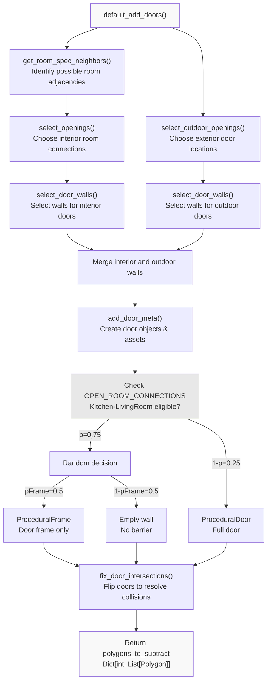
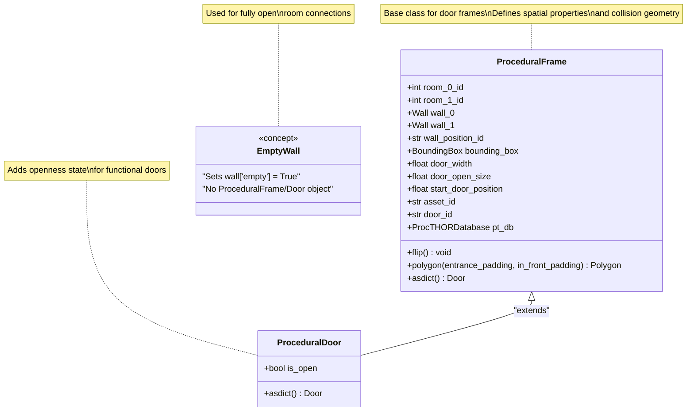
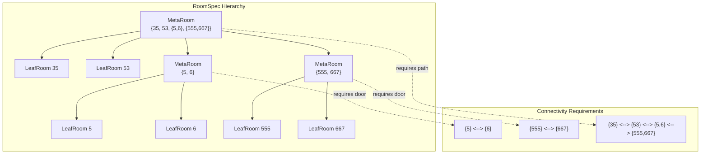
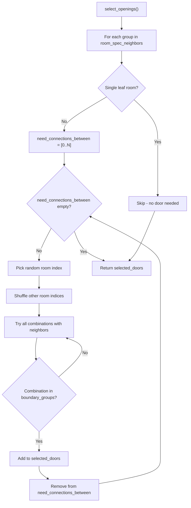
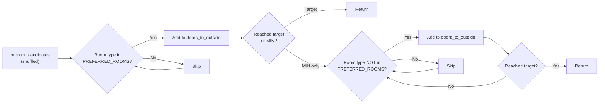
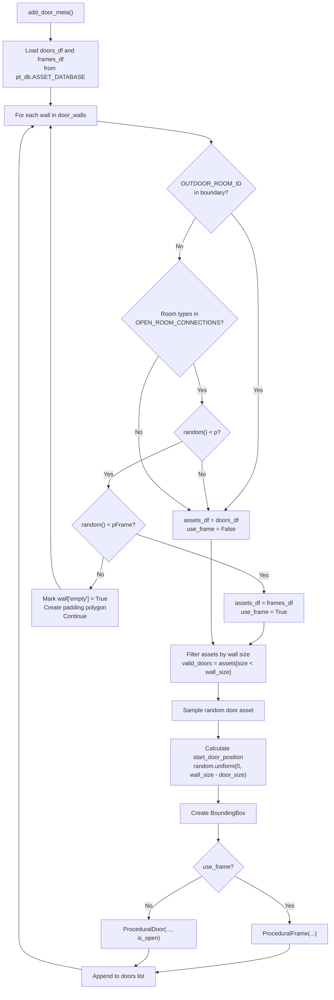
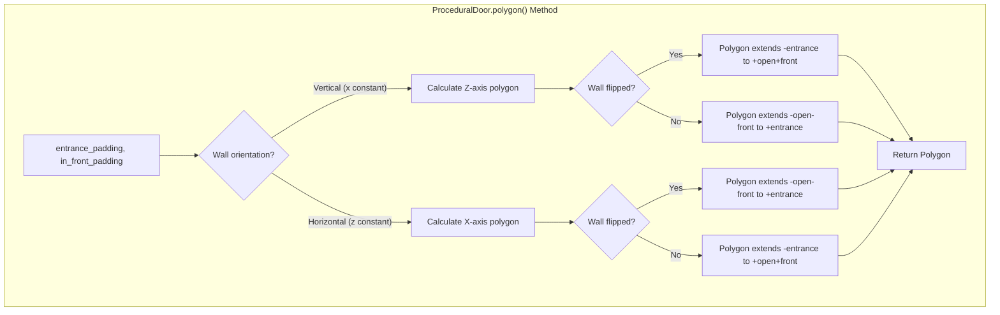
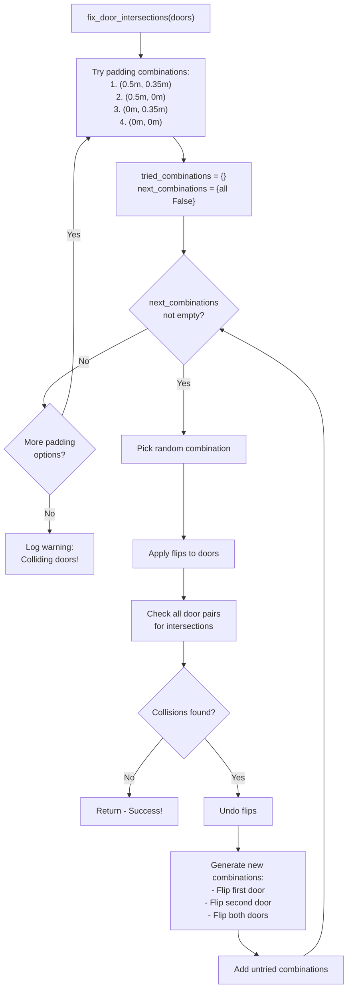
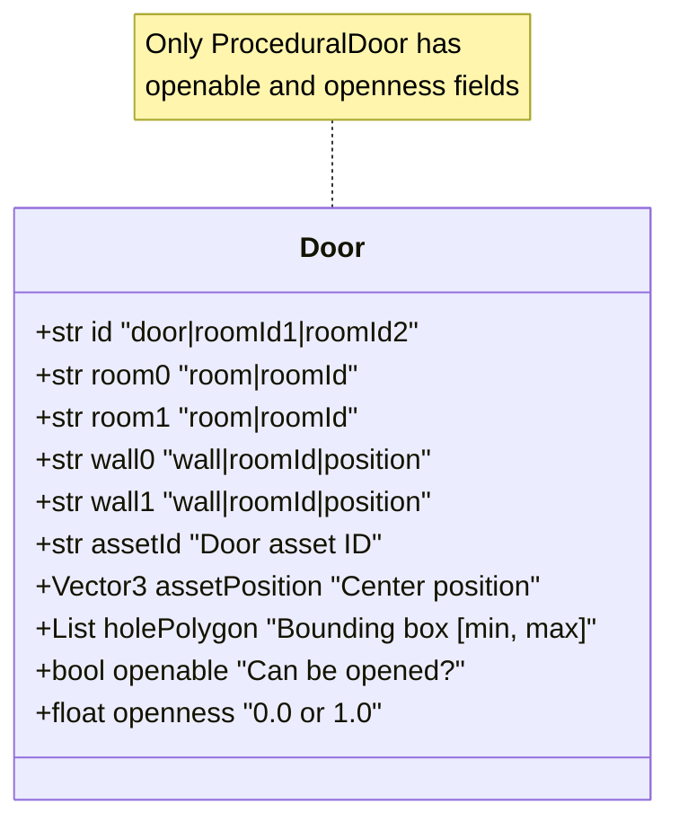
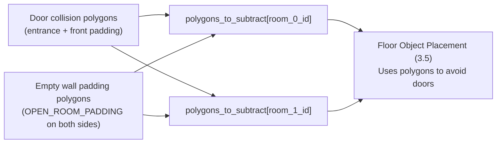

<!-- source: DeepWiki mcp.deepwiki.com · repo allenai/procthor · page 3.2 Door Placement · fetched 2026-10-26 -->

# Door Placement

<details>
<summary>Relevant source files</summary>

The following files were used as context for generating this wiki page:

- [procthor/generation/doors.py](procthor/generation/doors.py)

</details>


## Purpose and Scope

The Door Placement stage is responsible for connecting rooms in the procedurally generated house by placing doors, door frames, and open connections between interior rooms, as well as exterior doors that connect rooms to the outside. This stage is executed after structure generation ([3.1](#3.1)) and before light placement in the generation pipeline ([2.1](#2.1)).

This document covers the selection of door locations, the different types of openings (full doors, frames, or empty walls), collision detection and resolution, and spatial constraints that ensure navigable spaces. For information about the wall structures themselves, see Exterior Walls ([3.3](#3.3)). For database information about door assets, see Database Architecture ([5.1](#5.1)).

**Sources:** [procthor/generation/doors.py:1-918]()

---

## Generation Pipeline Flow

The door placement process follows a sequential pipeline that selects room connections, chooses walls, handles outdoor entrances, and resolves collisions.



**Sources:** [procthor/generation/doors.py:80-121](), [procthor/generation/doors.py:666-917]()

---

## Door Types and Open Room Connections

The system supports three types of openings between rooms, each with different spatial and functional properties.

### Door Type Hierarchy



**Sources:** [procthor/generation/doors.py:309-551](), [procthor/generation/doors.py:554-565]()

### Open Room Connection Configuration

The `OPEN_ROOM_CONNECTIONS` constant defines which room type pairs may have door frames or completely open walls instead of standard doors:

| Parameter | Value | Description |
|-----------|-------|-------------|
| `between` | `{"Kitchen", "LivingRoom"}` | Room types eligible for open connections |
| `p` | `0.75` | Probability of having an open connection |
| `pFrame` | `0.5` | Probability of door frame (vs. empty wall) given open connection |

This results in:
- **37.5%** chance of door frame between Kitchen-LivingRoom
- **37.5%** chance of empty wall between Kitchen-LivingRoom  
- **25%** chance of standard door between Kitchen-LivingRoom

**Sources:** [procthor/generation/doors.py:34-46](), [procthor/generation/doors.py:746-809]()

---

## Interior Door Selection

Interior door placement follows a graph-based approach that ensures connectivity between all rooms defined in the `RoomSpec`.

### Room Connectivity Graph

The `get_room_spec_neighbors()` function extracts connectivity requirements from the hierarchical room specification:



**Sources:** [procthor/generation/doors.py:169-215]()

### Opening Selection Algorithm

The `select_openings()` function ensures all room groups are connected by iteratively selecting door locations:



The algorithm prioritizes room pairs without `avoid_doors_from_metarooms` set to `True` using the `randomly_prioritize_room_ids()` function.

**Sources:** [procthor/generation/doors.py:243-292](), [procthor/generation/doors.py:218-240]()

### Wall Selection

Once room connections are determined, `select_door_walls()` chooses specific walls using weighted random selection based on wall length:

```python
# Weight calculation uses Manhattan distance (equivalent to Euclidean for axis-aligned walls)
weights = [abs(c[1][0] - c[0][0]) + abs(c[1][1] - c[0][1]) for c in candidates]
chosen_opening = random.choices(population=population, weights=weights, k=1)[0]
```

Longer walls have higher probability of being selected, providing more flexibility for door positioning.

**Sources:** [procthor/generation/doors.py:295-306]()

---

## Exterior Door Selection

Exterior doors connect interior rooms to the outdoor space (room ID `OUTDOOR_ROOM_ID = -1`).

### Selection Strategy

The `select_outdoor_openings()` function implements a two-pass selection algorithm with room type preferences:

| Parameter | Value | Description |
|-----------|-------|-------------|
| `MIN_DOORS_TO_OUTSIDE` | `1` | Minimum exterior doors required |
| `MAX_DOORS_TO_OUTSIDE` | `1` | Maximum exterior doors allowed |
| `PREFERRED_ROOMS_TO_OUTSIDE` | `{"Kitchen", "LivingRoom"}` | Preferred room types |

**Algorithm:**
1. Shuffle all candidates with `OUTDOOR_ROOM_ID` in boundary
2. **First pass:** Select from preferred room types until target reached
3. **Second pass (if needed):** Select from non-preferred room types
4. Return when `MIN_DOORS_TO_OUTSIDE` satisfied



**Sources:** [procthor/generation/doors.py:124-156](), [procthor/generation/doors.py:67-74]()

---

## Door Placement and Asset Selection

The `add_door_meta()` function creates concrete door objects with proper positioning and asset selection.

### Asset Selection Process



**Sources:** [procthor/generation/doors.py:666-917](), [procthor/generation/doors.py:697-723]()

### Position Calculation

Door positions are randomly determined along the selected wall:

1. **Wall size** = `abs(wall[1][0] - wall[0][0]) + abs(wall[1][1] - wall[0][1])`
2. **Valid doors** = doors where `openXSize < wall_size` (or `xSize` for frames)
3. **Start position** = `random.uniform(0, wall_size - door_size)`
4. **Bounding box** = `[start_position, start_position + door_width]`

The `wall_position_id` uniquely identifies the wall: `"{min_x:.2f}|{min_z:.2f}|{max_x:.2f}|{max_z:.2f}"`

**Sources:** [procthor/generation/doors.py:811-838]()

---

## Collision Detection and Resolution

Door collision resolution ensures that doors do not block each other's opening paths.

### Collision Geometry

Each door defines a collision polygon that includes:
- **Entrance padding**: Space to walk into the door
- **In-front padding**: Space for the door to swing open



**Sources:** [procthor/generation/doors.py:374-498]()

### Collision Resolution Algorithm

The `fix_door_intersections()` function attempts to resolve collisions by flipping doors (reversing which side they open):



**Collision Detection:** For each door pair `(d0, d1)`, check if `d0.polygon(...).intersects(d1.polygon(...))`

**New Combinations:** For each collision, generate three flip variants:
1. Flip first door only
2. Flip second door only  
3. Flip both doors

**Sources:** [procthor/generation/doors.py:568-663]()

---

## Spatial Constraints and Padding

Padding constants ensure navigable and physically plausible door placements.

### Padding Constants

| Constant | Value | Purpose |
|----------|-------|---------|
| `PREFERRED_ENTRANCE_PADDING` | `0.5m` | Space behind door (entrance side) |
| `PADDING_IN_FRONT_OF_DOOR` | `0.35m` | Additional space in front of door |
| `OPEN_ROOM_PADDING` | `0.35m` | Padding for open room connections |
| `door_open_size` | Asset-specific | Door swing radius from `openZSize` |

### Padding Zones Diagram

```
For a door on a vertical wall (constant X):

    Room 0              |  Wall  |              Room 1
                        |        |
    ← entrance_padding →|← door →|← door_open_size →
                        |← width|  ← in_front_padding →
    [                   ]|[     ]|[                    ]
    Polygon area that must remain clear of objects

For ProceduralDoor:
- entrance_padding = PREFERRED_ENTRANCE_PADDING (0.5m)
- in_front_padding = PADDING_IN_FRONT_OF_DOOR (0.35m)

For ProceduralFrame / Empty walls:
- entrance_padding = OPEN_ROOM_PADDING (0.35m)
- in_front_padding = OPEN_ROOM_PADDING (0.35m)
```

### Padding Degradation Strategy

When collisions cannot be resolved with preferred padding, the system degrades gracefully:

1. **First attempt:** `(entrance=0.5m, front=0.35m)` - Full padding
2. **Second attempt:** `(entrance=0.5m, front=0m)` - Entrance only
3. **Third attempt:** `(entrance=0m, front=0.35m)` - Front only
4. **Final attempt:** `(entrance=0m, front=0m)` - Minimal padding

A warning is logged if reduced padding is used: `"Might be unable to walk between rooms!"`

**Sources:** [procthor/generation/doors.py:48-65](), [procthor/generation/doors.py:571-578]()

---

## Output and Integration

The door placement stage produces two key outputs that affect subsequent generation stages.

### Door Dictionary Format

Each door is serialized using the `asdict()` method to produce a `Door` TypedDict:



**Key transformations in `asdict()`:**
- Apply asset offset from `pt_db.WALL_HOLES`
- Calculate center position from bounding box
- Set `openable = True` for interior doors, `False` for outdoor
- Set `openness = 1` if `is_open`, otherwise `0`

**Sources:** [procthor/generation/doors.py:500-551](), [procthor/generation/doors.py:561-565]()

### Polygons to Subtract

The function returns `Dict[int, List[Polygon]]` mapping room IDs to collision polygons that must be subtracted from available placement space:



These polygons are used by subsequent stages to ensure objects are not placed in door swing paths or entrances, maintaining navigability.

**Sources:** [procthor/generation/doors.py:112-121](), [procthor/generation/doors.py:726-807](), [procthor/generation/doors.py:909-915]()

---

## Configuration Summary

### Key Constants Reference

```python
# Open room connections
OPEN_ROOM_CONNECTIONS = [
    {"between": {"Kitchen", "LivingRoom"}, "p": 0.75, "pFrame": 0.5}
]

# Outdoor doors
PREFERRED_ROOMS_TO_OUTSIDE = {"Kitchen", "LivingRoom"}
MIN_DOORS_TO_OUTSIDE = 1
MAX_DOORS_TO_OUTSIDE = 1

# Padding (in meters)
PREFERRED_ENTRANCE_PADDING = 0.5
PADDING_IN_FRONT_OF_DOOR = 0.35
OPEN_ROOM_PADDING = 0.35

# Precision threshold
EPSILON = 1e-3
```

### Entry Point

The door placement stage is invoked through:

```python
default_add_doors(
    partial_house: PartialHouse,
    controller: Controller,
    pt_db: ProcTHORDatabase,
    split: Split
) -> Dict[int, List[Polygon]]
```

This function is registered as the door placement implementation in the generation pipeline and is called automatically when `PartialHouse` reaches the door placement stage.

**Sources:** [procthor/generation/doors.py:34-77](), [procthor/generation/doors.py:80-121]()

---

