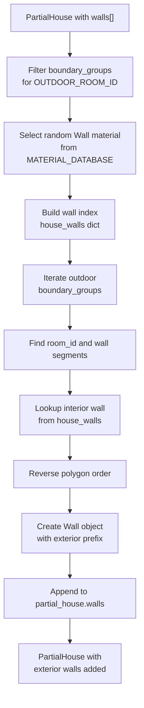
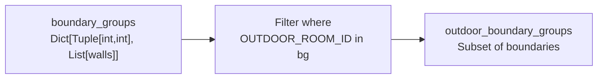
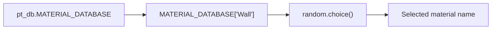
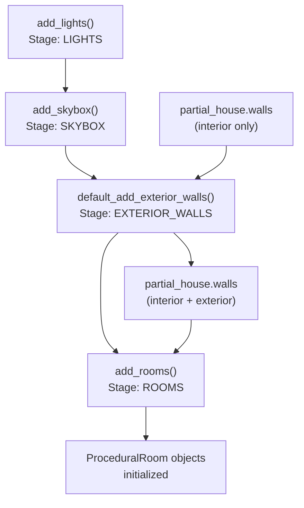

<!-- source: DeepWiki mcp.deepwiki.com · repo allenai/procthor · page 3.3 Exterior Walls · fetched 2026-10-26 -->

# Exterior Walls

<details>
<summary>Relevant source files</summary>

The following files were used as context for generating this wiki page:

- [procthor/generation/exterior_walls.py](procthor/generation/exterior_walls.py)

</details>


## Purpose and Scope

This document describes the exterior wall generation stage in the ProcTHOR generation pipeline. Exterior walls are one-sided walls created for outdoor-facing boundaries to ensure that rooms appear visually complete when viewed from windows or other openings. This stage occurs after door and light placement ([#3.2](#3.2)) and before room setup ([#3.4](#3.4)). For information about interior wall generation during structure creation, see [Structure Generation](#3.1).

**Sources:** [procthor/generation/exterior_walls.py:1-54]()

---

## Overview

Exterior walls serve a specific rendering purpose: since walls in the system are one-sided (visible from only one direction), rooms with windows or doors facing the outdoor boundary would appear to have missing walls when viewed from adjacent rooms or the exterior. The exterior wall generation stage solves this problem by creating outward-facing wall polygons for all boundaries between interior rooms and the outdoor space.

The stage is implemented by the `default_add_exterior_walls` function, which identifies outdoor boundaries, selects appropriate materials, and creates reversed wall polygons for each exterior-facing segment.

**Sources:** [procthor/generation/exterior_walls.py:15-26]()

---

## Generation Process Flow

The exterior wall generation follows a systematic process:



**Figure 1: Exterior Wall Generation Data Flow**

**Sources:** [procthor/generation/exterior_walls.py:15-53]()

---

## Function Signature and Parameters

The `default_add_exterior_walls` function is the primary entry point for this generation stage:

```python
def default_add_exterior_walls(
    partial_house: "PartialHouse",
    controller: Controller,
    pt_db: ProcTHORDatabase,
    split: Split,
    boundary_groups: BoundaryGroups,
) -> None
```

| Parameter | Type | Purpose |
|-----------|------|---------|
| `partial_house` | `PartialHouse` | Mutable house state that accumulates walls |
| `controller` | `Controller` | AI2-THOR controller (unused in default implementation) |
| `pt_db` | `ProcTHORDatabase` | Database for material selection |
| `split` | `Split` | Train/val/test designation (unused in default implementation) |
| `boundary_groups` | `BoundaryGroups` | Mapping of room boundary pairs to wall segments |

The function modifies `partial_house.walls` in-place by appending new `Wall` objects.

**Sources:** [procthor/generation/exterior_walls.py:15-21]()

---

## Boundary Filtering

The first step identifies which boundaries face the outdoor space:



**Figure 2: Outdoor Boundary Filtering**

The `OUTDOOR_ROOM_ID` constant (defined in `procthor.constants`) represents the exterior space surrounding the house. Any boundary group tuple containing this ID indicates a wall segment that faces outside.

```python
outdoor_boundary_groups = {
    bg: walls for bg, walls in boundary_groups.items() if OUTDOOR_ROOM_ID in bg
}
```

Each boundary group key is a tuple of two room IDs, e.g., `(5, OUTDOOR_ROOM_ID)`, and the value is a list of wall segments defined by coordinate pairs.

**Sources:** [procthor/generation/exterior_walls.py:27-29](), [procthor/constants.py]()

---

## Material Selection

A single material is randomly selected from the `MATERIAL_DATABASE["Wall"]` collection for all exterior walls in a house:



**Figure 3: Material Selection Process**

The comment explicitly notes:

> "Intentionally not using solid colors as they're often too bright."

This design decision ensures exterior walls use textured materials rather than solid color materials, which could create overly bright or unrealistic appearances. The material selection is consistent across all exterior walls in a single house to maintain visual coherence.

**Sources:** [procthor/generation/exterior_walls.py:31-32]()

---

## Wall Construction

For each outdoor boundary segment, the system constructs a new exterior wall by:

### 1. Room Identification

```python
room_id_n = bg[0] if bg[1] == OUTDOOR_ROOM_ID else bg[1]
room_id = f"room|{room_id_n}"
```

The room ID is extracted from the boundary group tuple, selecting the non-outdoor room ID.

### 2. Wall Ordering and ID Generation

```python
wall_order = f"{min(x0, x1):.2f}|{min(z0, z1):.2f}|{max(x0, x1):.2f}|{max(z0, z1):.2f}"
wall_id = f"wall|{room_id_n}|{wall_order}"
```

The wall order string creates a canonical representation of the wall segment's bounding coordinates, ensuring consistent ID generation.

### 3. Interior Wall Lookup

```python
house_walls = {wall["id"]: wall for wall in partial_house.walls}
house_wall = house_walls[wall_id]
```

The system builds an index of existing walls and retrieves the corresponding interior wall using the generated ID.

### 4. Polygon Reversal

```python
polygon=list(reversed(house_wall["polygon"]))
```

The critical operation: the polygon vertex order is reversed so the wall faces outward. In 3D rendering, polygon winding order determines which side is visible. Reversing the order flips the visible face.

### 5. Wall Object Creation

```python
partial_house.walls.append(
    Wall(
        id=f"wall|exterior|{wall_order}",
        polygon=list(reversed(house_wall["polygon"])),
        roomId=room_id,
        material={
            "name": material,
        },
    )
)
```

A new `Wall` object is created with:
- **ID prefix**: `"wall|exterior|"` to distinguish from interior walls
- **Reversed polygon**: Outward-facing surface
- **Same room ID**: Associates with the interior room
- **Selected material**: Applied to the outward-facing surface

**Sources:** [procthor/generation/exterior_walls.py:34-53]()

---

## Data Structures

### BoundaryGroups Type

```python
BoundaryGroups = Dict[Tuple[int, int], List[Tuple[Tuple[float, float], Tuple[float, float]]]]
```

Maps pairs of room IDs to lists of wall segments, where each segment is defined by two (x, z) coordinate pairs.

### Wall Type

The `Wall` TypedDict contains:

| Field | Type | Description |
|-------|------|-------------|
| `id` | `str` | Unique identifier with format `"wall|exterior|<coordinates>"` |
| `polygon` | `List` | Vertex coordinates defining the wall surface |
| `roomId` | `str` | Associated room identifier |
| `material` | `Dict` | Material specification with `"name"` key |

**Sources:** [procthor/utils/types.py](), [procthor/generation/exterior_walls.py:44-53]()

---

## Integration with Generation Pipeline



**Figure 4: Pipeline Position of Exterior Wall Stage**

The exterior wall stage operates at `NextSamplingStage.EXTERIOR_WALLS` and runs after the skybox is added but before rooms are initialized for object placement. This sequencing ensures:

1. All interior walls are already generated (from structure generation)
2. Doors are placed and finalized
3. Exterior walls are present before objects are placed in rooms

**Sources:** [procthor/generation/exterior_walls.py:1-54]()

---

## Key Design Decisions

### Single Material for All Exterior Walls

The system selects one material for all exterior walls in a house rather than per-wall randomization. This creates visual consistency when viewing the house from outside or through windows.

### Polygon Reversal Instead of Duplication

Rather than duplicating wall geometry with flipped normals, the system explicitly reverses the polygon vertex order. This approach provides fine-grained control over which walls get exterior faces and ensures the material database is consulted only once.

### Exclusion of Solid Colors

The explicit avoidance of solid color materials prevents overly bright or artificial-looking exterior walls. Textured materials provide more realistic outdoor appearances.

### Reuse of Interior Wall Geometry

By looking up existing interior walls and reversing their polygons, the system ensures perfect geometric alignment between interior and exterior faces. This prevents gaps or overlaps that could occur with independent wall generation.

**Sources:** [procthor/generation/exterior_walls.py:22-32]()

---

## Summary

The exterior wall generation stage is a focused system that:

1. Identifies boundaries between interior rooms and outdoor space using `OUTDOOR_ROOM_ID`
2. Selects a single textured material from `MATERIAL_DATABASE["Wall"]`
3. Creates outward-facing walls by reversing interior wall polygons
4. Appends these walls to `partial_house.walls` with `"wall|exterior|"` ID prefix

This ensures complete visual rendering of rooms when viewed from windows or adjacent spaces, maintaining the one-sided wall rendering model used throughout ProcTHOR.

**Sources:** [procthor/generation/exterior_walls.py:1-54]()

---

