<!-- source: DeepWiki mcp.deepwiki.com · repo allenai/procthor · page 3.4 Room Setup · fetched 2026-10-26 -->

# Room Setup

<details>
<summary>Relevant source files</summary>

The following files were used as context for generating this wiki page:

- [procthor/generation/objects.py](procthor/generation/objects.py)

</details>


## Purpose and Scope

This document describes the Room Setup stage of the ProcTHOR generation pipeline, which creates and initializes `ProceduralRoom` objects for each room in the house. This stage occurs after exterior walls have been generated ([3.3](#3.3)) and before floor objects are placed ([3.5](#3.5)). The `ProceduralRoom` class serves as the primary interface for object placement operations, maintaining spatial state and providing methods for collision-free placement of assets.

For information about the spatial primitives used by ProceduralRoom, see [Geometric Primitives](#4.1). For details on how objects are actually placed, see [Floor Object Placement](#3.5).

---

## ProceduralRoom Class Overview

The `ProceduralRoom` class represents a single room in the house and maintains the spatial state needed for object placement. It tracks both the original room geometry and the dynamically shrinking available space as objects are placed.

### Class Structure

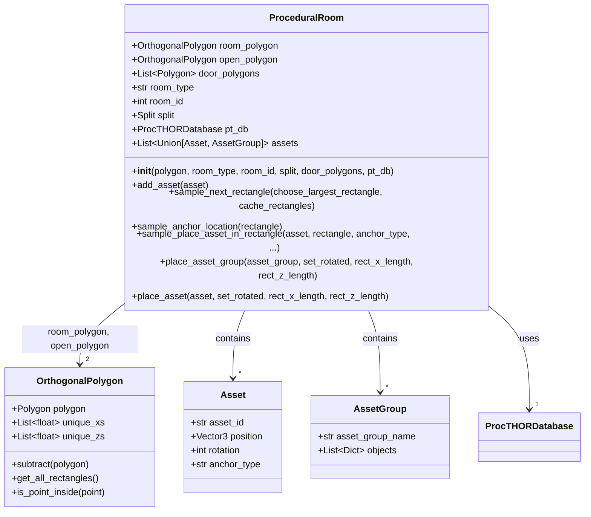

**Sources:** [procthor/generation/objects.py:504-541]()

### Initialization Parameters

| Parameter | Type | Purpose |
|-----------|------|---------|
| `polygon` | `Sequence[Tuple[int, int]]` | 2D floor boundary of the room |
| `room_type` | `Literal["Kitchen", "LivingRoom", "Bedroom", "Bathroom"]` | Semantic room category |
| `room_id` | `int` | Unique identifier for the room |
| `split` | `Split` | Dataset split ("train", "val", or "test") |
| `door_polygons` | `List[Polygon]` | Polygons representing door locations |
| `pt_db` | `ProcTHORDatabase` | Database for asset selection and properties |

**Sources:** [procthor/generation/objects.py:505-522]()

---

## Dual Polygon System

The `ProceduralRoom` maintains two separate `OrthogonalPolygon` instances that serve distinct purposes during object placement:

### room_polygon vs open_polygon

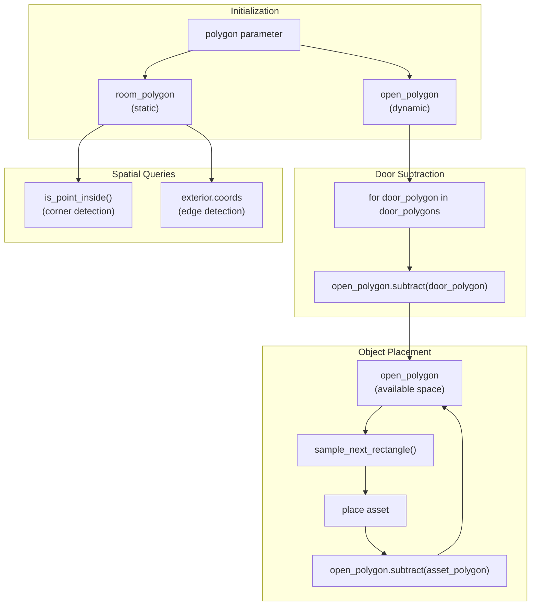

- **`room_polygon`**: Immutable reference to the original room boundary. Used for spatial queries like corner detection and edge identification during anchor location sampling.

- **`open_polygon`**: Dynamically updated to represent available placement space. Starts as a copy of `room_polygon`, then has door areas subtracted during initialization, and asset footprints subtracted as objects are placed.

**Sources:** [procthor/generation/objects.py:523-540]()

### Door Polygon Subtraction

The `_cut_out_doors()` method removes door areas from the available space immediately after initialization:

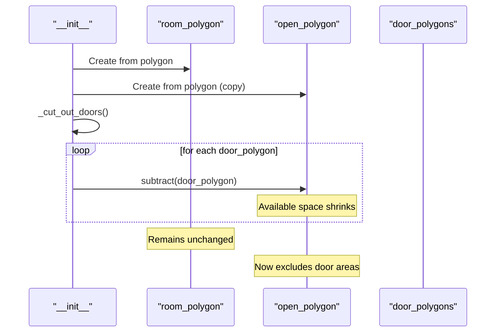

**Sources:** [procthor/generation/objects.py:538-540]()

---

## Room Initialization Function

The `default_add_rooms()` function is the standard implementation that creates `ProceduralRoom` instances during the generation pipeline.

### Function Signature and Parameters

```python
def default_add_rooms(
    partial_house: "PartialHouse",
    controller: Controller,
    pt_db: ProcTHORDatabase,
    split: str,
    floor_polygons: Dict[str, Polygon],
    room_type_map: Dict[int, str],
    door_polygons: Dict[int, List[Polygon]],
) -> None
```

**Sources:** [procthor/generation/objects.py:1157-1172]()

### Room Creation Process

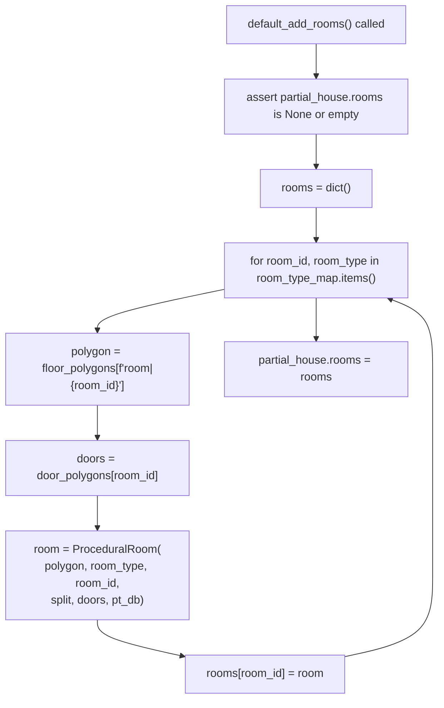

### Input Data Structures

| Parameter | Description | Example Key |
|-----------|-------------|-------------|
| `floor_polygons` | Maps room identifiers to floor boundary polygons | `"room|0"`, `"room|1"` |
| `room_type_map` | Maps room IDs to semantic types | `{0: "Kitchen", 1: "LivingRoom"}` |
| `door_polygons` | Maps room IDs to lists of door polygons in that room | `{0: [door_poly_1, door_poly_2]}` |

**Sources:** [procthor/generation/objects.py:1173-1188]()

---

## OrthogonalPolygon Data Structure

The `OrthogonalPolygon` class is a specialized wrapper around Shapely polygons optimized for axis-aligned rectangular decomposition, which is critical for object placement.

### Internal Representation

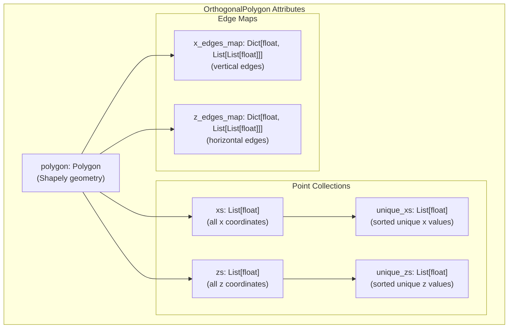

### Rectangle Decomposition

The key functionality of `OrthogonalPolygon` is decomposing arbitrary orthogonal polygons into rectangles for placement sampling:

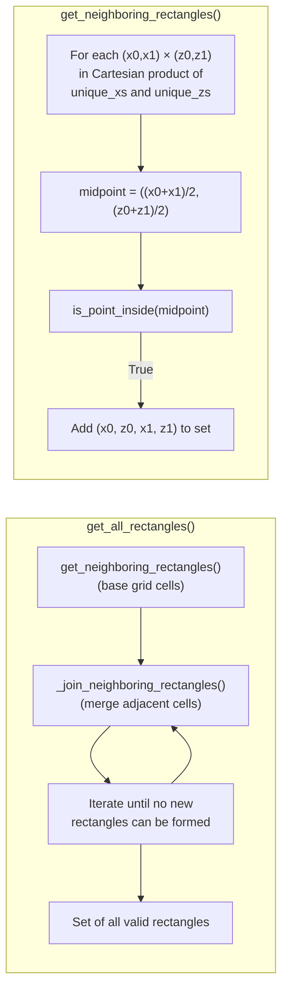

**Sources:** [procthor/generation/objects.py:235-322]()

---

## Asset Tracking and Placement Interface

The `ProceduralRoom` maintains a list of placed assets and provides methods that will be used extensively during floor object placement.

### Asset Storage

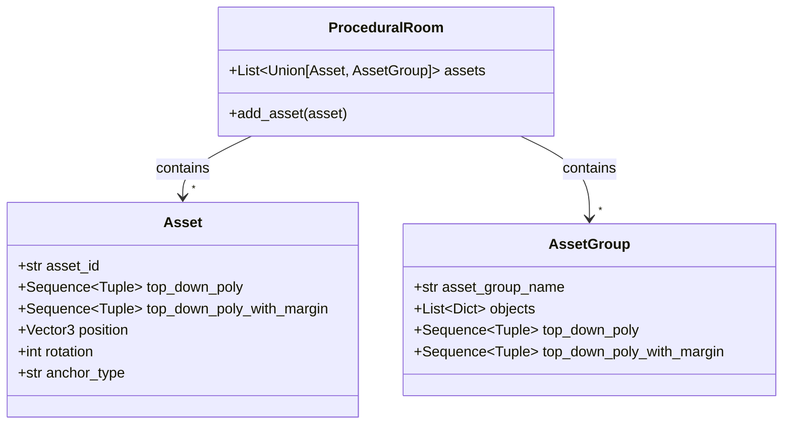

### add_asset Method

The `add_asset()` method updates room state when an asset is successfully placed:

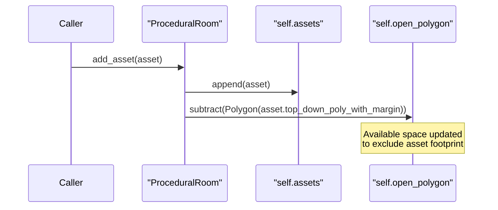

**Sources:** [procthor/generation/objects.py:542-548]()

---

## Rectangle Sampling for Placement

The `sample_next_rectangle()` method selects a placement area from the available space, serving as the first step in the object placement pipeline.

### Method Signature and Behavior

```python
def sample_next_rectangle(
    self,
    choose_largest_rectangle: bool = False,
    cache_rectangles: bool = False
) -> Optional[Tuple[float, float, float, float]]
```

**Returns:** `(x0, z0, x1, z1)` defining a rectangle, or `None` if no valid rectangles exist.

### Sampling Strategy

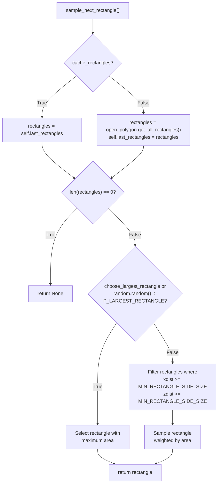

**Sources:** [procthor/generation/objects.py:550-594]()

---

## Anchor Location Sampling

The `sample_anchor_location()` method determines where within a rectangle to place an object and what type of anchor to use.

### Anchor Types and Deltas

The method returns a tuple `(x_info, z_info, anchor_delta, anchor_type)` where:

- **anchor_type**: One of `"inCorner"`, `"onEdge"`, or `"inMiddle"`
- **anchor_delta**: Integer 0-8 specifying directional placement relative to the anchor point

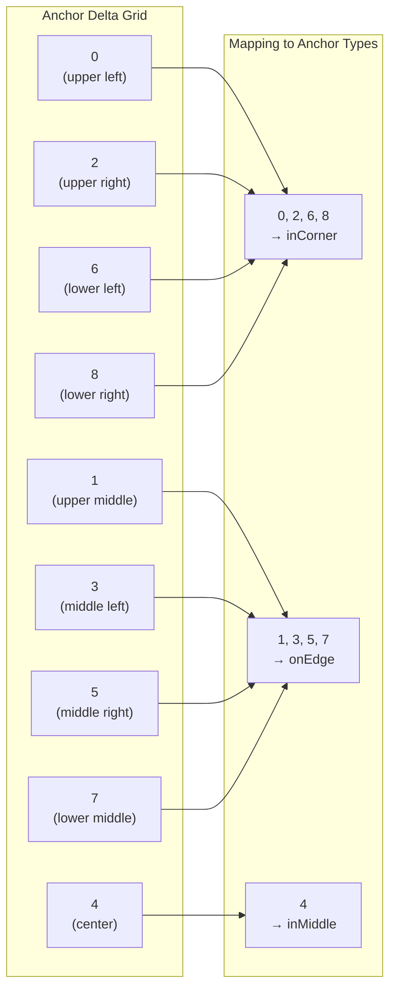

### Selection Process

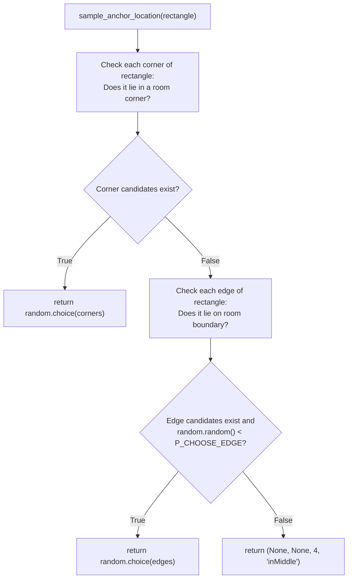

**Corner Detection Logic:** Uses epsilon-based point queries to determine if a rectangle corner is in a room corner (diagonal or L-shaped):

```
q1 = room_polygon.is_point_inside((x + ε, z + ε))
q2 = room_polygon.is_point_inside((x - ε, z + ε))
q3 = room_polygon.is_point_inside((x - ε, z - ε))
q4 = room_polygon.is_point_inside((x + ε, z - ε))
```

A point is a corner if it forms an L-shape (2 quadrants inside, 2 outside).

**Sources:** [procthor/generation/objects.py:817-899]()

---

## Integration with Generation Pipeline

### Pipeline Position

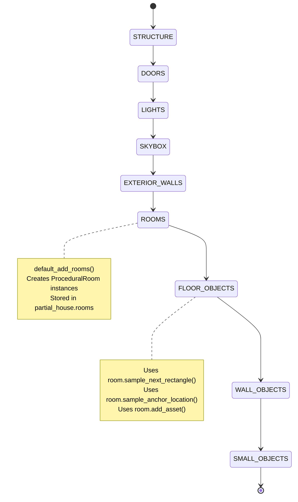

### Data Flow

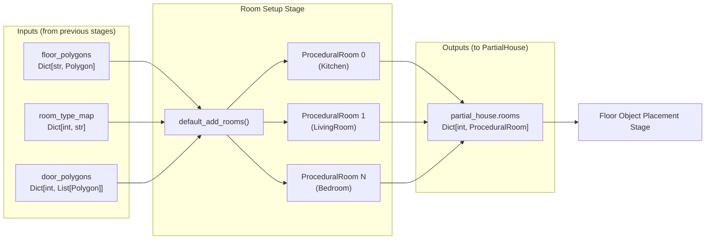

**Sources:** [procthor/generation/objects.py:1157-1188]()

---

## Summary

The Room Setup stage creates `ProceduralRoom` instances that serve as the primary interface for object placement. Each room maintains:

1. **Static geometry** (`room_polygon`) for spatial queries
2. **Dynamic available space** (`open_polygon`) that shrinks as objects are placed
3. **Asset tracking** (`assets` list) of placed objects
4. **Placement methods** for rectangle sampling and anchor location selection

The `default_add_rooms()` function orchestrates room creation by:
- Mapping room IDs to floor polygons and room types
- Collecting door polygons for each room
- Instantiating `ProceduralRoom` objects with proper initialization
- Storing rooms in `partial_house.rooms` for subsequent stages

These rooms are then used extensively during Floor Object Placement ([3.5](#3.5)) to determine where and how to place furniture and other assets.

**Sources:** [procthor/generation/objects.py:504-978](), [procthor/generation/objects.py:1157-1188]()

---

