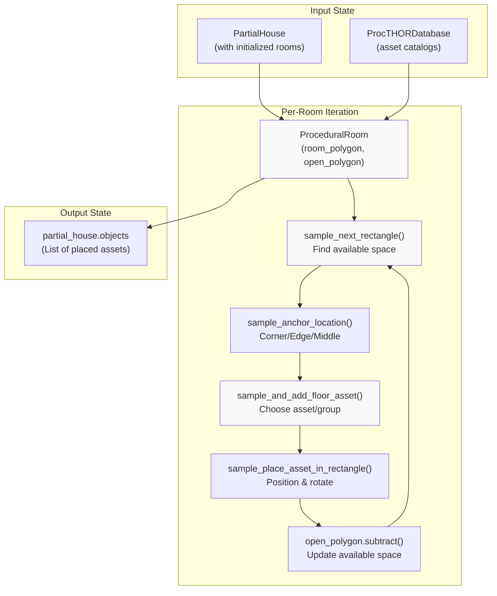
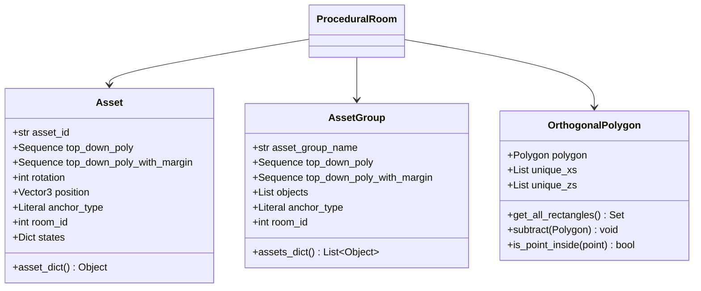
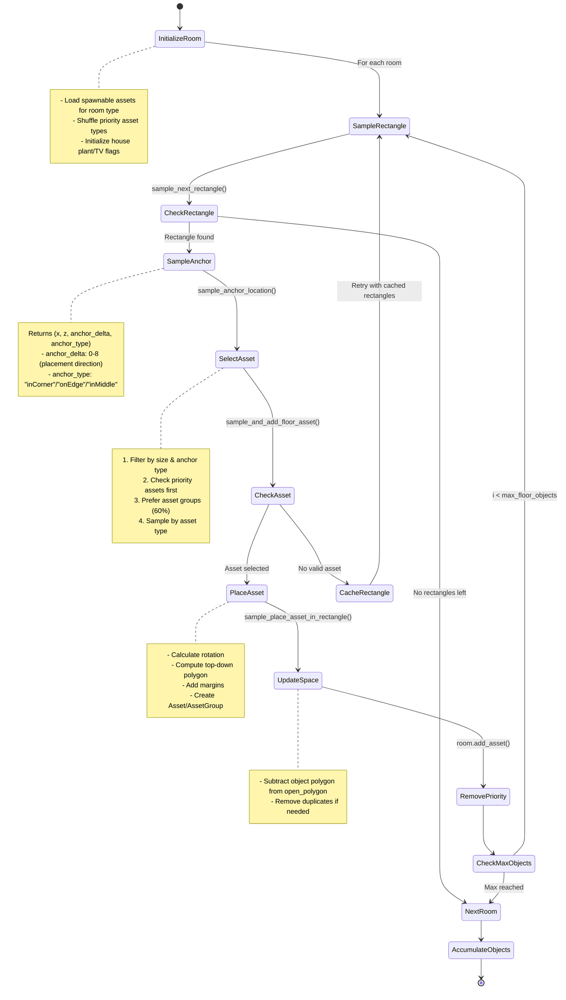
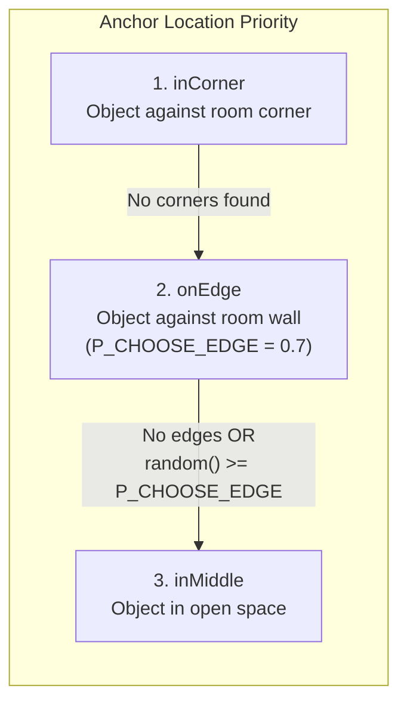
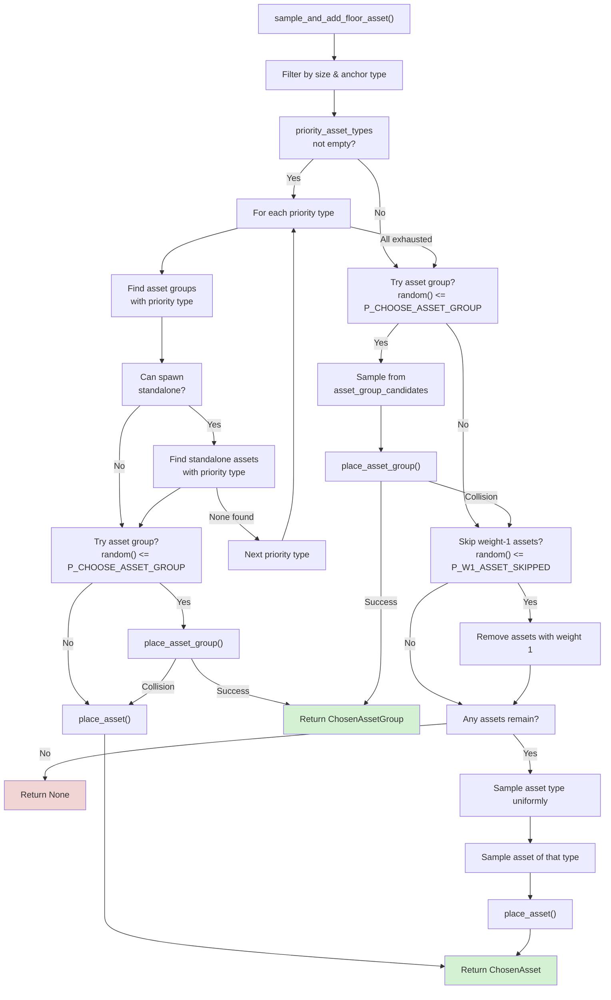
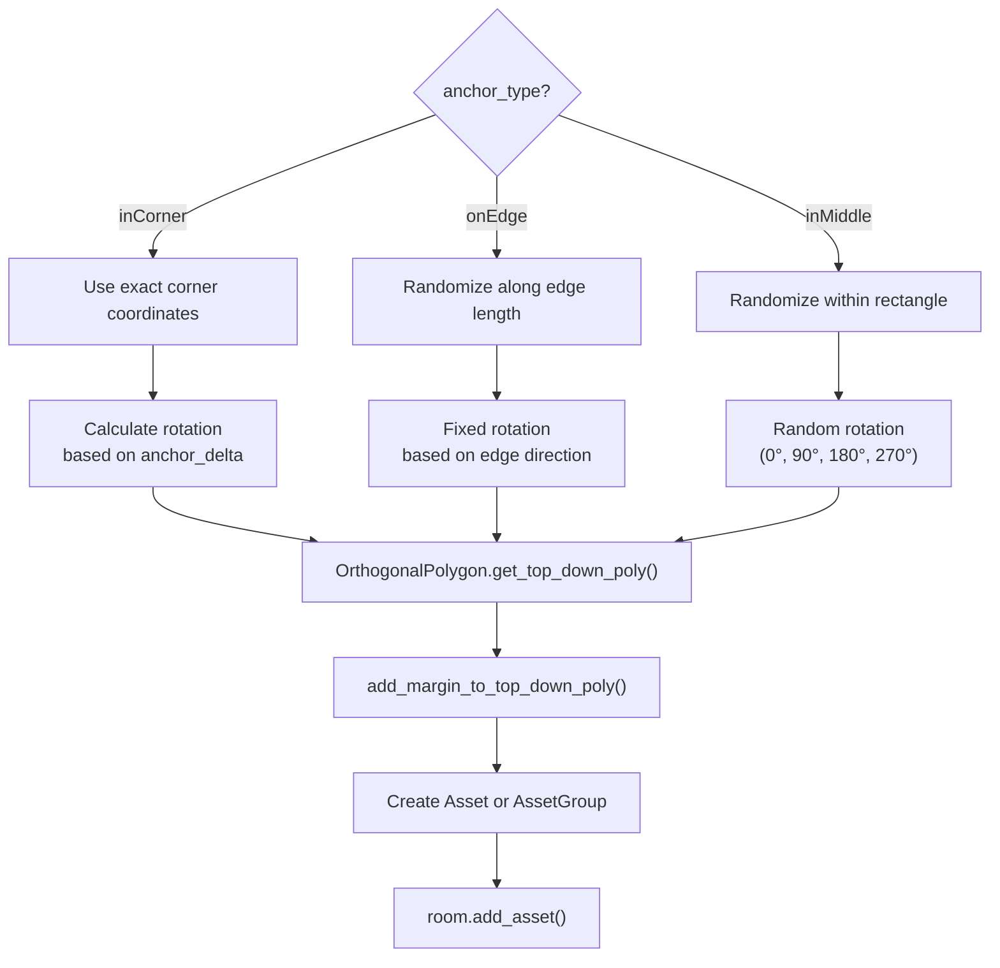
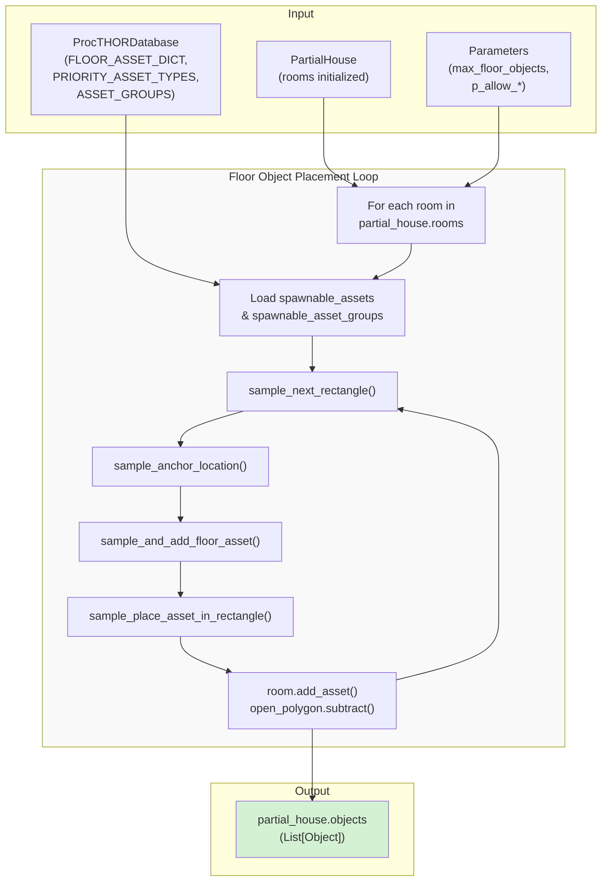

<!-- source: DeepWiki mcp.deepwiki.com · repo allenai/procthor · page 3.5 Floor Object Placement · fetched 2026-10-26 -->

# Floor Object Placement

<details>
<summary>Relevant source files</summary>

The following files were used as context for generating this wiki page:

- [procthor/generation/objects.py](procthor/generation/objects.py)

</details>


## Purpose and Scope

This document describes the floor object placement system, which is responsible for populating rooms with large furniture and floor-standing objects (e.g., beds, tables, sofas, appliances). This is stage 6 in the generation pipeline, occurring after room setup and before wall object placement.

For information about:
- The overall generation pipeline, see [Generation Pipeline Architecture](#2.1)
- Room initialization that precedes this stage, see [Room Setup](#3.4)
- Wall-mounted objects (windows, paintings, TVs), see [Wall Object Placement](#3.6)
- Small decorative objects, see [Object Color and State Randomization](#3.8)
- Spatial reasoning primitives used by this system, see [Spatial Reasoning Systems](#4)

---

## System Overview

Floor object placement fills procedurally generated rooms with furniture by iteratively sampling available space, selecting appropriate assets, and placing them while avoiding collisions. The system balances multiple objectives: ensuring required furniture types are present (e.g., beds in bedrooms), maximizing space utilization, and maintaining physical plausibility.

**Sources:** [procthor/generation/objects.py:1191-1305]()



**Sources:** [procthor/generation/objects.py:1191-1305](), [procthor/generation/objects.py:504-549]()

---

## Core Components

### ProceduralRoom Class

The `ProceduralRoom` class manages asset placement within a single room. It maintains two key polygons:

- `room_polygon`: The original room boundary (immutable during placement)
- `open_polygon`: Dynamically updated to track remaining available space

**Sources:** [procthor/generation/objects.py:504-549]()

| Property | Type | Purpose |
|----------|------|---------|
| `room_polygon` | `OrthogonalPolygon` | Original room boundaries for corner/edge detection |
| `open_polygon` | `OrthogonalPolygon` | Available space after subtracting placed objects |
| `room_type` | `Literal["Kitchen", "LivingRoom", "Bedroom", "Bathroom"]` | Determines spawnable asset types |
| `assets` | `List[Union[Asset, AssetGroup]]` | Accumulated placed objects |
| `last_rectangles` | `Optional[Set[Tuple[float, float, float, float]]]` | Cached rectangles for retry optimization |

### Asset and AssetGroup Classes

Assets represent placed objects in the scene:

**Sources:** [procthor/generation/objects.py:88-145](), [procthor/generation/objects.py:147-233]()



**Sources:** [procthor/generation/objects.py:88-233](), [procthor/generation/objects.py:235-343]()

### OrthogonalPolygon Class

This spatial reasoning class decomposes complex room shapes into rectangles for efficient placement sampling. See [Geometric Primitives](#4.1) for detailed documentation.

**Key Methods:**
- `get_all_rectangles()`: Extracts all possible rectangles from available space
- `subtract(polygon)`: Updates available space after placing an object
- `is_point_inside(point)`: Tests point containment for anchor detection

**Sources:** [procthor/generation/objects.py:235-343]()

---

## Placement Algorithm

The main entry point is `default_add_floor_objects()`, which orchestrates the placement process:

**Sources:** [procthor/generation/objects.py:1191-1305]()



**Sources:** [procthor/generation/objects.py:1191-1305]()

---

## Rectangle Sampling

The system identifies available placement space by decomposing the `open_polygon` into rectangles:

**Sources:** [procthor/generation/objects.py:550-594](), [procthor/generation/objects.py:280-323]()

### Sampling Strategy

The `sample_next_rectangle()` method uses probabilistic selection:

| Strategy | Probability | Method |
|----------|-------------|--------|
| Largest rectangle | `P_LARGEST_RECTANGLE` (0.8) | Select rectangle with maximum area |
| Random weighted | `1 - P_LARGEST_RECTANGLE` (0.2) | Sample proportional to area |

**Filtering:** Rectangles with either dimension < `MIN_RECTANGLE_SIDE_SIZE` are excluded.

**Sources:** [procthor/generation/objects.py:550-594](), [procthor/constants.py:31-32]()

### Rectangle Caching Optimization

When no valid asset fits a rectangle, the system caches the remaining rectangles and removes the failed one, avoiding redundant recomputation:

```python
if cache_rectangles:
    room.last_rectangles.remove(rectangle)
    rectangle = room.sample_next_rectangle(cache_rectangles=True)
```

**Sources:** [procthor/generation/objects.py:1228-1236]()

---

## Anchor Location Selection

The `sample_anchor_location()` method determines where within a rectangle to anchor an object. This affects both placement position and applicable margin calculations.

**Sources:** [procthor/generation/objects.py:817-899]()

### Anchor Types



**Sources:** [procthor/generation/objects.py:817-899](), [procthor/constants.py:30]()

### Anchor Delta System

The anchor delta (0-8) specifies the directional placement relative to the anchor point:

```
    0   1   2
        |
    3 - 4 - 5
        |
    6   7   8
```

| Delta | Position | Typical Anchor Type | Rotation Constraint |
|-------|----------|---------------------|---------------------|
| 0 | Upper-left corner | `inCorner` | 0° or 270° (rotated) |
| 1 | Upper-middle edge | `onEdge` | 0° |
| 2 | Upper-right corner | `inCorner` | 0° or 90° (rotated) |
| 3 | Left-middle edge | `onEdge` | 270° |
| 4 | Center | `inMiddle` | Any |
| 5 | Right-middle edge | `onEdge` | 90° |
| 6 | Lower-left corner | `inCorner` | 180° or 270° (rotated) |
| 7 | Lower-middle edge | `onEdge` | 180° |
| 8 | Lower-right corner | `inCorner` | 180° or 90° (rotated) |

**Sources:** [procthor/generation/objects.py:820-844](), [procthor/generation/objects.py:410-502]()

### Corner Detection Algorithm

The system detects corners by testing point containment in four quadrants around rectangle vertices:

```python
epsilon = 1e-3
q1 = self.room_polygon.is_point_inside((x + epsilon, z + epsilon))
q2 = self.room_polygon.is_point_inside((x - epsilon, z + epsilon))
q3 = self.room_polygon.is_point_inside((x - epsilon, z - epsilon))
q4 = self.room_polygon.is_point_inside((x + epsilon, z - epsilon))
```

A vertex is a corner if exactly two adjacent or diagonal quadrants are inside the room polygon.

**Sources:** [procthor/generation/objects.py:858-878]()

---

## Asset Selection

The `sample_and_add_floor_asset()` function implements a hierarchical selection strategy that balances required furniture, semantic asset groups, and spatial constraints.

**Sources:** [procthor/generation/objects.py:980-1154]()

### Selection Hierarchy



**Sources:** [procthor/generation/objects.py:980-1154]()

### Priority Asset Types

Each room type has required furniture that must be placed first:

```python
PRIORITY_ASSET_TYPES = {
    "Kitchen": ["Stove", "Fridge"],
    "Bedroom": ["Bed"],
    "LivingRoom": ["Sofa"],
    "Bathroom": ["Toilet", "Bathtub"]
}
```

The system iterates through these in random order, attempting to place them before general furniture.

**Sources:** [procthor/generation/objects.py:1217-1218](), [procthor/databases/__init__.py]()

### Asset Groups vs Individual Assets

**Asset Groups** are semantic furniture arrangements (e.g., "dining-table" includes table + chairs). The system prefers them with probability `P_CHOOSE_ASSET_GROUP` (0.6).

| Parameter | Value | Purpose |
|-----------|-------|---------|
| `P_CHOOSE_ASSET_GROUP` | 0.6 | Preference for semantic groups over individual assets |
| `P_ALLOW_HOUSE_PLANT_GROUP` | 0.5 | Limit floor house plant groups |
| `P_ALLOW_TV_GROUP` | 0.5 | Limit standalone TV groups (prefer wall-mounted) |
| `P_W1_ASSET_SKIPPED` | 0.8 | Skip rare objects (weight 1) |

**Sources:** [procthor/constants.py:29](), [procthor/generation/objects.py:44-53]()

### Size Filtering

Assets must fit within the sampled rectangle considering anchor-specific margins:

**Sources:** [procthor/generation/objects.py:1014-1055]()

| Anchor Type | X Margin | Z Margin |
|-------------|----------|----------|
| `onEdge` | `2 * MARGIN["edge"]["sides"]` | `MARGIN["edge"]["front"] + MARGIN["edge"]["back"] + PADDING_AGAINST_WALL` |
| `inCorner` | `2 * MARGIN["corner"]["sides"] + PADDING_AGAINST_WALL` | `MARGIN["corner"]["front"] + MARGIN["corner"]["back"] + PADDING_AGAINST_WALL` |
| `inMiddle` | `2 * MARGIN["middle"]` | `2 * MARGIN["middle"]` |

For anchor deltas 1 and 7 (horizontal edges), rotation is fixed to non-rotated. For deltas 3 and 5 (vertical edges), rotation is fixed to rotated.

**Sources:** [procthor/generation/objects.py:1014-1055](), [procthor/constants.py:21-27]()

---

## Collision Detection and Space Management

### Polygon Subtraction

After placing each asset, its `top_down_poly_with_margin` is subtracted from `open_polygon`, ensuring future objects cannot overlap:

```python
def add_asset(self, asset: Union[Asset, AssetGroup]) -> None:
    self.assets.append(asset)
    self.open_polygon.subtract(Polygon(asset.top_down_poly_with_margin))
```

**Sources:** [procthor/generation/objects.py:542-548]()

### Two-Polygon System

Each asset maintains two polygons:

1. **`top_down_poly`**: Actual object footprint + `PADDING_AGAINST_WALL` (0.1m)
2. **`top_down_poly_with_margin`**: Includes additional `MARGIN` based on anchor type

This separation allows visualization of actual object boundaries while enforcing spacing.

**Sources:** [procthor/generation/objects.py:88-106](), [procthor/generation/objects.py:346-409]()

### Asset Group Collision Checking

Asset groups undergo internal collision detection during generation. The `AssetGroupGenerator.get_intersecting_objects()` method checks for overlaps among group members, retrying up to `MAX_INTERSECTING_OBJECT_RETRIES` (5) times:

```python
for _ in range(MAX_INTERSECTING_OBJECT_RETRIES):
    object_placement = asset_group_generator.sample_object_placement()
    any_collisions, intersecting_objects = asset_group_generator.get_intersecting_objects(
        object_placement=object_placement["objects"]
    )
    if not any_collisions:
        return ChosenAssetGroup(...)
```

**Sources:** [procthor/generation/objects.py:752-795](), [procthor/constants.py:26]()

---

## Rotation and Positioning

### Rotation Selection

Rotation is determined by:
1. **Anchor delta constraints**: Edge anchors (1, 3, 5, 7) have fixed rotations
2. **Rectangle dimensions**: For corners/middle, both orientations are tested
3. **Random choice**: If both orientations fit, one is selected randomly

**Sources:** [procthor/generation/objects.py:742-750](), [procthor/generation/objects.py:604-621]()

### Position Calculation

The `sample_place_asset_in_rectangle()` method computes final positions based on anchor type:

**Sources:** [procthor/generation/objects.py:596-739]()



**Sources:** [procthor/generation/objects.py:596-739]()

### Asset Group Transformation

Asset groups are rotated collectively about their center point:

1. Center group at origin: `x -= bounds["x"]["center"]`, `z -= bounds["z"]["center"]`
2. Apply rotation matrix: `rotation_rad = -rotation * π / 180`
3. Transform each member: `x' = x*cos(θ) - z*sin(θ)`, `z' = x*sin(θ) + z*cos(θ)`
4. Translate to final position: `x += center_x`, `z += center_z`

**Sources:** [procthor/generation/objects.py:668-696]()

---

## Configuration Parameters

The floor object placement system is controlled by several constants defined in `procthor/constants.py`:

**Sources:** [procthor/constants.py:20-34]()

| Constant | Value | Purpose |
|----------|-------|---------|
| `P_CHOOSE_ASSET_GROUP` | 0.6 | Probability of preferring asset groups over individuals |
| `P_CHOOSE_EDGE` | 0.7 | Probability of choosing edge placement when available |
| `P_LARGEST_RECTANGLE` | 0.8 | Probability of selecting the largest available rectangle |
| `P_W1_ASSET_SKIPPED` | 0.8 | Probability of skipping rare (weight 1) assets |
| `MAX_INTERSECTING_OBJECT_RETRIES` | 5 | Maximum collision resolution attempts for asset groups |
| `MIN_RECTANGLE_SIDE_SIZE` | 0.3 | Minimum rectangle dimension (meters) for placement |
| `PADDING_AGAINST_WALL` | 0.1 | Space added when objects touch walls (meters) |

### Margin Configuration

Margins vary by anchor type to account for object accessibility:

```python
MARGIN = {
    "corner": {"front": 0.55, "sides": 0.2, "back": 0.0},
    "edge": {"front": 0.55, "sides": 0.2, "back": 0.1},
    "middle": 0.3
}
```

- **Front margin** (0.55m): Space needed for interaction
- **Side margins** (0.2m): Minimal clearance
- **Back margin**: 0.0m for corners (flush against walls), 0.1m for edges
- **Middle margin**: Uniform 0.3m on all sides

**Sources:** [procthor/constants.py:21-27]()

---

## Data Flow Summary



**Sources:** [procthor/generation/objects.py:1191-1305]()

---

