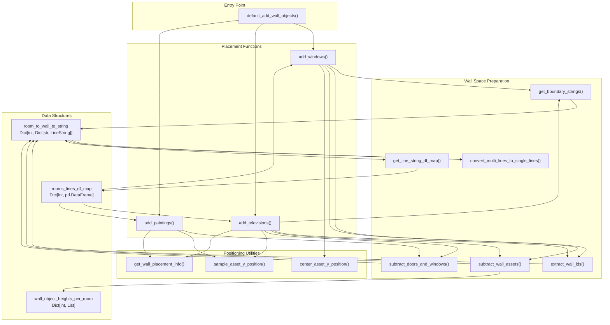
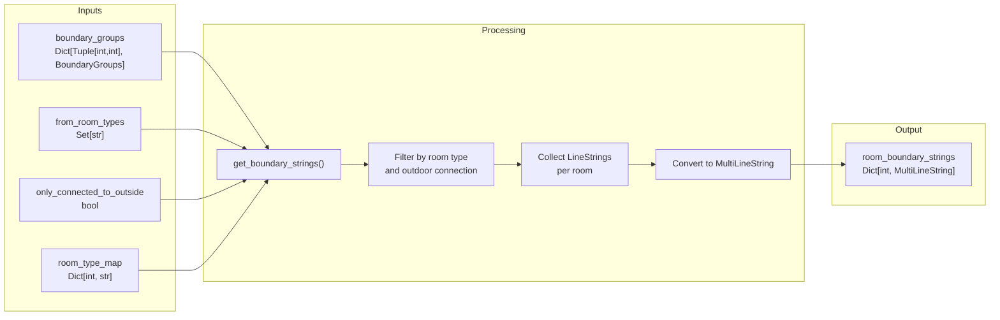
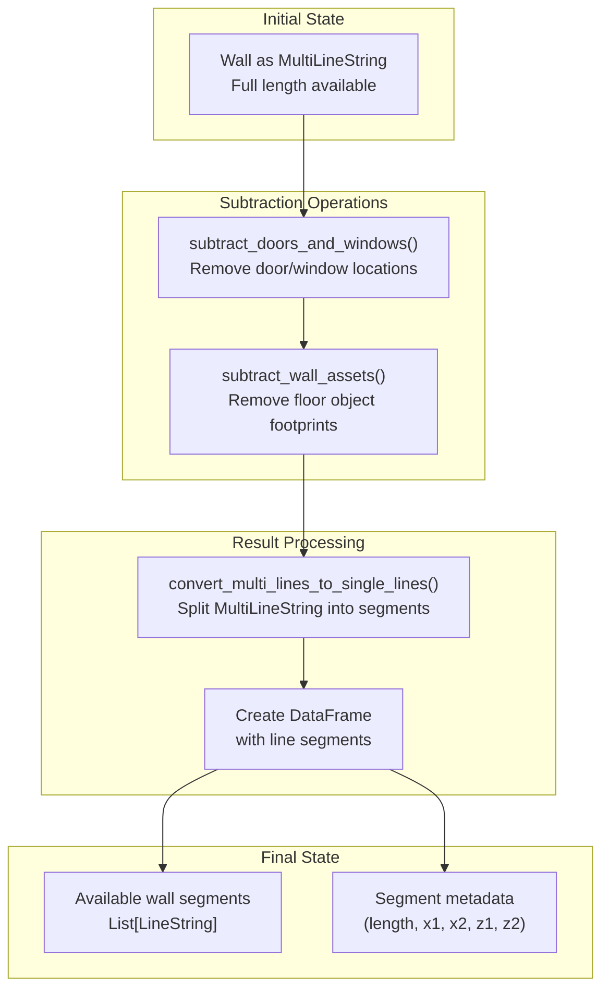
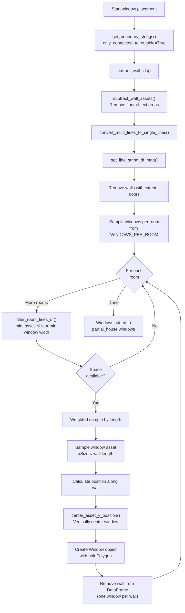
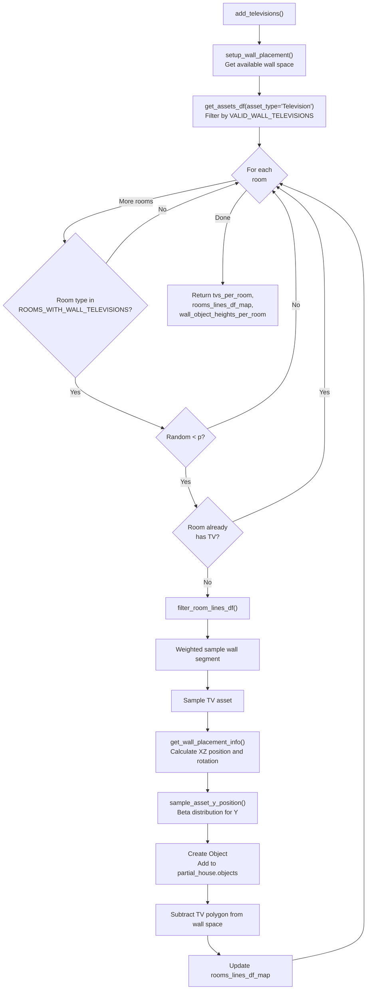
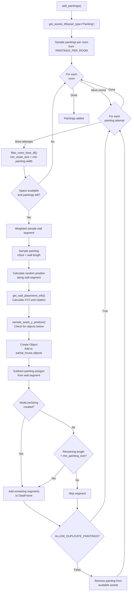
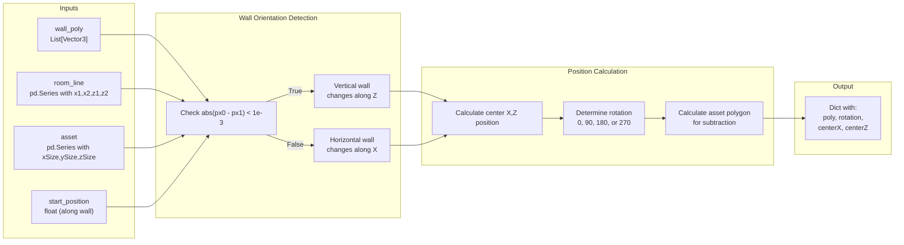

<!-- source: DeepWiki mcp.deepwiki.com · repo allenai/procthor · page 3.6 Wall Object Placement · fetched 2026-10-26 -->

# Wall Object Placement

<details>
<summary>Relevant source files</summary>

The following files were used as context for generating this wiki page:

- [procthor/generation/wall_objects.py](procthor/generation/wall_objects.py)

</details>


## Purpose and Scope

This document describes the wall object placement system, which handles the procedural generation of wall-mounted assets including windows, televisions, and paintings. This stage occurs after floor object placement ([3.5](#3.5)) and before material randomization ([3.7](#3.7)) in the generation pipeline. The system manages available wall space, prevents collisions with existing objects, and ensures physically plausible placement through geometric operations.

For information about other object placement systems, see Floor Object Placement ([3.5](#3.5)). For spatial reasoning primitives used by this system, see Geometric Primitives ([4.1](#4.1)) and Wall Space Management ([4.4](#4.4)).

## Overview

The wall object placement system adds three types of wall-mounted assets to the procedurally generated house:

| Asset Type | Placement Location | Room Type Filtering | Collision Constraints |
|------------|-------------------|---------------------|----------------------|
| Windows | Exterior walls only | Bedroom, Kitchen, LivingRoom | One per wall, no overlap with doors |
| Wall-mounted TVs | Any wall | LivingRoom (80%), Bedroom (40%), Kitchen (25%) | No overlap with doors, windows, or other objects |
| Paintings | Any wall | Bedroom, Kitchen, LivingRoom, Bathroom | No overlap with doors, windows, or other objects |

The main entry point is `default_add_wall_objects()` which orchestrates the placement of all three asset types in sequence.

**Sources:** [procthor/generation/wall_objects.py:1041-1085]()



**Sources:** [procthor/generation/wall_objects.py:1041-1085](), [procthor/generation/wall_objects.py:81-113](), [procthor/generation/wall_objects.py:170-188]()

## Wall Space Management System

The wall object placement system uses a sophisticated wall space tracking mechanism based on shapely geometric operations. Wall boundaries are represented as `MultiLineString` objects, and available space is dynamically updated through polygon subtraction as objects are placed.

### Boundary String Extraction

The `get_boundary_strings()` function extracts wall boundaries for rooms that meet specified criteria:



**Sources:** [procthor/generation/wall_objects.py:81-113]()

The function filters boundaries based on:
- **Room type filtering**: Only includes rooms whose type appears in `from_room_types`
- **Outdoor connection**: When `only_connected_to_outside=True`, only includes boundaries between a room and `OUTDOOR_ROOM_ID`

### Wall ID Generation

Each wall segment is assigned a unique identifier using the `extract_wall_ids()` function. Wall IDs follow the format:

```
wall|{room_id}|{min_x:.2f}|{min_z:.2f}|{max_x:.2f}|{max_z:.2f}
```

This encoding allows for precise identification and tracking of each wall segment throughout the placement process.

**Sources:** [procthor/generation/wall_objects.py:170-188]()

### Polygon Subtraction for Collision Avoidance

Available wall space is tracked by subtracting occupied areas from the `MultiLineString` representing each wall. The system uses two main subtraction operations:

#### 1. Subtracting Floor Objects

The `subtract_wall_assets()` function removes wall space occupied by floor objects placed near walls:

- Objects with `anchor_type == "inMiddle"` are skipped (not near walls)
- For objects below a minimum height threshold, only the footprint is tracked (allows placement above)
- For taller objects, the entire wall area is subtracted (prevents any overlap)

The function returns `wall_object_heights_per_room`, which tracks low objects that can have wall assets placed above them.

**Sources:** [procthor/generation/wall_objects.py:191-262]()

#### 2. Subtracting Doors and Windows

The `subtract_doors_and_windows()` function removes wall space occupied by doors and windows:

- Empty walls (open connections) are completely removed
- Door and window polygons are calculated based on their width and position along the wall
- A padding of `POLYGON_PADDING = 1e-3` is added to avoid floating-point comparison issues

**Sources:** [procthor/generation/wall_objects.py:494-613]()



**Sources:** [procthor/generation/wall_objects.py:191-262](), [procthor/generation/wall_objects.py:494-613](), [procthor/generation/wall_objects.py:265-281]()

### Line String DataFrame

After polygon subtraction, the system converts wall segments into a pandas DataFrame using `get_line_string_df_map()`. Each row represents an available wall segment with the following columns:

| Column | Type | Description |
|--------|------|-------------|
| `length` | float | Length of the wall segment |
| `x1`, `x2` | float | X-axis bounds of the segment |
| `z1`, `z2` | float | Z-axis bounds of the segment |
| `lineString` | LineString | Shapely LineString object |
| `wallId` | str | Wall identifier |

This DataFrame enables efficient filtering and weighted random sampling based on wall segment length.

**Sources:** [procthor/generation/wall_objects.py:283-311]()

## Window Placement

Windows are placed exclusively on exterior walls (walls connecting to the outdoor area) in specific room types. The window placement algorithm is implemented in `add_windows()`.

### Room Type Filtering

Windows are only placed in rooms defined by:

```python
ROOM_TYPES_WITH_WINDOWS = {"Bedroom", "Kitchen", "LivingRoom"}
```

The number of windows per room is sampled from:

```python
WINDOWS_PER_ROOM = {"population": [0, 1, 2], "weights": [0.125, 0.375, 0.5]}
```

This distribution favors rooms with 2 windows (50% probability), followed by 1 window (37.5%), with some rooms having no windows (12.5%).

**Sources:** [procthor/generation/wall_objects.py:163-167]()

### Placement Algorithm



**Sources:** [procthor/generation/wall_objects.py:325-466]()

### Window Positioning

Windows are vertically centered using `center_asset_y_position()`:

```python
def center_asset_y_position(asset_height: float, ceiling_height: float) -> Tuple[float, float]:
    top_wall_position = min(ceiling_height, MAX_CENTER_Y_HEIGHT)  # MAX = 3
    diff = (top_wall_position - asset_height) / 2
    return diff, top_wall_position - diff
```

This centers the window between the floor (y=0) and either the ceiling or 3 meters, whichever is lower.

**Sources:** [procthor/generation/wall_objects.py:116-125]()

### AI2-THOR Constraints

The system enforces several AI2-THOR-specific constraints:

1. **One window per wall**: After placing a window on a wall, that entire wall is removed from consideration
2. **No windows on walls with exterior doors**: Walls containing exterior doors are filtered out before placement
3. **Window hole specification**: Each window includes a `holePolygon` field defining the opening in the wall

**Sources:** [procthor/generation/wall_objects.py:351-365](), [procthor/generation/wall_objects.py:461-465]()

## Television Placement

Wall-mounted televisions are placed using `add_televisions()`. Unlike windows, TVs can be placed on any wall (interior or exterior) and use a more sophisticated vertical positioning algorithm.

### Television Asset Selection

Only specific television assets are allowed for wall mounting:

```python
VALID_WALL_TELEVISIONS = {
    "Television_14", "Television_16", "Television_25",
    "Television_27", "Television_3", "Television_9"
}
```

**Sources:** [procthor/generation/wall_objects.py:877-884]()

### Room Type Probabilities

Television placement is probabilistic and room-type dependent:

```python
ROOMS_WITH_WALL_TELEVISIONS = {
    "LivingRoom": {"p": 0.8},
    "Kitchen": {"p": 0.25},
    "Bedroom": {"p": 0.4},
}
```

The system also skips rooms that already have a television (placed as a floor object).

**Sources:** [procthor/generation/wall_objects.py:886-891](), [procthor/generation/wall_objects.py:929-944]()

### Placement Process



**Sources:** [procthor/generation/wall_objects.py:894-1038]()

### Vertical Positioning with Beta Distribution

Televisions use `sample_asset_y_position()` which employs a beta distribution for natural vertical variation:

- Respects existing wall objects by placing above them if needed
- Uses `BETA_A = 12` and `BETA_B = 12` for a symmetric distribution centered in the available space
- Clamps placement to `MAX_CENTER_Y_HEIGHT = 3` meters

**Sources:** [procthor/generation/wall_objects.py:128-158](), [procthor/generation/wall_objects.py:34-38]()

## Painting Placement

Paintings are placed last, using the remaining wall space after windows and TVs. The `add_paintings()` function shares the same wall space tracking structures prepared by `setup_wall_placement()`.

### Configuration

```python
ROOM_TYPES_WITH_PAINTINGS = {"Bedroom", "Kitchen", "LivingRoom", "Bathroom"}

PAINTINGS_PER_ROOM = {
    "population": [0, 1, 2, 3, 4],
    "weights": [0.05, 0.1, 0.5, 0.25, 0.1],
}

NO_PAINTINGS_ABOVE_ASSETS_OF_HEIGHT = 1.15  # meters
ALLOW_DUPLICATE_PAINTINGS_IN_HOUSE = False
```

The system prevents placing paintings above objects taller than 1.15 meters (e.g., refrigerators, tall cabinets) while allowing placement above shorter objects like counters.

**Sources:** [procthor/generation/wall_objects.py:469-492]()

### Placement Algorithm



**Sources:** [procthor/generation/wall_objects.py:752-874]()

### Dynamic Wall Space Updates

Unlike windows and TVs, paintings update the wall space incrementally after each placement. When a painting is placed:

1. The painting's polygon is subtracted from the current wall segment
2. If the subtraction creates multiple line segments (`MultiLineString`), each segment is added back to the DataFrame
3. Segments shorter than `min_painting_size` are discarded
4. The DataFrame is re-indexed with the new segments

This allows multiple paintings on the same wall, with each painting reducing the available space for subsequent placements.

**Sources:** [procthor/generation/wall_objects.py:834-868]()

## Coordinate Transformation and Positioning

### Wall Placement Coordinate System

The `get_wall_placement_info()` function converts from wall-relative coordinates to world coordinates. Walls in ProcTHOR are defined as 2D polygons with an implicit direction.



**Sources:** [procthor/generation/wall_objects.py:615-710]()

### Rotation Determination

Wall-mounted objects are rotated to face into the room. The rotation is determined by the direction of the wall polygon:

| Wall Orientation | Direction Check | Rotation (degrees) |
|-----------------|-----------------|-------------------|
| Vertical wall | `pz1 > pz0` | 90 |
| Vertical wall | `pz1 < pz0` | 270 |
| Horizontal wall | `px1 > px0` | 180 |
| Horizontal wall | `px1 < px0` | 0 |

The depth offset (`PAINTING_WALL_PADDING = 5e-3`) prevents z-fighting artifacts by slightly offsetting the object from the wall surface.

**Sources:** [procthor/generation/wall_objects.py:659-702](), [procthor/generation/wall_objects.py:478-479]()

### Vertical Position Sampling

The `sample_asset_y_position()` function uses a beta distribution to create natural vertical variation:

```python
rand_range = top_open_position - bottom_open_position - asset_height
center_y_height = (
    bottom_open_position
    + asset_height / 2
    + rand_range * np.random.beta(a=BETA_A, b=BETA_B)
)
```

With `BETA_A = 12` and `BETA_B = 12`, the beta distribution is:
- Symmetric around 0.5
- Concentrated near the center of the available range
- Produces occasional placements near the top or bottom

The function also checks `wall_object_heights_per_room` to ensure the asset is placed above any low floor objects that intersect with its horizontal position.

**Sources:** [procthor/generation/wall_objects.py:128-158]()

## Configuration Constants

### Placement Control

| Constant | Value | Purpose |
|----------|-------|---------|
| `MAX_CENTER_Y_HEIGHT` | 3 | Maximum height for vertically centering objects |
| `BETA_A` | 12 | Beta distribution shape parameter |
| `BETA_B` | 12 | Beta distribution shape parameter |
| `POLYGON_PADDING` | 1e-3 | Padding to avoid floating-point comparison issues |
| `PAINTING_WALL_PADDING` | 5e-3 | Depth offset from wall surface |
| `NO_PAINTINGS_ABOVE_ASSETS_OF_HEIGHT` | 1.15 | Threshold for blocking painting placement |
| `ALLOW_DUPLICATE_PAINTINGS_IN_HOUSE` | False | Whether to allow repeated painting assets |

**Sources:** [procthor/generation/wall_objects.py:27-492]()

### Room Type Filters

```python
ROOM_TYPES_WITH_WINDOWS = {"Bedroom", "Kitchen", "LivingRoom"}
ROOM_TYPES_WITH_PAINTINGS = {"Bedroom", "Kitchen", "LivingRoom", "Bathroom"}
ROOMS_WITH_WALL_TELEVISIONS = {
    "LivingRoom": {"p": 0.8},
    "Kitchen": {"p": 0.25},
    "Bedroom": {"p": 0.4},
}
```

**Sources:** [procthor/generation/wall_objects.py:163-164](), [procthor/generation/wall_objects.py:475-476](), [procthor/generation/wall_objects.py:886-891]()

### Quantity Distributions

```python
WINDOWS_PER_ROOM = {"population": [0, 1, 2], "weights": [0.125, 0.375, 0.5]}
PAINTINGS_PER_ROOM = {"population": [0, 1, 2, 3, 4], "weights": [0.05, 0.1, 0.5, 0.25, 0.1]}
```

These distributions control the maximum number of placement attempts per room. The actual number placed may be lower if wall space is insufficient.

**Sources:** [procthor/generation/wall_objects.py:166-167](), [procthor/generation/wall_objects.py:469-473]()

---

