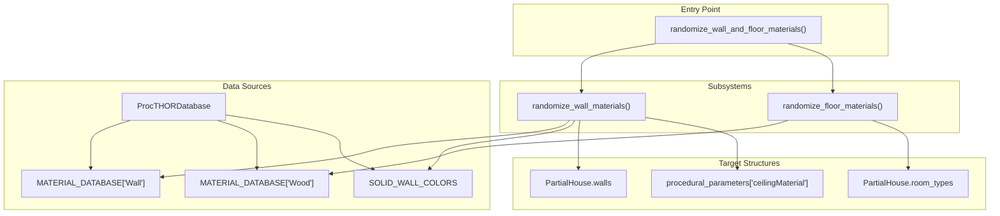
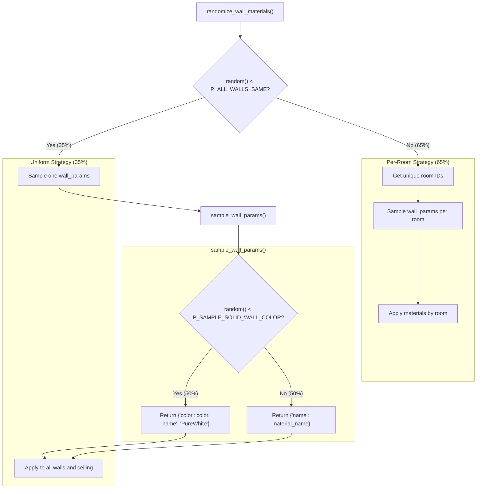
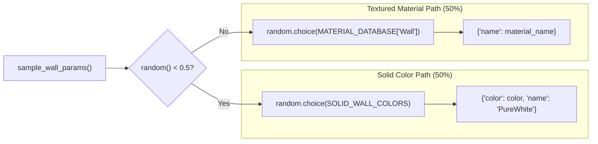
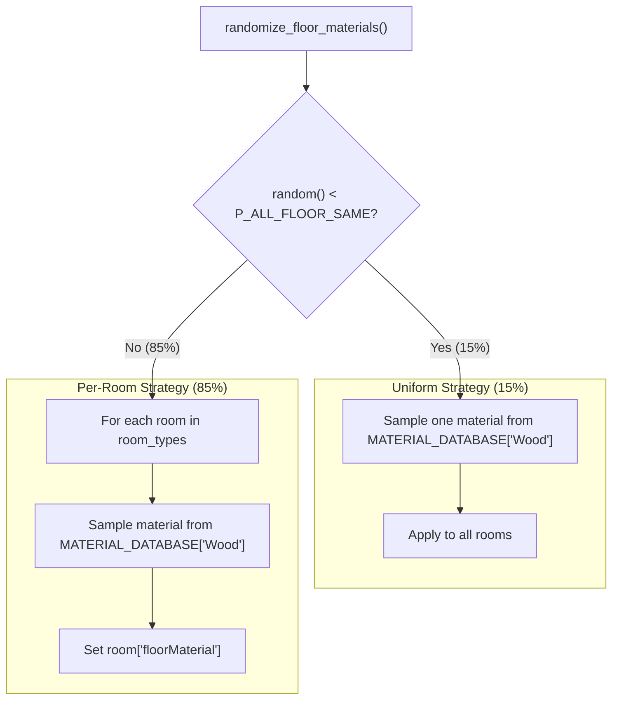
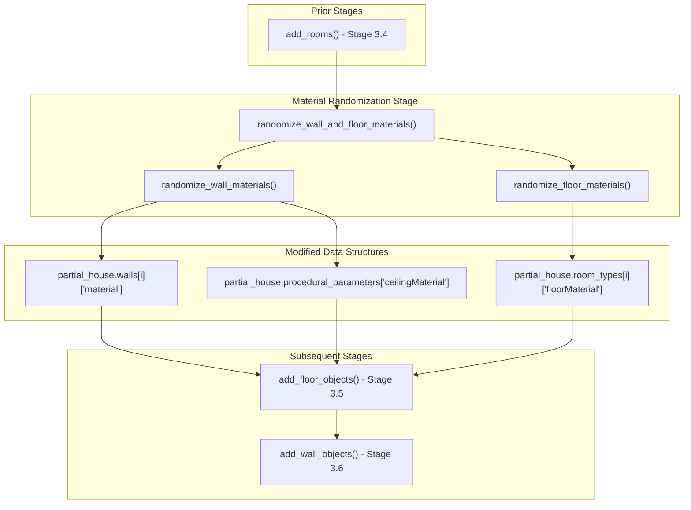

<!-- source: DeepWiki mcp.deepwiki.com · repo allenai/procthor · page 3.7 Material Randomization · fetched 2026-10-26 -->

# Material Randomization

<details>
<summary>Relevant source files</summary>

The following files were used as context for generating this wiki page:

- [procthor/generation/materials.py](procthor/generation/materials.py)

</details>


## Purpose and Scope

This document describes the material randomization system that assigns visual materials to walls, floors, and ceilings in generated houses. Material randomization occurs during the room setup stage and determines the aesthetic appearance of interior surfaces. The system balances visual diversity with cohesive design by probabilistically choosing between uniform materials (all surfaces use the same material) and per-room randomization (each room has independent materials).

For floor and wall object placement that occurs after material randomization, see [Floor Object Placement](#3.5) and [Wall Object Placement](#3.6). For object-specific material and color randomization, see [Object Color and State Randomization](#3.8). For the database of available materials, see [Database Architecture](#5.1).

## System Overview

The material randomization system is implemented in [procthor/generation/materials.py:1-93]() and consists of three primary functions that assign materials to different surface types within a `PartialHouse`. The entry point is `randomize_wall_and_floor_materials()`, which delegates to specialized functions for walls and floors.



**Sources:** [procthor/generation/materials.py:20-27]()

## Probability-Driven Uniformity

The system uses three probability constants to control the aesthetic characteristics of generated houses:

| Constant | Value | Purpose |
|----------|-------|---------|
| `P_ALL_WALLS_SAME` | 0.35 | Probability that all walls (including ceiling) use the same material |
| `P_ALL_FLOOR_SAME` | 0.15 | Probability that all floors use the same material |
| `P_SAMPLE_SOLID_WALL_COLOR` | 0.5 | Probability of using a solid color instead of a textured material for walls |

These constants balance visual coherence with diversity. Lower uniformity probabilities for floors (15%) compared to walls (35%) create more visual variation in flooring while maintaining cohesive wall treatments in many houses.

**Sources:** [procthor/generation/materials.py:10-18]()

## Wall Material Randomization

### Randomization Strategy

The `randomize_wall_materials()` function implements a two-tier strategy:



**Sources:** [procthor/generation/materials.py:29-74]()

### Uniform Wall Strategy

When `random.random() < P_ALL_WALLS_SAME` (35% probability), the function:

1. Calls `sample_wall_params()` once to generate a single material configuration
2. Applies this configuration to all walls in `partial_house.walls`
3. Sets the ceiling material to the same configuration via `partial_house.procedural_parameters["ceilingMaterial"]`

This creates visually cohesive houses where all interior surfaces share the same material treatment.

**Sources:** [procthor/generation/materials.py:48-55]()

### Per-Room Wall Strategy

When uniform randomization is not selected (65% probability), the function:

1. Extracts unique room IDs from all walls
2. Adds a special "ceiling" room ID
3. Generates independent `wall_params` for each room ID
4. Applies room-specific materials to walls based on their `wall["roomId"]`
5. Assigns the "ceiling" material to `procedural_parameters["ceilingMaterial"]`

This approach creates visual distinction between rooms while maintaining uniformity within each room.

**Sources:** [procthor/generation/materials.py:57-73]()

### Wall Parameter Sampling

The `sample_wall_params()` function determines whether to use a solid color or textured material:



**Solid Color Path**: Returns a dictionary with both `"color"` (an RGB color from `SOLID_WALL_COLORS`) and `"name"` (set to `"PureWhite"`). The color field overrides the base material with a solid paint color.

**Textured Material Path**: Returns a dictionary with only `"name"` (a material identifier from `MATERIAL_DATABASE["Wall"]`). This uses the material's built-in texture.

**Sources:** [procthor/generation/materials.py:29-39]()

## Floor Material Randomization

The `randomize_floor_materials()` function implements a simpler strategy than walls, using only textured wood materials (no solid colors):



**Sources:** [procthor/generation/materials.py:76-92]()

### Uniform Floor Strategy

When `random.random() < P_ALL_FLOOR_SAME` (15% probability):

1. Sample one material from `pt_db.MATERIAL_DATABASE["Wood"]`
2. Iterate through all rooms in `partial_house.room_types`
3. Set each `room["floorMaterial"]` to `{"name": floor_material}`

This creates houses with consistent flooring throughout.

**Sources:** [procthor/generation/materials.py:81-87]()

### Per-Room Floor Strategy

When uniform randomization is not selected (85% probability):

1. Iterate through each room in `partial_house.room_types`
2. For each room, independently sample from `pt_db.MATERIAL_DATABASE["Wood"]`
3. Set `room["floorMaterial"]` to `{"name": sampled_material}`

This creates more diverse flooring, with each room potentially having different wood materials.

**Sources:** [procthor/generation/materials.py:89-92]()

## Data Structure Modifications

The material randomization system modifies three distinct data structures within `PartialHouse`:

### Wall Material Assignment

Walls are stored in `partial_house.walls` as dictionaries. Material randomization sets the `"material"` key:

```python
# Structure after material assignment
wall = {
    "roomId": "room_id_string",
    "material": {
        "name": "MaterialName"  # Always present
        "color": {"r": 0.5, "g": 0.5, "b": 0.5}  # Optional, only for solid colors
    },
    # ... other wall properties
}
```

**Sources:** [procthor/generation/materials.py:50-51, 68]()

### Floor Material Assignment

Rooms are stored in `partial_house.room_types` as dictionaries. Material randomization sets the `"floorMaterial"` key:

```python
# Structure after material assignment
room = {
    "floorMaterial": {
        "name": "WoodMaterialName"  # Only wood materials used
    },
    # ... other room properties
}
```

**Sources:** [procthor/generation/materials.py:84-86, 90-92]()

### Ceiling Material Assignment

The ceiling is a global property stored in `partial_house.procedural_parameters`:

```python
# Structure after material assignment
partial_house.procedural_parameters = {
    "ceilingMaterial": {
        "name": "MaterialName",
        "color": {"r": 0.5, "g": 0.5, "b": 0.5}  # Optional
    },
    # ... other procedural parameters
}
```

The ceiling material follows the same sampling logic as walls, using either solid colors or textured materials from `MATERIAL_DATABASE["Wall"]`.

**Sources:** [procthor/generation/materials.py:54, 71-73]()

## Integration with Generation Pipeline

Material randomization occurs during the room setup stage of the generation pipeline. The following diagram shows the relationship between material randomization and adjacent stages:



Material randomization must occur after room creation (which initializes `room_types` and creates wall structures) but before object placement (which may need to coordinate with surface materials for aesthetic consistency).

**Sources:** [procthor/generation/materials.py:20-27]()

## Material Database Interface

The material randomization system depends on three data sources from `ProcTHORDatabase`:

| Database Field | Type | Usage |
|----------------|------|-------|
| `MATERIAL_DATABASE["Wall"]` | `list[str]` | Textured wall and ceiling materials |
| `MATERIAL_DATABASE["Wood"]` | `list[str]` | All floor materials |
| `SOLID_WALL_COLORS` | `list[dict]` | RGB color dictionaries for painted walls |

The `ProcTHORDatabase` object is passed as the `pt_db` parameter to all material randomization functions. These databases are generated offline by the database generation system (see [Database Generation](#5.2)) and included in the package distribution.

**Sources:** [procthor/generation/materials.py:4, 22, 30-38, 82-91]()

---

