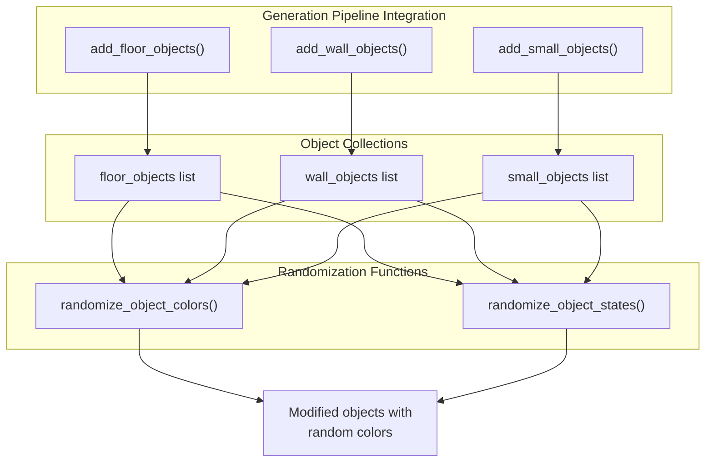
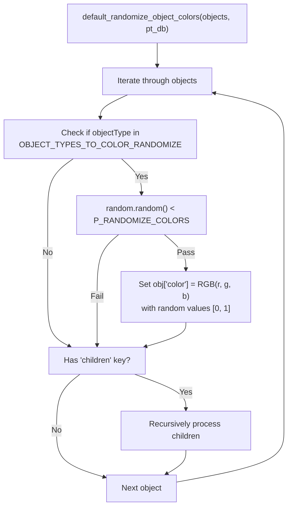
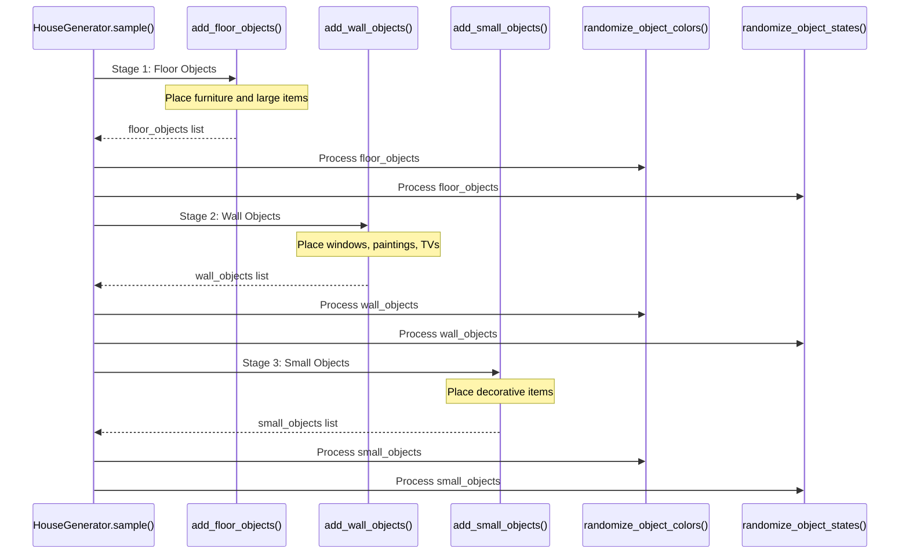
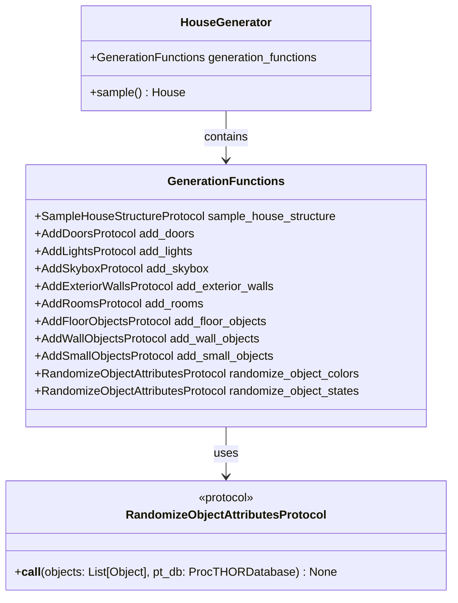

<!-- source: DeepWiki mcp.deepwiki.com · repo allenai/procthor · page 3.8 Object Color and State Randomization · fetched 2026-10-26 -->

# Object Color and State Randomization

<details>
<summary>Relevant source files</summary>

The following files were used as context for generating this wiki page:

- [procthor/generation/__init__.py](procthor/generation/__init__.py)
- [procthor/generation/color_objects.py](procthor/generation/color_objects.py)

</details>


## Purpose and Scope

This page documents the object attribute randomization systems that apply color variation and state changes to placed objects after spatial placement. These systems operate after the object placement stages ([3.5](#3.5), [3.6](#3.6)) to add visual diversity without affecting collision detection or spatial reasoning.

The randomization functions are applied selectively to specific object types and use probability-based sampling to create visual variety. For information about material randomization for walls, floors, and ceilings, see [Material Randomization](#3.7).

**Sources:** [procthor/generation/__init__.py:16](), [procthor/generation/__init__.py:32]()

---

## System Architecture

The randomization system consists of two independent subsystems that modify object attributes after spatial placement:

1. **Color Randomization**: Applies random RGB colors to specific decorative object types
2. **State Randomization**: Modifies openness states for objects with toggleable states

Both systems implement the `RandomizeObjectAttributesProtocol` interface and are invoked multiple times during the generation pipeline—once after each object placement stage.



**Diagram: Object Randomization Pipeline Integration**

The randomization functions are called three times during generation, processing distinct object collections to ensure all objects receive attribute randomization.

**Sources:** [procthor/generation/__init__.py:256-298]()

---

## Color Randomization System

### Overview

The color randomization system applies random RGB colors to specific decorative object types. This system is designed to add visual variety to objects that benefit from color diversity without affecting semantically important objects that should maintain their natural appearance.

### Eligible Object Types

Only three object types are eligible for color randomization:

| Object Type | Rationale |
|-------------|-----------|
| `Vase` | Decorative items that naturally come in many colors |
| `Statue` | Artistic pieces that can be any color |
| `Bottle` | Containers that commonly have colored glass or labels |

**Sources:** [procthor/generation/color_objects.py:10]()

### Probability Control

Color randomization is not applied to every eligible object. The system uses a probability threshold to control diversity:

- **Constant**: `P_RANDOMIZE_COLORS = 0.7`
- **Behavior**: Each eligible object has a 70% chance of receiving a random color
- **Effect**: Approximately 30% of eligible objects retain their default material colors

This probabilistic approach creates a mix of colored and naturally-textured objects, preventing scenes from appearing too uniform or artificial.

**Sources:** [procthor/generation/color_objects.py:12-13]()

### Implementation Details



**Diagram: Color Randomization Algorithm Flow**

The algorithm performs the following steps:

1. **Type Check**: Query `ASSET_ID_DATABASE` to determine if object type is in `OBJECT_TYPES_TO_COLOR_RANDOMIZE`
2. **Probability Check**: Generate a random value and compare against `P_RANDOMIZE_COLORS`
3. **Color Application**: If both checks pass, assign a random RGB color with components in range [0.0, 1.0]
4. **Recursive Processing**: Process any child objects recursively to handle hierarchical object structures

**Sources:** [procthor/generation/color_objects.py:16-33]()

### Color Representation

Colors are represented using the `RGB` type with floating-point components:

```python
obj["color"] = RGB(r=random.random(), g=random.random(), b=random.random())
```

Each component (red, green, blue) is independently sampled from a uniform distribution over [0.0, 1.0], producing a wide variety of colors including pastels, saturated hues, and near-grayscale values.

**Sources:** [procthor/generation/color_objects.py:27-29]()

---

## State Randomization System

### Overview

The state randomization system modifies the openness states of objects that have toggleable states (e.g., open/closed). This system is implemented in a separate module and follows the same protocol as color randomization.

### Function Interface

The state randomization function follows the `RandomizeObjectAttributesProtocol`:

```python
def default_randomize_object_states(
    objects: List[Object], 
    pt_db: ProcTHORDatabase
) -> None
```

Like color randomization, this function:
- Accepts a list of objects to process
- Has access to the `ProcTHORDatabase` for querying object metadata
- Modifies objects in-place
- Returns `None`

**Sources:** [procthor/generation/__init__.py:32]()

### State Modification Strategy

State randomization typically applies to objects with binary states:
- Cabinet doors (open/closed)
- Drawers (open/closed)
- Books (open/closed)
- Laptops (open/closed)
- Boxes (open/closed)

The specific implementation logic resides in `procthor/generation/object_states.py`, which determines:
1. Which object types support state randomization
2. The probability of applying state changes
3. The valid states for each object type

**Sources:** [procthor/generation/__init__.py:32]()

---

## Integration with Generation Pipeline

### Timing and Invocation

Both randomization functions are invoked immediately after object placement stages, ensuring that all objects receive attribute randomization before the house is finalized:



**Diagram: Randomization Invocation Sequence**

**Sources:** [procthor/generation/__init__.py:256-298]()

### Object List Slicing

The implementation uses careful list slicing to ensure each randomization call processes only the objects added in the most recent stage:

| Stage | Objects Processed | Slice Expression |
|-------|------------------|------------------|
| Floor Objects | All objects placed in floor stage | `[*partial_house.objects]` |
| Wall Objects | Objects added after floor stage | `[*partial_house.objects[len(floor_objects):]]` |
| Small Objects | Objects added after wall stage | `[*partial_house.objects[len(floor_objects) + len(wall_objects):]]` |

This slicing strategy prevents redundant processing—each object is randomized exactly once, immediately after it is placed.

**Sources:** [procthor/generation/__init__.py:265-298]()

### GenerationFunctions Structure

The randomization functions are stored in the `GenerationFunctions` dataclass, which aggregates all generation stage functions:



**Diagram: GenerationFunctions Class Structure with Randomization Protocols**

The default implementations are:
- `randomize_object_colors`: `default_randomize_object_colors`
- `randomize_object_states`: `default_randomize_object_states`

Users can customize randomization behavior by providing alternative implementations when constructing a `HouseGenerator`.

**Sources:** [procthor/generation/__init__.py:52-80]()

---

## Customization

### Overriding Default Functions

Users can customize randomization behavior by providing alternative implementations:

```python
from procthor.generation import HouseGenerator, GenerationFunctions
from procthor.databases import DEFAULT_PROCTHOR_DATABASE

def custom_randomize_colors(objects, pt_db):
    # Custom color randomization logic
    pass

def custom_randomize_states(objects, pt_db):
    # Custom state randomization logic
    pass

custom_gf = GenerationFunctions(
    # ... other functions ...
    randomize_object_colors=custom_randomize_colors,
    randomize_object_states=custom_randomize_states,
)

generator = HouseGenerator(
    split="train",
    generation_functions=custom_gf
)
```

This allows researchers to:
- Modify color palettes (e.g., restrict to specific hue ranges)
- Change probability distributions
- Add randomization for additional object types
- Disable randomization entirely (by providing no-op functions)

**Sources:** [procthor/generation/__init__.py:83-95]()

---

## Summary Table

| Aspect | Color Randomization | State Randomization |
|--------|-------------------|-------------------|
| **Function** | `default_randomize_object_colors` | `default_randomize_object_states` |
| **Module** | `procthor/generation/color_objects.py` | `procthor/generation/object_states.py` |
| **Eligible Types** | Vase, Statue, Bottle | Objects with toggleable states |
| **Probability** | `P_RANDOMIZE_COLORS = 0.7` | Implementation-specific |
| **Value Range** | RGB [0.0, 1.0] for each component | Binary or enumerated states |
| **Recursive** | Yes (processes children) | Implementation-specific |
| **Invocations** | 3 (after floor, wall, small objects) | 3 (after floor, wall, small objects) |
| **Customizable** | Yes (via `GenerationFunctions`) | Yes (via `GenerationFunctions`) |

**Sources:** [procthor/generation/color_objects.py:1-34](), [procthor/generation/__init__.py:63-64]()

---

