<!-- source: DeepWiki mcp.deepwiki.com · repo allenai/procthor · page 4 Spatial Reasoning Systems · fetched 2026-10-26 -->

# Spatial Reasoning Systems

<details>
<summary>Relevant source files</summary>

The following files were used as context for generating this wiki page:

- [procthor/generation/objects.py](procthor/generation/objects.py)
- [procthor/generation/wall_objects.py](procthor/generation/wall_objects.py)

</details>


## Purpose and Scope

This document covers the spatial reasoning systems that enable physically plausible object placement in ProcTHOR. These systems handle geometric primitives, collision detection, available space tracking, and position calculation for both floor and wall objects. The spatial reasoning layer ensures that objects do not overlap and maintains appropriate spacing based on object type and placement location.

For information about how these spatial systems are used during specific generation stages, see [Generation Stages](#3). For database-driven placement rules and asset metadata, see [Database System](#5).

## System Architecture

The spatial reasoning systems operate on multiple geometric representations that are progressively refined as objects are placed:

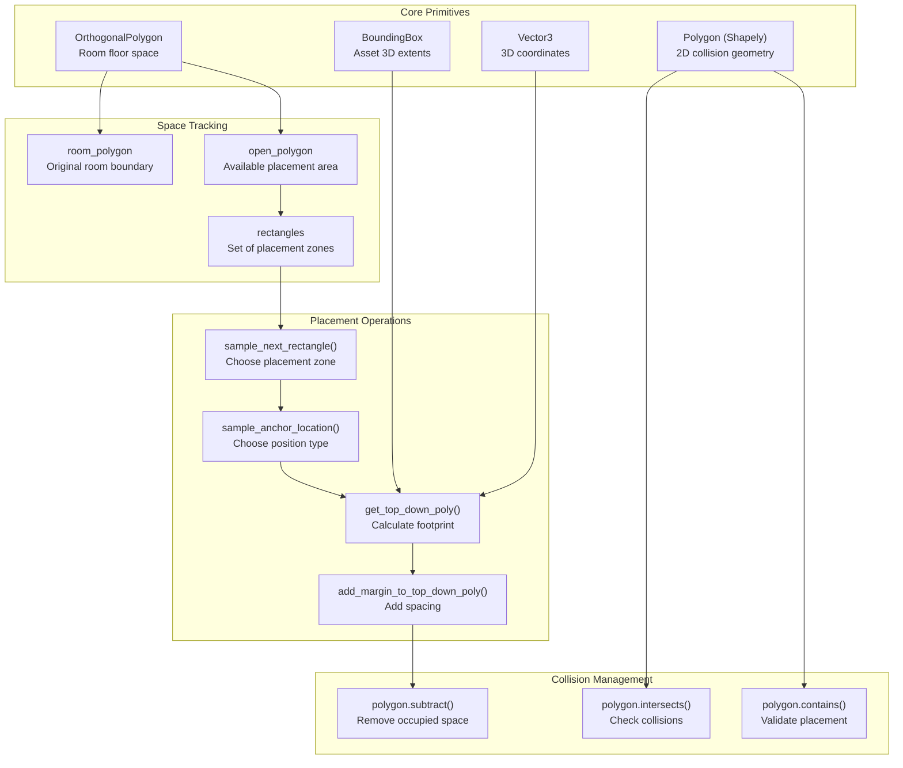

**Sources:** [procthor/generation/objects.py:235-343](), [procthor/generation/objects.py:504-595]()

## Geometric Primitives

### OrthogonalPolygon

The `OrthogonalPolygon` class wraps a Shapely polygon and provides operations optimized for axis-aligned rectangular spaces. It maintains cached lists of unique x and z coordinates that form the grid lines of the room.

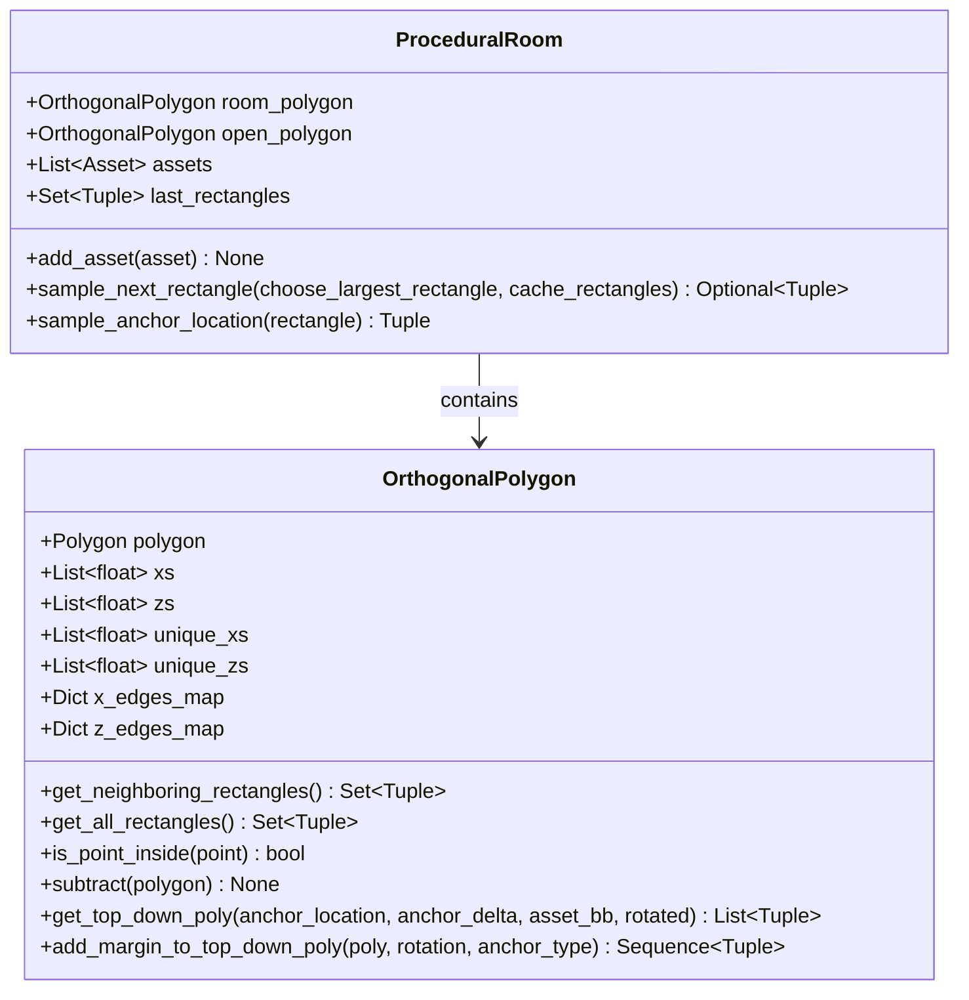

The class decomposes complex room shapes into collections of non-overlapping axis-aligned rectangles. This decomposition enables efficient sampling of placement locations weighted by available area.

**Key Operations:**
- **get_neighboring_rectangles()**: Returns the minimal set of rectangles formed by the grid of unique x and z coordinates ([procthor/generation/objects.py:280-290]())
- **_join_neighboring_rectangles()**: Merges adjacent rectangles to create larger placement zones ([procthor/generation/objects.py:292-312]())
- **get_all_rectangles()**: Iteratively joins rectangles until no more merging is possible ([procthor/generation/objects.py:314-322]())

**Sources:** [procthor/generation/objects.py:235-343]()

### Asset Footprints

Assets and asset groups maintain multiple polygon representations:

| Attribute | Purpose | Includes Padding | Includes Margin |
|-----------|---------|------------------|-----------------|
| `top_down_poly` | Base footprint | ✓ | ✗ |
| `top_down_poly_with_margin` | Collision boundary | ✓ | ✓ |
| `poly_xs`, `poly_zs` | Cached coordinates for base | ✓ | ✗ |
| `margined_poly_xs`, `margined_poly_zs` | Cached coordinates for collision | ✓ | ✓ |

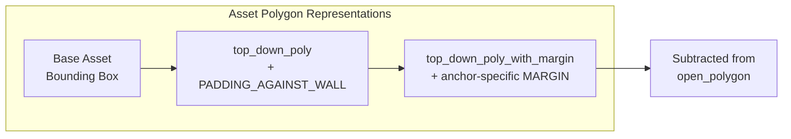

**Sources:** [procthor/generation/objects.py:88-145](), [procthor/generation/objects.py:147-233]()

### Wall Space Representation

Wall objects use `LineString` and `MultiLineString` from Shapely to represent available wall segments:

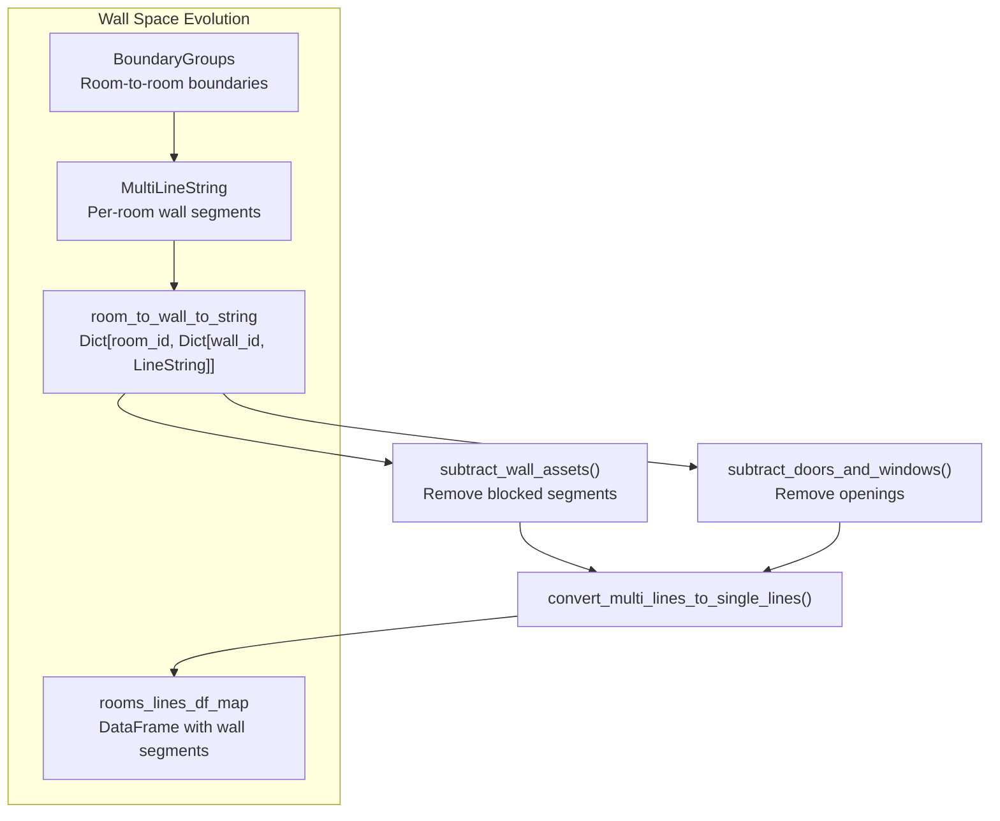

**Sources:** [procthor/generation/wall_objects.py:81-113](), [procthor/generation/wall_objects.py:170-188]()

## Rectangle Sampling and Anchoring

### Rectangle Selection

The `sample_next_rectangle()` method selects a placement zone from available rectangles using a hybrid strategy:

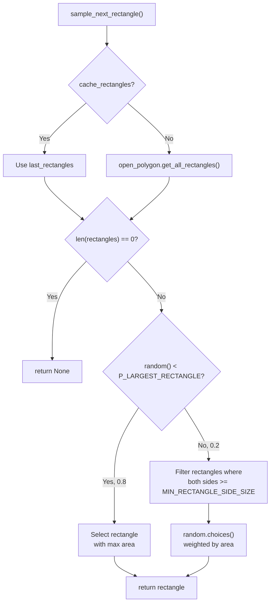

**Configuration Constants:**
- `P_LARGEST_RECTANGLE = 0.8`: Probability of choosing the largest available rectangle ([procthor/constants.py]())
- `MIN_RECTANGLE_SIDE_SIZE`: Minimum dimension for valid rectangles ([procthor/constants.py]())

**Sources:** [procthor/generation/objects.py:550-594]()

### Anchor Delta System

The anchor delta system defines 9 possible placement positions relative to a reference point, numbered 0-8:

```
    0   1   2
        |
    3 - 4 - 5
        |
    6   7   8
```

Each anchor delta specifies both the reference point direction and the object's rotation:

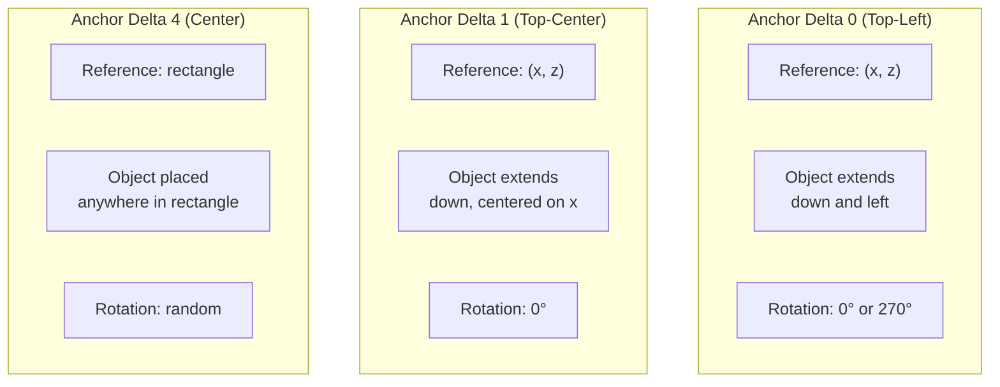

The `get_top_down_poly()` static method calculates the asset footprint based on anchor delta:

**Sources:** [procthor/generation/objects.py:411-501]()

### Anchor Type Selection

The `sample_anchor_location()` method determines the anchor type by analyzing the rectangle's relationship to the room boundary:

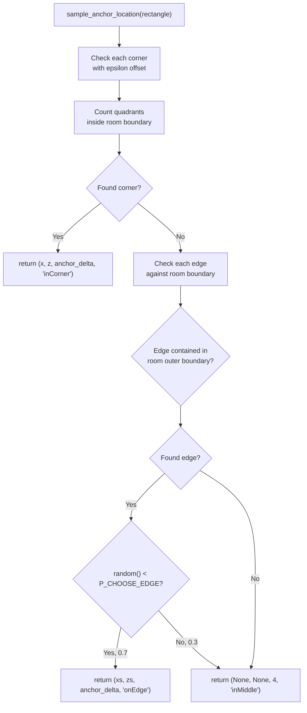

**Corner Detection Logic**: A point is a corner if it has exactly 1 or 2 adjacent quadrants inside the room boundary ([procthor/generation/objects.py:862-878]())

**Sources:** [procthor/generation/objects.py:817-899](), [procthor/constants.py]()

## Collision Avoidance

### Margin Calculation

Margins define minimum spacing between objects and vary by anchor type:

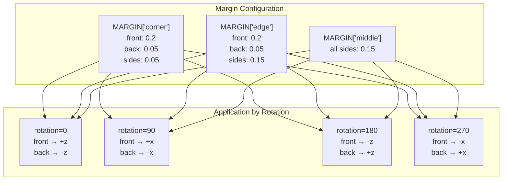

The `add_margin_to_top_down_poly()` method expands the base polygon by the appropriate margin values based on rotation and anchor type ([procthor/generation/objects.py:346-408]()).

**Key Constant:**
- `PADDING_AGAINST_WALL`: Additional padding when objects are against walls ([procthor/constants.py]())

**Sources:** [procthor/generation/objects.py:346-408](), [procthor/constants.py]()

### Polygon Subtraction for Floor Objects

The collision avoidance workflow for floor objects uses progressive polygon subtraction:

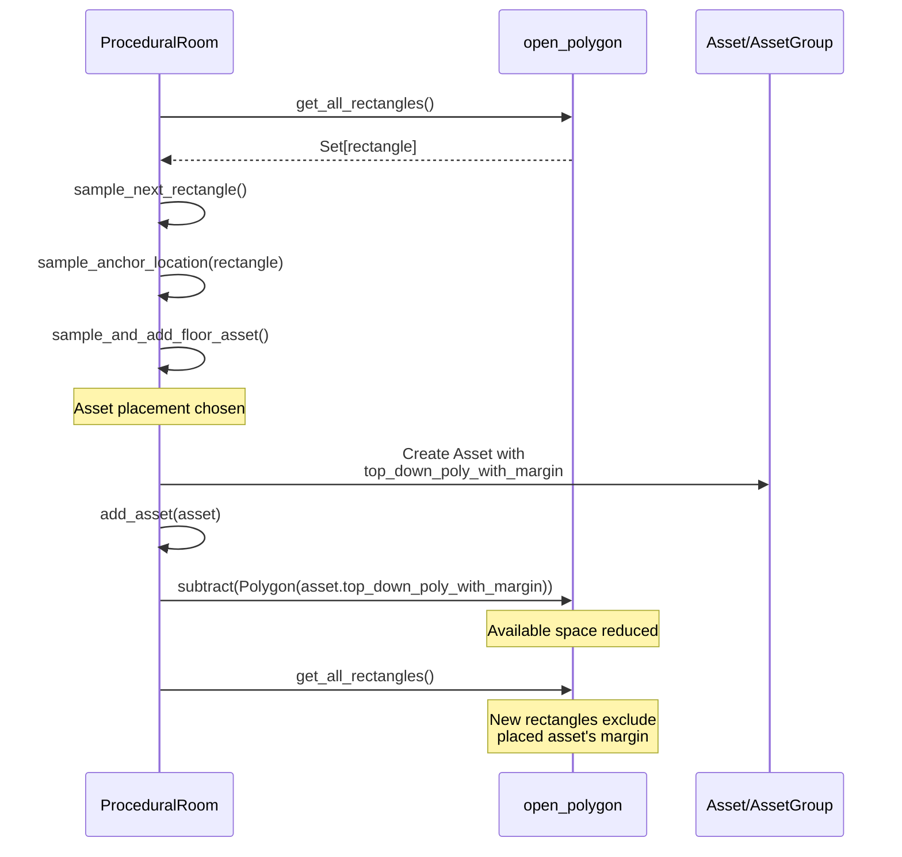

The `open_polygon` is maintained as a `MultiPolygon` after subtractions, and the rectangle extraction process automatically accounts for the reduced available space.

**Sources:** [procthor/generation/objects.py:542-548](), [procthor/generation/objects.py:338-340]()

### Wall Space Subtraction

Wall object placement uses `LineString` subtraction to track available wall segments:

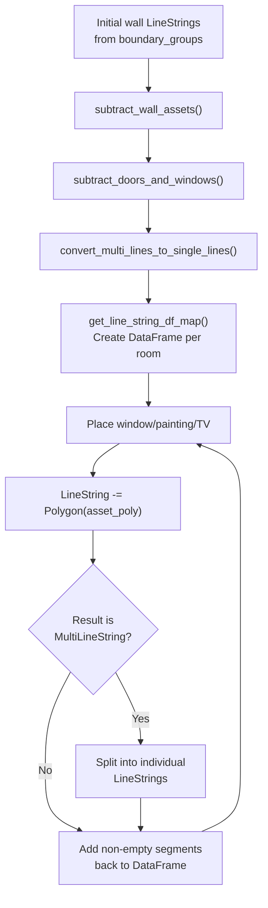

**Key Functions:**
- `subtract_wall_assets()`: Removes wall segments behind floor objects taller than `min_height` ([procthor/generation/wall_objects.py:191-262]())
- `subtract_doors_and_windows()`: Removes segments occupied by doors and windows ([procthor/generation/wall_objects.py:494-613]())
- `add_padding_to_poly()`: Adds `POLYGON_PADDING` to avoid floating-point comparison issues ([procthor/generation/wall_objects.py:41-58]())

**Sources:** [procthor/generation/wall_objects.py:191-262](), [procthor/generation/wall_objects.py:494-613](), [procthor/generation/wall_objects.py:265-281]()

### Collision Retry Logic

Asset groups may have internal collisions between objects. The placement system retries up to `MAX_INTERSECTING_OBJECT_RETRIES` times:

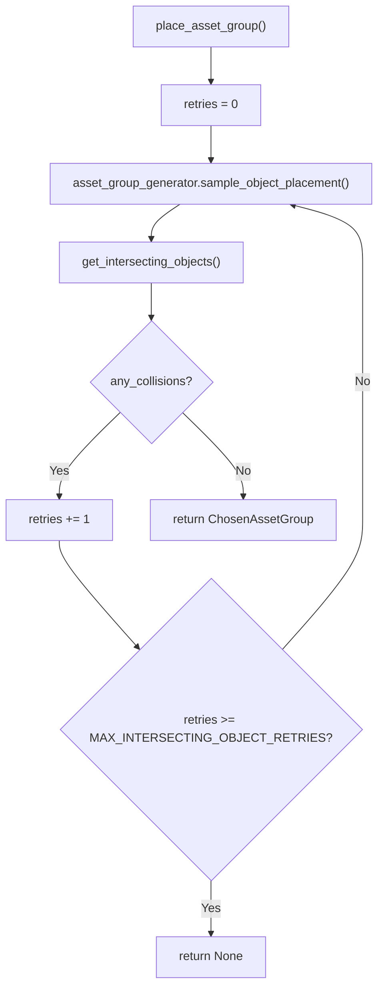

**Constant:** `MAX_INTERSECTING_OBJECT_RETRIES = 5` ([procthor/constants.py]())

**Sources:** [procthor/generation/objects.py:752-795](), [procthor/constants.py]()

## Wall Space Management

### Boundary Extraction

The `get_boundary_strings()` function extracts wall segments from room boundaries:

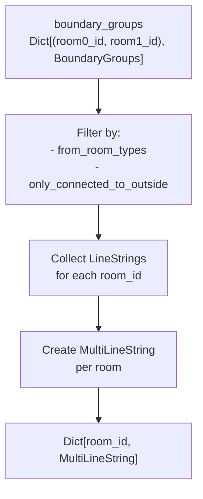

**Parameters:**
- `from_room_types`: Set of room types to include (e.g., `{"Bedroom", "Kitchen", "LivingRoom"}`)
- `only_connected_to_outside`: If `True`, only include boundaries where one room is `OUTDOOR_ROOM_ID`

**Sources:** [procthor/generation/wall_objects.py:81-113]()

### Wall ID Generation

Each wall segment is assigned a unique identifier based on its spatial coordinates:

```
wall|{room_id}|{min_x:.2f}|{min_z:.2f}|{max_x:.2f}|{max_z:.2f}
```

This identifier is stable across processing steps and enables tracking which walls have had objects placed on them.

**Sources:** [procthor/generation/wall_objects.py:170-188]()

### Wall Object Height Tracking

For wall objects that can stack vertically (e.g., painting above a short table), the system maintains height information:

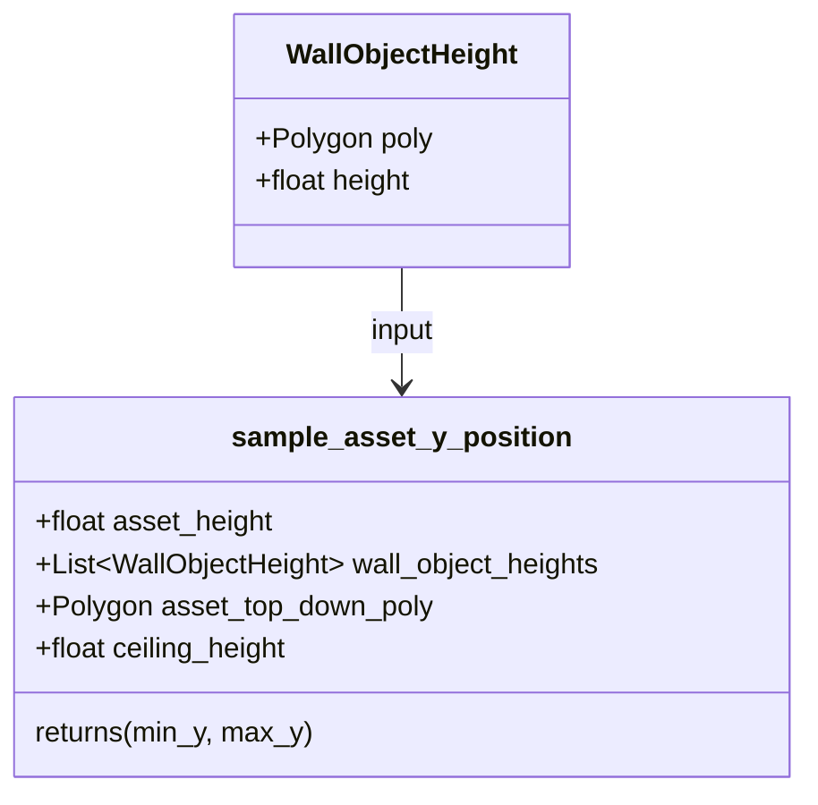

The `sample_asset_y_position()` function:
1. Finds the maximum height of any object below the asset's footprint
2. Calculates available vertical space between that height and `min(ceiling_height, MAX_CENTER_Y_HEIGHT)`
3. Samples a y-position using a beta distribution for visual variety

**Configuration:**
- `MAX_CENTER_Y_HEIGHT = 3.0`: Clips vertical centering for tall rooms ([procthor/generation/wall_objects.py:27-32]())
- `BETA_A = 12`, `BETA_B = 12`: Beta distribution parameters for centered sampling ([procthor/generation/wall_objects.py:34-38]())
- `NO_PAINTINGS_ABOVE_ASSETS_OF_HEIGHT = 1.15`: Minimum height to block painting placement ([procthor/generation/wall_objects.py:481-482]())

**Sources:** [procthor/generation/wall_objects.py:128-158](), [procthor/generation/wall_objects.py:191-262]()

### DataFrame-Based Wall Segment Management

Wall segments are converted to pandas DataFrames for efficient filtering and sampling:

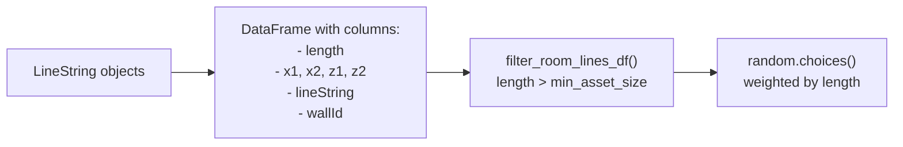

This approach enables:
- Efficient filtering by minimum size requirements
- Weighted random sampling proportional to wall segment length
- Fast lookups by wall ID

**Sources:** [procthor/generation/wall_objects.py:283-311](), [procthor/generation/wall_objects.py:314-322]()

## Placement Position Calculation

### Floor Object Position

The `sample_place_asset_in_rectangle()` method calculates the final 3D position:

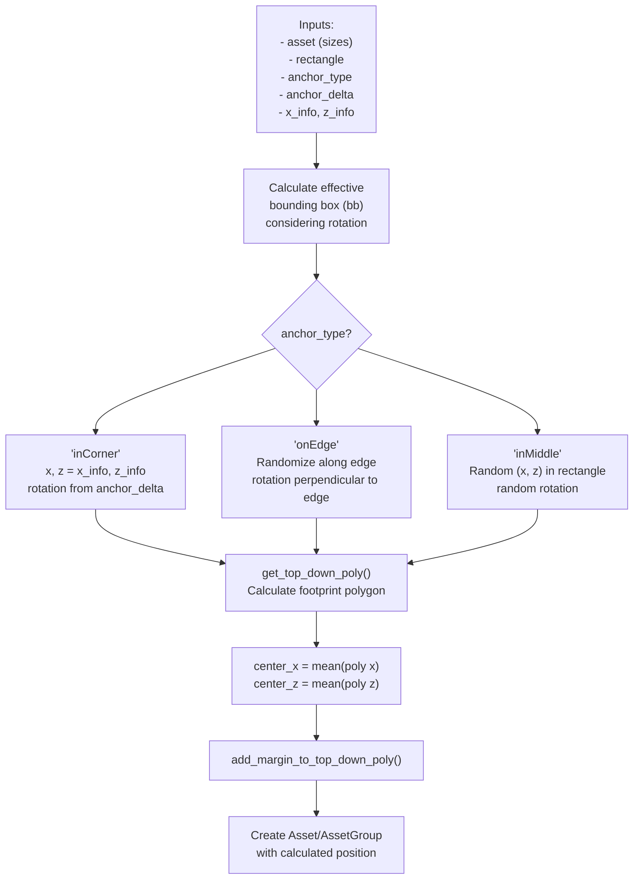

**Key Insight:** The position calculation separates the anchor point calculation (which varies by anchor type) from the footprint geometry calculation (which is standardized via `get_top_down_poly()`).

**Sources:** [procthor/generation/objects.py:596-739]()

### Wall Object Position

The `get_wall_placement_info()` function calculates placement data for wall objects:

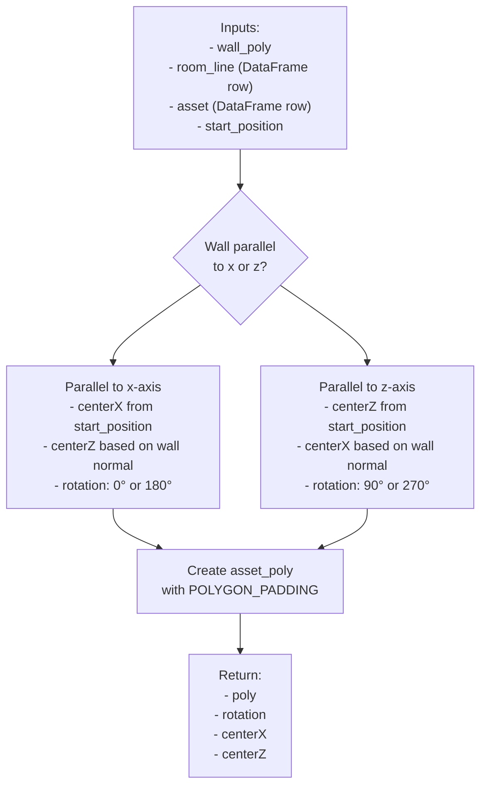

The rotation is determined by the wall polygon's point order, ensuring objects face into the room:
- Wall points increasing in z → rotation 90° (object extends +x)
- Wall points decreasing in z → rotation 270° (object extends -x)
- Wall points increasing in x → rotation 180° (object extends -z)
- Wall points decreasing in x → rotation 0° (object extends +z)

**Wall Padding:** `PAINTING_WALL_PADDING = 5e-3` prevents z-fighting by slightly offsetting objects from the wall surface ([procthor/generation/wall_objects.py:478-479]()).

**Sources:** [procthor/generation/wall_objects.py:615-710]()

## Integration with Generation Pipeline

The spatial reasoning systems are invoked at multiple stages:

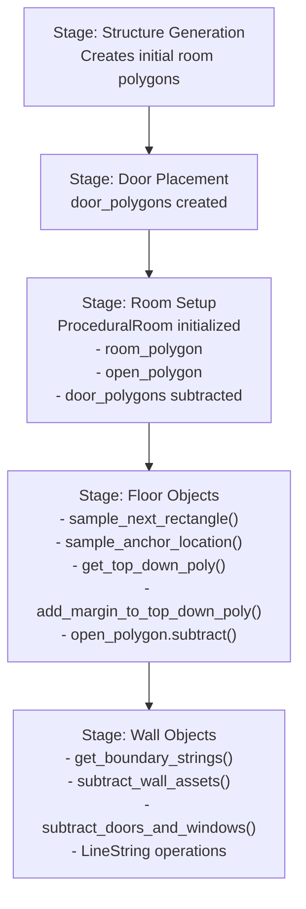

**Sources:** [procthor/generation/objects.py:1157-1188](), [procthor/generation/objects.py:1191-1304](), [procthor/generation/wall_objects.py:1041-1084]()

---

