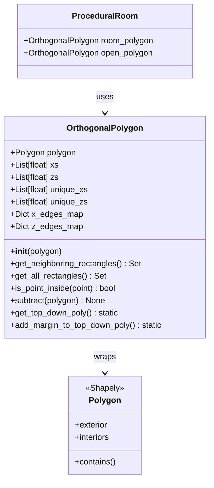
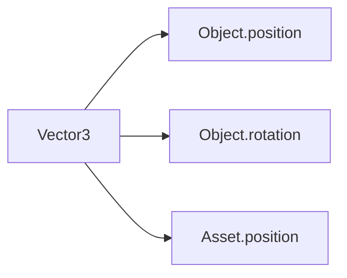
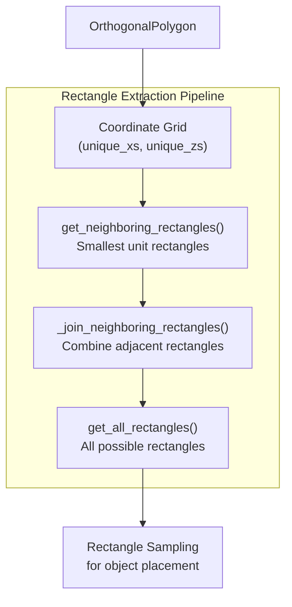
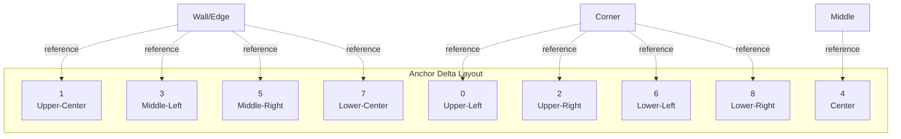
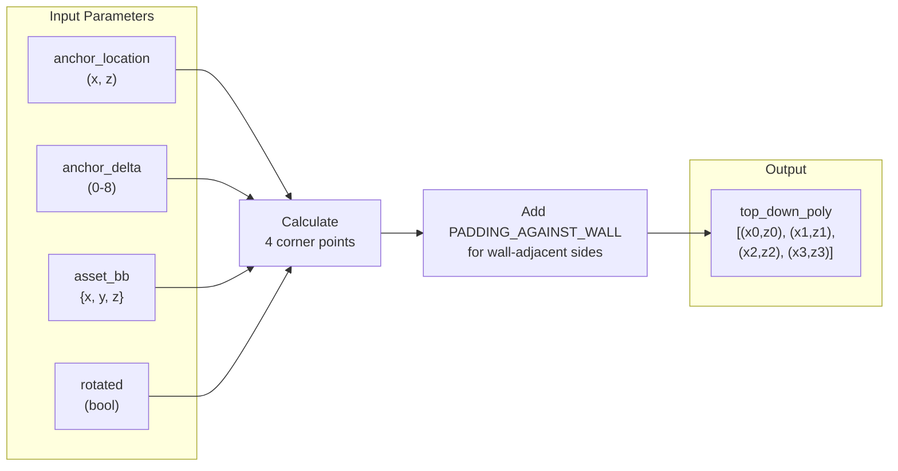
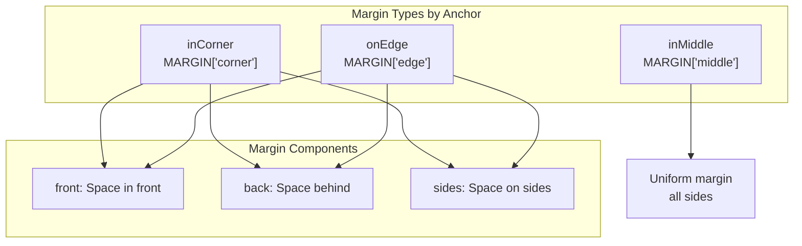
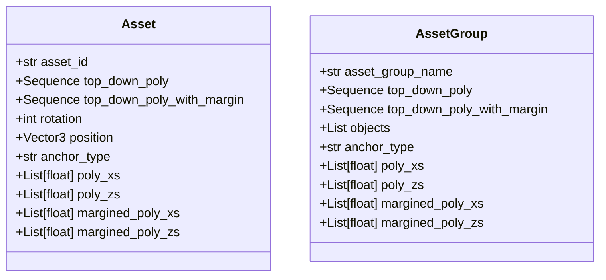
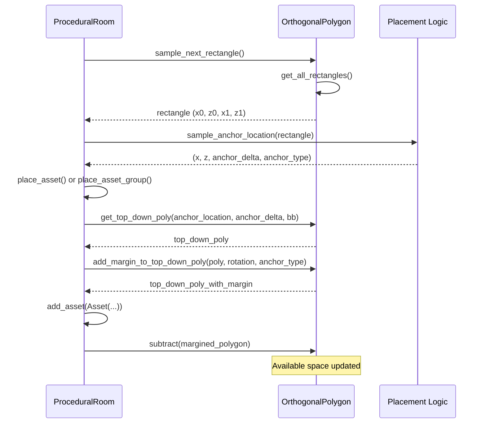

<!-- source: DeepWiki mcp.deepwiki.com · repo allenai/procthor · page 4.1 Geometric Primitives · fetched 2026-10-26 -->

# Geometric Primitives

<details>
<summary>Relevant source files</summary>

The following files were used as context for generating this wiki page:

- [procthor/generation/objects.py](procthor/generation/objects.py)

</details>


## Purpose and Scope

This document describes the fundamental geometric data structures and operations used throughout ProcTHOR for spatial reasoning. These primitives form the foundation for collision detection, object placement, and spatial queries during house generation.

The key geometric types covered are:
- `OrthogonalPolygon`: Axis-aligned 2D polygons for room footprints and available space tracking
- `Vector3`: 3D coordinate representation for object positions
- Shapely geometry types: Standard 2D geometric primitives
- Bounding box representations: Object dimension specifications

For information about how these primitives are used in placement strategies and collision avoidance, see [Rectangle Sampling and Anchoring](#4.2) and [Collision Avoidance](#4.3).

---

## Core Geometric Types

### OrthogonalPolygon

The `OrthogonalPolygon` class is the primary spatial data structure in ProcTHOR, representing axis-aligned 2D polygons that define room boundaries and track available placement space.



**Key Attributes:**

| Attribute | Type | Purpose |
|-----------|------|---------|
| `polygon` | `Polygon` | The underlying Shapely polygon geometry |
| `xs`, `zs` | `List[float]` | All x and z coordinates from polygon vertices |
| `unique_xs`, `unique_zs` | `List[float]` | Sorted unique x and z coordinates (defines grid) |
| `x_edges_map` | `Dict[float, List]` | Maps x-coordinates to vertical edge segments |
| `z_edges_map` | `Dict[float, List]` | Maps z-coordinates to horizontal edge segments |

The `OrthogonalPolygon` is initialized from a Shapely `Polygon` or `MultiPolygon` and automatically extracts a coordinate grid system. This grid enables efficient rectangle extraction for object placement.

**Sources:** [procthor/generation/objects.py:235-263]()

### Vector3

The `Vector3` type represents 3D coordinates throughout the system. It is defined in the types module and used for:
- Object positions (center points in 3D space)
- Object rotations (Euler angles)
- Bounding box centers



**Sources:** [procthor/generation/objects.py:36](), [procthor/generation/objects.py:102](), [procthor/generation/objects.py:728-730]()

### Shapely Geometry Types

ProcTHOR uses the Shapely library's geometric primitives for 2D spatial operations:

| Type | Usage |
|------|-------|
| `Polygon` | Room boundaries, object footprints, door areas |
| `LineString` | Wall edges, boundary segments |
| `Point` | Point-in-polygon tests |
| `MultiPolygon` | Fragmented spaces after polygon subtraction |

These types provide robust geometric operations like containment testing, intersection, and boolean operations.

**Sources:** [procthor/generation/objects.py:37]()

### Bounding Box Representation

Bounding boxes are represented as dictionaries with dimension keys:

```python
# Example bounding box structure
bb = {
    "x": 1.2,  # Width (left-right)
    "y": 0.8,  # Height (up-down)
    "z": 0.6   # Depth (front-back)
}
```

This representation is used in:
- `ChosenAsset` dictionaries (`xSize`, `ySize`, `zSize`)
- `ChosenAssetGroup` dictionaries
- Asset metadata from the database
- Top-down polygon generation

**Sources:** [procthor/generation/objects.py:56-62](), [procthor/generation/objects.py:606-610]()

---

## Polygon Operations

### Rectangle Extraction

The `OrthogonalPolygon` decomposes arbitrary orthogonal polygons into sets of axis-aligned rectangles. This decomposition is fundamental to the object placement algorithm.



**`get_neighboring_rectangles()`**

Identifies the minimal unit rectangles by testing midpoints of each grid cell:

```
For each pair of adjacent x-coordinates (x0, x1):
    For each pair of adjacent z-coordinates (z0, z1):
        If midpoint (mid_x, mid_z) is inside polygon:
            Add rectangle (x0, z0, x1, z1)
```

**`get_all_rectangles()`**

Iteratively joins neighboring rectangles to create all possible rectangular regions. This enables placement algorithms to select from rectangles of various sizes.

**Sources:** [procthor/generation/objects.py:280-322]()

### Point Containment Testing

The `is_point_inside()` method delegates to Shapely's efficient point-in-polygon algorithm:

```python
def is_point_inside(self, point: Tuple[float, float]) -> bool:
    return self.polygon.contains(Point(*point))
```

This is used to:
- Verify anchor positions are within room boundaries
- Identify corner locations
- Test rectangle validity

**Sources:** [procthor/generation/objects.py:335-336]()

### Polygon Subtraction

The `subtract()` method is the core collision avoidance mechanism. As objects are placed, their footprints are subtracted from the available space:

```python
def subtract(self, polygon: Polygon) -> None:
    self.polygon -= polygon
    self._set_attributes()
```

After subtraction, the polygon may fragment into a `MultiPolygon`. The attributes (coordinate grid, edge maps) are automatically recalculated.

**Sources:** [procthor/generation/objects.py:338-340]()

### Edge Maps

Edge maps enable efficient spatial queries:

**`x_edges_map`**: Maps each x-coordinate to vertical edge segments at that x-value
```python
# Format: {x_coordinate: [(z_start, z_end), ...]}
```

**`z_edges_map`**: Maps each z-coordinate to horizontal edge segments at that z-value
```python
# Format: {z_coordinate: [(x_start, x_end), ...]}
```

These maps are used internally for edge detection and boundary queries.

**Sources:** [procthor/generation/objects.py:258-278]()

---

## Top-Down Polygon Generation

### Anchor Delta System

The anchor delta system defines 9 discrete placement orientations relative to a reference point. This system controls how objects are positioned relative to walls and corners.



**Anchor Delta to Placement Mapping:**

| Delta | Location | Typical Use | Rotation Logic |
|-------|----------|-------------|----------------|
| 0 | Upper-left | Corner placement | Object extends right and down |
| 1 | Upper-center | Edge placement | Object extends down, centered horizontally |
| 2 | Upper-right | Corner placement | Object extends left and down |
| 3 | Middle-left | Edge placement | Object extends right, centered vertically |
| 4 | Center | Middle placement | Object centered in both axes |
| 5 | Middle-right | Edge placement | Object extends left, centered vertically |
| 6 | Lower-left | Corner placement | Object extends right and up |
| 7 | Lower-center | Edge placement | Object extends up, centered horizontally |
| 8 | Lower-right | Corner placement | Object extends left and up |

**Sources:** [procthor/generation/objects.py:410-501]()

### The `get_top_down_poly()` Method

This static method generates the 2D footprint polygon for an asset based on its anchor location, delta, and dimensions:



**Example: Anchor Delta 0 (Upper-Left Corner)**

```python
# For anchor_delta == 0, not rotated:
top_down_poly = [
    (x, z),  # Anchor point (upper-left)
    (x, z + asset_bb["z"] + PADDING_AGAINST_WALL),  # Lower-left
    (x - asset_bb["x"] - PADDING_AGAINST_WALL, z + asset_bb["z"] + PADDING_AGAINST_WALL),  # Lower-right
    (x - asset_bb["x"] - PADDING_AGAINST_WALL, z),  # Upper-right
]
```

The polygon always includes `PADDING_AGAINST_WALL` on sides adjacent to walls, preventing objects from being flush against boundaries.

**Sources:** [procthor/generation/objects.py:410-501]()

### Margin Addition with `add_margin_to_top_down_poly()`

After generating the base footprint, margins are added to create the collision polygon. Margins vary by anchor type:



**Margin Application by Rotation:**

The method applies margins directionally based on the object's rotation (0°, 90°, 180°, 270°):

- **Rotation 0°**: Front = +z, Back = -z, Sides = ±x
- **Rotation 90°**: Front = +x, Back = -x, Sides = ±z
- **Rotation 180°**: Front = -z, Back = +z, Sides = ±x
- **Rotation 270°**: Front = -x, Back = +x, Sides = ±z

For `inMiddle` anchor types, a uniform margin is applied to all sides.

**Sources:** [procthor/generation/objects.py:345-408]()

---

## Integration with Asset Placement

### Asset and AssetGroup Classes

The `Asset` and `AssetGroup` classes store both the base footprint and the margined footprint:



**Footprint Usage:**

| Polygon Type | Purpose |
|--------------|---------|
| `top_down_poly` | Actual object extent (includes padding) |
| `top_down_poly_with_margin` | Collision boundary (includes margin) |

When an asset is added to a room, the margined polygon is subtracted from the available space, ensuring proper spacing between objects.

**Sources:** [procthor/generation/objects.py:88-145](), [procthor/generation/objects.py:147-232]()

---

## Coordinate System Conventions

ProcTHOR uses a right-handed coordinate system with the following conventions:

**Axis Meanings:**
- **X-axis**: Left-right (horizontal)
- **Y-axis**: Up-down (vertical/height)
- **Z-axis**: Front-back (depth)

**Top-Down Perspective:**
- The XZ plane represents the floor/ceiling view
- Polygons are defined in the XZ plane
- Y-coordinates represent height above the floor

**Rotation Convention:**
- Rotations are specified in degrees around the Y-axis (yaw)
- 0° = facing +Z direction
- 90° = facing +X direction
- 180° = facing -Z direction
- 270° = facing -X direction

**Sources:** [procthor/generation/objects.py:418-419]()

---

## Usage Example Flow



**Sources:** [procthor/generation/objects.py:504-739](), [procthor/generation/objects.py:596-739]()

---

