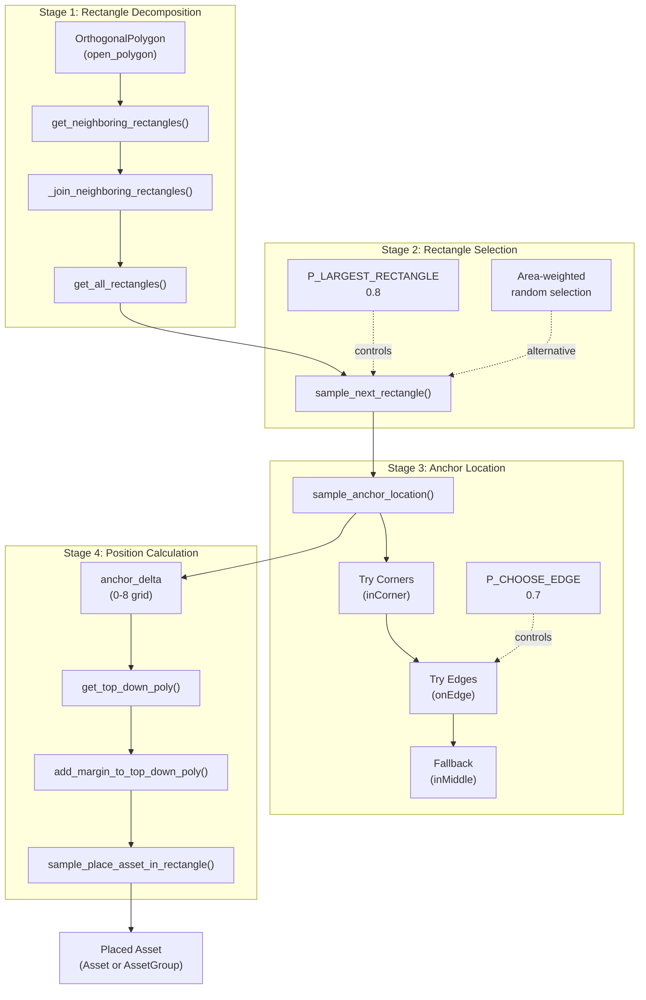
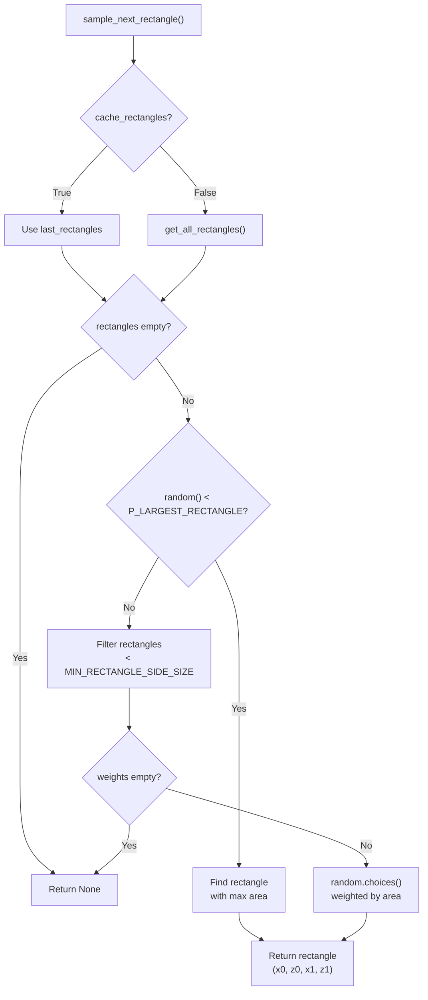
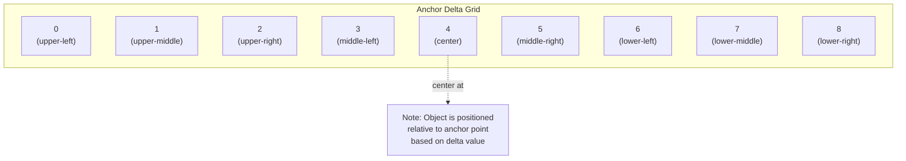
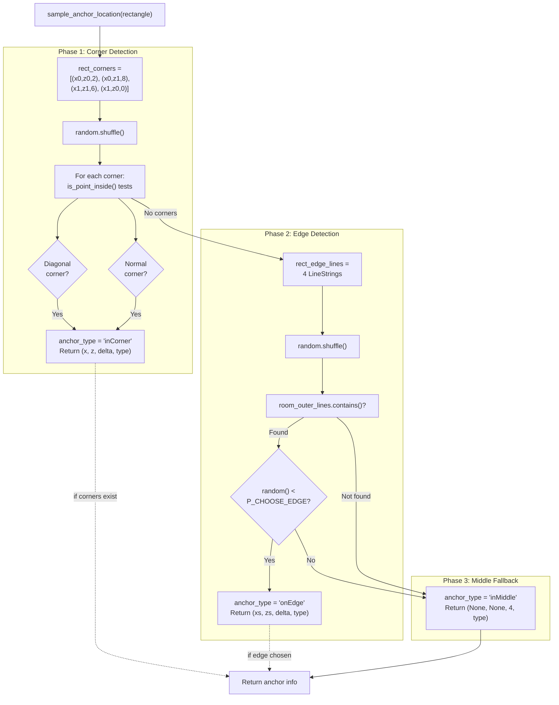
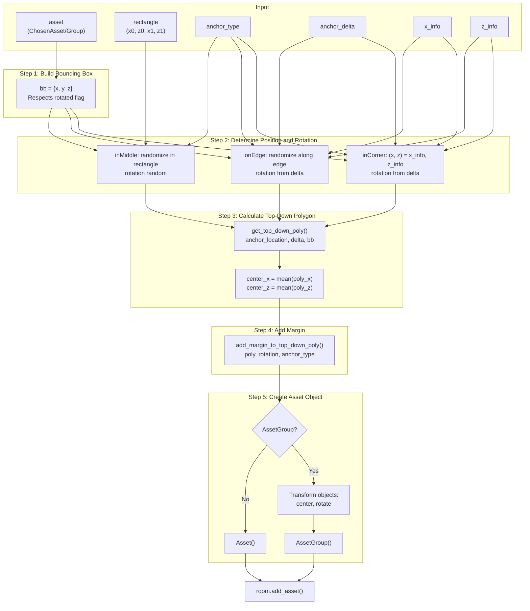
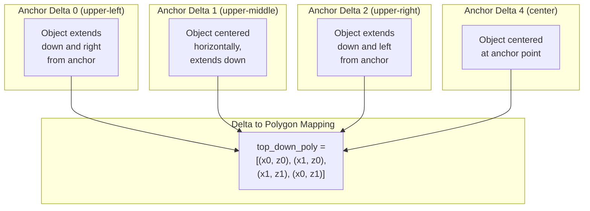
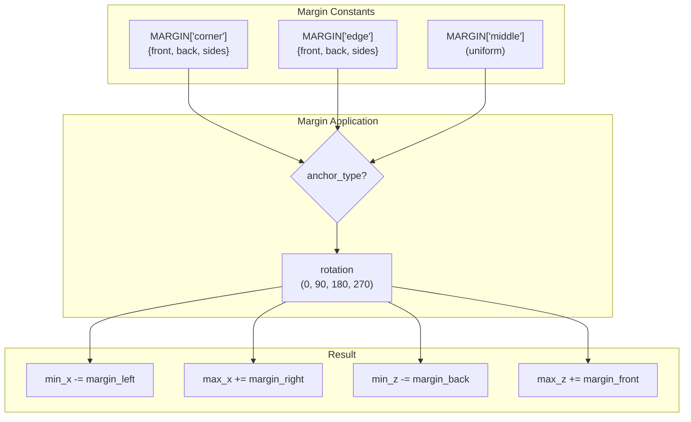
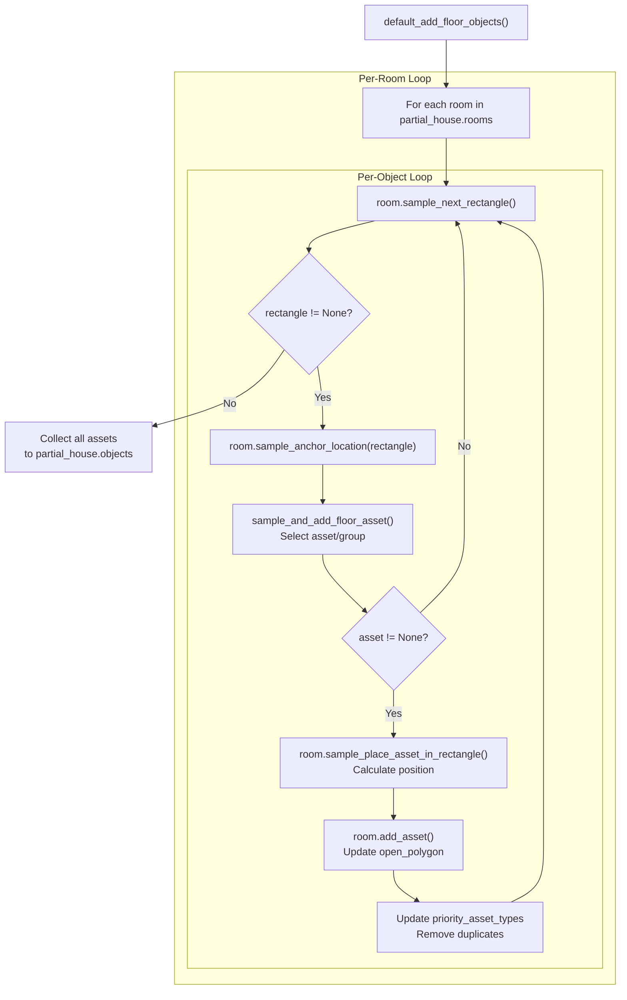

<!-- source: DeepWiki mcp.deepwiki.com · repo allenai/procthor · page 4.2 Rectangle Sampling and Anchoring · fetched 2026-10-26 -->

# Rectangle Sampling and Anchoring

<details>
<summary>Relevant source files</summary>

The following files were used as context for generating this wiki page:

- [procthor/generation/objects.py](procthor/generation/objects.py)

</details>


## Purpose and Scope

This document describes the **rectangle sampling and anchoring system**, which determines where objects are placed within rooms. This system decomposes available floor space into rectangles, selects a rectangle probabilistically, and then positions objects within that rectangle using a 9-position anchor grid (anchor delta 0-8) combined with three anchor types (corner, edge, middle). This two-stage process ensures diverse object placements while maintaining physical plausibility and avoiding collisions.

For information about collision detection and margin calculation, see [Collision Avoidance](#4.3). For geometric primitives like `OrthogonalPolygon`, see [Geometric Primitives](#4.1). For the overall object placement pipeline, see [Floor Object Placement](#3.5).

## System Overview



**Sources:** [procthor/generation/objects.py:235-502]()

## Rectangle Decomposition

The `OrthogonalPolygon` class decomposes available floor space into a set of all possible axis-aligned rectangles that fit within the polygon. This decomposition provides candidate placement locations for objects.

### Grid-Based Decomposition Algorithm

```mermaid
graph LR
    subgraph "Input"
        POLY["Polygon<br/>(available space)"]
    end
    
    subgraph "Step 1: Extract Grid"
        UX["unique_xs<br/>(sorted x coords)"]
        UZ["unique_zs<br/>(sorted z coords)"]
    end
    
    subgraph "Step 2: Find Base Rectangles"
        GNR["get_neighboring_rectangles()"]
        CHECK["Check midpoint<br/>is_point_inside()"]
        BASE_RECTS["Base rectangles"]
    end
    
    subgraph "Step 3: Join Rectangles"
        JOIN["_join_neighboring_rectangles()"]
        SHARE["Find rectangles<br/>sharing 2 points"]
        UNION["Create union<br/>rectangle"]
    end
    
    subgraph "Step 4: Iterate"
        CURR["Current set"]
        NEW["New candidates"]
        MERGE["Merge sets"]
        CONVERGE{"Converged?"}
    end
    
    subgraph "Output"
        ALL_RECTS["All rectangles"]
    end
    
    POLY --> UX
    POLY --> UZ
    UX --> GNR
    UZ --> GNR
    GNR --> CHECK
    CHECK --> BASE_RECTS
    BASE_RECTS --> JOIN
    JOIN --> SHARE
    SHARE --> UNION
    UNION --> CURR
    CURR --> NEW
    NEW --> MERGE
    MERGE --> CONVERGE
    CONVERGE -->|No| JOIN
    CONVERGE -->|Yes| ALL_RECTS
```



**Sources:** [procthor/generation/objects.py:280-322]()

### Implementation Details

The decomposition occurs in `OrthogonalPolygon.get_all_rectangles()`:

1. **Base Rectangle Extraction** [procthor/generation/objects.py:280-290]():
   - For each pair of consecutive x-coordinates and z-coordinates
   - Calculate midpoint `(mid_x, mid_z)`
   - If midpoint is inside polygon, add rectangle `(x0, z0, x1, z1)`
   
2. **Rectangle Joining** [procthor/generation/objects.py:292-312]():
   - For each pair of rectangles, check if they share exactly 2 corner points
   - If so, create merged rectangle with `min` and `max` of all coordinates
   - Continue until no new rectangles can be formed

3. **Termination** [procthor/generation/objects.py:314-322]():
   - Stop when `len(rects) == len(curr_rects)` (convergence)

| Property | Description |
|----------|-------------|
| **Input** | `OrthogonalPolygon.polygon` (available space after subtraction) |
| **Grid Points** | `unique_xs`, `unique_zs` - all corner coordinates |
| **Base Rectangles** | Smallest axis-aligned rectangles within polygon |
| **All Rectangles** | Complete set including merged rectangles |

**Sources:** [procthor/generation/objects.py:280-322]()

## Rectangle Selection Strategy

Once all rectangles are computed, `ProceduralRoom.sample_next_rectangle()` selects one using a probabilistic strategy that balances exploration (small spaces) with exploitation (large spaces).

### Selection Algorithm



**Sources:** [procthor/generation/objects.py:550-594]()

### Selection Parameters

| Parameter | Value | Purpose |
|-----------|-------|---------|
| `P_LARGEST_RECTANGLE` | 0.8 | Probability of selecting largest available rectangle |
| `MIN_RECTANGLE_SIDE_SIZE` | Defined in constants | Minimum side length for valid rectangle |
| `cache_rectangles` | Boolean flag | Reuse previous computation when placement failed |

The selection strategy is:

1. **Cache optimization** [procthor/generation/objects.py:557-562](): If previous placement failed and `cache_rectangles=True`, reuse last computation
2. **Largest rectangle bias** [procthor/generation/objects.py:567-577](): With 80% probability, choose rectangle with maximum area
3. **Area-weighted sampling** [procthor/generation/objects.py:579-594](): Otherwise, randomly sample with probability proportional to area, filtering out rectangles with sides smaller than `MIN_RECTANGLE_SIDE_SIZE`

**Sources:** [procthor/generation/objects.py:550-594](), [procthor/constants.py]()

## Anchor Delta System

The **anchor delta** is an integer in `[0, 1, 2, 3, 4, 5, 6, 7, 8]` that specifies where an object should be positioned relative to an anchor point. This system provides 9 discrete positioning options arranged in a 3×3 grid.

### The 0-8 Grid



As documented in [procthor/generation/objects.py:821-844]():

```
    0   1   2
        |
    3 - 4 - 5
        |
    6   7   8
```

- **Delta 4**: Center object at `(x, z)`
- **Delta 8**: Object's upper-left corner at `(x, z)` (bottom-right of anchor)
- **Delta 0**: Object's lower-right corner at `(x, z)` (upper-left of anchor)
- **Delta 1**: Object's lower edge centered at `(x, z)` (upper-middle of anchor)

**Sources:** [procthor/generation/objects.py:817-899]()

## Anchor Type Classification

Before calculating the final position, `sample_anchor_location()` classifies the rectangle's relationship to the room boundary and determines the **anchor type**.

### Anchor Type Decision Flow



**Sources:** [procthor/generation/objects.py:817-899]()

### Corner Detection Logic

The corner detection uses a point-in-polygon test with epsilon perturbation [procthor/generation/objects.py:858-876]():

```
For each rectangle corner (x, z):
    Test 4 epsilon-perturbed points:
    - q1 = (x + ε, z + ε)
    - q2 = (x - ε, z + ε)
    - q3 = (x - ε, z - ε)
    - q4 = (x + ε, z - ε)
    
    If diagonal corners inside: corner is "DiagCorner"
    If only one quadrant inside: corner is normal corner
```

### Edge Detection Logic

Edge detection checks if rectangle edges align with room boundaries [procthor/generation/objects.py:880-896]():

```
For each rectangle edge:
    Create LineString from edge coordinates
    If room_outer_lines.contains(rect_edge_line):
        This is a valid edge placement
```

| Anchor Type | Description | Anchor Delta Options | Return Format |
|-------------|-------------|---------------------|---------------|
| **inCorner** | Rectangle corner aligns with room corner | 0, 2, 6, 8 | `(x, z, delta, "inCorner")` |
| **onEdge** | Rectangle edge aligns with room wall | 1, 3, 5, 7 | `(xs, zs, delta, "onEdge")` |
| **inMiddle** | No wall contact (middle of room) | 4 | `(None, None, 4, "inMiddle")` |

**Sources:** [procthor/generation/objects.py:817-899]()

## Position Calculation

Once the anchor location and delta are determined, `sample_place_asset_in_rectangle()` calculates the final object position and orientation.

### Position Calculation Pipeline



**Sources:** [procthor/generation/objects.py:596-739]()

### Top-Down Polygon Calculation

The `get_top_down_poly()` method [procthor/generation/objects.py:410-501]() calculates the object's footprint based on anchor delta:



Each delta value has a specific formula. For example, delta 0 [procthor/generation/objects.py:421-430]():

```
top_down_poly = [
    (x, z),
    (x, z + asset_bb[rot2] + PADDING_AGAINST_WALL),
    (x - asset_bb[rot1] - PADDING_AGAINST_WALL, 
     z + asset_bb[rot2] + PADDING_AGAINST_WALL),
    (x - asset_bb[rot1] - PADDING_AGAINST_WALL, z),
]
```

**Sources:** [procthor/generation/objects.py:410-501]()

### Rotation Determination

Rotation is determined based on anchor type and delta [procthor/generation/objects.py:611-652]():

| Anchor Type | Anchor Delta | Rotation Logic |
|-------------|--------------|----------------|
| **inCorner** | 0 | `270°` if rotated else `0°` |
| **inCorner** | 2 | `90°` if rotated else `0°` |
| **inCorner** | 6 | `270°` if rotated else `180°` |
| **inCorner** | 8 | `90°` if rotated else `180°` |
| **onEdge** | 1, 7 | `180°` if delta==7 else `0°` |
| **onEdge** | 3, 5 | `90°` if delta==5 else `270°` |
| **inMiddle** | 4 | Random `[90°, 270°]` if rotated else `[0°, 180°]` |

### Randomization for Edge and Middle

For **onEdge** placements [procthor/generation/objects.py:622-640]():
- If delta 1 or 7 (horizontal edges): randomize x-coordinate along edge
- If delta 3 or 5 (vertical edges): randomize z-coordinate along edge

For **inMiddle** placements [procthor/generation/objects.py:641-652]():
- Randomize both x and z within rectangle bounds
- Ensure object fits: `x ∈ [x0 + bb["x"]/2, x1 - bb["x"]/2]`

**Sources:** [procthor/generation/objects.py:596-739]()

## Margin Addition

After calculating the base polygon, `add_margin_to_top_down_poly()` expands it to create separation between objects [procthor/generation/objects.py:346-408]().

### Margin Specifications



**Sources:** [procthor/generation/objects.py:346-408]()

### Margin Calculation Logic

The margin varies by anchor type [procthor/generation/objects.py:368-406]():

1. **inMiddle** [procthor/generation/objects.py:368-376](): Uniform margin on all sides
2. **onEdge** [procthor/generation/objects.py:378-381](): Different front/back/sides
3. **inCorner** [procthor/generation/objects.py:382-385](): Different front/back/sides

For edge and corner types, the margin direction depends on rotation:

| Rotation | Front Direction | Back Direction |
|----------|----------------|----------------|
| 0° | +z | -z |
| 90° | +x | -x |
| 180° | -z | +z |
| 270° | -x | +x |

The margined polygon is used for collision detection, while the base polygon defines the actual object placement.

**Sources:** [procthor/generation/objects.py:346-408](), [procthor/constants.py]()

## Integration with Object Placement

The rectangle sampling and anchoring system integrates with the overall object placement pipeline in `default_add_floor_objects()` [procthor/generation/objects.py:1191-1304]().

### End-to-End Flow



**Sources:** [procthor/generation/objects.py:1191-1304]()

### Cache Optimization

The system includes a caching mechanism [procthor/generation/objects.py:1229-1233]():

```python
cache_rectangles = i != 0 and asset is None
if cache_rectangles:
    # Don't resample failed rectangles
    room.last_rectangles.remove(rectangle)
    rectangle = room.sample_next_rectangle(cache_rectangles=True)
```

When asset placement fails (no valid asset fits the rectangle), the system:
1. Removes the failed rectangle from the cached set
2. Reuses the remaining rectangles without recomputation
3. This avoids redundant polygon decomposition operations

**Sources:** [procthor/generation/objects.py:1229-1236]()

### Polygon Subtraction

After each successful placement, `room.add_asset()` updates available space [procthor/generation/objects.py:542-548]():

```python
def add_asset(self, asset: Union[Asset, AssetGroup]) -> None:
    self.assets.append(asset)
    self.open_polygon.subtract(Polygon(asset.top_down_poly_with_margin))
```

This subtraction:
- Removes the margined footprint from available space
- Forces future rectangles to avoid the placed object
- Implements spatial collision avoidance (see [Collision Avoidance](#4.3))

**Sources:** [procthor/generation/objects.py:542-548]()

## Summary

The rectangle sampling and anchoring system provides a robust framework for object placement:

| Component | Purpose | Key Methods/Constants |
|-----------|---------|----------------------|
| **Rectangle Decomposition** | Break space into placement candidates | `get_all_rectangles()`, `_join_neighboring_rectangles()` |
| **Rectangle Selection** | Choose placement area probabilistically | `sample_next_rectangle()`, `P_LARGEST_RECTANGLE` |
| **Anchor Classification** | Determine wall relationship | `sample_anchor_location()`, `P_CHOOSE_EDGE` |
| **Anchor Delta** | Specify 9-position grid | Delta values 0-8 |
| **Position Calculation** | Compute final object transform | `get_top_down_poly()`, `sample_place_asset_in_rectangle()` |
| **Margin Addition** | Create separation between objects | `add_margin_to_top_down_poly()`, `MARGIN` constants |

This system ensures that objects are placed in physically plausible locations with appropriate spacing, while maintaining diversity through probabilistic selection and the 9-position anchor grid.

**Sources:** [procthor/generation/objects.py:235-1304](), [procthor/constants.py]()

---

