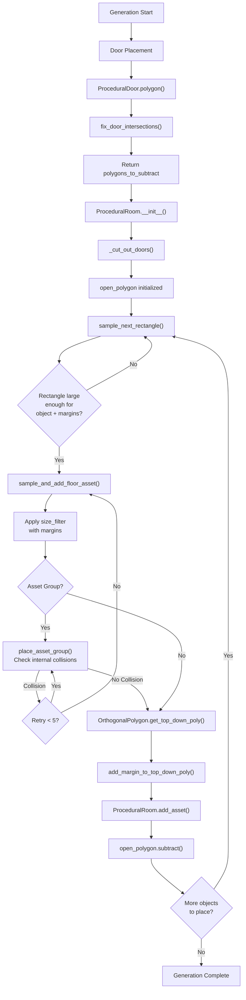
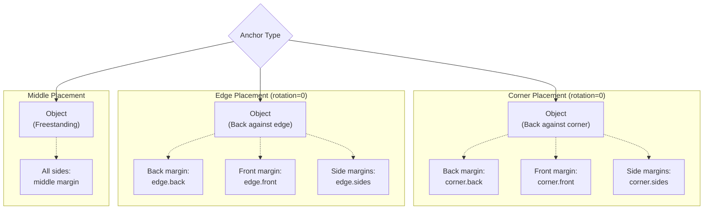
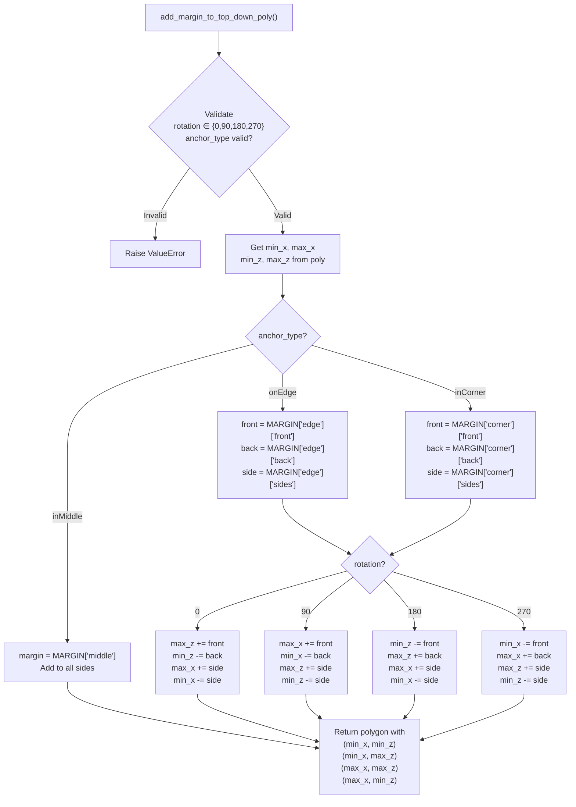
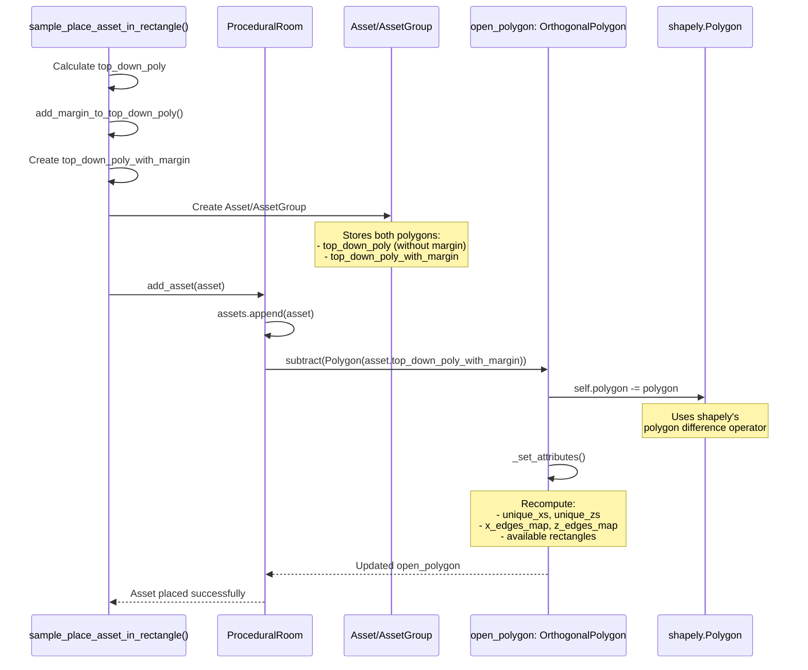
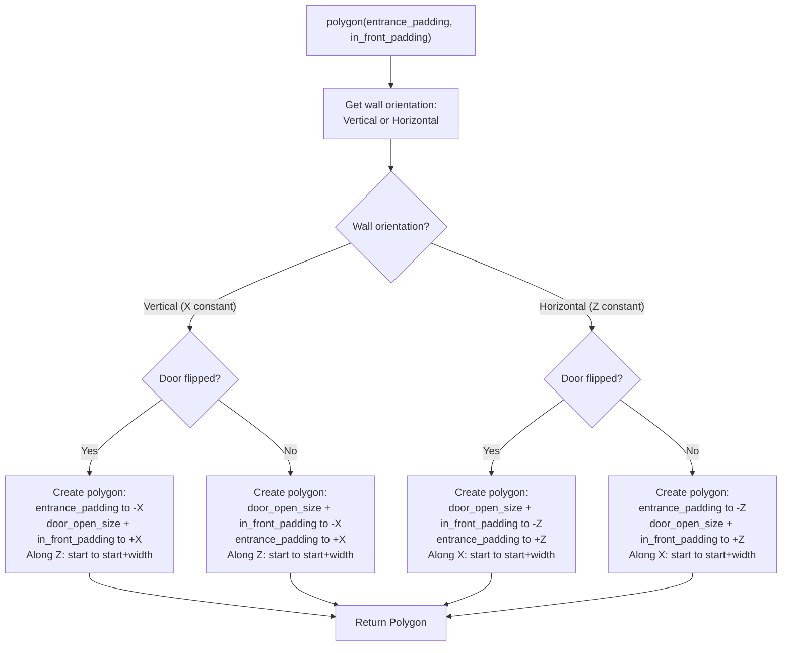
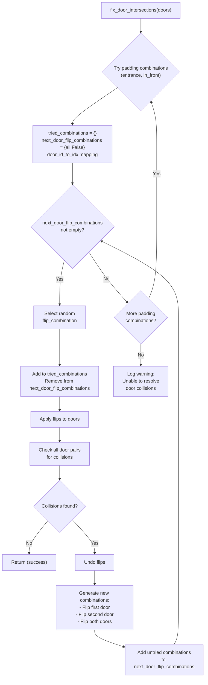
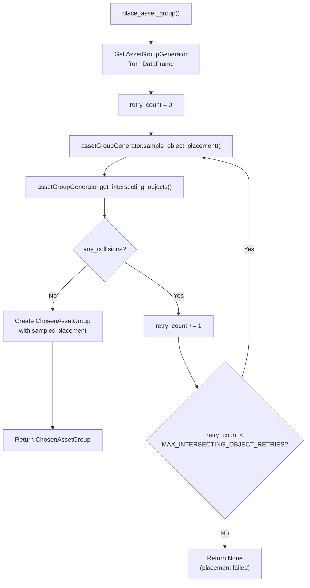
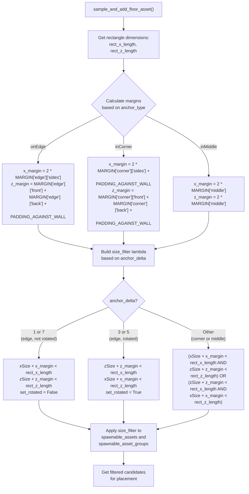
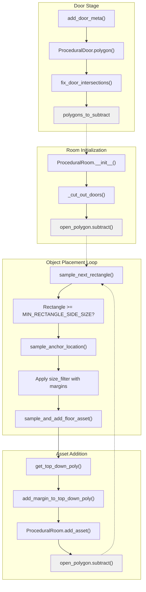

<!-- source: DeepWiki mcp.deepwiki.com · repo allenai/procthor · page 4.3 Collision Avoidance · fetched 2026-10-26 -->

# Collision Avoidance

<details>
<summary>Relevant source files</summary>

The following files were used as context for generating this wiki page:

- [procthor/generation/doors.py](procthor/generation/doors.py)
- [procthor/generation/objects.py](procthor/generation/objects.py)

</details>


## Purpose and Scope

This page documents the collision avoidance mechanisms in ProcTHOR that ensure physically plausible object placement. These systems prevent objects from overlapping with walls, doors, or other objects by calculating appropriate margins and dynamically tracking available space through polygon subtraction operations.

For information about the geometric primitives used in collision detection (polygons, bounding boxes), see [Geometric Primitives](#4.1). For the rectangle sampling strategy that selects placement locations, see [Rectangle Sampling and Anchoring](#4.2). For wall-specific collision handling, see [Wall Space Management](#4.4).

---

## Collision Avoidance Strategy

ProcTHOR employs a multi-layered collision avoidance strategy that operates throughout the generation pipeline:

1. **Margin-based spacing** - Objects have configurable margins that vary by placement type (corner, edge, middle)
2. **Polygon subtraction** - As objects are placed, their occupied space (including margins) is subtracted from available space
3. **Door collision resolution** - Doors can be flipped to different orientations to avoid overlapping collision zones
4. **Rectangle-based filtering** - Only rectangles large enough to fit objects (with margins) are considered
5. **Asset group validation** - Furniture groups are checked for internal collisions before placement

**Collision Avoidance Flow in Generation Pipeline**



Sources: [procthor/generation/doors.py:666-917](), [procthor/generation/objects.py:504-548](), [procthor/generation/objects.py:980-1154]()

---

## Margin Calculation System

Margins define the minimum spacing around objects to ensure navigability and visual plausibility. The margin size depends on the object's **anchor type** and **rotation**.

### Margin Constants

| Anchor Type | Direction | Margin Value | Purpose |
|-------------|-----------|--------------|---------|
| `inCorner` | Front | `MARGIN["corner"]["front"]` | Space in front of object |
| `inCorner` | Back | `MARGIN["corner"]["back"]` | Space behind object (against wall) |
| `inCorner` | Sides | `MARGIN["corner"]["sides"]` | Space on left/right sides |
| `onEdge` | Front | `MARGIN["edge"]["front"]` | Space in front of object |
| `onEdge` | Back | `MARGIN["edge"]["back"]` | Space behind object (against wall) |
| `onEdge` | Sides | `MARGIN["edge"]["sides"]` | Space on left/right sides |
| `inMiddle` | All sides | `MARGIN["middle"]` | Uniform space on all sides |

Additionally, `PADDING_AGAINST_WALL` is added when objects are placed against walls.

**Margin Application by Anchor Type**



### Margin Application Algorithm

The `add_margin_to_top_down_poly()` method applies margins to a top-down polygon based on rotation and anchor type:



The rotation determines which edges are the "front", "back", and "sides" of the object:
- **Rotation 0°**: Front faces +Z direction
- **Rotation 90°**: Front faces +X direction  
- **Rotation 180°**: Front faces -Z direction
- **Rotation 270°**: Front faces -X direction

Sources: [procthor/generation/objects.py:345-408]()

---

## Polygon Subtraction Mechanism

The `OrthogonalPolygon` class tracks available space in each room and dynamically updates as objects are placed.

### OrthogonalPolygon Class

```mermaid
classDiagram
    class OrthogonalPolygon {
        +Polygon polygon
        +List~float~ xs
        +List~float~ zs
        +List~float~ unique_xs
        +List~float~ unique_zs
        +Dict x_edges_map
        +Dict z_edges_map
        
        +__init__(polygon)
        +subtract(polygon: Polygon)
        +get_all_rectangles()
        +is_point_inside(point)
        -_set_attributes()
        -_set_x_edges_map()
        -_set_z_edges_map()
    }
    
    class ProceduralRoom {
        +OrthogonalPolygon room_polygon
        +OrthogonalPolygon open_polygon
        +List~Asset~ assets
        +add_asset(asset)
        -_cut_out_doors()
    }
    
    class Asset {
        +Sequence top_down_poly
        +Sequence top_down_poly_with_margin
    }
    
    class AssetGroup {
        +Sequence top_down_poly
        +Sequence top_down_poly_with_margin
    }
    
    ProceduralRoom --> OrthogonalPolygon : "maintains"
    ProceduralRoom --> Asset : "contains"
    ProceduralRoom --> AssetGroup : "contains"
    OrthogonalPolygon --> "shapely.Polygon" : "wraps"
```

### Subtraction Workflow

When an object is placed, its polygon (with margin) is subtracted from the room's `open_polygon`:

**Polygon Subtraction Flow**



The subtraction uses Shapely's polygon difference operator (`-=`), which handles complex cases including:
- Creating holes in the available space
- Splitting the space into multiple disconnected regions (MultiPolygon)
- Handling edge-to-edge placement

Sources: [procthor/generation/objects.py:235-340](), [procthor/generation/objects.py:542-548]()

---

## Door Collision Resolution

Doors can open in different directions, creating different collision zones. The `fix_door_intersections()` function tries different door flip combinations to find a configuration where no door collision zones overlap.

### Door Collision Zones

Each door has a collision zone defined by:
- **Entrance padding**: Space behind the door (where you walk into the door) - `PREFERRED_ENTRANCE_PADDING = 0.5m`
- **In-front padding**: Space in front of the door (direction it opens) - `PADDING_IN_FRONT_OF_DOOR = 0.35m`
- **Door open size**: The Z-size of the door when fully open

The `ProceduralDoor.polygon()` method creates the collision zone polygon based on the door's orientation:

**Door Collision Zone Creation**



### Collision Resolution Algorithm

The `fix_door_intersections()` function uses a search algorithm to find a non-colliding door configuration:

**Door Flip Search Algorithm**



The algorithm:
1. Tries padding combinations in order of preference (most padding first)
2. For each padding level, searches through door flip combinations
3. For each flip combination:
   - Applies flips to doors
   - Checks all door pairs for polygon intersections
   - If no collisions, returns successfully
   - If collisions, generates new flip combinations to try (flip door 1, flip door 2, or flip both)
4. If all combinations fail, tries with less padding (degrading walkability)

Sources: [procthor/generation/doors.py:374-498](), [procthor/generation/doors.py:568-663]()

---

## Asset Group Collision Detection

Asset groups (furniture sets) can have internal collisions between their constituent objects. The `place_asset_group()` method validates that objects within a group don't collide.

**Asset Group Placement with Collision Checking**



Key points:
- `MAX_INTERSECTING_OBJECT_RETRIES = 5` - Maximum attempts to place an asset group
- Each attempt samples a new object placement from the asset group generator
- The `get_intersecting_objects()` method checks bounding box intersections between objects
- If all retries fail, the system tries a different asset or asset group

Sources: [procthor/generation/objects.py:752-795](), [procthor/constants.py:26]()

---

## Size Filtering with Margins

Before attempting to place an object, the system filters candidates to only those that fit within the rectangle with appropriate margins.

**Size Filter Construction**



The size filter ensures:
1. Objects fit within the rectangle dimensions
2. Margins appropriate to the anchor type are accounted for
3. Rotation constraints are respected (some placements require specific rotations)

Sources: [procthor/generation/objects.py:1004-1055]()

---

## Integration with Placement Pipeline

Collision avoidance is integrated throughout the placement pipeline:

| Stage | Collision Avoidance Mechanism |
|-------|-------------------------------|
| **Door Placement** | `fix_door_intersections()` resolves door collision zones; returns `polygons_to_subtract` |
| **Room Initialization** | `_cut_out_doors()` subtracts door polygons from `open_polygon` |
| **Rectangle Sampling** | Only rectangles meeting `MIN_RECTANGLE_SIDE_SIZE` are considered |
| **Asset Selection** | Size filters ensure assets fit in rectangles with margins |
| **Asset Group Placement** | `get_intersecting_objects()` validates internal consistency |
| **Asset Addition** | `add_asset()` subtracts asset's margined polygon from `open_polygon` |

**Complete Collision Avoidance Integration**



This integration ensures that:
- Doors are placed before objects, reserving necessary space
- Objects cannot be placed in door zones
- Each object placement reduces available space for subsequent objects
- The system gracefully handles cases where no valid placement exists

Sources: [procthor/generation/doors.py:80-121](), [procthor/generation/objects.py:1157-1305]()

---

