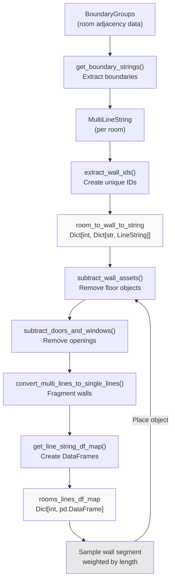
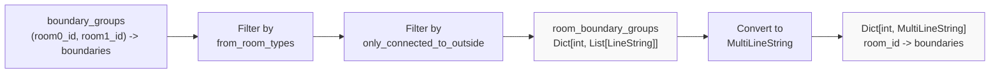
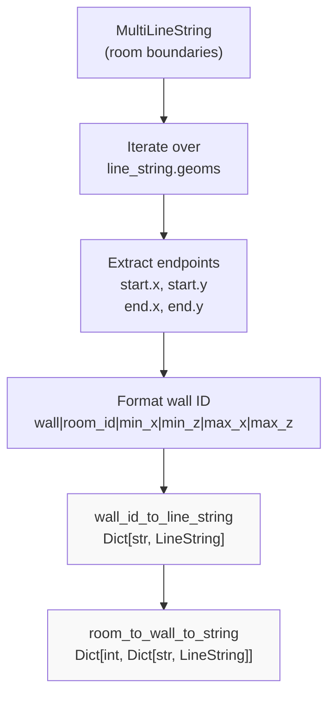
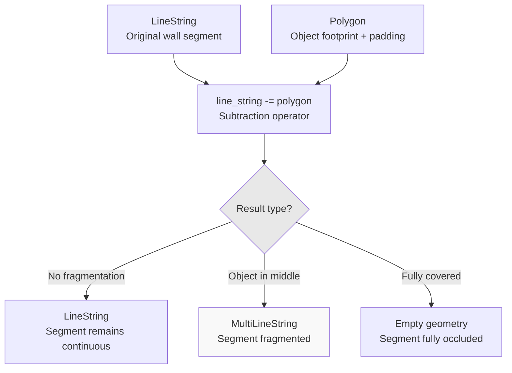
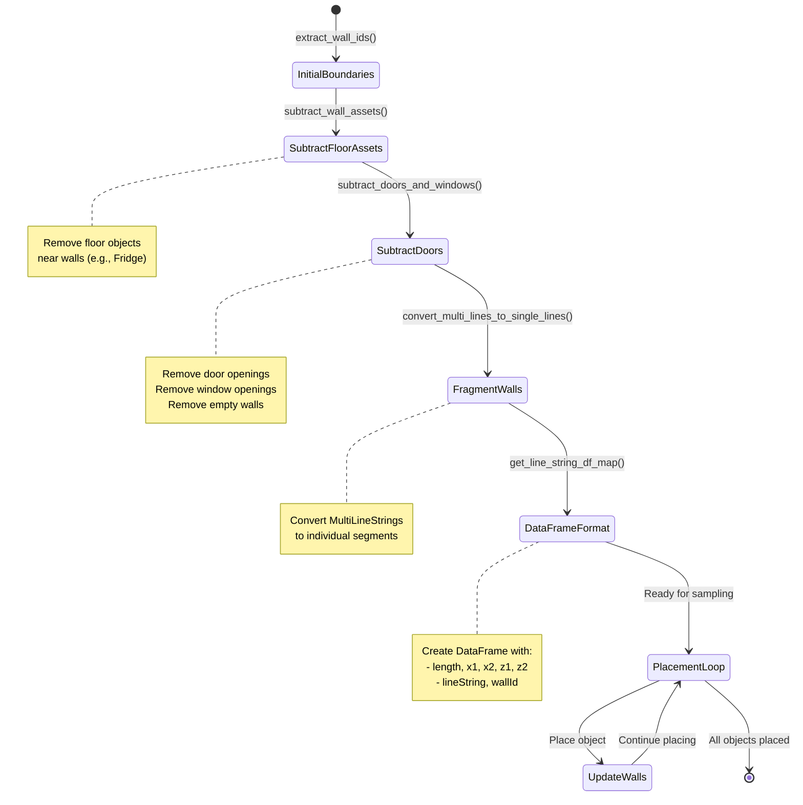
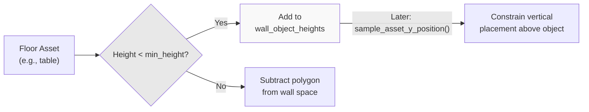
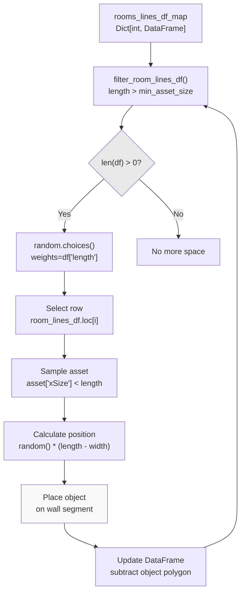
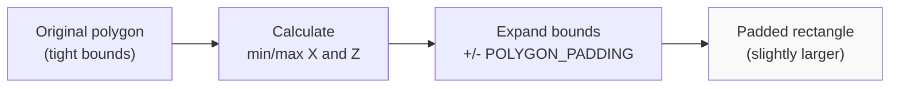
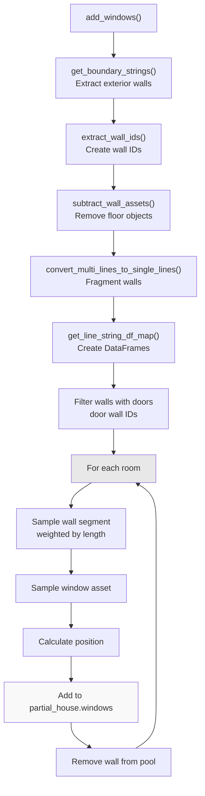
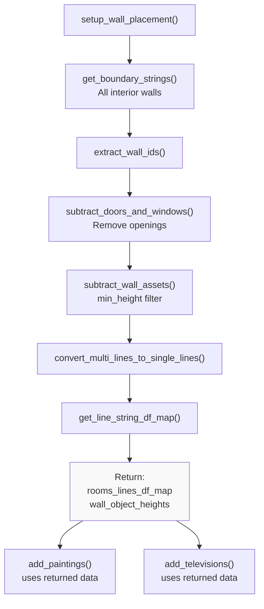

<!-- source: DeepWiki mcp.deepwiki.com · repo allenai/procthor · page 4.4 Wall Space Management · fetched 2026-10-26 -->

# Wall Space Management

<details>
<summary>Relevant source files</summary>

The following files were used as context for generating this wiki page:

- [procthor/generation/wall_objects.py](procthor/generation/wall_objects.py)

</details>


## Purpose and Scope

This document explains the wall space management system used for placing wall-mounted objects (windows, paintings, TVs) in ProcTHOR. The system tracks available wall space, handles collision avoidance through polygon subtraction, and dynamically updates wall boundaries as objects are placed. For information about placing objects on floors, see [Floor Object Placement](#3.5). For general collision detection concepts, see [Collision Avoidance](#4.3).

## Overview

The wall space management system maintains a dynamic representation of available wall segments where objects can be placed. As floor objects, doors, windows, and other wall-mounted items are added to a room, the system continuously subtracts their occupied space from the available wall boundaries. This ensures that wall objects do not overlap with existing objects or openings.

The system uses Shapely's `LineString` and `MultiLineString` geometric primitives to represent wall segments in 2D top-down space. Each wall segment is identified by a unique wall ID and tracked separately. The subtraction operation leverages Shapely's polygon operations to dynamically fragment wall segments as objects are placed.



**Sources:** [procthor/generation/wall_objects.py:81-113](), [procthor/generation/wall_objects.py:170-188](), [procthor/generation/wall_objects.py:191-262]()

## Boundary Extraction

The `get_boundary_strings()` function extracts wall boundaries from the `BoundaryGroups` data structure, which represents adjacency information between rooms. This function filters boundaries based on room types and optionally restricts boundaries to those connecting to the outdoor space.

### Boundary String Extraction Process



The function accepts the following parameters:
- `boundary_groups`: Mapping from room ID pairs to boundary geometries
- `from_room_types`: Set of room types to include (e.g., `{"Bedroom", "Kitchen"}`)
- `only_connected_to_outside`: Boolean flag to restrict to exterior walls
- `room_type_map`: Mapping from room IDs to room type strings

For windows, the system uses `only_connected_to_outside=True` and `from_room_types=ROOM_TYPES_WITH_WINDOWS` to ensure windows only appear on exterior walls of certain room types:

| Constant | Value | Purpose |
|----------|-------|---------|
| `ROOM_TYPES_WITH_WINDOWS` | `{"Bedroom", "Kitchen", "LivingRoom"}` | Room types that can have windows |
| `ROOM_TYPES_WITH_PAINTINGS` | `{"Bedroom", "Kitchen", "LivingRoom", "Bathroom"}` | Room types that can have paintings |
| `OUTDOOR_ROOM_ID` | -1 | Special ID representing outdoor space |

**Sources:** [procthor/generation/wall_objects.py:81-113](), [procthor/generation/wall_objects.py:163-164](), [procthor/generation/wall_objects.py:475-476]()

## Wall ID System

Each wall segment is assigned a unique identifier that encodes its spatial position and associated room. The `extract_wall_ids()` function creates these IDs from `LineString` boundaries.

### Wall ID Format

The wall ID follows this pattern:
```
wall|{room_id}|{min_x:.2f}|{min_z:.2f}|{max_x:.2f}|{max_z:.2f}
```

For example: `wall|0|-2.50|1.00|2.50|1.00` represents a wall segment in room 0 extending from (-2.50, 1.00) to (2.50, 1.00) in the XZ plane.



The wall ID serves multiple purposes:
1. **Uniqueness**: Each wall segment has a distinct identifier
2. **Spatial encoding**: The ID contains the wall's bounding box coordinates
3. **Room association**: The room ID is embedded in the wall ID
4. **Door/window matching**: Used to prevent placing windows on walls with doors

**Sources:** [procthor/generation/wall_objects.py:170-188](), [procthor/generation/wall_objects.py:182-186]()

## LineString Representation and Operations

The system represents wall segments using Shapely's `LineString` and `MultiLineString` geometric primitives. These provide efficient spatial operations for managing wall space.

### LineString Structure

A `LineString` represents a continuous wall segment with two endpoints:
- Stored as a sequence of (x, z) coordinates in the top-down plane
- The y-coordinate (vertical) is handled separately during object placement
- Operations like subtraction can fragment a `LineString` into a `MultiLineString`

### Key Operations



The subtraction operation is the core mechanism for updating wall space:

```python
# Example from subtract_wall_assets()
padded_asset_poly = Polygon(add_padding_to_poly(poly=asset.top_down_poly_with_margin))
room_to_wall_to_string[room_id][wall_id] -= padded_asset_poly
```

After subtraction, a wall segment may become a `MultiLineString` containing multiple disconnected fragments. The `convert_multi_lines_to_single_lines()` function expands these fragments into separate list entries for easier processing.

**Sources:** [procthor/generation/wall_objects.py:257-261](), [procthor/generation/wall_objects.py:265-281](), [procthor/generation/wall_objects.py:10]()

## Dynamic Space Updates Through Subtraction

The system performs multiple subtraction passes to account for all objects that occlude wall space. Each pass removes specific types of objects from the available wall segments.

### Subtraction Sequence



### Floor Asset Subtraction

The `subtract_wall_assets()` function removes floor objects from wall space with special handling for object height:

| Filter Type | Behavior | Purpose |
|-------------|----------|---------|
| Anchor filter | Skip `anchor_type == "inMiddle"` | Middle-placed objects don't touch walls |
| Height filter | Objects below `min_height` create height constraints | Allow placement above short objects |
| Height filter | Objects above `min_height` fully subtract from wall | Prevent placement behind tall objects |

For objects below the minimum height (e.g., 1.15m for paintings), the system tracks their height and allows placement above them:



**Sources:** [procthor/generation/wall_objects.py:191-262](), [procthor/generation/wall_objects.py:481-482](), [procthor/generation/wall_objects.py:214-255]()

### Door and Window Subtraction

The `subtract_doors_and_windows()` function removes door and window openings from wall segments. This function:

1. Removes empty walls (open connections between rooms)
2. Creates padded polygons around each door and window based on their width
3. Subtracts these polygons from all affected wall segments

The polygon creation accounts for wall orientation (vertical or horizontal) and direction:

```python
# Wall changes along Z-axis
poly = [
    (x - POLYGON_PADDING, p0["z"] + center_pos_along_wall - obj_width / 2),
    (x + POLYGON_PADDING, p0["z"] + center_pos_along_wall - obj_width / 2),
    (x + POLYGON_PADDING, p0["z"] + center_pos_along_wall + obj_width / 2),
    (x - POLYGON_PADDING, p0["z"] + center_pos_along_wall + obj_width / 2),
]
```

| Constant | Value | Purpose |
|----------|-------|---------|
| `POLYGON_PADDING` | 1e-3 | Small buffer to handle floating-point precision |
| `PAINTING_WALL_PADDING` | 5e-3 | Prevents clipping artifacts on wall surface |

**Sources:** [procthor/generation/wall_objects.py:494-613](), [procthor/generation/wall_objects.py:484-488](), [procthor/generation/wall_objects.py:478-479]()

## DataFrame Management for Sampling

After subtraction operations fragment wall segments, the system converts them to a `pandas.DataFrame` structure optimized for weighted sampling. The `get_line_string_df_map()` function creates these DataFrames.

### DataFrame Schema

Each DataFrame row represents a single wall segment with the following columns:

| Column | Type | Description |
|--------|------|-------------|
| `length` | float | Length of the wall segment (used as sampling weight) |
| `x1`, `x2` | float | Min and max X coordinates of segment |
| `z1`, `z2` | float | Min and max Z coordinates of segment |
| `lineString` | LineString | Shapely geometry object |
| `wallId` | str | Unique wall identifier |

### Weighted Sampling Process



The sampling weights each segment by its length, ensuring that longer wall segments are more likely to receive objects. This produces more natural distributions of wall objects across the house.

### Dynamic DataFrame Updates

After placing each object, the system updates the DataFrame:

1. **Drop placed segment**: Remove the row where the object was placed
2. **Subtract object polygon**: Use `line_string -= placement["poly"]` 
3. **Fragment handling**: If subtraction creates a `MultiLineString`, add each fragment as a new row
4. **Filter short segments**: Remove fragments shorter than the minimum asset size

```python
# From add_paintings()
line_string = room_line["lineString"]
line_string -= placement["poly"]

if isinstance(line_string, MultiLineString):
    line_strings_to_add = [
        ls for ls in line_string.geoms if ls.length > min_painting_size
    ]
```

**Sources:** [procthor/generation/wall_objects.py:283-311](), [procthor/generation/wall_objects.py:314-322](), [procthor/generation/wall_objects.py:834-868]()

## Padding and Collision Constants

The system uses several padding constants to prevent geometric conflicts and visual artifacts:

| Constant | Value | Location | Purpose |
|----------|-------|----------|---------|
| `POLYGON_PADDING` | 1e-3 | Added around subtracted polygons | Handles floating-point precision issues |
| `PAINTING_WALL_PADDING` | 5e-3 | Added to object depth | Prevents Z-fighting artifacts on walls |
| `NO_PAINTINGS_ABOVE_ASSETS_OF_HEIGHT` | 1.15 | Height threshold | Prevents placing paintings behind tall objects |

The `add_padding_to_poly()` function expands a polygon by `POLYGON_PADDING` on all sides before subtraction operations:



This padding ensures that when a `LineString` is subtracted from a `Polygon`, the geometric operations properly account for numerical precision issues that could otherwise leave tiny fragments or gaps.

**Sources:** [procthor/generation/wall_objects.py:41-58](), [procthor/generation/wall_objects.py:478-488]()

## Integration with Placement Systems

The wall space management system integrates with the broader object placement pipeline through several key functions:

### Window Placement Integration

The `add_windows()` function demonstrates the complete wall space management workflow:



**Sources:** [procthor/generation/wall_objects.py:325-466]()

### Painting and TV Placement Integration

The `setup_wall_placement()` function prepares wall space for both paintings and TVs by performing all necessary subtractions:



The returned `wall_object_heights_per_room` data structure tracks objects below the height threshold, enabling vertical collision avoidance through `sample_asset_y_position()`.

**Sources:** [procthor/generation/wall_objects.py:713-749](), [procthor/generation/wall_objects.py:128-158]()

## Performance Considerations

The wall space management system makes several design choices to optimize performance:

1. **DataFrame indexing**: Using pandas DataFrames enables efficient filtering and weighted sampling operations
2. **Lazy fragmentation**: Walls are only converted to individual segments after all subtraction operations complete
3. **Duplicate prevention**: For paintings, the system maintains a shrinking asset pool to avoid duplicates without checking all placed objects
4. **Early termination**: Functions exit immediately when no wall space remains (`len(room_lines_df) == 0`)

The weighted sampling approach ensures O(1) selection time per object, while the subtraction operations leverage Shapely's optimized geometric algorithms.

**Sources:** [procthor/generation/wall_objects.py:283-311](), [procthor/generation/wall_objects.py:265-281](), [procthor/generation/wall_objects.py:870-873]()

---

