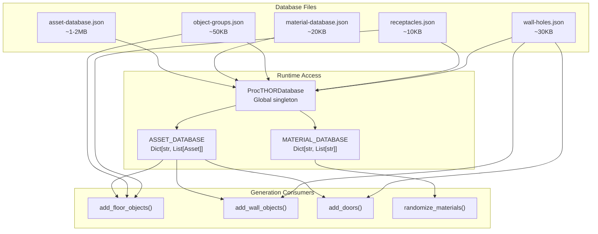
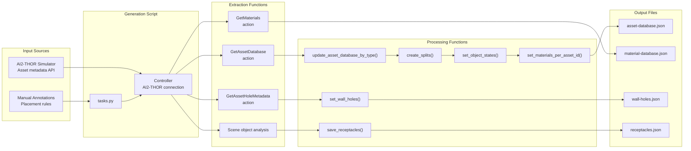
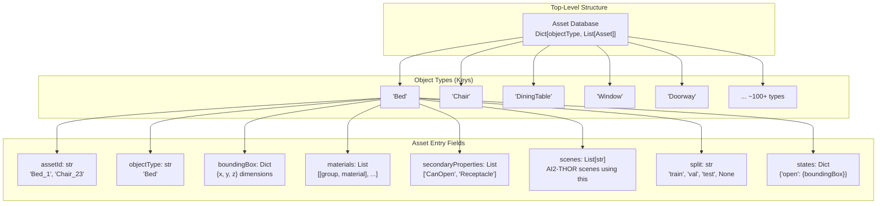
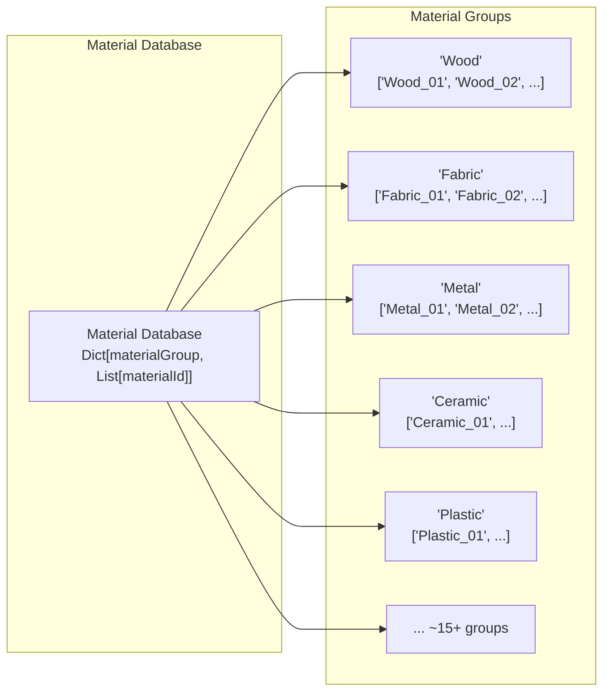
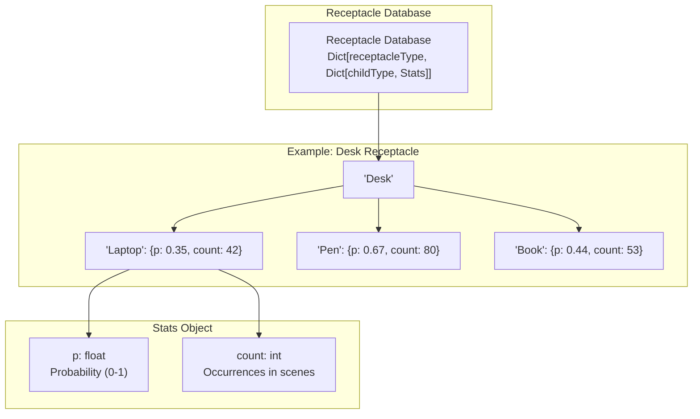
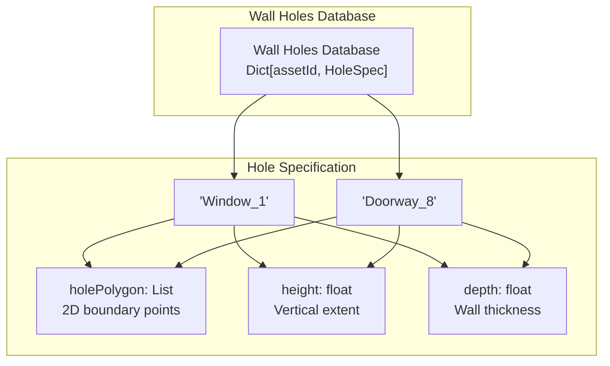
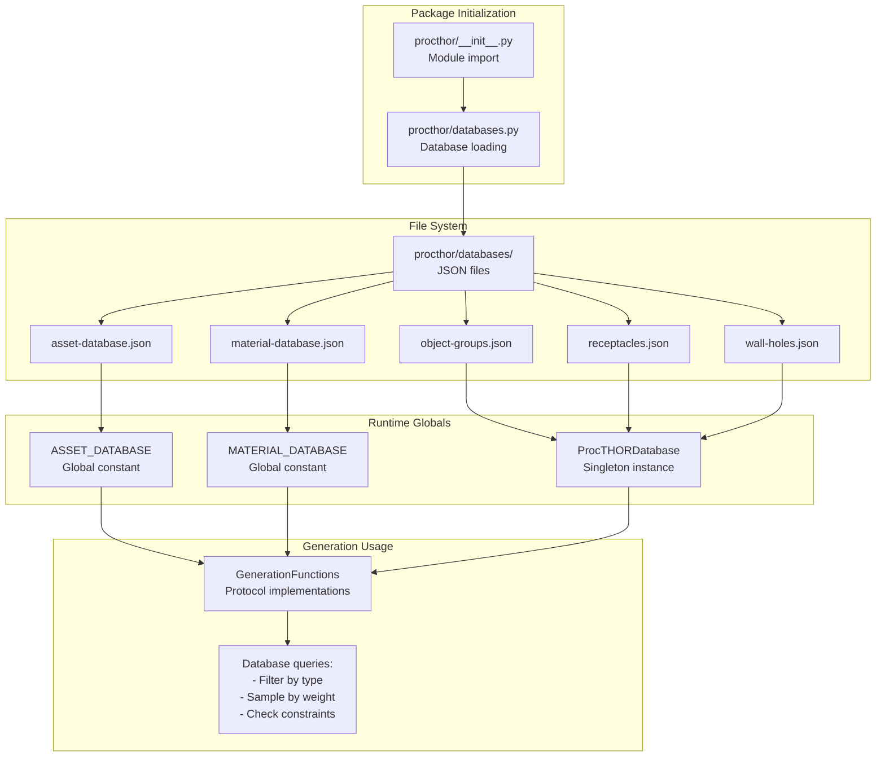
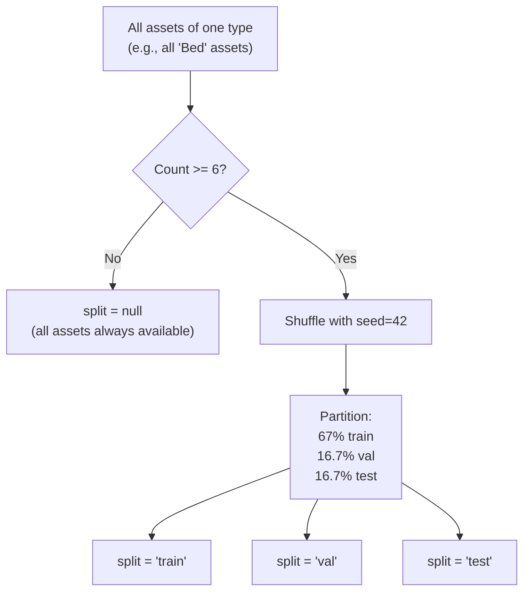

<!-- source: DeepWiki mcp.deepwiki.com · repo allenai/procthor · page 5 Database System · fetched 2026-10-26 -->

# Database System

Relevant source files

The following files were used as context for generating this wiki page:

- [procthor/constants.py](procthor/constants.py)
- [tasks.py](tasks.py)

## Purpose and Scope

The Database System provides static metadata that drives procedural generation in ProcTHOR. It consists of six specialized databases that store information about assets (3D objects), materials (textures), placement rules, object relationships, and architectural components. These databases are generated once from AI2-THOR metadata and distributed as part of the package, enabling deterministic and data-driven house generation.

This page provides an overview of the database architecture and data flow. For detailed information about specific database components, see [Database Architecture](#5.1). For the generation process that creates these databases, see [Database Generation](#5.2). For how generation stages query and filter database content, see [Asset Selection and Filtering](#5.3).

---

## Database Components

The ProcTHOR database system comprises six specialized databases stored as JSON files in the `procthor/databases/` directory:

| Database | File | Purpose | Primary Consumers |
|----------|------|---------|------------------|
| Asset Database | `asset-database.json` | Object metadata indexed by type (e.g., "Bed", "Chair") | Floor object placement, wall object placement |
| Material Database | `material-database.json` | Material identifiers grouped by material type | Material randomization |
| Asset Groups | `object-groups.json` | Semantically related asset collections | Floor object placement |
| Receptacles | `receptacles.json` | Object containment relationships and probabilities | Small object placement |
| Wall Holes | `wall-holes.json` | Geometric specifications for windows and doors | Door placement, window placement |
| Placement Annotations | Not explicitly stored separately | Spawn rules and placement constraints | Asset filtering across all stages |

These databases are immutable at runtime—they are generated once during development and packaged with the distribution.

**Sources:** [tasks.py:1-619](), [Diagram 3 from context]

---

## Database Architecture Overview

**Database Architecture: Physical storage, runtime loading, and consumption by generation stages**

The database architecture follows a clear separation between storage (JSON files), runtime access (in-memory dictionaries), and consumption (generation functions). The `ProcTHORDatabase` class loads all JSON files on initialization and exposes them as queryable data structures.

**Sources:** [tasks.py:3-4](), [Diagram 3 from context]

---

## Database Generation Pipeline

**Database Generation Pipeline: One-time extraction from AI2-THOR to JSON files**

The database generation process is a one-time operation performed during development. The `tasks.py` script connects to AI2-THOR, queries various metadata endpoints, processes and enriches the data, then saves it as JSON files. This process is not run by end users.

**Sources:** [tasks.py:19-619]()

---

## Asset Database Schema

The Asset Database is the largest and most complex database, containing detailed metadata for every 3D asset in AI2-THOR.

**Asset Database Schema: Hierarchical structure with object types and per-asset metadata**

Each object type key maps to a list of asset entries. Each asset entry contains:
- **assetId**: Unique identifier (e.g., `"Bed_12"`)
- **objectType**: Category (e.g., `"Bed"`)
- **boundingBox**: 3D dimensions `{x, y, z}` in meters
- **materials**: List of `[materialGroup, material]` pairs for randomization
- **secondaryProperties**: Capabilities like `"CanOpen"`, `"Receptacle"`, `"Breakable"`
- **scenes**: List of AI2-THOR scene names where this asset appears
- **split**: Train/val/test designation for dataset splits, or `null` for assets with <6 instances
- **states**: Optional state-specific metadata (e.g., bounding box when open)

**Sources:** [tasks.py:85-180](), [tasks.py:412-467]()

---

## Material Database Schema

The Material Database organizes texture identifiers by material group, enabling semantic material randomization.

**Material Database Schema: Material identifiers grouped by semantic type**

The structure is a flat dictionary where each key is a material group (e.g., `"Wood"`, `"Fabric"`) and each value is a sorted list of material identifiers (e.g., `["Wood_01", "Wood_02", ...]`). This allows generation code to sample random materials while maintaining semantic coherence (e.g., a wooden table gets a wood texture, not metal).

**Sources:** [tasks.py:28-46](), [tasks.py:204-233]()

---

## Receptacle Database Schema

The Receptacle Database encodes probabilistic object containment relationships derived from AI2-THOR scene analysis.

**Receptacle Database Schema: Probability distributions for object containment**

Each receptacle type (e.g., `"Desk"`, `"CounterTop"`) maps to a dictionary of child object types. Each child entry contains:
- **p**: Probability this child appears on/in this receptacle (derived from AI2-THOR scene frequency)
- **count**: Number of times this relationship was observed

This drives realistic small object placement—laptops are more likely to appear on desks than on toilets.

**Sources:** [tasks.py:533-592]()

---

## Wall Holes Database Schema

The Wall Holes Database stores geometric specifications for assets that create openings in walls (windows and doors).

**Wall Holes Database Schema: Geometric specifications for wall openings**

Each window or door asset ID maps to a specification containing:
- **holePolygon**: 2D boundary points defining the opening shape
- **height**: Vertical dimension in meters
- **depth**: Wall thickness requirement

This metadata is queried during door and window placement to ensure proper wall cutouts and collision avoidance.

**Sources:** [tasks.py:596-618]()

---

## Database Loading and Access Patterns

At runtime, database files are loaded once during module initialization and exposed through global constants and the `ProcTHORDatabase` class.

**Database Loading: From JSON files to runtime access patterns**

Database loading follows this sequence:

1. **Module Import**: When `procthor` is imported, `__init__.py` triggers database loading
2. **JSON Parsing**: `databases.py` reads JSON files from `procthor/databases/` directory
3. **Global Constants**: Databases are exposed as module-level constants (`ASSET_DATABASE`, `MATERIAL_DATABASE`)
4. **Query Interface**: Generation functions access databases directly via these constants

This design ensures databases are loaded exactly once and remain immutable throughout execution, supporting thread-safe access and deterministic generation.

**Sources:** [tasks.py:3-4]()

---

## Database Versioning and Splits

The Asset Database includes versioning metadata to support train/val/test dataset splits and backward compatibility.

### Train/Val/Test Splits

Asset splits are determined during database generation via the `create_splits()` function:

**Asset Split Determination: Reproducible train/val/test partitioning**

Object types with fewer than 6 assets receive `split=null` and are available in all datasets. Types with 6+ assets are deterministically partitioned (seed 42) into approximately 2/3 train, 1/6 val, 1/6 test. This ensures:
- Reproducibility across ProcTHOR versions
- Balanced visual diversity across splits
- No data leakage between splits

The `USE_ITHOR_SPLITS` constant [procthor/constants.py:1-2]() controls whether iTHOR object splits should be used instead.

**Sources:** [tasks.py:93-135](), [procthor/constants.py:1-2]()

---

## Integration with Generation Pipeline

The database system serves as the foundation for all generation stages, providing the content that fills procedurally generated structures.

| Generation Stage | Database Usage | Query Pattern |
|-----------------|----------------|---------------|
| Structure Generation | None | N/A (geometric algorithms only) |
| Door Placement | Wall Holes Database | Filter by type (`"Doorway"`), check dimensions |
| Light Placement | None | N/A (procedurally placed) |
| Exterior Walls | Material Database | Sample from `"WallMaterial"` group |
| Room Setup | Material Database | Sample from `"FloorMaterial"`, `"WallMaterial"` |
| Floor Objects | Asset Database, Asset Groups, Receptacles | Filter by room type, weight, placement annotations |
| Wall Objects | Asset Database, Wall Holes Database | Filter by `onWall=True`, check dimensions |
| Small Objects | Asset Database, Receptacles | Filter by `isPickupable=True`, sample by receptacle probability |
| Material Randomization | Material Database, Asset Database | Match material groups to asset material slots |

The database system's static nature enables:
- **Deterministic Generation**: Same seed + same database = same house
- **Fast Access**: In-memory lookups with no I/O overhead
- **Package Distribution**: Databases are bundled with the package, no external dependencies
- **Version Stability**: Database changes trigger new package versions, ensuring reproducibility

**Sources:** [Diagram 3 from context], [tasks.py:1-619]()

---

## Summary

The Database System is the content repository for ProcTHOR, storing metadata for 100+ object types, 1000+ assets, and semantic relationships. Generated once from AI2-THOR and distributed as JSON files, it provides the foundation for all procedural generation stages. The architecture balances comprehensive metadata (bounding boxes, materials, states, relationships) with efficient runtime access (in-memory dictionaries, global constants). For implementation details, see subsection pages [5.1](#5.1), [5.2](#5.2), and [5.3](#5.3).

---

