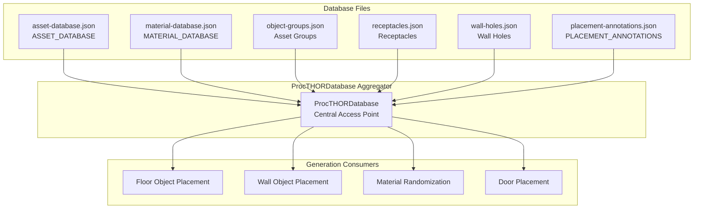
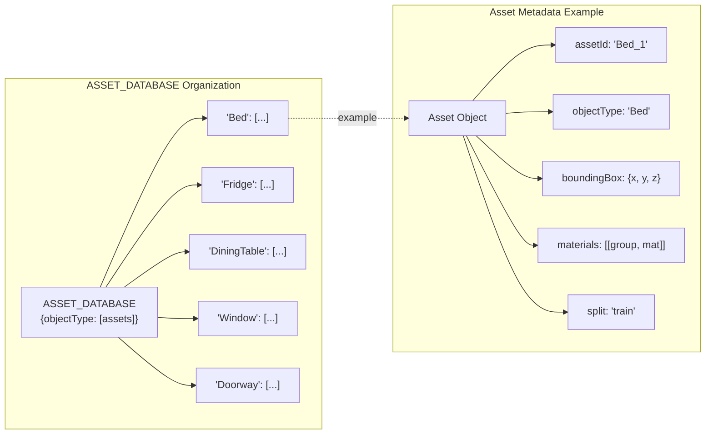
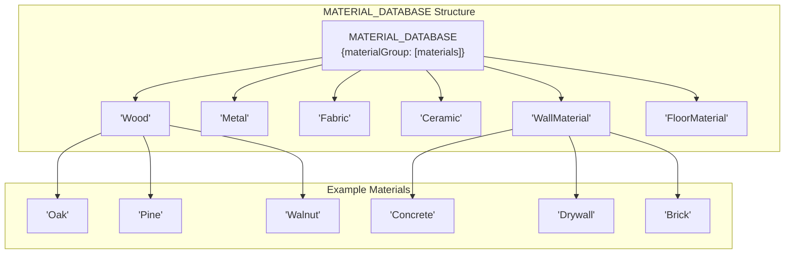
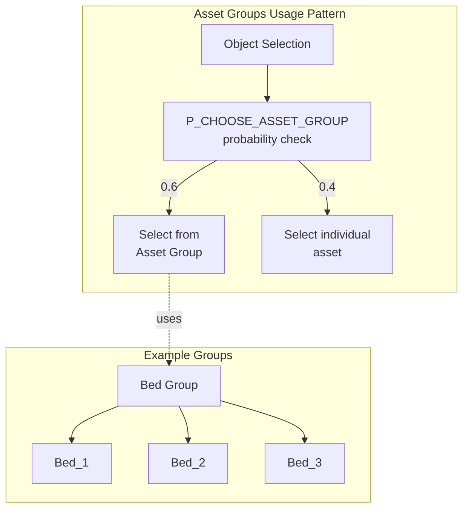
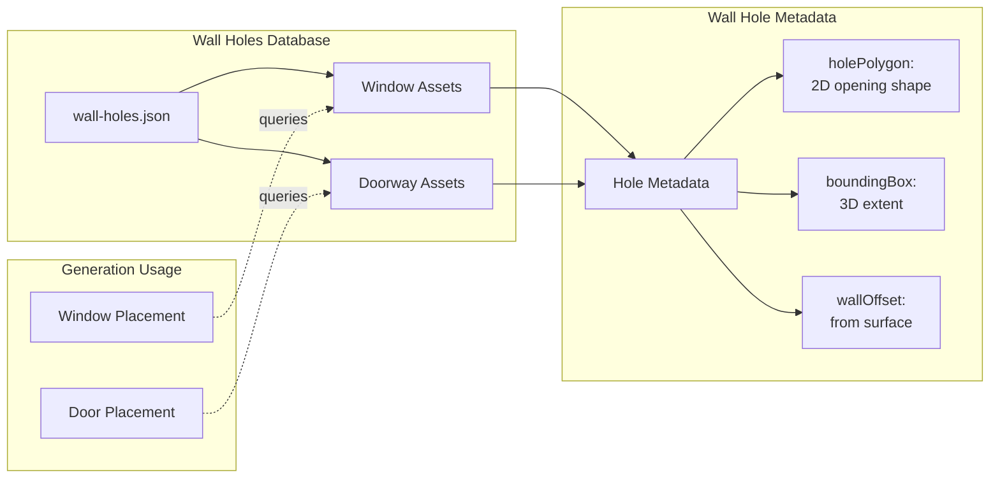
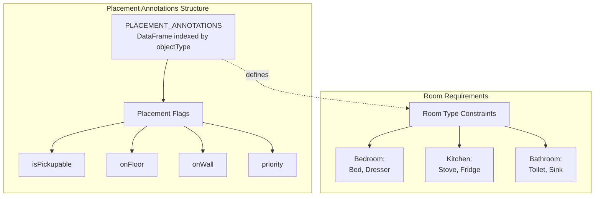
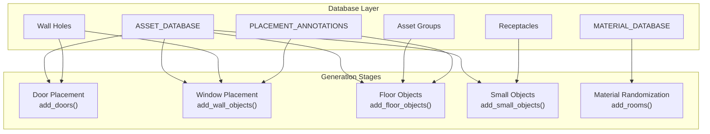

<!-- source: DeepWiki mcp.deepwiki.com · repo allenai/procthor · page 5.1 Database Architecture · fetched 2026-10-26 -->

# Database Architecture

<details>
<summary>Relevant source files</summary>

The following files were used as context for generating this wiki page:

- [tasks.py](tasks.py)

</details>


## Purpose and Scope

This document describes the architecture of ProcTHOR's database system, which provides the asset metadata, material definitions, and placement rules that drive procedural house generation. The `ProcTHORDatabase` aggregates six specialized databases that collectively define what objects can be placed, how they appear, and where they can go.

This page covers the structure and content of each database. For information on how these databases are generated and updated, see [Database Generation](#5.2). For details on how generation stages query and filter assets, see [Asset Selection and Filtering](#5.3).

## Database System Overview

The ProcTHOR database system consists of six interconnected databases, each serving a specific purpose in the generation pipeline. These databases are stored as JSON files in the `procthor/databases/` directory and loaded into memory at runtime.



**Sources:** [tasks.py:3-4](), Diagram 3 from high-level architecture

## ASSET_DATABASE Structure

The `ASSET_DATABASE` is the primary database containing metadata for all placeable objects. It is organized as a dictionary mapping object types to lists of asset metadata objects.

### Asset Metadata Schema

Each asset in the database contains the following fields:

| Field | Type | Description |
|-------|------|-------------|
| `assetId` | string | Unique identifier (e.g., "Bed_1", "Fridge_11") |
| `objectType` | string | Asset category (e.g., "Bed", "Fridge") |
| `boundingBox` | dict | Size in meters: `{x, y, z}` |
| `primaryProperties` | list | Core properties (e.g., "Receptacle") |
| `secondaryProperties` | list | Additional properties (e.g., "CanOpen") |
| `materials` | list | Material slots: `[[group, material], ...]` |
| `scenes` | list | AI2-THOR scenes containing this asset |
| `split` | string | Dataset split: "train", "val", "test", or null |
| `states` | dict | State-specific bounding boxes (e.g., "open") |
| `maxImagePixelLength` | float | Normalized pixel extent for visualizations |



**Sources:** [tasks.py:85-90](), [tasks.py:138-180]()

### Dataset Splits

Assets are divided into train/val/test splits to enable domain generalization experiments. The split assignment is deterministic (seeded with 42) and stored in the asset metadata.

- **Train**: ~67% of assets for each type with 6+ assets
- **Val**: ~17% of assets 
- **Test**: ~17% of assets
- **Null**: Asset types with fewer than 6 items are not split

Manual overrides exist for specific assets to ensure balanced representation across splits.

**Sources:** [tasks.py:93-135]()

### Bounding Box Corrections

Bounding boxes are extracted by spawning each asset in AI2-THOR and querying the `axisAlignedBoundingBox` property. This ensures accurate collision detection during placement.

**Sources:** [tasks.py:159-180]()

### Object States

Assets with the `CanOpen` secondary property have additional state-specific bounding boxes. The `states.open.boundingBox` field contains the maximum extent when all openable components are fully open.

**Sources:** [tasks.py:412-467]()

## MATERIAL_DATABASE Structure

The `MATERIAL_DATABASE` maps material groups to lists of material names that can be applied to objects and surfaces.

### Material Group Organization



**Sources:** [tasks.py:29-46]()

### Material Groups

Common material groups include:

| Group | Usage | Example Materials |
|-------|-------|------------------|
| `Wood` | Furniture, floors | Oak, Pine, Walnut, Cherry |
| `Metal` | Appliances, fixtures | Steel, Aluminum, Bronze |
| `Fabric` | Sofas, chairs, curtains | Cotton, Linen, Velvet |
| `Ceramic` | Countertops, tiles | Marble, Granite, Porcelain |
| `WallMaterial` | Interior walls | Drywall, Brick, Concrete, Wallpaper |
| `FloorMaterial` | Room floors | Hardwood, Tile, Carpet, Linoleum |

### Material Application

Each asset specifies which material groups can be applied to it through the `materials` field. This field contains a list of `[materialGroup, defaultMaterial]` pairs, where each pair represents a material slot on the asset.

**Sources:** [tasks.py:204-233]()

## Asset Groups Database

Asset groups define sets of furniture that are aesthetically or functionally related. During generation, when a furniture piece is selected, there is a probability `P_CHOOSE_ASSET_GROUP` of selecting matching pieces from the same group.

### Asset Group Structure

The asset groups database is organized as:

```json
{
  "objectType": ["assetId1", "assetId2", ...],
  ...
}
```

Groups are used to create coherent room aesthetics by placing matching furniture sets (e.g., matching bedroom furniture or kitchen appliances).



**Sources:** [tasks.py:503-523](), referenced from constants

## Receptacles Database

The `receptacles` database defines parent-child relationships between objects, specifying which small objects can be placed on or in larger receptacle objects.

### Receptacle Schema

The database structure is:

```json
{
  "receptacleType": {
    "childObjectType": {
      "p": probability,
      "count": occurrence_count
    }
  }
}
```

### Example Relationships

| Receptacle | Child Objects | Probability |
|------------|--------------|-------------|
| `DiningTable` | `Plate` | High |
| `DiningTable` | `Bowl` | High |
| `DiningTable` | `Laptop` | Medium |
| `Desk` | `Laptop` | High |
| `Desk` | `Book` | High |
| `Fridge` | `Apple` | Medium |

### Exclusions

Certain object types are explicitly excluded from receptacle relationships to prevent unrealistic placements:

- `Sofa`, `Television`, `CounterTop`, `Chair`
- `DiningTable`, `ShelvingUnit`, `SideTable`
- `Toilet`, `Desk`, `Sink`, `Fridge`

These objects are either too large, structurally important, or semantically inappropriate as child objects.

**Sources:** [tasks.py:533-592]()

### Statistical Derivation

Receptacle probabilities are derived from AI2-THOR scene statistics by:

1. Counting occurrences of each `(parent, child)` pair across all scenes
2. Computing `p = child_count / parent_count`
3. Filtering out low-probability relationships
4. Excluding semantically inappropriate pairs

**Sources:** [tasks.py:550-588]()

## Wall Holes Database

The `wall-holes` database contains geometric specifications for assets that create openings in walls, specifically windows and doors.

### Wall Hole Metadata

Each wall hole asset has metadata including:

| Field | Description |
|-------|-------------|
| `assetId` | Unique identifier for the window/door |
| `holePolygon` | 2D polygon defining the wall opening |
| `boundingBox` | 3D extent of the opening |
| `wallOffset` | Distance from wall surface |
| `openingType` | "window" or "door" |



**Sources:** [tasks.py:598-618]()

### Extraction Process

Wall hole metadata is extracted by:

1. Spawning each window/door asset in AI2-THOR
2. Calling `GetAssetHoleMetadata` action
3. Recording the polygon and bounding box data
4. Storing in the wall-holes database

This metadata enables the generation system to properly cut openings in walls and position the window/door assets correctly.

**Sources:** [tasks.py:598-618]()

## Placement Annotations Database

The `placement-annotations` database defines placement rules and constraints for each object type. This database is typically structured as a DataFrame with object types as the index and boolean flags as columns.

### Placement Flags

Key placement flags include:

| Flag | Description |
|------|-------------|
| `isPickupable` | Whether the object can be picked up |
| `onFloor` | Can be placed on floor surfaces |
| `onWall` | Can be mounted on walls |
| `inRoom` | Requires specific room types |
| `priority` | Placement priority level |

### Room-Specific Requirements

Certain object types have room-type requirements:

- **Windows**: Only in bedrooms, kitchens, living rooms
- **Toilet**: Only in bathrooms
- **Bed**: Only in bedrooms
- **Stove**: Only in kitchens



**Sources:** [tasks.py:504-516]()

### Priority Asset Types

The placement annotations define priority assets that should be placed first in each room. These are typically large, functionally essential furniture pieces like:

- **Bedroom**: Bed
- **Kitchen**: Stove, Fridge, CounterTop
- **Living Room**: Sofa, Television
- **Bathroom**: Toilet, Sink

**Sources:** Referenced from generation stages in high-level diagrams

## Database File Organization

All database files are stored in the `procthor/databases/` directory as JSON files. The file structure is:

```
procthor/databases/
├── asset-database.json          # ASSET_DATABASE
├── material-database.json       # MATERIAL_DATABASE
├── object-groups.json           # Asset Groups
├── receptacles.json             # Receptacles
├── wall-holes.json              # Wall Holes
├── placement-annotations.json   # PLACEMENT_ANNOTATIONS
└── ai2thor-object-metadata.json # Source metadata
```

### File Path Constants

The database paths are defined as constants in `tasks.py`:

- `ASSET_DATABASE_PATH = "procthor/databases/asset-database.json"`
- `MATERIAL_DATABASE_PATH = "procthor/databases/material-database.json"`

**Sources:** [tasks.py:3-4]()

### JSON Format

All databases use human-readable JSON with:
- 4-space indentation
- Sorted keys for diff-friendliness
- UTF-8 encoding

**Sources:** [tasks.py:39-40](), [tasks.py:89-90]()

## Integration with Generation System

The databases are consumed by different stages of the generation pipeline:



**Sources:** Diagram 3 from high-level architecture

### Query Patterns

Generation stages typically query databases using these patterns:

1. **Filter by object type**: `ASSET_DATABASE[object_type]`
2. **Filter by properties**: Check `primaryProperties` or `secondaryProperties`
3. **Filter by split**: Select assets matching current split constraint
4. **Apply placement rules**: Check `PLACEMENT_ANNOTATIONS` for constraints
5. **Select materials**: Choose from `MATERIAL_DATABASE[material_group]`
6. **Check receptacles**: Query `receptacles[parent_type]` for valid children

For detailed information on these query patterns, see [Asset Selection and Filtering](#5.3).

**Sources:** Referenced from generation function implementations

---

