<!-- source: DeepWiki mcp.deepwiki.com · repo allenai/procthor · page 5.2 Database Generation · fetched 2026-10-26 -->

# Database Generation

<details>
<summary>Relevant source files</summary>

The following files were used as context for generating this wiki page:

- [tasks.py](tasks.py)

</details>


## Purpose and Scope

This document describes the database generation system implemented in [tasks.py](). This system is responsible for extracting and processing metadata from AI2-THOR to create the structured databases used by ProcTHOR's generation pipeline. The generation process is a one-time operation that queries AI2-THOR's asset library, measures object properties, generates visualizations, and constructs relationship mappings.

For information about the structure and usage of the generated databases, see [Database Architecture](#5.1). For information about how these databases are queried during house generation, see [Asset Selection and Filtering](#5.3).

**Sources:** [tasks.py:1-619]()

## Overview

The database generation system transforms AI2-THOR's raw asset library into structured JSON databases optimized for procedural generation. The process involves spawning each asset in AI2-THOR, measuring its properties, capturing images, and extracting relationships with other objects.

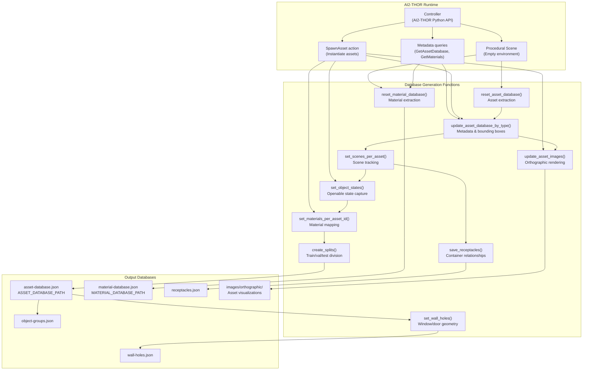

**Sources:** [tasks.py:19-619]()

## Material Database Generation

The material database contains all available materials in AI2-THOR, organized by material group (e.g., "Wood", "Metal", "Fabric"). This database enables material randomization during house generation.

### Extraction Process

The `reset_material_database()` function queries AI2-THOR for the complete material catalog:

| Step | Function | Purpose |
|------|----------|---------|
| 1 | Initialize Controller | Create AI2-THOR connection with PROCTHOR_INITIALIZATION |
| 2 | `update_material_database()` | Call `GetMaterials` action |
| 3 | `save_material_database()` | Sort and write to JSON |
| 4 | `update_material_visualizations()` | Generate preview images (optional) |

### Material Visualization

The system can optionally generate sphere renders for each material by creating a material ball and capturing it with an orthographic camera:

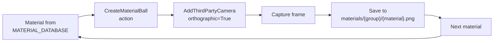

**Sources:** [tasks.py:28-71]()

## Asset Database Generation

The asset database is the core database containing metadata for all placeable objects in ProcTHOR. The generation process is orchestrated by `reset_asset_database()`, which calls a sequence of functions to build and enrich the database.

### Generation Pipeline

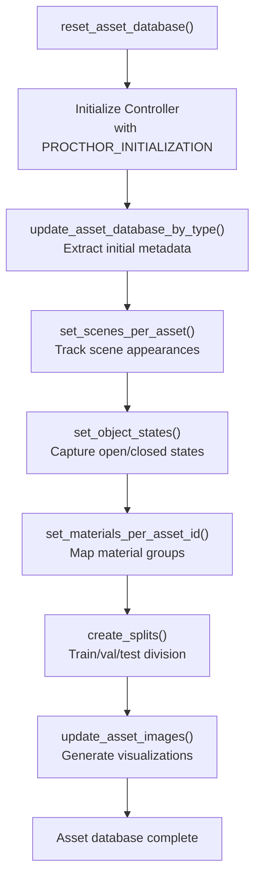

**Sources:** [tasks.py:74-83]()

### Initial Metadata Extraction

The `update_asset_database_by_type()` function extracts the initial asset catalog from AI2-THOR:

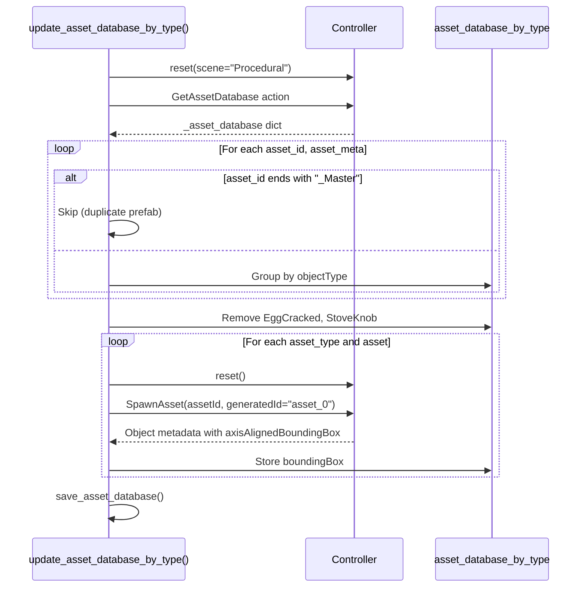

Key operations:
1. Query AI2-THOR's complete asset database via `GetAssetDatabase` action
2. Filter out `_Master` prefabs (duplicates)
3. Group assets by `objectType`
4. Remove invalid object types (`EggCracked`, `StoveKnob`)
5. Spawn each asset individually to measure its bounding box
6. Store accurate bounding box dimensions

**Sources:** [tasks.py:138-181]()

## Asset Metadata Enrichment

After initial extraction, several functions enrich the asset database with additional metadata required for generation.

### Scene Tracking

The `set_scenes_per_asset()` function determines which AI2-THOR scenes contain each asset:

| Field | Type | Purpose |
|-------|------|---------|
| `scenes` | `List[str]` | Scene names where this asset appears |

This metadata helps maintain compatibility with AI2-THOR's scene library and enables validation.

**Process:**
1. Iterate through all AI2-THOR scene names
2. Reset to each scene with `procedural=False`
3. Extract all `assetId` values from objects in scene
4. Map each asset to its list of scenes

**Sources:** [tasks.py:236-257]()

### Material Mapping

The `set_materials_per_asset_id()` function maps each asset to its material groups:

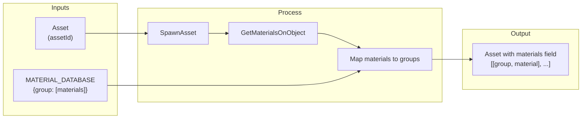

The `materials` field structure:
```
"materials": [
    ["Wood", "Wood_VarnishedBrown"],
    ["Metal", "Metal_BrushedAluminum_Blue"]
]
```

This enables selective material randomization during generation—only materials from compatible groups can be applied.

**Sources:** [tasks.py:204-233]()

### Object State Capture

The `set_object_states()` function captures bounding box dimensions for openable objects in their open state:

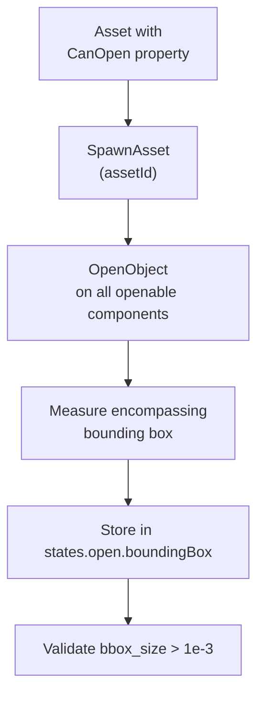

**Data structure:**
```
"states": {
    "open": {
        "boundingBox": {"x": 1.2, "y": 0.8, "z": 0.9}
    }
}
```

This metadata ensures collision detection accounts for doors, cabinets, and fridges in their open configuration.

**Sources:** [tasks.py:412-467]()

## Train/Val/Test Split Creation

The `create_splits()` function divides assets into train/val/test sets for research experiments:

### Split Algorithm

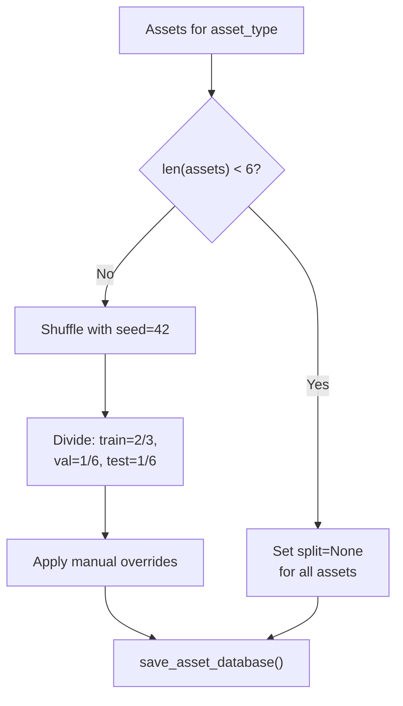

### Manual Overrides

The function includes hardcoded overrides to ensure specific assets land in desired splits:

| Asset Type | Asset ID | From Split | To Split | Reason |
|------------|----------|------------|----------|--------|
| Fridge | Fridge_11 | train | test | - |
| Fridge | Fridge_1 | test | train | - |
| Doorway | Doorway_8 | test | train | - |
| Doorway | Doorway_Double_3 | train | test | - |

The assertion `assert overrides == 4` ensures these exact overrides are applied.

**Sources:** [tasks.py:93-136]()

## Asset Image Generation

The `update_asset_images()` function generates orthographic visualizations for each asset from six viewpoints.

### Rendering Configuration

| Parameter | Value | Purpose |
|-----------|-------|---------|
| `width` | 450 (ASSET_IMAGE_SIZE) | Image dimensions |
| `height` | 450 | Image dimensions |
| `orthographic` | True | No perspective distortion |
| `renderInstanceSegmentation` | True | Alpha mask generation |
| `cameraNearPlane` | 1e-10 | Capture very close objects |
| `cameraFarPlane` | 1e5 | Capture distant objects |

### Viewpoint Configuration

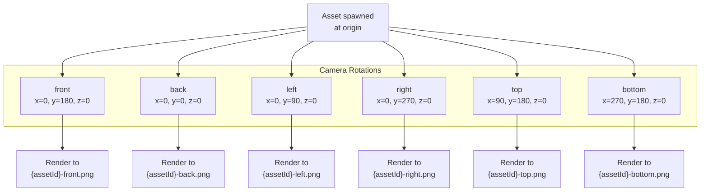

### Alpha Channel Generation

The system creates RGBA images with transparent backgrounds:

1. Capture RGB frame and instance segmentation frame
2. Create alpha channel by identifying pixels matching the asset's color in segmentation
3. Mark pixels at zero depth (background) as transparent
4. Combine RGB + alpha into RGBA image

**Output structure:**
```
images/orthographic/{asset_type}/{asset_id}-{side}.png
```

**Sources:** [tasks.py:260-378]()

### Maximum Pixel Length Calculation

The `add_max_image_pixel_length()` function computes the largest visual extent of each asset:

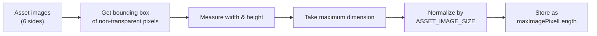

This field enables filtering assets by visual size, ensuring appropriately-scaled objects are selected for rooms.

**Sources:** [tasks.py:381-409]()

## Relationship Database Generation

### Receptacle Database

The `save_receptacles()` function analyzes AI2-THOR scenes to extract parent-child object relationships:

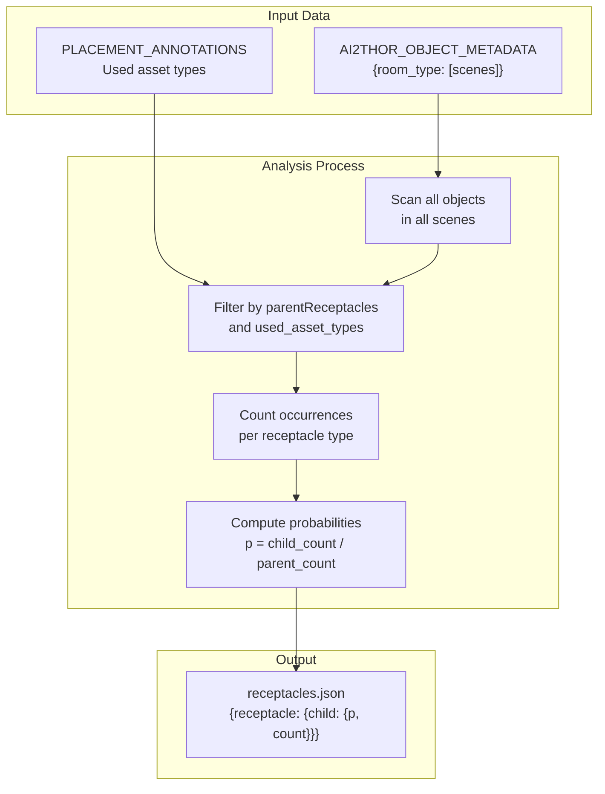

**Example output structure:**
```json
{
  "CounterTop": {
    "Apple": {"p": 0.15, "count": 42},
    "Bowl": {"p": 0.23, "count": 65}
  }
}
```

**Exclusions:** Objects like Sofa, Television, CounterTop (as children), Chair, DiningTable, etc., are excluded from receptacle relationships to avoid semantic implausibility.

**Sources:** [tasks.py:533-593]()

### Wall Holes Database

The `set_wall_holes()` function extracts geometric specifications for windows and doors:

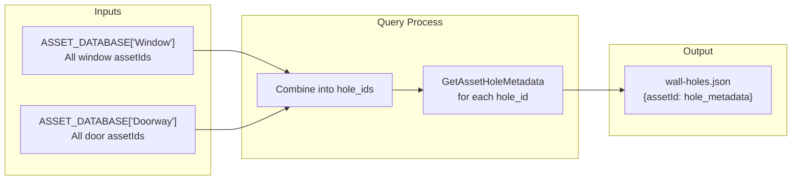

The hole metadata includes:
- Wall thickness requirements
- Opening dimensions
- Placement constraints

This data is used during door and window placement to ensure proper integration with walls.

**Sources:** [tasks.py:598-618]()

## Database Output Files

The generation process produces the following files:

| File Path | Generator Function | Content |
|-----------|-------------------|---------|
| `procthor/databases/asset-database.json` | `save_asset_database()` | Complete asset catalog with metadata |
| `procthor/databases/material-database.json` | `save_material_database()` | Material groups and materials |
| `procthor/databases/receptacles.json` | `save_receptacles()` | Parent-child object probabilities |
| `procthor/databases/wall-holes.json` | `set_wall_holes()` | Window and door geometry |
| `procthor/databases/object-groups.json` | `assign_object_groups()` | Asset groupings by type |
| `images/orthographic/{type}/{id}-{side}.png` | `update_asset_images()` | Asset visualization images |

### Database Constants

The system defines output paths as module-level constants:

```python
ASSET_DATABASE_PATH = "procthor/databases/asset-database.json"
MATERIAL_DATABASE_PATH = "procthor/databases/material-database.json"
ASSET_IMAGE_SIZE = 450
```

**Sources:** [tasks.py:3-5]()

## Integration with Generation System

The databases generated by `tasks.py` are loaded by the ProcTHORDatabase system and consumed throughout the generation pipeline:

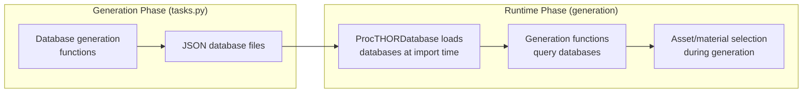

The generation phase (running `tasks.py` functions) is a one-time process executed by ProcTHOR developers. The runtime phase uses the pre-generated databases included in the package distribution.

**Sources:** [tasks.py:1-619]()

---

