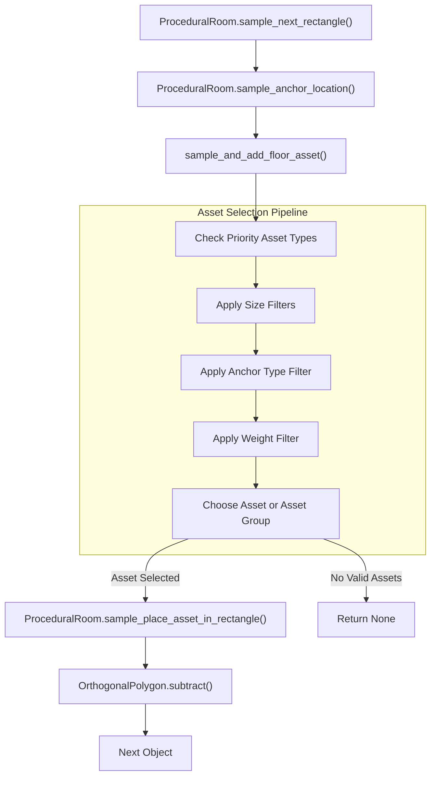
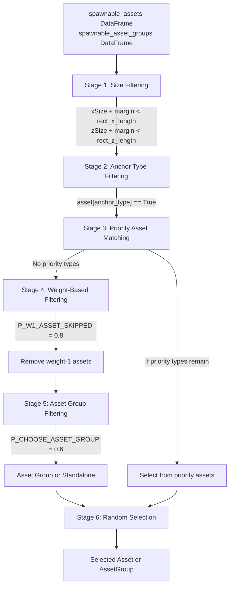
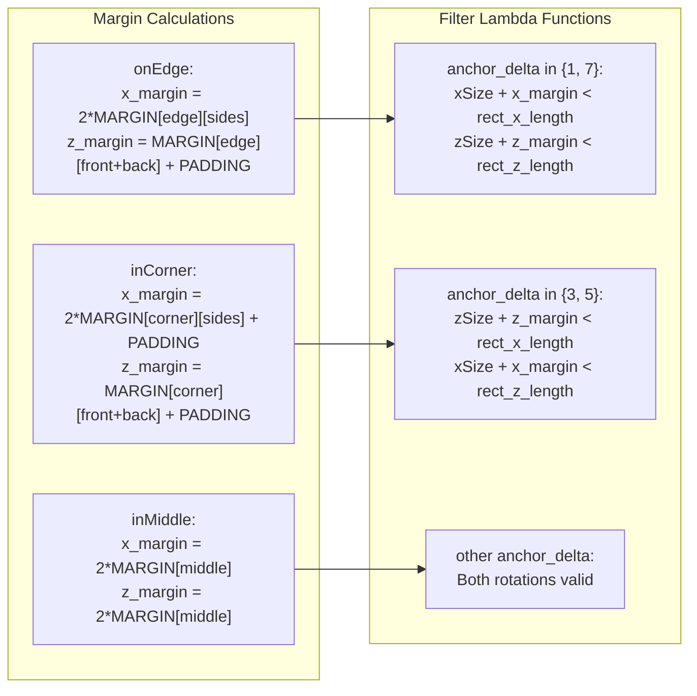
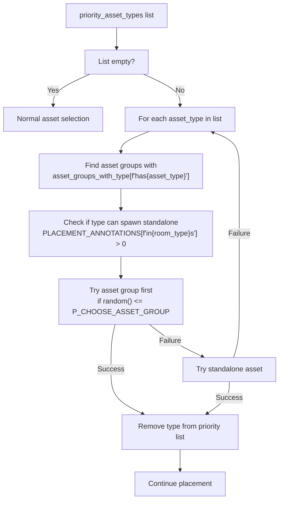
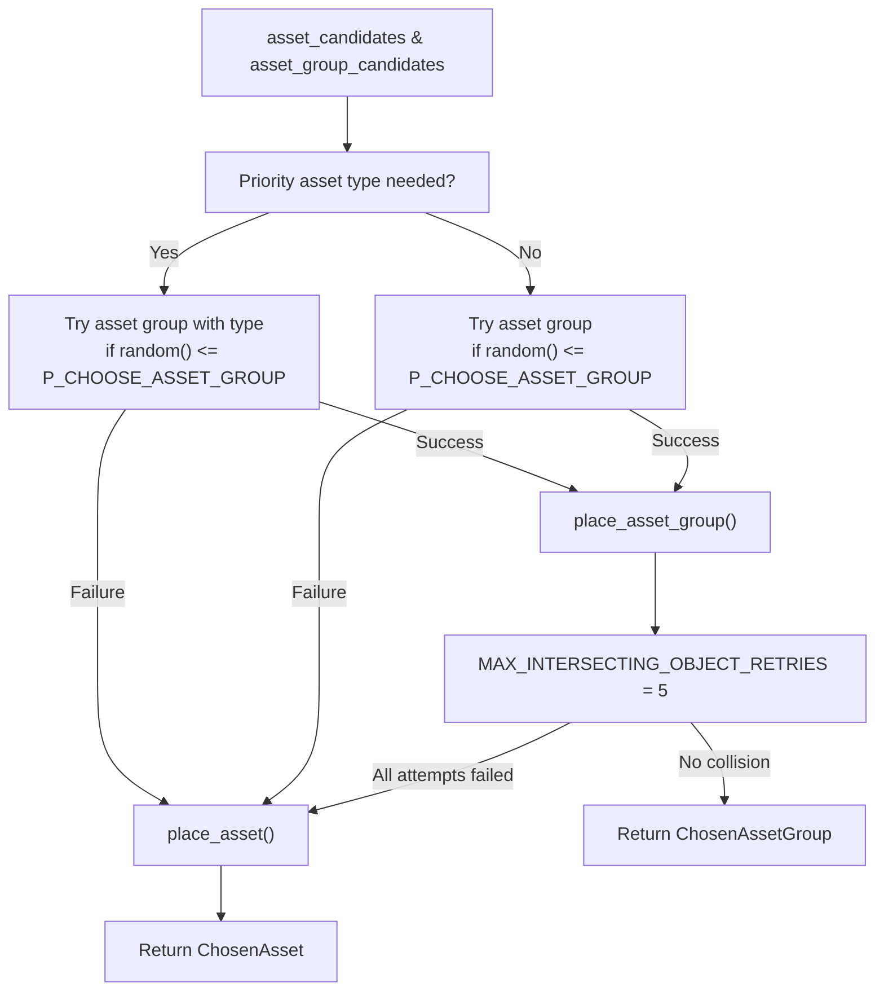
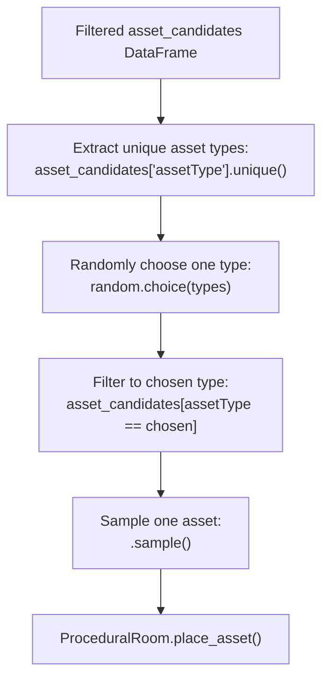
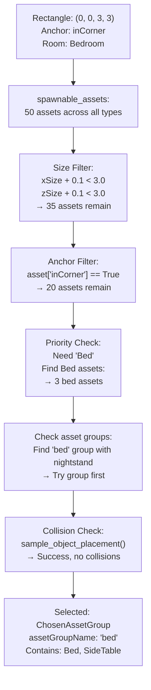

<!-- source: DeepWiki mcp.deepwiki.com · repo allenai/procthor · page 5.3 Asset Selection and Filtering · fetched 2026-10-26 -->

# Asset Selection and Filtering

<details>
<summary>Relevant source files</summary>

The following files were used as context for generating this wiki page:

- [procthor/generation/objects.py](procthor/generation/objects.py)
- [tasks.py](tasks.py)

</details>


## Purpose and Scope

This page documents the asset selection and filtering mechanisms used during floor object placement. It explains how the system queries the ProcTHORDatabase to find appropriate assets for each room, applies multi-stage filtering based on spatial constraints and semantic rules, and selects specific assets using probability-based strategies.

For information about the underlying database architecture and data structures, see [Database Architecture](#5.1). For details on how the database is generated from AI2-THOR metadata, see [Database Generation](#5.2). For the complete floor object placement pipeline that uses these selection mechanisms, see [Floor Object Placement](#3.5).

---

## Asset Selection Overview

Asset selection occurs during the floor object placement stage and determines which furniture, appliances, and decorative objects appear in each room. The system balances semantic plausibility (e.g., beds in bedrooms), spatial constraints (objects must fit in available space), and visual diversity (avoiding repetitive scenes).

The selection process follows this high-level flow:



**Sources:** [procthor/generation/objects.py:980-1154]()

---

## Database Structures for Asset Selection

Asset selection queries three primary database structures maintained by `ProcTHORDatabase`:

### Asset DataFrames

The `FLOOR_ASSET_DICT` maps `(room_type, split)` tuples to preprocessed DataFrames of spawnable assets. Each DataFrame contains:

| Column | Type | Description |
|--------|------|-------------|
| `assetId` | str | Unique asset identifier |
| `assetType` | str | Object type (e.g., "Bed", "Chair") |
| `xSize`, `ySize`, `zSize` | float | Bounding box dimensions |
| `inCorner`, `onEdge`, `inMiddle` | bool | Valid anchor types |
| `inKitchens`, `inLivingRooms`, `inBedrooms`, `inBathrooms` | int | Spawn weights per room type |
| `split` | str | Train/val/test designation |

**Sources:** [procthor/generation/objects.py:1214-1216]()

### Asset Group DataFrames

Asset groups are multi-object furniture sets (e.g., a desk with a chair). The `spawnable_asset_groups` DataFrame contains:

| Column | Type | Description |
|--------|------|-------------|
| `assetGroupName` | str | Group identifier |
| `xSize`, `ySize`, `zSize` | float | Bounding box of entire group |
| `inCorner`, `onEdge`, `inMiddle` | bool | Valid anchor types |
| `inKitchens`, `inLivingRooms`, `inBedrooms`, `inBathrooms` | int | Spawn weights per room type |
| `hasBed`, `hasChair`, etc. | bool | Indicates presence of each asset type |
| `allowDuplicates` | bool | Whether group can appear multiple times |
| `assetGroupGenerator` | AssetGroupGenerator | Object for sampling placements |

**Sources:** [procthor/generation/objects.py:1220-1225]()

### Placement Annotations

The `PLACEMENT_ANNOTATIONS` DataFrame defines semantic rules for each asset type:

| Column | Type | Description |
|--------|------|-------------|
| `isKinematic` | bool | Whether object is fixed in place |
| `multiplePerRoom` | bool | Allow multiple instances in same room |
| `onFloor` | bool | Can be placed on floor |
| `inKitchens`, `inLivingRooms`, etc. | int | Priority weights per room type |

**Sources:** [procthor/generation/objects.py:1084-1090]()

---

## Multi-Stage Filtering Pipeline

The `sample_and_add_floor_asset()` function implements a cascading filter pipeline that progressively narrows the set of candidate assets:



**Sources:** [procthor/generation/objects.py:980-1154]()

### Stage 1: Size Filtering

Size filters ensure assets fit within the sampled rectangle with appropriate margins. Margins vary by anchor type:



**Sources:** [procthor/generation/objects.py:1014-1055]()

### Stage 2: Anchor Type Filtering

Each asset specifies which anchor types it supports. The filter applies a boolean mask:

```python
# Pseudo-code representation
asset_candidates = spawnable_assets[
    spawnable_assets[anchor_type] & size_filter(spawnable_assets)
]
```

This ensures corner-only furniture (e.g., beds) won't be selected for middle placements, and vice versa.

**Sources:** [procthor/generation/objects.py:1058-1074]()

---

## Priority Asset System

The priority system ensures semantically important furniture appears in each room. `PRIORITY_ASSET_TYPES` maps room types to required asset types:

```python
PRIORITY_ASSET_TYPES = {
    "Kitchen": ["Fridge", "Stove", "DiningTable"],
    "LivingRoom": ["Sofa", "Television"],
    "Bedroom": ["Bed"],
    "Bathroom": ["Toilet", "Shower"]
}
```

### Priority Asset Selection Logic



Priority asset types are removed from the list once successfully placed, preventing duplicates of required furniture.

**Sources:** [procthor/generation/objects.py:1077-1121](), [procthor/generation/objects.py:1279-1282]()

---

## Weight-Based Selection and Filtering

### Weight-1 Asset Filtering

To avoid overusing rare objects, the system filters out assets with weight 1 (appear in exactly 1 scene) with probability `P_W1_ASSET_SKIPPED = 0.8`:

```python
if random.random() <= P_W1_ASSET_SKIPPED:
    asset_candidates = asset_candidates[
        asset_candidates[f"in{room.room_type}s"] != 1
    ]
```

This makes common objects (weight > 1) more likely to appear.

**Sources:** [procthor/generation/objects.py:1136-1140]()

### Room-Specific Spawn Weights

The `inKitchens`, `inLivingRooms`, `inBedrooms`, `inBathrooms` columns contain integer weights indicating how many times each asset type appears in AI2-THOR scenes of that room type. These weights inform:

1. **Filtering**: Assets with weight 0 for a room type are excluded
2. **Priority**: Higher-weight assets are considered more semantically appropriate
3. **Rarity control**: Weight-1 assets are often skipped

**Sources:** [procthor/generation/objects.py:1214-1216]()

---

## Asset Groups vs Standalone Assets

The system prefers asset groups (multi-object furniture sets) over standalone assets, controlled by `P_CHOOSE_ASSET_GROUP = 0.6`:



### Asset Group Collision Detection

Asset groups require collision checking because they contain multiple objects with specific relative positions:

```python
for _ in range(MAX_INTERSECTING_OBJECT_RETRIES):
    object_placement = asset_group_generator.sample_object_placement()
    any_collisions, intersecting_objects = asset_group_generator.get_intersecting_objects(
        object_placement=object_placement["objects"]
    )
    if not any_collisions:
        return chosen_asset_group
```

**Sources:** [procthor/generation/objects.py:752-795](), [procthor/generation/objects.py:1098-1134]()

---

## Special-Case Filtering

### House Plant Group Filter

To prevent oversampling floor-based house plants, the system applies:

```python
if not allow_house_plant_group:
    asset_group_candidates = asset_group_candidates[
        asset_group_candidates["assetGroupName"] != "floor-house-plant"
    ]
```

Where `allow_house_plant_group` is sampled once per room with `P_ALLOW_HOUSE_PLANT_GROUP = 0.5`.

**Sources:** [procthor/generation/objects.py:44-45](), [procthor/generation/objects.py:1061-1065]()

### Television Group Filter

Similarly, standalone TV groups (TV + stand) are limited to avoid oversampling:

```python
if not allow_tv_group:
    asset_group_candidates = asset_group_candidates[
        asset_group_candidates["assetGroupName"] != "television"
    ]
```

This makes wall-mounted TVs more likely in living rooms.

**Sources:** [procthor/generation/objects.py:47-53](), [procthor/generation/objects.py:1066-1070]()

---

## Duplicate Prevention

### Per-Asset-Type Duplicate Control

The `multiplePerRoom` flag in `PLACEMENT_ANNOTATIONS` controls whether multiple instances of an asset type can appear in the same room:

```python
if not allow_duplicates_of_asset_type:
    # Remove all asset groups containing the type
    spawnable_asset_groups = spawnable_asset_groups[
        ~spawnable_asset_groups[f"has{asset_type}"]
    ]
    
    # Remove all standalone assets of the type
    spawnable_assets = spawnable_assets[
        spawnable_assets["assetType"] != asset_type
    ]
```

This prevents, for example, multiple beds in a bedroom.

**Sources:** [procthor/generation/objects.py:1284-1297]()

### Per-Asset-Group Duplicate Control

Asset groups have their own `allowDuplicates` flag:

```python
if not asset["allowDuplicates"]:
    spawnable_asset_groups = spawnable_asset_groups.query(
        f"assetGroupName!='{asset['assetGroupName']}'"
    )
```

This prevents identical furniture sets from appearing multiple times.

**Sources:** [procthor/generation/objects.py:1274-1277]()

---

## Asset Type Sampling

After filtering, the final selection is stratified by asset type to increase diversity:



This ensures each asset type has equal probability regardless of how many asset IDs exist for that type.

**Sources:** [procthor/generation/objects.py:1147-1154]()

---

## Complete Filtering Example

Here is a concrete example of how an asset is selected for a bedroom corner:



**Sources:** [procthor/generation/objects.py:980-1154]()

---

## Key Constants

| Constant | Value | Purpose |
|----------|-------|---------|
| `P_CHOOSE_ASSET_GROUP` | 0.6 | Probability of preferring asset groups over standalone assets |
| `P_W1_ASSET_SKIPPED` | 0.8 | Probability of filtering out weight-1 (rare) assets |
| `P_ALLOW_HOUSE_PLANT_GROUP` | 0.5 | Per-room probability of allowing floor house plant groups |
| `P_ALLOW_TV_GROUP` | 0.5 | Per-room probability of allowing standalone TV groups |
| `MAX_INTERSECTING_OBJECT_RETRIES` | 5 | Number of collision resolution attempts for asset groups |

**Sources:** [procthor/generation/objects.py:29](), [procthor/generation/objects.py:32](), [procthor/generation/objects.py:44](), [procthor/generation/objects.py:47](), [procthor/constants.py:26]()

---

