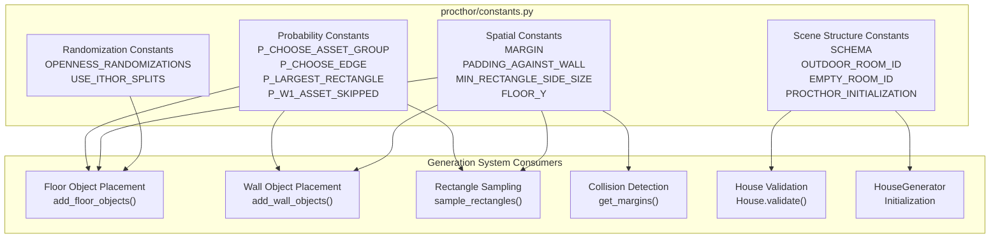
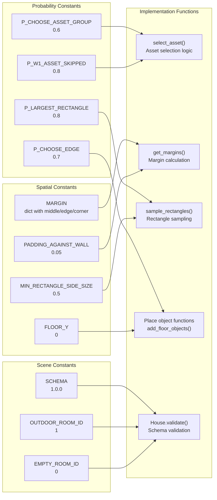
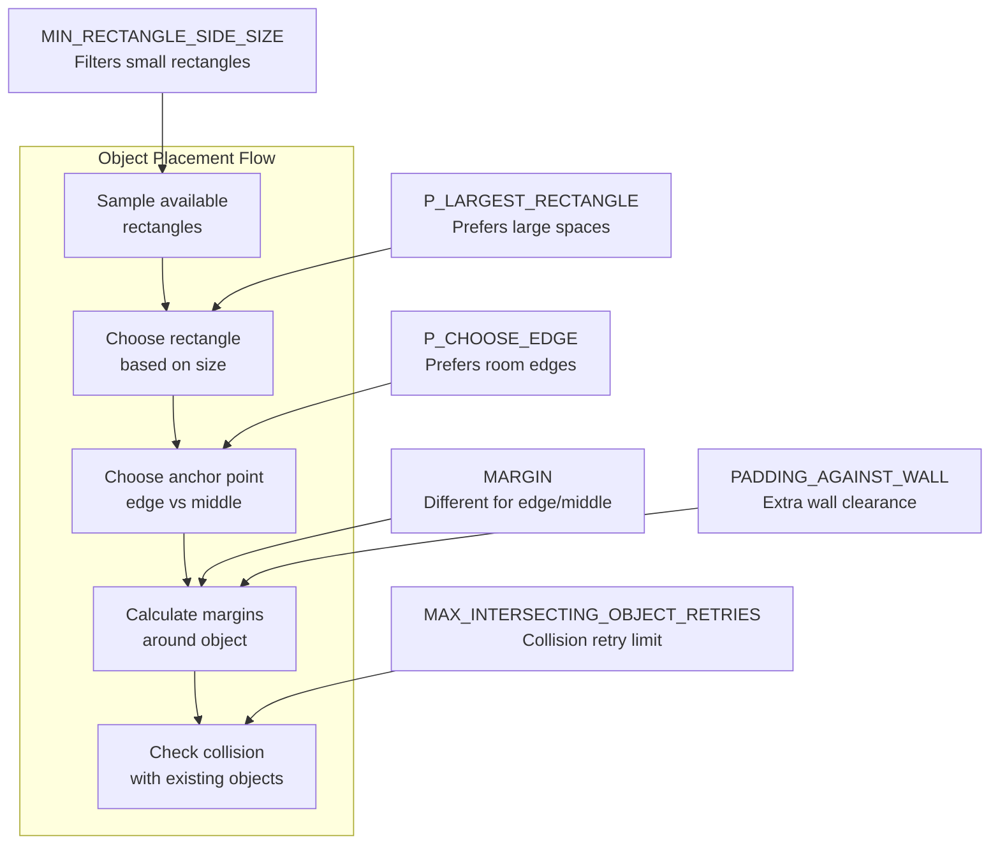

<!-- source: DeepWiki mcp.deepwiki.com · repo allenai/procthor · page 6 Configuration and Constants · fetched 2026-10-26 -->

# Configuration and Constants

<details>
<summary>Relevant source files</summary>

The following files were used as context for generating this wiki page:

- [procthor/constants.py](procthor/constants.py)

</details>


This page documents the configuration constants that control ProcTHOR's procedural generation system. These constants define probabilities, spatial parameters, and initialization values that determine how houses are generated.

For detailed explanations of how constants are used in specific generation stages, see [Core Generation System](#2). For information about the database of assets and materials that these constants operate on, see [Database System](#5).

## Purpose and Scope

The constants defined in `procthor/constants.py` serve as the primary tuning parameters for the entire generation system. They control:

- **Stochastic decisions**: Probabilities that govern random choices during generation
- **Spatial constraints**: Minimum sizes, margins, and padding for object placement
- **Scene structure**: Room identifiers and initialization parameters
- **Schema versioning**: Version tracking for backward compatibility

These constants are imported and used throughout the generation pipeline, particularly in the generation functions and spatial reasoning systems.

**Sources:** [procthor/constants.py:1-76]()

## Constants Module Structure

The `procthor/constants.py` file contains 14 module-level constants organized into three functional categories. The following diagram shows how these constants are consumed by different parts of the generation system:



**Sources:** [procthor/constants.py:1-76]()

## Constant Categories Overview

The following table categorizes all constants by their functional purpose:

| Category | Constants | Purpose |
|----------|-----------|---------|
| **Probability** | `P_CHOOSE_ASSET_GROUP`<br/>`P_W1_ASSET_SKIPPED`<br/>`P_CHOOSE_EDGE`<br/>`P_LARGEST_RECTANGLE` | Control stochastic decisions during object and placement selection |
| **Spatial** | `MARGIN`<br/>`PADDING_AGAINST_WALL`<br/>`MIN_RECTANGLE_SIDE_SIZE`<br/>`FLOOR_Y` | Define physical spacing, minimum sizes, and coordinate systems |
| **Scene Structure** | `SCHEMA`<br/>`OUTDOOR_ROOM_ID`<br/>`EMPTY_ROOM_ID`<br/>`PROCTHOR_INITIALIZATION` | Schema versioning and room identification |
| **Randomization** | `OPENNESS_RANDOMIZATIONS`<br/>`USE_ITHOR_SPLITS`<br/>`MAX_INTERSECTING_OBJECT_RETRIES` | Object state randomization and retry limits |

**Sources:** [procthor/constants.py:1-76]()

## Mapping Constants to Code Usage

The following diagram shows the specific functions and methods that consume each constant, bridging the configuration layer to the implementation layer:



**Sources:** [procthor/constants.py:1-76]()

## Design Philosophy

The constants system embodies several key design principles:

### Tunability Without Code Changes

All generation behavior can be tuned by modifying values in `constants.py` without changing the core algorithms. This separation allows researchers to adjust generation characteristics (e.g., making rooms sparser or denser) without understanding implementation details.

### Explicit Over Implicit

Rather than hardcoding magic numbers throughout the codebase, all tunable parameters are centralized and documented. Each constant includes a docstring explaining its purpose and effect.

### Probability-Driven Diversity

Many constants are probabilities (0.0 to 1.0) that control binary or multi-way decisions. This approach creates natural variation across generated houses while maintaining control over statistical distributions.

### Physical Realism Through Constraints

Spatial constants (margins, padding, minimum sizes) ensure generated scenes are physically plausible and navigable by embodied AI agents. These values are empirically tuned based on AI2-THOR's physics simulation.

**Sources:** [procthor/constants.py:1-76]()

## Constant Interdependencies

Some constants work together to achieve specific generation behaviors. The following diagram illustrates key interdependencies:



**Sources:** [procthor/constants.py:18-64]()

## Constant Value Rationale

The specific values assigned to constants are not arbitrary but result from empirical tuning and domain knowledge:

| Constant | Value | Rationale |
|----------|-------|-----------|
| `P_CHOOSE_ASSET_GROUP` | 0.6 | Favors semantically coherent furniture sets (e.g., matching dining table and chairs) while allowing standalone objects |
| `P_CHOOSE_EDGE` | 0.7 | Reflects real-world furniture placement patterns where most items are against walls |
| `P_LARGEST_RECTANGLE` | 0.8 | Encourages efficient space usage while allowing smaller items in corners |
| `P_W1_ASSET_SKIPPED` | 0.8 | Prevents over-population with low-priority decorative items |
| `MARGIN["middle"]` | 0.35 | Provides comfortable navigation space around furniture |
| `MARGIN["edge"]["front"]` | 0.5 | Ensures agents can approach and interact with objects |
| `PADDING_AGAINST_WALL` | 0.05 | Small buffer prevents physics collision glitches |
| `MIN_RECTANGLE_SIDE_SIZE` | 0.5 | Minimum size for most furniture items in AI2-THOR |

**Sources:** [procthor/constants.py:18-64]()

## Schema Versioning

The `SCHEMA` constant tracks the house JSON format version for backward compatibility:

```python
SCHEMA = "1.0.0"
```

This version string is embedded in every generated house JSON file and checked during validation. When the house format changes (e.g., adding new fields or changing data structures), the schema version is incremented. The `HouseUpgradeManager` (see [Versioning and Schema Migration](#7)) uses this version to apply appropriate transformations when loading older house files.

**Sources:** [procthor/constants.py:15-16]()

## Room Identification Constants

Two special room identifiers are used in the spatial matrix representation:

```python
OUTDOOR_ROOM_ID = 1  # Outside the house boundary
EMPTY_ROOM_ID = 0    # Unassigned interior space
```

These constants appear in the room matrix generated during structure creation. `OUTDOOR_ROOM_ID` marks cells outside the house boundary, while `EMPTY_ROOM_ID` represents interior cells not yet assigned to specific rooms. During generation, all `EMPTY_ROOM_ID` cells are eventually assigned actual room identifiers (2, 3, 4, ...).

**Sources:** [procthor/constants.py:71-75]()

## AI2-THOR Initialization Parameters

The `PROCTHOR_INITIALIZATION` dictionary provides base parameters for initializing AI2-THOR:

```python
PROCTHOR_INITIALIZATION = dict(branch="main", scene="Procedural")
```

These parameters are passed to the AI2-THOR controller when validating or rendering generated houses. The `"Procedural"` scene type indicates that the environment is dynamically generated rather than a pre-built scene.

**Sources:** [procthor/constants.py:65-66]()

## Randomization Configuration

The `OPENNESS_RANDOMIZATIONS` dictionary specifies how to randomize the open/closed state of specific object types:

```python
OPENNESS_RANDOMIZATIONS = {
    "Box": {"population": [0, 1], "weights": [0.5, 0.5]},
    "Laptop": {"population": [0, 1, "any"], "weights": [0.4, 0.4, 0.2]},
}
```

Each entry defines:
- **population**: Possible openness values (0=closed, 1=open, "any"=leave unchanged)
- **weights**: Probability distribution over these values

This system only applies to objects whose opening doesn't affect other objects (e.g., no objects on top that would fall).

**Sources:** [procthor/constants.py:4-13]()

## Collision Retry Limit

The `MAX_INTERSECTING_OBJECT_RETRIES` constant controls how many times the system attempts to place an asset group before giving up:

```python
MAX_INTERSECTING_OBJECT_RETRIES = 5
```

When an asset group contains multiple objects (e.g., a table with chairs), the system tries different configurations. If collisions persist after 5 attempts, the system may skip the asset group or select a simpler alternative. This prevents infinite loops while maximizing successful placements.

**Sources:** [procthor/constants.py:34-35]()

## Usage Patterns

Constants are imported and used throughout the generation pipeline. Common usage patterns include:

### Binary Probability Decisions

```python
from procthor.constants import P_CHOOSE_ASSET_GROUP

if random.random() < P_CHOOSE_ASSET_GROUP:
    # Select an asset group
else:
    # Select a standalone asset
```

### Spatial Constraint Checks

```python
from procthor.constants import MIN_RECTANGLE_SIDE_SIZE

valid_rectangles = [
    r for r in candidate_rectangles 
    if r.width >= MIN_RECTANGLE_SIDE_SIZE 
    and r.height >= MIN_RECTANGLE_SIDE_SIZE
]
```

### Margin Calculation

```python
from procthor.constants import MARGIN

margin = MARGIN["edge"] if is_edge_placement else MARGIN["middle"]
front_margin = margin["front"]
```

These patterns appear repeatedly in the generation functions throughout `procthor/generation/`.

**Sources:** [procthor/constants.py:1-76]()

## Relationship to Subsections

The three subsections of this page provide detailed documentation:

- **[Probability Constants](#6.1)**: In-depth explanation of stochastic decision parameters and their effects on generation diversity
- **[Spatial Constants](#6.2)**: Detailed documentation of margins, padding, and spatial constraints with geometric illustrations
- **[Scene Structure Constants](#6.3)**: Complete reference for schema versioning, room identifiers, and initialization parameters

These subsections include additional diagrams, usage examples, and guidance on tuning constants for specific research applications.

**Sources:** [procthor/constants.py:1-76]()

---

