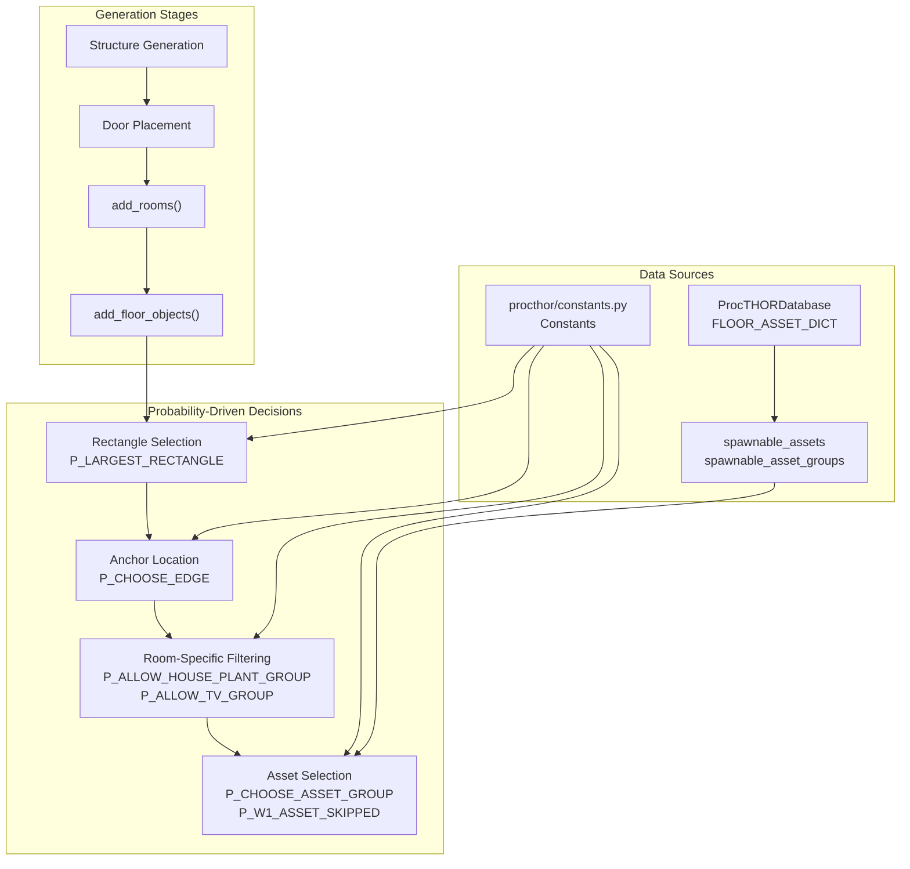
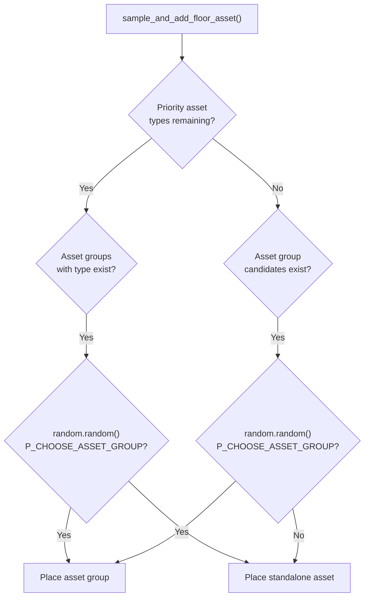
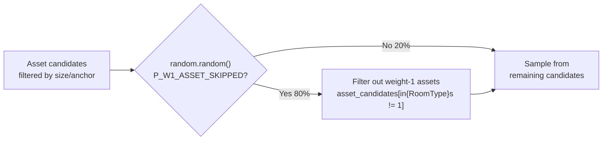
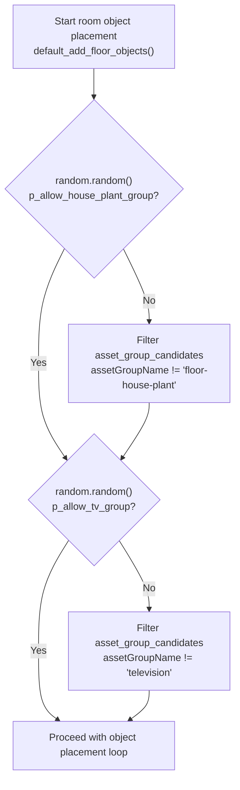
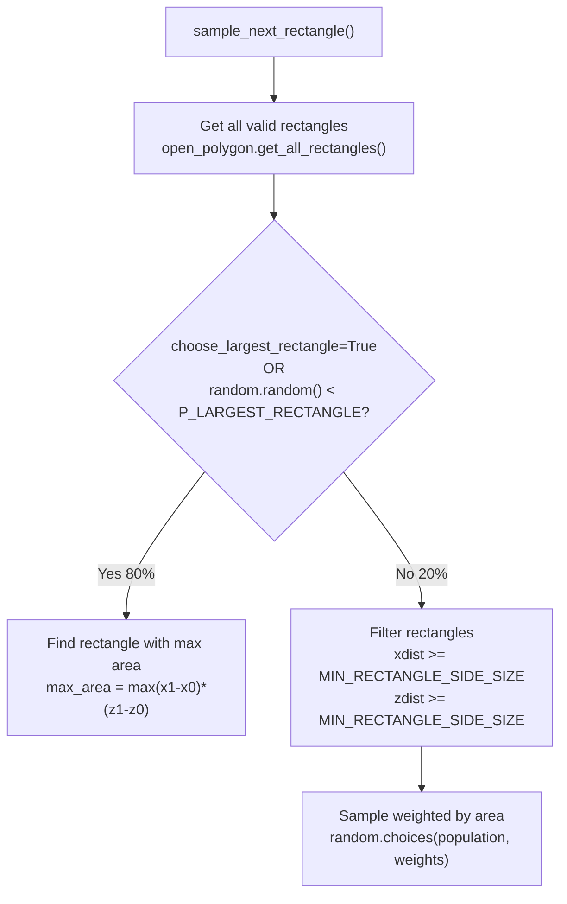
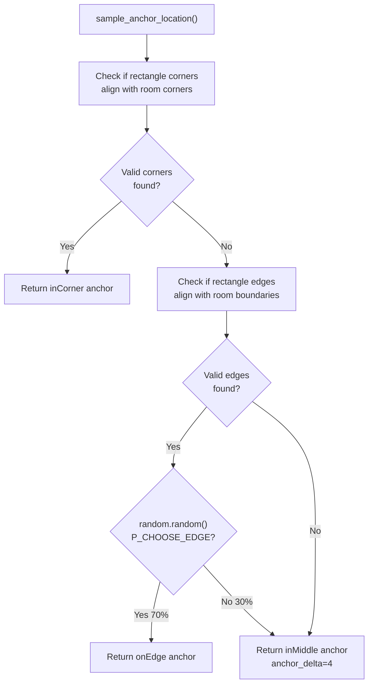
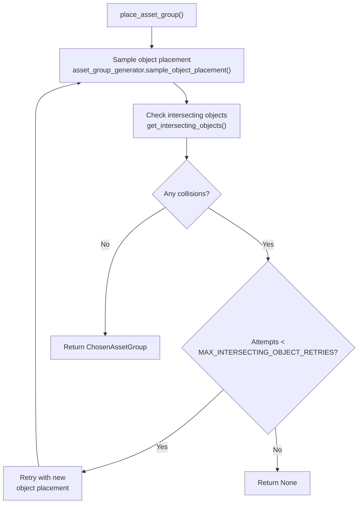

<!-- source: DeepWiki mcp.deepwiki.com · repo allenai/procthor · page 6.1 Probability Constants · fetched 2026-10-26 -->

# Probability Constants

<details>
<summary>Relevant source files</summary>

The following files were used as context for generating this wiki page:

- [procthor/constants.py](procthor/constants.py)
- [procthor/generation/objects.py](procthor/generation/objects.py)

</details>


## Purpose and Scope

This page documents the probability constants that control stochastic decisions during procedural house generation. These constants determine outcomes such as whether to place an asset group versus a standalone asset, where to position objects within rooms, and which rectangle to select from available placement areas.

For information about spatial constants (margins, padding, minimum sizes), see [Spatial Constants](#6.2). For scene structure constants (schema version, room IDs), see [Scene Structure Constants](#6.3). For material randomization strategies, see [Material Randomization](#3.7). For object state randomization, see [Object Color and State Randomization](#3.8).

## Overview

Probability constants are defined in [procthor/constants.py:31-60]() and [procthor/generation/objects.py:44-53](). They control stochastic decisions throughout the generation pipeline, primarily during floor object placement. These constants allow ProcTHOR to generate diverse scenes while maintaining semantic plausibility.

The constants fall into three categories:
1. **Asset Selection**: Determine whether to place asset groups or standalone assets
2. **Spatial Placement**: Control where objects are positioned within rooms
3. **Sampling Control**: Prevent over-representation of specific object types

### Generation Pipeline Integration



**Sources:** [procthor/constants.py:31-60](), [procthor/generation/objects.py:980-1305]()

## Asset Selection Probabilities

### P_CHOOSE_ASSET_GROUP

```python
P_CHOOSE_ASSET_GROUP = 0.6
```

This constant determines the probability of selecting a semantic asset group (e.g., a dining table with chairs) over a standalone asset when both are valid placement options.

**Value:** `0.6` (60% chance of choosing an asset group)

**Usage Context:** The constant is evaluated in two scenarios during floor object placement:

1. **Priority Asset Placement**: When placing required furniture types for a room (e.g., beds in bedrooms)
2. **General Asset Placement**: After priority assets are placed, for filling remaining space

**Code Flow:**



**Design Rationale:** The 60% preference for asset groups creates more realistic room compositions. Asset groups represent semantically coherent furniture sets (e.g., dining tables with matching chairs, sofas with coffee tables), which are more common in real homes than standalone furniture pieces.

**Sources:** [procthor/constants.py:31-32](), [procthor/generation/objects.py:1098-1110](), [procthor/generation/objects.py:1124-1134]()

### P_W1_ASSET_SKIPPED

```python
P_W1_ASSET_SKIPPED = 0.8
```

This constant controls the probability of skipping weight-1 assets when only weight-1 assets are available. Weight-1 assets are those with low spawn priority in a given room type (as defined in `PLACEMENT_ANNOTATIONS`).

**Value:** `0.8` (80% chance of skipping weight-1 assets)

**Purpose:** Prevents weight-1 assets from always appearing in rooms when `max_floor_objects` is large. Without this constant, rooms would become cluttered with low-priority objects once high-priority objects are placed.

**Implementation:**



**Note:** This probability is compounded relative to `max_floor_objects` and the number of weight-2+ assets and asset groups available. If an iteration skips weight-1 assets but finds no valid candidates, the system returns `None` and no object is placed in that iteration.

**Sources:** [procthor/constants.py:37-45](), [procthor/generation/objects.py:1136-1140]()

### Room-Specific Sampling Controls

Two additional probability constants control over-representation of specific asset types:

#### P_ALLOW_HOUSE_PLANT_GROUP

```python
P_ALLOW_HOUSE_PLANT_GROUP = 0.5
```

Defined in [procthor/generation/objects.py:44-45](), this constant prevents oversampling of floor house plants. At the start of each room's object placement, a random check determines whether the `"floor-house-plant"` asset group is allowed. If not, it is filtered from candidates.

#### P_ALLOW_TV_GROUP

```python
P_ALLOW_TV_GROUP = 0.5
```

Defined in [procthor/generation/objects.py:47-53](), this constant reduces the frequency of standalone television asset groups (TVs on TV stands). This makes wall-mounted TVs more likely by limiting floor-based TV placements.

**Implementation Context:**



**Sources:** [procthor/generation/objects.py:44-53](), [procthor/generation/objects.py:1061-1070](), [procthor/generation/objects.py:1211-1212]()

## Spatial Placement Probabilities

### P_LARGEST_RECTANGLE

```python
P_LARGEST_RECTANGLE = 0.8
```

This constant determines the probability of selecting the largest available rectangle when placing an object. Rectangles represent valid placement areas within a room's `OrthogonalPolygon`.

**Value:** `0.8` (80% chance of choosing the largest rectangle)

**Decision Logic:**

| Condition | Action | Probability |
|-----------|--------|-------------|
| `random.random() < P_LARGEST_RECTANGLE` | Select rectangle with maximum area | 80% |
| Otherwise | Sample rectangle weighted by area | 20% |

**Implementation:**



**Design Rationale:** Preferring larger rectangles places objects in more spacious areas, which:
1. Reduces collision likelihood
2. Creates more realistic furniture arrangements (large furniture in open areas)
3. Leaves smaller rectangles for subsequent smaller objects

The 20% weighted sampling adds variability, preventing all large objects from clustering in the room's center.

**Sources:** [procthor/constants.py:55-60](), [procthor/generation/objects.py:550-594]()

### P_CHOOSE_EDGE

```python
P_CHOOSE_EDGE = 0.7
```

This constant controls the probability of placing an object at the edge of a room when the selected rectangle touches a room boundary.

**Value:** `0.7` (70% chance of edge placement when edge is available)

**Anchor Location Decision Tree:**



**Anchor Type Impact:** The anchor type determines margin application (see [Spatial Constants](#6.2)) and affects placement realism:
- `"inCorner"`: Objects against two walls (e.g., corner desks)
- `"onEdge"`: Objects against one wall (e.g., beds, sofas)
- `"inMiddle"`: Objects in open space (e.g., dining tables)

**Design Rationale:** The 70% edge preference reflects real-world furniture placement patterns. Most furniture is placed against walls to maximize open floor space. The 30% middle placement adds variety and enables realistic center-of-room furniture (dining tables, coffee tables).

**Sources:** [procthor/constants.py:47-53](), [procthor/generation/objects.py:817-899]()

## Interaction with Collision Detection

Probability constants interact with collision detection through `MAX_INTERSECTING_OBJECT_RETRIES`:

```python
MAX_INTERSECTING_OBJECT_RETRIES = 5
```

When placing asset groups, the system samples object positions internally. If any objects collide, the system retries up to 5 times before giving up on that asset group.



**Sources:** [procthor/constants.py:34-35](), [procthor/generation/objects.py:768-795]()

## Probability Constants Summary Table

| Constant | Value | Purpose | Code Location |
|----------|-------|---------|---------------|
| `P_CHOOSE_ASSET_GROUP` | 0.6 | Prefer asset groups over standalone assets | [constants.py:31]() |
| `P_W1_ASSET_SKIPPED` | 0.8 | Skip low-priority assets to reduce clutter | [constants.py:37]() |
| `P_CHOOSE_EDGE` | 0.7 | Place objects against walls when possible | [constants.py:47]() |
| `P_LARGEST_RECTANGLE` | 0.8 | Select largest available placement area | [constants.py:55]() |
| `P_ALLOW_HOUSE_PLANT_GROUP` | 0.5 | Control house plant frequency | [objects.py:44]() |
| `P_ALLOW_TV_GROUP` | 0.5 | Control standalone TV frequency | [objects.py:47]() |

## Impact on Scene Diversity

The combination of these probability constants creates diverse scenes through:

1. **Compositional Variety**: `P_CHOOSE_ASSET_GROUP` balances curated furniture sets with eclectic standalone pieces
2. **Spatial Variety**: `P_LARGEST_RECTANGLE` and `P_CHOOSE_EDGE` distribute objects across different room areas
3. **Density Control**: `P_W1_ASSET_SKIPPED` prevents over-cluttering with low-priority objects
4. **Type Balance**: Room-specific constants prevent over-representation of specific object types

**Tuning Considerations:**

- Increasing `P_CHOOSE_ASSET_GROUP` creates more cohesive room aesthetics but reduces variety
- Increasing `P_LARGEST_RECTANGLE` spreads objects more but may leave corners empty
- Increasing `P_CHOOSE_EDGE` creates more realistic layouts but reduces central furniture
- Decreasing `P_W1_ASSET_SKIPPED` increases room density but may create unrealistic clutter

These constants were tuned empirically to balance realism, diversity, and computational efficiency. Adjusting them changes the aesthetic character of generated houses without modifying core algorithms.

**Sources:** [procthor/constants.py:1-76](), [procthor/generation/objects.py:980-1305]()

---

