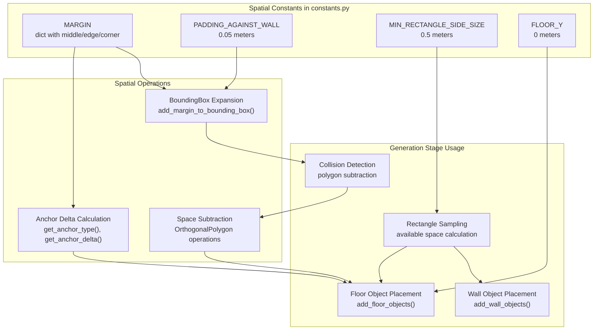
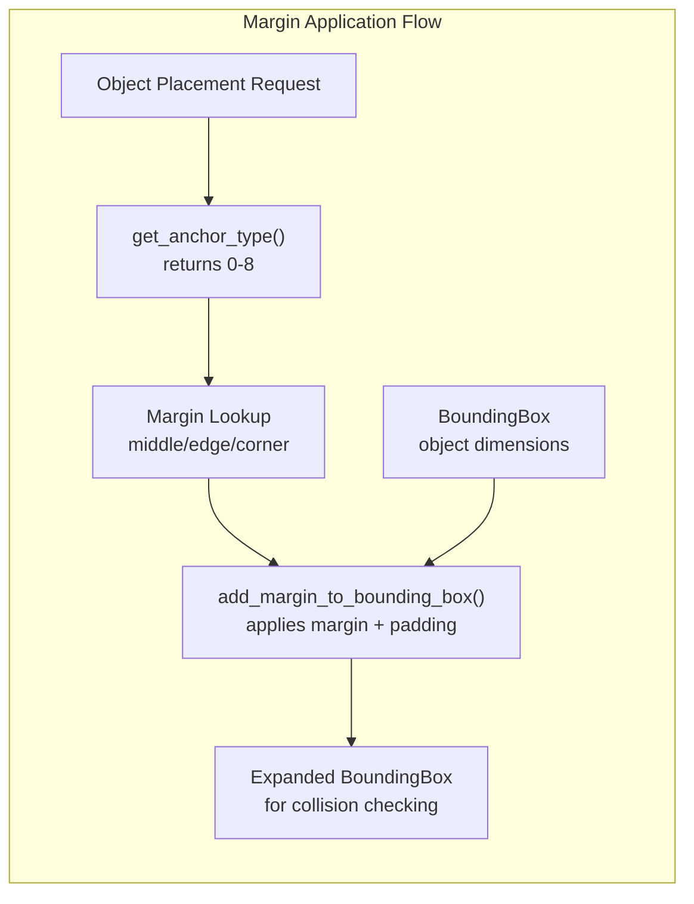
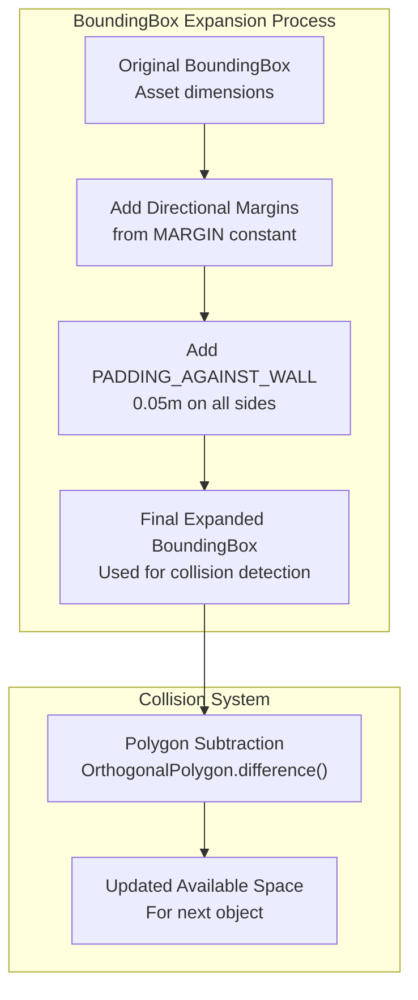
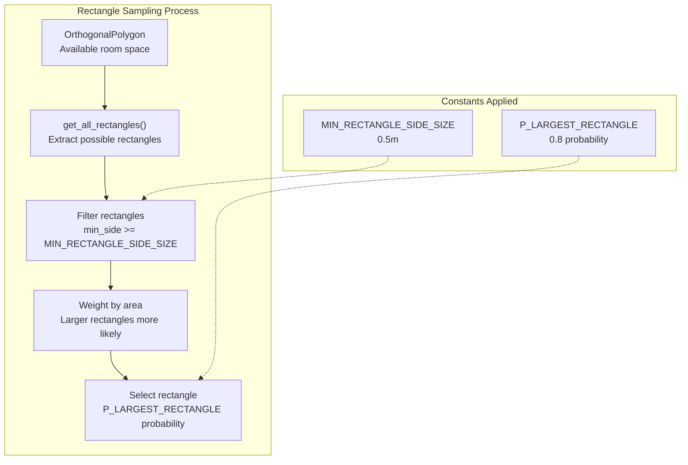
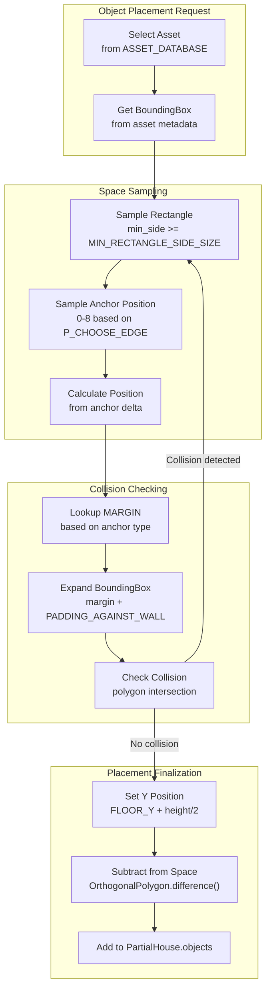
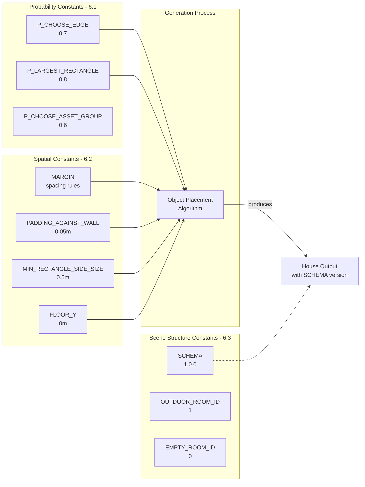

<!-- source: DeepWiki mcp.deepwiki.com · repo allenai/procthor · page 6.2 Spatial Constants · fetched 2026-10-26 -->

# Spatial Constants

<details>
<summary>Relevant source files</summary>

The following files were used as context for generating this wiki page:

- [procthor/constants.py](procthor/constants.py)

</details>


## Purpose and Scope

This document describes the spatial constants defined in [procthor/constants.py]() that control physical spacing, sizing, and positioning during object placement. These constants ensure that objects maintain appropriate distances from walls and each other, creating physically plausible scene layouts.

For stochastic decision parameters that control probabilistic behavior, see [Probability Constants](#6.1). For schema versioning and room identification constants, see [Scene Structure Constants](#6.3).

**Sources:** [procthor/constants.py:18-76]()

## Spatial Constants Overview

The spatial constants system defines four primary parameters that govern geometric placement constraints throughout the generation pipeline:



**Sources:** [procthor/constants.py:18-69]()

## The MARGIN System

The `MARGIN` dictionary defines spacing rules based on object placement location within a room. It differentiates between three anchor types: middle, edge, and corner placements.

### Structure

The constant is defined at [procthor/constants.py:18-23]():

```python
MARGIN = {
    "middle": 0.35,
    "edge": {"front": 0.5, "back": 0, "sides": 0},
    "corner": {"front": 0.5, "back": 0, "sides": 0},
}
```

### Margin Types

| Anchor Type | Configuration | Purpose |
|-------------|---------------|---------|
| `middle` | Single value: 0.35m | Applied uniformly around objects placed away from walls |
| `edge` | Directional: front=0.5m, back=0m, sides=0m | Applied to objects placed along one wall |
| `corner` | Directional: front=0.5m, back=0m, sides=0m | Applied to objects placed at room corners |

### Directional Margin Application

For edge and corner placements, the margin system uses directional spacing:

- **Front:** 0.5 meters - space in front of the object (towards room interior)
- **Back:** 0 meters - no additional space against the wall
- **Sides:** 0 meters - no additional space along the wall edges

This asymmetric approach allows objects to sit flush against walls while maintaining clearance for interaction from the front.



### Anchor Type Mapping

The margin type selection depends on the anchor position (0-8):

- **Middle (anchor 0):** Uses `MARGIN["middle"]`
- **Edge (anchors 2, 4, 6, 8):** Uses `MARGIN["edge"]`  
- **Corner (anchors 1, 3, 5, 7):** Uses `MARGIN["corner"]`

The anchor system is documented in detail in [Rectangle Sampling and Anchoring](#4.2).

**Sources:** [procthor/constants.py:18-23]()

## PADDING_AGAINST_WALL

The `PADDING_AGAINST_WALL` constant adds a small buffer to prevent objects from intersecting with wall geometry.

### Definition

```python
PADDING_AGAINST_WALL = 0.05  # meters
```

Defined at [procthor/constants.py:25-29]().

### Purpose

This 5-centimeter padding compensates for:
1. Floating-point precision errors in geometric calculations
2. Small inaccuracies in asset bounding boxes
3. AI2-THOR physics tolerances

### Application Context

The padding is added to the bounding box during the `add_margin_to_bounding_box()` function, which is called before collision detection. The expanded bounding box is used for polygon subtraction operations that update available room space.



The padding ensures that when an object's bounding box is converted to a 2D polygon for spatial reasoning, there is sufficient clearance from walls and other objects.

**Sources:** [procthor/constants.py:25-29]()

## MIN_RECTANGLE_SIDE_SIZE

The `MIN_RECTANGLE_SIDE_SIZE` constant defines the minimum dimensions for rectangles extracted from available room space during object placement.

### Definition

```python
MIN_RECTANGLE_SIDE_SIZE = 0.5  # meters
```

Defined at [procthor/constants.py:62-63]().

### Purpose

This constant serves two functions:

1. **Filtering:** Rectangles smaller than 0.5m × 0.5m are discarded from consideration
2. **Performance:** Reduces computational overhead by ignoring placement locations that are too small for most objects

### Usage in Rectangle Sampling

The rectangle sampling system extracts all possible rectangular regions from the available space (represented as an `OrthogonalPolygon`). The `MIN_RECTANGLE_SIDE_SIZE` acts as a filter during this extraction:



**Sources:** [procthor/constants.py:62-63]()

## FLOOR_Y Position Constant

The `FLOOR_Y` constant defines the vertical position of the floor plane in the coordinate system.

### Definition

```python
FLOOR_Y = 0  # meters
```

Defined at [procthor/constants.py:68-69]().

### Purpose

This constant establishes the Y-axis reference point for all vertical positioning:

- Floor objects are placed at `y = FLOOR_Y + (object height / 2)`
- Room height calculations use `FLOOR_Y` as the base
- Collision detection uses this as the ground plane reference

### Coordinate System Context

| Axis | Interpretation | Usage |
|------|----------------|-------|
| X | Horizontal (east-west) | Room width and object X positions |
| Y | Vertical (up-down) | Object heights, floor/ceiling positions |
| Z | Horizontal (north-south) | Room depth and object Z positions |

The Y=0 floor convention simplifies calculations and aligns with AI2-THOR's coordinate system expectations.

**Sources:** [procthor/constants.py:68-69]()

## Integration with Placement Systems

The spatial constants work together to ensure physically plausible object placement throughout the generation pipeline.

### Floor Object Placement Integration



**Sources:** [procthor/constants.py:18-69]()

## Constant Value Rationale

The specific values chosen for these constants balance realism, computational efficiency, and scene diversity:

| Constant | Value | Design Rationale |
|----------|-------|------------------|
| `MARGIN["middle"]` | 0.35m | Provides natural spacing between freestanding furniture pieces |
| `MARGIN["edge"]["front"]` | 0.5m | Ensures sufficient clearance for agent interaction and navigation |
| `MARGIN["edge"]["back"]` | 0m | Allows objects to sit flush against walls for realistic placement |
| `PADDING_AGAINST_WALL` | 0.05m | Minimal buffer to prevent physics collisions without excessive gaps |
| `MIN_RECTANGLE_SIDE_SIZE` | 0.5m | Filters out spaces too small for typical furniture (e.g., chairs, tables) |
| `FLOOR_Y` | 0m | Aligns with AI2-THOR coordinate conventions |

These values are empirically tuned based on the distribution of object sizes in the `ASSET_DATABASE` and requirements for navigable spaces in embodied AI research scenarios.

**Sources:** [procthor/constants.py:18-69]()

## Relationship to Other Constant Categories



The spatial constants provide deterministic geometric constraints, while probability constants (section [6.1](#6.1)) introduce stochastic variation in placement decisions. Scene structure constants (section [6.3](#6.3)) define metadata properties of the generated scenes.

**Sources:** [procthor/constants.py:1-76]()

---

