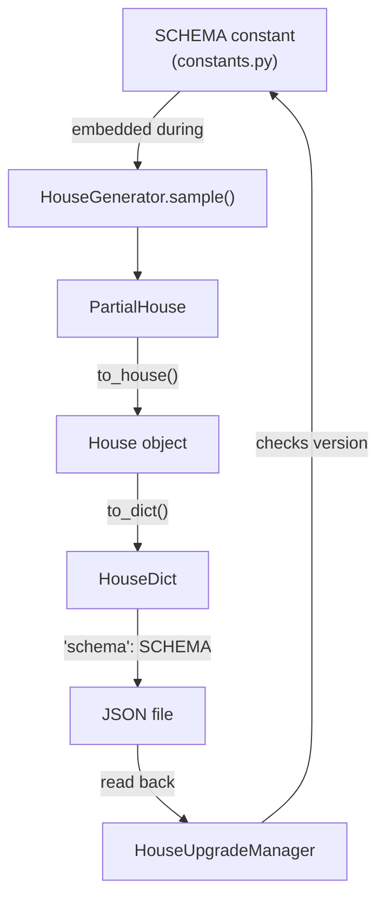
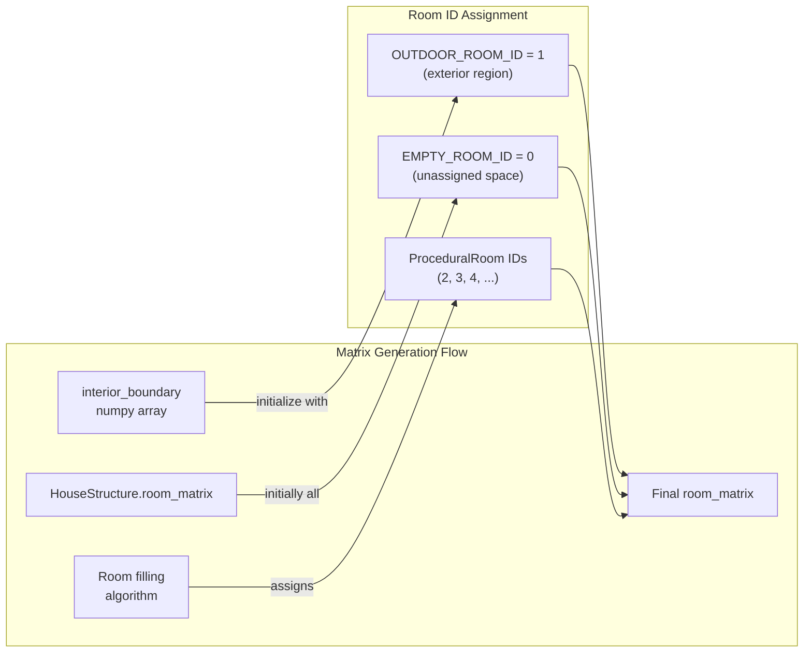
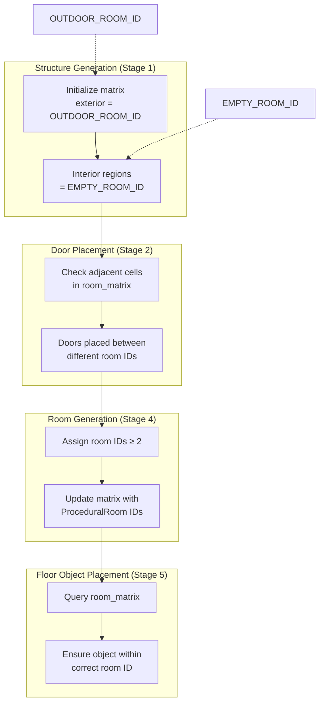
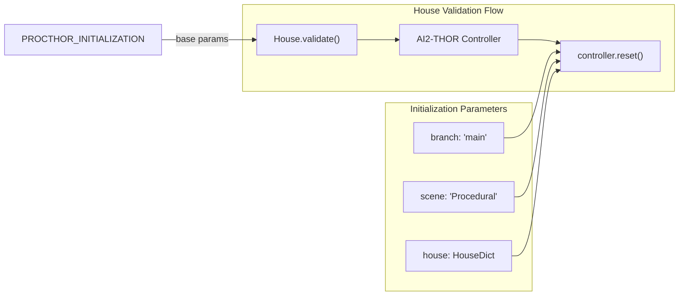
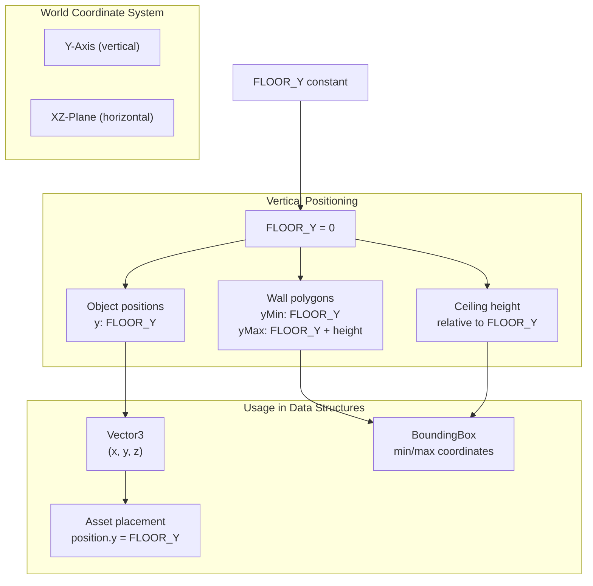
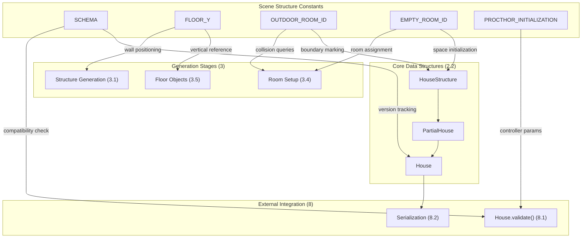

<!-- source: DeepWiki mcp.deepwiki.com · repo allenai/procthor · page 6.3 Scene Structure Constants · fetched 2026-10-26 -->

# Scene Structure Constants

<details>
<summary>Relevant source files</summary>

The following files were used as context for generating this wiki page:

- [procthor/constants.py](procthor/constants.py)

</details>


## Purpose and Scope

This page documents the foundational constants in `procthor/constants.py` that define the structural framework of generated scenes. These constants establish the schema version, room identification system, initialization parameters for AI2-THOR integration, and fundamental coordinate system properties.

For probabilistic generation parameters, see [Probability Constants](#6.1). For spatial placement parameters like margins and padding, see [Spatial Constants](#6.2). For object-specific randomization parameters, see [Object Color and State Randomization](#3.8).

## Schema Version Management

The `SCHEMA` constant defines the version of the scene representation format. This version string is embedded in all generated houses and enables backward-compatible upgrades through the `HouseUpgradeManager` system.

### Schema Version Constant

```python
SCHEMA = "1.0.0"
```

[procthor/constants.py:15-16]()

The schema version follows semantic versioning (MAJOR.MINOR.PATCH) and serves three critical functions:

1. **Validation**: Ensures generated houses can be correctly interpreted by AI2-THOR
2. **Migration**: Enables automatic upgrading of houses created with older schema versions
3. **Compatibility**: Allows detection of version mismatches between generation code and runtime environment

The current schema version (1.0.0) represents the stable format after the initial 0.0.1 prototype. For details on schema migration mechanisms, see [HouseUpgradeManager](#7.1).

### Schema Usage in Data Structures



**Diagram: Schema version flow through generation and validation**

Sources: [procthor/constants.py:15-16]()

## Room Identification System

The room ID system assigns unique integer identifiers to different regions in the scene's spatial matrix. This matrix-based representation is fundamental to collision detection, door placement, and spatial reasoning throughout the generation pipeline.

### Room ID Constants

Two special room IDs are defined to handle boundary conditions and empty space:

| Constant | Value | Purpose |
|----------|-------|---------|
| `OUTDOOR_ROOM_ID` | 1 | Identifies matrix entries outside the generated house boundary |
| `EMPTY_ROOM_ID` | 0 | Identifies matrix entries within the house but not yet assigned to rooms |

[procthor/constants.py:71-75]()

### Room ID Matrix System



**Diagram: Room ID assignment during house structure generation**

The room matrix is a 2D integer array where each cell represents a spatial location. The value at each cell indicates which room occupies that location:

- **Value 1 (OUTDOOR_ROOM_ID)**: Exterior space outside the house boundary
- **Value 0 (EMPTY_ROOM_ID)**: Interior space not yet assigned to any room (used during generation)
- **Values ≥ 2**: Unique identifiers for individual `ProceduralRoom` objects

### Room ID Usage in Generation Stages



**Diagram: Room ID usage across generation stages**

Sources: [procthor/constants.py:71-75]()

## Scene Initialization Constants

The `PROCTHOR_INITIALIZATION` dictionary defines base parameters passed to the AI2-THOR controller when initializing a procedural scene.

### Initialization Dictionary

```python
PROCTHOR_INITIALIZATION = dict(branch="main", scene="Procedural")
```

[procthor/constants.py:65-66]()

This dictionary contains:

| Parameter | Value | Purpose |
|-----------|-------|---------|
| `branch` | `"main"` | Specifies the AI2-THOR branch to use for rendering |
| `scene` | `"Procedural"` | Identifies the scene type as procedurally generated |

### Integration with AI2-THOR



**Diagram: Initialization constants in AI2-THOR integration**

When a `House` object's `validate()` method is called, these initialization parameters are merged with the house-specific data (in `HouseDict` format) and passed to the AI2-THOR controller. The `branch="main"` parameter ensures the latest stable AI2-THOR build is used, while `scene="Procedural"` signals to AI2-THOR that it should interpret the house data as a procedurally generated scene rather than a pre-built scene asset.

Sources: [procthor/constants.py:65-66]()

## Vertical Positioning Constants

The `FLOOR_Y` constant establishes the reference plane for all vertical positioning in the scene coordinate system.

### Floor Position Constant

```python
FLOOR_Y = 0
```

[procthor/constants.py:68-69]()

This constant defines the Y-coordinate (vertical axis) of the floor surface in meters. All object positions, wall heights, and vertical measurements are calculated relative to this value.

### Coordinate System Reference



**Diagram: Floor position constant in coordinate system**

### Floor Position in Generation Stages

The `FLOOR_Y` constant is used throughout the generation pipeline:

1. **Structure Generation**: Wall polygons are created with `yMin = FLOOR_Y`
2. **Floor Object Placement**: All floor objects have their Y-position set to `FLOOR_Y`
3. **Wall Object Placement**: Wall-mounted objects (windows, paintings, TVs) have their Y-positions calculated relative to `FLOOR_Y`
4. **Light Placement**: Ceiling lights are positioned at `FLOOR_Y + ceiling_height`

By centralizing this value as a constant rather than hard-coding zeros throughout the codebase, the system maintains flexibility to adjust the world origin if needed.

Sources: [procthor/constants.py:68-69]()

## Constant Relationships

The scene structure constants work together to define the fundamental framework within which all other generation stages operate.

### Cross-System Dependencies



**Diagram: Scene structure constants and their system dependencies**

### Usage Patterns

| Constant | Primary Usage | Secondary Usage |
|----------|---------------|-----------------|
| `SCHEMA` | House serialization, version validation | Upgrade manager dispatch |
| `FLOOR_Y` | Object Y-coordinate initialization | Wall polygon construction |
| `OUTDOOR_ROOM_ID` | House boundary initialization | Door placement boundary checks |
| `EMPTY_ROOM_ID` | Temporary room matrix values | Debugging unassigned space |
| `PROCTHOR_INITIALIZATION` | AI2-THOR controller reset | Scene type identification |

Sources: [procthor/constants.py:15-75]()

## Implementation Details

### Constants Definition Location

All scene structure constants are defined in a single module for centralized access:

```
procthor/
└── constants.py         # All generation constants including scene structure
```

The module uses simple assignment statements with inline docstrings to define each constant. This approach:

1. **Centralizes configuration**: All constants in one location for easy modification
2. **Enables imports**: Any module can import specific constants as needed
3. **Supports documentation**: Inline docstrings provide context for each constant
4. **Facilitates testing**: Constants can be mocked or overridden in tests

### Type Annotations

The constants module does not use type annotations for the constant definitions themselves, as Python's type system treats module-level constants as having inferred types. However, the constants are used throughout the codebase with proper type checking:

- `SCHEMA` is always treated as `str`
- `OUTDOOR_ROOM_ID` and `EMPTY_ROOM_ID` are always treated as `int`
- `PROCTHOR_INITIALIZATION` is always treated as `Dict[str, str]`
- `FLOOR_Y` is always treated as `int` or `float`

Sources: [procthor/constants.py:1-76]()

---

