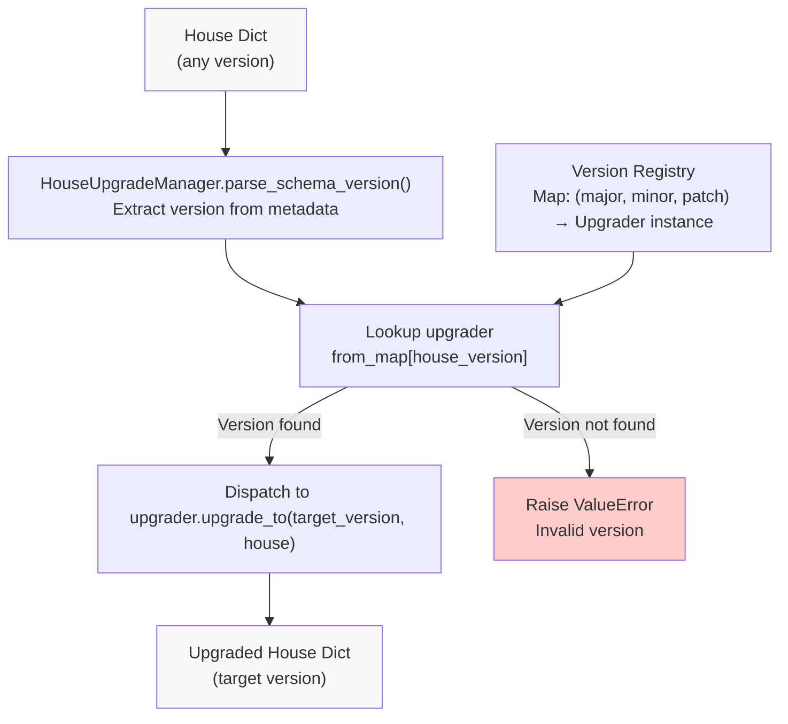
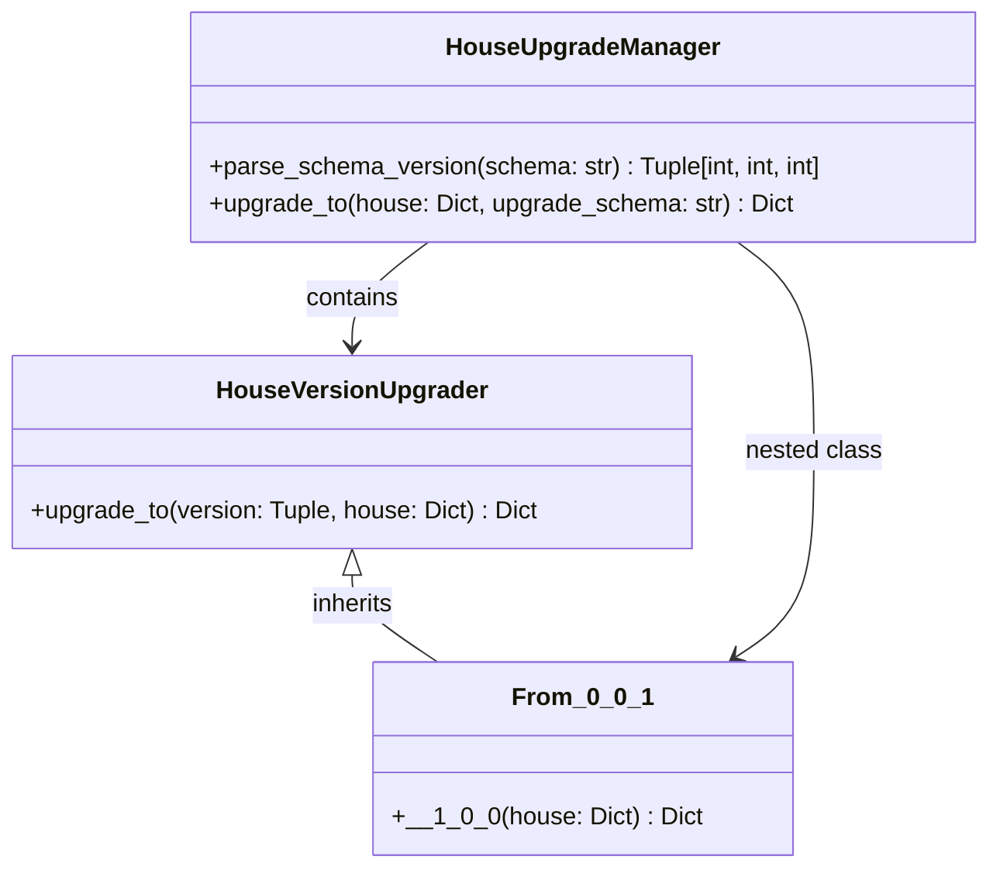
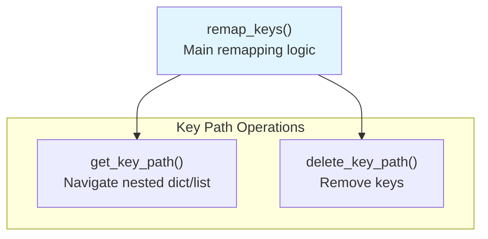
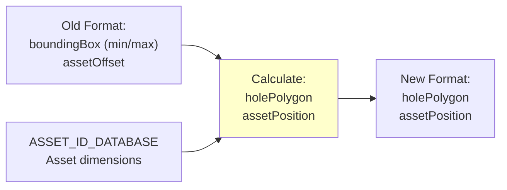
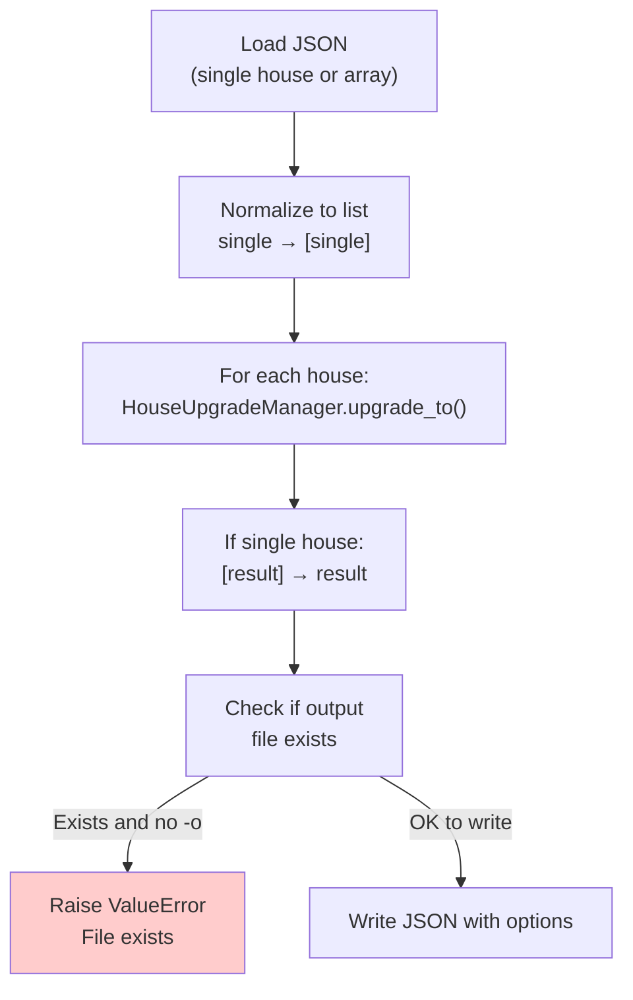
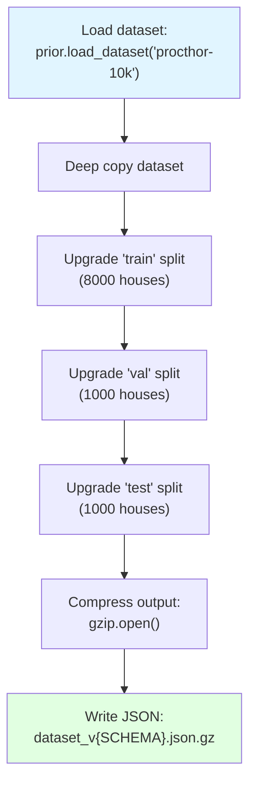

<!-- source: DeepWiki mcp.deepwiki.com · repo allenai/procthor · page 7 Versioning and Schema Migration · fetched 2026-10-26 -->

# Versioning and Schema Migration

<details>
<summary>Relevant source files</summary>

The following files were used as context for generating this wiki page:

- [procthor/utils/upgrade_house_version.py](procthor/utils/upgrade_house_version.py)
- [scripts/upgrade_dataset.py](scripts/upgrade_dataset.py)
- [scripts/upgrade_house.py](scripts/upgrade_house.py)

</details>


## Purpose and Scope

This document describes ProcTHOR's schema versioning system and migration mechanisms that ensure backward compatibility as the house JSON format evolves. The system allows houses generated with older versions of ProcTHOR to be automatically upgraded to newer schema versions, preventing data loss and maintaining compatibility with evolving AI2-THOR requirements.

For information about the house data structures themselves, see [Data Structures](#2.2). For information about scene serialization to AI2-THOR, see [Scene Serialization](#8.2).

---

## Schema Version Format

ProcTHOR uses semantic versioning for house schemas, stored as a string in the format `"MAJOR.MINOR.PATCH"`. The current schema version is defined by the `SCHEMA` constant in `procthor/constants.py`.

**Version Storage:**
- Stored in `house["metadata"]["schema"]` as a string (e.g., `"1.0.0"`)
- If the `schema` field is missing, the house is assumed to be version `0.0.1`
- Version tuples are represented internally as `Tuple[int, int, int]`

**Version Parsing:**
The `HouseUpgradeManager.parse_schema_version()` method converts version strings to tuples:

```python
"1.0.0" → (1, 0, 0)
None → (0, 0, 1)  # Default for legacy houses
```

Sources: [procthor/utils/upgrade_house_version.py:106-111]()

---

## HouseUpgradeManager Architecture

The `HouseUpgradeManager` class provides the main entry point for upgrading houses from one schema version to another. It uses a registry pattern to dispatch to version-specific upgrader classes.

### Upgrade Dispatch Flow



**Diagram: HouseUpgradeManager upgrade dispatch mechanism**

Sources: [procthor/utils/upgrade_house_version.py:104-145]()

---

## HouseUpgradeManager Implementation

### Class Structure

The `HouseUpgradeManager` class contains nested upgrader classes, one for each source version that needs migration support. Each upgrader class inherits from `HouseVersionUpgrader`.



**Diagram: Class hierarchy for version upgraders**

### Upgrader Registry Construction

The registry is built dynamically using reflection:

| Registry Key | Upgrader Instance | Method Name Pattern |
|--------------|-------------------|---------------------|
| `(0, 0, 1)` | `From_0_0_1()` | Class name after `From_` |
| Target versions | Method names | `__{major}_{minor}_{patch}` |

The `HouseUpgradeManager.upgrade_to()` method [procthor/utils/upgrade_house_version.py:114-145]():
1. Extracts all nested upgrader classes using `inspect.isclass()`
2. Parses class names (e.g., `From_0_0_1` → `(0, 0, 1)`)
3. Creates a mapping: `from_map = {(0, 0, 1): From_0_0_1(), ...}`
4. Looks up the appropriate upgrader based on the house's current version
5. Delegates to that upgrader's `upgrade_to()` method

### Version Validation

The system enforces version ordering constraints:

```python
if house_version == upgrade_schema:
    return house  # Already at target version
elif house_version < upgrade_schema:
    return from_map[house_version].upgrade_to(upgrade_schema, house)
else:
    raise ValueError("Cannot downgrade versions")
```

Sources: [procthor/utils/upgrade_house_version.py:138-145]()

---

## HouseVersionUpgrader Protocol

The base `HouseVersionUpgrader` class defines the protocol for version-specific upgraders.

### Upgrader Method Naming Convention

Each upgrader subclass contains methods named using a double-underscore prefix followed by the target version:

```python
class From_0_0_1(HouseVersionUpgrader):
    def __1_0_0(self, house: Dict[str, Any]) -> Dict[str, Any]:
        # Upgrade logic from 0.0.1 to 1.0.0
        pass
```

The `upgrade_to()` method [procthor/utils/upgrade_house_version.py:86-101]() dynamically constructs a mapping:
1. Uses `inspect.getmembers()` to find all methods
2. Filters for methods (excluding `upgrade_to` itself)
3. Parses method names: `__1_0_0` → `(1, 0, 0)`
4. Creates mapping: `{(1, 0, 0): self.__1_0_0}`
5. Dispatches to the appropriate method

This design allows a single upgrader class to support multiple target versions if needed.

Sources: [procthor/utils/upgrade_house_version.py:85-102]()

---

## Key Remapping System

The upgrade system uses helper functions to restructure house dictionaries by moving, renaming, and transforming keys.

### Helper Functions



**Diagram: Key remapping utility functions**

### Function Responsibilities

| Function | Purpose | Parameters |
|----------|---------|------------|
| `get_key_path()` | Navigate nested structures using key paths | `data`, `keys: List[str]` |
| `delete_key_path()` | Remove nested keys | `data`, `keys: List[str]` |
| `remap_keys()` | Move/rename keys between paths | `source`, `source_keys`, `out`, `keys`, `delete_source_key` |

### Key Path Format

Key paths are lists of strings representing nested dictionary/list traversal:

```python
["rooms", "floorMaterial", "name"]
# Accesses: house["rooms"][i]["floorMaterial"]["name"]
```

The `get_key_path()` function [procthor/utils/upgrade_house_version.py:21-28]() handles both dictionary and list traversal, returning a list of values when traversing lists.

### Remapping Logic

The `remap_keys()` function [procthor/utils/upgrade_house_version.py:31-82]() performs three operations:

1. **Extract** source value using `get_key_path(source, source_keys)`
2. **Delete** source key if `delete_source_key=True`
3. **Insert** value at target location using `keys` path

**List Handling:** When the output structure contains lists, the function iterates over list elements and applies remapping to each element independently.

Sources: [procthor/utils/upgrade_house_version.py:9-82]()

---

## Version 0.0.1 to 1.0.0 Migration

The `From_0_0_1.__1_0_0()` method implements the migration from schema version 0.0.1 to 1.0.0. This upgrade restructures material properties throughout the house schema.

### Material Property Restructuring

The primary change consolidates scattered material properties into nested `material` objects.

**Before (0.0.1):**
```json
{
  "walls": [{
    "materialId": "WallMaterial_01",
    "color": {"r": 0.8, "g": 0.8, "b": 0.8}
  }]
}
```

**After (1.0.0):**
```json
{
  "walls": [{
    "material": {
      "name": "WallMaterial_01",
      "color": {"r": 0.8, "g": 0.8, "b": 0.8}
    }
  }]
}
```

### Complete Remapping Table

| Source Path | Target Path | Delete Source |
|-------------|-------------|---------------|
| `proceduralParameters.ceilingMaterial` | `proceduralParameters.ceilingMaterial.name` | No |
| `proceduralParameters.ceilingColor` | `proceduralParameters.ceilingMaterial.color` | No |
| `proceduralParameters.ceilingMaterialTilingXDivisor` | `proceduralParameters.ceilingMaterial.tilingDivisorX` | Yes |
| `proceduralParameters.ceilingMaterialTilingYDivisor` | `proceduralParameters.ceilingMaterial.tilingDivisorY` | Yes |
| `rooms.floorMaterial` | `rooms.floorMaterial.name` | No |
| `rooms.floorColor` | `rooms.floorMaterial.color` | Yes |
| `rooms.floorMaterialTilingXDivisor` | `rooms.floorMaterial.tilingDivisorX` | Yes |
| `rooms.floorMaterialTilingYDivisor` | `rooms.floorMaterial.tilingDivisorY` | Yes |
| `rooms.ceilings.materialProperties` | `rooms.ceilings.material` | Yes |
| `rooms.ceilings.material` | `rooms.ceilings.material.name` | Yes |
| `rooms.ceilings.tilingDivisorX` | `rooms.ceilings.material.tilingDivisorX` | Yes |
| `rooms.ceilings.tilingDivisorY` | `rooms.ceilings.material.tilingDivisorY` | Yes |
| `walls.materialId` | `walls.material.name` | Yes |
| `walls.materialProperties` | `walls.material` | Yes |
| `walls.material` | `walls.material.name` | No |
| `walls.color` | `walls.material.color` | No |
| `windows.color` | `windows.material.color` | No |
| `doors.color` | `doors.material.color` | No |
| `objects.materialProperties` | `objects.material` | Yes |
| `objects.color` | `objects.material.color` | Yes |

Sources: [procthor/utils/upgrade_house_version.py:150-214]()

### Window and Door Hole Polygon Transformation

Windows and doors undergo geometric transformations:



**Diagram: Window/door geometry transformation**

**Transformation Logic** [procthor/utils/upgrade_house_version.py:216-239]():

1. **Hole Polygon:** Set to `[boundingBox.min, boundingBox.max]`
2. **Asset Position:** Calculate using:
   ```python
   assetPosition = {
       "x": boundingBox.min.x + assetOffset.x + asset.boundingBox.x / 2.0,
       "y": boundingBox.min.y + assetOffset.y + asset.boundingBox.y / 2.0,
       "z": 0
   }
   ```
3. **Delete:** Remove `boundingBox` and `assetOffset` fields

### Exterior Wall Room Assignment

Exterior walls receive a standardized room assignment [procthor/utils/upgrade_house_version.py:241-244]():

```python
for wall in out["walls"]:
    wall_id = wall["id"]
    if wall_id.split("|")[1] == "exterior":
        wall["roomId"] = "exterior"
```

### Metadata Update

The final step updates the schema version in metadata [procthor/utils/upgrade_house_version.py:246-249]():

```python
if out["metadata"] and isinstance(out["metadata"], dict):
    out["metadata"]["schema"] = "1.0.0"
else:
    out["metadata"] = {"schema": "1.0.0"}
```

Sources: [procthor/utils/upgrade_house_version.py:148-250]()

---

## Migration Scripts

ProcTHOR provides two command-line scripts for batch migration operations.

### Single House Migration: upgrade_house.py

**Purpose:** Upgrade a single house JSON file or array of houses to the latest schema version.

**Usage:**
```bash
python scripts/upgrade_house.py source.json output.json [options]
```

**Options:**

| Flag | Description |
|------|-------------|
| `-o, --overwrite` | Overwrite output file if it exists |
| `-i, --indent` | Pretty-print JSON with indentation |
| `-s, --sort_keys` | Sort dictionary keys alphabetically |

**Processing Flow:**



**Diagram: upgrade_house.py processing flow**

**Implementation Details** [scripts/upgrade_house.py:27-45]():
- Handles both single houses and arrays of houses
- Target version is the current `SCHEMA` constant
- Progress tracking with `tqdm`
- Validates output file doesn't exist unless `-o` flag is provided

Sources: [scripts/upgrade_house.py:1-46]()

### Dataset Migration: upgrade_dataset.py

**Purpose:** Upgrade the entire ProcTHOR-10K dataset to the latest schema version.

**Usage:**
```bash
python scripts/upgrade_dataset.py
```

**Processing Flow:**



**Diagram: upgrade_dataset.py processing flow**

**Implementation Details** [scripts/upgrade_dataset.py:10-23]():
- Uses the `prior` library to load the official dataset
- Processes three splits: `train`, `val`, `test`
- Uses `tqdm` for progress tracking per split
- Outputs compressed JSON with version number in filename
- Preserves split structure in output

**Output Format:**
```json
{
  "train": [house1, house2, ...],
  "val": [house1, house2, ...],
  "test": [house1, house2, ...]
}
```

Sources: [scripts/upgrade_dataset.py:1-24]()

---

## Design Patterns and Best Practices

### Extensibility

To add support for a new schema version:

1. **Define new schema version** in `procthor/constants.py`:
   ```python
   SCHEMA = "1.1.0"
   ```

2. **Create upgrader class** in `HouseUpgradeManager`:
   ```python
   class From_1_0_0(HouseVersionUpgrader):
       def __1_1_0(self, house: Dict[str, Any]) -> Dict[str, Any]:
           # Upgrade logic
           pass
   ```

3. **Implement transformations** using `remap_keys()` or custom logic

4. **Update metadata** to new schema version

### Deep Copy Safety

All upgrade methods create a deep copy of the input house to prevent mutation:

```python
out = copy.deepcopy(house)
# All modifications operate on 'out'
```

This ensures the upgrade process is non-destructive and allows for debugging comparisons.

### Incremental Upgrades

The system supports incremental upgrades through version chains:
- `0.0.1` → `1.0.0` (implemented)
- Future: `1.0.0` → `1.1.0` → `2.0.0`

Each upgrader handles transitions from one specific version to its immediate successors.

Sources: [procthor/utils/upgrade_house_version.py:148-150]()

---

