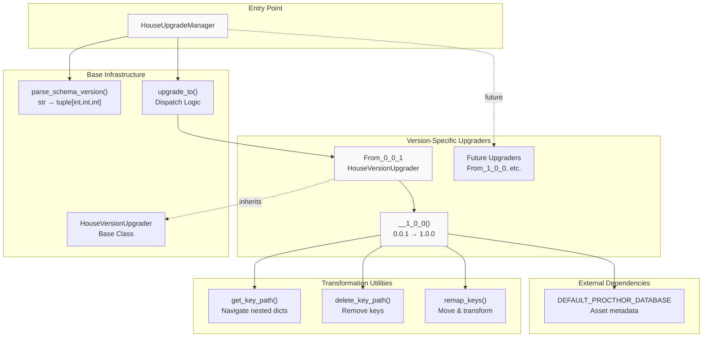
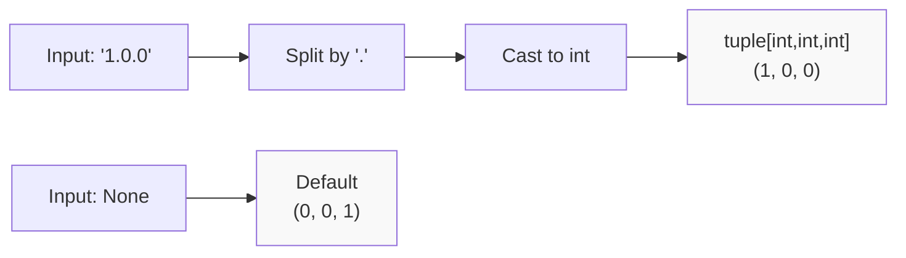
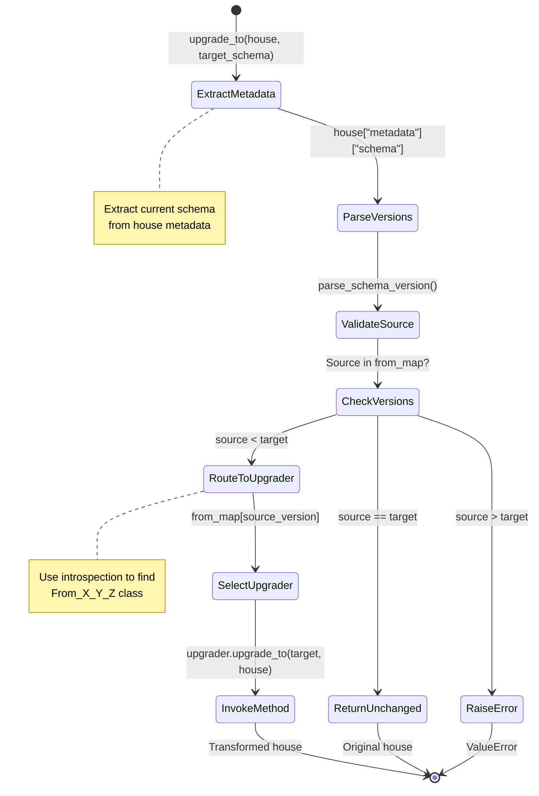
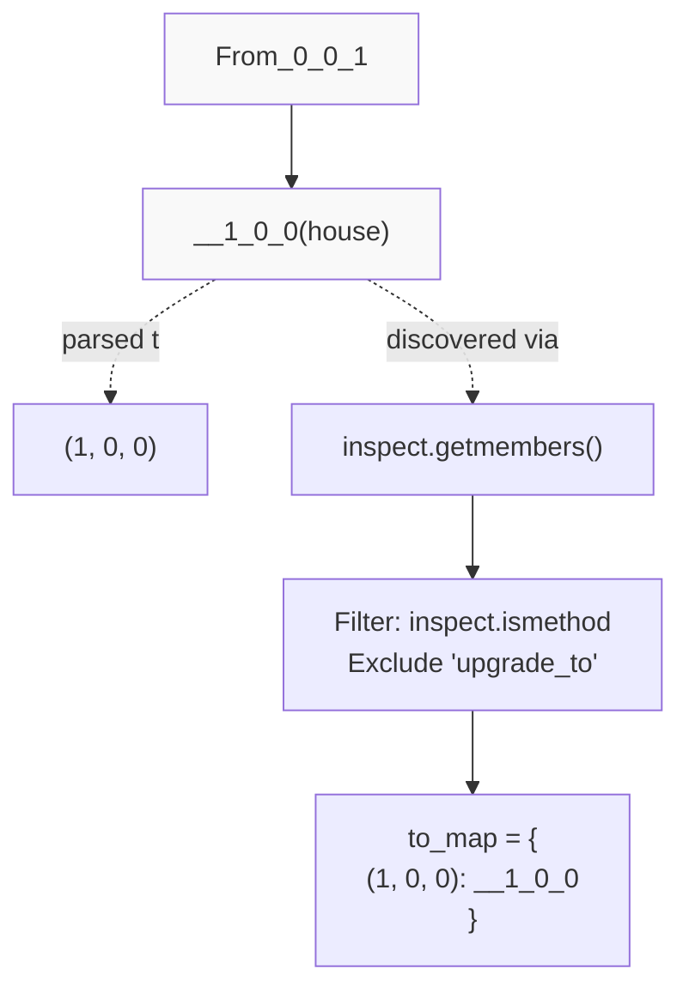
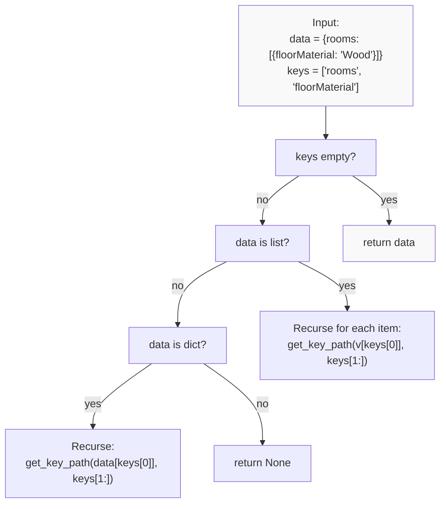
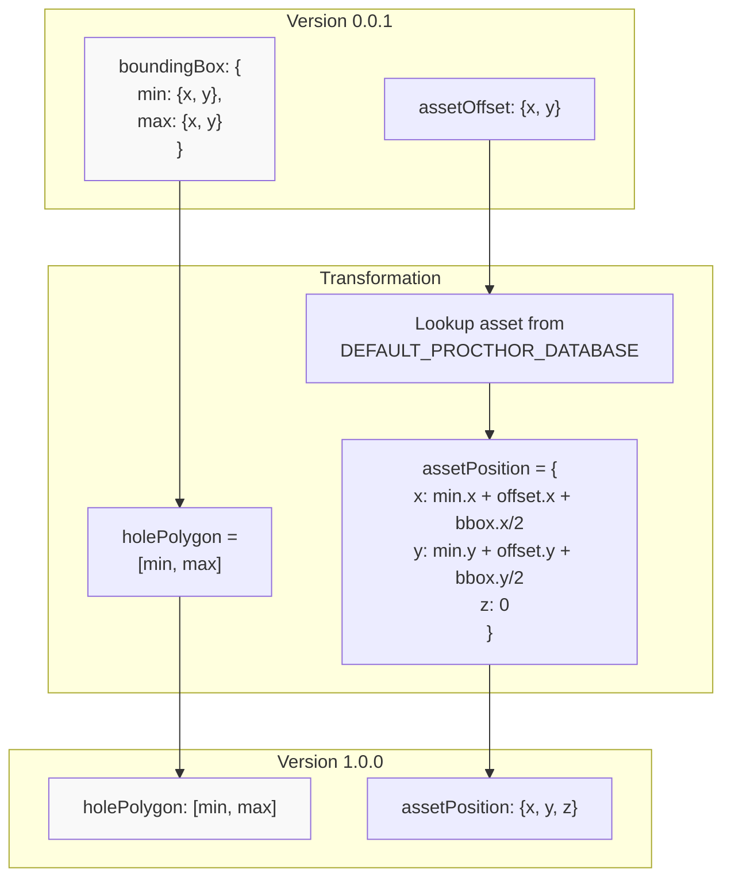

<!-- source: DeepWiki mcp.deepwiki.com · repo allenai/procthor · page 7.1 HouseUpgradeManager · fetched 2026-10-26 -->

# HouseUpgradeManager

<details>
<summary>Relevant source files</summary>

The following files were used as context for generating this wiki page:

- [procthor/utils/upgrade_house_version.py](procthor/utils/upgrade_house_version.py)

</details>


## Purpose and Scope

The `HouseUpgradeManager` system provides automated schema migration capabilities for ProcTHOR house data structures. When the house schema evolves across versions (e.g., restructuring material properties or changing polygon representations), this system enables backward compatibility by transforming older house dictionaries to newer schema formats. This document covers the upgrade manager architecture, version parsing, upgrade dispatch mechanism, and the transformation utilities that power schema migrations.

For information about applying these upgrades to actual house files or datasets, see [Schema Migration Scripts](#7.2). For details on specific transformations between versions, see [Version-Specific Transformations](#7.3).

**Sources:** [procthor/utils/upgrade_house_version.py:1-251]()

---

## Architecture Overview

The upgrade system uses a class-based architecture where each source version has a corresponding upgrader class that knows how to transform houses to newer target versions. The `HouseUpgradeManager` acts as the entry point and dispatcher, while `HouseVersionUpgrader` provides the base implementation for version-specific upgraders.



**Diagram: HouseUpgradeManager Class Architecture**

The system follows these design principles:

| Principle | Implementation |
|-----------|----------------|
| **Extensibility** | New source versions add new `From_X_Y_Z` inner classes to `HouseUpgradeManager` |
| **Version Routing** | Introspection discovers available upgraders via `inspect.isclass()` |
| **Target Selection** | Each upgrader class defines methods named `__X_Y_Z` for target versions |
| **Immutability** | Transformations use `copy.deepcopy()` to avoid modifying input houses |
| **Validation** | Version parsing and bounds checking prevent invalid upgrade paths |

**Sources:** [procthor/utils/upgrade_house_version.py:85-145]()

---

## Version Parsing and Representation

Schema versions follow semantic versioning (MAJOR.MINOR.PATCH) but are represented internally as tuples for comparison and routing purposes.

### Parse Schema Version

The `parse_schema_version()` class method converts string versions to tuples:



**Diagram: Schema Version Parsing Logic**

Implementation details:
- **Input:** String schema version (e.g., `"1.0.0"`) or `None`
- **Output:** Tuple `(major, minor, patch)`
- **Default behavior:** `None` maps to `(0, 0, 1)` for legacy houses without schema metadata
- **Location:** [procthor/utils/upgrade_house_version.py:106-111]()

Example usage:
```python
# Parse explicit version
version = HouseUpgradeManager.parse_schema_version("1.0.0")  # (1, 0, 0)

# Handle missing version
version = HouseUpgradeManager.parse_schema_version(None)  # (0, 0, 1)
```

**Sources:** [procthor/utils/upgrade_house_version.py:105-111]()

---

## Upgrade Dispatch Mechanism

The `upgrade_to()` method orchestrates the upgrade process by detecting the house's current version, selecting the appropriate upgrader, and routing to the correct transformation method.



**Diagram: Upgrade Dispatch State Machine**

### Version Map Construction

The dispatcher builds a version map using introspection to discover available upgrader classes:

| Step | Code Pattern | Purpose |
|------|--------------|---------|
| 1. Inspect classes | `inspect.isclass(getattr(HouseUpgradeManager, c))` | Find inner classes |
| 2. Parse class names | `c.split("_")[1:]` | Extract version from `From_0_0_1` |
| 3. Build map | `{(0, 0, 1): From_0_0_1()}` | Map version tuples to instances |
| 4. Exclude base | `c != "__class__"` | Skip Python's base class |

**Sources:** [procthor/utils/upgrade_house_version.py:114-145]()

---

## HouseVersionUpgrader Base Class

The `HouseVersionUpgrader` base class provides the template for version-specific upgraders. Each upgrader must implement methods that transform houses to specific target versions.

### Method Naming Convention

Target version methods use double underscore prefixes with version numbers separated by underscores:



**Diagram: Target Version Method Discovery**

The `upgrade_to()` method in `HouseVersionUpgrader`:

1. **Introspects** the instance to find all methods
2. **Filters** to methods matching the naming pattern `__X_Y_Z`
3. **Parses** method names to extract target version tuples
4. **Maps** version tuples to method references
5. **Validates** the requested target version exists
6. **Invokes** the appropriate transformation method

**Sources:** [procthor/utils/upgrade_house_version.py:85-101]()

---

## Key Transformation Utilities

Three utility functions enable structural transformations on nested dictionaries representing house data:

### get_key_path()

Navigates nested dictionary structures to extract values at a specific path:



**Diagram: get_key_path() Traversal Logic**

Key behaviors:
- **Handles lists:** Returns list of values for each element
- **Handles dicts:** Navigates through nested keys
- **Missing keys:** Returns `None` for non-existent paths
- **Base case:** Empty key list returns current data

**Sources:** [procthor/utils/upgrade_house_version.py:21-28]()

### delete_key_path()

Removes keys from nested structures:

```python
# Example: Delete deprecated field
delete_key_path(house, ["walls", "materialId"])
# Removes 'materialId' from all wall objects
```

Implementation:
- **Recursive descent** through key path
- **List handling:** Deletes from all list elements
- **Dict handling:** Deletes from single dict
- **Base case:** Single key deletes directly from current level

**Sources:** [procthor/utils/upgrade_house_version.py:9-18]()

### remap_keys()

Moves and transforms data from one key path to another, the workhorse of schema migrations:

| Parameter | Type | Purpose |
|-----------|------|---------|
| `source` | `Dict[str, Any]` | Original data dictionary |
| `source_keys` | `List[str]` | Path to extract value from |
| `root_out` | `Dict[str, Any]` | Root of output dictionary |
| `out` | `Dict[str, Any]` | Current position in output |
| `keys` | `List[str]` | Path to write value to |
| `delete_source_key` | `bool` | Whether to remove source after copying |

Behavior matrix:

| Source Type | Target Type | Action |
|-------------|-------------|--------|
| Single value | Single value | Direct assignment |
| List | List | Element-wise assignment |
| Nested dict | Nested dict | Recursive traversal |
| List of dicts | List of dicts | Per-element remapping |

**Sources:** [procthor/utils/upgrade_house_version.py:31-82]()

---

## Version-Specific Upgrader: From_0_0_1

The `From_0_0_1` class handles upgrades from the initial schema version (0.0.1) to version 1.0.0. This upgrade primarily restructures material properties into nested objects.

### Material Property Restructuring

The main transformation consolidates scattered material properties into unified `material` objects:

**Before (0.0.1):**
```json
{
  "walls": [{
    "material": "Concrete",
    "color": {"r": 0.8, "g": 0.8, "b": 0.8}
  }]
}
```

**After (1.0.0):**
```json
{
  "walls": [{
    "material": {
      "name": "Concrete",
      "color": {"r": 0.8, "g": 0.8, "b": 0.8}
    }
  }]
}
```

### Complete Remapping Table

The upgrader applies 11 distinct remappings across different house components:

| Component | Source Path | Target Path | Delete Source |
|-----------|-------------|-------------|---------------|
| Ceiling | `ceilingMaterial` | `ceilingMaterial.name` | No |
| Ceiling | `ceilingColor` | `ceilingMaterial.color` | No |
| Ceiling | `ceilingMaterialTilingXDivisor` | `ceilingMaterial.tilingDivisorX` | Yes |
| Ceiling | `ceilingMaterialTilingYDivisor` | `ceilingMaterial.tilingDivisorY` | Yes |
| Floor | `rooms[].floorMaterial` | `rooms[].floorMaterial.name` | No |
| Floor | `rooms[].floorColor` | `rooms[].floorMaterial.color` | Yes |
| Floor | `rooms[].floorMaterialTilingXDivisor` | `rooms[].floorMaterial.tilingDivisorX` | Yes |
| Floor | `rooms[].floorMaterialTilingYDivisor` | `rooms[].floorMaterial.tilingDivisorY` | Yes |
| Room Ceiling | `rooms[].ceilings[].materialProperties` | `rooms[].ceilings[].material` | Yes |
| Room Ceiling | `rooms[].ceilings[].material` | `rooms[].ceilings[].material.name` | Yes |
| Room Ceiling | `rooms[].ceilings[].tilingDivisorX` | `rooms[].ceilings[].material.tilingDivisorX` | Yes |
| Room Ceiling | `rooms[].ceilings[].tilingDivisorY` | `rooms[].ceilings[].material.tilingDivisorY` | Yes |
| Walls | `walls[].materialId` | `walls[].material.name` | Yes |
| Walls | `walls[].materialProperties` | `walls[].material` | Yes |
| Walls | `walls[].material` | `walls[].material.name` | No |
| Walls | `walls[].color` | `walls[].material.color` | No |
| Windows | `windows[].color` | `windows[].material.color` | No |
| Doors | `doors[].color` | `doors[].material.color` | No |
| Objects | `objects[].materialProperties` | `objects[].material` | Yes |
| Objects | `objects[].color` | `objects[].material.color` | Yes |

**Sources:** [procthor/utils/upgrade_house_version.py:150-214]()

### Hole Polygon Transformation

Windows and doors require geometric transformations beyond simple key remapping:



**Diagram: Hole Polygon Transformation (0.0.1 → 1.0.0)**

The transformation:
1. **Extracts** asset metadata from `DEFAULT_PROCTHOR_DATABASE.ASSET_ID_DATABASE`
2. **Copies** `boundingBox.min` and `boundingBox.max` to `holePolygon`
3. **Calculates** `assetPosition` from bounding box, offset, and asset dimensions
4. **Deletes** deprecated `boundingBox` and `assetOffset` fields

**Sources:** [procthor/utils/upgrade_house_version.py:216-239]()

### Exterior Wall Room Assignment

Walls with ID pattern `*|exterior` receive explicit room assignment:

```python
for wall in out["walls"]:
    wall_id = wall["id"]
    if wall_id.split("|")[1] == "exterior":
        wall["roomId"] = "exterior"
```

This ensures exterior walls are properly associated with the outdoor space.

**Sources:** [procthor/utils/upgrade_house_version.py:241-244]()

### Metadata Update

The final step updates the house metadata to reflect the new schema version:

```python
if out["metadata"] and isinstance(out["metadata"], dict):
    out["metadata"]["schema"] = "1.0.0"
else:
    out["metadata"] = {"schema": "1.0.0"}
```

**Sources:** [procthor/utils/upgrade_house_version.py:246-249]()

---

## Usage Patterns

### Basic Upgrade

```python
from procthor.utils.upgrade_house_version import HouseUpgradeManager

# Load old house
house_dict = load_json("old_house.json")

# Upgrade to latest schema
upgraded = HouseUpgradeManager.upgrade_to(house_dict, "1.0.0")

# Save upgraded house
save_json(upgraded, "upgraded_house.json")
```

### Version Detection

```python
# Extract current version
metadata = house_dict.get("metadata")
current_version = metadata.get("schema") if metadata else None

# Parse to tuple
version_tuple = HouseUpgradeManager.parse_schema_version(current_version)
# Returns (1, 0, 0) or (0, 0, 1) for None
```

### Error Handling

The system raises `ValueError` for invalid upgrade scenarios:

| Scenario | Error Message |
|----------|---------------|
| Unknown source version | `"Invalid source version: '{version}'. Upgrade from valid versions among: ..."` |
| Unknown target version | `"Invalid target version: '{version}'. Upgrade to valid version among: ..."` |
| Downgrade attempt | `"Invalid version: '{source}'. Must be lower than '{target}'"` |

**Sources:** [procthor/utils/upgrade_house_version.py:114-145]()

---

## Extension Points

### Adding New Source Versions

To support upgrading from a new source version (e.g., 1.0.0):

1. **Create inner class** in `HouseUpgradeManager`:
   ```python
   class From_1_0_0(HouseVersionUpgrader):
       pass
   ```

2. **Implement target methods** for each supported upgrade path:
   ```python
   def __2_0_0(self, house: Dict[str, Any]) -> Dict[str, Any]:
       # Transformation logic
       return transformed_house
   ```

3. **Use transformation utilities** (`remap_keys`, `get_key_path`, `delete_key_path`)

4. **Update metadata** to reflect new schema version

The introspection-based dispatch automatically discovers and registers the new upgrader.

**Sources:** [procthor/utils/upgrade_house_version.py:104-145]()

---

