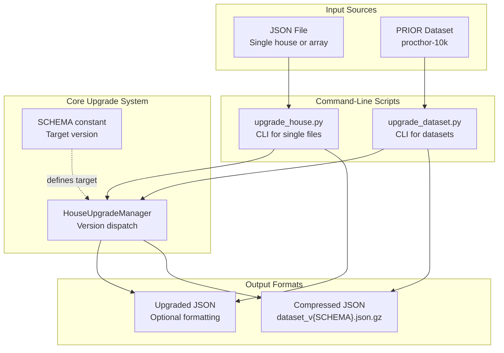
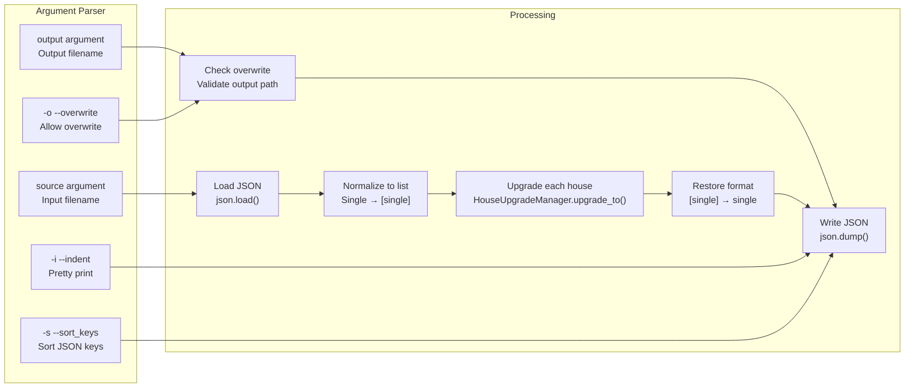
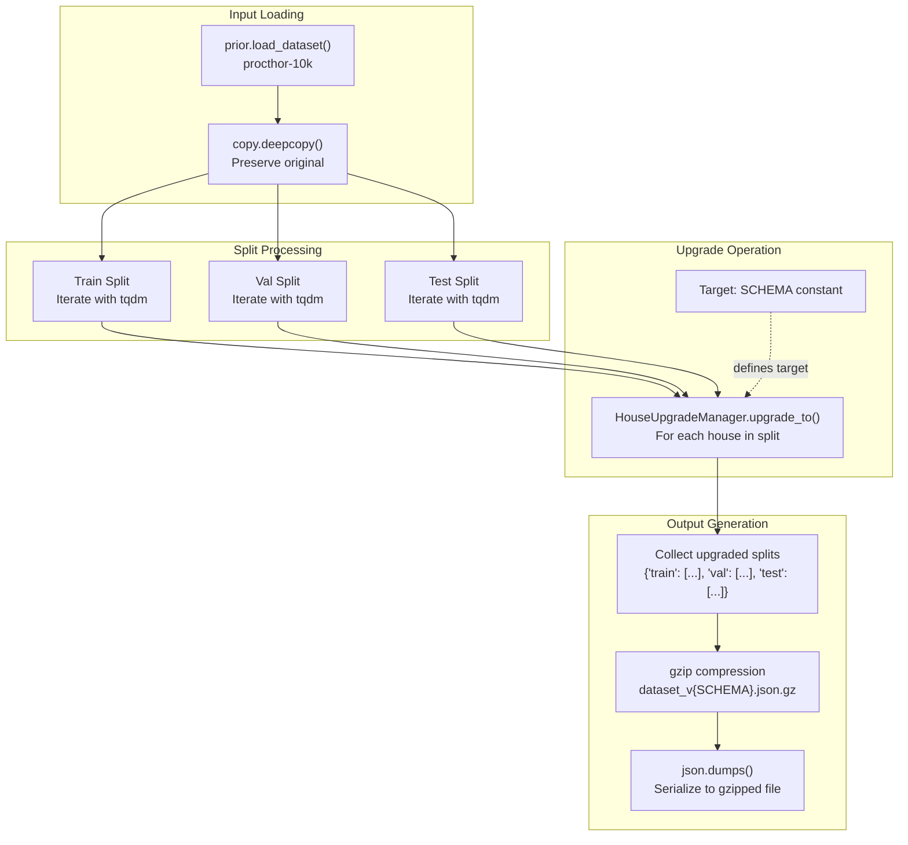
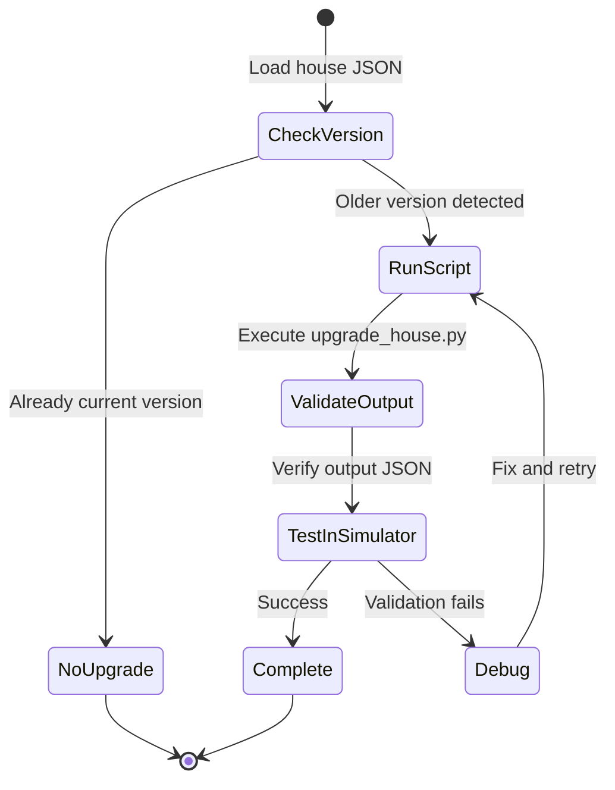
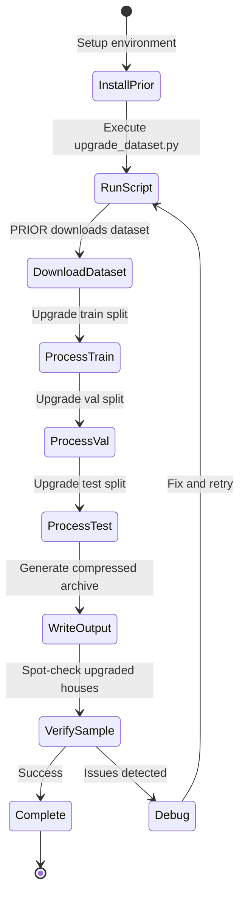
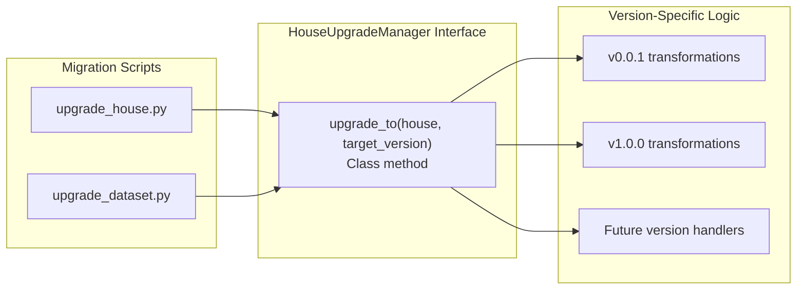

<!-- source: DeepWiki mcp.deepwiki.com · repo allenai/procthor · page 7.2 Schema Migration Scripts · fetched 2026-10-26 -->

# Schema Migration Scripts

<details>
<summary>Relevant source files</summary>

The following files were used as context for generating this wiki page:

- [scripts/upgrade_dataset.py](scripts/upgrade_dataset.py)
- [scripts/upgrade_house.py](scripts/upgrade_house.py)

</details>


## Purpose and Scope

This document describes the two command-line migration scripts that enable batch upgrades of house JSON files from older schema versions to the current version. These scripts provide user-facing interfaces to the upgrade system, allowing migration of individual houses, arrays of houses, or entire datasets.

For information about the underlying upgrade architecture and version dispatch logic, see [HouseUpgradeManager](#7.1). For details on specific version transformations and remapping rules, see [Version-Specific Transformations](#7.3).

## Overview

ProcTHOR provides two migration scripts for different use cases:

| Script | Purpose | Input | Output |
|--------|---------|-------|--------|
| `upgrade_house.py` | Migrate single house or array of houses | JSON file (single house or array) | JSON file (upgraded) |
| `upgrade_dataset.py` | Migrate entire ProcTHOR-10K dataset | PRIOR dataset | Compressed JSON with train/val/test splits |

Both scripts utilize `HouseUpgradeManager.upgrade_to()` to perform the actual transformations and target the `SCHEMA` constant defined in `procthor.constants`.

**Sources:** [scripts/upgrade_house.py:1-46](), [scripts/upgrade_dataset.py:1-24]()

## System Architecture

The following diagram shows how the migration scripts integrate with the upgrade system:



**Sources:** [scripts/upgrade_house.py:5-6](), [scripts/upgrade_dataset.py:6-7]()

## upgrade_house.py

The `upgrade_house.py` script provides a command-line interface for migrating individual house JSON files. It supports both single-house files and files containing arrays of houses.

### Command-Line Interface



### Argument Specifications

| Argument | Type | Description | Required |
|----------|------|-------------|----------|
| `source` | positional | Path to source JSON file (single house or array) | Yes |
| `output` | positional | Path to output JSON file | Yes |
| `-o`, `--overwrite` | flag | Allow overwriting existing output file | No |
| `-i`, `--indent` | flag | Format output with 4-space indentation | No |
| `-s`, `--sort_keys` | flag | Sort JSON keys alphabetically | No |

**Sources:** [scripts/upgrade_house.py:9-23]()

### Processing Flow

The script implements the following processing flow:

1. **Load Input**: Reads the source JSON file using `json.load()` [scripts/upgrade_house.py:27-28]()
2. **Normalization**: Converts single house dict to list for uniform processing [scripts/upgrade_house.py:29]()
3. **Upgrade Loop**: Iterates through houses with progress bar, calling `HouseUpgradeManager.upgrade_to(house, SCHEMA)` [scripts/upgrade_house.py:31-34]()
4. **Denormalization**: Restores single-house format if input was a single house [scripts/upgrade_house.py:35-36]()
5. **Output Validation**: Checks if output file exists and enforces overwrite protection [scripts/upgrade_house.py:37-40]()
6. **Write Output**: Writes upgraded houses with optional formatting [scripts/upgrade_house.py:41-45]()

**Sources:** [scripts/upgrade_house.py:27-45]()

### Usage Examples

```bash
# Upgrade single house file
python scripts/upgrade_house.py old_house.json new_house.json

# Upgrade with pretty printing
python scripts/upgrade_house.py old_house.json new_house.json -i

# Upgrade array of houses, sorted keys, allow overwrite
python scripts/upgrade_house.py houses_array.json upgraded.json -s -o
```

**Sources:** [scripts/upgrade_house.py:1-46]()

## upgrade_dataset.py

The `upgrade_dataset.py` script specializes in migrating the ProcTHOR-10K dataset from the PRIOR framework, processing all three splits (train, validation, test) and outputting a compressed archive.

### Dataset Processing Pipeline



**Sources:** [scripts/upgrade_dataset.py:1-24]()

### Implementation Details

The script follows a straightforward structure:

1. **Dataset Loading**: Loads the ProcTHOR-10K dataset using the `prior` library [scripts/upgrade_dataset.py:10]()
2. **Deep Copy**: Creates a deep copy to avoid mutating the original dataset [scripts/upgrade_dataset.py:11]()
3. **Split Iteration**: Processes each split (train, val, test) sequentially [scripts/upgrade_dataset.py:12-14]()
4. **Progress Tracking**: Uses `tqdm` to display progress bars for each split [scripts/upgrade_dataset.py:17]()
5. **Upgrade Invocation**: Calls `HouseUpgradeManager.upgrade_to(house, SCHEMA)` for each house [scripts/upgrade_dataset.py:19]()
6. **Collection**: Accumulates upgraded houses into output dictionary structure [scripts/upgrade_dataset.py:20-21]()
7. **Compressed Output**: Writes final dataset as gzipped JSON with schema version in filename [scripts/upgrade_dataset.py:22-23]()

**Sources:** [scripts/upgrade_dataset.py:10-23]()

### Output Format

The script produces a compressed JSON file with the following structure:

```json
{
  "train": [
    { "metadata": {...}, "rooms": [...], "objects": [...], ... },
    ...
  ],
  "val": [
    { "metadata": {...}, "rooms": [...], "objects": [...], ... },
    ...
  ],
  "test": [
    { "metadata": {...}, "rooms": [...], "objects": [...], ... },
    ...
  ]
}
```

The filename follows the pattern `dataset_v{SCHEMA}.json.gz`, where `{SCHEMA}` is the target version string (e.g., `dataset_v1.0.0.json.gz`).

**Sources:** [scripts/upgrade_dataset.py:22-23]()

## Common Dependencies

Both migration scripts share the following dependencies:

| Module | Purpose | Usage |
|--------|---------|-------|
| `procthor.constants.SCHEMA` | Current schema version constant | Target version for upgrades |
| `procthor.utils.upgrade_house_version.HouseUpgradeManager` | Upgrade dispatch logic | Performs actual transformations |
| `json` | JSON serialization/deserialization | Read and write house data |
| `tqdm` | Progress bar display | User feedback during batch operations |

**Sources:** [scripts/upgrade_house.py:1-7](), [scripts/upgrade_dataset.py:1-8]()

## Migration Workflows

### Single House Migration Workflow

The typical workflow for migrating a single house or small set of houses:



**Sources:** [scripts/upgrade_house.py:1-46]()

### Dataset Migration Workflow

The workflow for migrating the entire ProcTHOR-10K dataset:



**Sources:** [scripts/upgrade_dataset.py:1-24]()

## Error Handling

### upgrade_house.py Error Conditions

The script implements specific error handling for output file conflicts:

- **Overwrite Protection**: If the output file exists and `-o` flag is not provided, raises `ValueError` with descriptive message [scripts/upgrade_house.py:37-40]()
- **File I/O Errors**: Standard Python exceptions for file reading/writing (not explicitly caught)
- **JSON Parsing Errors**: Standard `json.JSONDecodeError` if input file is malformed (not explicitly caught)

### upgrade_dataset.py Error Conditions

The script has minimal explicit error handling:

- **Dataset Loading Errors**: Relies on `prior.load_dataset()` error handling
- **Memory Errors**: Creates deep copy of entire dataset, may fail on memory-constrained systems [scripts/upgrade_dataset.py:11]()
- **File I/O Errors**: Standard Python exceptions for gzip file writing (not explicitly caught)

**Sources:** [scripts/upgrade_house.py:37-40](), [scripts/upgrade_dataset.py:11]()

## Integration with HouseUpgradeManager

Both scripts delegate the actual upgrade logic to `HouseUpgradeManager.upgrade_to()`:



The scripts pass two arguments to `upgrade_to()`:
1. **house**: Dictionary representation of the house to upgrade [scripts/upgrade_house.py:33](), [scripts/upgrade_dataset.py:19]()
2. **target_version**: The `SCHEMA` constant from `procthor.constants` [scripts/upgrade_house.py:33](), [scripts/upgrade_dataset.py:19]()

`HouseUpgradeManager` then determines which version transformations to apply based on the house's current version and the target version. For details on this dispatch logic, see [HouseUpgradeManager](#7.1).

**Sources:** [scripts/upgrade_house.py:33](), [scripts/upgrade_dataset.py:19]()

---

