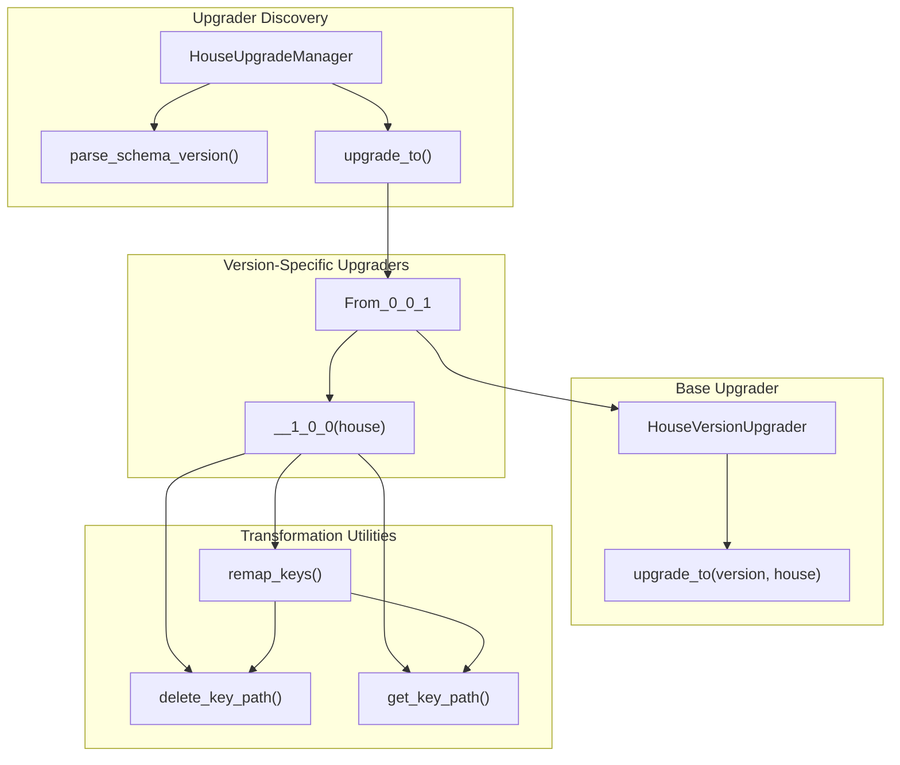
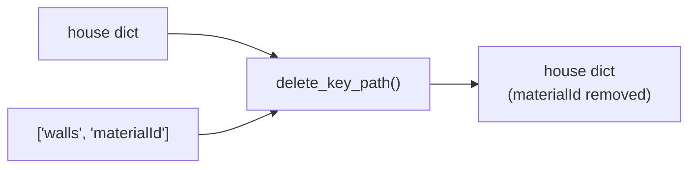
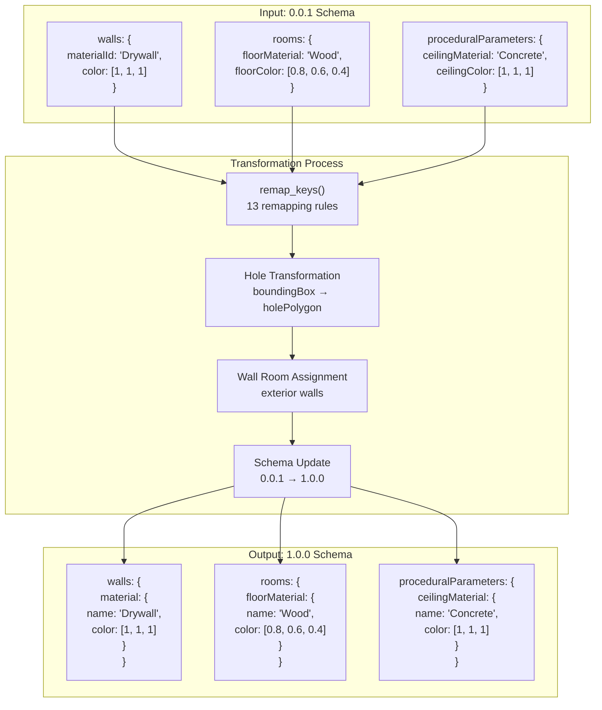
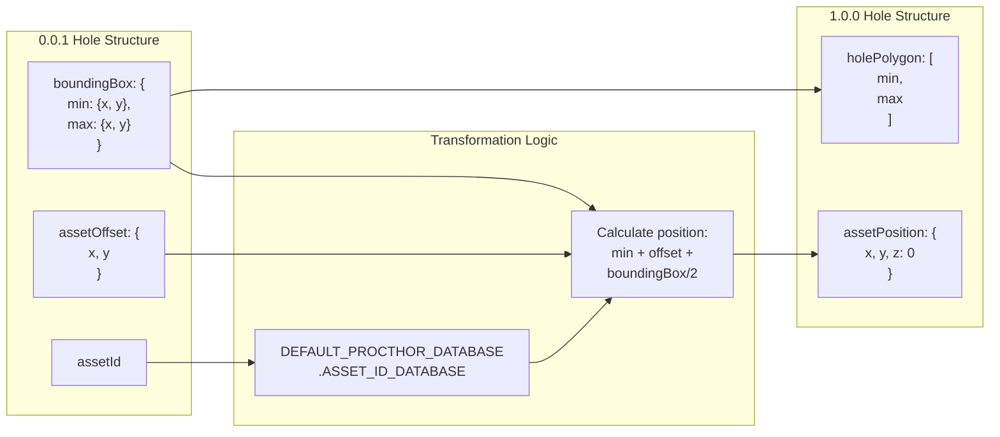
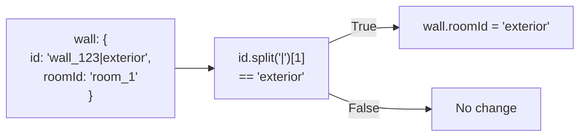
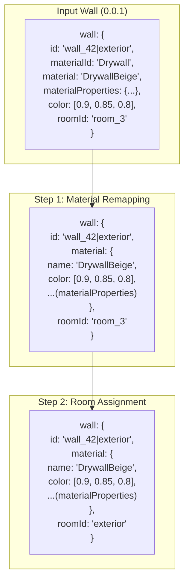

<!-- source: DeepWiki mcp.deepwiki.com · repo allenai/procthor · page 7.3 Version-Specific Transformations · fetched 2026-10-26 -->

# Version-Specific Transformations

Relevant source files

The following files were used as context for generating this wiki page:

- [procthor/utils/upgrade_house_version.py](procthor/utils/upgrade_house_version.py)

This page documents the specific data transformations that are applied when upgrading house definitions from one schema version to another. Each upgrader class contains the concrete logic for restructuring house data to match a target schema version.

For information about the overall upgrade management system, see [HouseUpgradeManager](#7.1). For batch migration scripts, see [Schema Migration Scripts](#7.2).

## Purpose and Scope

Version-specific transformations define the exact mapping and data restructuring rules needed to migrate house definitions between schema versions. These transformations handle:

- Key path remapping (moving/renaming nested dictionary keys)
- Data structure reorganization (flattening or nesting properties)
- Computed property derivation (calculating new values from existing data)
- Schema metadata updates

The primary transformation currently implemented is the upgrade from schema version `0.0.1` to `1.0.0`, which restructures material properties throughout the house definition.

## Transformation Architecture

The transformation system uses a class hierarchy where each upgrader handles migrations from a specific source version to one or more target versions.

**Transformation Discovery and Dispatch**

Sources: [procthor/utils/upgrade_house_version.py:104-145]()

### Upgrader Class Naming Convention

Upgrader classes are nested within `HouseUpgradeManager` and follow the naming pattern `From_X_Y_Z`, where `X.Y.Z` is the source schema version. Methods within these classes are named `__X_Y_Z`, indicating the target version.

| Source Version | Class Name | Target Version | Method Name |
|---------------|------------|----------------|-------------|
| 0.0.1 | `From_0_0_1` | 1.0.0 | `__1_0_0` |

The double underscore prefix (`__`) triggers Python name mangling, which prevents method name collisions across nested classes.

Sources: [procthor/utils/upgrade_house_version.py:147-150]()

## Key Remapping Utilities

The transformation system provides three core utilities for manipulating nested dictionary structures:

### delete_key_path()

Recursively deletes a key at a specified path in a nested dictionary or list structure.

**Function Signature and Behavior**

Sources: [procthor/utils/upgrade_house_version.py:9-18]()

### get_key_path()

Retrieves a value at a specified path, handling both dictionary and list traversal.

**List Handling**: When encountering a list, the function extracts the specified key from each element, returning a list of values.

Sources: [procthor/utils/upgrade_house_version.py:21-28]()

### remap_keys()

The primary transformation utility that moves or renames keys from one path to another. This function combines `get_key_path()` and `delete_key_path()` operations.

**Parameters:**

| Parameter | Type | Description |
|-----------|------|-------------|
| `source` | `Dict[str, Any]` | Source dictionary to read from |
| `source_keys` | `List[str]` | Path to source value |
| `root_out` | `Dict[str, Any]` | Root dictionary for deletions |
| `out` | `Dict[str, Any]` | Target dictionary to write to |
| `keys` | `List[str]` | Path to target location |
| `delete_source_key` | `bool` | Whether to delete source after copying |

Sources: [procthor/utils/upgrade_house_version.py:31-82]()

## 0.0.1 to 1.0.0 Transformation

The upgrade from schema version `0.0.1` to `1.0.0` restructures material properties throughout the house definition. The primary change is consolidating material-related properties into nested `material` objects.

### Transformation Overview

**High-Level Transformation Flow**

Sources: [procthor/utils/upgrade_house_version.py:148-250]()

### Material Property Consolidation

The core transformation consolidates scattered material properties into nested `material` objects. The upgrader applies 13 remapping rules covering ceilings, floors, walls, windows, doors, and objects.

#### Remapping Rules Table

| Source Path | Target Path | Delete Source |
|------------|-------------|---------------|
| `proceduralParameters.ceilingMaterial` | `proceduralParameters.ceilingMaterial.name` | No |
| `proceduralParameters.ceilingColor` | `proceduralParameters.ceilingMaterial.color` | No |
| `proceduralParameters.ceilingMaterialTilingXDivisor` | `proceduralParameters.ceilingMaterial.tilingDivisorX` | Yes |
| `proceduralParameters.ceilingMaterialTilingYDivisor` | `proceduralParameters.ceilingMaterial.tilingDivisorY` | Yes |
| `rooms.floorMaterial` | `rooms.floorMaterial.name` | No |
| `rooms.floorColor` | `rooms.floorMaterial.color` | Yes |
| `rooms.floorMaterialTilingXDivisor` | `rooms.floorMaterial.tilingDivisorX` | Yes |
| `rooms.floorMaterialTilingYDivisor` | `rooms.floorMaterial.tilingDivisorY` | Yes |
| `rooms.ceilings.materialProperties` | `rooms.ceilings.material` | Yes |
| `rooms.ceilings.material` | `rooms.ceilings.material.name` | Yes |
| `rooms.ceilings.tilingDivisorX` | `rooms.ceilings.material.tilingDivisorX` | Yes |
| `rooms.ceilings.tilingDivisorY` | `rooms.ceilings.material.tilingDivisorY` | Yes |
| `walls.materialId` | `walls.material.name` | Yes |
| `walls.materialProperties` | `walls.material` | Yes |
| `walls.material` | `walls.material.name` | No |
| `walls.color` | `walls.material.color` | No |
| `windows.color` | `windows.material.color` | No |
| `doors.color` | `doors.material.color` | No |
| `objects.materialProperties` | `objects.material` | Yes |
| `objects.color` | `objects.material.color` | Yes |

Sources: [procthor/utils/upgrade_house_version.py:150-211]()

#### Delete Source Key Rationale

The `delete_source_key` parameter controls whether the original key should be removed after remapping:

- **`False`**: Used when the source key becomes part of the target path (e.g., `floorMaterial` becomes `floorMaterial.name`)
- **`True`**: Used when the source key is completely replaced (e.g., `floorColor` moves into `floorMaterial.color`)

Sources: [procthor/utils/upgrade_house_version.py:213-214]()

### Hole Data Structure Transformation

Doors and windows (collectively called "holes") undergo a structural transformation from `boundingBox` + `assetOffset` to `holePolygon` + `assetPosition`.

**Hole Transformation Algorithm**

The transformation for each hole (door or window) follows these steps:

1. **Extract hole polygon**: Copy `boundingBox.min` and `boundingBox.max` to `holePolygon` as a 2-element list
2. **Look up asset metadata**: Retrieve the asset's bounding box dimensions from `DEFAULT_PROCTHOR_DATABASE.ASSET_ID_DATABASE`
3. **Calculate asset position**:
   - `x = boundingBox.min.x + assetOffset.x + asset.boundingBox.x / 2.0`
   - `y = boundingBox.min.y + assetOffset.y + asset.boundingBox.y / 2.0`
   - `z = 0` (holes are always on walls)
4. **Delete old fields**: Remove `boundingBox` and `assetOffset`

Sources: [procthor/utils/upgrade_house_version.py:216-239]()

### Exterior Wall Room Assignment

Walls with an `exterior` suffix in their ID are explicitly assigned to the `exterior` room.

**Wall Room Assignment Logic**

The upgrader parses the wall ID, which follows the format `wall_N|room_type`. If the room type is `exterior`, the wall's `roomId` is set to `"exterior"` regardless of its previous value.

Sources: [procthor/utils/upgrade_house_version.py:241-244]()

### Metadata Schema Update

After all transformations are complete, the upgrader updates the metadata to reflect the new schema version.

**Update Logic:**
- If `metadata` exists and is a dictionary: Set `metadata.schema = "1.0.0"`
- Otherwise: Create `metadata = {"schema": "1.0.0"}`

Sources: [procthor/utils/upgrade_house_version.py:246-249]()

## Transformation Example

The following diagram illustrates a complete transformation of a wall object:

**Transformation Steps Applied**

Sources: [procthor/utils/upgrade_house_version.py:148-250]()

## Adding New Transformations

To add support for a new schema version upgrade:

1. **Create a new upgrader class**: Add a nested class in `HouseUpgradeManager` named `From_X_Y_Z` (source version)
2. **Inherit from `HouseVersionUpgrader`**: Ensure the class extends the base upgrader
3. **Implement version methods**: Create methods named `__A_B_C` for each target version
4. **Define remapping rules**: Create a remapping list with `(source_path, target_path, delete_source)` tuples
5. **Apply custom transformations**: Add any version-specific logic beyond simple remapping
6. **Update metadata**: Set the schema version in the output dictionary

The upgrader discovery system will automatically detect and use the new transformation.

Sources: [procthor/utils/upgrade_house_version.py:85-101](), [procthor/utils/upgrade_house_version.py:147-250]()

---

