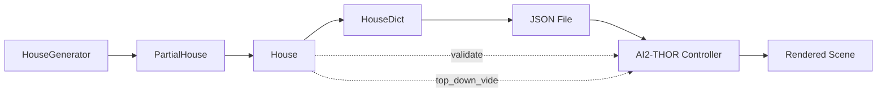
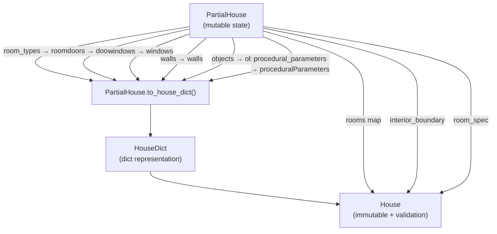
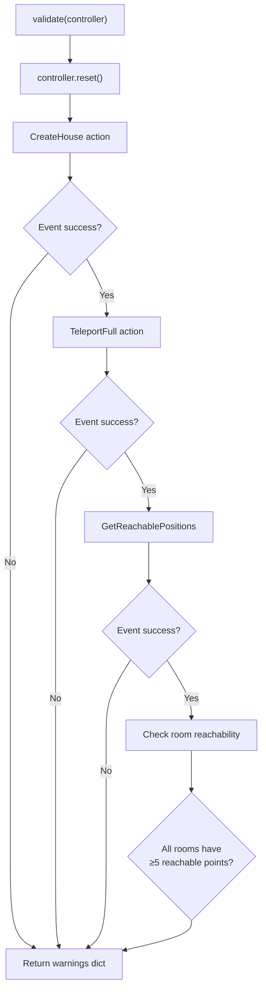
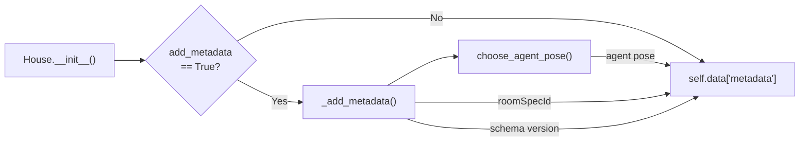
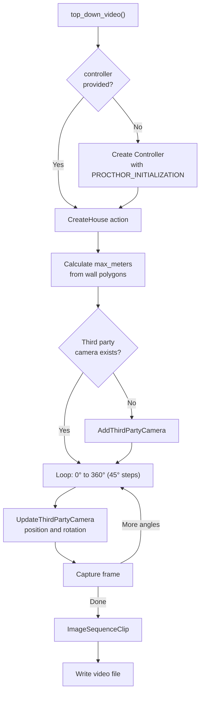
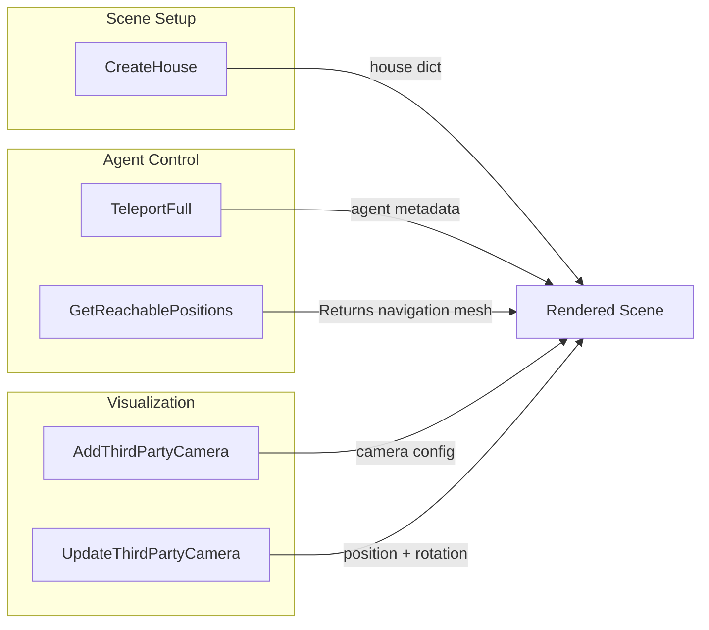

<!-- source: DeepWiki mcp.deepwiki.com · repo allenai/procthor · page 8 AI2-THOR Integration · fetched 2026-10-26 -->

# AI2-THOR Integration

<details>
<summary>Relevant source files</summary>

The following files were used as context for generating this wiki page:

- [README.md](README.md)
- [procthor/generation/house.py](procthor/generation/house.py)

</details>


## Purpose and Scope

This document explains how ProcTHOR interfaces with the AI2-THOR simulation environment. It covers the data format contract between ProcTHOR and AI2-THOR, validation mechanisms, serialization formats, and visualization capabilities. For details on the internal generation process that produces these houses, see [Core Generation System](#2). For information on upgrading house formats across schema versions, see [Versioning and Schema Migration](#7).

---

## Overview

ProcTHOR generates procedural houses as data structures that AI2-THOR can load and render as interactive 3D environments. The integration flow follows this pattern:



**Diagram: ProcTHOR to AI2-THOR Data Flow**

The `House` class serves as the primary integration point, providing methods for validation, serialization, and visualization through the AI2-THOR `Controller`.

**Sources:** [procthor/generation/house.py:1-338]()

---

## Data Format Contract

### HouseDict Structure

The `HouseDict` type defines the JSON schema that AI2-THOR consumes. This format includes:

| Field | Type | Description |
|-------|------|-------------|
| `rooms` | `List[RoomType]` | Room definitions with floor polygons and types |
| `doors` | `List[Door]` | Door objects with positions and openness states |
| `windows` | `List[Window]` | Window objects with wall hole specifications |
| `walls` | `List[Wall]` | Wall polygons defining room boundaries |
| `objects` | `List[Object]` | All objects (furniture, decorations) with poses |
| `proceduralParameters` | `ProceduralParameters` | Physics and rendering parameters |
| `metadata` | `Dict[str, Any]` | Agent pose, schema version, room spec ID |

**Sources:** [procthor/generation/house.py:295-311](), [procthor/utils/types.py]()

### Conversion Pipeline

The `PartialHouse` class accumulates components during generation and converts to the final format:



**Diagram: Data Structure Transformation**

The conversion uses a field mapping defined in [procthor/generation/house.py:297-309]():

```python
from_to_map = {
    "room_types": "rooms",
    "doors": "doors",
    "windows": "windows",
    "objects": "objects",
    "walls": "walls",
    "procedural_parameters": "proceduralParameters",
    "metadata": "metadata",
}
```

**Sources:** [procthor/generation/house.py:295-324]()

### Schema Versioning

Every house includes a schema version in its metadata [procthor/generation/house.py:65]():

```python
self.data["metadata"]["schema"] = SCHEMA
```

The `SCHEMA` constant from [procthor/constants.py]() ensures compatibility tracking between ProcTHOR and AI2-THOR. This enables version detection and migration through the `HouseUpgradeManager` system (see [Versioning and Schema Migration](#7)).

**Sources:** [procthor/generation/house.py:16](), [procthor/generation/house.py:65](), [procthor/constants.py]()

---

## House Validation

### Validation Method

The `House.validate()` method [procthor/generation/house.py:102-164]() verifies that a generated house is usable in AI2-THOR by performing runtime checks:



**Diagram: Validation State Machine**

**Sources:** [procthor/generation/house.py:102-164]()

### Validation Checks

The validation performs four critical checks:

1. **House Creation** [procthor/generation/house.py:109-116]()
   - Tests if AI2-THOR can parse and instantiate the house geometry
   - Failure indicates malformed wall polygons or invalid object placements

2. **Agent Teleportation** [procthor/generation/house.py:117-126]()
   - Verifies the agent can spawn at the chosen starting pose
   - Failure indicates the starting position is obstructed or invalid

3. **Reachable Positions** [procthor/generation/house.py:127-132]()
   - Requests the navigation mesh from AI2-THOR
   - Failure indicates physics or collision issues

4. **Room Navigation** [procthor/generation/house.py:136-158]()
   - Samples reachable positions and maps them to rooms using point-in-polygon tests
   - Ensures each room has at least 5 reachable positions
   - Identifies rooms that are blocked by doors or object collisions

### Warning System

Validation results are stored in the house metadata [procthor/generation/house.py:115-116](), [procthor/generation/house.py:125-126](), [procthor/generation/house.py:162]():

```python
self.data["metadata"]["warnings"] = warnings
```

This allows downstream systems to filter or analyze problematic houses without requiring re-validation.

**Sources:** [procthor/generation/house.py:102-164]()

---

## Scene Serialization

### JSON Export

The `House.to_json()` method [procthor/generation/house.py:68-79]() serializes houses to AI2-THOR's expected format:

```python
def to_json(self, filename: Optional[str] = None, compressed: bool = False) -> str
```

**Serialization Options:**

| Parameter | Type | Purpose |
|-----------|------|---------|
| `filename` | `Optional[str]` | File path for output (`.json` or `.json.gz`) |
| `compressed` | `bool` | Enable gzip compression for storage efficiency |
| Returns | `str` | JSON string representation |

**File Format Requirements:**
- Uncompressed: Must end with `.json` [procthor/generation/house.py:76]()
- Compressed: Must end with `.json.gz` [procthor/generation/house.py:72]()

**Sources:** [procthor/generation/house.py:68-79]()

### Metadata Injection

Before serialization, the `House` class adds metadata automatically [procthor/generation/house.py:57-66]():



**Diagram: Metadata Injection Process**

The metadata includes three required fields [procthor/generation/house.py:62-66]():
- `agent`: Starting pose (position, rotation, horizon) from `choose_agent_pose()`
- `roomSpecId`: Identifier for the `RoomSpec` used during generation
- `schema`: Schema version constant for compatibility tracking

**Sources:** [procthor/generation/house.py:57-66]()

### Agent Pose Selection

The `choose_agent_pose()` method [procthor/generation/house.py:98-100]() delegates to `generate_starting_pose()` from [procthor/generation/agent.py]():

```python
def choose_agent_pose(self) -> AgentPose:
    """Generate a starting position for the default agent in the house."""
    return generate_starting_pose(self.rooms)
```

This ensures the agent spawns in a valid, navigable location within the house geometry.

**Sources:** [procthor/generation/house.py:98-100](), [procthor/generation/agent.py]()

---

## Visualization

### Top-Down Video Generation

The `House.top_down_video()` static method [procthor/generation/house.py:166-208]() creates orbital camera videos using AI2-THOR's third-party camera system:



**Diagram: Video Generation Pipeline**

**Sources:** [procthor/generation/house.py:166-208]()

### Camera Configuration

The visualization uses an orbital camera setup [procthor/generation/house.py:194-206]():

| Parameter | Value | Purpose |
|-----------|-------|---------|
| Initial position | `(0, 0, 0)` | Origin before updates |
| Initial rotation | `(0, 0, 0)` | Level orientation |
| Skybox color | `"white"` | Clean background |
| Orbit radius | `2.75` meters | Distance from center |
| Height | `max_meters + 1.5` | Overhead view |
| X rotation | `65°` | Downward tilt |
| Y rotation | `angle` (0-360°) | Orbital sweep |
| Frame rate | `2 fps` | Smooth rotation |

The camera orbits around the house center at 45-degree increments [procthor/generation/house.py:196]():

```python
for angle in range(0, 360, 45):
```

**Sources:** [procthor/generation/house.py:166-208]()

### Video Output

The method uses `moviepy` [procthor/generation/house.py:13]() to compile frames:

```python
imsn = ImageSequenceClip(images, fps=2)
imsn.write_videofile(filename)
```

This creates an MP4 video showing the house from all angles, useful for dataset visualization and quality assessment.

**Sources:** [procthor/generation/house.py:207-208]()

---

## Runtime Initialization

### Controller Configuration

AI2-THOR requires specific initialization parameters for ProcTHOR houses. The `PROCTHOR_INITIALIZATION` constant [procthor/constants.py]() provides these defaults and is used in [procthor/generation/house.py:177]():

```python
controller = Controller(
    width=width, height=height, **PROCTHOR_INITIALIZATION
)
```

These parameters configure physics, rendering quality, and scene loading behavior to match ProcTHOR's requirements.

**Sources:** [procthor/generation/house.py:176-178](), [procthor/constants.py]()

### Action Interface

ProcTHOR houses integrate with AI2-THOR through specific actions:



**Diagram: AI2-THOR Action Interface**

**Key Actions:**

- **CreateHouse** [procthor/generation/house.py:110](), [procthor/generation/house.py:180]()
  - Loads house geometry into AI2-THOR
  - Parameter: `house=self.data` (HouseDict)

- **TeleportFull** [procthor/generation/house.py:118-120]()
  - Moves agent to starting position
  - Parameters: Unpacked from `self.data["metadata"]["agent"]`

- **GetReachablePositions** [procthor/generation/house.py:127]()
  - Queries navigation mesh
  - Returns list of grid positions where agent can stand

- **AddThirdPartyCamera** [procthor/generation/house.py:187-192]()
  - Creates additional camera for visualization
  - Parameters: position, rotation, skyboxColor

- **UpdateThirdPartyCamera** [procthor/generation/house.py:197-205]()
  - Moves camera to new viewpoint
  - Parameters: position, rotation

**Sources:** [procthor/generation/house.py:102-208]()

---

## Bounds Calculation

The `House.bounds` property [procthor/generation/house.py:82-96]() computes the axis-aligned bounding box of the entire house by iterating over all wall polygons:

```python
@property
def bounds(self) -> BoundingBox:
    out = BoundingBox(
        min=Vector3(x=float("inf"), y=float("inf"), z=float("inf")),
        max=Vector3(x=float("-inf"), y=float("-inf"), z=float("-inf")),
    )
    
    for wall in self.data["walls"]:
        for poly in wall["polygon"]:
            for k in ["x", "y", "z"]:
                if poly[k] < out["min"][k]:
                    out["min"][k] = poly[k]
                if poly[k] > out["max"][k]:
                    out["max"][k] = poly[k]
    
    return out
```

This bounding box is used for camera positioning in visualization and spatial queries in AI2-THOR.

**Sources:** [procthor/generation/house.py:82-96]()

---

