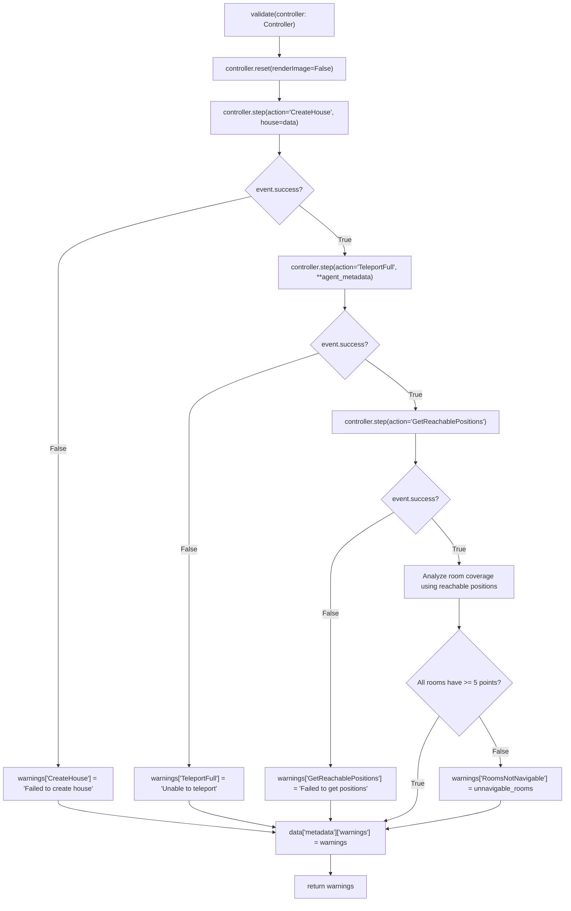
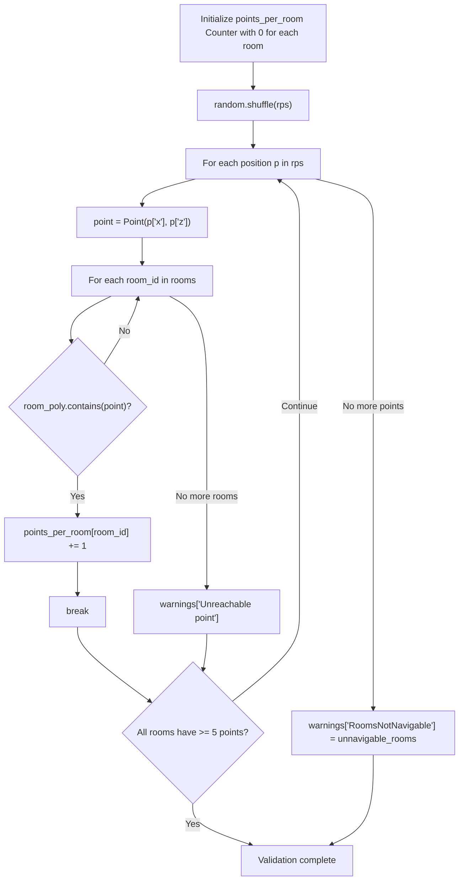
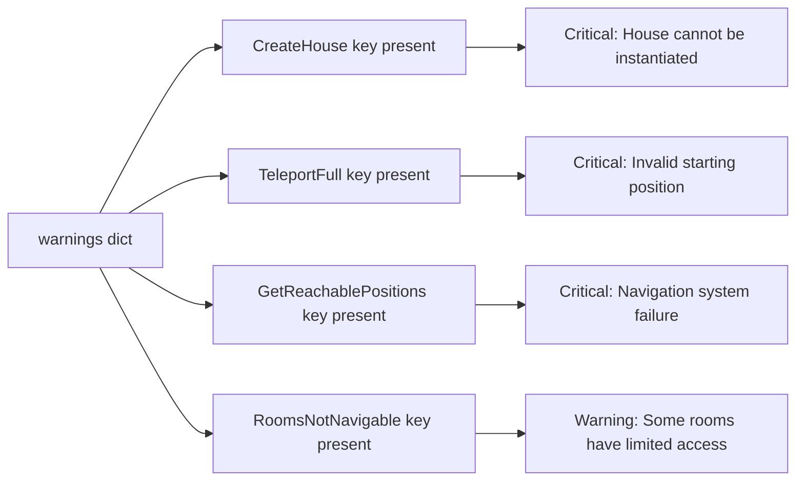
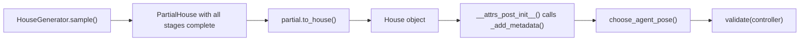

<!-- source: DeepWiki mcp.deepwiki.com · repo allenai/procthor · page 8.1 House Validation · fetched 2026-10-26 -->

# House Validation

<details>
<summary>Relevant source files</summary>

The following files were used as context for generating this wiki page:

- [procthor/generation/house.py](procthor/generation/house.py)

</details>


## Purpose and Scope

This document describes the house validation system used to verify that procedurally generated houses are functional and usable within the AI2-THOR simulation environment. The validation process ensures that agents can navigate the house and that all rooms are reachable. For information about scene serialization for AI2-THOR, see [Scene Serialization](#8.2). For visualization capabilities, see [Visualization](#8.3).

The validation system is implemented as the `validate()` method on the `House` class in [procthor/generation/house.py:102-164]().

---

## Overview

The validation system performs runtime checks by instantiating the generated house in AI2-THOR and testing key functionality:

1. **Scene Creation**: Verifies the house can be created in AI2-THOR without errors
2. **Agent Placement**: Confirms the agent can teleport to the designated starting position
3. **Navigation Analysis**: Retrieves all reachable positions within the scene
4. **Room Coverage**: Ensures every room contains at least 5 reachable navigation points

The validation process returns a dictionary of warnings and errors. These warnings are automatically added to the house metadata at `data["metadata"]["warnings"]` for persistence.

**Sources:** [procthor/generation/house.py:102-164]()

---

## Validation Method Architecture



**Sources:** [procthor/generation/house.py:102-164]()

---

## Validation Process

### Controller Initialization and Reset

The validation method accepts an `ai2thor.controller.Controller` instance as its only parameter. The controller is first reset with image rendering disabled to improve performance:

```python
controller.reset(renderImage=False)
```

All subsequent AI2-THOR actions in the validation process also disable rendering via `renderImage=False` since visual output is not required for validation checks.

**Sources:** [procthor/generation/house.py:108]()

---

### Step 1: House Creation

The first validation step attempts to create the house in AI2-THOR using the `CreateHouse` action:

```python
event = controller.step(
    action="CreateHouse", house=self.data, renderImage=False
)
```

The house data (`self.data`) is a `HouseDict` containing all scene components (walls, doors, windows, objects, rooms, etc.). If the event fails (returns falsy), a warning is generated:

| Warning Key | Warning Message | Meaning |
|-------------|----------------|---------|
| `CreateHouse` | `"Failed to create house."` | AI2-THOR could not instantiate the house scene, indicating structural or data format issues |

**Sources:** [procthor/generation/house.py:108-116]()

---

### Step 2: Agent Teleportation

After successful house creation, the validation attempts to teleport the agent to the starting position defined in the house metadata:

```python
event = controller.step(
    action="TeleportFull",
    **self.data["metadata"]["agent"],
    renderImage=False,
)
```

The agent metadata is generated by the `choose_agent_pose()` method (see [procthor/generation/house.py:98-100]()) which produces an `AgentPose` containing position, rotation, horizon, and standing state. If teleportation fails, it indicates the chosen starting position is invalid:

| Warning Key | Warning Message | Meaning |
|-------------|----------------|---------|
| `TeleportFull` | `"Unable to teleport to starting position."` | The agent cannot be placed at the designated starting position, usually due to collision with objects or geometry |

**Sources:** [procthor/generation/house.py:117-126]()

---

### Step 3: Reachability Analysis

The validation retrieves all navigable positions within the house using AI2-THOR's pathfinding grid:

```python
event = controller.step(action="GetReachablePositions", renderImage=False)
if not event:
    warnings["GetReachablePositions"] = "Failed to get reachable positions"
    return warnings
rps = event.metadata["actionReturn"]
```

The `rps` variable contains a list of positions (dictionaries with `x`, `y`, `z` coordinates) where the agent can navigate. These positions are then shuffled randomly to avoid systematic bias in the room coverage check:

```python
random.shuffle(rps)
```

**Sources:** [procthor/generation/house.py:127-135]()

---

### Step 4: Room Coverage Verification

The core validation logic checks whether every room in the house contains at least 5 reachable navigation points. This ensures rooms are not only accessible but have sufficient navigable space for agent activities.



The algorithm creates a `shapely.geometry.Point` from each reachable position's x and z coordinates and tests containment against each room's polygon:

```python
points_per_room = Counter({r: 0 for r in self.rooms})
for p in rps:
    point = Point(p["x"], p["z"])
    for room_id in self.rooms.keys():
        room_poly = self.rooms[room_id].room_polygon.polygon
        if room_poly.contains(point):
            points_per_room[room_id] += 1
            break
```

The loop terminates early once all rooms have at least 5 points, optimizing performance for valid houses:

```python
if all(num_points >= 5 for num_points in points_per_room.values()):
    break
```

If any rooms have fewer than 5 reachable points after processing all positions, a warning is generated:

| Warning Key | Warning Message | Meaning |
|-------------|----------------|---------|
| `RoomsNotNavigable` | `"Rooms {unnavigable_rooms} / {total_rooms} are not navigable."` | One or more rooms lack sufficient navigation points, indicating blocked access or insufficient space |

**Sources:** [procthor/generation/house.py:137-158]()

---

## Warning Types and Metadata Persistence

The validation method collects all warnings in a dictionary and persists them to the house metadata:

```python
self.data["metadata"]["warnings"] = warnings
return warnings
```

This persistence serves two purposes:

1. **Immediate Feedback**: The caller receives the warnings dictionary as the return value
2. **Serialization**: Warnings are included when the house is serialized to JSON, allowing downstream consumers to inspect validation results

All warnings are also logged using Python's `logging` module:

```python
if warnings:
    logging.warning(warnings)
```

### Warning Dictionary Structure

The warnings dictionary uses descriptive keys mapped to human-readable error messages:

```python
{
    "CreateHouse": "Failed to create house.",
    "TeleportFull": "Unable to teleport to starting position.",
    "GetReachablePositions": "Failed to get reachable positions",
    "RoomsNotNavigable": "Rooms [0, 3] / 5 are not navigable.",
    "Unreachable point: {'x': 1.5, 'y': 0.0, 'z': 2.0}": "Unreachable point."
}
```

**Sources:** [procthor/generation/house.py:107-164]()

---

## Integration with AI2-THOR Controller

The validation system requires an active `ai2thor.controller.Controller` instance. The controller must be compatible with the ProcTHOR initialization parameters (see [procthor/constants.py]() for `PROCTHOR_INITIALIZATION`).

### Controller Requirements

| Requirement | Description |
|-------------|-------------|
| **Platform** | The controller must be running on a platform that supports AI2-THOR (Linux, macOS, or Windows) |
| **Version** | AI2-THOR version must support the `CreateHouse` action (added in version 3.3.0+) |
| **State** | The controller can be in any state; validation calls `reset()` to ensure a clean environment |
| **Rendering** | Rendering can be disabled; validation does not require visual output |

### Example Controller Setup

```python
from ai2thor.controller import Controller
from procthor.constants import PROCTHOR_INITIALIZATION

controller = Controller(
    width=300,
    height=300,
    **PROCTHOR_INITIALIZATION
)

# Generate house
house = generator.sample()

# Validate
warnings = house.validate(controller)

if not warnings:
    print("House is valid!")
else:
    print(f"Validation warnings: {warnings}")
```

**Sources:** [procthor/generation/house.py:102](), [procthor/generation/house.py:11]()

---

## Reachability Threshold Rationale

The validation system requires at least **5 reachable points per room**. This threshold balances two competing concerns:

1. **False Negatives**: A threshold too high may reject valid houses where rooms have narrow passages or are simply small
2. **False Positives**: A threshold too low may accept houses with severely restricted navigation

The value of 5 was chosen empirically to ensure rooms have sufficient space for:
- Agent rotation (360 degrees)
- Object interaction (approaching from multiple angles)
- Multi-agent scenarios (future use cases)

Rooms with fewer than 5 points typically indicate:
- Doorway obstructions
- Excessive furniture density
- Geometric anomalies in wall placement

**Sources:** [procthor/generation/house.py:149]()

---

## Validation Result Interpretation

### Empty Warnings Dictionary

```python
warnings = {}  # or empty dict
```

An empty warnings dictionary indicates the house passed all validation checks:
- The house was created successfully in AI2-THOR
- The agent teleported to the starting position
- All reachable positions were retrieved
- Every room contains at least 5 reachable navigation points

### Non-Empty Warnings Dictionary

Any non-empty warnings dictionary indicates validation issues. The specific keys present indicate which checks failed:



**Sources:** [procthor/generation/house.py:107-164]()

---

## Relationship to House Generation Pipeline

The validation method is called after the complete generation pipeline has finished. The typical workflow is:

1. **Generation**: `HouseGenerator.sample()` produces a `PartialHouse` that progresses through all stages (see [Generation Pipeline Architecture](#2.1))
2. **Conversion**: `PartialHouse.to_house()` creates an immutable `House` object
3. **Metadata Addition**: `House.__attrs_post_init__()` calls `_add_metadata()` which includes agent pose selection
4. **Validation**: `House.validate(controller)` verifies the house is usable



**Sources:** [procthor/generation/house.py:313-324](), [procthor/generation/house.py:57-66](), [procthor/generation/house.py:98-100]()

---

## Performance Considerations

The validation process involves AI2-THOR simulation and can be computationally expensive:

| Operation | Typical Duration | Performance Notes |
|-----------|-----------------|-------------------|
| `controller.reset()` | 100-500ms | Clears previous scene state |
| `CreateHouse` | 500-2000ms | Depends on house complexity (number of objects, rooms) |
| `TeleportFull` | 10-50ms | Fast operation |
| `GetReachablePositions` | 200-1000ms | Depends on house size and grid resolution |
| Room coverage analysis | 10-100ms | Depends on number of reachable positions and rooms |

**Total validation time**: Typically 1-4 seconds per house.

### Optimization Strategies

1. **Image Rendering Disabled**: All operations use `renderImage=False` to avoid GPU rendering overhead
2. **Early Termination**: The room coverage loop breaks once all rooms have 5+ points
3. **Position Shuffling**: Randomizing position order prevents systematic bias but also enables early termination on average houses
4. **Batch Validation**: For large-scale generation, consider parallelizing validation across multiple controller instances

**Sources:** [procthor/generation/house.py:108-164]()

---

## Common Validation Failures and Debugging

### CreateHouse Failures

**Symptom**: `warnings["CreateHouse"] = "Failed to create house."`

**Common Causes**:
- Invalid asset IDs in the objects list
- Malformed wall polygons
- Overlapping geometry
- Missing required fields in `HouseDict`

**Debugging Strategy**: Inspect `self.data` structure for schema compliance and valid asset references from `ASSET_DATABASE`.

### TeleportFull Failures

**Symptom**: `warnings["TeleportFull"] = "Unable to teleport to starting position."`

**Common Causes**:
- Agent spawn position inside a wall or object
- Agent spawn position too close to obstacles
- Invalid rotation or horizon values

**Debugging Strategy**: Check `self.data["metadata"]["agent"]` coordinates against room polygons. The agent position should be generated by `generate_starting_pose()` (see [Agent Pose Selection](#8.3) for details).

### RoomsNotNavigable Warnings

**Symptom**: `warnings["RoomsNotNavigable"] = "Rooms [2, 4] / 6 are not navigable."`

**Common Causes**:
- No door connecting room to rest of house
- Door placement blocked by objects
- Room area too small (< 1.5m²)
- Excessive furniture density

**Debugging Strategy**: 
1. Visualize the house using `House.top_down_video()` (see [Visualization](#8.3))
2. Inspect door placement for the affected rooms in `self.data["doors"]`
3. Check object placement in `self.data["objects"]` for the room IDs
4. Review room polygon in `self.rooms[room_id].room_polygon`

**Sources:** [procthor/generation/house.py:102-164]()

---

