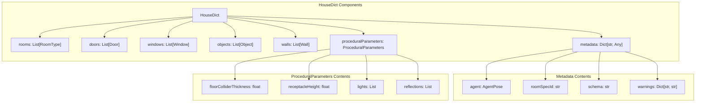
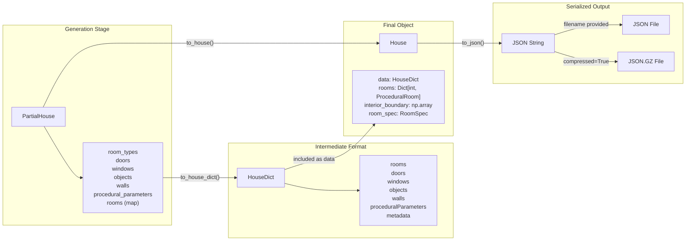
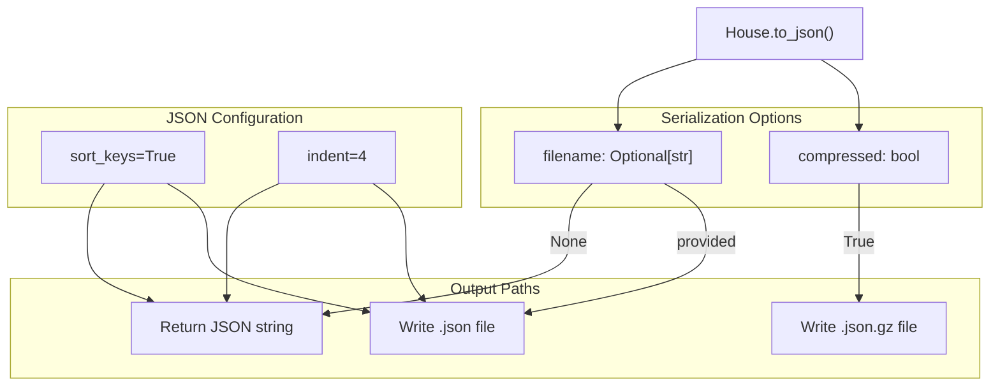
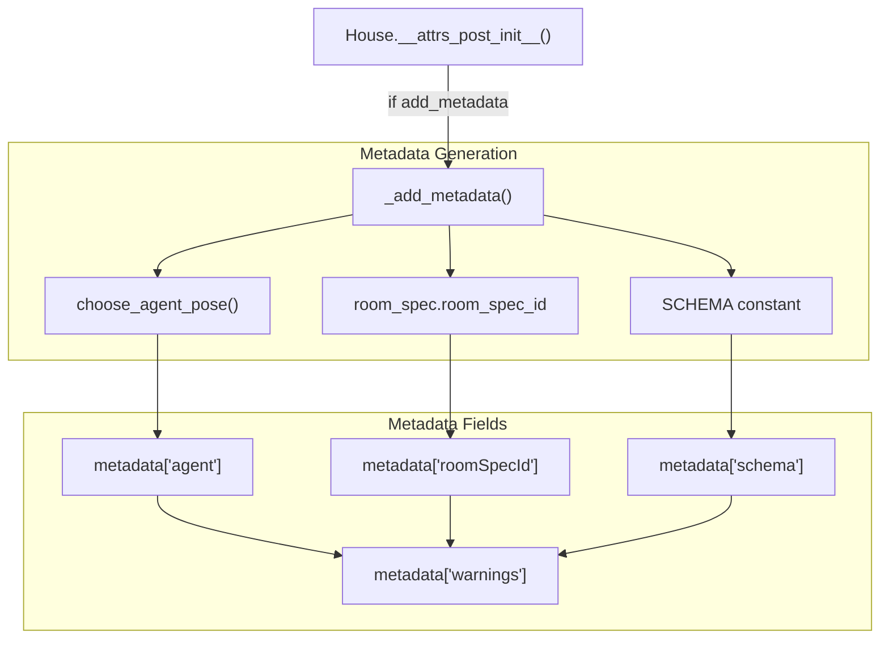
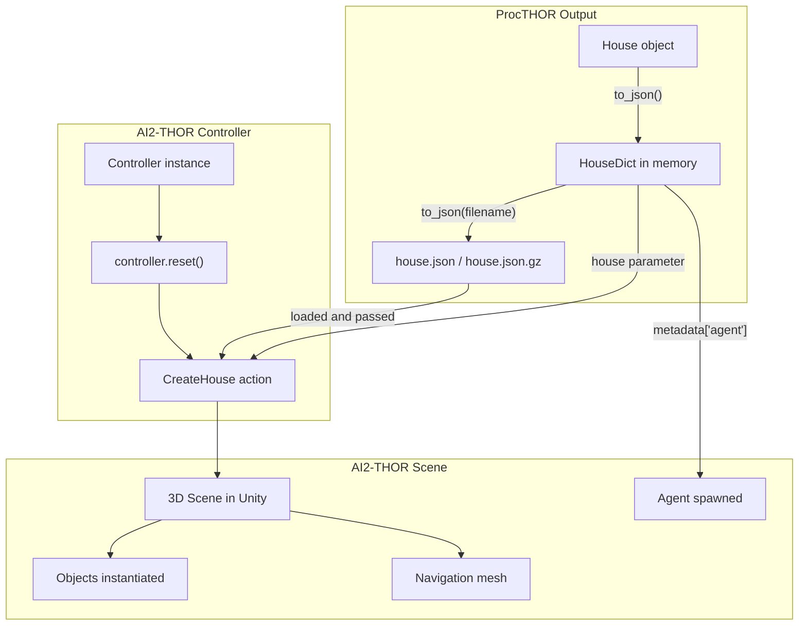

<!-- source: DeepWiki mcp.deepwiki.com · repo allenai/procthor · page 8.2 Scene Serialization · fetched 2026-10-26 -->

# Scene Serialization

<details>
<summary>Relevant source files</summary>

The following files were used as context for generating this wiki page:

- [procthor/generation/house.py](procthor/generation/house.py)

</details>


This document explains the serialization process that converts ProcTHOR's internal house representations into JSON format for consumption by the AI2-THOR simulator. It covers the `HouseDict` data structure, the transformation pipeline from `PartialHouse` to JSON files, field name conventions, and compression support.

For information about validating serialized houses in AI2-THOR, see [House Validation](#8.1). For information about the `House` and `PartialHouse` data structures themselves, see [Data Structures](#2.2).

## Purpose and Scope

Scene serialization transforms the internal house representation into a JSON format that AI2-THOR can consume via its `CreateHouse` action. This process involves three key transformations:

1. **PartialHouse → HouseDict**: Converting the staged generation state into a dictionary-based intermediate format
2. **Field Name Transformation**: Converting Python snake_case field names to JavaScript camelCase conventions
3. **HouseDict → JSON**: Serializing to JSON format with optional gzip compression

## HouseDict Structure

The `HouseDict` type represents the intermediate dictionary format that bridges ProcTHOR's internal representation and AI2-THOR's expected JSON schema. It contains all the structural and object information needed to reconstruct a complete scene in the simulator.



**HouseDict Top-Level Fields**

| Field | Type | Description |
|-------|------|-------------|
| `rooms` | `List[RoomType]` | Room geometry and type information |
| `doors` | `List[Door]` | Door openings with asset references |
| `windows` | `List[Window]` | Window openings in exterior walls |
| `objects` | `List[Object]` | All furniture and objects in the scene |
| `walls` | `List[Wall]` | Wall polygons with material assignments |
| `proceduralParameters` | `ProceduralParameters` | Simulation configuration parameters |
| `metadata` | `Dict[str, Any]` | Schema version, agent pose, and validation warnings |

**Sources:** [procthor/generation/house.py:295-311](), [procthor/generation/house.py:57-66]()

## Serialization Pipeline

The serialization pipeline transforms the staged generation state (`PartialHouse`) through intermediate representations until reaching the final JSON format.



### PartialHouse to HouseDict

The `to_house_dict()` method extracts serializable fields from `PartialHouse` and transforms their names to match AI2-THOR's expected format. [procthor/generation/house.py:295-311]()

```python
# Field name transformation mapping
from_to_map = {
    "room_types": "rooms",              # Python name → JSON name
    "doors": "doors",                    # No transformation
    "windows": "windows",                # No transformation
    "objects": "objects",                # No transformation
    "walls": "walls",                    # No transformation
    "procedural_parameters": "proceduralParameters",  # snake_case → camelCase
    "metadata": "metadata",              # No transformation
}
```

The method iterates through this mapping, extracting non-null attributes from the `PartialHouse` instance and constructing a dictionary with the transformed keys.

**Sources:** [procthor/generation/house.py:295-311]()

### PartialHouse to House

The `to_house()` method performs a complete conversion from `PartialHouse` to the final `House` object. This method validates that all required fields are present before creating the `House`. [procthor/generation/house.py:313-324]()

```python
# Required fields for conversion
required_fields = ["rooms", "doors", "windows", "objects", "walls"]
```

The resulting `House` object combines:
- The `HouseDict` representation (as `data`)
- The room polygon map (as `rooms`)
- The interior boundary array
- The original `RoomSpec`

**Sources:** [procthor/generation/house.py:313-324]()

## Field Transformations

ProcTHOR uses a consistent naming convention transformation between Python attributes and JSON fields to match AI2-THOR's JavaScript-based expectations.

**Transformation Rules**

| Python Convention | JSON Convention | Example Transformation |
|-------------------|-----------------|------------------------|
| `snake_case` | `camelCase` | `room_types` → `rooms` |
| `snake_case` | `camelCase` | `procedural_parameters` → `proceduralParameters` |
| Helper function | `snake_to_camel_case()` | `floor_collider_thickness` → `floorColliderThickness` |

The `snake_to_camel_case()` utility function [procthor/generation/house.py:34-36]() converts arbitrary snake_case strings to camelCase format:

```python
def snake_to_camel_case(s: str):
    split = s.split("_")
    return split[0] + "".join(part.capitalize() for part in split[1:])
```

**Sources:** [procthor/generation/house.py:34-36](), [procthor/generation/house.py:295-311]()

## JSON Serialization

The `House.to_json()` method handles the final serialization to JSON format with configurable output options. [procthor/generation/house.py:68-79]()



### Serialization Parameters

| Parameter | Type | Default | Description |
|-----------|------|---------|-------------|
| `filename` | `Optional[str]` | `None` | Output file path; if `None`, only returns string |
| `compressed` | `bool` | `False` | Whether to use gzip compression |

### Output Format Characteristics

1. **Key Ordering**: Keys are sorted alphabetically (`sort_keys=True`) for consistent output
2. **Indentation**: 4-space indentation for human readability
3. **File Extensions**: `.json` for uncompressed, `.json.gz` for compressed
4. **Encoding**: UTF-8 encoding for all text output

### Usage Examples

```python
# Return JSON string without saving
json_str = house.to_json()

# Save uncompressed JSON file
house.to_json(filename="house.json", compressed=False)

# Save compressed JSON file
house.to_json(filename="house.json.gz", compressed=True)
```

**Sources:** [procthor/generation/house.py:68-79]()

## Compression Support

ProcTHOR supports gzip compression for JSON files to reduce storage requirements. Compressed files use the `.json.gz` extension and are written using Python's `gzip` module.

**Compression Characteristics**

| Aspect | Uncompressed | Compressed |
|--------|-------------|------------|
| Extension | `.json` | `.json.gz` |
| Module | `open()` | `gzip.open()` |
| Mode | `"w"` | `"wt"` (text mode) |
| Encoding | UTF-8 | UTF-8 |
| Typical Size Reduction | 100% | ~20-30% of original |

The compression implementation validates file extensions via assertions to prevent incorrect usage: [procthor/generation/house.py:71-78]()

```python
if compressed:
    assert filename.endswith(".json.gz")  # Enforce correct extension
else:
    assert filename.endswith(".json")     # Enforce correct extension
```

**Sources:** [procthor/generation/house.py:71-78]()

## Metadata Enrichment

The `House` object automatically enriches its `HouseDict` representation with metadata during initialization via the `_add_metadata()` method. [procthor/generation/house.py:61-66]()



**Metadata Field Descriptions**

| Field | Type | Source | Description |
|-------|------|--------|-------------|
| `agent` | `AgentPose` | `choose_agent_pose()` | Starting position and orientation for the default agent |
| `roomSpecId` | `str` | `room_spec.room_spec_id` | Identifier for the room specification used |
| `schema` | `str` | `SCHEMA` constant | Version of the house schema format |
| `warnings` | `Dict[str, str]` | `validate()` | Validation warnings populated by validation process |

The `add_metadata` parameter (default `True`) controls whether this enrichment occurs. [procthor/generation/house.py:55]()

**Sources:** [procthor/generation/house.py:55-66](), [procthor/generation/house.py:98-100]()

## Integration with AI2-THOR

The serialized JSON format is designed to be directly consumable by AI2-THOR's `CreateHouse` action. The following diagram illustrates the complete integration workflow:



### AI2-THOR Consumption Process

1. **Controller Initialization**: Create an AI2-THOR `Controller` instance
2. **Reset State**: Call `controller.reset()` to clear any previous scene
3. **Pass HouseDict**: Call `controller.step(action="CreateHouse", house=house.data)`
4. **Scene Construction**: AI2-THOR parses the HouseDict and constructs the 3D scene
5. **Agent Teleport**: Use metadata agent pose to position the agent via `TeleportFull`

The validation method demonstrates this workflow: [procthor/generation/house.py:102-164]()

```python
controller.reset(renderImage=False)
event = controller.step(action="CreateHouse", house=self.data, renderImage=False)
event = controller.step(action="TeleportFull", **self.data["metadata"]["agent"])
```

**Sources:** [procthor/generation/house.py:102-164](), [procthor/generation/house.py:68-79]()

## JSON Schema Format

The serialized JSON follows a specific structure that AI2-THOR expects. Below is a representation of the key schema elements:

```json
{
  "rooms": [
    {
      "id": "room|0",
      "roomType": "Bedroom",
      "floorPolygon": [{"x": 0.0, "y": 0.0, "z": 0.0}, ...],
      "children": [],
      "ceilings": []
    }
  ],
  "doors": [
    {
      "id": "door|0|1",
      "room0": "room|0",
      "room1": "room|1",
      "wall0": "wall|0|...",
      "wall1": "wall|1|...",
      "assetId": "Doorway_1",
      "openness": 0.0
    }
  ],
  "windows": [
    {
      "id": "window|0",
      "room0": "room|0",
      "wall0": "wall|0|...",
      "assetId": "Window_1",
      "holePolygon": [{"x": 0.0, "y": 0.0, "z": 0.0}, ...]
    }
  ],
  "objects": [
    {
      "id": "object|0",
      "assetId": "Chair_1",
      "position": {"x": 1.0, "y": 0.0, "z": 1.0},
      "rotation": {"x": 0.0, "y": 90.0, "z": 0.0},
      "room": "room|0"
    }
  ],
  "walls": [
    {
      "id": "wall|0|...",
      "roomId": "room|0",
      "polygon": [{"x": 0.0, "y": 0.0, "z": 0.0}, ...]
    }
  ],
  "proceduralParameters": {
    "floorColliderThickness": 1.0,
    "receptacleHeight": 0.7,
    "lights": [],
    "reflections": []
  },
  "metadata": {
    "agent": {
      "position": {"x": 2.0, "y": 0.0, "z": 2.0},
      "rotation": {"x": 0.0, "y": 180.0, "z": 0.0},
      "horizon": 0.0,
      "standing": true
    },
    "roomSpecId": "roomspec_001",
    "schema": "2.0.0"
  }
}
```

**Sources:** [procthor/generation/house.py:295-311](), [procthor/generation/house.py:61-66]()

---

