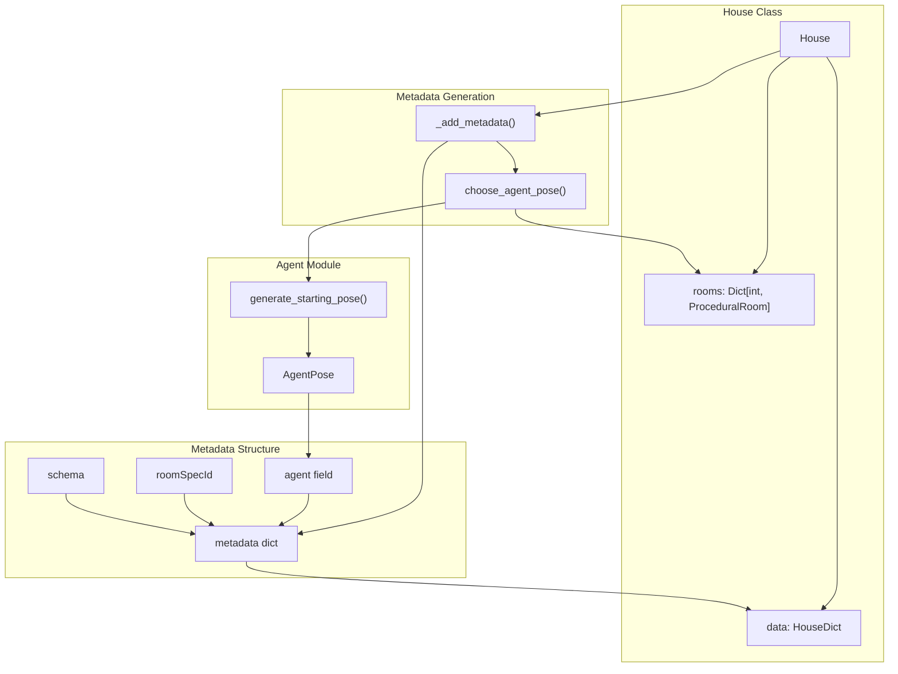
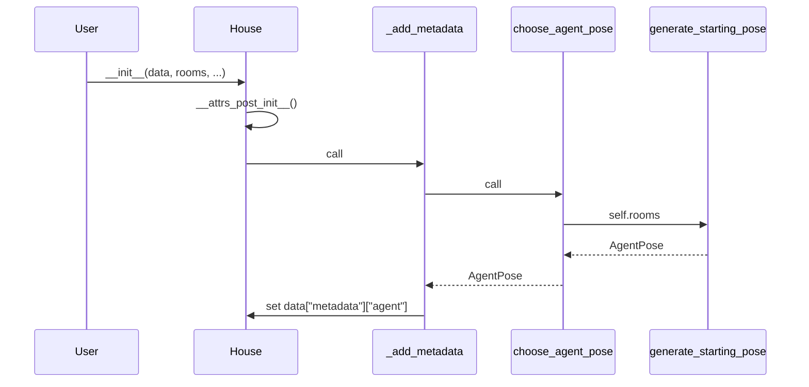
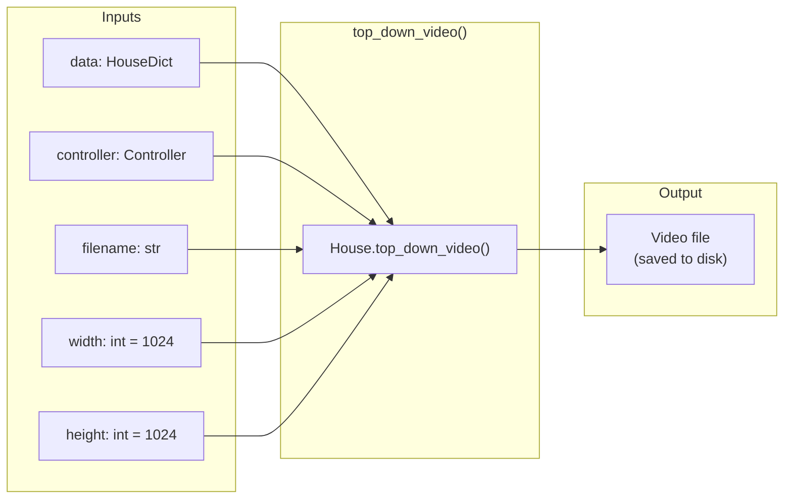
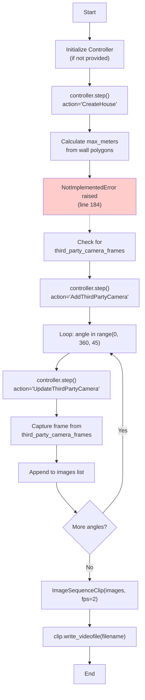
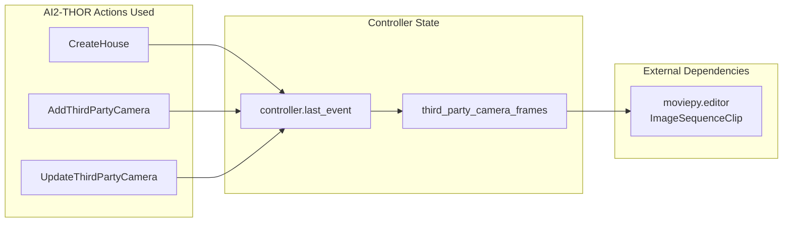
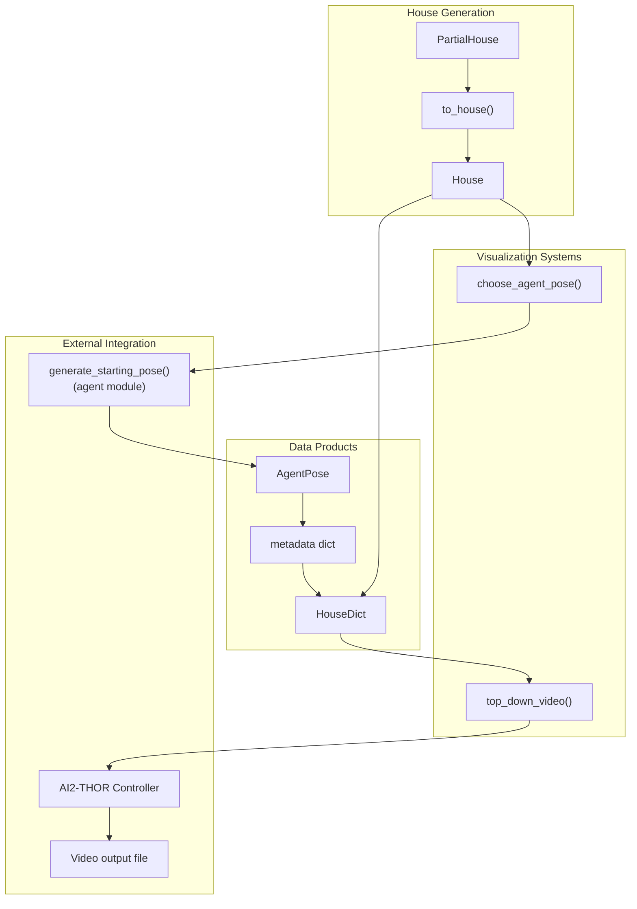

<!-- source: DeepWiki mcp.deepwiki.com · repo allenai/procthor · page 8.3 Visualization · fetched 2026-10-26 -->

# Visualization

Relevant source files

The following files were used as context for generating this wiki page:

- [procthor/generation/house.py](procthor/generation/house.py)

## Purpose and Scope

This document describes ProcTHOR's visualization capabilities for generated houses. It covers two main visualization features: (1) **agent pose selection** for determining default agent starting positions, and (2) **top-down video generation** for creating orbital camera views of generated houses. These visualization tools enable inspection of generated scenes and provide default agent configurations for embodied AI tasks.

For information about validating house usability in AI2-THOR, see [House Validation](#8.1). For details on house serialization formats, see [Scene Serialization](#8.2).

---

## Agent Pose Selection

### Overview

The agent pose selection system determines a plausible starting position and orientation for the default agent in a generated house. This starting pose is stored in the house metadata and used when initializing scenes in AI2-THOR.

### Architecture

**Sources:** [procthor/generation/house.py:57-66](), [procthor/generation/house.py:98-100]()

### Implementation Details

The `House` class provides the `choose_agent_pose()` method, which delegates to the `generate_starting_pose()` function from the agent module:

| Component | Type | Purpose |
|-----------|------|---------|
| `House.choose_agent_pose()` | Method | Public interface for agent pose selection |
| `generate_starting_pose()` | Function | Core algorithm for pose generation (from `procthor.generation.agent`) |
| `AgentPose` | Type | Result type containing position and rotation |
| `House.rooms` | Dict[int, ProceduralRoom] | Input room data for pose selection |

The agent pose is automatically added to house metadata during `House` initialization:

**Sources:** [procthor/generation/house.py:57-66](), [procthor/generation/house.py:98-100]()

### Metadata Integration

The selected agent pose is stored in the house metadata structure alongside other scene-level information:

| Metadata Field | Content | Purpose |
|----------------|---------|---------|
| `agent` | AgentPose object | Starting position and orientation for agent |
| `roomSpecId` | String | Identifier for the room specification used |
| `schema` | String | Schema version for compatibility tracking |

This metadata is used during house validation when teleporting the agent to verify the starting position is reachable (see [House Validation](#8.1)).

**Sources:** [procthor/generation/house.py:61-66](), [procthor/generation/house.py:117-126]()

---

## Top-Down Video Generation

### Overview

The `House.top_down_video()` static method creates an orbital camera video of a generated house by capturing frames from multiple angles and composing them into a video file. This provides a visual inspection tool for generated scenes.

### Method Signature

**Sources:** [procthor/generation/house.py:166-208]()

### Video Generation Process

The video generation follows a multi-step process involving AI2-THOR's third-party camera system:

**Sources:** [procthor/generation/house.py:174-208]()

### Camera Positioning

The third-party camera is positioned to orbit around the house center with the following parameters:

| Parameter | Formula | Purpose |
|-----------|---------|---------|
| X position | `max_meters / 2 - sin(angle * π / 180) * dist` | Orbital path in X dimension |
| Y position | `max_meters + 1.5` | Height above house |
| Z position | `max_meters / 2 - cos(angle * π / 180) * dist` | Orbital path in Z dimension |
| X rotation | `65` | Downward viewing angle |
| Y rotation | `angle` | Rotation around vertical axis |
| Z rotation | `0` | No roll |
| Distance | `2.75` meters | Radius of orbital path |

The camera captures 8 frames at 45-degree intervals (0°, 45°, 90°, 135°, 180°, 225°, 270°, 315°), which are composited into a video at 2 FPS.

**Sources:** [procthor/generation/house.py:194-206]()

### Integration with AI2-THOR

The video generation system uses several AI2-THOR actions:

**Sources:** [procthor/generation/house.py:1-14](), [procthor/generation/house.py:180-208]()

### Known Limitations

The `top_down_video()` method currently has an incomplete implementation:

| Issue | Location | Description |
|-------|----------|-------------|
| `NotImplementedError` | Line 184 | Calculation of `max_meters` is incomplete with message "Update max_meters from data." |
| Placeholder calculation | Lines 181-183 | Current max_meters calculation attempts to find maximum X/Z coordinates from wall polygons but raises exception |

The code structure suggests the intended behavior:
1. Calculate the bounding box of the house from wall polygons
2. Use this to position the camera at the center of the house
3. Adjust camera distance to frame the entire house

**Sources:** [procthor/generation/house.py:181-184]()

### Usage Context

The `top_down_video()` method is a static method, meaning it can be called without instantiating a `House` object. It requires:

1. A `HouseDict` object (see [Scene Serialization](#8.2))
2. An AI2-THOR `Controller` instance (optional - will be created if not provided)
3. A filename for the output video
4. Optional width and height for the controller (default 1024x1024)

The method initializes the controller with `PROCTHOR_INITIALIZATION` parameters if no controller is provided.

**Sources:** [procthor/generation/house.py:174-178]()

---

## Data Flow Summary

The following diagram shows how visualization components interact with the broader ProcTHOR system:

**Sources:** [procthor/generation/house.py:98-100](), [procthor/generation/house.py:166-208](), [procthor/generation/house.py:313-324]()

---

