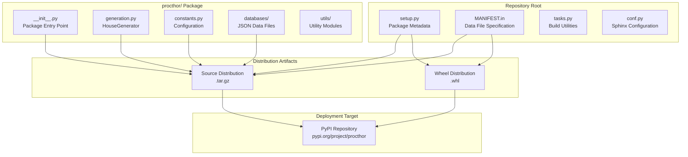
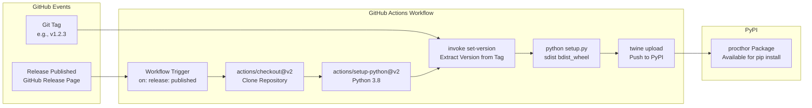
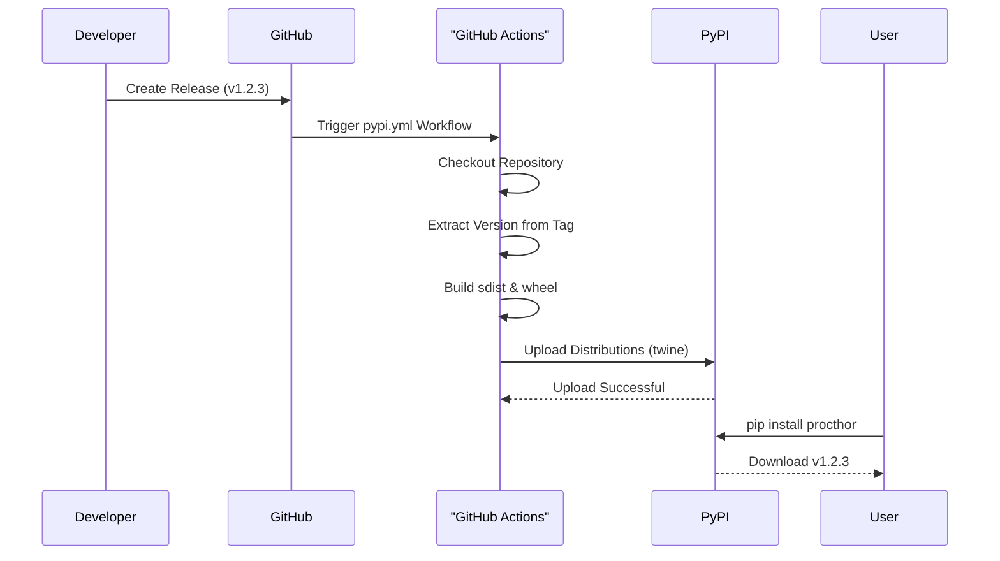
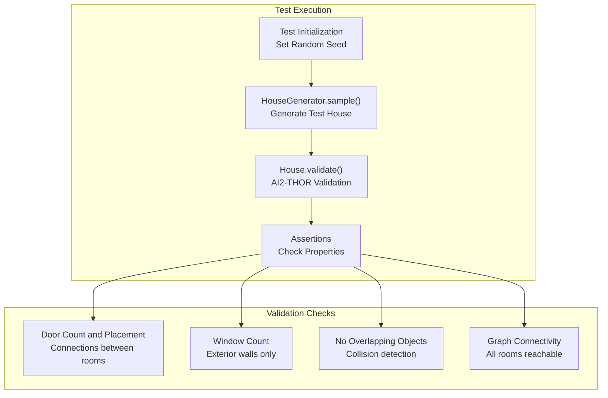
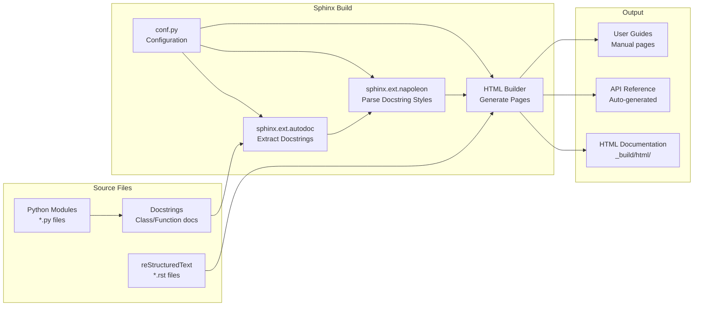

<!-- source: DeepWiki mcp.deepwiki.com · repo allenai/procthor · page 9 Development and Deployment · fetched 2026-10-26 -->

# Development and Deployment

<details>
<summary>Relevant source files</summary>

The following files were used as context for generating this wiki page:

- [.github/workflows/pypi.yml](.github/workflows/pypi.yml)
- [MANIFEST.in](MANIFEST.in)
- [conf.py](conf.py)

</details>


## Purpose and Scope

This page documents the development infrastructure, deployment pipeline, testing approach, and documentation system for ProcTHOR. It covers:

- Package structure and data file inclusion via `MANIFEST.in`
- Automated CI/CD pipeline using GitHub Actions for PyPI releases
- Testing infrastructure and validation approaches
- Sphinx-based documentation generation

For information about the core generation system, see [Core Generation System](#2). For database generation infrastructure, see [Database Generation](#5.2).

---

## Package Structure

ProcTHOR is distributed as a Python package through PyPI, with careful management of data files that must be included alongside the code. The package structure ensures that all required databases and assets are bundled correctly for end users.

### Data File Inclusion

The `MANIFEST.in` file specifies which non-Python files to include in the distribution package:

```
include procthor/databases/*.json
include procthor/databases/asset_groups/*.json
```

This ensures that:
- All database JSON files in `procthor/databases/` are included
- All asset group JSON files in `procthor/databases/asset_groups/` are included

These databases are essential for runtime operation, as they contain the asset metadata, material databases, receptacle information, and asset group definitions that drive procedural generation. Without these files, the `ProcTHORDatabase` would be unable to initialize.

**Sources:** [MANIFEST.in:1-2]()

### Package Organization



**Diagram: Package Structure and Distribution Artifacts**

The package follows a standard Python distribution structure:

| Component | Purpose | Included via |
|-----------|---------|--------------|
| `procthor/*.py` | Core Python modules | Automatic (Python files) |
| `procthor/databases/*.json` | Database files | `MANIFEST.in` |
| `procthor/databases/asset_groups/*.json` | Asset group definitions | `MANIFEST.in` |
| `setup.py` | Package metadata and dependencies | Standard setuptools |
| `README.md` | Package documentation | Automatic (top-level) |

**Sources:** [MANIFEST.in:1-2]()

---

## CI/CD Pipeline

ProcTHOR uses GitHub Actions to automate the release and deployment process to PyPI. The pipeline is triggered on GitHub release events, ensuring that every tagged release is automatically published.

### Workflow Architecture



**Diagram: CI/CD Pipeline Flow**

**Sources:** [.github/workflows/pypi.yml:1-25]()

### Workflow Configuration

The PyPI upload workflow is defined in [.github/workflows/pypi.yml:1-25](). Key characteristics:

| Configuration | Value | Purpose |
|---------------|-------|---------|
| **Trigger** | `on: release: types: [published]` | Activates when a GitHub release is published |
| **Runner** | `ubuntu-latest` | Linux environment for build |
| **Python Version** | `3.8` | Python version matrix (single version) |
| **Build Tools** | `invoke`, `twine`, `wheel` | Package building and uploading utilities |

**Sources:** [.github/workflows/pypi.yml:3-5,10-12]()

### Build and Upload Steps

The workflow executes the following sequence:

1. **Repository Checkout**
   ```yaml
   - uses: actions/checkout@v2
   ```
   Clones the repository at the tagged commit.

2. **Python Environment Setup**
   ```yaml
   - uses: actions/setup-python@v2
     with:
       python-version: 3.8
   ```
   Configures Python 3.8 environment.

3. **Version Extraction**
   ```bash
   invoke set-version --version "${GITHUB_REF##*/}"
   ```
   Extracts version from the Git reference (e.g., `v1.2.3` → `1.2.3`) and updates package metadata.

4. **Package Building**
   ```bash
   python setup.py sdist bdist_wheel
   ```
   Creates both source distribution (`.tar.gz`) and wheel distribution (`.whl`).

5. **PyPI Upload**
   ```bash
   twine upload dist/* -u 'mattdeitke' -p '${{ secrets.PYPI }}'
   ```
   Authenticates with PyPI credentials stored in GitHub Secrets and uploads both distribution formats.

**Sources:** [.github/workflows/pypi.yml:19-24]()

### Deployment Sequence



**Diagram: Deployment Sequence from Release to User Installation**

**Sources:** [.github/workflows/pypi.yml:1-25]()

### Security Considerations

- **PyPI Credentials**: Stored as encrypted GitHub Secret `PYPI`
- **User Account**: Hardcoded as `mattdeitke` in workflow
- **Access Control**: Only repository maintainers can create releases

---

## Testing

ProcTHOR's testing infrastructure validates that generated houses meet semantic and physical constraints. The testing approach emphasizes validation of complete generation workflows rather than isolated unit tests.

### Testing Philosophy

The codebase uses integration-style tests that:
1. Generate complete houses through the full pipeline
2. Validate structural properties (e.g., doors, windows, connectivity)
3. Ensure AI2-THOR compatibility via `House.validate()`

Example test structure referenced in the codebase:

```
tests/
└── windows_and_doors.py     # Validates door and window generation
```

### Validation Workflow



**Diagram: Testing and Validation Workflow**

### Key Testing Patterns

1. **Deterministic Generation**: Tests use fixed random seeds to ensure reproducibility
2. **Full Pipeline Testing**: Tests execute the entire generation pipeline, not individual stages
3. **AI2-THOR Integration**: The `House.validate()` method spawns an AI2-THOR controller to verify scene validity
4. **Property-Based Checks**: Tests validate semantic properties (e.g., "bedrooms should have beds")

Common assertions in tests:
- Door placement creates valid room connections
- Windows only appear on exterior walls
- Required furniture appears in appropriate rooms
- Generated scenes can be loaded in AI2-THOR without errors

**Sources:** Referenced in system overview and testing infrastructure discussions

---

## Documentation System

ProcTHOR uses Sphinx to generate documentation from docstrings and structured documentation files. The documentation system supports API reference generation and custom documentation pages.

### Sphinx Configuration

The documentation is configured in [conf.py:1-60](), which specifies:

| Configuration | Value | Purpose |
|---------------|-------|---------|
| **Project Name** | `"Houses"` | Documentation title |
| **Copyright** | `"2022, Allen Institute for AI"` | Attribution |
| **Release Version** | `"0.0.1"` | Documentation version |
| **Theme** | `"pydata_sphinx_theme"` | Visual theme |

**Sources:** [conf.py:21-26,54]()

### Enabled Extensions

```python
extensions = [
    "sphinx.ext.autodoc",      # Automatic API documentation from docstrings
    "sphinx.ext.napoleon",     # Support for NumPy/Google-style docstrings
    "sphinx.ext.viewcode",     # Add links to source code
]
```

- **autodoc**: Extracts docstrings from Python modules to generate API reference
- **napoleon**: Parses Google-style and NumPy-style docstrings into reStructuredText
- **viewcode**: Adds hyperlinks to source code for each documented class/function

**Sources:** [conf.py:34-38]()

### Documentation Build Process



**Diagram: Documentation Build Process**

**Sources:** [conf.py:1-60]()

### Directory Structure

```
Repository Root
├── conf.py                  # Sphinx configuration
├── _templates/              # Custom Sphinx templates
├── _static/                 # Static assets (CSS, images)
├── _build/                  # Generated documentation (not in repo)
│   └── html/                # HTML output
├── procthor/                # Source code with docstrings
│   ├── generation.py        # HouseGenerator documentation
│   ├── house.py             # House class documentation
│   └── ...
```

**Sources:** [conf.py:41,59]()

### Building Documentation

Standard Sphinx build commands:

```bash
# Generate HTML documentation
sphinx-build -b html . _build/html

# Clean build artifacts
rm -rf _build

# Build with warnings as errors
sphinx-build -W -b html . _build/html
```

The generated documentation includes:
- **API Reference**: Auto-generated from docstrings in `procthor/` modules
- **Module Index**: Searchable index of all classes and functions
- **Source Links**: Direct links to source code via `viewcode` extension

**Sources:** [conf.py:1-60]()

---

## Summary

The development and deployment infrastructure for ProcTHOR provides:

1. **Automated Releases**: GitHub Actions workflow publishes to PyPI on release events
2. **Complete Distribution**: `MANIFEST.in` ensures all required data files are included
3. **Validation Testing**: Integration tests verify full generation pipeline correctness
4. **API Documentation**: Sphinx generates searchable documentation from docstrings

This infrastructure enables reliable releases while maintaining code quality and comprehensive documentation. The CI/CD pipeline ensures that every GitHub release is automatically available on PyPI within minutes, allowing users to install the latest version via `pip install procthor`.

**Key Files:**
- [.github/workflows/pypi.yml:1-25]() - CI/CD workflow
- [MANIFEST.in:1-2]() - Data file inclusion
- [conf.py:1-60]() - Sphinx configuration
- `setup.py` - Package metadata (referenced throughout)
- `tasks.py` - Build utilities (referenced in workflow)

---

