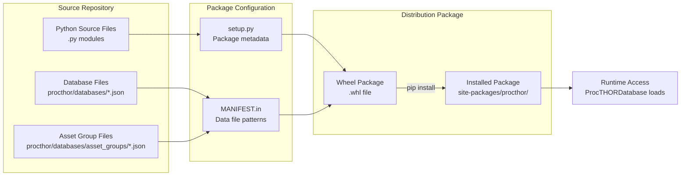
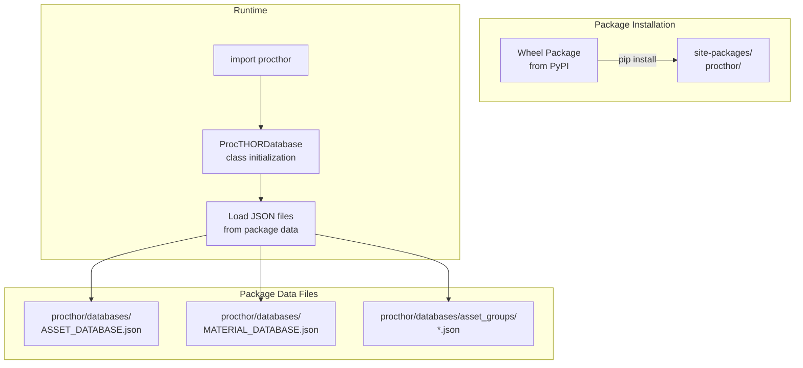
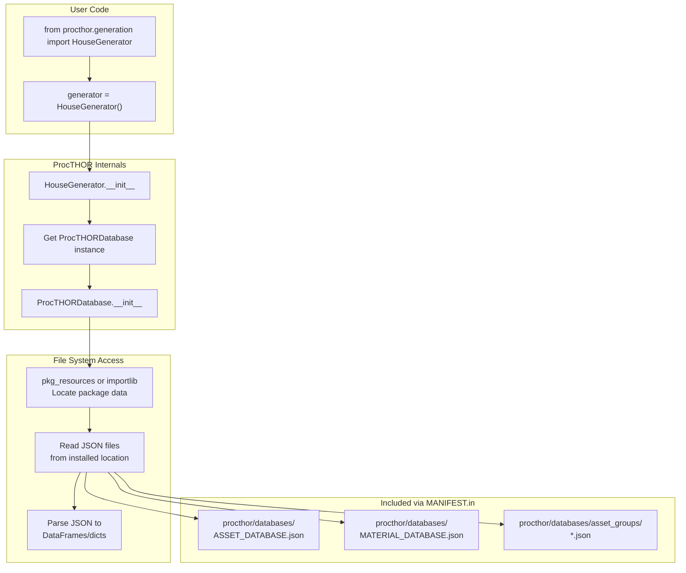

<!-- source: DeepWiki mcp.deepwiki.com · repo allenai/procthor · page 9.1 Package Structure · fetched 2026-10-26 -->

# Package Structure

<details>
<summary>Relevant source files</summary>

The following files were used as context for generating this wiki page:

- [MANIFEST.in](MANIFEST.in)

</details>


## Purpose and Scope

This document explains the ProcTHOR package structure and how data files are included in the distributed package. It covers the `MANIFEST.in` configuration that ensures database files are properly bundled with the Python package during distribution. For information about how the package is built and published, see [CI/CD Pipeline](#9.2). For database content and generation, see [Database System](#5).

## Package Organization

The ProcTHOR package follows a standard Python package layout with the source code located in the `procthor/` directory. The package includes not only Python source code but also critical data files containing asset and material databases that are essential for house generation.

### Directory Structure

```
procthor/
├── __init__.py
├── generation/              # Generation pipeline implementation
├── databases/               # Database JSON files
│   ├── *.json              # Main database files (ASSET_DATABASE, MATERIAL_DATABASE)
│   └── asset_groups/       # Asset group definitions
│       └── *.json
├── utils/                   # Utility functions
└── upgrade/                 # Schema migration system
```

The key directories are:
- **`procthor/generation/`**: Contains the core generation classes (`HouseGenerator`, `PartialHouse`, etc.)
- **`procthor/databases/`**: Contains JSON database files required at runtime
- **`procthor/utils/`**: Utility classes and functions
- **`procthor/upgrade/`**: Schema versioning and migration tools

Sources: Repository structure analysis

## MANIFEST.in Configuration

Python's `setuptools` by default only includes Python source files (`.py`) in the distributed package. Data files such as JSON databases must be explicitly declared using a `MANIFEST.in` file.

### MANIFEST.in Contents

The ProcTHOR `MANIFEST.in` specifies which data files to include:

```
include procthor/databases/*.json
include procthor/databases/asset_groups/*.json
```

**Lines 1-2**: Include all JSON files in the databases directory and asset_groups subdirectory

These patterns ensure that:
1. All database JSON files in `procthor/databases/` are included
2. All asset group definition files in `procthor/databases/asset_groups/` are included

Sources: [MANIFEST.in:1-2]()

### File Inclusion Workflow



**Diagram: Package File Inclusion Pipeline**

This diagram shows how `MANIFEST.in` ensures data files are included in the distributed package. Without `MANIFEST.in`, only Python source files would be packaged, causing runtime errors when `ProcTHORDatabase` attempts to load JSON files.

Sources: [MANIFEST.in:1-2]()

## Database File Organization

The included database files contain critical data for house generation:

| Directory | File Pattern | Purpose | Used By |
|-----------|--------------|---------|---------|
| `procthor/databases/` | `*.json` | Main asset and material databases | `ProcTHORDatabase` initialization |
| `procthor/databases/asset_groups/` | `*.json` | Asset group definitions (furniture sets) | Floor object placement |

### Database File Types

The `procthor/databases/` directory contains several JSON files:

1. **ASSET_DATABASE**: Contains metadata for all placeable objects (furniture, appliances, decorations)
2. **MATERIAL_DATABASE**: Contains material definitions organized by material group
3. **Wall Holes Database**: Specifications for windows and doors
4. **Receptacles Database**: Container-content relationships
5. **Placement Annotations**: Spawn rules and placement constraints

The `procthor/databases/asset_groups/` directory contains JSON files defining logical groupings of furniture that are commonly placed together (e.g., a dining table with matching chairs).

Sources: [MANIFEST.in:1-2](), Database System documentation

### Runtime Loading



**Diagram: Database Loading at Runtime**

When users install ProcTHOR via pip, the `MANIFEST.in` declarations ensure that all database JSON files are copied to the installation directory. At runtime, `ProcTHORDatabase` can then locate and load these files from the installed package location.

Sources: [MANIFEST.in:1-2]()

## Package Distribution Requirements

### Why MANIFEST.in is Required

Python's default packaging behavior only includes `.py` files in the source distribution. Since ProcTHOR's databases are JSON files (not Python code), they require explicit inclusion via `MANIFEST.in`.

**Without MANIFEST.in**:
- Python source files would be packaged correctly
- Database JSON files would be omitted
- Runtime errors would occur when `ProcTHORDatabase` attempts to load data
- Users would need to manually download and configure database files

**With MANIFEST.in**:
- All required data files are automatically included
- Installation via `pip install procthor` works out-of-the-box
- No additional configuration required by end users

### Integration with setup.py

The `setup.py` file must also specify `include_package_data=True` to respect `MANIFEST.in` declarations:

```python
setuptools.setup(
    name="procthor",
    packages=setuptools.find_packages(),
    include_package_data=True,  # Enables MANIFEST.in
    # ... other configuration
)
```

This configuration tells `setuptools` to include files matched by `MANIFEST.in` patterns when building distributions.

Sources: [MANIFEST.in:1-2](), Standard Python packaging practices

## Package Data Access Pattern



**Diagram: Package Data Access Flow**

This diagram shows the complete flow from user code to database file access. The `MANIFEST.in` declarations enable step 4 by ensuring the JSON files exist in the installed package location.

Sources: [MANIFEST.in:1-2]()

## Summary

The ProcTHOR package structure relies on `MANIFEST.in` to include critical database files in the distributed package:

| Component | Role |
|-----------|------|
| `MANIFEST.in` | Declares which non-Python files to include in distribution |
| `procthor/databases/*.json` | Main database files (assets, materials, etc.) |
| `procthor/databases/asset_groups/*.json` | Asset group definitions |
| `setup.py` | Specifies `include_package_data=True` to honor `MANIFEST.in` |

Without proper configuration of `MANIFEST.in`, the package would install successfully but fail at runtime when attempting to load database files. This configuration ensures that ProcTHOR works correctly immediately after installation via pip, with no additional setup required by end users.

Sources: [MANIFEST.in:1-2]()

---

