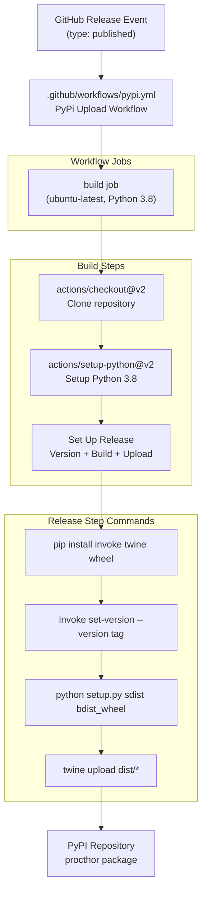
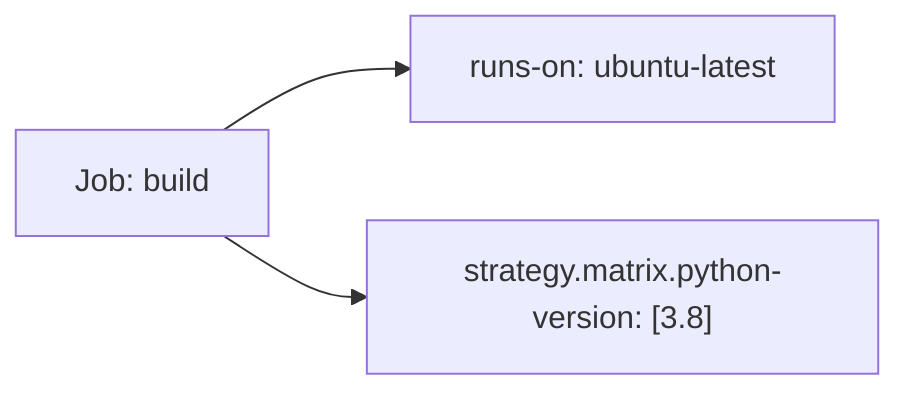
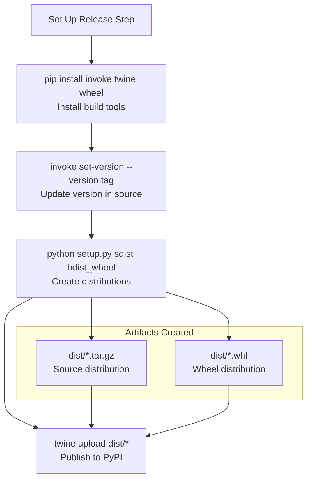
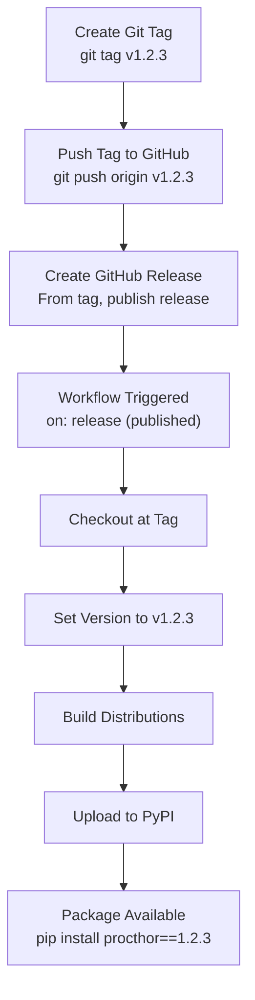
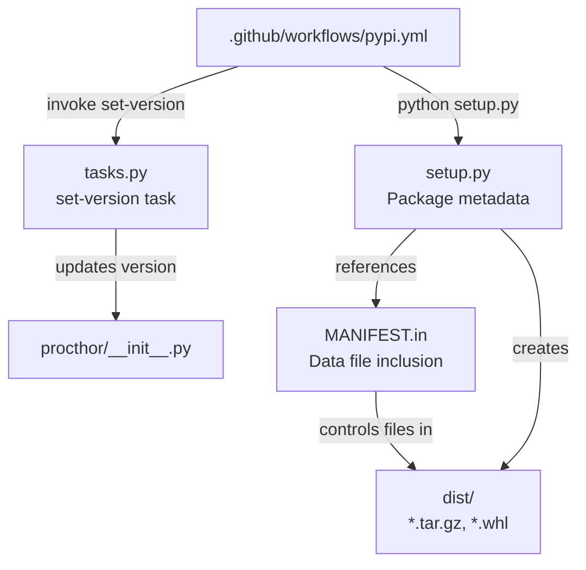

<!-- source: DeepWiki mcp.deepwiki.com · repo allenai/procthor · page 9.2 CI/CD Pipeline · fetched 2026-10-26 -->

# CI/CD Pipeline

<details>
<summary>Relevant source files</summary>

The following files were used as context for generating this wiki page:

- [.github/workflows/pypi.yml](.github/workflows/pypi.yml)

</details>


## Purpose and Scope

This document describes the Continuous Integration and Continuous Deployment (CI/CD) infrastructure for the ProcTHOR package. Specifically, it covers the GitHub Actions workflow that automatically publishes new releases to PyPI when a GitHub release is created. For information about package structure and data file inclusion, see [Package Structure](#9.1). For testing infrastructure, see [Testing](#9.3).

The CI/CD pipeline is defined in a single workflow file that handles the entire release process: version setting, package building, and PyPI upload.

## Workflow Architecture

The following diagram shows the high-level architecture of the CI/CD pipeline:



**Sources:** [.github/workflows/pypi.yml:1-25]()

## Workflow Trigger Configuration

The workflow is triggered exclusively by GitHub release events. The trigger configuration is minimal and event-driven:

| Configuration Key | Value | Purpose |
|------------------|-------|---------|
| `on.release.types` | `[published]` | Only trigger on published releases (not drafts) |

This means the workflow will not run on push, pull request, or manual dispatch. It activates only when a maintainer creates and publishes a new release through the GitHub UI or API.

**Sources:** [.github/workflows/pypi.yml:3-5]()

## Job Configuration

The workflow defines a single job named `build` that runs on Ubuntu with Python 3.8:



The matrix strategy with a single Python version (3.8) suggests the package is compatible with Python 3.8+. While only one version is tested during release, the package itself may support multiple Python versions.

**Sources:** [.github/workflows/pypi.yml:8-12]()

## Build Steps

### Step 1: Repository Checkout

```yaml
- uses: actions/checkout@v2
```

This step clones the repository at the release tag reference. The checkout action uses the default behavior, which checks out the exact commit associated with the release tag.

**Sources:** [.github/workflows/pypi.yml:14]()

### Step 2: Python Environment Setup

```yaml
- name: Set up Python ${{ matrix.python-version }}
  uses: actions/setup-python@v2
  with:
    python-version: ${{ matrix.python-version }}
```

This step configures Python 3.8 using GitHub's official Python setup action. The action downloads and caches the specified Python version for use in subsequent steps.

**Sources:** [.github/workflows/pypi.yml:15-18]()

### Step 3: Release Build and Upload

The final step performs four distinct operations in sequence:



**Sources:** [.github/workflows/pypi.yml:19-24]()

## Build Tool Dependencies

The workflow installs three Python packages before building:

| Package | Purpose |
|---------|---------|
| `invoke` | Task automation tool used to run the `set-version` task |
| `twine` | PyPI upload utility with secure authentication |
| `wheel` | Enables building wheel distributions (`.whl` files) |

The `invoke` tool is used to execute a custom `set-version` task, which likely modifies `procthor/__init__.py` or a similar file to embed the release version.

**Sources:** [.github/workflows/pypi.yml:21]()

## Version Management

The workflow extracts the version from the GitHub release tag:

```bash
invoke set-version --version "${GITHUB_REF##*/}"
```

The `${GITHUB_REF##*/}` parameter expansion extracts the tag name from the full reference. For example:
- `GITHUB_REF=refs/tags/v1.2.3` → `${GITHUB_REF##*/}=v1.2.3`

The `set-version` task is defined in a `tasks.py` file (not shown in provided files but referenced by the workflow). This task updates the version string in the package source code before building.

**Sources:** [.github/workflows/pypi.yml:22]()

## Distribution Building

The workflow uses `setup.py` to build two distribution formats:

```bash
python setup.py sdist bdist_wheel
```

This command generates:
1. **Source Distribution (sdist)**: A `.tar.gz` archive containing the source code
2. **Wheel Distribution (bdist_wheel)**: A `.whl` binary package for faster installation

Both distributions are created in the `dist/` directory and subsequently uploaded to PyPI.

**Sources:** [.github/workflows/pypi.yml:23]()

## PyPI Upload

The final command uploads both distributions to PyPI:

```bash
twine upload dist/* -u 'mattdeitke' -p '${{ secrets.PYPI }}'
```

### Upload Configuration

| Parameter | Value | Purpose |
|-----------|-------|---------|
| `dist/*` | All files in dist/ | Upload both source and wheel distributions |
| `-u 'mattdeitke'` | PyPI username | Authenticate as specific user |
| `-p '${{ secrets.PYPI }}'` | GitHub secret | PyPI password or API token |

The PyPI credentials are stored as a GitHub repository secret named `PYPI`. This secret must be configured in the repository settings by a maintainer with appropriate permissions.

**Sources:** [.github/workflows/pypi.yml:24]()

## Release Procedure

To trigger a new release, a maintainer follows this process:



### Step-by-Step Release Process

1. **Tag Creation**: Create a version tag following semantic versioning (e.g., `v1.2.3`)
2. **Tag Push**: Push the tag to GitHub's remote repository
3. **Release Creation**: Create a GitHub release from the tag through the GitHub UI
4. **Release Publication**: Mark the release as published (not draft)
5. **Automatic Deployment**: The workflow triggers and publishes to PyPI automatically

The version tag should follow the format `vX.Y.Z` where X, Y, and Z are integers representing major, minor, and patch versions respectively.

**Sources:** [.github/workflows/pypi.yml:3-5]()

## Security Considerations

The workflow handles sensitive credentials through GitHub Secrets:

| Secret | Usage | Risk Mitigation |
|--------|-------|-----------------|
| `PYPI` | PyPI authentication | Stored encrypted in GitHub; only accessible to workflow |

### Best Practices Implemented

1. **No Hardcoded Credentials**: PyPI password stored as encrypted secret
2. **Release-Only Trigger**: Workflow only runs on explicit release events, not on every commit
3. **Single Responsibility**: Workflow only handles PyPI upload, no other operations

### Security Gaps

The workflow uses username/password authentication (`-u` and `-p` flags) rather than PyPI API tokens. Modern best practice would be to use `__token__` as the username and a scoped API token as the password for more granular access control.

**Sources:** [.github/workflows/pypi.yml:24]()

## Workflow Limitations

The current CI/CD pipeline has several constraints:

1. **No Pre-Release Testing**: The workflow does not run tests before uploading to PyPI
2. **Single Python Version**: Only tests building on Python 3.8, not other versions
3. **No TestPyPI Stage**: Uploads directly to production PyPI without a staging environment
4. **No Rollback Mechanism**: Once uploaded to PyPI, packages cannot be deleted
5. **Manual Release Creation**: Requires manual tag creation and release publication

These limitations mean the release process depends on pre-release testing being performed manually or in separate workflows before creating the release.

**Sources:** [.github/workflows/pypi.yml:1-25]()

## Integration with Package Structure

The workflow depends on several package configuration files:



For details on how `MANIFEST.in` controls which files are included in distributions, see [Package Structure](#9.1).

**Sources:** [.github/workflows/pypi.yml:21-23]()

## Monitoring and Debugging

When a release fails, maintainers can diagnose issues through:

1. **GitHub Actions Logs**: View step-by-step execution in the Actions tab
2. **PyPI Upload Errors**: Check `twine upload` output for authentication or validation errors
3. **Version Conflicts**: Verify that the version number doesn't conflict with existing PyPI releases
4. **Distribution Validation**: Inspect `dist/` contents before upload

Common failure scenarios:

| Failure | Cause | Solution |
|---------|-------|----------|
| `twine upload` authentication error | Invalid PYPI secret | Update GitHub secret with valid token |
| Version already exists | Duplicate version tag | Create new version tag with incremented number |
| `invoke set-version` fails | Missing tasks.py | Ensure tasks.py is committed to repository |
| Build artifacts missing | setup.py error | Check setup.py for syntax errors |

**Sources:** [.github/workflows/pypi.yml:19-24]()

---

