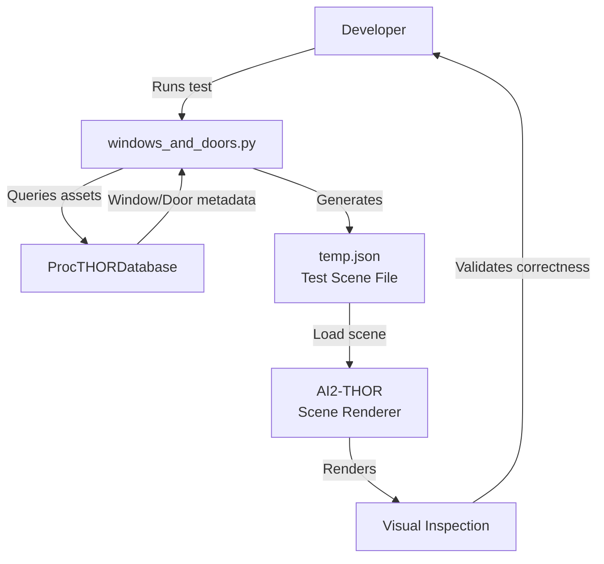
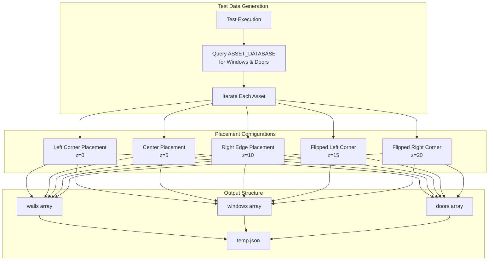
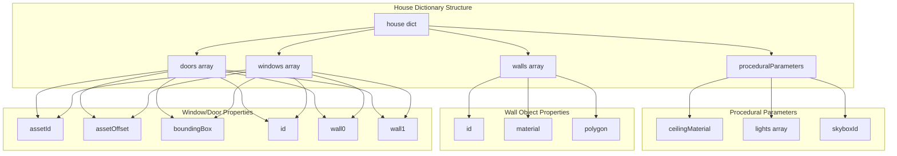
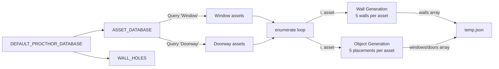
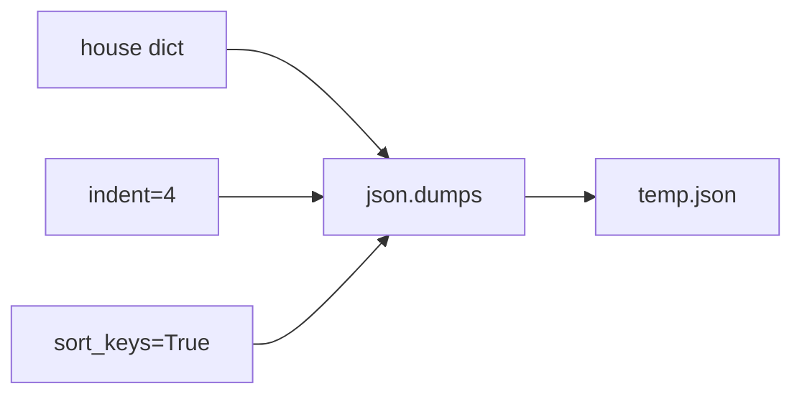
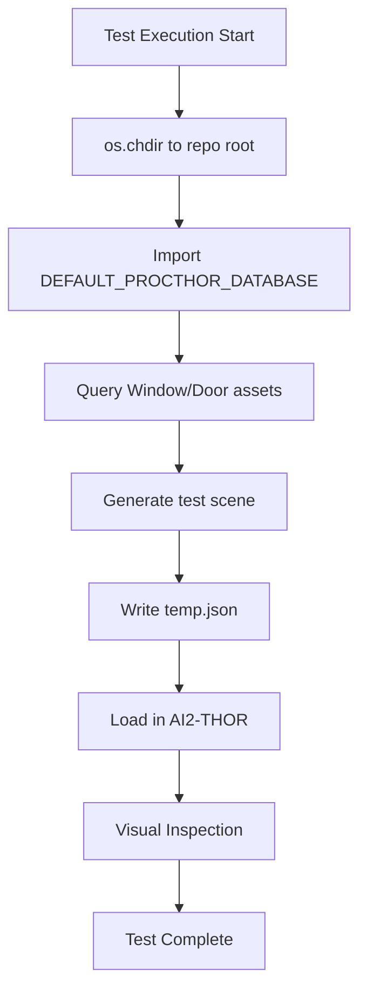
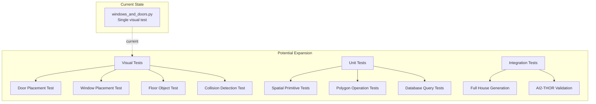
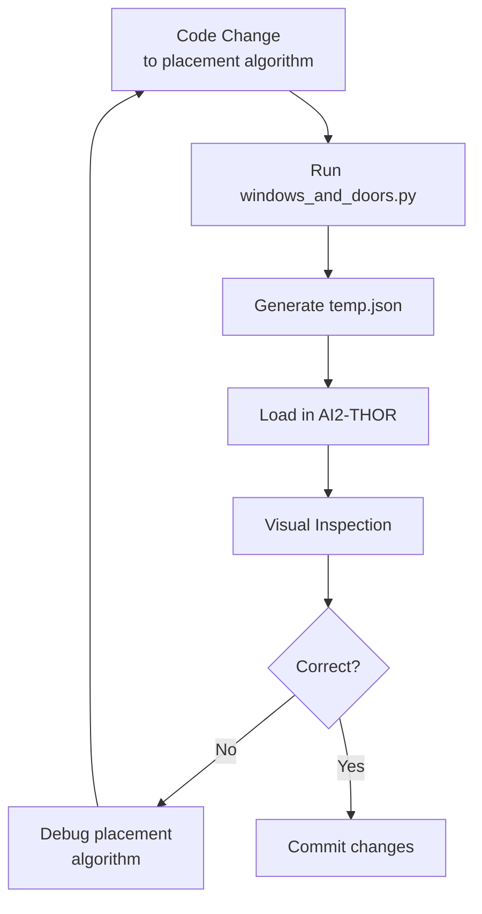

<!-- source: DeepWiki mcp.deepwiki.com · repo allenai/procthor · page 9.3 Testing · fetched 2026-10-26 -->

# Testing

<details>
<summary>Relevant source files</summary>

The following files were used as context for generating this wiki page:

- [procthor/tests/windows_and_doors.py](procthor/tests/windows_and_doors.py)

</details>


## Purpose and Scope

This document describes the testing infrastructure and approach used in ProcTHOR. The testing system focuses primarily on visual validation of generated components, particularly doors and windows, to ensure correct placement and rendering within AI2-THOR. For information about runtime scene validation within AI2-THOR, see [House Validation](#8.1). For information about the core data structures being tested, see [Data Structures](#2.2).

## Testing Philosophy

ProcTHOR employs a specialized testing approach focused on visual validation rather than traditional unit tests. The primary test suite generates synthetic scenes that systematically exercise placement algorithms and visual rendering, allowing developers to manually inspect outputs in AI2-THOR for correctness.

The testing strategy acknowledges that procedural generation correctness is often best validated visually—ensuring that windows appear in walls correctly, doors align properly, and objects don't collide requires human inspection of the rendered scene rather than programmatic assertions.



**Diagram: Visual Testing Workflow**

The testing process creates controlled scenarios where specific components (windows, doors) are placed in systematic configurations, allowing developers to verify that the placement algorithms and asset metadata produce correct visual results.

Sources: [procthor/tests/windows_and_doors.py:1-257]()

## Test Suite Structure

### Windows and Doors Visual Test

The primary test file `windows_and_doors.py` serves as a comprehensive visual test for door and window placement. This test generates a synthetic house containing all available window and door assets from the database, placing each asset in multiple configurations to validate placement correctness.



**Diagram: Test Scene Generation Process**

Sources: [procthor/tests/windows_and_doors.py:1-257]()

### Test Configuration Matrix

The test systematically creates five placement configurations for each window and door asset:

| Configuration | Z-Position | X-Position | Wall Orientation | Purpose |
|--------------|-----------|-----------|-----------------|---------|
| Left Corner | 0 | 0 | Standard | Validates minimum x placement |
| Center | 5 | `(3 - width) / 2` | Standard | Validates centered placement |
| Right Edge | 10 | `3 - width` | Standard | Validates maximum x placement |
| Flipped Left | 15 | `3 - width` | Reversed | Validates polygon reversal with left alignment |
| Flipped Right | 20 | 0 | Reversed | Validates polygon reversal with right alignment |

Each configuration tests different aspects of the placement algorithm:
- **Horizontal positioning**: Left, center, and right placements verify x-coordinate calculations
- **Vertical positioning**: Y-coordinates test asset height and vertical alignment
- **Wall orientation**: Standard vs. reversed polygon winding validates orientation handling
- **Asset metadata**: Bounding boxes and offsets verify database correctness

Sources: [procthor/tests/windows_and_doors.py:68-253]()

## Test Implementation Details

### House Structure Construction

The test constructs a minimal house dictionary containing only the essential components needed for visual validation. This structure follows the serialization format expected by AI2-THOR.



**Diagram: Test House Dictionary Structure**

Sources: [procthor/tests/windows_and_doors.py:13-40]()

### Asset Iteration and Placement

The test retrieves all window and door assets from the database and processes them sequentially:



**Diagram: Asset Query and Iteration Flow**

The loop index `i` serves as a spatial multiplier, spacing assets 4 units apart along the x-axis to prevent visual overlap in the test scene: `x = i * 4`.

Sources: [procthor/tests/windows_and_doors.py:42-49]()

### Wall Polygon Generation

For each asset and configuration, the test creates a corresponding wall polygon. Wall polygons define the 3D surface where windows and doors are placed:

**Standard Orientation Wall** (configurations 1-3):
```
Polygon vertices in counter-clockwise order:
[0] {"x": i * 4,     "y": 0, "z": z}  (bottom-left)
[1] {"x": i * 4 + 3, "y": 0, "z": z}  (bottom-right)
[2] {"x": i * 4 + 3, "y": 3, "z": z}  (top-right)
[3] {"x": i * 4,     "y": 3, "z": z}  (top-left)
```

**Reversed Orientation Wall** (configurations 4-5):
```
Polygon vertices in clockwise order:
[0] {"x": i * 4 + 3, "y": 0, "z": z}  (bottom-right)
[1] {"x": i * 4,     "y": 0, "z": z}  (bottom-left)
[2] {"x": i * 4,     "y": 3, "z": z}  (top-left)
[3] {"x": i * 4 + 3, "y": 3, "z": z}  (top-right)
```

The reversed winding order tests that the placement algorithm correctly handles walls facing the opposite direction.

Sources: [procthor/tests/windows_and_doors.py:53-66](), [procthor/tests/windows_and_doors.py:173-187]()

### Bounding Box Calculation

Each window or door placement requires a bounding box that defines its 3D extent. The test calculates these using asset metadata from the database:

**Component Metadata Sources**:

| Property | Source | Purpose |
|----------|--------|---------|
| `assetId` | `asset["assetId"]` | Unique identifier for the asset |
| `assetOffset` | `WALL_HOLES[assetId]["offset"]` | Offset from wall surface |
| `boundingBox.min` | Calculated from placement position | Minimum corner coordinates |
| `boundingBox.max` | Calculated from placement + `WALL_HOLES` dimensions | Maximum corner coordinates |
| `wall0` | Generated wall ID | Primary wall attachment |
| `wall1` | `None` | Secondary wall (unused for windows/doors) |

**Bounding Box Calculation Example** (Left Corner Placement):
```
min: {"x": 0, "y": 0, "z": 0}
max: {
    "x": WALL_HOLES[assetId]["max"]["x"],
    "y": asset["boundingBox"]["y"],
    "z": 0
}
```

**Bounding Box Calculation Example** (Center Placement):
```
start_x = (3 - asset["boundingBox"]["x"]) / 2
min: {"x": start_x, "y": 0.5, "z": 0}
max: {
    "x": start_x + WALL_HOLES[assetId]["max"]["x"],
    "y": 0.5 + asset["boundingBox"]["y"],
    "z": 0
}
```

The `WALL_HOLES` database provides the x-dimension that determines how wide the opening in the wall should be, while the asset's bounding box provides the y-dimension (height).

Sources: [procthor/tests/windows_and_doors.py:69-91](), [procthor/tests/windows_and_doors.py:110-128]()

### Output Serialization

The test serializes the complete house dictionary to JSON with specific formatting:



**Diagram: JSON Serialization Process**

The sorted keys and indentation ensure the output is human-readable and can be easily compared across test runs using diff tools.

Sources: [procthor/tests/windows_and_doors.py:255-256]()

## Running the Test

### Execution Requirements

The test requires:
1. The working directory to be set to the repository root
2. Access to `DEFAULT_PROCTHOR_DATABASE` for asset metadata
3. Write permissions to create `temp.json` in the current directory

### Execution Process



**Diagram: Test Execution Flow**

The test can be executed directly:
```bash
cd procthor
python procthor/tests/windows_and_doors.py
```

This generates `temp.json` in the repository root, which can then be loaded into AI2-THOR for visual inspection.

Sources: [procthor/tests/windows_and_doors.py:11-12]()

## Test Validation Approach

### Visual Inspection Checklist

When reviewing the generated test scene in AI2-THOR, developers should verify:

| Aspect | Expected Behavior | Failure Indicators |
|--------|------------------|-------------------|
| Window Placement | Windows centered in walls, no clipping | Windows outside wall boundaries, intersecting geometry |
| Door Placement | Doors aligned with wall edges | Doors floating, misaligned with floor |
| Asset Orientation | Assets facing correct direction | Backward or upside-down assets |
| Bounding Box Accuracy | Object extent matches visual appearance | Objects collidable beyond visible mesh |
| Wall Hole Sizing | Opening size matches asset width | Assets too large/small for openings |
| Spacing | 4-unit separation between test groups | Overlapping asset visualizations |
| Polygon Winding | Reversed walls render correctly | Missing or inside-out wall faces |

### Debugging Failed Placements

If visual inspection reveals incorrect placements, developers should:

1. **Check Database Metadata**: Verify `WALL_HOLES` entries for correct offset and dimensions
2. **Review Bounding Box Calculation**: Ensure min/max coordinates use correct database fields
3. **Validate Polygon Winding**: Confirm wall vertices follow expected order
4. **Inspect Asset Metadata**: Check `boundingBox` dimensions in `ASSET_DATABASE`
5. **Test Isolated Configuration**: Modify test to generate only failing configuration

Sources: [procthor/tests/windows_and_doors.py:1-257]()

## Testing Limitations and Future Work

### Current Limitations

The existing test suite has several limitations:

**Limited Scope**: Only windows and doors are tested; floor objects, room layouts, and other generation stages lack dedicated tests.

**Manual Validation**: Requires human inspection in AI2-THOR; no automated pass/fail criteria.

**No CI Integration**: Test does not run automatically in continuous integration pipelines.

**No Regression Detection**: Changes that break visual correctness won't fail automated builds.

**Single Test File**: All testing logic concentrated in one file rather than modular test suite.

### Test Organization



**Diagram: Potential Test Suite Expansion**

Future development could expand the test suite to include:
- Separate visual tests for each generation stage
- Unit tests for spatial primitives and collision detection
- Integration tests that validate full house generation
- Automated validation using AI2-THOR's reachability and simulation capabilities

Sources: [procthor/tests/windows_and_doors.py:1-257]()

## Integration with Development Workflow

### Role in Development Cycle

The test suite serves specific purposes in the development workflow:



**Diagram: Development Testing Cycle**

### Database Update Validation

When updating the ProcTHOR database (see [Database Generation](#5.2)), the test validates that new or modified assets render correctly:

1. **Run** `tasks.py` to regenerate databases with updated AI2-THOR assets
2. **Execute** `windows_and_doors.py` to generate test scene with new assets
3. **Load** `temp.json` into AI2-THOR
4. **Verify** that new/modified windows and doors render and place correctly
5. **Commit** database changes if validation passes

This workflow ensures database updates don't introduce visual artifacts or placement errors.

Sources: [procthor/tests/windows_and_doors.py:9-49]()

---

