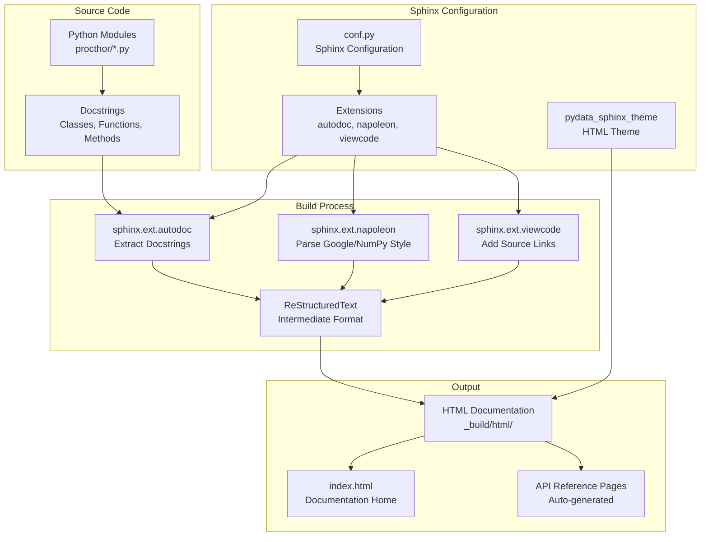
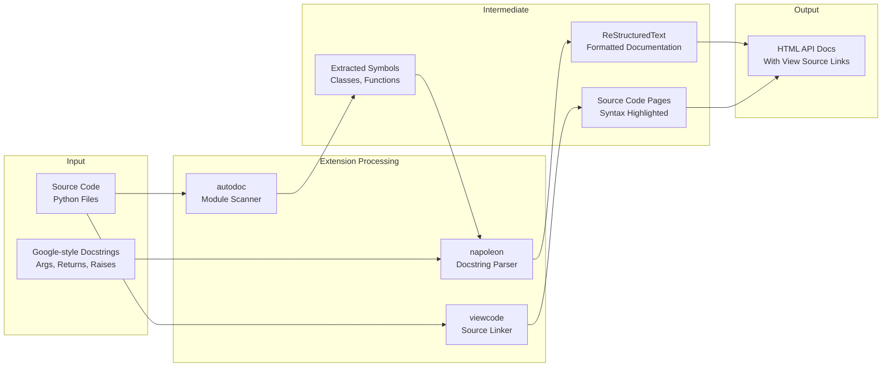
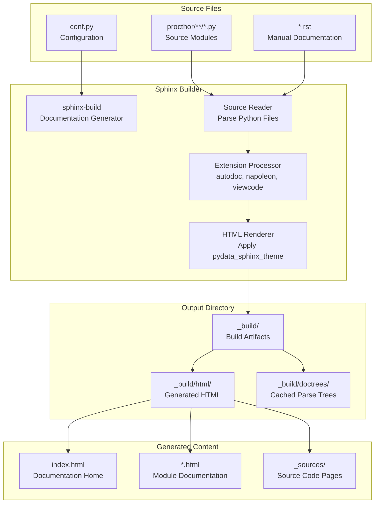
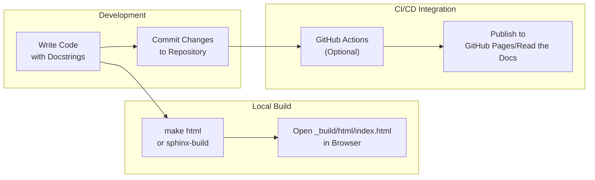

<!-- source: DeepWiki mcp.deepwiki.com · repo allenai/procthor · page 9.4 Documentation System · fetched 2026-10-26 -->

# Documentation System

<details>
<summary>Relevant source files</summary>

The following files were used as context for generating this wiki page:

- [conf.py](conf.py)

</details>


## Purpose and Scope

This page documents the Sphinx-based documentation generation system used to create API reference documentation for the ProcTHOR codebase. The system automatically extracts documentation from Python docstrings and generates HTML documentation.

For information about package structure and data file inclusion, see [Package Structure](#9.1). For CI/CD deployment pipelines, see [CI/CD Pipeline](#9.2).

---

## Configuration Overview

The documentation system is configured through a single Sphinx configuration file that defines project metadata, enabled extensions, and output formats. The configuration uses Sphinx's standard setup to generate HTML documentation from Python source files.

**Project Metadata**

| Property | Value | Description |
|----------|-------|-------------|
| `project` | `"Houses"` | Project display name in documentation |
| `copyright` | `"2022, Allen Institute for AI"` | Copyright statement |
| `author` | `"Allen Institute for AI"` | Author attribution |
| `release` | `"0.0.1"` | Version string displayed in documentation |

The project metadata is defined at [conf.py:21-26]().

**Sources:** [conf.py:19-26]()

---

## Documentation Architecture

The following diagram shows how the Sphinx documentation system integrates with the ProcTHOR codebase:



**Sources:** [conf.py:1-60]()

---

## Sphinx Extensions

The documentation system enables three core Sphinx extensions that provide automated documentation generation capabilities. Each extension serves a specific purpose in the documentation pipeline.

### sphinx.ext.autodoc

Automatically extracts documentation from Python docstrings in the codebase. This extension scans Python modules and generates documentation pages for classes, functions, and methods without manual intervention.

**Key Capabilities:**
- Automatic API reference generation
- Docstring extraction from source code
- Signature and parameter documentation

### sphinx.ext.napoleon

Parses Google-style and NumPy-style docstrings into reStructuredText format. This allows developers to write docstrings in a more readable format than raw reStructuredText.

**Supported Formats:**
- Google-style docstrings (standard Python convention)
- NumPy-style docstrings (scientific Python convention)
- Automatic conversion to reStructuredText

### sphinx.ext.viewcode

Adds "View Source" links to the generated documentation, allowing readers to view the actual implementation code. This extension generates syntax-highlighted source code pages.

**Features:**
- Direct links from documentation to source code
- Syntax highlighting
- Cross-referencing between docs and implementation

The extension configuration is defined at [conf.py:34-38]().

**Sources:** [conf.py:34-38]()

---

## Extension Processing Pipeline

The following diagram illustrates how the three Sphinx extensions process documentation:



**Sources:** [conf.py:34-38]()

---

## HTML Output Configuration

The documentation system generates HTML output using the PyData Sphinx Theme, a modern responsive theme designed for scientific Python projects.

**Theme Configuration:**

```python
html_theme = "pydata_sphinx_theme"
```

The theme is configured at [conf.py:54]().

**Static and Template Files:**

| Directory | Purpose | Configuration |
|-----------|---------|---------------|
| `_templates` | Custom HTML templates | `templates_path = ["_templates"]` |
| `_static` | Custom CSS, JavaScript, images | `html_static_path = ["_static"]` |

These paths allow customization of the generated HTML through template overrides and custom static assets. The paths are defined at [conf.py:41]() and [conf.py:59]().

**Excluded Patterns:**

The build system excludes the following patterns from documentation generation:
- `_build` - Sphinx output directory
- `Thumbs.db` - Windows thumbnail cache
- `.DS_Store` - macOS metadata files

These exclusions are configured at [conf.py:46]().

**Sources:** [conf.py:40-59]()

---

## Build Process Flow

The following diagram shows the complete documentation build process from source code to published HTML:



**Build Command:**

```bash
sphinx-build -b html . _build/html
```

This command:
1. Reads configuration from `conf.py`
2. Scans Python source files for docstrings
3. Processes extensions (autodoc, napoleon, viewcode)
4. Renders HTML using the configured theme
5. Outputs to `_build/html/` directory

**Sources:** [conf.py:1-60]()

---

## File Organization

The documentation system follows Sphinx's standard directory structure:

```
procthor/
├── conf.py                    # Sphinx configuration
├── _templates/                # Custom HTML templates (optional)
├── _static/                   # Custom CSS/JS/images (optional)
├── _build/                    # Generated documentation (excluded from git)
│   ├── html/                  # HTML output
│   └── doctrees/              # Cached parse trees
└── procthor/                  # Source code with docstrings
    ├── __init__.py
    ├── generation.py
    ├── databases/
    └── ...
```

**Directory Purposes:**

| Directory | Purpose | Version Control |
|-----------|---------|-----------------|
| `conf.py` | Configuration file | Committed |
| `_templates/` | Template overrides | Committed (if present) |
| `_static/` | Static assets | Committed (if present) |
| `_build/` | Build output | Excluded (`.gitignore`) |
| `procthor/` | Source code | Committed |

The exclude patterns ensure that build artifacts are not included in source code traversal, as defined at [conf.py:46]().

**Sources:** [conf.py:40-46]()

---

## Configuration Details

### Extension Configuration

The extensions array specifies which Sphinx extensions to load:

```python
extensions = [
    "sphinx.ext.autodoc",
    "sphinx.ext.napoleon",
    "sphinx.ext.viewcode",
]
```

This configuration at [conf.py:34-38]() enables:
- Automatic documentation extraction (`autodoc`)
- Google/NumPy docstring parsing (`napoleon`)
- Source code linking (`viewcode`)

### Path Configuration

The configuration includes commented-out path setup code at [conf.py:13-16]():

```python
# import os
# import sys
# sys.path.insert(0, os.path.abspath('./procthor/'))
```

This path manipulation would be necessary if Sphinx needs to import modules that are not installed in the Python environment. For ProcTHOR, the package is typically installed (via `pip install -e .`), so this path setup is not required.

**Sources:** [conf.py:13-38]()

---

## Integration with Development Workflow

The documentation system integrates with the development workflow at several points:



**Local Development:**
1. Developers write docstrings following Google or NumPy style
2. Run `sphinx-build` or `make html` to generate documentation locally
3. Preview documentation in browser to verify formatting

**Continuous Integration:**
- Documentation can be built automatically in CI/CD pipelines
- Published to hosting services (GitHub Pages, Read the Docs)
- Ensures documentation stays synchronized with code

**Sources:** [conf.py:1-60]()

---

## Theme and Appearance

The PyData Sphinx Theme provides a modern, responsive design optimized for technical documentation:

**Theme Features:**
- Responsive layout for mobile and desktop
- Navigation sidebar with module hierarchy
- Search functionality
- Dark/light mode support (theme-dependent)
- Code syntax highlighting

The theme is configured with a single line at [conf.py:54]():

```python
html_theme = "pydata_sphinx_theme"
```

**Customization Options:**

Custom styling and templates can be added through:
- `_static/custom.css` - Custom CSS rules
- `_templates/` - HTML template overrides
- `html_theme_options` - Theme-specific configuration (not currently used)

The static path configuration at [conf.py:59]() enables these customizations.

**Sources:** [conf.py:54-59]()

---

## Documentation Generation Process

The complete process for generating documentation follows these steps:

1. **Configuration Loading**: Sphinx reads `conf.py` and initializes extensions
2. **Source Discovery**: Scans Python modules in the configured path
3. **Docstring Extraction**: `autodoc` extracts documentation from source code
4. **Format Conversion**: `napoleon` converts Google/NumPy style to reStructuredText
5. **Source Linking**: `viewcode` creates syntax-highlighted source code pages
6. **HTML Generation**: Renders documentation using `pydata_sphinx_theme`
7. **Output**: Writes HTML files to `_build/html/` directory

**Key Configuration Elements:**

| Element | Location | Purpose |
|---------|----------|---------|
| `extensions` | [conf.py:34-38]() | Enable autodoc, napoleon, viewcode |
| `templates_path` | [conf.py:41]() | Custom template directory |
| `exclude_patterns` | [conf.py:46]() | Files to ignore during build |
| `html_theme` | [conf.py:54]() | Documentation theme |
| `html_static_path` | [conf.py:59]() | Static assets directory |

**Sources:** [conf.py:34-59]()

---

