# Page: Overview

# Overview

<details>
<summary>Relevant source files</summary>

The following files were used as context for generating this wiki page:

- [README.md](README.md)

</details>


## Purpose and Scope

This page provides a high-level introduction to ProcTHOR, its architecture, and core design principles. ProcTHOR is a system for procedurally generating interactive, diverse, and semantically plausible 3D house environments for embodied AI research. Generated houses are fully compatible with the AI2-THOR simulation environment.

This overview covers the major system components, their relationships, and how data flows through the generation pipeline. For detailed information about specific subsystems, refer to:
- Generation pipeline mechanics: [Core Generation System](#2)
- Individual generation stages: [Generation Stages](#3)
- Spatial reasoning and collision detection: [Spatial Reasoning Systems](#4)
- Asset and material databases: [Database System](#5)
- Configuration parameters: [Configuration and Constants](#6)
- Practical usage examples: [Usage Guide](#10)

**Sources:** [README.md:1-51]()

---

## What is ProcTHOR?

ProcTHOR is a procedural generation system that creates realistic 3D houses suitable for training and evaluating embodied AI agents. The system generates houses by:

1. **Sampling floor plans** with diverse room layouts and wall configurations
2. **Placing structural elements** including doors, windows, lights, and exterior walls
3. **Furnishing rooms** with semantically appropriate objects (furniture, appliances, decorations)
4. **Randomizing materials and colors** to create visual diversity
5. **Validating scenes** for physical plausibility and AI2-THOR compatibility

Generated houses are represented as structured data (JSON-serializable dictionaries) that AI2-THOR can load and render as interactive 3D environments.

**Sources:** [README.md:5-9]()

---

## System Architecture

The ProcTHOR system consists of six major subsystems that work together to produce complete houses:

| Subsystem | Primary Components | Responsibility |
|-----------|-------------------|----------------|
| **User Interface** | `HouseGenerator`, Python API | Orchestrate generation, expose public API |
| **Generation Pipeline** | `PartialHouse`, `GenerationFunctions`, `NextSamplingStage` | Execute staged generation process |
| **Data Structures** | `House`, `HouseDict`, `HouseStructure` | Represent houses at various stages |
| **Spatial Reasoning** | `OrthogonalPolygon`, collision detection, rectangle sampling | Ensure physically plausible placement |
| **Database** | `ProcTHORDatabase`, `ASSET_DATABASE`, `MATERIAL_DATABASE` | Provide assets, materials, and metadata |
| **Configuration** | Constants in `constants.py` | Control probabilities and parameters |

### High-Level Component Diagram

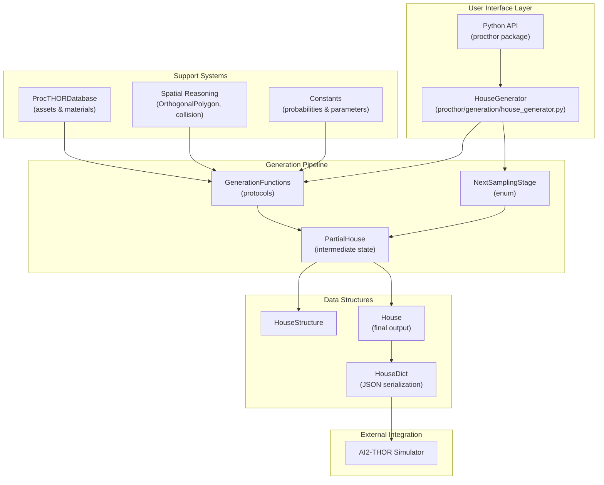

**Sources:** [procthor/generation/house_generator.py](), [procthor/generation/__init__.py](), [procthor/databases/__init__.py]()

---

## Generation Pipeline Overview

The core of ProcTHOR is a **staged generation pipeline** that constructs houses incrementally. The pipeline is controlled by the `NextSamplingStage` enumeration, which defines the sequence of operations:

### Pipeline Stages

```mermaid
graph LR
    START["Input:<br/>RoomSpec + Seed"] --> STRUCT["STRUCTURE<br/>add_structure()"]
    STRUCT --> DOORS["DOORS<br/>add_doors()"]
    DOORS --> LIGHTS["LIGHTING<br/>add_lights()"]
    LIGHTS --> SKY["SKYBOX<br/>add_skybox()"]
    SKY --> EXT["EXTERIOR_WALLS<br/>add_exterior_walls()"]
    EXT --> ROOMS["ROOMS<br/>add_rooms()"]
    ROOMS --> FLOOR["FLOOR_OBJECTS<br/>add_floor_objects()"]
    FLOOR --> WALL["WALL_OBJECTS<br/>add_wall_objects()"]
    WALL --> SMALL["SMALL_OBJECTS<br/>add_small_objects()"]
    SMALL --> LAYER["LAYER_ASSIGNMENT<br/>assign_layers()"]
    LAYER --> COMPLETE["COMPLETE<br/>to_house()"]
    COMPLETE --> OUTPUT["Output:<br/>House object"]
```

Each stage:
- Receives a `PartialHouse` object containing all data from previous stages
- Executes a specific generation function (e.g., `add_doors`, `add_floor_objects`)
- Updates the `PartialHouse` with new components
- Advances to the next stage

The staged architecture enables:
- **Modularity**: Each stage can be customized or replaced
- **Debuggability**: Generation can be paused/inspected at any stage
- **Reproducibility**: Same seed produces identical houses
- **Extensibility**: New stages can be added to the pipeline

**Sources:** [procthor/generation/house_generator.py](), [procthor/generation/objects.py]()

---

## Key Data Structures

ProcTHOR uses several data structures to represent houses at different levels of completeness:

| Structure | Type | Purpose | Mutability |
|-----------|------|---------|------------|
| `RoomSpec` | Input | Specifies desired room types and counts | Immutable |
| `HouseStructure` | Intermediate | Contains floor plan and wall geometry | Immutable |
| `PartialHouse` | Intermediate | Accumulates components during generation | Mutable |
| `HouseDict` | Serialization | JSON-compatible dictionary representation | Immutable |
| `House` | Output | Validated, complete house specification | Immutable |

### Data Flow Through Structures

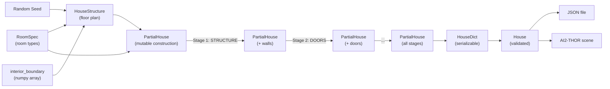

The `PartialHouse` is the central data structure during generation. It maintains:
- All components added so far (walls, doors, windows, objects)
- Available space for placement (via `OrthogonalPolygon` objects)
- Current generation stage
- Random number generator state

**Sources:** [procthor/generation/house_generator.py](), [procthor/databases/asset_database.py]()

---

## Database System

ProcTHOR relies on a comprehensive database system (`ProcTHORDatabase`) that provides:

| Database Component | Content | Usage |
|-------------------|---------|-------|
| `ASSET_DATABASE` | Object metadata from AI2-THOR (size, receptacles, spawn rules) | Asset selection during object placement |
| `MATERIAL_DATABASE` | Material definitions grouped by type (wood, tile, fabric, etc.) | Material randomization for walls, floors, objects |
| Asset Groups | Curated furniture sets (e.g., dining table + chairs) | Cohesive room furnishing |
| Receptacles | Parent-child object relationships | Placing small objects inside/on furniture |
| Wall Holes | Window and door specifications | Exterior wall object placement |
| Placement Annotations | Room-specific spawn rules | Ensuring semantic plausibility |

The database is **data-driven**: all assets and materials come from AI2-THOR's catalog, extracted via the `tasks.py` build script. This ensures compatibility and allows the system to automatically support new AI2-THOR assets.

### Database Generation and Consumption

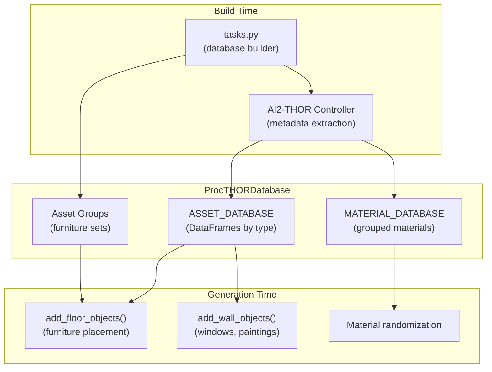

**Sources:** [procthor/databases/__init__.py](), [procthor/databases/asset_database.py](), [tasks.py]()

---

## Spatial Reasoning System

To ensure physically plausible object placement, ProcTHOR implements a sophisticated spatial reasoning system. The core abstractions are:

### Key Spatial Primitives

| Primitive | File/Class | Purpose |
|-----------|------------|---------|
| `OrthogonalPolygon` | `procthor/utils/types.py` | Represents axis-aligned room boundaries and available space |
| `BoundingBox` | `procthor/utils/types.py` | 3D axis-aligned bounding boxes for collision detection |
| `Polygon` (Shapely) | External library | General polygon operations (intersection, subtraction) |
| `Vector3` | `procthor/utils/types.py` | 3D position representation |

### Collision Avoidance Strategy

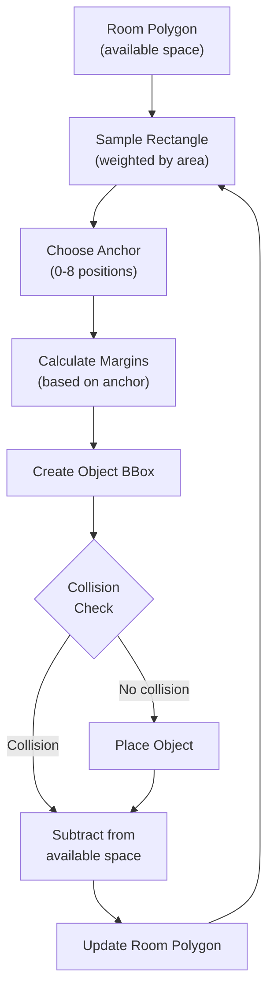

The system uses **polygon subtraction** to dynamically track available space. When an object is placed:
1. Its bounding box (with margins) is converted to a polygon
2. This polygon is subtracted from the room's available space polygon
3. Future placements only consider the remaining space

This approach naturally handles:
- **Collision avoidance**: Objects cannot overlap
- **Spatial constraints**: Furniture near walls leaves appropriate gaps
- **Placement density**: Rooms fill up naturally without explicit density limits

**Sources:** [procthor/utils/types.py](), [procthor/generation/objects.py]()

---

## Configuration and Probability System

ProcTHOR generates diverse scenes through a carefully designed probability system. All tunable parameters are defined in `procthor/constants.py`:

### Categories of Constants

| Category | Examples | Purpose |
|----------|----------|---------|
| **Probability** | `P_CHOOSE_EDGE`, `P_LARGEST_RECTANGLE`, `P_CHOOSE_ASSET_GROUP` | Control stochastic decisions during generation |
| **Spatial** | `MARGIN`, `PADDING_AGAINST_WALL`, `MIN_FLOOR_POSITION` | Define spacing rules and minimum sizes |
| **Scene Structure** | `SCHEMA`, `OUTDOOR_ROOM_ID`, `EMPTY_ROOM_ID` | Define scene metadata and special room IDs |
| **Visual** | `P_ALL_WALLS_SAME`, `P_SAMPLE_SOLID_WALL_COLOR` | Control material and color uniformity |

By adjusting these constants, users can tune the **aesthetic character** of generated houses without modifying the core algorithms. For example:
- Increasing `P_CHOOSE_EDGE` creates more wall-adjacent furniture
- Increasing `P_ALL_WALLS_SAME` creates more uniform color palettes
- Decreasing `P_CHOOSE_ASSET_GROUP` reduces furniture set cohesion

**Sources:** [procthor/constants.py]()

---

## Integration with AI2-THOR

ProcTHOR's primary output is a `House` object that can be loaded into AI2-THOR for simulation:

### Integration Points

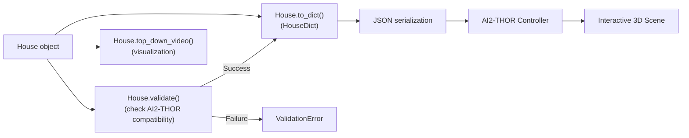

The `House.validate()` method:
- Loads the house into AI2-THOR
- Checks for reachability and physical stability
- Verifies that critical objects are accessible
- Ensures the scene meets quality criteria

This validation step is crucial for ensuring that generated houses are suitable for embodied AI research, where agents must navigate and interact with objects.

**Sources:** [procthor/generation/house_generator.py]()

---

## Entry Points and Usage

Users interact with ProcTHOR through two primary interfaces:

### 1. Python API (Programmatic)

```python
from procthor.generation import HouseGenerator

# Create generator with default configuration
generator = HouseGenerator()

# Generate a house
house = generator.sample()

# Validate and save
house.validate()
house.to_json("output/house.json")
```

### 2. Command-Line Interface

```bash
python scripts/example.py
```

The example script demonstrates:
- Instantiating `HouseGenerator`
- Generating multiple houses with different room specifications
- Saving houses to disk
- Visualizing houses as top-down videos

**Sources:** [README.md:11-22](), [scripts/example.py]()

---

## Design Principles

ProcTHOR's architecture is guided by several key principles:

### 1. **Staged Pipeline**
Generation proceeds through well-defined stages, each building on the previous. This enables modularity, debuggability, and extensibility.

### 2. **Data-Driven Configuration**
Assets, materials, and placement rules come from external databases rather than hard-coded logic. This allows the system to adapt as AI2-THOR evolves.

### 3. **Probability-Driven Diversity**
Stochastic decisions at every stage create infinite variety. Probability constants provide intuitive control over generation characteristics.

### 4. **Spatial Plausibility**
Sophisticated collision detection and spatial reasoning ensure that generated houses are physically plausible and navigable by AI agents.

### 5. **Semantic Consistency**
Room-specific asset filters and placement annotations ensure that objects appear in semantically appropriate locations (e.g., stoves only in kitchens).

### 6. **Reproducibility**
All randomness is controlled by a seed value. The same seed always produces an identical house, enabling reproducible experiments.

These principles work together to create a system that is both **powerful** (capable of generating millions of unique houses) and **controllable** (users can tune generation characteristics without modifying code).

**Sources:** [procthor/generation/house_generator.py](), [procthor/constants.py]()

---

## System Output

The final output of the ProcTHOR system is a `House` object with the following characteristics:

| Property | Description |
|----------|-------------|
| **Completeness** | Contains all structural elements (walls, doors, windows), lighting, and furnished rooms |
| **Validity** | Passes AI2-THOR validation checks (reachability, stability, object accessibility) |
| **Serializability** | Can be converted to JSON and loaded into AI2-THOR |
| **Metadata** | Includes schema version, room specifications, and generation parameters |
| **Visualization** | Can generate top-down video showing room layout and objects |

Houses are typically 50-500KB in JSON format (compressed) and contain 50-300 objects depending on the number and size of rooms.

**Sources:** [procthor/generation/house_generator.py]()

---

## Repository Structure Summary

The ProcTHOR codebase is organized as follows:

| Directory/File | Purpose |
|----------------|---------|
| `procthor/generation/` | Core generation pipeline (`HouseGenerator`, stage functions) |
| `procthor/databases/` | Database system (`ProcTHORDatabase`, asset/material databases) |
| `procthor/utils/` | Utility classes (`OrthogonalPolygon`, collision detection, geometry) |
| `procthor/constants.py` | Configuration constants (probabilities, spatial parameters) |
| `procthor/upgrade/` | Schema versioning system (`HouseUpgradeManager`) |
| `tasks.py` | Database generation script |
| `scripts/example.py` | Example usage demonstrating house generation |
| `.github/workflows/` | CI/CD pipeline for automated PyPI releases |

**Sources:** [README.md](), [procthor/]()

---

## Next Steps

To dive deeper into specific subsystems:

- **Understand the generation pipeline**: See [Core Generation System](#2) for details on `HouseGenerator` orchestration and stage progression
- **Learn about individual stages**: See [Generation Stages](#3) for detailed documentation of each generation function
- **Explore spatial reasoning**: See [Spatial Reasoning Systems](#4) for collision detection and placement algorithms
- **Understand the database**: See [Database System](#5) for asset and material database architecture
- **Customize generation**: See [Configuration and Constants](#6) for tunable parameters
- **Use ProcTHOR**: See [Usage Guide](#10) for practical examples and API reference

**Sources:** [README.md](), [procthor/generation/__init__.py]()

---

# Page: Core Generation System

# Core Generation System

<details>
<summary>Relevant source files</summary>

The following files were used as context for generating this wiki page:

- [procthor/generation/__init__.py](procthor/generation/__init__.py)
- [procthor/generation/house.py](procthor/generation/house.py)

</details>


## Purpose and Scope

The Core Generation System is the central orchestration mechanism of ProcTHOR, responsible for coordinating the procedural generation of 3D house environments. This document describes the `HouseGenerator` class, the `GenerationFunctions` protocol system, and the staged pipeline architecture that transforms input specifications into complete, validated house structures.

For details on individual generation stages (structure, doors, objects, etc.), see [Generation Stages](#3). For information about the data structures used throughout generation (`House`, `PartialHouse`, `HouseStructure`), see [Data Structures](#2.2). For details on how stages progress and state accumulates, see [Stage Progression and State Management](#2.3).

## System Overview

The core generation system implements a **pipeline architecture** where house generation proceeds through a fixed sequence of stages. Each stage adds specific components (walls, doors, objects, etc.) to an intermediate `PartialHouse` representation, which is ultimately converted to an immutable `House` object.

### Key Components

| Component | Type | Purpose |
|-----------|------|---------|
| `HouseGenerator` | Class | Orchestrates the entire generation pipeline and manages state |
| `GenerationFunctions` | Data class | Collection of protocol-conforming functions for each stage |
| `PartialHouse` | Class | Mutable intermediate representation that accumulates components |
| `NextSamplingStage` | Enum | Controls progression through the 9 generation stages |
| `House` | Class | Final immutable output containing complete house specification |
| `HouseStructure` | Class | Geometric foundation (floorplan, walls, boundaries) |

Sources: [procthor/generation/__init__.py:52-95](), [procthor/generation/house.py:40-47](), [procthor/generation/house.py:50-56](), [procthor/generation/house.py:211-228](), [procthor/generation/house.py:230-244]()

## Core Architecture

The following diagram illustrates the relationships between the main components of the core generation system:

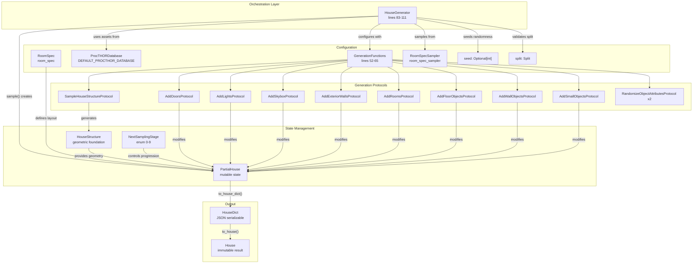

**Figure 1: Core Generation System Architecture** - The `HouseGenerator` orchestrates generation by invoking protocol functions from `GenerationFunctions`, which progressively build up a `PartialHouse` through defined stages controlled by `NextSamplingStage`.

Sources: [procthor/generation/__init__.py:83-111](), [procthor/generation/__init__.py:52-80](), [procthor/generation/house.py:230-293]()

## HouseGenerator Class

The `HouseGenerator` class is the primary entry point for procedural house generation. It maintains configuration state, manages randomness, and coordinates the execution of all generation stages through its `sample()` method.

### Class Definition

```python
@define
class HouseGenerator:
    split: Split = field()
    seed: Optional[int] = None
    room_spec: Optional[Union[RoomSpec, str]] = None
    room_spec_sampler: Optional[RoomSpecSampler] = None
    interior_boundary: Optional[np.array] = None
    controller: Optional[Controller] = None
    partial_house: Optional[PartialHouse] = None
    pt_db: ProcTHORDatabase = DEFAULT_PROCTHOR_DATABASE
    generation_functions: GenerationFunctions = Factory(_create_default_generation_functions)
```

### Key Attributes

| Attribute | Type | Purpose |
|-----------|------|---------|
| `split` | `Split` | Train/val/test split designation (validated to be one of these three values) |
| `seed` | `Optional[int]` | Random seed for reproducibility (auto-generated if None) |
| `room_spec` | `Optional[Union[RoomSpec, str]]` | Specific room configuration or identifier |
| `room_spec_sampler` | `Optional[RoomSpecSampler]` | Sampler for generating room specifications |
| `controller` | `Optional[Controller]` | AI2-THOR controller instance (lazily initialized) |
| `pt_db` | `ProcTHORDatabase` | Asset and material database |
| `generation_functions` | `GenerationFunctions` | Customizable stage implementations |
| `partial_house` | `Optional[PartialHouse]` | Can be provided to resume from a specific stage |

### Initialization Behavior

The `__attrs_post_init__()` method performs automatic configuration:

1. **Seed Management** [lines 103-107](): If no seed is provided, generates a random seed in range [0, 2^15]
2. **Room Spec Sampler** [lines 108-109](): Defaults to `PROCTHOR10K_ROOM_SPEC_SAMPLER` if not provided
3. **String Resolution** [lines 110-111](): If `room_spec` is a string, looks it up in the sampler

Sources: [procthor/generation/__init__.py:83-111]()

## GenerationFunctions Class

The `GenerationFunctions` class is a data container that holds references to all stage implementation functions. This design enables customization—users can replace individual stage functions while keeping the rest of the pipeline intact.

### Structure

```python
@define
class GenerationFunctions:
    sample_house_structure: SampleHouseStructureProtocol
    add_doors: AddDoorsProtocol
    add_lights: AddLightsProtocol
    add_skybox: AddSkyboxProtocol
    add_exterior_walls: AddExteriorWallsProtocol
    add_rooms: AddRoomsProtocol
    add_floor_objects: AddFloorObjectsProtocol
    add_wall_objects: AddWallObjectsProtocol
    add_small_objects: AddSmallObjectsProtocol
    randomize_object_colors: RandomizeObjectAttributesProtocol
    randomize_object_states: RandomizeObjectAttributesProtocol
```

### Protocol-Based Design

Each field is typed with a protocol (defined in `procthor/generation/protocols.py`) that specifies the expected function signature. This provides:

- **Type Safety**: Static type checkers can verify that custom implementations match expected signatures
- **Modularity**: Individual stages can be replaced without modifying the orchestration logic
- **Testability**: Stages can be tested in isolation with mock implementations

### Default Implementation Factory

The `_create_default_generation_functions()` helper [lines 67-80]() instantiates a `GenerationFunctions` object with all default implementations:

| Field | Default Implementation |
|-------|------------------------|
| `sample_house_structure` | `default_sample_house_structure` |
| `add_doors` | `default_add_doors` |
| `add_lights` | `default_add_lights` |
| `add_skybox` | `default_add_skybox` |
| `add_exterior_walls` | `default_add_exterior_walls` |
| `add_rooms` | `default_add_rooms` |
| `add_floor_objects` | `default_add_floor_objects` |
| `add_wall_objects` | `default_add_wall_objects` |
| `add_small_objects` | `default_add_small_objects` |
| `randomize_object_colors` | `default_randomize_object_colors` |
| `randomize_object_states` | `default_randomize_object_states` |

Sources: [procthor/generation/__init__.py:52-80]()

## The Generation Pipeline

The `sample()` method [lines 121-304]() implements the complete generation pipeline as a sequential state machine. It can either start from scratch or resume from a provided `PartialHouse` at any stage.

### Method Signature

```python
def sample(
    self,
    partial_house: Optional[PartialHouse] = None,
    return_partial_houses: bool = False,
    sampling_vars: Optional[SamplingVars] = None,
    next_sampling_stage: Optional[NextSamplingStage] = NextSamplingStage.STRUCTURE,
) -> Tuple[House, Dict[NextSamplingStage, PartialHouse]]
```

### Parameters

| Parameter | Type | Purpose |
|-----------|------|---------|
| `partial_house` | `Optional[PartialHouse]` | Resume from this intermediate state (if None, starts from scratch) |
| `return_partial_houses` | `bool` | Whether to return snapshots of `PartialHouse` at each stage |
| `sampling_vars` | `Optional[SamplingVars]` | Control parameters (e.g., `max_floor_objects`) |
| `next_sampling_stage` | `Optional[NextSamplingStage]` | Starting stage (only used when `partial_house` is None) |

### Return Values

Returns a tuple containing:
1. **`House`**: The final, complete house specification
2. **`Dict[NextSamplingStage, PartialHouse]`**: Dictionary mapping stages to their `PartialHouse` snapshots (useful for debugging or resumption)

### Pipeline Stages

The following diagram shows the sequential progression through all stages:

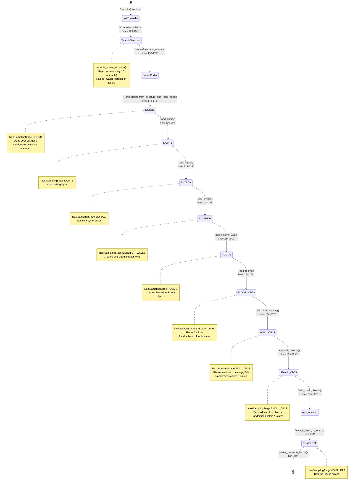

**Figure 2: Generation Pipeline State Machine** - Shows the sequential flow through all 9 stages, with `NextSamplingStage` controlling progression and `advance_and_record_partial()` context manager handling state transitions.

Sources: [procthor/generation/__init__.py:121-304]()

## Stage Execution Pattern

Each stage follows a consistent execution pattern using a context manager:

```python
@contextmanager
def advance_and_record_partial(partial_house: PartialHouse):
    try:
        yield None
    finally:
        partial_house.advance_sampling_stage()
        if return_partial_houses:
            sampling_stage_to_ph[partial_house.next_sampling_stage] = copy.deepcopy(partial_house)
```

This pattern [lines 187-196]() ensures:
1. **Automatic Stage Advancement**: `advance_sampling_stage()` is always called, even if the stage function raises an exception
2. **Optional Snapshotting**: If `return_partial_houses=True`, a deep copy is saved at each stage
3. **Consistent State Management**: The `next_sampling_stage` field always reflects the current position in the pipeline

### Example Stage Execution

```python
if partial_house.next_sampling_stage <= NextSamplingStage.DOORS:
    with advance_and_record_partial(partial_house):
        door_polygons = gfs.add_doors(
            partial_house=partial_house,
            controller=self.controller,
            pt_db=self.pt_db,
            split=self.split,
        )
        randomize_wall_and_floor_materials(partial_house, pt_db=self.pt_db)
```

The conditional check allows resumption—if the `PartialHouse` has already progressed past this stage, it is skipped.

Sources: [procthor/generation/__init__.py:187-207]()

## Controller Management

The `HouseGenerator` lazily initializes an AI2-THOR `Controller` [lines 129-135]():

```python
if self.controller is None:
    # NOTE: assumes images are never used by this Controller.
    self.controller = Controller(quality="Low", **PROCTHOR_INITIALIZATION)
    if self.seed is not None:
        self.controller.step(
            action="SetRandomSeed", seed=self.seed, renderImage=False
        )
```

**Key Points**:
- **Lazy Initialization**: Controller is only created when `sample()` is first called
- **Low Quality**: Uses `quality="Low"` since the controller is only used for metadata, not rendering
- **Seed Synchronization**: Sets the controller's random seed to match the generator's seed
- **No Rendering**: All `step()` calls use `renderImage=False` for performance

The controller is reused across multiple `sample()` calls on the same `HouseGenerator` instance.

Sources: [procthor/generation/__init__.py:129-135]()

## Rejection Sampling for Structure Generation

House structure generation uses **rejection sampling** to handle invalid floorplans [lines 156-172]():

```python
room_ids = set(room_spec.room_type_map.keys())
for _ in range(10):
    try:
        house_structure = gfs.sample_house_structure(
            interior_boundary=interior_boundary,
            room_ids=room_ids,
            room_spec=room_spec,
            interior_boundary_scale=sampling_vars.interior_boundary_scale,
        )
        break
    except InvalidFloorplan:
        pass
else:
    raise Exception(
        f"Failed to generate interior boundary and floorplan"
        "for room_spec={room_spec}!"
    )
```

The system attempts structure generation up to 10 times before giving up. This accounts for:
- Invalid room configurations
- Geometric constraints that cannot be satisfied
- Randomness in the sampling process

Sources: [procthor/generation/__init__.py:156-172]()

## Seed Management

The `set_seed()` method [lines 113-119]() provides centralized seed control:

```python
def set_seed(self, seed: int) -> None:
    # TODO: Probably should not be done on a global level
    self.seed = seed
    random.seed(seed)
    np.random.seed(seed)
    if self.controller is not None:
        self.controller.step(action="SetRandomSeed", seed=seed, renderImage=False)
```

**Important**: This sets **global** random state for both Python's `random` module and NumPy. The TODO comment indicates this is recognized as a design limitation—ideally, each `HouseGenerator` would maintain isolated random state.

Sources: [procthor/generation/__init__.py:113-119]()

## Object Randomization

Object color and state randomization occurs in three batches [lines 265-298]():

1. **Floor Objects** [lines 265-267](): After `add_floor_objects()` completes
2. **Wall Objects** [lines 281-283](): After `add_wall_objects()` completes  
3. **Small Objects** [lines 297-298](): After `add_small_objects()` completes

This batched approach ensures that only newly added objects are randomized, preserving the state of previously placed objects.

Sources: [procthor/generation/__init__.py:265-298]()

## NextSamplingStage Enum

The `NextSamplingStage` enum [lines 211-228]() defines the 10 possible states of the generation pipeline:

```python
@total_ordering
class NextSamplingStage(enum.Enum):
    STRUCTURE = 0
    DOORS = 1
    LIGHTS = 2
    SKYBOX = 3
    EXTERIOR_WALLS = 4
    ROOMS = 5
    FLOOR_OBJS = 6
    WALL_OBJS = 7
    SMALL_OBJS = 8
    COMPLETE = 9
```

### Design Features

- **Total Ordering**: The `@total_ordering` decorator enables comparison operations (`<`, `<=`, `>`, `>=`)
- **Sequential Values**: Values 0-9 provide a natural ordering
- **Explicit Stages**: Each stage has a descriptive name matching its generation function

### Usage in Stage Control

Stages are checked using comparison operators:

```python
if partial_house.next_sampling_stage <= NextSamplingStage.DOORS:
    # Execute door stage
```

This allows for flexible resumption—stages that have already been completed are skipped.

Sources: [procthor/generation/house.py:211-228]()

## Integration Points

The following diagram shows how the core generation system integrates with other ProcTHOR subsystems:

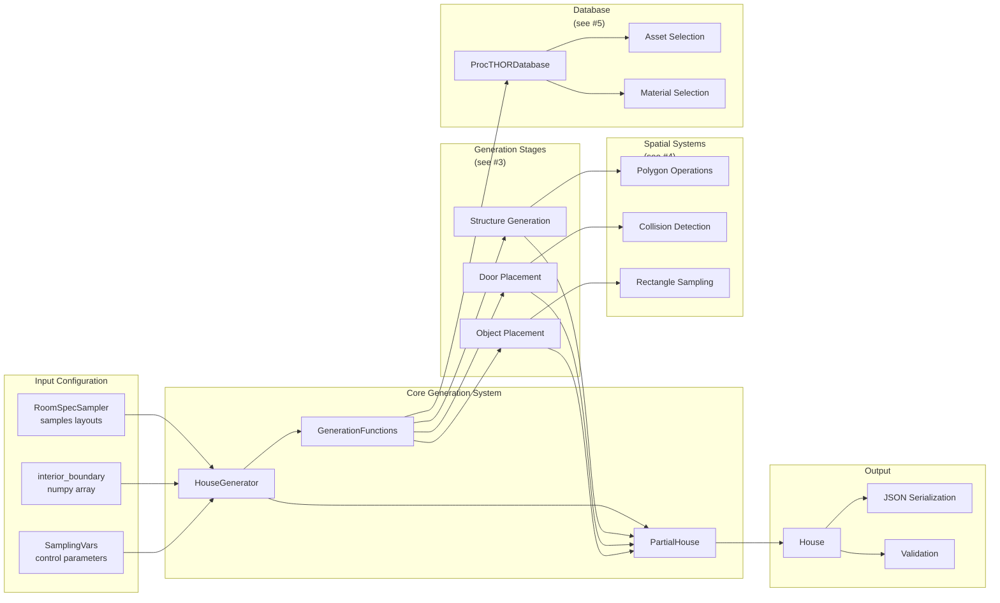

**Figure 3: Core System Integration** - The `HouseGenerator` serves as the central integration point, coordinating between input configuration, generation stages, spatial systems, and the asset database to produce validated `House` outputs.

Sources: [procthor/generation/__init__.py:83-304]()

## Summary

The Core Generation System provides:

1. **Orchestration**: `HouseGenerator` manages the complete generation lifecycle
2. **Modularity**: `GenerationFunctions` enables stage-level customization via protocols
3. **State Management**: `PartialHouse` accumulates components through defined stages
4. **Resumability**: `NextSamplingStage` controls progression and enables resumption from any point
5. **Reproducibility**: Comprehensive seed management ensures deterministic generation

The system's design separates concerns cleanly—orchestration logic is isolated in `HouseGenerator`, stage implementations follow protocol contracts, and state accumulation is managed by `PartialHouse`. This architecture enables both flexibility (custom stage implementations) and reliability (consistent progression through well-defined stages).

---

# Page: Generation Pipeline Architecture

# Generation Pipeline Architecture

<details>
<summary>Relevant source files</summary>

The following files were used as context for generating this wiki page:

- [procthor/generation/__init__.py](procthor/generation/__init__.py)

</details>


## Purpose and Scope

This document describes the core orchestration system that coordinates procedural house generation in ProcTHOR. It covers the `HouseGenerator` class, the `GenerationFunctions` protocol system, and the `NextSamplingStage` enum that drives sequential pipeline progression. This page focuses on the architectural framework and control flow; for details on the intermediate data structures that flow through the pipeline, see [Data Structures](#2.2). For information on specific generation algorithms at each stage, see [Generation Stages](#3).

---

## Architecture Overview

The generation pipeline is implemented as a staged orchestration system where a central `HouseGenerator` class coordinates the execution of discrete generation functions. The system progresses through nine well-defined stages, each building upon the previous stage's output. The pipeline operates on a `PartialHouse` object that accumulates components as it advances through stages, ultimately converting to an immutable `House` object.

### Core Components Relationship

```mermaid
graph TB
    HG["HouseGenerator"]
    GF["GenerationFunctions"]
    PH["PartialHouse"]
    NSS["NextSamplingStage"]
    
    subgraph "Protocols"
        SHSP["SampleHouseStructureProtocol"]
        ADP["AddDoorsProtocol"]
        ALP["AddLightsProtocol"]
        ASP["AddSkyboxProtocol"]
        AEWP["AddExteriorWallsProtocol"]
        ARP["AddRoomsProtocol"]
        AFOP["AddFloorObjectsProtocol"]
        AWOP["AddWallObjectsProtocol"]
        ASOP["AddSmallObjectsProtocol"]
        ROAP["RandomizeObjectAttributesProtocol"]
    end
    
    subgraph "Default Implementations"
        DSH["default_sample_house_structure"]
        DAD["default_add_doors"]
        DAL["default_add_lights"]
        DAS["default_add_skybox"]
        DAEW["default_add_exterior_walls"]
        DAR["default_add_rooms"]
        DAFO["default_add_floor_objects"]
        DAWO["default_add_wall_objects"]
        DASO["default_add_small_objects"]
        DROC["default_randomize_object_colors"]
        DROS["default_randomize_object_states"]
    end
    
    HG -->|"orchestrates"| GF
    HG -->|"mutates"| PH
    HG -->|"checks"| NSS
    
    GF -->|"sample_house_structure"| SHSP
    GF -->|"add_doors"| ADP
    GF -->|"add_lights"| ALP
    GF -->|"add_skybox"| ASP
    GF -->|"add_exterior_walls"| AEWP
    GF -->|"add_rooms"| ARP
    GF -->|"add_floor_objects"| AFOP
    GF -->|"add_wall_objects"| AWOP
    GF -->|"add_small_objects"| ASOP
    GF -->|"randomize_object_colors"| ROAP
    GF -->|"randomize_object_states"| ROAP
    
    SHSP -.default.-> DSH
    ADP -.default.-> DAD
    ALP -.default.-> DAL
    ASP -.default.-> DAS
    AEWP -.default.-> DAEW
    ARP -.default.-> DAR
    AFOP -.default.-> DAFO
    AWOP -.default.-> DAWO
    ASOP -.default.-> DASO
    ROAP -.default.-> DROC
    ROAP -.default.-> DROS
    
    PH -->|"tracks"| NSS
```

**Sources:** [procthor/generation/__init__.py:52-80](), [procthor/generation/__init__.py:84-95]()

---

## HouseGenerator Class

The `HouseGenerator` class serves as the main entry point for procedural house generation. It maintains generation state and orchestrates the execution of all generation stages through its `sample()` method.

### Class Attributes

| Attribute | Type | Purpose |
|-----------|------|---------|
| `split` | `Split` | Dataset split ("train", "val", or "test") for asset sampling |
| `seed` | `Optional[int]` | Random seed for reproducible generation |
| `room_spec` | `Optional[Union[RoomSpec, str]]` | Room type specification or identifier |
| `room_spec_sampler` | `Optional[RoomSpecSampler]` | Sampler for generating room specifications |
| `interior_boundary` | `Optional[np.array]` | Pre-defined interior boundary polygon |
| `controller` | `Optional[Controller]` | AI2-THOR controller for validation |
| `partial_house` | `Optional[PartialHouse]` | Resume generation from existing state |
| `pt_db` | `ProcTHORDatabase` | Asset and material database |
| `generation_functions` | `GenerationFunctions` | Customizable generation function implementations |

### Initialization and Seed Management

The `HouseGenerator` initializes with automatic seed generation if none is provided, and sets global random state for reproducibility:

```
__attrs_post_init__() → Initialize seed, room_spec_sampler
    ├─ Generate random seed if None (0 to 2^15)
    ├─ Call set_seed() to set global random state
    ├─ Initialize room_spec_sampler if None (uses PROCTHOR10K_ROOM_SPEC_SAMPLER)
    └─ Convert string room_spec to RoomSpec object if needed
```

The `set_seed()` method [procthor/generation/__init__.py:113-119]() sets random seeds globally:
- Python `random.seed()`
- NumPy `np.random.seed()`
- AI2-THOR controller's internal RNG (if controller exists)

**Sources:** [procthor/generation/__init__.py:84-119]()

---

## GenerationFunctions and Protocol System

The `GenerationFunctions` class is a simple dataclass that aggregates all generation function implementations. Each function is typed with a corresponding protocol that defines its expected signature and behavior.

### Protocol Definitions

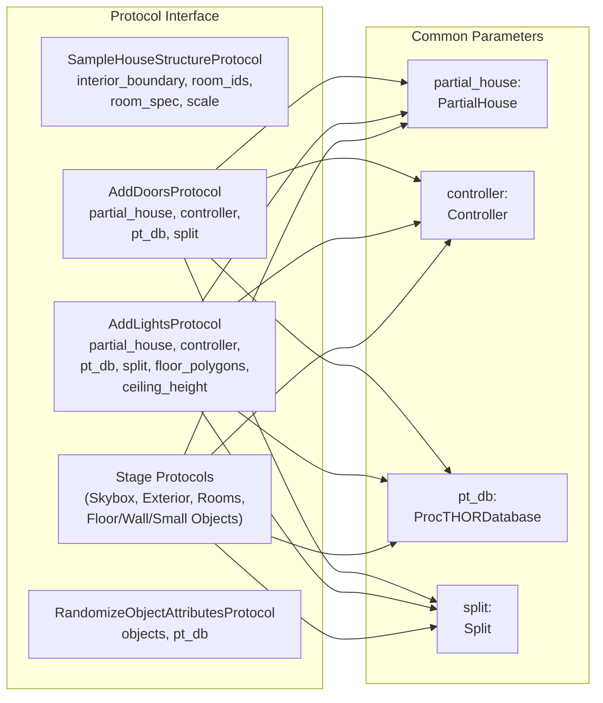

### Protocol Categories

The protocols are organized into three categories:

1. **Structure Protocol**: `SampleHouseStructureProtocol` generates the base house structure including floor plan, walls, and geometric primitives.

2. **Component Addition Protocols**: Each stage has a dedicated protocol:
   - `AddDoorsProtocol` - Door placement between rooms
   - `AddLightsProtocol` - Ceiling light placement
   - `AddSkyboxProtocol` - Skybox selection
   - `AddExteriorWallsProtocol` - Exterior wall generation
   - `AddRoomsProtocol` - Room initialization for object placement
   - `AddFloorObjectsProtocol` - Large furniture placement
   - `AddWallObjectsProtocol` - Windows, paintings, wall-mounted items
   - `AddSmallObjectsProtocol` - Small decorative objects

3. **Randomization Protocols**: `RandomizeObjectAttributesProtocol` is reused for both:
   - `randomize_object_colors` - Color randomization for specific object types
   - `randomize_object_states` - Open/closed state randomization

### Default Implementation Factory

The `_create_default_generation_functions()` factory [procthor/generation/__init__.py:67-80]() creates a `GenerationFunctions` instance with default implementations for all protocols. Users can override individual functions by creating a custom `GenerationFunctions` instance.

**Sources:** [procthor/generation/__init__.py:34-49](), [procthor/generation/__init__.py:52-80]()

---

## NextSamplingStage Progression

The `NextSamplingStage` enum defines the sequential stages of the generation pipeline. The `PartialHouse` object tracks which stage should execute next via its `next_sampling_stage` attribute.

### Stage Enumeration

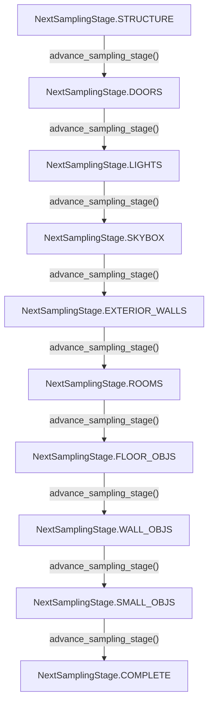

### Stage Ordering Rationale

The stages are strictly ordered to ensure dependencies are satisfied:

| Stage | Dependencies | Output |
|-------|-------------|--------|
| STRUCTURE | None | Floor plan, walls, XZ polygon map |
| DOORS | Walls, room boundaries | Door placements, room connections |
| LIGHTS | Room polygons, ceiling height | Ceiling lights |
| SKYBOX | None | Skybox asset selection |
| EXTERIOR_WALLS | Interior walls, materials | One-sided exterior walls |
| ROOMS | Floor polygons, doors | Initialized ProceduralRoom objects |
| FLOOR_OBJS | Rooms, available floor space | Large furniture and objects |
| WALL_OBJS | Exterior walls, room boundaries | Windows, paintings, wall-mounted TVs |
| SMALL_OBJS | Rooms, receptacles | Small decorative objects |
| COMPLETE | All previous stages | Ready for conversion to House |

**Sources:** [procthor/generation/house.py]() (NextSamplingStage enum)

---

## Pipeline Execution Flow

The `HouseGenerator.sample()` method [procthor/generation/__init__.py:121-304]() implements the complete pipeline execution logic. It supports both fresh generation and resumption from an existing `PartialHouse`.

### Sample Method Signature

```python
def sample(
    self,
    partial_house: Optional[PartialHouse] = None,
    return_partial_houses: bool = False,
    sampling_vars: Optional[SamplingVars] = None,
    next_sampling_stage: Optional[NextSamplingStage] = NextSamplingStage.STRUCTURE,
) -> Tuple[House, Dict[NextSamplingStage, PartialHouse]]
```

### Execution Sequence Diagram

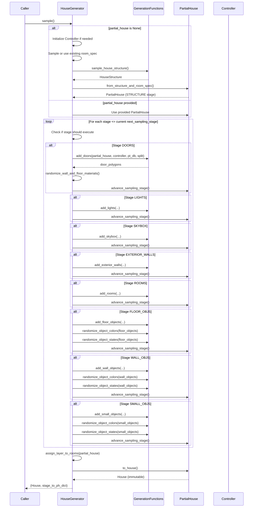

### Structure Generation with Rejection Sampling

The initial structure generation [procthor/generation/__init__.py:156-172]() uses rejection sampling to handle invalid floor plans:

```
for retry in range(10):
    try:
        house_structure = sample_house_structure(
            interior_boundary, room_ids, room_spec, scale
        )
        break
    except InvalidFloorplan:
        continue
else:
    raise Exception("Failed to generate valid floorplan")
```

This ensures that the pipeline only proceeds with geometrically valid floor plans.

**Sources:** [procthor/generation/__init__.py:121-304]()

---

## Stage Advancement Context Manager

The `advance_and_record_partial()` context manager [procthor/generation/__init__.py:188-196]() encapsulates the pattern of executing a stage and then advancing to the next stage. It ensures that stage advancement always occurs, even if an exception is raised during generation.

### Context Manager Pattern

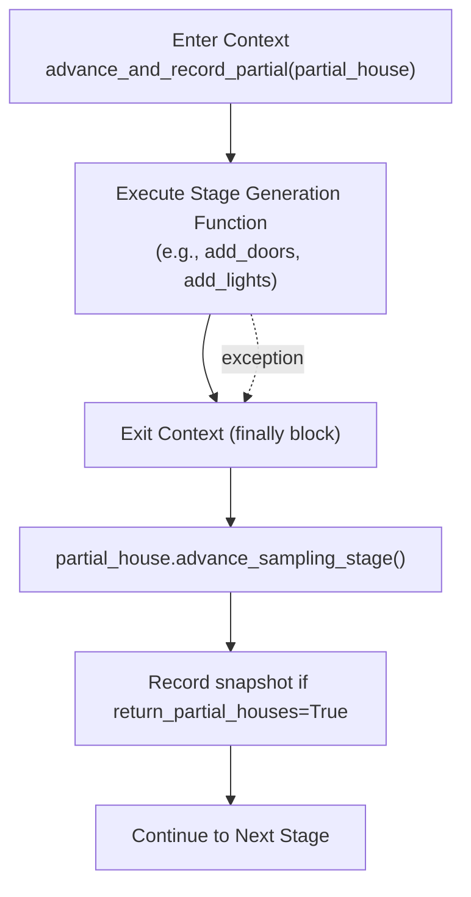

### Implementation Details

```python
@contextmanager
def advance_and_record_partial(partial_house: PartialHouse):
    try:
        yield None
    finally:
        partial_house.advance_sampling_stage()
        if return_partial_houses:
            sampling_stage_to_ph[partial_house.next_sampling_stage] = copy.deepcopy(partial_house)
```

This pattern is used consistently for all stages:

```python
with advance_and_record_partial(partial_house):
    gfs.add_doors(...)
    randomize_wall_and_floor_materials(...)
```

The `finally` block ensures that:
1. Stage advancement always occurs
2. A deep copy is captured if intermediate snapshots are requested
3. The `partial_house.next_sampling_stage` is updated for the next iteration

**Sources:** [procthor/generation/__init__.py:188-196](), [procthor/generation/__init__.py:199-298]()

---

## Stage Conditional Execution

Each stage checks whether it should execute based on the `PartialHouse.next_sampling_stage` value. This enables resumption from any stage by providing a `PartialHouse` with the appropriate `next_sampling_stage` set.

### Conditional Execution Logic

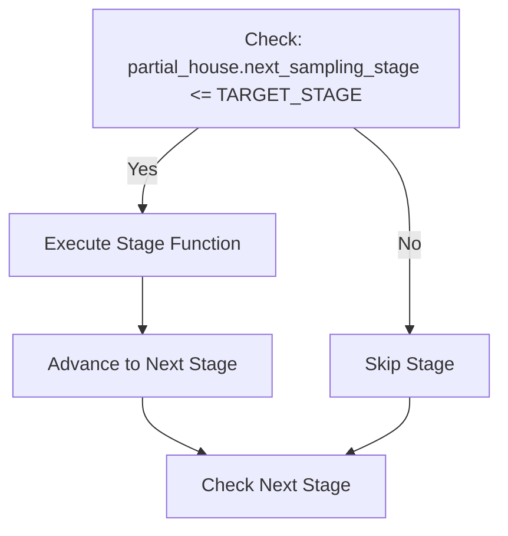

### Example: Door Stage Execution

```python
if partial_house.next_sampling_stage <= NextSamplingStage.DOORS:
    with advance_and_record_partial(partial_house):
        door_polygons = gfs.add_doors(
            partial_house=partial_house,
            controller=self.controller,
            pt_db=self.pt_db,
            split=self.split,
        )
        randomize_wall_and_floor_materials(partial_house, pt_db=self.pt_db)
```

This pattern means:
- If `next_sampling_stage == STRUCTURE`, door stage executes (STRUCTURE < DOORS)
- If `next_sampling_stage == DOORS`, door stage executes (DOORS <= DOORS)
- If `next_sampling_stage == LIGHTS`, door stage skips (LIGHTS > DOORS)

### Stage Ordering Assertion

For resumed generation, the code asserts [procthor/generation/__init__.py:180]():
```python
assert partial_house.next_sampling_stage.value > NextSamplingStage.STRUCTURE
```

This prevents attempting to regenerate the structure when resuming from a partial house.

**Sources:** [procthor/generation/__init__.py:199-298]()

---

## Material and Object Randomization Integration

Material and object randomization occur at specific points in the pipeline:

### Material Randomization

Wall and floor materials are randomized immediately after door placement [procthor/generation/__init__.py:207]():
```python
randomize_wall_and_floor_materials(partial_house, pt_db=self.pt_db)
```

This occurs in the DOORS stage because:
1. Walls must exist (from STRUCTURE stage)
2. Doors define room boundaries that affect material assignment
3. Materials must be set before EXTERIOR_WALLS stage (which references them)

### Object Attribute Randomization

Object colors and states are randomized immediately after objects are added, grouped by object category:

| Object Category | Randomization Point | Object Set |
|----------------|---------------------|------------|
| Floor Objects | After FLOOR_OBJS stage | `partial_house.objects[:]` (all objects so far) |
| Wall Objects | After WALL_OBJS stage | `partial_house.objects[len(floor_objects):]` (only wall objects) |
| Small Objects | After SMALL_OBJS stage | `partial_house.objects[len(floor_objects) + len(wall_objects):]` (only small objects) |

This incremental approach ensures that:
- Each object type is randomized exactly once
- Randomization occurs immediately after placement
- Object indices remain consistent throughout pipeline

**Sources:** [procthor/generation/__init__.py:207](), [procthor/generation/__init__.py:266-267](), [procthor/generation/__init__.py:282-283](), [procthor/generation/__init__.py:297-298]()

---

## Layer Assignment Post-Processing

After all generation stages complete, the `assign_layer_to_rooms()` function [procthor/generation/__init__.py:300]() performs a final post-processing step to assign collision layers to rooms. This is a separate step from the staged pipeline and executes unconditionally after all stages complete.

**Sources:** [procthor/generation/__init__.py:300]()

---

## Return Values and State Snapshots

The `sample()` method returns a tuple `(House, Dict[NextSamplingStage, PartialHouse])`:

1. **House**: The final immutable house specification, obtained by calling `partial_house.to_house()` [procthor/generation/__init__.py:304]()

2. **Stage Snapshots Dictionary**: Maps each `NextSamplingStage` to a `PartialHouse` snapshot at that stage
   - Populated only if `return_partial_houses=True`
   - Contains deep copies to prevent mutation
   - Useful for debugging, visualization, or resuming generation from intermediate points

### Snapshot Dictionary Structure

```
{
    NextSamplingStage.STRUCTURE: PartialHouse (after structure generation),
    NextSamplingStage.DOORS: PartialHouse (after door placement),
    NextSamplingStage.LIGHTS: PartialHouse (after light placement),
    ...
    NextSamplingStage.COMPLETE: PartialHouse (final state before conversion)
}
```

The final `COMPLETE` stage snapshot is always included [procthor/generation/__init__.py:302](), regardless of the `return_partial_houses` flag.

**Sources:** [procthor/generation/__init__.py:302-304]()

---

## Controller Initialization

The `HouseGenerator` lazily initializes the AI2-THOR `Controller` during the first `sample()` call if not already provided [procthor/generation/__init__.py:129-135]():

```python
if self.controller is None:
    self.controller = Controller(quality="Low", **PROCTHOR_INITIALIZATION)
    if self.seed is not None:
        self.controller.step(action="SetRandomSeed", seed=self.seed, renderImage=False)
```

Controller initialization:
- Uses "Low" quality to minimize rendering overhead
- Applies `PROCTHOR_INITIALIZATION` constants for environment configuration
- Sets the random seed for reproducible AI2-THOR internal behavior
- Disables image rendering (`renderImage=False`) since the controller is used only for metadata queries during generation

**Sources:** [procthor/generation/__init__.py:129-135]()

---

## Default Function Implementations Summary

The default implementations provide complete, tested generation logic for all stages:

| Protocol | Default Implementation | Module |
|----------|----------------------|--------|
| `SampleHouseStructureProtocol` | `default_sample_house_structure` | `generation.generation` |
| `AddDoorsProtocol` | `default_add_doors` | `generation.doors` |
| `AddLightsProtocol` | `default_add_lights` | `generation.lights` |
| `AddSkyboxProtocol` | `default_add_skybox` | `generation.skyboxes` |
| `AddExteriorWallsProtocol` | `default_add_exterior_walls` | `generation.exterior_walls` |
| `AddRoomsProtocol` | `default_add_rooms` | `generation.objects` |
| `AddFloorObjectsProtocol` | `default_add_floor_objects` | `generation.objects` |
| `AddWallObjectsProtocol` | `default_add_wall_objects` | `generation.wall_objects` |
| `AddSmallObjectsProtocol` | `default_add_small_objects` | `generation.small_objects` |
| `RandomizeObjectAttributesProtocol` (colors) | `default_randomize_object_colors` | `generation.color_objects` |
| `RandomizeObjectAttributesProtocol` (states) | `default_randomize_object_states` | `generation.object_states` |

These implementations are imported [procthor/generation/__init__.py:16-49]() and composed into the default `GenerationFunctions` instance.

**Sources:** [procthor/generation/__init__.py:16-49](), [procthor/generation/__init__.py:67-80]()

---

# Page: Data Structures

# Data Structures

<details>
<summary>Relevant source files</summary>

The following files were used as context for generating this wiki page:

- [procthor/generation/house.py](procthor/generation/house.py)

</details>


## Purpose and Scope

This document describes the core data structures used to represent houses at different stages of the generation pipeline. These structures form the backbone of ProcTHOR's generation system, transforming from geometric primitives through intermediate accumulation to final validated output.

For information about how these structures are populated through the generation pipeline, see [Stage Progression and State Management](#2.3). For details on the generation orchestration, see [Generation Pipeline Architecture](#2.1).

---

## Data Structure Hierarchy

The generation system uses four primary data structures that represent progressively more complete house representations:

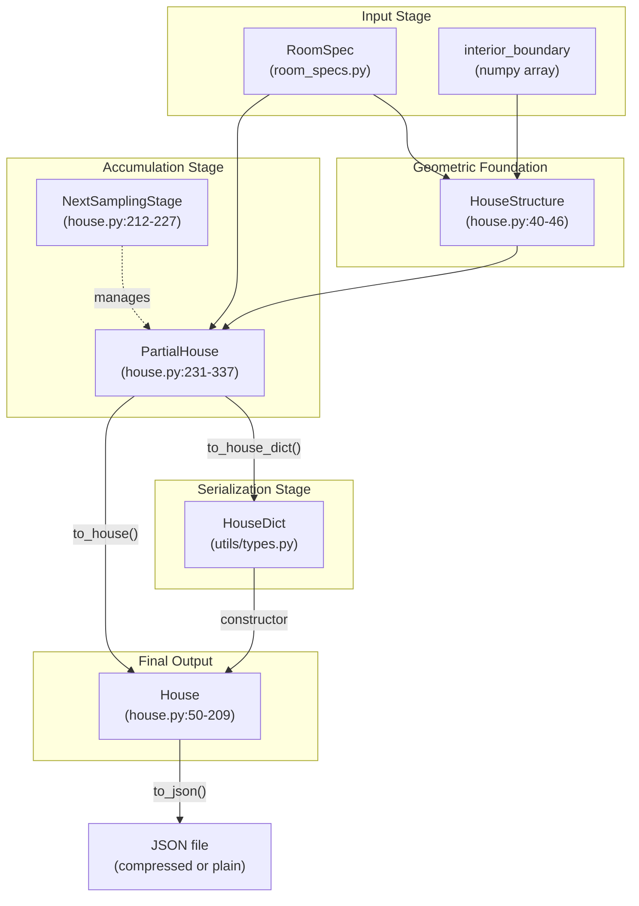

**Sources:** [procthor/generation/house.py:1-337]()

---

## HouseStructure

`HouseStructure` is an immutable data class that represents the geometric foundation of a house after the structure generation stage. It contains the raw geometric data needed for all subsequent generation stages.

### Fields

| Field | Type | Description |
|-------|------|-------------|
| `interior_boundary` | `np.ndarray` | 2D boolean array marking interior vs exterior space |
| `floorplan` | `np.ndarray` | 2D integer array mapping grid cells to room IDs |
| `rowcol_walls` | `Dict[Tuple[int, int], List[Tuple[int, int]]]` | Maps grid positions to wall segments |
| `boundary_groups` | `Dict[Tuple[int, int], List[Tuple[float, float]]]` | Groups of boundary coordinates for room polygons |
| `xz_poly_map` | `Dict[int, List[Tuple[float, float]]]` | Maps room IDs to 2D polygon vertices (x, z coordinates) |
| `ceiling_height` | `float` | Height of ceilings in meters |

### Creation and Usage

`HouseStructure` is created during the STRUCTURE generation stage and passed to `PartialHouse.from_structure_and_room_spec()`. The `xz_poly_map` is particularly important as it defines the precise room boundaries used for wall generation and spatial reasoning throughout the pipeline.

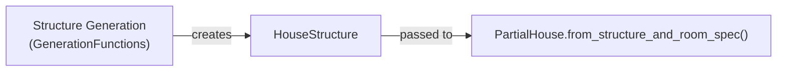

**Sources:** [procthor/generation/house.py:39-46]()

---

## PartialHouse

`PartialHouse` is a mutable data class that accumulates components as the house progresses through generation stages. It serves as the working state container for the entire generation pipeline.

### Structure

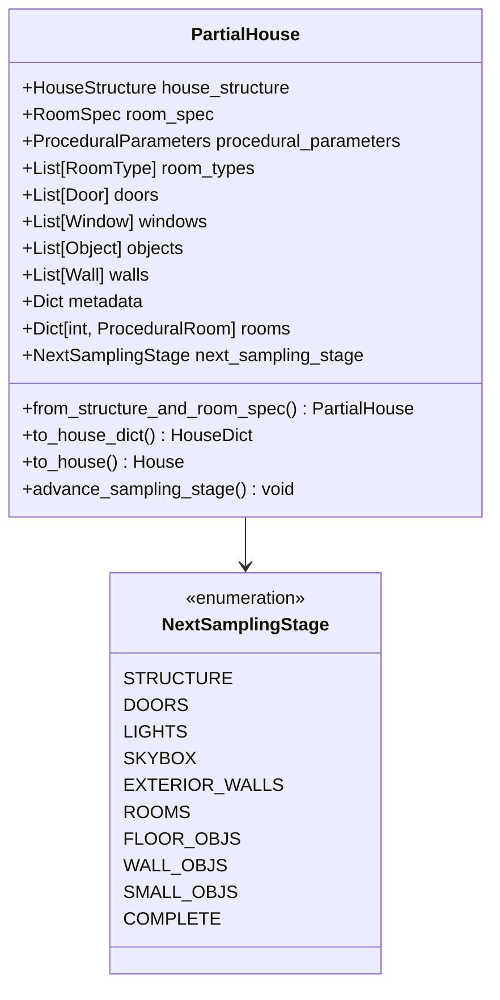

**Sources:** [procthor/generation/house.py:230-337]()

### Core Fields

These fields are always present:

| Field | Type | Description |
|-------|------|-------------|
| `house_structure` | `HouseStructure` | Geometric foundation from structure generation |
| `room_spec` | `RoomSpec` | Specification defining room types and layout |
| `procedural_parameters` | `ProceduralParameters` | Runtime parameters (lights, reflections, collider thickness) |
| `next_sampling_stage` | `NextSamplingStage` | Tracks which generation stage to execute next |

### Optional Fields (Populated During Generation)

These fields are `None` initially and populated as generation progresses:

| Field | Type | When Populated | Description |
|-------|------|----------------|-------------|
| `room_types` | `Optional[List[RoomType]]` | STRUCTURE stage | Room metadata including floor polygons |
| `doors` | `Optional[List[Door]]` | DOORS stage | Door objects connecting rooms |
| `windows` | `Optional[List[Window]]` | WALL_OBJS stage | Window objects on exterior walls |
| `objects` | `Optional[List[Object]]` | FLOOR_OBJS, WALL_OBJS, SMALL_OBJS stages | All placed objects |
| `walls` | `Optional[List[Wall]]` | STRUCTURE stage | Wall geometry with polygons |
| `metadata` | `Optional[Dict[str, Any]]` | Throughout pipeline | Schema version and other metadata |
| `rooms` | `Optional[Dict[int, ProceduralRoom]]` | ROOMS stage | Room objects for spatial reasoning |

### Initialization

The `from_structure_and_room_spec()` class method creates a `PartialHouse` from a completed `HouseStructure`. This method:

1. Generates `Wall` objects from the `xz_poly_map` in the structure [procthor/generation/house.py:252-266]()
2. Creates `RoomType` entries with floor polygons [procthor/generation/house.py:271-282]()
3. Initializes `procedural_parameters` with default values [procthor/generation/house.py:285-290]()
4. Sets `next_sampling_stage` to `NextSamplingStage.DOORS` [procthor/generation/house.py:291]()

### Conversion Methods

**`to_house_dict()`** [procthor/generation/house.py:295-311]()

Converts the `PartialHouse` to a `HouseDict` (JSON-serializable dictionary) by mapping internal field names to the expected AI2-THOR format:

| Internal Field | HouseDict Key |
|---------------|---------------|
| `room_types` | `rooms` |
| `doors` | `doors` |
| `windows` | `windows` |
| `objects` | `objects` |
| `walls` | `walls` |
| `procedural_parameters` | `proceduralParameters` |
| `metadata` | `metadata` |

**`to_house()`** [procthor/generation/house.py:313-324]()

Converts the `PartialHouse` to a final immutable `House` object. This method asserts that all required fields are populated before conversion, ensuring the house is complete.

**Sources:** [procthor/generation/house.py:230-337]()

---

## HouseDict

`HouseDict` is a `TypedDict` representing the JSON-serializable structure consumed by AI2-THOR. It follows the AI2-THOR house schema exactly.

### Structure

| Key | Type | Description |
|-----|------|-------------|
| `rooms` | `List[RoomType]` | Room definitions with floor polygons |
| `walls` | `List[Wall]` | Wall geometry as 3D polygons |
| `doors` | `List[Door]` | Door objects with positions and assets |
| `windows` | `List[Window]` | Window objects on walls |
| `objects` | `List[Object]` | All placed objects with transforms |
| `proceduralParameters` | `ProceduralParameters` | Lighting and physics parameters |
| `metadata` | `Dict[str, Any]` | Schema version, agent pose, room spec ID |

### Relationship to House

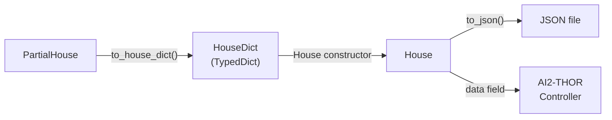

**Sources:** [procthor/utils/types.py]() (referenced in [procthor/generation/house.py:21]())

---

## House

`House` is the final immutable data class representing a complete, validated house. It wraps a `HouseDict` with additional metadata and provides validation and serialization methods.

### Fields

| Field | Type | Description |
|-------|------|-------------|
| `data` | `HouseDict` | The complete house specification |
| `rooms` | `Dict[int, ProceduralRoom]` | Room objects for spatial queries |
| `interior_boundary` | `np.array` | Original interior boundary from structure generation |
| `room_spec` | `RoomSpec` | Original room specification |
| `add_metadata` | `bool` | Whether to automatically add metadata (default: True) |

### Methods

#### Metadata Generation

**`_add_metadata()`** [procthor/generation/house.py:61-66]()

Automatically populates the `metadata` field with:
- `agent`: Starting agent pose generated by `choose_agent_pose()`
- `roomSpecId`: Identifier from the room specification
- `schema`: Current schema version constant

#### Agent Pose Selection

**`choose_agent_pose()`** [procthor/generation/house.py:98-100]()

Generates a starting position for the default agent by calling `generate_starting_pose()` with the rooms dictionary.

#### Bounds Calculation

**`bounds` property** [procthor/generation/house.py:81-96]()

Computes the axis-aligned bounding box encompassing all walls in the house:

```python
BoundingBox(
    min=Vector3(x=..., y=..., z=...),
    max=Vector3(x=..., y=..., z=...)
)
```

#### Validation

**`validate(controller: Controller)`** [procthor/generation/house.py:102-164]()

Validates the house using an AI2-THOR controller:

1. Creates the house in AI2-THOR
2. Teleports to the starting agent position
3. Gets reachable positions
4. Verifies each room has at least 5 reachable positions

Returns a dictionary of warnings/errors and stores them in `data["metadata"]["warnings"]`.

#### Serialization

**`to_json(filename: Optional[str], compressed: bool)`** [procthor/generation/house.py:68-79]()

Serializes the house to JSON format. Supports:
- Plain JSON files (`.json`)
- Compressed JSON files (`.json.gz`) using gzip

**Sources:** [procthor/generation/house.py:49-209]()

---

## NextSamplingStage

`NextSamplingStage` is an ordered enumeration that defines the sequence of generation stages. It implements total ordering to allow stage comparison.

### Values

| Value | Stage | Description |
|-------|-------|-------------|
| 0 | `STRUCTURE` | Generate floor plan and walls |
| 1 | `DOORS` | Place doors between rooms |
| 2 | `LIGHTS` | Add ceiling lights |
| 3 | `SKYBOX` | Select skybox asset |
| 4 | `EXTERIOR_WALLS` | Create exterior wall geometry |
| 5 | `ROOMS` | Initialize ProceduralRoom objects |
| 6 | `FLOOR_OBJS` | Place floor objects (furniture) |
| 7 | `WALL_OBJS` | Place wall objects (windows, paintings, TVs) |
| 8 | `SMALL_OBJS` | Place small decorative objects |
| 9 | `COMPLETE` | All stages complete |

### Stage Advancement

`PartialHouse.advance_sampling_stage()` [procthor/generation/house.py:326-334]() increments the stage by finding the next enum value. The `COMPLETE` stage is terminal.

**Sources:** [procthor/generation/house.py:211-227]()

---

## Supporting Types

The data structures reference several types defined in `procthor.utils.types`:

### Geometric Types

| Type | Description |
|------|-------------|
| `Vector3` | 3D coordinate with `x`, `y`, `z` fields |
| `BoundingBox` | Axis-aligned box with `min` and `max` Vector3 |

### Scene Component Types

| Type | Description |
|------|-------------|
| `Wall` | Wall definition with `id`, `roomId`, `polygon`, `material` |
| `Door` | Door with `id`, `room0`, `room1`, `openness`, `assetId` |
| `Window` | Window with `id`, `room0`, `room1`, `wall0`, `holePolygon` |
| `Object` | Placed object with `id`, `assetId`, `position`, `rotation` |
| `RoomType` | Room metadata with `id`, `roomType`, `floorPolygon`, `children` |

### Parameters

| Type | Description |
|------|-------------|
| `ProceduralParameters` | Runtime parameters including lights, reflections, collider thickness |

**Sources:** [procthor/utils/types.py]() (imported in [procthor/generation/house.py:18-28]())

---

## State Transformation Pipeline

The complete transformation pipeline shows how data flows from initial specifications to final output:

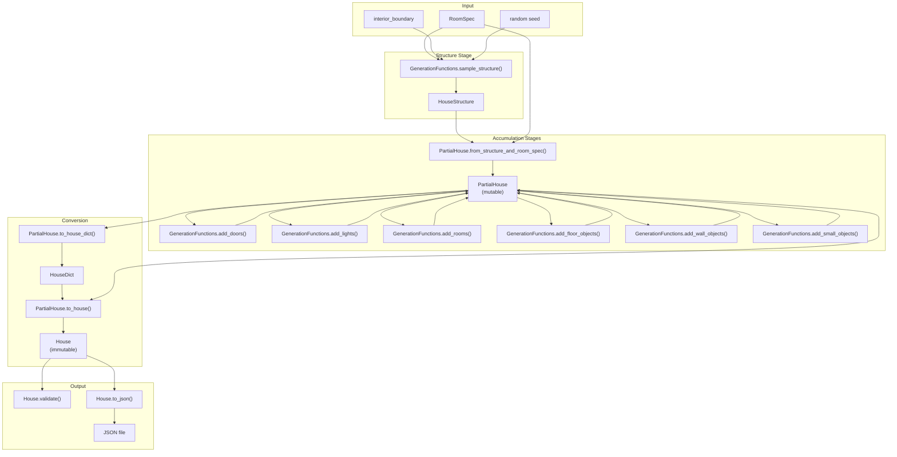

### Key Transformation Points

1. **Structure → PartialHouse**: `PartialHouse.from_structure_and_room_spec()` creates initial walls and room types [procthor/generation/house.py:246-293]()

2. **PartialHouse → HouseDict**: `to_house_dict()` remaps field names to AI2-THOR schema [procthor/generation/house.py:295-311]()

3. **PartialHouse → House**: `to_house()` performs final validation and creates immutable output [procthor/generation/house.py:313-324]()

4. **House → JSON**: `to_json()` serializes for storage or AI2-THOR consumption [procthor/generation/house.py:68-79]()

**Sources:** [procthor/generation/house.py:1-337]()

---

# Page: Stage Progression and State Management

# Stage Progression and State Management

<details>
<summary>Relevant source files</summary>

The following files were used as context for generating this wiki page:

- [procthor/generation/__init__.py](procthor/generation/__init__.py)
- [procthor/generation/house.py](procthor/generation/house.py)

</details>


## Purpose and Scope

This document explains how ProcTHOR manages the sequential progression through generation stages and accumulates intermediate state during house generation. The system uses a state machine pattern where a `PartialHouse` object advances through well-defined stages, each adding specific components to the house specification.

For details on individual generation stages (structure, doors, objects, etc.), see [Generation Stages](#3). For information on the `HouseGenerator` orchestration, see [Generation Pipeline Architecture](#2.1). For details on final `House` and `HouseDict` representations, see [Data Structures](#2.2).

---

## NextSamplingStage Enumeration

The `NextSamplingStage` enum defines the ordered sequence of generation stages. It uses Python's `@total_ordering` decorator to enable comparison operations between stages.

### Stage Definition

```mermaid
graph LR
    S0["STRUCTURE<br/>(value=0)"]
    S1["DOORS<br/>(value=1)"]
    S2["LIGHTS<br/>(value=2)"]
    S3["SKYBOX<br/>(value=3)"]
    S4["EXTERIOR_WALLS<br/>(value=4)"]
    S5["ROOMS<br/>(value=5)"]
    S6["FLOOR_OBJS<br/>(value=6)"]
    S7["WALL_OBJS<br/>(value=7)"]
    S8["SMALL_OBJS<br/>(value=8)"]
    S9["COMPLETE<br/>(value=9)"]
    
    S0 --> S1 --> S2 --> S3 --> S4 --> S5 --> S6 --> S7 --> S8 --> S9
```

**Stage Ordering and Comparison**

Each stage has an integer value enabling ordered comparisons. The `__lt__` method at [procthor/generation/house.py:224-227]() allows statements like `stage <= NextSamplingStage.DOORS` to determine if a stage should execute.

| Stage | Value | Primary Responsibility |
|-------|-------|------------------------|
| `STRUCTURE` | 0 | Initial state, structure already generated |
| `DOORS` | 1 | Door placement and material randomization |
| `LIGHTS` | 2 | Ceiling light placement |
| `SKYBOX` | 3 | Skybox asset selection |
| `EXTERIOR_WALLS` | 4 | Exterior wall object creation |
| `ROOMS` | 5 | ProceduralRoom object initialization |
| `FLOOR_OBJS` | 6 | Large furniture and floor object placement |
| `WALL_OBJS` | 7 | Windows, paintings, wall-mounted TVs |
| `SMALL_OBJS` | 8 | Small decorative objects |
| `COMPLETE` | 9 | All generation finished, ready for conversion to House |

**Sources:** [procthor/generation/house.py:211-228]()

---

## PartialHouse State Container

The `PartialHouse` class serves as the mutable state container that accumulates components as generation progresses through stages. It holds both completed components and the current stage position.

### State Fields by Category

```mermaid
graph TB
    subgraph "Core State"
        PH["PartialHouse"]
        NSS["next_sampling_stage:<br/>NextSamplingStage"]
        HS["house_structure:<br/>HouseStructure"]
        RS["room_spec:<br/>RoomSpec"]
        PP["procedural_parameters:<br/>ProceduralParameters"]
    end
    
    subgraph "Optional Component Collections"
        RT["room_types:<br/>List[RoomType]"]
        DOORS["doors:<br/>List[Door]"]
        WINDOWS["windows:<br/>List[Window]"]
        OBJECTS["objects:<br/>List[Object]"]
        WALLS["walls:<br/>List[Wall]"]
        ROOMS["rooms:<br/>Dict[int, ProceduralRoom]"]
        META["metadata:<br/>Dict[str, Any]"]
    end
    
    PH --> NSS
    PH --> HS
    PH --> RS
    PH --> PP
    
    PH -.accumulates.-> RT
    PH -.accumulates.-> DOORS
    PH -.accumulates.-> WINDOWS
    PH -.accumulates.-> OBJECTS
    PH -.accumulates.-> WALLS
    PH -.accumulates.-> ROOMS
    PH -.accumulates.-> META
```

### Initialization from Structure

The `PartialHouse.from_structure_and_room_spec()` class method at [procthor/generation/house.py:246-293]() creates an initial state with:

- **Walls**: Generated from `xz_poly_map` boundaries
- **Room Types**: One `RoomType` per room with floor polygon
- **Objects**: Empty list
- **Procedural Parameters**: Default values for colliders and receptacles
- **Next Sampling Stage**: Set to `NextSamplingStage.DOORS` (skipping STRUCTURE)
- **Metadata**: Schema version

**Sources:** [procthor/generation/house.py:230-338]()

---

## Stage Advancement Mechanism

Stage progression is controlled by the `advance_sampling_stage()` method and enforced by conditional execution guards in `HouseGenerator.sample()`.

### Advancement Logic

```mermaid
stateDiagram-v2
    [*] --> current_stage: next_sampling_stage
    current_stage --> find_next: advance_sampling_stage()
    find_next --> next_stage: value + 1
    next_stage --> COMPLETE: if no next stage
    next_stage --> [*]: updated next_sampling_stage
    
    note right of find_next
        Finds next enum member
        with value = current + 1
        or defaults to COMPLETE
    end note
```

The `advance_sampling_stage()` method at [procthor/generation/house.py:326-334]() uses a generator expression to find the next `NextSamplingStage` enum member:

```python
self.next_sampling_stage = next(
    (nss for nss in NextSamplingStage 
     if nss.value == self.next_sampling_stage.value + 1),
    self.next_sampling_stage.COMPLETE,
)
```

### Context Manager Pattern

The `advance_and_record_partial()` context manager at [procthor/generation/__init__.py:187-196]() ensures stages always advance and can optionally record intermediate states:

```mermaid
graph TB
    START["Enter Context"]
    YIELD["Execute Stage<br/>Generation Function"]
    ADVANCE["advance_sampling_stage()"]
    RECORD{"return_partial_houses?"}
    DEEPCOPY["Deep copy PartialHouse"]
    STORE["Store in sampling_stage_to_ph"]
    END["Exit Context"]
    
    START --> YIELD
    YIELD --> ADVANCE
    ADVANCE --> RECORD
    RECORD -->|Yes| DEEPCOPY
    RECORD -->|No| END
    DEEPCOPY --> STORE
    STORE --> END
```

This pattern guarantees that:
1. Stage advancement always occurs after generation functions execute
2. Partial house snapshots are captured if requested
3. Stage progression is exception-safe (finally block)

**Sources:** [procthor/generation/__init__.py:187-196](), [procthor/generation/house.py:326-334]()

---

## Conditional Stage Execution

The `HouseGenerator.sample()` method at [procthor/generation/__init__.py:121-304]() uses comparison operators to conditionally execute stages based on `next_sampling_stage`.

### Execution Flow with Stage Guards

```mermaid
graph TD
    START["sample() called"]
    CHECK_PH{"partial_house<br/>provided?"}
    CREATE_PH["Create new PartialHouse<br/>from structure"]
    USE_PH["Use provided<br/>PartialHouse"]
    
    CHECK_DOORS{"next_sampling_stage<br/><= DOORS?"}
    EXEC_DOORS["Execute add_doors()<br/>randomize materials"]
    ADV_DOORS["advance_sampling_stage()"]
    
    CHECK_LIGHTS{"next_sampling_stage<br/><= LIGHTS?"}
    EXEC_LIGHTS["Execute add_lights()"]
    ADV_LIGHTS["advance_sampling_stage()"]
    
    CHECK_SKYBOX{"next_sampling_stage<br/><= SKYBOX?"}
    EXEC_SKYBOX["Execute add_skybox()"]
    ADV_SKYBOX["advance_sampling_stage()"]
    
    CHECK_EXT{"next_sampling_stage<br/><= EXTERIOR_WALLS?"}
    EXEC_EXT["Execute add_exterior_walls()"]
    ADV_EXT["advance_sampling_stage()"]
    
    CHECK_ROOMS{"next_sampling_stage<br/><= ROOMS?"}
    EXEC_ROOMS["Execute add_rooms()"]
    ADV_ROOMS["advance_sampling_stage()"]
    
    MORE["... FLOOR_OBJS,<br/>WALL_OBJS,<br/>SMALL_OBJS ..."]
    
    ASSIGN_LAYERS["assign_layer_to_rooms()"]
    TO_HOUSE["partial_house.to_house()"]
    RETURN["Return House<br/>and stage snapshots"]
    
    START --> CHECK_PH
    CHECK_PH -->|No| CREATE_PH
    CHECK_PH -->|Yes| USE_PH
    CREATE_PH --> CHECK_DOORS
    USE_PH --> CHECK_DOORS
    
    CHECK_DOORS -->|Yes| EXEC_DOORS
    CHECK_DOORS -->|No| CHECK_LIGHTS
    EXEC_DOORS --> ADV_DOORS
    ADV_DOORS --> CHECK_LIGHTS
    
    CHECK_LIGHTS -->|Yes| EXEC_LIGHTS
    CHECK_LIGHTS -->|No| CHECK_SKYBOX
    EXEC_LIGHTS --> ADV_LIGHTS
    ADV_LIGHTS --> CHECK_SKYBOX
    
    CHECK_SKYBOX -->|Yes| EXEC_SKYBOX
    CHECK_SKYBOX -->|No| CHECK_EXT
    EXEC_SKYBOX --> ADV_SKYBOX
    ADV_SKYBOX --> CHECK_EXT
    
    CHECK_EXT -->|Yes| EXEC_EXT
    CHECK_EXT -->|No| CHECK_ROOMS
    EXEC_EXT --> ADV_EXT
    ADV_EXT --> CHECK_ROOMS
    
    CHECK_ROOMS -->|Yes| EXEC_ROOMS
    CHECK_ROOMS -->|No| MORE
    EXEC_ROOMS --> ADV_ROOMS
    ADV_ROOMS --> MORE
    
    MORE --> ASSIGN_LAYERS
    ASSIGN_LAYERS --> TO_HOUSE
    TO_HOUSE --> RETURN
```

Each stage execution follows this pattern at [procthor/generation/__init__.py:199-207]():

```python
if partial_house.next_sampling_stage <= NextSamplingStage.DOORS:
    with advance_and_record_partial(partial_house):
        door_polygons = gfs.add_doors(
            partial_house=partial_house,
            controller=self.controller,
            pt_db=self.pt_db,
            split=self.split,
        )
        randomize_wall_and_floor_materials(partial_house, pt_db=self.pt_db)
```

**Sources:** [procthor/generation/__init__.py:198-304]()

---

## State Accumulation Patterns

Different stages populate different fields of `PartialHouse`. The accumulation follows a pattern where early stages provide infrastructure and later stages add objects.

### Component Addition by Stage

| Stage | Fields Modified | Description |
|-------|----------------|-------------|
| `DOORS` | `doors` list, wall materials | Adds `Door` objects, modifies wall/floor materials |
| `LIGHTS` | `procedural_parameters.lights` | Adds light specifications to parameters |
| `SKYBOX` | `metadata` | Adds skybox asset reference |
| `EXTERIOR_WALLS` | `objects` list | Adds exterior wall planes as objects |
| `ROOMS` | `rooms` dict | Creates `ProceduralRoom` instances with spatial data |
| `FLOOR_OBJS` | `objects` list | Appends furniture and large floor objects |
| `WALL_OBJS` | `objects` list, `windows` list | Appends wall-mounted objects and windows |
| `SMALL_OBJS` | `objects` list | Appends small decorative objects |

### Object List Growth Pattern

```mermaid
graph LR
    subgraph "Stage FLOOR_OBJS"
        FL_START["objects = []"]
        FL_ADD["add_floor_objects()"]
        FL_END["objects = [f1, f2, ..., fn]"]
    end
    
    subgraph "Stage WALL_OBJS"
        WL_START["objects = [f1, f2, ..., fn]"]
        WL_ADD["add_wall_objects()"]
        WL_END["objects = [f1, ..., fn, w1, ..., wm]"]
    end
    
    subgraph "Stage SMALL_OBJS"
        SM_START["objects = [f1, ..., fn, w1, ..., wm]"]
        SM_ADD["add_small_objects()"]
        SM_END["objects = [f1, ..., fn, w1, ..., wm, s1, ..., sk]"]
    end
    
    FL_START --> FL_ADD --> FL_END
    FL_END --> WL_START
    WL_START --> WL_ADD --> WL_END
    WL_END --> SM_START
    SM_START --> SM_ADD --> SM_END
```

The `HouseGenerator.sample()` method tracks object list slices at [procthor/generation/__init__.py:265-298]():

- **Floor objects**: `objects[:]` captured after FLOOR_OBJS stage
- **Wall objects**: `objects[len(floor_objects):]` captured after WALL_OBJS stage  
- **Small objects**: `objects[len(floor_objects) + len(wall_objects):]` captured after SMALL_OBJS stage

This enables stage-specific randomization of colors and states for each object category.

**Sources:** [procthor/generation/__init__.py:256-298]()

---

## Resumable Generation

The stage progression system supports resuming generation from any intermediate stage by providing a pre-populated `PartialHouse`.

### Resume Mechanism

```mermaid
sequenceDiagram
    participant User
    participant HG as HouseGenerator
    participant PH as PartialHouse
    
    User->>HG: sample(partial_house=ph)
    HG->>PH: Check next_sampling_stage
    
    alt Stage > STRUCTURE
        Note over HG,PH: Skip structure generation
    end
    
    alt Stage <= DOORS
        HG->>PH: Execute DOORS stage
        HG->>PH: advance_sampling_stage()
    end
    
    alt Stage <= LIGHTS
        HG->>PH: Execute LIGHTS stage
        HG->>PH: advance_sampling_stage()
    end
    
    Note over HG,PH: Continue for remaining stages...
    
    HG->>PH: to_house()
    PH-->>User: Return House
```

**Resume Requirements**

At [procthor/generation/__init__.py:179-180](), the system validates resume state:

```python
else:
    assert partial_house.next_sampling_stage.value > NextSamplingStage.STRUCTURE
```

This ensures:
- Structure must already be generated
- All prerequisite fields must be populated
- Stage value indicates which stages to execute

**Use Cases for Resumable Generation:**

1. **Debugging**: Generate up to a specific stage, inspect state, modify, and continue
2. **A/B Testing**: Generate multiple variants from the same base structure
3. **Incremental Refinement**: Add objects progressively without regenerating structure
4. **Partial Regeneration**: Regenerate only later stages (e.g., re-place objects with same floor plan)

**Sources:** [procthor/generation/__init__.py:143-180]()

---

## Recording Intermediate States

The `return_partial_houses` parameter enables capturing snapshots of `PartialHouse` at each stage for inspection or debugging.

### Snapshot Collection

When `return_partial_houses=True` is passed to `sample()`, the system returns a dictionary mapping stages to deep copies of the partial house:

```mermaid
graph TB
    SAMPLE["sample(return_partial_houses=True)"]
    DICT["sampling_stage_to_ph = {}"]
    
    STAGE1["DOORS stage completes"]
    COPY1["Deep copy PartialHouse"]
    STORE1["sampling_stage_to_ph[DOORS] = copy"]
    
    STAGE2["LIGHTS stage completes"]
    COPY2["Deep copy PartialHouse"]
    STORE2["sampling_stage_to_ph[LIGHTS] = copy"]
    
    MORE["... additional stages ..."]
    
    FINAL["sampling_stage_to_ph[COMPLETE] = partial_house"]
    RETURN["Return (House, sampling_stage_to_ph)"]
    
    SAMPLE --> DICT
    DICT --> STAGE1
    STAGE1 --> COPY1
    COPY1 --> STORE1
    STORE1 --> STAGE2
    STAGE2 --> COPY2
    COPY2 --> STORE2
    STORE2 --> MORE
    MORE --> FINAL
    FINAL --> RETURN
```

The implementation at [procthor/generation/__init__.py:182-196]() uses deep copy to ensure snapshots are independent:

```python
if return_partial_houses:
    sampling_stage_to_ph[partial_house.next_sampling_stage] = copy.deepcopy(
        partial_house
    )
```

The final snapshot at stage `COMPLETE` stores the original `PartialHouse` reference (not a copy) at [procthor/generation/__init__.py:302]().

**Sources:** [procthor/generation/__init__.py:182-196](), [procthor/generation/__init__.py:302]()

---

## Conversion to Final House

Once all stages complete, the `PartialHouse.to_house()` method at [procthor/generation/house.py:313-324]() converts the mutable state to an immutable `House` object.

### Conversion Requirements and Process

```mermaid
graph TD
    START["to_house() called"]
    CHECK["Assert all required fields<br/>are not None:<br/>rooms, doors, windows,<br/>objects, walls"]
    DICT["to_house_dict():<br/>Convert to HouseDict"]
    CREATE["Create House instance"]
    META["Add metadata:<br/>agent pose, room_spec_id, schema"]
    RETURN["Return House"]
    
    START --> CHECK
    CHECK -->|Valid| DICT
    CHECK -->|Missing fields| ERROR["AssertionError"]
    DICT --> CREATE
    CREATE --> META
    META --> RETURN
```

**Field Validation**

The assertion at [procthor/generation/house.py:314-317]() ensures completeness:

```python
assert all(
    getattr(self, k) is not None
    for k in ["rooms", "doors", "windows", "objects", "walls"]
)
```

**HouseDict Serialization**

The `to_house_dict()` method at [procthor/generation/house.py:295-311]() maps internal field names to API-compatible names:

| Internal Field | HouseDict Key |
|----------------|---------------|
| `room_types` | `rooms` |
| `doors` | `doors` |
| `windows` | `windows` |
| `objects` | `objects` |
| `walls` | `walls` |
| `procedural_parameters` | `proceduralParameters` |
| `metadata` | `metadata` |

**Sources:** [procthor/generation/house.py:295-324]()

---

## Summary: Stage Progression Flow

The complete stage progression system combines enumeration, state container, advancement logic, and conditional execution:

```mermaid
graph TB
    NS["NextSamplingStage Enum<br/>Defines ordered stages 0-9"]
    PH["PartialHouse<br/>Mutable state container<br/>with next_sampling_stage"]
    ADV["advance_sampling_stage()<br/>Increments stage value"]
    CM["advance_and_record_partial<br/>Context manager<br/>ensures advancement"]
    COND["Conditional Execution<br/>if stage <= target_stage"]
    GEN["Generation Functions<br/>add_doors, add_lights, etc."]
    
    NS -.defines.-> PH
    PH --> COND
    COND -->|Execute| GEN
    GEN --> CM
    CM --> ADV
    ADV --> PH
```

**Key Properties:**

1. **Strict Ordering**: Stages must execute in sequence due to dependencies
2. **Incremental State**: Each stage adds to `PartialHouse` without modifying previous components
3. **Resumability**: Can start from any stage with appropriate pre-populated state
4. **Observability**: Can capture snapshots at each stage for debugging
5. **Type Safety**: Enum-based stages prevent invalid progressions
6. **Exception Safety**: Finally blocks ensure stage advancement occurs

**Sources:** [procthor/generation/__init__.py:121-304](), [procthor/generation/house.py:211-338]()

---

# Page: Generation Stages

# Generation Stages

<details>
<summary>Relevant source files</summary>

The following files were used as context for generating this wiki page:

- [procthor/generation/__init__.py](procthor/generation/__init__.py)
- [procthor/generation/generation.py](procthor/generation/generation.py)

</details>


## Purpose and Scope

This document provides an overview of the sequential generation stages that transform a `RoomSpec` into a complete `House` object. Each stage builds upon the previous, progressively adding geometric structure, objects, and visual details to the procedurally generated environment.

For implementation details of the orchestration system that controls stage progression, see [Core Generation System](#2). For detailed documentation of individual stages, see the child pages [3.1](#3.1) through [3.8](#3.8). For spatial reasoning systems used across stages, see [Spatial Reasoning Systems](#4).

**Sources:** [procthor/generation/__init__.py:1-305]()

## Staged Generation Architecture

ProcTHOR uses a strictly sequential pipeline where each stage produces specific outputs that subsequent stages depend on. The generation process is controlled by the `HouseGenerator` class, which orchestrates a series of generation functions while maintaining intermediate state in a `PartialHouse` object.

The staged approach provides several benefits:
- **Resumability**: Generation can be paused and resumed at any stage
- **Debugging**: Intermediate outputs can be inspected after each stage
- **Customization**: Individual stage functions can be replaced without affecting others
- **Determinism**: The same seed produces identical results at each stage

**Sources:** [procthor/generation/__init__.py:84-304]()

## Stage Progression Enumeration

The `NextSamplingStage` enumeration defines the complete sequence of generation stages. The `PartialHouse` object tracks which stage should execute next via the `next_sampling_stage` attribute, advancing through the pipeline using the `advance_sampling_stage()` method.

```mermaid
graph LR
    STRUCTURE["NextSamplingStage.STRUCTURE"]
    DOORS["NextSamplingStage.DOORS"]
    LIGHTS["NextSamplingStage.LIGHTS"]
    SKYBOX["NextSamplingStage.SKYBOX"]
    EXTERIOR["NextSamplingStage.EXTERIOR_WALLS"]
    ROOMS["NextSamplingStage.ROOMS"]
    FLOOR["NextSamplingStage.FLOOR_OBJS"]
    WALL["NextSamplingStage.WALL_OBJS"]
    SMALL["NextSamplingStage.SMALL_OBJS"]
    COMPLETE["NextSamplingStage.COMPLETE"]
    
    STRUCTURE --> DOORS
    DOORS --> LIGHTS
    LIGHTS --> SKYBOX
    SKYBOX --> EXTERIOR
    EXTERIOR --> ROOMS
    ROOMS --> FLOOR
    FLOOR --> WALL
    WALL --> SMALL
    SMALL --> COMPLETE
```

**Diagram: NextSamplingStage Sequential Progression**

The enumeration uses integer values to enable comparison operations (e.g., `next_sampling_stage <= NextSamplingStage.DOORS`), allowing the generator to conditionally execute stages when resuming from a partial house.

**Sources:** [procthor/generation/house.py](), [procthor/generation/__init__.py:199-299]()

## Generation Pipeline Overview

The following diagram maps each stage to its implementation function and primary outputs:

```mermaid
graph TB
    subgraph "HouseGenerator.sample()"
        INPUT["Input:<br/>RoomSpec<br/>interior_boundary<br/>seed"]
        
        STRUCT_STAGE["Stage: STRUCTURE"]
        DOORS_STAGE["Stage: DOORS"]
        LIGHTS_STAGE["Stage: LIGHTS"]
        SKYBOX_STAGE["Stage: SKYBOX"]
        EXTERIOR_STAGE["Stage: EXTERIOR_WALLS"]
        ROOMS_STAGE["Stage: ROOMS"]
        FLOOR_STAGE["Stage: FLOOR_OBJS"]
        WALL_STAGE["Stage: WALL_OBJS"]
        SMALL_STAGE["Stage: SMALL_OBJS"]
        
        OUTPUT["Output:<br/>House object<br/>validation-ready"]
    end
    
    subgraph "GenerationFunctions"
        STRUCT_FUNC["sample_house_structure()"]
        DOORS_FUNC["add_doors()"]
        LIGHTS_FUNC["add_lights()"]
        SKYBOX_FUNC["add_skybox()"]
        EXTERIOR_FUNC["add_exterior_walls()"]
        ROOMS_FUNC["add_rooms()"]
        FLOOR_FUNC["add_floor_objects()"]
        WALL_FUNC["add_wall_objects()"]
        SMALL_FUNC["add_small_objects()"]
    end
    
    subgraph "PartialHouse State"
        PH_STRUCT["HouseStructure:<br/>floorplan, walls,<br/>boundary_groups"]
        PH_DOORS["doors list<br/>door_polygons"]
        PH_LIGHTS["lights list"]
        PH_SKYBOX["skybox"]
        PH_EXTERIOR["exterior_walls list"]
        PH_ROOMS["rooms list<br/>ProceduralRoom objects"]
        PH_FLOOR["objects list<br/>floor furniture"]
        PH_WALL["objects list<br/>windows, paintings"]
        PH_SMALL["objects list<br/>small objects"]
    end
    
    INPUT --> STRUCT_STAGE
    STRUCT_STAGE --> STRUCT_FUNC
    STRUCT_FUNC --> PH_STRUCT
    PH_STRUCT --> DOORS_STAGE
    
    DOORS_STAGE --> DOORS_FUNC
    DOORS_FUNC --> PH_DOORS
    PH_DOORS --> LIGHTS_STAGE
    
    LIGHTS_STAGE --> LIGHTS_FUNC
    LIGHTS_FUNC --> PH_LIGHTS
    PH_LIGHTS --> SKYBOX_STAGE
    
    SKYBOX_STAGE --> SKYBOX_FUNC
    SKYBOX_FUNC --> PH_SKYBOX
    PH_SKYBOX --> EXTERIOR_STAGE
    
    EXTERIOR_STAGE --> EXTERIOR_FUNC
    EXTERIOR_FUNC --> PH_EXTERIOR
    PH_EXTERIOR --> ROOMS_STAGE
    
    ROOMS_STAGE --> ROOMS_FUNC
    ROOMS_FUNC --> PH_ROOMS
    PH_ROOMS --> FLOOR_STAGE
    
    FLOOR_STAGE --> FLOOR_FUNC
    FLOOR_FUNC --> PH_FLOOR
    PH_FLOOR --> WALL_STAGE
    
    WALL_STAGE --> WALL_FUNC
    WALL_FUNC --> PH_WALL
    PH_WALL --> SMALL_STAGE
    
    SMALL_STAGE --> SMALL_FUNC
    SMALL_FUNC --> PH_SMALL
    PH_SMALL --> OUTPUT
```

**Diagram: Stage-to-Function-to-State Mapping**

**Sources:** [procthor/generation/__init__.py:121-304]()

## Stage Outputs and Dependencies

The following table summarizes what each stage produces and what subsequent stages require:

| Stage | Implementation Function | Primary Outputs | Key Dependencies |
|-------|------------------------|-----------------|------------------|
| **STRUCTURE** | `default_sample_house_structure()` | `HouseStructure` (floorplan, walls, boundary_groups, xz_poly_map, ceiling_height) | RoomSpec, interior_boundary |
| **DOORS** | `default_add_doors()` | Door objects, door_polygons | Wall positions, room connections |
| **LIGHTS** | `default_add_lights()` | Ceiling lights | Floor polygons, ceiling_height |
| **SKYBOX** | `default_add_skybox()` | Skybox asset | None |
| **EXTERIOR_WALLS** | `default_add_exterior_walls()` | Exterior wall objects | boundary_groups, wall materials |
| **ROOMS** | `default_add_rooms()` | ProceduralRoom objects | Floor polygons, door_polygons, room_type_map |
| **FLOOR_OBJS** | `default_add_floor_objects()` | Furniture and large floor objects | ProceduralRoom polygons, ASSET_DATABASE |
| **WALL_OBJS** | `default_add_wall_objects()` | Windows, paintings, wall-mounted TVs | Room boundaries, ceiling_height, exterior walls |
| **SMALL_OBJS** | `default_add_small_objects()` | Small decorative objects | Receptacle objects from previous stages |

**Sources:** [procthor/generation/__init__.py:159-304](), [procthor/generation/generation.py:185-222]()

## GenerationFunctions Class

The `GenerationFunctions` dataclass holds references to all stage implementation functions, enabling customization of the generation pipeline. Each function follows a protocol interface defined in `procthor/generation/protocols.py`.

```mermaid
classDiagram
    class GenerationFunctions {
        +sample_house_structure: SampleHouseStructureProtocol
        +add_doors: AddDoorsProtocol
        +add_lights: AddLightsProtocol
        +add_skybox: AddSkyboxProtocol
        +add_exterior_walls: AddExteriorWallsProtocol
        +add_rooms: AddRoomsProtocol
        +add_floor_objects: AddFloorObjectsProtocol
        +add_wall_objects: AddWallObjectsProtocol
        +add_small_objects: AddSmallObjectsProtocol
        +randomize_object_colors: RandomizeObjectAttributesProtocol
        +randomize_object_states: RandomizeObjectAttributesProtocol
    }
    
    class HouseGenerator {
        +generation_functions: GenerationFunctions
        +sample() House
    }
    
    HouseGenerator --> GenerationFunctions
```

**Diagram: GenerationFunctions Structure**

Default implementations are created by `_create_default_generation_functions()` which returns a `GenerationFunctions` instance with the standard generation pipeline. Users can provide custom implementations by passing a modified `GenerationFunctions` object to the `HouseGenerator` constructor.

**Sources:** [procthor/generation/__init__.py:52-80]()

## Structure Generation Stage

The structure generation stage establishes the geometric foundation for the entire house. This stage is unique because it executes before a `PartialHouse` exists, producing a `HouseStructure` object that is then used to initialize the `PartialHouse`.

**Key Operations:**
1. Sample or use provided `interior_boundary` (2D numpy array)
2. Generate floorplan using `generate_floorplan()` with room placement algorithm
3. Find walls between rooms using `find_walls()` 
4. Consolidate adjacent wall segments using `consolidate_walls()`
5. Scale boundary groups by `interior_boundary_scale` factor
6. Create XZ polygon map using `get_xz_poly_map()` for each room
7. Sample ceiling height

The output `HouseStructure` contains:
- `interior_boundary`: Original or sampled boundary array
- `floorplan`: 2D array with room IDs
- `rowcol_walls`: Wall segments in row/col coordinates
- `boundary_groups`: Consolidated walls grouped by adjacent room pairs
- `xz_poly_map`: Ordered polygon vertices for each room in XZ plane
- `ceiling_height`: Sampled vertical dimension

**Sources:** [procthor/generation/generation.py:185-222](), [procthor/generation/__init__.py:159-177]()

## Material and Object Randomization

Unlike other stages that execute once in sequence, material and object randomization occurs at multiple points in the pipeline:

**Material Randomization:**
- Executes during the DOORS stage via `randomize_wall_and_floor_materials()`
- Applies before exterior walls are added
- Controls wall texture/color uniformity based on probability constants

**Object Attribute Randomization:**
- Executes after FLOOR_OBJS, WALL_OBJS, and SMALL_OBJS stages
- Two separate operations:
  - `randomize_object_colors()`: Sets colors for vases, bottles, statues, etc.
  - `randomize_object_states()`: Sets open/closed states for objects
- Applied to newly added objects from each stage

```mermaid
graph TB
    DOORS_STAGE["DOORS Stage"]
    MATERIALS["randomize_wall_and_floor_materials()"]
    EXTERIOR_STAGE["EXTERIOR_WALLS Stage"]
    
    FLOOR_STAGE["FLOOR_OBJS Stage"]
    FLOOR_OBJS["floor_objects list"]
    FLOOR_COLOR["randomize_object_colors(floor_objects)"]
    FLOOR_STATE["randomize_object_states(floor_objects)"]
    
    WALL_STAGE["WALL_OBJS Stage"]
    WALL_OBJS["wall_objects list"]
    WALL_COLOR["randomize_object_colors(wall_objects)"]
    WALL_STATE["randomize_object_states(wall_objects)"]
    
    SMALL_STAGE["SMALL_OBJS Stage"]
    SMALL_OBJS["small_objects list"]
    SMALL_COLOR["randomize_object_colors(small_objects)"]
    SMALL_STATE["randomize_object_states(small_objects)"]
    
    DOORS_STAGE --> MATERIALS
    MATERIALS --> EXTERIOR_STAGE
    
    FLOOR_STAGE --> FLOOR_OBJS
    FLOOR_OBJS --> FLOOR_COLOR
    FLOOR_COLOR --> FLOOR_STATE
    
    WALL_STAGE --> WALL_OBJS
    WALL_OBJS --> WALL_COLOR
    WALL_COLOR --> WALL_STATE
    
    SMALL_STAGE --> SMALL_OBJS
    SMALL_OBJS --> SMALL_COLOR
    SMALL_COLOR --> SMALL_STATE
```

**Diagram: Randomization Execution Points**

This design ensures that object attributes are randomized immediately after placement, while materials are set early so that exterior walls inherit the correct materials.

**Sources:** [procthor/generation/__init__.py:207-298]()

## Stage Execution Control Flow

The `HouseGenerator.sample()` method uses conditional execution to support resumable generation. Each stage checks if it should execute using a comparison: `if partial_house.next_sampling_stage <= NextSamplingStage.STAGE_NAME`.

The `advance_and_record_partial()` context manager handles stage advancement:

```mermaid
sequenceDiagram
    participant HG as HouseGenerator.sample()
    participant CTX as advance_and_record_partial
    participant PH as PartialHouse
    participant GF as GenerationFunction
    
    HG->>HG: Check if stage should execute
    HG->>CTX: Enter context manager
    CTX->>GF: Call generation function
    GF->>PH: Modify partial_house state
    GF-->>CTX: Return
    CTX->>PH: advance_sampling_stage()
    CTX->>HG: Record partial_house snapshot
    CTX-->>HG: Exit context
    HG->>HG: Check next stage
```

**Diagram: Stage Execution Pattern**

This pattern ensures:
- State is only modified within the try block
- Stage advancement always occurs (in finally block)
- Snapshots are captured after each stage completes
- Errors don't leave the system in an inconsistent state

**Sources:** [procthor/generation/__init__.py:187-196]()

## Final Processing

After all generation stages complete, two final operations occur:

1. **Layer Assignment** (`assign_layer_to_rooms()`): Assigns rendering layers to room objects for proper occlusion and rendering order in AI2-THOR.

2. **House Conversion** (`partial_house.to_house()`): Converts the mutable `PartialHouse` to an immutable `House` object, which includes validation and serialization capabilities.

The `sample()` method returns both the final `House` object and (optionally) a dictionary mapping each `NextSamplingStage` to the `PartialHouse` snapshot at that stage, enabling inspection of intermediate states.

**Sources:** [procthor/generation/__init__.py:300-304]()

---

# Page: Structure Generation

# Structure Generation

<details>
<summary>Relevant source files</summary>

The following files were used as context for generating this wiki page:

- [procthor/generation/generation.py](procthor/generation/generation.py)

</details>


## Purpose and Scope

Structure generation is the first stage in the ProcTHOR house generation pipeline. This stage creates the fundamental geometric layout of a house, including the 2D floorplan, wall boundaries, and room polygons. The output of this stage is a `HouseStructure` object containing all geometric primitives needed by subsequent generation stages.

This document covers the algorithms for sampling interior boundaries, generating floorplans, detecting walls, consolidating wall segments, and creating XZ polygon representations. For door placement between rooms, see [Door Placement](#3.2). For material assignment to walls and floors, see [Material Randomization](#3.7).

## Overview

Structure generation transforms a high-level room specification into concrete geometric data through a sequential pipeline:

```mermaid
graph LR
    RS["RoomSpec"] --> IB["interior_boundary<br/>(numpy array)"]
    IB --> FP["floorplan<br/>(numpy array)"]
    FP --> RCW["rowcol_walls<br/>(dict)"]
    RCW --> BG["boundary_groups<br/>(consolidated)"]
    BG --> XZ["xz_poly_map<br/>(polygons)"]
    XZ --> HS["HouseStructure"]
    
    CH["ceiling_height<br/>(float)"] --> HS
```

The primary entry point is `default_sample_house_structure()` [procthor/generation/generation.py:185-222](), which orchestrates all sub-stages and returns a complete `HouseStructure`. This function is called by the `HouseGenerator` during the structure generation stage.

**Sources:** [procthor/generation/generation.py:185-222]()

## Interior Boundary Sampling

The interior boundary defines the outer perimeter of the house as a 2D binary grid. Each cell represents whether that location is inside (1) or outside (0) the house boundary.

The `sample_interior_boundary()` function [procthor/generation/interior_boundaries.py]() generates this boundary based on:

| Parameter | Description | Default |
|-----------|-------------|---------|
| `num_rooms` | Number of rooms to accommodate | Required |
| `average_room_size` | Average area per room in grid cells | `DEFAULT_AVERAGE_ROOM_SIZE` |
| `dims` | Optional fixed dimensions (rows, cols) | None |

If `interior_boundary` is provided to `default_sample_house_structure()`, this sampling step is skipped and the provided boundary is used directly [procthor/generation/generation.py:193-197]().

**Sources:** [procthor/generation/generation.py:186-197](), [procthor/generation/interior_boundaries.py:19]()

## Floorplan Generation

The floorplan is a 2D integer array where each cell contains a room ID, effectively partitioning the interior boundary into distinct rooms.

```mermaid
graph TB
    subgraph "Floorplan Generation"
        IB["interior_boundary<br/>(binary grid)"]
        RS["RoomSpec<br/>(room requirements)"]
        
        IB --> GF["generate_floorplan()"]
        RS --> GF
        
        GF --> FP["floorplan<br/>(room ID grid)"]
    end
    
    subgraph "Padding"
        FP --> PAD["np.pad()<br/>constant_values=OUTDOOR_ROOM_ID"]
        PAD --> FP_PADDED["padded floorplan"]
    end
```

The `generate_floorplan()` function [procthor/generation/floorplan_generation.py]() assigns room IDs to cells within the interior boundary based on the `RoomSpec` requirements. After generation, the floorplan is padded with `OUTDOOR_ROOM_ID` cells to simplify wall detection at the boundary [procthor/generation/generation.py:204-206]().

**Sources:** [procthor/generation/generation.py:198-206]()

## Wall Finding

The `find_walls()` function detects wall segments by identifying adjacent cells with different room IDs. Walls are stored as row-column coordinate pairs grouped by the two room IDs they separate.

```mermaid
graph TB
    subgraph "Wall Detection Algorithm"
        FP["floorplan[row, col]"]
        
        FP --> CHECK_RIGHT["Check floorplan[row, col+1]"]
        FP --> CHECK_DOWN["Check floorplan[row+1, col]"]
        
        CHECK_RIGHT --> DIFF_RIGHT{"Different<br/>room IDs?"}
        CHECK_DOWN --> DIFF_DOWN{"Different<br/>room IDs?"}
        
        DIFF_RIGHT -->|Yes| ADD_VERT["Add vertical wall<br/>((row-1, col), (row, col))"]
        DIFF_DOWN -->|Yes| ADD_HORIZ["Add horizontal wall<br/>((row, col-1), (row, col))"]
        
        ADD_VERT --> WALLS["walls[(min_id, max_id)]"]
        ADD_HORIZ --> WALLS
    end
```

The function iterates through all cells (excluding the last row and column) and compares each cell with its right and bottom neighbors [procthor/generation/generation.py:115-130]():

- **Horizontal walls** are created when `floorplan[row, col] != floorplan[row, col+1]`
- **Vertical walls** are created when `floorplan[row, col] != floorplan[row+1, col]`

Each wall is stored as a tuple `((row_start, col_start), (row_end, col_end))` and grouped by room ID pair `(min_id, max_id)`.

**Sources:** [procthor/generation/generation.py:115-130]()

## Wall Consolidation

Raw wall detection produces many short segments. The `consolidate_walls()` function merges collinear adjacent segments into longer walls.

### Consolidation Algorithm

The algorithm uses an iterative approach:

1. Build a graph where each wall endpoint maps to its connected endpoints
2. Iteratively merge walls that:
   - Share an endpoint
   - Are collinear (same x-coordinate or same z-coordinate for all four points)
3. Continue until no more merges are possible

```mermaid
graph TB
    subgraph "Before Consolidation"
        W1["((0,0), (0,1))<br/>((0,1), (0,2))<br/>((0,2), (0,3))<br/>...<br/>((0,8), (0,9))"]
    end
    
    subgraph "Consolidation Process"
        W1 --> BUILD["Build wall_map<br/>{start_point: {end_points}}"]
        BUILD --> ITER["Iterate until no changes"]
        ITER --> MERGE["Merge collinear walls<br/>sharing endpoints"]
        MERGE --> CHECK{"More<br/>merges?"}
        CHECK -->|Yes| ITER
        CHECK -->|No| DONE["Consolidation complete"]
    end
    
    subgraph "After Consolidation"
        DONE --> W2["((0,0), (0,9))"]
    end
```

**Example:** A vertical wall with 9 segments from `(0,0)` to `(0,9)` is consolidated into a single segment `((0,0), (0,9))` [procthor/generation/generation.py:23-55]().

The consolidation logic checks if four points are collinear by testing:
```
w1_1[0] == w1_2[0] == w2_1[0] == w2_2[0]  # All x-coordinates equal (vertical)
or
w1_1[1] == w1_2[1] == w2_1[1] == w2_2[1]  # All z-coordinates equal (horizontal)
```
[procthor/generation/generation.py:76-79]()

**Sources:** [procthor/generation/generation.py:23-95]()

## Boundary Scaling

The `scale_boundary_groups()` function transforms wall coordinates from grid space to world space by applying a scaling factor.

| Parameter | Type | Description |
|-----------|------|-------------|
| `boundary_groups` | `BoundaryGroups` | Consolidated wall groups in grid coordinates |
| `scale` | `float` | Scaling factor (typically `interior_boundary_scale`) |
| `precision` | `int` | Decimal precision for rounding (default: 3) |

Each coordinate `(x, z)` is transformed to `(round(x * scale, precision), round(z * scale, precision))` [procthor/generation/generation.py:104-109](). This converts discrete grid cells to continuous world coordinates suitable for 3D rendering.

**Sources:** [procthor/generation/generation.py:98-112]()

## XZ Polygon Map Creation

The `get_xz_poly_map()` function converts boundary groups into ordered polygon loops for each room. An XZ polygon is a sequence of 2D coordinate pairs representing the room's perimeter in counter-clockwise order.

### Polygon Construction Process

```mermaid
graph TB
    BG["boundary_groups<br/>{(room1, room2): {walls}}"]
    RID["room_ids<br/>{room1, room2, ...}"]
    
    BG --> EXTRACT["Extract all walls<br/>involving room_id"]
    RID --> EXTRACT
    
    EXTRACT --> LOOP["get_wall_loop()<br/>Order walls into loop"]
    
    LOOP --> CHECK["Compute edge sum<br/>Σ(x0*z1 - x1*z0)"]
    
    CHECK --> CW{"Clockwise?<br/>(sum > 0)"}
    CW -->|Yes| REVERSE["Reverse loop<br/>[(p1,p0) for (p0,p1)]"]
    CW -->|No| KEEP["Keep loop"]
    
    REVERSE --> XZ["xz_poly_map<br/>{room_id: polygon}"]
    KEEP --> XZ
```

**Wall Loop Construction:** The `get_wall_loop()` function [procthor/generation/generation.py:145-161]() builds a continuous loop by:

1. Starting with an arbitrary wall
2. Finding the next wall where its start point equals the current wall's end point
3. Repeating until all walls form a closed loop

If a wall is encountered backwards (its end matches the current end), it is reversed `(wall[1], wall[0])` [procthor/generation/generation.py:155-158]().

**Winding Order:** The algorithm ensures counter-clockwise winding using the shoelace formula. If the edge sum is positive (clockwise), the loop is reversed [procthor/generation/generation.py:173-179]().

**Sources:** [procthor/generation/generation.py:145-182]()

## Creating the Partial House

The `create_empty_partial_house()` function initializes a `PartialHouse` object with walls and room definitions derived from the XZ polygon map.

### Wall Object Creation

For each edge in each room's XZ polygon, a `Wall` object is created [procthor/generation/generation.py:230-244]():

| Field | Value |
|-------|-------|
| `id` | `"wall\|{room_id}\|{min_x}\|{min_z}\|{max_x}\|{max_z}"` |
| `roomId` | `"room\|{room_id}"` |
| `polygon` | Four 3D vertices forming a rectangular wall |

The wall polygon vertices are:
- Bottom-left: `(x0, FLOOR_Y, z0)`
- Bottom-right: `(x1, FLOOR_Y, z1)`
- Top-left: `(x0, FLOOR_Y + ceiling_height, z0)`
- Top-right: `(x1, FLOOR_Y + ceiling_height, z1)`

### Room Type Creation

Each room gets a `RoomType` object [procthor/generation/generation.py:247-256]() containing:

| Field | Description |
|-------|-------------|
| `id` | `"room\|{room_id}"` |
| `roomType` | Room category (e.g., "Bedroom", "Kitchen") from `room_type_map` |
| `children` | Empty list (populated in later stages) |
| `ceilings` | Empty list (populated in later stages) |
| `floorPolygon` | 2D floor vertices from XZ polygon at y=0 |

### Procedural Parameters

The `PartialHouse` is initialized with default `ProceduralParameters` [procthor/generation/generation.py:261-266]():

```python
ProceduralParameters(
    floorColliderThickness=1.0,
    receptacleHeight=0.7,
    lights=[],
    reflections=[],
)
```

These parameters will be populated by subsequent generation stages (lights, reflections, etc.).

**Sources:** [procthor/generation/generation.py:225-267]()

## Complete Structure Generation Pipeline

The following diagram shows the complete data flow through `default_sample_house_structure()`:

```mermaid
graph TB
    subgraph "Input"
        IB_IN["interior_boundary<br/>(optional)"]
        RS_IN["RoomSpec"]
        SCALE["interior_boundary_scale"]
        AVG_SIZE["average_room_size"]
    end
    
    subgraph "Sampling Phase"
        IB_IN --> SAMPLE_CHECK{"boundary<br/>provided?"}
        SAMPLE_CHECK -->|No| SAMPLE_IB["sample_interior_boundary()"]
        SAMPLE_CHECK -->|Yes| USE_IB["Use provided boundary"]
        
        AVG_SIZE --> SAMPLE_IB
        RS_IN --> DIMS["room_spec.dims()"]
        DIMS --> SAMPLE_IB
        
        SAMPLE_IB --> IB["interior_boundary"]
        USE_IB --> IB
    end
    
    subgraph "Floorplan Phase"
        IB --> GEN_FP["generate_floorplan()"]
        RS_IN --> GEN_FP
        GEN_FP --> FP["floorplan"]
        FP --> PAD["np.pad()<br/>OUTDOOR_ROOM_ID"]
        PAD --> FP_PAD["padded_floorplan"]
    end
    
    subgraph "Wall Detection Phase"
        FP_PAD --> FIND["find_walls()"]
        FIND --> RCW["rowcol_walls"]
        RCW --> CONS["consolidate_walls()"]
        CONS --> BG["boundary_groups"]
        BG --> SCALE_FN["scale_boundary_groups()"]
        SCALE --> SCALE_FN
        SCALE_FN --> BG_SCALED["boundary_groups<br/>(scaled)"]
    end
    
    subgraph "Polygon Phase"
        BG_SCALED --> POLY["get_xz_poly_map()"]
        RS_IN --> ROOM_IDS["room_ids"]
        ROOM_IDS --> POLY
        POLY --> XZ["xz_poly_map"]
    end
    
    subgraph "Ceiling Phase"
        SAMPLE_CH["sample_ceiling_height()"] --> CH["ceiling_height"]
    end
    
    subgraph "Output"
        IB --> HS["HouseStructure"]
        FP_PAD --> HS
        RCW --> HS
        BG_SCALED --> HS
        XZ --> HS
        CH --> HS
    end
```

**Sources:** [procthor/generation/generation.py:185-222]()

## HouseStructure Data Class

The `HouseStructure` returned by `default_sample_house_structure()` contains all geometric data from structure generation:

| Field | Type | Description |
|-------|------|-------------|
| `interior_boundary` | `np.ndarray` | Binary grid defining house perimeter |
| `floorplan` | `np.ndarray` | Room ID assignments (padded) |
| `rowcol_walls` | `Dict` | Raw wall segments in grid coordinates |
| `boundary_groups` | `BoundaryGroups` | Consolidated walls in world coordinates |
| `xz_poly_map` | `Dict[int, XZPoly]` | Ordered polygon loops per room |
| `ceiling_height` | `float` | Sampled ceiling height |

This structure is stored in the `PartialHouse.house_structure` field and accessed by subsequent generation stages that need geometric information about room layouts.

**Sources:** [procthor/generation/house.py]()

## Integration with Generation Pipeline

Structure generation is invoked as the first stage in `HouseGenerator.sample()`. The function signature for the generation function is:

```python
def default_sample_house_structure(
    interior_boundary: Optional[np.ndarray],
    room_ids: Set,
    room_spec: "RoomSpec",
    interior_boundary_scale: float,
    average_room_size: int = DEFAULT_AVERAGE_ROOM_SIZE,
) -> HouseStructure
```

The `HouseGenerator` passes:
- `interior_boundary`: None (for random generation) or a fixed boundary
- `room_ids`: Set of room IDs from the `RoomSpec`
- `room_spec`: The `RoomSpec` defining room types and connections
- `interior_boundary_scale`: Scaling factor for world coordinates
- `average_room_size`: Average room area in grid cells

The resulting `HouseStructure` is used to initialize the `PartialHouse` via `create_empty_partial_house()`, which subsequent stages modify by adding doors, objects, materials, etc.

**Sources:** [procthor/generation/generation.py:185-222](), [procthor/generation/house.py]()

---

# Page: Door Placement

# Door Placement

<details>
<summary>Relevant source files</summary>

The following files were used as context for generating this wiki page:

- [procthor/generation/doors.py](procthor/generation/doors.py)

</details>


## Purpose and Scope

The Door Placement stage is responsible for connecting rooms in the procedurally generated house by placing doors, door frames, and open connections between interior rooms, as well as exterior doors that connect rooms to the outside. This stage is executed after structure generation ([3.1](#3.1)) and before light placement in the generation pipeline ([2.1](#2.1)).

This document covers the selection of door locations, the different types of openings (full doors, frames, or empty walls), collision detection and resolution, and spatial constraints that ensure navigable spaces. For information about the wall structures themselves, see Exterior Walls ([3.3](#3.3)). For database information about door assets, see Database Architecture ([5.1](#5.1)).

**Sources:** [procthor/generation/doors.py:1-918]()

---

## Generation Pipeline Flow

The door placement process follows a sequential pipeline that selects room connections, chooses walls, handles outdoor entrances, and resolves collisions.

```mermaid
graph TB
    Start["default_add_doors()"] --> GetNeighbors["get_room_spec_neighbors()<br/>Identify possible room adjacencies"]
    GetNeighbors --> SelectInt["select_openings()<br/>Choose interior room connections"]
    SelectInt --> WallInt["select_door_walls()<br/>Select walls for interior doors"]
    
    Start --> SelectOut["select_outdoor_openings()<br/>Choose exterior door locations"]
    SelectOut --> WallOut["select_door_walls()<br/>Select walls for outdoor doors"]
    
    WallInt --> Merge["Merge interior and outdoor walls"]
    WallOut --> Merge
    
    Merge --> AddMeta["add_door_meta()<br/>Create door objects & assets"]
    
    AddMeta --> CheckOpen["Check OPEN_ROOM_CONNECTIONS<br/>Kitchen-LivingRoom eligible?"]
    CheckOpen -->|"p=0.75"| DecideType["Random decision"]
    DecideType -->|"pFrame=0.5"| Frame["ProceduralFrame<br/>Door frame only"]
    DecideType -->|"1-pFrame=0.5"| Empty["Empty wall<br/>No barrier"]
    CheckOpen -->|"1-p=0.25"| Door["ProceduralDoor<br/>Full door"]
    
    Frame --> FixCollisions["fix_door_intersections()<br/>Flip doors to resolve collisions"]
    Door --> FixCollisions
    Empty --> FixCollisions
    
    FixCollisions --> Output["Return polygons_to_subtract<br/>Dict[int, List[Polygon]]"]
    
    style Start fill:#f9f9f9
    style Output fill:#f9f9f9
    style CheckOpen fill:#e8e8e8
```

**Sources:** [procthor/generation/doors.py:80-121](), [procthor/generation/doors.py:666-917]()

---

## Door Types and Open Room Connections

The system supports three types of openings between rooms, each with different spatial and functional properties.

### Door Type Hierarchy

```mermaid
classDiagram
    class ProceduralFrame {
        +int room_0_id
        +int room_1_id
        +Wall wall_0
        +Wall wall_1
        +str wall_position_id
        +BoundingBox bounding_box
        +float door_width
        +float door_open_size
        +float start_door_position
        +str asset_id
        +str door_id
        +ProcTHORDatabase pt_db
        +flip() void
        +polygon(entrance_padding, in_front_padding) Polygon
        +asdict() Door
    }
    
    class ProceduralDoor {
        +bool is_open
        +asdict() Door
    }
    
    class EmptyWall {
        <<concept>>
        "Sets wall['empty'] = True"
        "No ProceduralFrame/Door object"
    }
    
    ProceduralFrame <|-- ProceduralDoor : "extends"
    
    note for ProceduralFrame "Base class for door frames\nDefines spatial properties\nand collision geometry"
    note for ProceduralDoor "Adds openness state\nfor functional doors"
    note for EmptyWall "Used for fully open\nroom connections"
```

**Sources:** [procthor/generation/doors.py:309-551](), [procthor/generation/doors.py:554-565]()

### Open Room Connection Configuration

The `OPEN_ROOM_CONNECTIONS` constant defines which room type pairs may have door frames or completely open walls instead of standard doors:

| Parameter | Value | Description |
|-----------|-------|-------------|
| `between` | `{"Kitchen", "LivingRoom"}` | Room types eligible for open connections |
| `p` | `0.75` | Probability of having an open connection |
| `pFrame` | `0.5` | Probability of door frame (vs. empty wall) given open connection |

This results in:
- **37.5%** chance of door frame between Kitchen-LivingRoom
- **37.5%** chance of empty wall between Kitchen-LivingRoom  
- **25%** chance of standard door between Kitchen-LivingRoom

**Sources:** [procthor/generation/doors.py:34-46](), [procthor/generation/doors.py:746-809]()

---

## Interior Door Selection

Interior door placement follows a graph-based approach that ensures connectivity between all rooms defined in the `RoomSpec`.

### Room Connectivity Graph

The `get_room_spec_neighbors()` function extracts connectivity requirements from the hierarchical room specification:

```mermaid
graph TB
    subgraph "RoomSpec Hierarchy"
        Meta1["MetaRoom<br/>{35, 53, {5,6}, {555,667}}"]
        Leaf1["LeafRoom 35"]
        Leaf2["LeafRoom 53"]
        Meta2["MetaRoom<br/>{5, 6}"]
        Leaf3["LeafRoom 5"]
        Leaf4["LeafRoom 6"]
        Meta3["MetaRoom<br/>{555, 667}"]
        Leaf5["LeafRoom 555"]
        Leaf6["LeafRoom 667"]
        
        Meta1 --> Leaf1
        Meta1 --> Leaf2
        Meta1 --> Meta2
        Meta1 --> Meta3
        Meta2 --> Leaf3
        Meta2 --> Leaf4
        Meta3 --> Leaf5
        Meta3 --> Leaf6
    end
    
    subgraph "Connectivity Requirements"
        Req1["{5} <--> {6}"]
        Req2["{555} <--> {667}"]
        Req3["{35} <--> {53} <--> {5,6} <--> {555,667}"]
    end
    
    Meta2 -.->|"requires door"| Req1
    Meta3 -.->|"requires door"| Req2
    Meta1 -.->|"requires path"| Req3
```

**Sources:** [procthor/generation/doors.py:169-215]()

### Opening Selection Algorithm

The `select_openings()` function ensures all room groups are connected by iteratively selecting door locations:

```mermaid
graph TD
    Start["select_openings()"] --> Init["For each group in room_spec_neighbors"]
    Init --> CheckSingle{"Single leaf room?"}
    CheckSingle -->|Yes| Skip["Skip - no door needed"]
    CheckSingle -->|No| InitConnections["need_connections_between = [0..N]"]
    
    InitConnections --> LoopCheck{"need_connections_between empty?"}
    LoopCheck -->|No| PickNext["Pick random room index"]
    PickNext --> Shuffle["Shuffle other room indices"]
    Shuffle --> TryCombos["Try all combinations with neighbors"]
    TryCombos --> CheckBoundary{"Combination in boundary_groups?"}
    CheckBoundary -->|Yes| AddDoor["Add to selected_doors"]
    AddDoor --> RemoveIndices["Remove from need_connections_between"]
    RemoveIndices --> LoopCheck
    CheckBoundary -->|No| TryCombos
    LoopCheck -->|Yes| Done["Return selected_doors"]
    Skip --> Done
```

The algorithm prioritizes room pairs without `avoid_doors_from_metarooms` set to `True` using the `randomly_prioritize_room_ids()` function.

**Sources:** [procthor/generation/doors.py:243-292](), [procthor/generation/doors.py:218-240]()

### Wall Selection

Once room connections are determined, `select_door_walls()` chooses specific walls using weighted random selection based on wall length:

```python
# Weight calculation uses Manhattan distance (equivalent to Euclidean for axis-aligned walls)
weights = [abs(c[1][0] - c[0][0]) + abs(c[1][1] - c[0][1]) for c in candidates]
chosen_opening = random.choices(population=population, weights=weights, k=1)[0]
```

Longer walls have higher probability of being selected, providing more flexibility for door positioning.

**Sources:** [procthor/generation/doors.py:295-306]()

---

## Exterior Door Selection

Exterior doors connect interior rooms to the outdoor space (room ID `OUTDOOR_ROOM_ID = -1`).

### Selection Strategy

The `select_outdoor_openings()` function implements a two-pass selection algorithm with room type preferences:

| Parameter | Value | Description |
|-----------|-------|-------------|
| `MIN_DOORS_TO_OUTSIDE` | `1` | Minimum exterior doors required |
| `MAX_DOORS_TO_OUTSIDE` | `1` | Maximum exterior doors allowed |
| `PREFERRED_ROOMS_TO_OUTSIDE` | `{"Kitchen", "LivingRoom"}` | Preferred room types |

**Algorithm:**
1. Shuffle all candidates with `OUTDOOR_ROOM_ID` in boundary
2. **First pass:** Select from preferred room types until target reached
3. **Second pass (if needed):** Select from non-preferred room types
4. Return when `MIN_DOORS_TO_OUTSIDE` satisfied

```mermaid
graph LR
    Candidates["outdoor_candidates<br/>(shuffled)"] --> Pass1{"Room type in<br/>PREFERRED_ROOMS?"}
    Pass1 -->|Yes| Add1["Add to doors_to_outside"]
    Pass1 -->|No| Skip1["Skip"]
    Add1 --> Check1{"Reached target<br/>or MIN?"}
    Check1 -->|Target| Return1["Return"]
    Check1 -->|MIN only| Pass2{"Room type NOT in<br/>PREFERRED_ROOMS?"}
    Pass2 -->|Yes| Add2["Add to doors_to_outside"]
    Pass2 -->|No| Skip2["Skip"]
    Add2 --> Check2{"Reached target?"}
    Check2 -->|Yes| Return2["Return"]
    Check2 -->|No| Pass2
    Skip1 --> Pass1
    Skip2 --> Pass2
```

**Sources:** [procthor/generation/doors.py:124-156](), [procthor/generation/doors.py:67-74]()

---

## Door Placement and Asset Selection

The `add_door_meta()` function creates concrete door objects with proper positioning and asset selection.

### Asset Selection Process

```mermaid
graph TB
    Start["add_door_meta()"] --> LoadAssets["Load doors_df and frames_df<br/>from pt_db.ASSET_DATABASE"]
    LoadAssets --> IterWalls["For each wall in door_walls"]
    
    IterWalls --> CheckOutdoor{"OUTDOOR_ROOM_ID<br/>in boundary?"}
    CheckOutdoor -->|Yes| SetDoors["assets_df = doors_df<br/>use_frame = False"]
    CheckOutdoor -->|No| CheckOpen{"Room types in<br/>OPEN_ROOM_CONNECTIONS?"}
    
    CheckOpen -->|Yes| RandP{"random() < p?"}
    RandP -->|Yes| RandFrame{"random() < pFrame?"}
    RandFrame -->|Yes| SetFrame["assets_df = frames_df<br/>use_frame = True"]
    RandFrame -->|No| SetEmpty["Mark wall['empty'] = True<br/>Create padding polygon<br/>Continue"]
    RandP -->|No| SetDoors
    CheckOpen -->|No| SetDoors
    
    SetEmpty --> IterWalls
    SetFrame --> Filter
    SetDoors --> Filter["Filter assets by wall size<br/>valid_doors = assets[size < wall_size]"]
    
    Filter --> Sample["Sample random door asset"]
    Sample --> CalcPos["Calculate start_door_position<br/>random.uniform(0, wall_size - door_size)"]
    CalcPos --> CreateBBox["Create BoundingBox"]
    CreateBBox --> CreateObj{"use_frame?"}
    CreateObj -->|Yes| MakeFrame["ProceduralFrame(...)"]
    CreateObj -->|No| MakeDoor["ProceduralDoor(..., is_open)"]
    
    MakeFrame --> Append["Append to doors list"]
    MakeDoor --> Append
    Append --> IterWalls
```

**Sources:** [procthor/generation/doors.py:666-917](), [procthor/generation/doors.py:697-723]()

### Position Calculation

Door positions are randomly determined along the selected wall:

1. **Wall size** = `abs(wall[1][0] - wall[0][0]) + abs(wall[1][1] - wall[0][1])`
2. **Valid doors** = doors where `openXSize < wall_size` (or `xSize` for frames)
3. **Start position** = `random.uniform(0, wall_size - door_size)`
4. **Bounding box** = `[start_position, start_position + door_width]`

The `wall_position_id` uniquely identifies the wall: `"{min_x:.2f}|{min_z:.2f}|{max_x:.2f}|{max_z:.2f}"`

**Sources:** [procthor/generation/doors.py:811-838]()

---

## Collision Detection and Resolution

Door collision resolution ensures that doors do not block each other's opening paths.

### Collision Geometry

Each door defines a collision polygon that includes:
- **Entrance padding**: Space to walk into the door
- **In-front padding**: Space for the door to swing open

```mermaid
graph TB
    subgraph "ProceduralDoor.polygon() Method"
        Input["entrance_padding, in_front_padding"] --> CheckAxis{"Wall orientation?"}
        CheckAxis -->|"Vertical (x constant)"| CalcZ["Calculate Z-axis polygon"]
        CheckAxis -->|"Horizontal (z constant)"| CalcX["Calculate X-axis polygon"]
        
        CalcZ --> CheckFlip1{"Wall flipped?"}
        CheckFlip1 -->|Yes| PolyZ1["Polygon extends -entrance to +open+front"]
        CheckFlip1 -->|No| PolyZ2["Polygon extends -open-front to +entrance"]
        
        CalcX --> CheckFlip2{"Wall flipped?"}
        CheckFlip2 -->|Yes| PolyX1["Polygon extends -open-front to +entrance"]
        CheckFlip2 -->|No| PolyX2["Polygon extends -entrance to +open+front"]
        
        PolyZ1 --> Return["Return Polygon"]
        PolyZ2 --> Return
        PolyX1 --> Return
        PolyX2 --> Return
    end
```

**Sources:** [procthor/generation/doors.py:374-498]()

### Collision Resolution Algorithm

The `fix_door_intersections()` function attempts to resolve collisions by flipping doors (reversing which side they open):

```mermaid
graph TD
    Start["fix_door_intersections(doors)"] --> TryPadding["Try padding combinations:<br/>1. (0.5m, 0.35m)<br/>2. (0.5m, 0m)<br/>3. (0m, 0.35m)<br/>4. (0m, 0m)"]
    
    TryPadding --> InitCombos["tried_combinations = {}<br/>next_combinations = {all False}"]
    
    InitCombos --> LoopCheck{"next_combinations<br/>not empty?"}
    LoopCheck -->|No| NextPadding{"More padding<br/>options?"}
    NextPadding -->|Yes| TryPadding
    NextPadding -->|No| Warn["Log warning:<br/>Colliding doors!"]
    
    LoopCheck -->|Yes| Pick["Pick random combination"]
    Pick --> Flip["Apply flips to doors"]
    Flip --> CheckColl["Check all door pairs<br/>for intersections"]
    
    CheckColl --> HasColl{"Collisions found?"}
    HasColl -->|No| Success["Return - Success!"]
    HasColl -->|Yes| Unflip["Undo flips"]
    Unflip --> GenNew["Generate new combinations:<br/>- Flip first door<br/>- Flip second door<br/>- Flip both doors"]
    GenNew --> AddUntried["Add untried combinations"]
    AddUntried --> LoopCheck
```

**Collision Detection:** For each door pair `(d0, d1)`, check if `d0.polygon(...).intersects(d1.polygon(...))`

**New Combinations:** For each collision, generate three flip variants:
1. Flip first door only
2. Flip second door only  
3. Flip both doors

**Sources:** [procthor/generation/doors.py:568-663]()

---

## Spatial Constraints and Padding

Padding constants ensure navigable and physically plausible door placements.

### Padding Constants

| Constant | Value | Purpose |
|----------|-------|---------|
| `PREFERRED_ENTRANCE_PADDING` | `0.5m` | Space behind door (entrance side) |
| `PADDING_IN_FRONT_OF_DOOR` | `0.35m` | Additional space in front of door |
| `OPEN_ROOM_PADDING` | `0.35m` | Padding for open room connections |
| `door_open_size` | Asset-specific | Door swing radius from `openZSize` |

### Padding Zones Diagram

```
For a door on a vertical wall (constant X):

    Room 0              |  Wall  |              Room 1
                        |        |
    ← entrance_padding →|← door →|← door_open_size →
                        |← width|  ← in_front_padding →
    [                   ]|[     ]|[                    ]
    Polygon area that must remain clear of objects

For ProceduralDoor:
- entrance_padding = PREFERRED_ENTRANCE_PADDING (0.5m)
- in_front_padding = PADDING_IN_FRONT_OF_DOOR (0.35m)

For ProceduralFrame / Empty walls:
- entrance_padding = OPEN_ROOM_PADDING (0.35m)
- in_front_padding = OPEN_ROOM_PADDING (0.35m)
```

### Padding Degradation Strategy

When collisions cannot be resolved with preferred padding, the system degrades gracefully:

1. **First attempt:** `(entrance=0.5m, front=0.35m)` - Full padding
2. **Second attempt:** `(entrance=0.5m, front=0m)` - Entrance only
3. **Third attempt:** `(entrance=0m, front=0.35m)` - Front only
4. **Final attempt:** `(entrance=0m, front=0m)` - Minimal padding

A warning is logged if reduced padding is used: `"Might be unable to walk between rooms!"`

**Sources:** [procthor/generation/doors.py:48-65](), [procthor/generation/doors.py:571-578]()

---

## Output and Integration

The door placement stage produces two key outputs that affect subsequent generation stages.

### Door Dictionary Format

Each door is serialized using the `asdict()` method to produce a `Door` TypedDict:

```mermaid
classDiagram
    class Door {
        +str id "door|roomId1|roomId2"
        +str room0 "room|roomId"
        +str room1 "room|roomId"
        +str wall0 "wall|roomId|position"
        +str wall1 "wall|roomId|position"
        +str assetId "Door asset ID"
        +Vector3 assetPosition "Center position"
        +List holePolygon "Bounding box [min, max]"
        +bool openable "Can be opened?"
        +float openness "0.0 or 1.0"
    }
    
    note for Door "Only ProceduralDoor has<br/>openable and openness fields"
```

**Key transformations in `asdict()`:**
- Apply asset offset from `pt_db.WALL_HOLES`
- Calculate center position from bounding box
- Set `openable = True` for interior doors, `False` for outdoor
- Set `openness = 1` if `is_open`, otherwise `0`

**Sources:** [procthor/generation/doors.py:500-551](), [procthor/generation/doors.py:561-565]()

### Polygons to Subtract

The function returns `Dict[int, List[Polygon]]` mapping room IDs to collision polygons that must be subtracted from available placement space:

```mermaid
graph LR
    DoorPolygons["Door collision polygons<br/>(entrance + front padding)"] --> Room0["polygons_to_subtract[room_0_id]"]
    DoorPolygons --> Room1["polygons_to_subtract[room_1_id]"]
    
    Room0 --> FloorStage["Floor Object Placement (3.5)<br/>Uses polygons to avoid doors"]
    Room1 --> FloorStage
    
    EmptyWallPolygons["Empty wall padding polygons<br/>(OPEN_ROOM_PADDING on both sides)"] --> Room0
    EmptyWallPolygons --> Room1
```

These polygons are used by subsequent stages to ensure objects are not placed in door swing paths or entrances, maintaining navigability.

**Sources:** [procthor/generation/doors.py:112-121](), [procthor/generation/doors.py:726-807](), [procthor/generation/doors.py:909-915]()

---

## Configuration Summary

### Key Constants Reference

```python
# Open room connections
OPEN_ROOM_CONNECTIONS = [
    {"between": {"Kitchen", "LivingRoom"}, "p": 0.75, "pFrame": 0.5}
]

# Outdoor doors
PREFERRED_ROOMS_TO_OUTSIDE = {"Kitchen", "LivingRoom"}
MIN_DOORS_TO_OUTSIDE = 1
MAX_DOORS_TO_OUTSIDE = 1

# Padding (in meters)
PREFERRED_ENTRANCE_PADDING = 0.5
PADDING_IN_FRONT_OF_DOOR = 0.35
OPEN_ROOM_PADDING = 0.35

# Precision threshold
EPSILON = 1e-3
```

### Entry Point

The door placement stage is invoked through:

```python
default_add_doors(
    partial_house: PartialHouse,
    controller: Controller,
    pt_db: ProcTHORDatabase,
    split: Split
) -> Dict[int, List[Polygon]]
```

This function is registered as the door placement implementation in the generation pipeline and is called automatically when `PartialHouse` reaches the door placement stage.

**Sources:** [procthor/generation/doors.py:34-77](), [procthor/generation/doors.py:80-121]()

---

# Page: Exterior Walls

# Exterior Walls

<details>
<summary>Relevant source files</summary>

The following files were used as context for generating this wiki page:

- [procthor/generation/exterior_walls.py](procthor/generation/exterior_walls.py)

</details>


## Purpose and Scope

This document describes the exterior wall generation stage in the ProcTHOR generation pipeline. Exterior walls are one-sided walls created for outdoor-facing boundaries to ensure that rooms appear visually complete when viewed from windows or other openings. This stage occurs after door and light placement ([#3.2](#3.2)) and before room setup ([#3.4](#3.4)). For information about interior wall generation during structure creation, see [Structure Generation](#3.1).

**Sources:** [procthor/generation/exterior_walls.py:1-54]()

---

## Overview

Exterior walls serve a specific rendering purpose: since walls in the system are one-sided (visible from only one direction), rooms with windows or doors facing the outdoor boundary would appear to have missing walls when viewed from adjacent rooms or the exterior. The exterior wall generation stage solves this problem by creating outward-facing wall polygons for all boundaries between interior rooms and the outdoor space.

The stage is implemented by the `default_add_exterior_walls` function, which identifies outdoor boundaries, selects appropriate materials, and creates reversed wall polygons for each exterior-facing segment.

**Sources:** [procthor/generation/exterior_walls.py:15-26]()

---

## Generation Process Flow

The exterior wall generation follows a systematic process:

```mermaid
graph TD
    INPUT["PartialHouse with walls[]"]
    FILTER["Filter boundary_groups<br/>for OUTDOOR_ROOM_ID"]
    MATERIAL["Select random Wall material<br/>from MATERIAL_DATABASE"]
    INDEX["Build wall index<br/>house_walls dict"]
    ITERATE["Iterate outdoor<br/>boundary_groups"]
    FIND["Find room_id and wall segments"]
    LOOKUP["Lookup interior wall<br/>from house_walls"]
    REVERSE["Reverse polygon order"]
    CREATE["Create Wall object<br/>with exterior prefix"]
    APPEND["Append to partial_house.walls"]
    OUTPUT["PartialHouse with<br/>exterior walls added"]
    
    INPUT --> FILTER
    FILTER --> MATERIAL
    MATERIAL --> INDEX
    INDEX --> ITERATE
    ITERATE --> FIND
    FIND --> LOOKUP
    LOOKUP --> REVERSE
    REVERSE --> CREATE
    CREATE --> APPEND
    APPEND --> OUTPUT
```

**Figure 1: Exterior Wall Generation Data Flow**

**Sources:** [procthor/generation/exterior_walls.py:15-53]()

---

## Function Signature and Parameters

The `default_add_exterior_walls` function is the primary entry point for this generation stage:

```python
def default_add_exterior_walls(
    partial_house: "PartialHouse",
    controller: Controller,
    pt_db: ProcTHORDatabase,
    split: Split,
    boundary_groups: BoundaryGroups,
) -> None
```

| Parameter | Type | Purpose |
|-----------|------|---------|
| `partial_house` | `PartialHouse` | Mutable house state that accumulates walls |
| `controller` | `Controller` | AI2-THOR controller (unused in default implementation) |
| `pt_db` | `ProcTHORDatabase` | Database for material selection |
| `split` | `Split` | Train/val/test designation (unused in default implementation) |
| `boundary_groups` | `BoundaryGroups` | Mapping of room boundary pairs to wall segments |

The function modifies `partial_house.walls` in-place by appending new `Wall` objects.

**Sources:** [procthor/generation/exterior_walls.py:15-21]()

---

## Boundary Filtering

The first step identifies which boundaries face the outdoor space:

```mermaid
graph LR
    BG["boundary_groups<br/>Dict[Tuple[int,int], List[walls]]"]
    FILTER["Filter where<br/>OUTDOOR_ROOM_ID in bg"]
    OBG["outdoor_boundary_groups<br/>Subset of boundaries"]
    
    BG --> FILTER
    FILTER --> OBG
```

**Figure 2: Outdoor Boundary Filtering**

The `OUTDOOR_ROOM_ID` constant (defined in `procthor.constants`) represents the exterior space surrounding the house. Any boundary group tuple containing this ID indicates a wall segment that faces outside.

```python
outdoor_boundary_groups = {
    bg: walls for bg, walls in boundary_groups.items() if OUTDOOR_ROOM_ID in bg
}
```

Each boundary group key is a tuple of two room IDs, e.g., `(5, OUTDOOR_ROOM_ID)`, and the value is a list of wall segments defined by coordinate pairs.

**Sources:** [procthor/generation/exterior_walls.py:27-29](), [procthor/constants.py]()

---

## Material Selection

A single material is randomly selected from the `MATERIAL_DATABASE["Wall"]` collection for all exterior walls in a house:

```mermaid
graph LR
    DB["pt_db.MATERIAL_DATABASE"]
    WALL["MATERIAL_DATABASE['Wall']"]
    CHOICE["random.choice()"]
    MAT["Selected material name"]
    
    DB --> WALL
    WALL --> CHOICE
    CHOICE --> MAT
```

**Figure 3: Material Selection Process**

The comment explicitly notes:

> "Intentionally not using solid colors as they're often too bright."

This design decision ensures exterior walls use textured materials rather than solid color materials, which could create overly bright or unrealistic appearances. The material selection is consistent across all exterior walls in a single house to maintain visual coherence.

**Sources:** [procthor/generation/exterior_walls.py:31-32]()

---

## Wall Construction

For each outdoor boundary segment, the system constructs a new exterior wall by:

### 1. Room Identification

```python
room_id_n = bg[0] if bg[1] == OUTDOOR_ROOM_ID else bg[1]
room_id = f"room|{room_id_n}"
```

The room ID is extracted from the boundary group tuple, selecting the non-outdoor room ID.

### 2. Wall Ordering and ID Generation

```python
wall_order = f"{min(x0, x1):.2f}|{min(z0, z1):.2f}|{max(x0, x1):.2f}|{max(z0, z1):.2f}"
wall_id = f"wall|{room_id_n}|{wall_order}"
```

The wall order string creates a canonical representation of the wall segment's bounding coordinates, ensuring consistent ID generation.

### 3. Interior Wall Lookup

```python
house_walls = {wall["id"]: wall for wall in partial_house.walls}
house_wall = house_walls[wall_id]
```

The system builds an index of existing walls and retrieves the corresponding interior wall using the generated ID.

### 4. Polygon Reversal

```python
polygon=list(reversed(house_wall["polygon"]))
```

The critical operation: the polygon vertex order is reversed so the wall faces outward. In 3D rendering, polygon winding order determines which side is visible. Reversing the order flips the visible face.

### 5. Wall Object Creation

```python
partial_house.walls.append(
    Wall(
        id=f"wall|exterior|{wall_order}",
        polygon=list(reversed(house_wall["polygon"])),
        roomId=room_id,
        material={
            "name": material,
        },
    )
)
```

A new `Wall` object is created with:
- **ID prefix**: `"wall|exterior|"` to distinguish from interior walls
- **Reversed polygon**: Outward-facing surface
- **Same room ID**: Associates with the interior room
- **Selected material**: Applied to the outward-facing surface

**Sources:** [procthor/generation/exterior_walls.py:34-53]()

---

## Data Structures

### BoundaryGroups Type

```python
BoundaryGroups = Dict[Tuple[int, int], List[Tuple[Tuple[float, float], Tuple[float, float]]]]
```

Maps pairs of room IDs to lists of wall segments, where each segment is defined by two (x, z) coordinate pairs.

### Wall Type

The `Wall` TypedDict contains:

| Field | Type | Description |
|-------|------|-------------|
| `id` | `str` | Unique identifier with format `"wall|exterior|<coordinates>"` |
| `polygon` | `List` | Vertex coordinates defining the wall surface |
| `roomId` | `str` | Associated room identifier |
| `material` | `Dict` | Material specification with `"name"` key |

**Sources:** [procthor/utils/types.py](), [procthor/generation/exterior_walls.py:44-53]()

---

## Integration with Generation Pipeline

```mermaid
graph TB
    STAGE1["add_lights()<br/>Stage: LIGHTS"]
    STAGE2["add_skybox()<br/>Stage: SKYBOX"]
    STAGE3["default_add_exterior_walls()<br/>Stage: EXTERIOR_WALLS"]
    STAGE4["add_rooms()<br/>Stage: ROOMS"]
    
    WALLS["partial_house.walls<br/>(interior only)"]
    EXTERIOR["partial_house.walls<br/>(interior + exterior)"]
    ROOMS_SETUP["ProceduralRoom objects<br/>initialized"]
    
    STAGE1 --> STAGE2
    STAGE2 --> STAGE3
    STAGE3 --> STAGE4
    
    WALLS --> STAGE3
    STAGE3 --> EXTERIOR
    EXTERIOR --> STAGE4
    STAGE4 --> ROOMS_SETUP
```

**Figure 4: Pipeline Position of Exterior Wall Stage**

The exterior wall stage operates at `NextSamplingStage.EXTERIOR_WALLS` and runs after the skybox is added but before rooms are initialized for object placement. This sequencing ensures:

1. All interior walls are already generated (from structure generation)
2. Doors are placed and finalized
3. Exterior walls are present before objects are placed in rooms

**Sources:** [procthor/generation/exterior_walls.py:1-54]()

---

## Key Design Decisions

### Single Material for All Exterior Walls

The system selects one material for all exterior walls in a house rather than per-wall randomization. This creates visual consistency when viewing the house from outside or through windows.

### Polygon Reversal Instead of Duplication

Rather than duplicating wall geometry with flipped normals, the system explicitly reverses the polygon vertex order. This approach provides fine-grained control over which walls get exterior faces and ensures the material database is consulted only once.

### Exclusion of Solid Colors

The explicit avoidance of solid color materials prevents overly bright or artificial-looking exterior walls. Textured materials provide more realistic outdoor appearances.

### Reuse of Interior Wall Geometry

By looking up existing interior walls and reversing their polygons, the system ensures perfect geometric alignment between interior and exterior faces. This prevents gaps or overlaps that could occur with independent wall generation.

**Sources:** [procthor/generation/exterior_walls.py:22-32]()

---

## Summary

The exterior wall generation stage is a focused system that:

1. Identifies boundaries between interior rooms and outdoor space using `OUTDOOR_ROOM_ID`
2. Selects a single textured material from `MATERIAL_DATABASE["Wall"]`
3. Creates outward-facing walls by reversing interior wall polygons
4. Appends these walls to `partial_house.walls` with `"wall|exterior|"` ID prefix

This ensures complete visual rendering of rooms when viewed from windows or adjacent spaces, maintaining the one-sided wall rendering model used throughout ProcTHOR.

**Sources:** [procthor/generation/exterior_walls.py:1-54]()

---

# Page: Room Setup

# Room Setup

<details>
<summary>Relevant source files</summary>

The following files were used as context for generating this wiki page:

- [procthor/generation/objects.py](procthor/generation/objects.py)

</details>


## Purpose and Scope

This document describes the Room Setup stage of the ProcTHOR generation pipeline, which creates and initializes `ProceduralRoom` objects for each room in the house. This stage occurs after exterior walls have been generated ([3.3](#3.3)) and before floor objects are placed ([3.5](#3.5)). The `ProceduralRoom` class serves as the primary interface for object placement operations, maintaining spatial state and providing methods for collision-free placement of assets.

For information about the spatial primitives used by ProceduralRoom, see [Geometric Primitives](#4.1). For details on how objects are actually placed, see [Floor Object Placement](#3.5).

---

## ProceduralRoom Class Overview

The `ProceduralRoom` class represents a single room in the house and maintains the spatial state needed for object placement. It tracks both the original room geometry and the dynamically shrinking available space as objects are placed.

### Class Structure

```mermaid
classDiagram
    class ProceduralRoom {
        +OrthogonalPolygon room_polygon
        +OrthogonalPolygon open_polygon
        +List~Polygon~ door_polygons
        +str room_type
        +int room_id
        +Split split
        +ProcTHORDatabase pt_db
        +List~Union[Asset, AssetGroup]~ assets
        +__init__(polygon, room_type, room_id, split, door_polygons, pt_db)
        +add_asset(asset)
        +sample_next_rectangle(choose_largest_rectangle, cache_rectangles)
        +sample_anchor_location(rectangle)
        +sample_place_asset_in_rectangle(asset, rectangle, anchor_type, ...)
        +place_asset_group(asset_group, set_rotated, rect_x_length, rect_z_length)
        +place_asset(asset, set_rotated, rect_x_length, rect_z_length)
    }
    
    class OrthogonalPolygon {
        +Polygon polygon
        +List~float~ unique_xs
        +List~float~ unique_zs
        +subtract(polygon)
        +get_all_rectangles()
        +is_point_inside(point)
    }
    
    class Asset {
        +str asset_id
        +Vector3 position
        +int rotation
        +str anchor_type
    }
    
    class AssetGroup {
        +str asset_group_name
        +List~Dict~ objects
    }
    
    ProceduralRoom --> "2" OrthogonalPolygon : room_polygon, open_polygon
    ProceduralRoom --> "*" Asset : contains
    ProceduralRoom --> "*" AssetGroup : contains
    ProceduralRoom --> "1" ProcTHORDatabase : uses
```

**Sources:** [procthor/generation/objects.py:504-541]()

### Initialization Parameters

| Parameter | Type | Purpose |
|-----------|------|---------|
| `polygon` | `Sequence[Tuple[int, int]]` | 2D floor boundary of the room |
| `room_type` | `Literal["Kitchen", "LivingRoom", "Bedroom", "Bathroom"]` | Semantic room category |
| `room_id` | `int` | Unique identifier for the room |
| `split` | `Split` | Dataset split ("train", "val", or "test") |
| `door_polygons` | `List[Polygon]` | Polygons representing door locations |
| `pt_db` | `ProcTHORDatabase` | Database for asset selection and properties |

**Sources:** [procthor/generation/objects.py:505-522]()

---

## Dual Polygon System

The `ProceduralRoom` maintains two separate `OrthogonalPolygon` instances that serve distinct purposes during object placement:

### room_polygon vs open_polygon

```mermaid
graph TB
    subgraph "Initialization"
        INPUT["polygon parameter"]
        INPUT --> RP["room_polygon<br/>(static)"]
        INPUT --> OP_INIT["open_polygon<br/>(dynamic)"]
    end
    
    subgraph "Door Subtraction"
        OP_INIT --> DOOR_LOOP["for door_polygon in door_polygons"]
        DOOR_LOOP --> SUBTRACT1["open_polygon.subtract(door_polygon)"]
    end
    
    subgraph "Object Placement"
        SUBTRACT1 --> OP["open_polygon<br/>(available space)"]
        OP --> SAMPLE["sample_next_rectangle()"]
        SAMPLE --> PLACE["place asset"]
        PLACE --> SUBTRACT2["open_polygon.subtract(asset_polygon)"]
        SUBTRACT2 --> OP
    end
    
    subgraph "Spatial Queries"
        RP --> CORNER_CHECK["is_point_inside()<br/>(corner detection)"]
        RP --> EDGE_CHECK["exterior.coords<br/>(edge detection)"]
    end
```

- **`room_polygon`**: Immutable reference to the original room boundary. Used for spatial queries like corner detection and edge identification during anchor location sampling.

- **`open_polygon`**: Dynamically updated to represent available placement space. Starts as a copy of `room_polygon`, then has door areas subtracted during initialization, and asset footprints subtracted as objects are placed.

**Sources:** [procthor/generation/objects.py:523-540]()

### Door Polygon Subtraction

The `_cut_out_doors()` method removes door areas from the available space immediately after initialization:

```mermaid
sequenceDiagram
    participant Init as "__init__"
    participant RP as "room_polygon"
    participant OP as "open_polygon"
    participant Doors as "door_polygons"
    
    Init->>RP: Create from polygon
    Init->>OP: Create from polygon (copy)
    Init->>Init: _cut_out_doors()
    loop for each door_polygon
        Init->>OP: subtract(door_polygon)
        Note over OP: Available space shrinks
    end
    Note over RP: Remains unchanged
    Note over OP: Now excludes door areas
```

**Sources:** [procthor/generation/objects.py:538-540]()

---

## Room Initialization Function

The `default_add_rooms()` function is the standard implementation that creates `ProceduralRoom` instances during the generation pipeline.

### Function Signature and Parameters

```python
def default_add_rooms(
    partial_house: "PartialHouse",
    controller: Controller,
    pt_db: ProcTHORDatabase,
    split: str,
    floor_polygons: Dict[str, Polygon],
    room_type_map: Dict[int, str],
    door_polygons: Dict[int, List[Polygon]],
) -> None
```

**Sources:** [procthor/generation/objects.py:1157-1172]()

### Room Creation Process

```mermaid
flowchart TD
    START["default_add_rooms() called"]
    ASSERT["assert partial_house.rooms is None or empty"]
    INIT_DICT["rooms = dict()"]
    
    LOOP_START["for room_id, room_type in room_type_map.items()"]
    GET_POLY["polygon = floor_polygons[f'room|{room_id}']"]
    GET_DOORS["doors = door_polygons[room_id]"]
    
    CREATE["room = ProceduralRoom(<br/>polygon, room_type, room_id,<br/>split, doors, pt_db)"]
    
    ADD["rooms[room_id] = room"]
    
    ASSIGN["partial_house.rooms = rooms"]
    
    START --> ASSERT
    ASSERT --> INIT_DICT
    INIT_DICT --> LOOP_START
    LOOP_START --> GET_POLY
    GET_POLY --> GET_DOORS
    GET_DOORS --> CREATE
    CREATE --> ADD
    ADD --> LOOP_START
    LOOP_START --> ASSIGN
```

### Input Data Structures

| Parameter | Description | Example Key |
|-----------|-------------|-------------|
| `floor_polygons` | Maps room identifiers to floor boundary polygons | `"room|0"`, `"room|1"` |
| `room_type_map` | Maps room IDs to semantic types | `{0: "Kitchen", 1: "LivingRoom"}` |
| `door_polygons` | Maps room IDs to lists of door polygons in that room | `{0: [door_poly_1, door_poly_2]}` |

**Sources:** [procthor/generation/objects.py:1173-1188]()

---

## OrthogonalPolygon Data Structure

The `OrthogonalPolygon` class is a specialized wrapper around Shapely polygons optimized for axis-aligned rectangular decomposition, which is critical for object placement.

### Internal Representation

```mermaid
graph TB
    subgraph "OrthogonalPolygon Attributes"
        POLY["polygon: Polygon<br/>(Shapely geometry)"]
        
        subgraph "Point Collections"
            XS["xs: List[float]<br/>(all x coordinates)"]
            ZS["zs: List[float]<br/>(all z coordinates)"]
            UXS["unique_xs: List[float]<br/>(sorted unique x values)"]
            UZS["unique_zs: List[float]<br/>(sorted unique z values)"]
        end
        
        subgraph "Edge Maps"
            XMAP["x_edges_map: Dict[float, List[List[float]]]<br/>(vertical edges)"]
            ZMAP["z_edges_map: Dict[float, List[List[float]]]<br/>(horizontal edges)"]
        end
    end
    
    POLY --> XS
    POLY --> ZS
    XS --> UXS
    ZS --> UZS
    POLY --> XMAP
    POLY --> ZMAP
```

### Rectangle Decomposition

The key functionality of `OrthogonalPolygon` is decomposing arbitrary orthogonal polygons into rectangles for placement sampling:

```mermaid
flowchart LR
    subgraph "get_all_rectangles()"
        NEIGHBOR["get_neighboring_rectangles()<br/>(base grid cells)"]
        JOIN["_join_neighboring_rectangles()<br/>(merge adjacent cells)"]
        LOOP["Iterate until no new<br/>rectangles can be formed"]
        
        NEIGHBOR --> JOIN
        JOIN --> LOOP
        LOOP --> JOIN
        LOOP --> RESULT["Set of all valid rectangles"]
    end
    
    subgraph "get_neighboring_rectangles()"
        GRID["For each (x0,x1) × (z0,z1)<br/>in Cartesian product of<br/>unique_xs and unique_zs"]
        MIDPOINT["midpoint = ((x0+x1)/2, (z0+z1)/2)"]
        CHECK["is_point_inside(midpoint)"]
        ADD["Add (x0, z0, x1, z1) to set"]
        
        GRID --> MIDPOINT
        MIDPOINT --> CHECK
        CHECK -->|"True"| ADD
    end
```

**Sources:** [procthor/generation/objects.py:235-322]()

---

## Asset Tracking and Placement Interface

The `ProceduralRoom` maintains a list of placed assets and provides methods that will be used extensively during floor object placement.

### Asset Storage

```mermaid
classDiagram
    class ProceduralRoom {
        +List~Union[Asset, AssetGroup]~ assets
        +add_asset(asset)
    }
    
    class Asset {
        +str asset_id
        +Sequence~Tuple~ top_down_poly
        +Sequence~Tuple~ top_down_poly_with_margin
        +Vector3 position
        +int rotation
        +str anchor_type
    }
    
    class AssetGroup {
        +str asset_group_name
        +List~Dict~ objects
        +Sequence~Tuple~ top_down_poly
        +Sequence~Tuple~ top_down_poly_with_margin
    }
    
    ProceduralRoom --> "*" Asset : contains
    ProceduralRoom --> "*" AssetGroup : contains
```

### add_asset Method

The `add_asset()` method updates room state when an asset is successfully placed:

```mermaid
sequenceDiagram
    participant Caller
    participant Room as "ProceduralRoom"
    participant Assets as "self.assets"
    participant OP as "self.open_polygon"
    
    Caller->>Room: add_asset(asset)
    Room->>Assets: append(asset)
    Room->>OP: subtract(Polygon(asset.top_down_poly_with_margin))
    Note over OP: Available space updated<br/>to exclude asset footprint
```

**Sources:** [procthor/generation/objects.py:542-548]()

---

## Rectangle Sampling for Placement

The `sample_next_rectangle()` method selects a placement area from the available space, serving as the first step in the object placement pipeline.

### Method Signature and Behavior

```python
def sample_next_rectangle(
    self,
    choose_largest_rectangle: bool = False,
    cache_rectangles: bool = False
) -> Optional[Tuple[float, float, float, float]]
```

**Returns:** `(x0, z0, x1, z1)` defining a rectangle, or `None` if no valid rectangles exist.

### Sampling Strategy

```mermaid
flowchart TD
    START["sample_next_rectangle()"]
    
    CACHE_CHECK{"cache_rectangles?"}
    USE_CACHE["rectangles = self.last_rectangles"]
    COMPUTE["rectangles = open_polygon.get_all_rectangles()<br/>self.last_rectangles = rectangles"]
    
    EMPTY_CHECK{"len(rectangles) == 0?"}
    RETURN_NONE["return None"]
    
    LARGEST_CHECK{"choose_largest_rectangle or<br/>random.random() < P_LARGEST_RECTANGLE?"}
    
    SELECT_LARGEST["Select rectangle with<br/>maximum area"]
    
    FILTER["Filter rectangles where<br/>xdist >= MIN_RECTANGLE_SIDE_SIZE<br/>zdist >= MIN_RECTANGLE_SIDE_SIZE"]
    
    WEIGHTED["Sample rectangle<br/>weighted by area"]
    
    START --> CACHE_CHECK
    CACHE_CHECK -->|"True"| USE_CACHE
    CACHE_CHECK -->|"False"| COMPUTE
    USE_CACHE --> EMPTY_CHECK
    COMPUTE --> EMPTY_CHECK
    EMPTY_CHECK -->|"True"| RETURN_NONE
    EMPTY_CHECK -->|"False"| LARGEST_CHECK
    LARGEST_CHECK -->|"True"| SELECT_LARGEST
    LARGEST_CHECK -->|"False"| FILTER
    FILTER --> WEIGHTED
    SELECT_LARGEST --> RETURN
    WEIGHTED --> RETURN["return rectangle"]
```

**Sources:** [procthor/generation/objects.py:550-594]()

---

## Anchor Location Sampling

The `sample_anchor_location()` method determines where within a rectangle to place an object and what type of anchor to use.

### Anchor Types and Deltas

The method returns a tuple `(x_info, z_info, anchor_delta, anchor_type)` where:

- **anchor_type**: One of `"inCorner"`, `"onEdge"`, or `"inMiddle"`
- **anchor_delta**: Integer 0-8 specifying directional placement relative to the anchor point

```mermaid
graph LR
    subgraph "Anchor Delta Grid"
        A0["0<br/>(upper left)"]
        A1["1<br/>(upper middle)"]
        A2["2<br/>(upper right)"]
        A3["3<br/>(middle left)"]
        A4["4<br/>(center)"]
        A5["5<br/>(middle right)"]
        A6["6<br/>(lower left)"]
        A7["7<br/>(lower middle)"]
        A8["8<br/>(lower right)"]
    end
    
    subgraph "Mapping to Anchor Types"
        CORNERS["0, 2, 6, 8<br/>→ inCorner"]
        EDGES["1, 3, 5, 7<br/>→ onEdge"]
        MIDDLE["4<br/>→ inMiddle"]
    end
    
    A0 --> CORNERS
    A2 --> CORNERS
    A6 --> CORNERS
    A8 --> CORNERS
    A1 --> EDGES
    A3 --> EDGES
    A5 --> EDGES
    A7 --> EDGES
    A4 --> MIDDLE
```

### Selection Process

```mermaid
flowchart TD
    START["sample_anchor_location(rectangle)"]
    
    CORNERS["Check each corner of rectangle:<br/>Does it lie in a room corner?"]
    CORNER_FOUND{"Corner candidates exist?"}
    RETURN_CORNER["return random.choice(corners)"]
    
    EDGES["Check each edge of rectangle:<br/>Does it lie on room boundary?"]
    EDGE_FOUND{"Edge candidates exist and<br/>random.random() < P_CHOOSE_EDGE?"}
    RETURN_EDGE["return random.choice(edges)"]
    
    RETURN_MIDDLE["return (None, None, 4, 'inMiddle')"]
    
    START --> CORNERS
    CORNERS --> CORNER_FOUND
    CORNER_FOUND -->|"True"| RETURN_CORNER
    CORNER_FOUND -->|"False"| EDGES
    EDGES --> EDGE_FOUND
    EDGE_FOUND -->|"True"| RETURN_EDGE
    EDGE_FOUND -->|"False"| RETURN_MIDDLE
```

**Corner Detection Logic:** Uses epsilon-based point queries to determine if a rectangle corner is in a room corner (diagonal or L-shaped):

```
q1 = room_polygon.is_point_inside((x + ε, z + ε))
q2 = room_polygon.is_point_inside((x - ε, z + ε))
q3 = room_polygon.is_point_inside((x - ε, z - ε))
q4 = room_polygon.is_point_inside((x + ε, z - ε))
```

A point is a corner if it forms an L-shape (2 quadrants inside, 2 outside).

**Sources:** [procthor/generation/objects.py:817-899]()

---

## Integration with Generation Pipeline

### Pipeline Position

```mermaid
stateDiagram-v2
    [*] --> STRUCTURE
    STRUCTURE --> DOORS
    DOORS --> LIGHTS
    LIGHTS --> SKYBOX
    SKYBOX --> EXTERIOR_WALLS
    EXTERIOR_WALLS --> ROOMS
    ROOMS --> FLOOR_OBJECTS
    FLOOR_OBJECTS --> WALL_OBJECTS
    WALL_OBJECTS --> SMALL_OBJECTS
    SMALL_OBJECTS --> [*]
    
    note right of ROOMS
        default_add_rooms()
        Creates ProceduralRoom instances
        Stored in partial_house.rooms
    end note
    
    note right of FLOOR_OBJECTS
        Uses room.sample_next_rectangle()
        Uses room.sample_anchor_location()
        Uses room.add_asset()
    end note
```

### Data Flow

```mermaid
flowchart LR
    subgraph "Inputs (from previous stages)"
        FP["floor_polygons<br/>Dict[str, Polygon]"]
        RTM["room_type_map<br/>Dict[int, str]"]
        DP["door_polygons<br/>Dict[int, List[Polygon]]"]
    end
    
    subgraph "Room Setup Stage"
        DAR["default_add_rooms()"]
        PR1["ProceduralRoom 0<br/>(Kitchen)"]
        PR2["ProceduralRoom 1<br/>(LivingRoom)"]
        PRN["ProceduralRoom N<br/>(Bedroom)"]
        
        DAR --> PR1
        DAR --> PR2
        DAR --> PRN
    end
    
    subgraph "Outputs (to PartialHouse)"
        ROOMS["partial_house.rooms<br/>Dict[int, ProceduralRoom]"]
    end
    
    FP --> DAR
    RTM --> DAR
    DP --> DAR
    
    PR1 --> ROOMS
    PR2 --> ROOMS
    PRN --> ROOMS
    
    ROOMS --> NEXT["Floor Object Placement Stage"]
```

**Sources:** [procthor/generation/objects.py:1157-1188]()

---

## Summary

The Room Setup stage creates `ProceduralRoom` instances that serve as the primary interface for object placement. Each room maintains:

1. **Static geometry** (`room_polygon`) for spatial queries
2. **Dynamic available space** (`open_polygon`) that shrinks as objects are placed
3. **Asset tracking** (`assets` list) of placed objects
4. **Placement methods** for rectangle sampling and anchor location selection

The `default_add_rooms()` function orchestrates room creation by:
- Mapping room IDs to floor polygons and room types
- Collecting door polygons for each room
- Instantiating `ProceduralRoom` objects with proper initialization
- Storing rooms in `partial_house.rooms` for subsequent stages

These rooms are then used extensively during Floor Object Placement ([3.5](#3.5)) to determine where and how to place furniture and other assets.

**Sources:** [procthor/generation/objects.py:504-978](), [procthor/generation/objects.py:1157-1188]()

---

# Page: Floor Object Placement

# Floor Object Placement

<details>
<summary>Relevant source files</summary>

The following files were used as context for generating this wiki page:

- [procthor/generation/objects.py](procthor/generation/objects.py)

</details>


## Purpose and Scope

This document describes the floor object placement system, which is responsible for populating rooms with large furniture and floor-standing objects (e.g., beds, tables, sofas, appliances). This is stage 6 in the generation pipeline, occurring after room setup and before wall object placement.

For information about:
- The overall generation pipeline, see [Generation Pipeline Architecture](#2.1)
- Room initialization that precedes this stage, see [Room Setup](#3.4)
- Wall-mounted objects (windows, paintings, TVs), see [Wall Object Placement](#3.6)
- Small decorative objects, see [Object Color and State Randomization](#3.8)
- Spatial reasoning primitives used by this system, see [Spatial Reasoning Systems](#4)

---

## System Overview

Floor object placement fills procedurally generated rooms with furniture by iteratively sampling available space, selecting appropriate assets, and placing them while avoiding collisions. The system balances multiple objectives: ensuring required furniture types are present (e.g., beds in bedrooms), maximizing space utilization, and maintaining physical plausibility.

**Sources:** [procthor/generation/objects.py:1191-1305]()

```mermaid
graph TB
    subgraph Input["Input State"]
        PH["PartialHouse<br/>(with initialized rooms)"]
        PTDB["ProcTHORDatabase<br/>(asset catalogs)"]
    end
    
    subgraph PerRoom["Per-Room Iteration"]
        PR["ProceduralRoom<br/>(room_polygon, open_polygon)"]
        RECT["sample_next_rectangle()<br/>Find available space"]
        ANCHOR["sample_anchor_location()<br/>Corner/Edge/Middle"]
        SELECT["sample_and_add_floor_asset()<br/>Choose asset/group"]
        PLACE["sample_place_asset_in_rectangle()<br/>Position & rotate"]
        SUBTRACT["open_polygon.subtract()<br/>Update available space"]
    end
    
    subgraph Output["Output State"]
        OBJECTS["partial_house.objects<br/>(List of placed assets)"]
    end
    
    PH --> PR
    PTDB --> PR
    
    PR --> RECT
    RECT --> ANCHOR
    ANCHOR --> SELECT
    SELECT --> PLACE
    PLACE --> SUBTRACT
    SUBTRACT --> RECT
    
    PR --> OBJECTS
    
    style PR fill:#f9f9f9
    style RECT fill:#f9f9f9
    style SELECT fill:#f9f9f9
```

**Sources:** [procthor/generation/objects.py:1191-1305](), [procthor/generation/objects.py:504-549]()

---

## Core Components

### ProceduralRoom Class

The `ProceduralRoom` class manages asset placement within a single room. It maintains two key polygons:

- `room_polygon`: The original room boundary (immutable during placement)
- `open_polygon`: Dynamically updated to track remaining available space

**Sources:** [procthor/generation/objects.py:504-549]()

| Property | Type | Purpose |
|----------|------|---------|
| `room_polygon` | `OrthogonalPolygon` | Original room boundaries for corner/edge detection |
| `open_polygon` | `OrthogonalPolygon` | Available space after subtracting placed objects |
| `room_type` | `Literal["Kitchen", "LivingRoom", "Bedroom", "Bathroom"]` | Determines spawnable asset types |
| `assets` | `List[Union[Asset, AssetGroup]]` | Accumulated placed objects |
| `last_rectangles` | `Optional[Set[Tuple[float, float, float, float]]]` | Cached rectangles for retry optimization |

### Asset and AssetGroup Classes

Assets represent placed objects in the scene:

**Sources:** [procthor/generation/objects.py:88-145](), [procthor/generation/objects.py:147-233]()

```mermaid
classDiagram
    class Asset {
        +str asset_id
        +Sequence top_down_poly
        +Sequence top_down_poly_with_margin
        +int rotation
        +Vector3 position
        +Literal anchor_type
        +int room_id
        +Dict states
        +asset_dict() Object
    }
    
    class AssetGroup {
        +str asset_group_name
        +Sequence top_down_poly
        +Sequence top_down_poly_with_margin
        +List objects
        +Literal anchor_type
        +int room_id
        +assets_dict() List~Object~
    }
    
    class OrthogonalPolygon {
        +Polygon polygon
        +List unique_xs
        +List unique_zs
        +get_all_rectangles() Set
        +subtract(Polygon) void
        +is_point_inside(point) bool
    }
    
    ProceduralRoom --> Asset
    ProceduralRoom --> AssetGroup
    ProceduralRoom --> OrthogonalPolygon
```

**Sources:** [procthor/generation/objects.py:88-233](), [procthor/generation/objects.py:235-343]()

### OrthogonalPolygon Class

This spatial reasoning class decomposes complex room shapes into rectangles for efficient placement sampling. See [Geometric Primitives](#4.1) for detailed documentation.

**Key Methods:**
- `get_all_rectangles()`: Extracts all possible rectangles from available space
- `subtract(polygon)`: Updates available space after placing an object
- `is_point_inside(point)`: Tests point containment for anchor detection

**Sources:** [procthor/generation/objects.py:235-343]()

---

## Placement Algorithm

The main entry point is `default_add_floor_objects()`, which orchestrates the placement process:

**Sources:** [procthor/generation/objects.py:1191-1305]()

```mermaid
stateDiagram-v2
    [*] --> InitializeRoom
    
    InitializeRoom --> SampleRectangle: For each room
    note right of InitializeRoom
        - Load spawnable assets for room type
        - Shuffle priority asset types
        - Initialize house plant/TV flags
    end note
    
    SampleRectangle --> CheckRectangle: sample_next_rectangle()
    
    CheckRectangle --> SampleAnchor: Rectangle found
    CheckRectangle --> NextRoom: No rectangles left
    
    SampleAnchor --> SelectAsset: sample_anchor_location()
    note right of SampleAnchor
        Returns (x, z, anchor_delta, anchor_type)
        - anchor_delta: 0-8 (placement direction)
        - anchor_type: "inCorner"/"onEdge"/"inMiddle"
    end note
    
    SelectAsset --> CheckAsset: sample_and_add_floor_asset()
    note right of SelectAsset
        1. Filter by size & anchor type
        2. Check priority assets first
        3. Prefer asset groups (60%)
        4. Sample by asset type
    end note
    
    CheckAsset --> PlaceAsset: Asset selected
    CheckAsset --> CacheRectangle: No valid asset
    
    PlaceAsset --> UpdateSpace: sample_place_asset_in_rectangle()
    note right of PlaceAsset
        - Calculate rotation
        - Compute top-down polygon
        - Add margins
        - Create Asset/AssetGroup
    end note
    
    UpdateSpace --> RemovePriority: room.add_asset()
    note right of UpdateSpace
        - Subtract object polygon from open_polygon
        - Remove duplicates if needed
    end note
    
    RemovePriority --> CheckMaxObjects
    
    CheckMaxObjects --> SampleRectangle: i < max_floor_objects
    CheckMaxObjects --> NextRoom: Max reached
    
    CacheRectangle --> SampleRectangle: Retry with cached rectangles
    
    NextRoom --> AccumulateObjects
    AccumulateObjects --> [*]
```

**Sources:** [procthor/generation/objects.py:1191-1305]()

---

## Rectangle Sampling

The system identifies available placement space by decomposing the `open_polygon` into rectangles:

**Sources:** [procthor/generation/objects.py:550-594](), [procthor/generation/objects.py:280-323]()

### Sampling Strategy

The `sample_next_rectangle()` method uses probabilistic selection:

| Strategy | Probability | Method |
|----------|-------------|--------|
| Largest rectangle | `P_LARGEST_RECTANGLE` (0.8) | Select rectangle with maximum area |
| Random weighted | `1 - P_LARGEST_RECTANGLE` (0.2) | Sample proportional to area |

**Filtering:** Rectangles with either dimension < `MIN_RECTANGLE_SIDE_SIZE` are excluded.

**Sources:** [procthor/generation/objects.py:550-594](), [procthor/constants.py:31-32]()

### Rectangle Caching Optimization

When no valid asset fits a rectangle, the system caches the remaining rectangles and removes the failed one, avoiding redundant recomputation:

```python
if cache_rectangles:
    room.last_rectangles.remove(rectangle)
    rectangle = room.sample_next_rectangle(cache_rectangles=True)
```

**Sources:** [procthor/generation/objects.py:1228-1236]()

---

## Anchor Location Selection

The `sample_anchor_location()` method determines where within a rectangle to anchor an object. This affects both placement position and applicable margin calculations.

**Sources:** [procthor/generation/objects.py:817-899]()

### Anchor Types

```mermaid
graph LR
    subgraph AnchorSelection["Anchor Location Priority"]
        CORNER["1. inCorner<br/>Object against room corner"]
        EDGE["2. onEdge<br/>Object against room wall<br/>(P_CHOOSE_EDGE = 0.7)"]
        MIDDLE["3. inMiddle<br/>Object in open space"]
    end
    
    CORNER -->|"No corners found"| EDGE
    EDGE -->|"No edges OR<br/>random() >= P_CHOOSE_EDGE"| MIDDLE
```

**Sources:** [procthor/generation/objects.py:817-899](), [procthor/constants.py:30]()

### Anchor Delta System

The anchor delta (0-8) specifies the directional placement relative to the anchor point:

```
    0   1   2
        |
    3 - 4 - 5
        |
    6   7   8
```

| Delta | Position | Typical Anchor Type | Rotation Constraint |
|-------|----------|---------------------|---------------------|
| 0 | Upper-left corner | `inCorner` | 0° or 270° (rotated) |
| 1 | Upper-middle edge | `onEdge` | 0° |
| 2 | Upper-right corner | `inCorner` | 0° or 90° (rotated) |
| 3 | Left-middle edge | `onEdge` | 270° |
| 4 | Center | `inMiddle` | Any |
| 5 | Right-middle edge | `onEdge` | 90° |
| 6 | Lower-left corner | `inCorner` | 180° or 270° (rotated) |
| 7 | Lower-middle edge | `onEdge` | 180° |
| 8 | Lower-right corner | `inCorner` | 180° or 90° (rotated) |

**Sources:** [procthor/generation/objects.py:820-844](), [procthor/generation/objects.py:410-502]()

### Corner Detection Algorithm

The system detects corners by testing point containment in four quadrants around rectangle vertices:

```python
epsilon = 1e-3
q1 = self.room_polygon.is_point_inside((x + epsilon, z + epsilon))
q2 = self.room_polygon.is_point_inside((x - epsilon, z + epsilon))
q3 = self.room_polygon.is_point_inside((x - epsilon, z - epsilon))
q4 = self.room_polygon.is_point_inside((x + epsilon, z - epsilon))
```

A vertex is a corner if exactly two adjacent or diagonal quadrants are inside the room polygon.

**Sources:** [procthor/generation/objects.py:858-878]()

---

## Asset Selection

The `sample_and_add_floor_asset()` function implements a hierarchical selection strategy that balances required furniture, semantic asset groups, and spatial constraints.

**Sources:** [procthor/generation/objects.py:980-1154]()

### Selection Hierarchy

```mermaid
graph TD
    START["sample_and_add_floor_asset()"]
    
    START --> FILTER["Filter by size & anchor type"]
    
    FILTER --> CHECK_PRIORITY["priority_asset_types<br/>not empty?"]
    
    CHECK_PRIORITY -->|Yes| PRIORITY_LOOP["For each priority type"]
    CHECK_PRIORITY -->|No| CHECK_GROUP
    
    PRIORITY_LOOP --> FIND_GROUPS["Find asset groups<br/>with priority type"]
    FIND_GROUPS --> CHECK_STANDALONE["Can spawn<br/>standalone?"]
    
    CHECK_STANDALONE -->|Yes| FIND_ASSETS["Find standalone assets<br/>with priority type"]
    CHECK_STANDALONE -->|No| TRY_PRIORITY_GROUP
    
    FIND_ASSETS --> TRY_PRIORITY_GROUP["Try asset group?<br/>random() <= P_CHOOSE_ASSET_GROUP"]
    
    TRY_PRIORITY_GROUP -->|Yes| PLACE_PRIORITY_GROUP["place_asset_group()"]
    TRY_PRIORITY_GROUP -->|No| PLACE_PRIORITY_ASSET["place_asset()"]
    
    PLACE_PRIORITY_GROUP -->|Success| RETURN_GROUP["Return ChosenAssetGroup"]
    PLACE_PRIORITY_GROUP -->|Collision| PLACE_PRIORITY_ASSET
    
    PLACE_PRIORITY_ASSET --> RETURN_ASSET["Return ChosenAsset"]
    
    FIND_ASSETS -->|None found| NEXT_PRIORITY["Next priority type"]
    NEXT_PRIORITY --> PRIORITY_LOOP
    
    PRIORITY_LOOP -->|All exhausted| CHECK_GROUP
    
    CHECK_GROUP["Try asset group?<br/>random() <= P_CHOOSE_ASSET_GROUP"]
    
    CHECK_GROUP -->|Yes| SAMPLE_GROUP["Sample from<br/>asset_group_candidates"]
    CHECK_GROUP -->|No| SKIP_W1
    
    SAMPLE_GROUP --> PLACE_GROUP["place_asset_group()"]
    PLACE_GROUP -->|Success| RETURN_GROUP
    PLACE_GROUP -->|Collision| SKIP_W1
    
    SKIP_W1["Skip weight-1 assets?<br/>random() <= P_W1_ASSET_SKIPPED"]
    SKIP_W1 -->|Yes| FILTER_W1["Remove assets with weight 1"]
    SKIP_W1 -->|No| CHECK_EMPTY
    
    FILTER_W1 --> CHECK_EMPTY["Any assets remain?"]
    CHECK_EMPTY -->|No| RETURN_NONE["Return None"]
    CHECK_EMPTY -->|Yes| SAMPLE_TYPE["Sample asset type uniformly"]
    
    SAMPLE_TYPE --> SAMPLE_ASSET["Sample asset of that type"]
    SAMPLE_ASSET --> PLACE_FINAL["place_asset()"]
    PLACE_FINAL --> RETURN_ASSET
    
    style RETURN_GROUP fill:#d4f1d4
    style RETURN_ASSET fill:#d4f1d4
    style RETURN_NONE fill:#f1d4d4
```

**Sources:** [procthor/generation/objects.py:980-1154]()

### Priority Asset Types

Each room type has required furniture that must be placed first:

```python
PRIORITY_ASSET_TYPES = {
    "Kitchen": ["Stove", "Fridge"],
    "Bedroom": ["Bed"],
    "LivingRoom": ["Sofa"],
    "Bathroom": ["Toilet", "Bathtub"]
}
```

The system iterates through these in random order, attempting to place them before general furniture.

**Sources:** [procthor/generation/objects.py:1217-1218](), [procthor/databases/__init__.py]()

### Asset Groups vs Individual Assets

**Asset Groups** are semantic furniture arrangements (e.g., "dining-table" includes table + chairs). The system prefers them with probability `P_CHOOSE_ASSET_GROUP` (0.6).

| Parameter | Value | Purpose |
|-----------|-------|---------|
| `P_CHOOSE_ASSET_GROUP` | 0.6 | Preference for semantic groups over individual assets |
| `P_ALLOW_HOUSE_PLANT_GROUP` | 0.5 | Limit floor house plant groups |
| `P_ALLOW_TV_GROUP` | 0.5 | Limit standalone TV groups (prefer wall-mounted) |
| `P_W1_ASSET_SKIPPED` | 0.8 | Skip rare objects (weight 1) |

**Sources:** [procthor/constants.py:29](), [procthor/generation/objects.py:44-53]()

### Size Filtering

Assets must fit within the sampled rectangle considering anchor-specific margins:

**Sources:** [procthor/generation/objects.py:1014-1055]()

| Anchor Type | X Margin | Z Margin |
|-------------|----------|----------|
| `onEdge` | `2 * MARGIN["edge"]["sides"]` | `MARGIN["edge"]["front"] + MARGIN["edge"]["back"] + PADDING_AGAINST_WALL` |
| `inCorner` | `2 * MARGIN["corner"]["sides"] + PADDING_AGAINST_WALL` | `MARGIN["corner"]["front"] + MARGIN["corner"]["back"] + PADDING_AGAINST_WALL` |
| `inMiddle` | `2 * MARGIN["middle"]` | `2 * MARGIN["middle"]` |

For anchor deltas 1 and 7 (horizontal edges), rotation is fixed to non-rotated. For deltas 3 and 5 (vertical edges), rotation is fixed to rotated.

**Sources:** [procthor/generation/objects.py:1014-1055](), [procthor/constants.py:21-27]()

---

## Collision Detection and Space Management

### Polygon Subtraction

After placing each asset, its `top_down_poly_with_margin` is subtracted from `open_polygon`, ensuring future objects cannot overlap:

```python
def add_asset(self, asset: Union[Asset, AssetGroup]) -> None:
    self.assets.append(asset)
    self.open_polygon.subtract(Polygon(asset.top_down_poly_with_margin))
```

**Sources:** [procthor/generation/objects.py:542-548]()

### Two-Polygon System

Each asset maintains two polygons:

1. **`top_down_poly`**: Actual object footprint + `PADDING_AGAINST_WALL` (0.1m)
2. **`top_down_poly_with_margin`**: Includes additional `MARGIN` based on anchor type

This separation allows visualization of actual object boundaries while enforcing spacing.

**Sources:** [procthor/generation/objects.py:88-106](), [procthor/generation/objects.py:346-409]()

### Asset Group Collision Checking

Asset groups undergo internal collision detection during generation. The `AssetGroupGenerator.get_intersecting_objects()` method checks for overlaps among group members, retrying up to `MAX_INTERSECTING_OBJECT_RETRIES` (5) times:

```python
for _ in range(MAX_INTERSECTING_OBJECT_RETRIES):
    object_placement = asset_group_generator.sample_object_placement()
    any_collisions, intersecting_objects = asset_group_generator.get_intersecting_objects(
        object_placement=object_placement["objects"]
    )
    if not any_collisions:
        return ChosenAssetGroup(...)
```

**Sources:** [procthor/generation/objects.py:752-795](), [procthor/constants.py:26]()

---

## Rotation and Positioning

### Rotation Selection

Rotation is determined by:
1. **Anchor delta constraints**: Edge anchors (1, 3, 5, 7) have fixed rotations
2. **Rectangle dimensions**: For corners/middle, both orientations are tested
3. **Random choice**: If both orientations fit, one is selected randomly

**Sources:** [procthor/generation/objects.py:742-750](), [procthor/generation/objects.py:604-621]()

### Position Calculation

The `sample_place_asset_in_rectangle()` method computes final positions based on anchor type:

**Sources:** [procthor/generation/objects.py:596-739]()

```mermaid
graph TD
    ANCHOR_TYPE{"anchor_type?"}
    
    ANCHOR_TYPE -->|"inCorner"| CORNER["Use exact corner coordinates"]
    ANCHOR_TYPE -->|"onEdge"| EDGE["Randomize along edge length"]
    ANCHOR_TYPE -->|"inMiddle"| MIDDLE["Randomize within rectangle"]
    
    CORNER --> CALC_ROTATION_C["Calculate rotation<br/>based on anchor_delta"]
    EDGE --> CALC_ROTATION_E["Fixed rotation<br/>based on edge direction"]
    MIDDLE --> CALC_ROTATION_M["Random rotation<br/>(0°, 90°, 180°, 270°)"]
    
    CALC_ROTATION_C --> COMPUTE_POLY
    CALC_ROTATION_E --> COMPUTE_POLY
    CALC_ROTATION_M --> COMPUTE_POLY
    
    COMPUTE_POLY["OrthogonalPolygon.get_top_down_poly()"]
    COMPUTE_POLY --> ADD_MARGIN["add_margin_to_top_down_poly()"]
    
    ADD_MARGIN --> CREATE_ASSET["Create Asset or AssetGroup"]
    CREATE_ASSET --> ADD_TO_ROOM["room.add_asset()"]
```

**Sources:** [procthor/generation/objects.py:596-739]()

### Asset Group Transformation

Asset groups are rotated collectively about their center point:

1. Center group at origin: `x -= bounds["x"]["center"]`, `z -= bounds["z"]["center"]`
2. Apply rotation matrix: `rotation_rad = -rotation * π / 180`
3. Transform each member: `x' = x*cos(θ) - z*sin(θ)`, `z' = x*sin(θ) + z*cos(θ)`
4. Translate to final position: `x += center_x`, `z += center_z`

**Sources:** [procthor/generation/objects.py:668-696]()

---

## Configuration Parameters

The floor object placement system is controlled by several constants defined in `procthor/constants.py`:

**Sources:** [procthor/constants.py:20-34]()

| Constant | Value | Purpose |
|----------|-------|---------|
| `P_CHOOSE_ASSET_GROUP` | 0.6 | Probability of preferring asset groups over individuals |
| `P_CHOOSE_EDGE` | 0.7 | Probability of choosing edge placement when available |
| `P_LARGEST_RECTANGLE` | 0.8 | Probability of selecting the largest available rectangle |
| `P_W1_ASSET_SKIPPED` | 0.8 | Probability of skipping rare (weight 1) assets |
| `MAX_INTERSECTING_OBJECT_RETRIES` | 5 | Maximum collision resolution attempts for asset groups |
| `MIN_RECTANGLE_SIDE_SIZE` | 0.3 | Minimum rectangle dimension (meters) for placement |
| `PADDING_AGAINST_WALL` | 0.1 | Space added when objects touch walls (meters) |

### Margin Configuration

Margins vary by anchor type to account for object accessibility:

```python
MARGIN = {
    "corner": {"front": 0.55, "sides": 0.2, "back": 0.0},
    "edge": {"front": 0.55, "sides": 0.2, "back": 0.1},
    "middle": 0.3
}
```

- **Front margin** (0.55m): Space needed for interaction
- **Side margins** (0.2m): Minimal clearance
- **Back margin**: 0.0m for corners (flush against walls), 0.1m for edges
- **Middle margin**: Uniform 0.3m on all sides

**Sources:** [procthor/constants.py:21-27]()

---

## Data Flow Summary

```mermaid
graph TB
    subgraph Input["Input"]
        PH_IN["PartialHouse<br/>(rooms initialized)"]
        DB["ProcTHORDatabase<br/>(FLOOR_ASSET_DICT,<br/>PRIORITY_ASSET_TYPES,<br/>ASSET_GROUPS)"]
        PARAMS["Parameters<br/>(max_floor_objects,<br/>p_allow_*)"]
    end
    
    subgraph Processing["Floor Object Placement Loop"]
        ROOM["For each room in<br/>partial_house.rooms"]
        LOAD["Load spawnable_assets<br/>& spawnable_asset_groups"]
        SAMPLE_RECT["sample_next_rectangle()"]
        SAMPLE_ANCHOR["sample_anchor_location()"]
        SELECT["sample_and_add_floor_asset()"]
        PLACE["sample_place_asset_in_rectangle()"]
        UPDATE["room.add_asset()<br/>open_polygon.subtract()"]
    end
    
    subgraph Output["Output"]
        PH_OUT["partial_house.objects<br/>(List[Object])"]
    end
    
    PH_IN --> ROOM
    DB --> LOAD
    PARAMS --> ROOM
    
    ROOM --> LOAD
    LOAD --> SAMPLE_RECT
    SAMPLE_RECT --> SAMPLE_ANCHOR
    SAMPLE_ANCHOR --> SELECT
    SELECT --> PLACE
    PLACE --> UPDATE
    UPDATE --> SAMPLE_RECT
    
    UPDATE --> PH_OUT
    
    style Processing fill:#f9f9f9
    style PH_OUT fill:#d4f1d4
```

**Sources:** [procthor/generation/objects.py:1191-1305]()

---

# Page: Wall Object Placement

# Wall Object Placement

<details>
<summary>Relevant source files</summary>

The following files were used as context for generating this wiki page:

- [procthor/generation/wall_objects.py](procthor/generation/wall_objects.py)

</details>


## Purpose and Scope

This document describes the wall object placement system, which handles the procedural generation of wall-mounted assets including windows, televisions, and paintings. This stage occurs after floor object placement ([3.5](#3.5)) and before material randomization ([3.7](#3.7)) in the generation pipeline. The system manages available wall space, prevents collisions with existing objects, and ensures physically plausible placement through geometric operations.

For information about other object placement systems, see Floor Object Placement ([3.5](#3.5)). For spatial reasoning primitives used by this system, see Geometric Primitives ([4.1](#4.1)) and Wall Space Management ([4.4](#4.4)).

## Overview

The wall object placement system adds three types of wall-mounted assets to the procedurally generated house:

| Asset Type | Placement Location | Room Type Filtering | Collision Constraints |
|------------|-------------------|---------------------|----------------------|
| Windows | Exterior walls only | Bedroom, Kitchen, LivingRoom | One per wall, no overlap with doors |
| Wall-mounted TVs | Any wall | LivingRoom (80%), Bedroom (40%), Kitchen (25%) | No overlap with doors, windows, or other objects |
| Paintings | Any wall | Bedroom, Kitchen, LivingRoom, Bathroom | No overlap with doors, windows, or other objects |

The main entry point is `default_add_wall_objects()` which orchestrates the placement of all three asset types in sequence.

**Sources:** [procthor/generation/wall_objects.py:1041-1085]()

```mermaid
graph TB
    subgraph "Entry Point"
        DAWO["default_add_wall_objects()"]
    end
    
    subgraph "Wall Space Preparation"
        GBS["get_boundary_strings()"]
        EWI["extract_wall_ids()"]
        SWA["subtract_wall_assets()"]
        SDW["subtract_doors_and_windows()"]
        CMLS["convert_multi_lines_to_single_lines()"]
        GLSM["get_line_string_df_map()"]
    end
    
    subgraph "Placement Functions"
        AW["add_windows()"]
        AT["add_televisions()"]
        AP["add_paintings()"]
    end
    
    subgraph "Positioning Utilities"
        GWPI["get_wall_placement_info()"]
        SAYP["sample_asset_y_position()"]
        CAYP["center_asset_y_position()"]
    end
    
    subgraph "Data Structures"
        RTWS["room_to_wall_to_string<br/>Dict[int, Dict[str, LineString]]"]
        RLM["rooms_lines_df_map<br/>Dict[int, pd.DataFrame]"]
        WOHPR["wall_object_heights_per_room<br/>Dict[int, List]"]
    end
    
    DAWO --> AW
    DAWO --> AT
    DAWO --> AP
    
    AW --> GBS
    AW --> EWI
    AW --> SWA
    
    AT --> GBS
    AT --> EWI
    AT --> SWA
    AT --> SDW
    
    AP --> SDW
    
    GBS --> RTWS
    EWI --> RTWS
    SWA --> RTWS
    SWA --> WOHPR
    SDW --> RTWS
    CMLS --> RTWS
    GLSM --> RLM
    
    AW --> CAYP
    AT --> SAYP
    AP --> SAYP
    
    AT --> GWPI
    AP --> GWPI
    
    RTWS --> CMLS
    RTWS --> GLSM
    RLM --> AW
    RLM --> AT
    RLM --> AP
```

**Sources:** [procthor/generation/wall_objects.py:1041-1085](), [procthor/generation/wall_objects.py:81-113](), [procthor/generation/wall_objects.py:170-188]()

## Wall Space Management System

The wall object placement system uses a sophisticated wall space tracking mechanism based on shapely geometric operations. Wall boundaries are represented as `MultiLineString` objects, and available space is dynamically updated through polygon subtraction as objects are placed.

### Boundary String Extraction

The `get_boundary_strings()` function extracts wall boundaries for rooms that meet specified criteria:

```mermaid
graph LR
    subgraph "Inputs"
        BG["boundary_groups<br/>Dict[Tuple[int,int], BoundaryGroups]"]
        FRT["from_room_types<br/>Set[str]"]
        OCTO["only_connected_to_outside<br/>bool"]
        RTM["room_type_map<br/>Dict[int, str]"]
    end
    
    subgraph "Processing"
        GBS["get_boundary_strings()"]
        FILTER["Filter by room type<br/>and outdoor connection"]
        COLLECT["Collect LineStrings<br/>per room"]
        CONVERT["Convert to MultiLineString"]
    end
    
    subgraph "Output"
        RBS["room_boundary_strings<br/>Dict[int, MultiLineString]"]
    end
    
    BG --> GBS
    FRT --> GBS
    OCTO --> GBS
    RTM --> GBS
    
    GBS --> FILTER
    FILTER --> COLLECT
    COLLECT --> CONVERT
    CONVERT --> RBS
```

**Sources:** [procthor/generation/wall_objects.py:81-113]()

The function filters boundaries based on:
- **Room type filtering**: Only includes rooms whose type appears in `from_room_types`
- **Outdoor connection**: When `only_connected_to_outside=True`, only includes boundaries between a room and `OUTDOOR_ROOM_ID`

### Wall ID Generation

Each wall segment is assigned a unique identifier using the `extract_wall_ids()` function. Wall IDs follow the format:

```
wall|{room_id}|{min_x:.2f}|{min_z:.2f}|{max_x:.2f}|{max_z:.2f}
```

This encoding allows for precise identification and tracking of each wall segment throughout the placement process.

**Sources:** [procthor/generation/wall_objects.py:170-188]()

### Polygon Subtraction for Collision Avoidance

Available wall space is tracked by subtracting occupied areas from the `MultiLineString` representing each wall. The system uses two main subtraction operations:

#### 1. Subtracting Floor Objects

The `subtract_wall_assets()` function removes wall space occupied by floor objects placed near walls:

- Objects with `anchor_type == "inMiddle"` are skipped (not near walls)
- For objects below a minimum height threshold, only the footprint is tracked (allows placement above)
- For taller objects, the entire wall area is subtracted (prevents any overlap)

The function returns `wall_object_heights_per_room`, which tracks low objects that can have wall assets placed above them.

**Sources:** [procthor/generation/wall_objects.py:191-262]()

#### 2. Subtracting Doors and Windows

The `subtract_doors_and_windows()` function removes wall space occupied by doors and windows:

- Empty walls (open connections) are completely removed
- Door and window polygons are calculated based on their width and position along the wall
- A padding of `POLYGON_PADDING = 1e-3` is added to avoid floating-point comparison issues

**Sources:** [procthor/generation/wall_objects.py:494-613]()

```mermaid
graph TB
    subgraph "Initial State"
        IW["Wall as MultiLineString<br/>Full length available"]
    end
    
    subgraph "Subtraction Operations"
        SDW["subtract_doors_and_windows()<br/>Remove door/window locations"]
        SWA["subtract_wall_assets()<br/>Remove floor object footprints"]
    end
    
    subgraph "Result Processing"
        CMLS["convert_multi_lines_to_single_lines()<br/>Split MultiLineString into segments"]
        DF["Create DataFrame<br/>with line segments"]
    end
    
    subgraph "Final State"
        SEG["Available wall segments<br/>List[LineString]"]
        META["Segment metadata<br/>(length, x1, x2, z1, z2)"]
    end
    
    IW --> SDW
    SDW --> SWA
    SWA --> CMLS
    CMLS --> DF
    DF --> SEG
    DF --> META
```

**Sources:** [procthor/generation/wall_objects.py:191-262](), [procthor/generation/wall_objects.py:494-613](), [procthor/generation/wall_objects.py:265-281]()

### Line String DataFrame

After polygon subtraction, the system converts wall segments into a pandas DataFrame using `get_line_string_df_map()`. Each row represents an available wall segment with the following columns:

| Column | Type | Description |
|--------|------|-------------|
| `length` | float | Length of the wall segment |
| `x1`, `x2` | float | X-axis bounds of the segment |
| `z1`, `z2` | float | Z-axis bounds of the segment |
| `lineString` | LineString | Shapely LineString object |
| `wallId` | str | Wall identifier |

This DataFrame enables efficient filtering and weighted random sampling based on wall segment length.

**Sources:** [procthor/generation/wall_objects.py:283-311]()

## Window Placement

Windows are placed exclusively on exterior walls (walls connecting to the outdoor area) in specific room types. The window placement algorithm is implemented in `add_windows()`.

### Room Type Filtering

Windows are only placed in rooms defined by:

```python
ROOM_TYPES_WITH_WINDOWS = {"Bedroom", "Kitchen", "LivingRoom"}
```

The number of windows per room is sampled from:

```python
WINDOWS_PER_ROOM = {"population": [0, 1, 2], "weights": [0.125, 0.375, 0.5]}
```

This distribution favors rooms with 2 windows (50% probability), followed by 1 window (37.5%), with some rooms having no windows (12.5%).

**Sources:** [procthor/generation/wall_objects.py:163-167]()

### Placement Algorithm

```mermaid
graph TD
    START["Start window placement"] --> GETBOUNDS["get_boundary_strings()<br/>only_connected_to_outside=True"]
    GETBOUNDS --> EXTRACTIDS["extract_wall_ids()"]
    EXTRACTIDS --> SUBTRACT["subtract_wall_assets()<br/>Remove floor object areas"]
    SUBTRACT --> CONVERT["convert_multi_lines_to_single_lines()"]
    CONVERT --> CREATEDF["get_line_string_df_map()"]
    CREATEDF --> REMOVEDOORS["Remove walls with exterior doors"]
    
    REMOVEDOORS --> SAMPLE_COUNT["Sample windows per room<br/>from WINDOWS_PER_ROOM"]
    
    SAMPLE_COUNT --> LOOP_START{"For each<br/>room"}
    LOOP_START -->|More rooms| FILTER["filter_room_lines_df()<br/>min_asset_size = min window width"]
    FILTER --> CHECK_SPACE{"Space<br/>available?"}
    CHECK_SPACE -->|No| LOOP_START
    CHECK_SPACE -->|Yes| SAMPLE_WALL["Weighted sample by length"]
    SAMPLE_WALL --> SAMPLE_WINDOW["Sample window asset<br/>xSize < wall length"]
    SAMPLE_WINDOW --> CALC_POS["Calculate position along wall"]
    CALC_POS --> CENTER_Y["center_asset_y_position()<br/>Vertically center window"]
    CENTER_Y --> CREATE_WINDOW["Create Window object<br/>with holePolygon"]
    CREATE_WINDOW --> REMOVE_WALL["Remove wall from DataFrame<br/>(one window per wall)"]
    REMOVE_WALL --> LOOP_START
    
    LOOP_START -->|Done| END["Windows added to<br/>partial_house.windows"]
```

**Sources:** [procthor/generation/wall_objects.py:325-466]()

### Window Positioning

Windows are vertically centered using `center_asset_y_position()`:

```python
def center_asset_y_position(asset_height: float, ceiling_height: float) -> Tuple[float, float]:
    top_wall_position = min(ceiling_height, MAX_CENTER_Y_HEIGHT)  # MAX = 3
    diff = (top_wall_position - asset_height) / 2
    return diff, top_wall_position - diff
```

This centers the window between the floor (y=0) and either the ceiling or 3 meters, whichever is lower.

**Sources:** [procthor/generation/wall_objects.py:116-125]()

### AI2-THOR Constraints

The system enforces several AI2-THOR-specific constraints:

1. **One window per wall**: After placing a window on a wall, that entire wall is removed from consideration
2. **No windows on walls with exterior doors**: Walls containing exterior doors are filtered out before placement
3. **Window hole specification**: Each window includes a `holePolygon` field defining the opening in the wall

**Sources:** [procthor/generation/wall_objects.py:351-365](), [procthor/generation/wall_objects.py:461-465]()

## Television Placement

Wall-mounted televisions are placed using `add_televisions()`. Unlike windows, TVs can be placed on any wall (interior or exterior) and use a more sophisticated vertical positioning algorithm.

### Television Asset Selection

Only specific television assets are allowed for wall mounting:

```python
VALID_WALL_TELEVISIONS = {
    "Television_14", "Television_16", "Television_25",
    "Television_27", "Television_3", "Television_9"
}
```

**Sources:** [procthor/generation/wall_objects.py:877-884]()

### Room Type Probabilities

Television placement is probabilistic and room-type dependent:

```python
ROOMS_WITH_WALL_TELEVISIONS = {
    "LivingRoom": {"p": 0.8},
    "Kitchen": {"p": 0.25},
    "Bedroom": {"p": 0.4},
}
```

The system also skips rooms that already have a television (placed as a floor object).

**Sources:** [procthor/generation/wall_objects.py:886-891](), [procthor/generation/wall_objects.py:929-944]()

### Placement Process

```mermaid
graph TD
    START["add_televisions()"] --> SETUP["setup_wall_placement()<br/>Get available wall space"]
    SETUP --> GETASSETS["get_assets_df(asset_type='Television')<br/>Filter by VALID_WALL_TELEVISIONS"]
    GETASSETS --> LOOP_START{"For each<br/>room"}
    
    LOOP_START -->|More rooms| CHECK_TYPE{"Room type in<br/>ROOMS_WITH_WALL_TELEVISIONS?"}
    CHECK_TYPE -->|No| LOOP_START
    CHECK_TYPE -->|Yes| PROB_CHECK{"Random < p?"}
    PROB_CHECK -->|No| LOOP_START
    PROB_CHECK -->|Yes| HAS_TV{"Room already<br/>has TV?"}
    HAS_TV -->|Yes| LOOP_START
    HAS_TV -->|No| FILTER["filter_room_lines_df()"]
    
    FILTER --> SAMPLE_WALL["Weighted sample wall segment"]
    SAMPLE_WALL --> SAMPLE_TV["Sample TV asset"]
    SAMPLE_TV --> CALC_POS["get_wall_placement_info()<br/>Calculate XZ position and rotation"]
    CALC_POS --> SAMPLE_Y["sample_asset_y_position()<br/>Beta distribution for Y"]
    SAMPLE_Y --> CREATE_OBJ["Create Object<br/>Add to partial_house.objects"]
    CREATE_OBJ --> UPDATE_SPACE["Subtract TV polygon from wall space"]
    UPDATE_SPACE --> UPDATE_MAP["Update rooms_lines_df_map"]
    UPDATE_MAP --> LOOP_START
    
    LOOP_START -->|Done| RETURN["Return tvs_per_room,<br/>rooms_lines_df_map,<br/>wall_object_heights_per_room"]
```

**Sources:** [procthor/generation/wall_objects.py:894-1038]()

### Vertical Positioning with Beta Distribution

Televisions use `sample_asset_y_position()` which employs a beta distribution for natural vertical variation:

- Respects existing wall objects by placing above them if needed
- Uses `BETA_A = 12` and `BETA_B = 12` for a symmetric distribution centered in the available space
- Clamps placement to `MAX_CENTER_Y_HEIGHT = 3` meters

**Sources:** [procthor/generation/wall_objects.py:128-158](), [procthor/generation/wall_objects.py:34-38]()

## Painting Placement

Paintings are placed last, using the remaining wall space after windows and TVs. The `add_paintings()` function shares the same wall space tracking structures prepared by `setup_wall_placement()`.

### Configuration

```python
ROOM_TYPES_WITH_PAINTINGS = {"Bedroom", "Kitchen", "LivingRoom", "Bathroom"}

PAINTINGS_PER_ROOM = {
    "population": [0, 1, 2, 3, 4],
    "weights": [0.05, 0.1, 0.5, 0.25, 0.1],
}

NO_PAINTINGS_ABOVE_ASSETS_OF_HEIGHT = 1.15  # meters
ALLOW_DUPLICATE_PAINTINGS_IN_HOUSE = False
```

The system prevents placing paintings above objects taller than 1.15 meters (e.g., refrigerators, tall cabinets) while allowing placement above shorter objects like counters.

**Sources:** [procthor/generation/wall_objects.py:469-492]()

### Placement Algorithm

```mermaid
graph TD
    START["add_paintings()"] --> GETASSETS["get_assets_df(asset_type='Painting')"]
    GETASSETS --> SAMPLE_COUNT["Sample paintings per room<br/>from PAINTINGS_PER_ROOM"]
    SAMPLE_COUNT --> LOOP_ROOM{"For each<br/>room"}
    
    LOOP_ROOM -->|More rooms| LOOP_PAINT{"For each<br/>painting attempt"}
    LOOP_PAINT -->|More attempts| FILTER["filter_room_lines_df()<br/>min_asset_size = min painting width"]
    FILTER --> CHECK_SPACE{"Space available<br/>and paintings left?"}
    CHECK_SPACE -->|No| LOOP_ROOM
    CHECK_SPACE -->|Yes| SAMPLE_WALL["Weighted sample wall segment"]
    
    SAMPLE_WALL --> SAMPLE_PAINT["Sample painting<br/>xSize < wall length"]
    SAMPLE_PAINT --> CALC_POS["Calculate random position<br/>along wall segment"]
    CALC_POS --> PLACEMENT["get_wall_placement_info()<br/>Calculate XYZ and rotation"]
    PLACEMENT --> SAMPLE_Y["sample_asset_y_position()<br/>Check for objects below"]
    SAMPLE_Y --> CREATE_OBJ["Create Object<br/>Add to partial_house.objects"]
    
    CREATE_OBJ --> SUBTRACT_POLY["Subtract painting polygon<br/>from wall segment"]
    SUBTRACT_POLY --> SPLIT{"MultiLineString<br/>created?"}
    SPLIT -->|Yes| ADD_SEGMENTS["Add remaining segments<br/>to DataFrame"]
    SPLIT -->|No| CHECK_LENGTH{"Remaining length<br/>> min_painting_size?"}
    CHECK_LENGTH -->|Yes| ADD_SEGMENTS
    CHECK_LENGTH -->|No| SKIP["Skip segment"]
    ADD_SEGMENTS --> REMOVE_DUP{"ALLOW_DUPLICATE_PAINTINGS?"}
    SKIP --> REMOVE_DUP
    REMOVE_DUP -->|False| REMOVE_PAINT["Remove painting from<br/>available assets"]
    REMOVE_DUP -->|True| LOOP_PAINT
    REMOVE_PAINT --> LOOP_PAINT
    
    LOOP_PAINT -->|Done| LOOP_ROOM
    LOOP_ROOM -->|Done| END["Paintings added"]
```

**Sources:** [procthor/generation/wall_objects.py:752-874]()

### Dynamic Wall Space Updates

Unlike windows and TVs, paintings update the wall space incrementally after each placement. When a painting is placed:

1. The painting's polygon is subtracted from the current wall segment
2. If the subtraction creates multiple line segments (`MultiLineString`), each segment is added back to the DataFrame
3. Segments shorter than `min_painting_size` are discarded
4. The DataFrame is re-indexed with the new segments

This allows multiple paintings on the same wall, with each painting reducing the available space for subsequent placements.

**Sources:** [procthor/generation/wall_objects.py:834-868]()

## Coordinate Transformation and Positioning

### Wall Placement Coordinate System

The `get_wall_placement_info()` function converts from wall-relative coordinates to world coordinates. Walls in ProcTHOR are defined as 2D polygons with an implicit direction.

```mermaid
graph LR
    subgraph "Inputs"
        WP["wall_poly<br/>List[Vector3]"]
        RL["room_line<br/>pd.Series with x1,x2,z1,z2"]
        ASSET["asset<br/>pd.Series with xSize,ySize,zSize"]
        SP["start_position<br/>float (along wall)"]
    end
    
    subgraph "Wall Orientation Detection"
        CHECK["Check abs(px0 - px1) < 1e-3"]
        VERTICAL["Vertical wall<br/>changes along Z"]
        HORIZONTAL["Horizontal wall<br/>changes along X"]
    end
    
    subgraph "Position Calculation"
        CALC_CENTER["Calculate center X,Z position"]
        CALC_ROTATION["Determine rotation<br/>0, 90, 180, or 270"]
        CALC_POLY["Calculate asset polygon<br/>for subtraction"]
    end
    
    subgraph "Output"
        OUT["Dict with:<br/>poly, rotation,<br/>centerX, centerZ"]
    end
    
    WP --> CHECK
    RL --> CHECK
    ASSET --> CHECK
    SP --> CHECK
    
    CHECK -->|True| VERTICAL
    CHECK -->|False| HORIZONTAL
    
    VERTICAL --> CALC_CENTER
    HORIZONTAL --> CALC_CENTER
    
    CALC_CENTER --> CALC_ROTATION
    CALC_ROTATION --> CALC_POLY
    CALC_POLY --> OUT
```

**Sources:** [procthor/generation/wall_objects.py:615-710]()

### Rotation Determination

Wall-mounted objects are rotated to face into the room. The rotation is determined by the direction of the wall polygon:

| Wall Orientation | Direction Check | Rotation (degrees) |
|-----------------|-----------------|-------------------|
| Vertical wall | `pz1 > pz0` | 90 |
| Vertical wall | `pz1 < pz0` | 270 |
| Horizontal wall | `px1 > px0` | 180 |
| Horizontal wall | `px1 < px0` | 0 |

The depth offset (`PAINTING_WALL_PADDING = 5e-3`) prevents z-fighting artifacts by slightly offsetting the object from the wall surface.

**Sources:** [procthor/generation/wall_objects.py:659-702](), [procthor/generation/wall_objects.py:478-479]()

### Vertical Position Sampling

The `sample_asset_y_position()` function uses a beta distribution to create natural vertical variation:

```python
rand_range = top_open_position - bottom_open_position - asset_height
center_y_height = (
    bottom_open_position
    + asset_height / 2
    + rand_range * np.random.beta(a=BETA_A, b=BETA_B)
)
```

With `BETA_A = 12` and `BETA_B = 12`, the beta distribution is:
- Symmetric around 0.5
- Concentrated near the center of the available range
- Produces occasional placements near the top or bottom

The function also checks `wall_object_heights_per_room` to ensure the asset is placed above any low floor objects that intersect with its horizontal position.

**Sources:** [procthor/generation/wall_objects.py:128-158]()

## Configuration Constants

### Placement Control

| Constant | Value | Purpose |
|----------|-------|---------|
| `MAX_CENTER_Y_HEIGHT` | 3 | Maximum height for vertically centering objects |
| `BETA_A` | 12 | Beta distribution shape parameter |
| `BETA_B` | 12 | Beta distribution shape parameter |
| `POLYGON_PADDING` | 1e-3 | Padding to avoid floating-point comparison issues |
| `PAINTING_WALL_PADDING` | 5e-3 | Depth offset from wall surface |
| `NO_PAINTINGS_ABOVE_ASSETS_OF_HEIGHT` | 1.15 | Threshold for blocking painting placement |
| `ALLOW_DUPLICATE_PAINTINGS_IN_HOUSE` | False | Whether to allow repeated painting assets |

**Sources:** [procthor/generation/wall_objects.py:27-492]()

### Room Type Filters

```python
ROOM_TYPES_WITH_WINDOWS = {"Bedroom", "Kitchen", "LivingRoom"}
ROOM_TYPES_WITH_PAINTINGS = {"Bedroom", "Kitchen", "LivingRoom", "Bathroom"}
ROOMS_WITH_WALL_TELEVISIONS = {
    "LivingRoom": {"p": 0.8},
    "Kitchen": {"p": 0.25},
    "Bedroom": {"p": 0.4},
}
```

**Sources:** [procthor/generation/wall_objects.py:163-164](), [procthor/generation/wall_objects.py:475-476](), [procthor/generation/wall_objects.py:886-891]()

### Quantity Distributions

```python
WINDOWS_PER_ROOM = {"population": [0, 1, 2], "weights": [0.125, 0.375, 0.5]}
PAINTINGS_PER_ROOM = {"population": [0, 1, 2, 3, 4], "weights": [0.05, 0.1, 0.5, 0.25, 0.1]}
```

These distributions control the maximum number of placement attempts per room. The actual number placed may be lower if wall space is insufficient.

**Sources:** [procthor/generation/wall_objects.py:166-167](), [procthor/generation/wall_objects.py:469-473]()

---

# Page: Material Randomization

# Material Randomization

<details>
<summary>Relevant source files</summary>

The following files were used as context for generating this wiki page:

- [procthor/generation/materials.py](procthor/generation/materials.py)

</details>


## Purpose and Scope

This document describes the material randomization system that assigns visual materials to walls, floors, and ceilings in generated houses. Material randomization occurs during the room setup stage and determines the aesthetic appearance of interior surfaces. The system balances visual diversity with cohesive design by probabilistically choosing between uniform materials (all surfaces use the same material) and per-room randomization (each room has independent materials).

For floor and wall object placement that occurs after material randomization, see [Floor Object Placement](#3.5) and [Wall Object Placement](#3.6). For object-specific material and color randomization, see [Object Color and State Randomization](#3.8). For the database of available materials, see [Database Architecture](#5.1).

## System Overview

The material randomization system is implemented in [procthor/generation/materials.py:1-93]() and consists of three primary functions that assign materials to different surface types within a `PartialHouse`. The entry point is `randomize_wall_and_floor_materials()`, which delegates to specialized functions for walls and floors.

```mermaid
graph TB
    subgraph "Entry Point"
        ENTRY["randomize_wall_and_floor_materials()"]
    end
    
    subgraph "Subsystems"
        WALLS["randomize_wall_materials()"]
        FLOORS["randomize_floor_materials()"]
    end
    
    subgraph "Data Sources"
        PTDB["ProcTHORDatabase"]
        MATERIAL_DB["MATERIAL_DATABASE['Wall']"]
        WOOD_DB["MATERIAL_DATABASE['Wood']"]
        SOLID_COLORS["SOLID_WALL_COLORS"]
    end
    
    subgraph "Target Structures"
        PH_WALLS["PartialHouse.walls"]
        PH_ROOMS["PartialHouse.room_types"]
        PH_CEILING["procedural_parameters['ceilingMaterial']"]
    end
    
    ENTRY --> WALLS
    ENTRY --> FLOORS
    
    WALLS --> MATERIAL_DB
    WALLS --> SOLID_COLORS
    WALLS --> PH_WALLS
    WALLS --> PH_CEILING
    
    FLOORS --> WOOD_DB
    FLOORS --> PH_ROOMS
    
    PTDB --> MATERIAL_DB
    PTDB --> WOOD_DB
    PTDB --> SOLID_COLORS
```

**Sources:** [procthor/generation/materials.py:20-27]()

## Probability-Driven Uniformity

The system uses three probability constants to control the aesthetic characteristics of generated houses:

| Constant | Value | Purpose |
|----------|-------|---------|
| `P_ALL_WALLS_SAME` | 0.35 | Probability that all walls (including ceiling) use the same material |
| `P_ALL_FLOOR_SAME` | 0.15 | Probability that all floors use the same material |
| `P_SAMPLE_SOLID_WALL_COLOR` | 0.5 | Probability of using a solid color instead of a textured material for walls |

These constants balance visual coherence with diversity. Lower uniformity probabilities for floors (15%) compared to walls (35%) create more visual variation in flooring while maintaining cohesive wall treatments in many houses.

**Sources:** [procthor/generation/materials.py:10-18]()

## Wall Material Randomization

### Randomization Strategy

The `randomize_wall_materials()` function implements a two-tier strategy:

```mermaid
flowchart TD
    START["randomize_wall_materials()"]
    UNIFORM_CHECK{"random() < P_ALL_WALLS_SAME?"}
    SAMPLE_PARAMS["sample_wall_params()"]
    COLOR_CHECK{"random() < P_SAMPLE_SOLID_WALL_COLOR?"}
    
    subgraph "Uniform Strategy (35%)"
        UNIFORM_SAMPLE["Sample one wall_params"]
        APPLY_ALL["Apply to all walls and ceiling"]
    end
    
    subgraph "Per-Room Strategy (65%)"
        GET_ROOMS["Get unique room IDs"]
        SAMPLE_PER_ROOM["Sample wall_params per room"]
        APPLY_PER_ROOM["Apply materials by room"]
    end
    
    subgraph "sample_wall_params()"
        COLOR_CHECK
        SOLID["Return {'color': color, 'name': 'PureWhite'}"]
        TEXTURE["Return {'name': material_name}"]
    end
    
    START --> UNIFORM_CHECK
    UNIFORM_CHECK -->|"Yes (35%)"| UNIFORM_SAMPLE
    UNIFORM_SAMPLE --> SAMPLE_PARAMS
    SAMPLE_PARAMS --> COLOR_CHECK
    COLOR_CHECK -->|"Yes (50%)"| SOLID
    COLOR_CHECK -->|"No (50%)"| TEXTURE
    SOLID --> APPLY_ALL
    TEXTURE --> APPLY_ALL
    
    UNIFORM_CHECK -->|"No (65%)"| GET_ROOMS
    GET_ROOMS --> SAMPLE_PER_ROOM
    SAMPLE_PER_ROOM --> APPLY_PER_ROOM
```

**Sources:** [procthor/generation/materials.py:29-74]()

### Uniform Wall Strategy

When `random.random() < P_ALL_WALLS_SAME` (35% probability), the function:

1. Calls `sample_wall_params()` once to generate a single material configuration
2. Applies this configuration to all walls in `partial_house.walls`
3. Sets the ceiling material to the same configuration via `partial_house.procedural_parameters["ceilingMaterial"]`

This creates visually cohesive houses where all interior surfaces share the same material treatment.

**Sources:** [procthor/generation/materials.py:48-55]()

### Per-Room Wall Strategy

When uniform randomization is not selected (65% probability), the function:

1. Extracts unique room IDs from all walls
2. Adds a special "ceiling" room ID
3. Generates independent `wall_params` for each room ID
4. Applies room-specific materials to walls based on their `wall["roomId"]`
5. Assigns the "ceiling" material to `procedural_parameters["ceilingMaterial"]`

This approach creates visual distinction between rooms while maintaining uniformity within each room.

**Sources:** [procthor/generation/materials.py:57-73]()

### Wall Parameter Sampling

The `sample_wall_params()` function determines whether to use a solid color or textured material:

```mermaid
flowchart LR
    START["sample_wall_params()"]
    CHECK{"random() < 0.5?"}
    
    subgraph "Solid Color Path (50%)"
        COLOR_CHOICE["random.choice(SOLID_WALL_COLORS)"]
        COLOR_DICT["{'color': color, 'name': 'PureWhite'}"]
    end
    
    subgraph "Textured Material Path (50%)"
        MAT_CHOICE["random.choice(MATERIAL_DATABASE['Wall'])"]
        MAT_DICT["{'name': material_name}"]
    end
    
    START --> CHECK
    CHECK -->|"Yes"| COLOR_CHOICE
    CHECK -->|"No"| MAT_CHOICE
    COLOR_CHOICE --> COLOR_DICT
    MAT_CHOICE --> MAT_DICT
```

**Solid Color Path**: Returns a dictionary with both `"color"` (an RGB color from `SOLID_WALL_COLORS`) and `"name"` (set to `"PureWhite"`). The color field overrides the base material with a solid paint color.

**Textured Material Path**: Returns a dictionary with only `"name"` (a material identifier from `MATERIAL_DATABASE["Wall"]`). This uses the material's built-in texture.

**Sources:** [procthor/generation/materials.py:29-39]()

## Floor Material Randomization

The `randomize_floor_materials()` function implements a simpler strategy than walls, using only textured wood materials (no solid colors):

```mermaid
flowchart TD
    START["randomize_floor_materials()"]
    UNIFORM_CHECK{"random() < P_ALL_FLOOR_SAME?"}
    
    subgraph "Uniform Strategy (15%)"
        UNIFORM_SAMPLE["Sample one material from MATERIAL_DATABASE['Wood']"]
        APPLY_ALL_FLOORS["Apply to all rooms"]
    end
    
    subgraph "Per-Room Strategy (85%)"
        ITERATE["For each room in room_types"]
        SAMPLE_ROOM["Sample material from MATERIAL_DATABASE['Wood']"]
        APPLY_ROOM["Set room['floorMaterial']"]
    end
    
    START --> UNIFORM_CHECK
    UNIFORM_CHECK -->|"Yes (15%)"| UNIFORM_SAMPLE
    UNIFORM_SAMPLE --> APPLY_ALL_FLOORS
    
    UNIFORM_CHECK -->|"No (85%)"| ITERATE
    ITERATE --> SAMPLE_ROOM
    SAMPLE_ROOM --> APPLY_ROOM
```

**Sources:** [procthor/generation/materials.py:76-92]()

### Uniform Floor Strategy

When `random.random() < P_ALL_FLOOR_SAME` (15% probability):

1. Sample one material from `pt_db.MATERIAL_DATABASE["Wood"]`
2. Iterate through all rooms in `partial_house.room_types`
3. Set each `room["floorMaterial"]` to `{"name": floor_material}`

This creates houses with consistent flooring throughout.

**Sources:** [procthor/generation/materials.py:81-87]()

### Per-Room Floor Strategy

When uniform randomization is not selected (85% probability):

1. Iterate through each room in `partial_house.room_types`
2. For each room, independently sample from `pt_db.MATERIAL_DATABASE["Wood"]`
3. Set `room["floorMaterial"]` to `{"name": sampled_material}`

This creates more diverse flooring, with each room potentially having different wood materials.

**Sources:** [procthor/generation/materials.py:89-92]()

## Data Structure Modifications

The material randomization system modifies three distinct data structures within `PartialHouse`:

### Wall Material Assignment

Walls are stored in `partial_house.walls` as dictionaries. Material randomization sets the `"material"` key:

```python
# Structure after material assignment
wall = {
    "roomId": "room_id_string",
    "material": {
        "name": "MaterialName"  # Always present
        "color": {"r": 0.5, "g": 0.5, "b": 0.5}  # Optional, only for solid colors
    },
    # ... other wall properties
}
```

**Sources:** [procthor/generation/materials.py:50-51, 68]()

### Floor Material Assignment

Rooms are stored in `partial_house.room_types` as dictionaries. Material randomization sets the `"floorMaterial"` key:

```python
# Structure after material assignment
room = {
    "floorMaterial": {
        "name": "WoodMaterialName"  # Only wood materials used
    },
    # ... other room properties
}
```

**Sources:** [procthor/generation/materials.py:84-86, 90-92]()

### Ceiling Material Assignment

The ceiling is a global property stored in `partial_house.procedural_parameters`:

```python
# Structure after material assignment
partial_house.procedural_parameters = {
    "ceilingMaterial": {
        "name": "MaterialName",
        "color": {"r": 0.5, "g": 0.5, "b": 0.5}  # Optional
    },
    # ... other procedural parameters
}
```

The ceiling material follows the same sampling logic as walls, using either solid colors or textured materials from `MATERIAL_DATABASE["Wall"]`.

**Sources:** [procthor/generation/materials.py:54, 71-73]()

## Integration with Generation Pipeline

Material randomization occurs during the room setup stage of the generation pipeline. The following diagram shows the relationship between material randomization and adjacent stages:

```mermaid
flowchart TB
    subgraph "Prior Stages"
        ROOMS["add_rooms() - Stage 3.4"]
    end
    
    subgraph "Material Randomization Stage"
        ENTRY["randomize_wall_and_floor_materials()"]
        WALLS_FUNC["randomize_wall_materials()"]
        FLOORS_FUNC["randomize_floor_materials()"]
    end
    
    subgraph "Subsequent Stages"
        FLOOR_OBJ["add_floor_objects() - Stage 3.5"]
        WALL_OBJ["add_wall_objects() - Stage 3.6"]
    end
    
    subgraph "Modified Data Structures"
        PH_WALLS["partial_house.walls[i]['material']"]
        PH_ROOMS["partial_house.room_types[i]['floorMaterial']"]
        PH_CEILING["partial_house.procedural_parameters['ceilingMaterial']"]
    end
    
    ROOMS --> ENTRY
    ENTRY --> WALLS_FUNC
    ENTRY --> FLOORS_FUNC
    
    WALLS_FUNC --> PH_WALLS
    WALLS_FUNC --> PH_CEILING
    FLOORS_FUNC --> PH_ROOMS
    
    PH_WALLS --> FLOOR_OBJ
    PH_ROOMS --> FLOOR_OBJ
    PH_CEILING --> FLOOR_OBJ
    
    FLOOR_OBJ --> WALL_OBJ
```

Material randomization must occur after room creation (which initializes `room_types` and creates wall structures) but before object placement (which may need to coordinate with surface materials for aesthetic consistency).

**Sources:** [procthor/generation/materials.py:20-27]()

## Material Database Interface

The material randomization system depends on three data sources from `ProcTHORDatabase`:

| Database Field | Type | Usage |
|----------------|------|-------|
| `MATERIAL_DATABASE["Wall"]` | `list[str]` | Textured wall and ceiling materials |
| `MATERIAL_DATABASE["Wood"]` | `list[str]` | All floor materials |
| `SOLID_WALL_COLORS` | `list[dict]` | RGB color dictionaries for painted walls |

The `ProcTHORDatabase` object is passed as the `pt_db` parameter to all material randomization functions. These databases are generated offline by the database generation system (see [Database Generation](#5.2)) and included in the package distribution.

**Sources:** [procthor/generation/materials.py:4, 22, 30-38, 82-91]()

---

# Page: Object Color and State Randomization

# Object Color and State Randomization

<details>
<summary>Relevant source files</summary>

The following files were used as context for generating this wiki page:

- [procthor/generation/__init__.py](procthor/generation/__init__.py)
- [procthor/generation/color_objects.py](procthor/generation/color_objects.py)

</details>


## Purpose and Scope

This page documents the object attribute randomization systems that apply color variation and state changes to placed objects after spatial placement. These systems operate after the object placement stages ([3.5](#3.5), [3.6](#3.6)) to add visual diversity without affecting collision detection or spatial reasoning.

The randomization functions are applied selectively to specific object types and use probability-based sampling to create visual variety. For information about material randomization for walls, floors, and ceilings, see [Material Randomization](#3.7).

**Sources:** [procthor/generation/__init__.py:16](), [procthor/generation/__init__.py:32]()

---

## System Architecture

The randomization system consists of two independent subsystems that modify object attributes after spatial placement:

1. **Color Randomization**: Applies random RGB colors to specific decorative object types
2. **State Randomization**: Modifies openness states for objects with toggleable states

Both systems implement the `RandomizeObjectAttributesProtocol` interface and are invoked multiple times during the generation pipeline—once after each object placement stage.

```mermaid
graph TB
    subgraph "Generation Pipeline Integration"
        FLOOR["add_floor_objects()"]
        WALL["add_wall_objects()"]
        SMALL["add_small_objects()"]
    end
    
    subgraph "Randomization Functions"
        COLOR["randomize_object_colors()"]
        STATE["randomize_object_states()"]
    end
    
    subgraph "Object Collections"
        FLOOR_OBJS["floor_objects list"]
        WALL_OBJS["wall_objects list"]
        SMALL_OBJS["small_objects list"]
    end
    
    FLOOR --> FLOOR_OBJS
    FLOOR_OBJS --> COLOR
    FLOOR_OBJS --> STATE
    
    WALL --> WALL_OBJS
    WALL_OBJS --> COLOR
    WALL_OBJS --> STATE
    
    SMALL --> SMALL_OBJS
    SMALL_OBJS --> COLOR
    SMALL_OBJS --> STATE
    
    COLOR --> MODIFIED["Modified objects with<br/>random colors"]
    STATE --> MODIFIED
```

**Diagram: Object Randomization Pipeline Integration**

The randomization functions are called three times during generation, processing distinct object collections to ensure all objects receive attribute randomization.

**Sources:** [procthor/generation/__init__.py:256-298]()

---

## Color Randomization System

### Overview

The color randomization system applies random RGB colors to specific decorative object types. This system is designed to add visual variety to objects that benefit from color diversity without affecting semantically important objects that should maintain their natural appearance.

### Eligible Object Types

Only three object types are eligible for color randomization:

| Object Type | Rationale |
|-------------|-----------|
| `Vase` | Decorative items that naturally come in many colors |
| `Statue` | Artistic pieces that can be any color |
| `Bottle` | Containers that commonly have colored glass or labels |

**Sources:** [procthor/generation/color_objects.py:10]()

### Probability Control

Color randomization is not applied to every eligible object. The system uses a probability threshold to control diversity:

- **Constant**: `P_RANDOMIZE_COLORS = 0.7`
- **Behavior**: Each eligible object has a 70% chance of receiving a random color
- **Effect**: Approximately 30% of eligible objects retain their default material colors

This probabilistic approach creates a mix of colored and naturally-textured objects, preventing scenes from appearing too uniform or artificial.

**Sources:** [procthor/generation/color_objects.py:12-13]()

### Implementation Details

```mermaid
graph TB
    START["default_randomize_object_colors(objects, pt_db)"]
    ITER["Iterate through objects"]
    CHECK_TYPE["Check if objectType in<br/>OBJECT_TYPES_TO_COLOR_RANDOMIZE"]
    CHECK_PROB["random.random() < P_RANDOMIZE_COLORS"]
    APPLY_COLOR["Set obj['color'] = RGB(r, g, b)<br/>with random values [0, 1]"]
    CHECK_CHILDREN["Has 'children' key?"]
    RECURSE["Recursively process children"]
    NEXT["Next object"]
    
    START --> ITER
    ITER --> CHECK_TYPE
    CHECK_TYPE -->|Yes| CHECK_PROB
    CHECK_TYPE -->|No| CHECK_CHILDREN
    CHECK_PROB -->|Pass| APPLY_COLOR
    CHECK_PROB -->|Fail| CHECK_CHILDREN
    APPLY_COLOR --> CHECK_CHILDREN
    CHECK_CHILDREN -->|Yes| RECURSE
    CHECK_CHILDREN -->|No| NEXT
    RECURSE --> NEXT
    NEXT --> ITER
```

**Diagram: Color Randomization Algorithm Flow**

The algorithm performs the following steps:

1. **Type Check**: Query `ASSET_ID_DATABASE` to determine if object type is in `OBJECT_TYPES_TO_COLOR_RANDOMIZE`
2. **Probability Check**: Generate a random value and compare against `P_RANDOMIZE_COLORS`
3. **Color Application**: If both checks pass, assign a random RGB color with components in range [0.0, 1.0]
4. **Recursive Processing**: Process any child objects recursively to handle hierarchical object structures

**Sources:** [procthor/generation/color_objects.py:16-33]()

### Color Representation

Colors are represented using the `RGB` type with floating-point components:

```python
obj["color"] = RGB(r=random.random(), g=random.random(), b=random.random())
```

Each component (red, green, blue) is independently sampled from a uniform distribution over [0.0, 1.0], producing a wide variety of colors including pastels, saturated hues, and near-grayscale values.

**Sources:** [procthor/generation/color_objects.py:27-29]()

---

## State Randomization System

### Overview

The state randomization system modifies the openness states of objects that have toggleable states (e.g., open/closed). This system is implemented in a separate module and follows the same protocol as color randomization.

### Function Interface

The state randomization function follows the `RandomizeObjectAttributesProtocol`:

```python
def default_randomize_object_states(
    objects: List[Object], 
    pt_db: ProcTHORDatabase
) -> None
```

Like color randomization, this function:
- Accepts a list of objects to process
- Has access to the `ProcTHORDatabase` for querying object metadata
- Modifies objects in-place
- Returns `None`

**Sources:** [procthor/generation/__init__.py:32]()

### State Modification Strategy

State randomization typically applies to objects with binary states:
- Cabinet doors (open/closed)
- Drawers (open/closed)
- Books (open/closed)
- Laptops (open/closed)
- Boxes (open/closed)

The specific implementation logic resides in `procthor/generation/object_states.py`, which determines:
1. Which object types support state randomization
2. The probability of applying state changes
3. The valid states for each object type

**Sources:** [procthor/generation/__init__.py:32]()

---

## Integration with Generation Pipeline

### Timing and Invocation

Both randomization functions are invoked immediately after object placement stages, ensuring that all objects receive attribute randomization before the house is finalized:

```mermaid
sequenceDiagram
    participant HG as HouseGenerator.sample()
    participant FLOOR as add_floor_objects()
    participant WALL as add_wall_objects()
    participant SMALL as add_small_objects()
    participant COLOR as randomize_object_colors()
    participant STATE as randomize_object_states()
    
    HG->>FLOOR: Stage 1: Floor Objects
    Note over FLOOR: Place furniture and large items
    FLOOR-->>HG: floor_objects list
    HG->>COLOR: Process floor_objects
    HG->>STATE: Process floor_objects
    
    HG->>WALL: Stage 2: Wall Objects
    Note over WALL: Place windows, paintings, TVs
    WALL-->>HG: wall_objects list
    HG->>COLOR: Process wall_objects
    HG->>STATE: Process wall_objects
    
    HG->>SMALL: Stage 3: Small Objects
    Note over SMALL: Place decorative items
    SMALL-->>HG: small_objects list
    HG->>COLOR: Process small_objects
    HG->>STATE: Process small_objects
```

**Diagram: Randomization Invocation Sequence**

**Sources:** [procthor/generation/__init__.py:256-298]()

### Object List Slicing

The implementation uses careful list slicing to ensure each randomization call processes only the objects added in the most recent stage:

| Stage | Objects Processed | Slice Expression |
|-------|------------------|------------------|
| Floor Objects | All objects placed in floor stage | `[*partial_house.objects]` |
| Wall Objects | Objects added after floor stage | `[*partial_house.objects[len(floor_objects):]]` |
| Small Objects | Objects added after wall stage | `[*partial_house.objects[len(floor_objects) + len(wall_objects):]]` |

This slicing strategy prevents redundant processing—each object is randomized exactly once, immediately after it is placed.

**Sources:** [procthor/generation/__init__.py:265-298]()

### GenerationFunctions Structure

The randomization functions are stored in the `GenerationFunctions` dataclass, which aggregates all generation stage functions:

```mermaid
classDiagram
    class GenerationFunctions {
        +SampleHouseStructureProtocol sample_house_structure
        +AddDoorsProtocol add_doors
        +AddLightsProtocol add_lights
        +AddSkyboxProtocol add_skybox
        +AddExteriorWallsProtocol add_exterior_walls
        +AddRoomsProtocol add_rooms
        +AddFloorObjectsProtocol add_floor_objects
        +AddWallObjectsProtocol add_wall_objects
        +AddSmallObjectsProtocol add_small_objects
        +RandomizeObjectAttributesProtocol randomize_object_colors
        +RandomizeObjectAttributesProtocol randomize_object_states
    }
    
    class RandomizeObjectAttributesProtocol {
        <<protocol>>
        +__call__(objects: List[Object], pt_db: ProcTHORDatabase) None
    }
    
    class HouseGenerator {
        +GenerationFunctions generation_functions
        +sample() House
    }
    
    GenerationFunctions --> RandomizeObjectAttributesProtocol : uses
    HouseGenerator --> GenerationFunctions : contains
```

**Diagram: GenerationFunctions Class Structure with Randomization Protocols**

The default implementations are:
- `randomize_object_colors`: `default_randomize_object_colors`
- `randomize_object_states`: `default_randomize_object_states`

Users can customize randomization behavior by providing alternative implementations when constructing a `HouseGenerator`.

**Sources:** [procthor/generation/__init__.py:52-80]()

---

## Customization

### Overriding Default Functions

Users can customize randomization behavior by providing alternative implementations:

```python
from procthor.generation import HouseGenerator, GenerationFunctions
from procthor.databases import DEFAULT_PROCTHOR_DATABASE

def custom_randomize_colors(objects, pt_db):
    # Custom color randomization logic
    pass

def custom_randomize_states(objects, pt_db):
    # Custom state randomization logic
    pass

custom_gf = GenerationFunctions(
    # ... other functions ...
    randomize_object_colors=custom_randomize_colors,
    randomize_object_states=custom_randomize_states,
)

generator = HouseGenerator(
    split="train",
    generation_functions=custom_gf
)
```

This allows researchers to:
- Modify color palettes (e.g., restrict to specific hue ranges)
- Change probability distributions
- Add randomization for additional object types
- Disable randomization entirely (by providing no-op functions)

**Sources:** [procthor/generation/__init__.py:83-95]()

---

## Summary Table

| Aspect | Color Randomization | State Randomization |
|--------|-------------------|-------------------|
| **Function** | `default_randomize_object_colors` | `default_randomize_object_states` |
| **Module** | `procthor/generation/color_objects.py` | `procthor/generation/object_states.py` |
| **Eligible Types** | Vase, Statue, Bottle | Objects with toggleable states |
| **Probability** | `P_RANDOMIZE_COLORS = 0.7` | Implementation-specific |
| **Value Range** | RGB [0.0, 1.0] for each component | Binary or enumerated states |
| **Recursive** | Yes (processes children) | Implementation-specific |
| **Invocations** | 3 (after floor, wall, small objects) | 3 (after floor, wall, small objects) |
| **Customizable** | Yes (via `GenerationFunctions`) | Yes (via `GenerationFunctions`) |

**Sources:** [procthor/generation/color_objects.py:1-34](), [procthor/generation/__init__.py:63-64]()

---

# Page: Spatial Reasoning Systems

# Spatial Reasoning Systems

<details>
<summary>Relevant source files</summary>

The following files were used as context for generating this wiki page:

- [procthor/generation/objects.py](procthor/generation/objects.py)
- [procthor/generation/wall_objects.py](procthor/generation/wall_objects.py)

</details>


## Purpose and Scope

This document covers the spatial reasoning systems that enable physically plausible object placement in ProcTHOR. These systems handle geometric primitives, collision detection, available space tracking, and position calculation for both floor and wall objects. The spatial reasoning layer ensures that objects do not overlap and maintains appropriate spacing based on object type and placement location.

For information about how these spatial systems are used during specific generation stages, see [Generation Stages](#3). For database-driven placement rules and asset metadata, see [Database System](#5).

## System Architecture

The spatial reasoning systems operate on multiple geometric representations that are progressively refined as objects are placed:

```mermaid
graph TB
    subgraph "Core Primitives"
        ORTHO["OrthogonalPolygon<br/>Room floor space"]
        BBOX["BoundingBox<br/>Asset 3D extents"]
        VEC3["Vector3<br/>3D coordinates"]
        POLY["Polygon (Shapely)<br/>2D collision geometry"]
    end
    
    subgraph "Space Tracking"
        ROOM_POLY["room_polygon<br/>Original room boundary"]
        OPEN_POLY["open_polygon<br/>Available placement area"]
        RECTS["rectangles<br/>Set of placement zones"]
    end
    
    subgraph "Placement Operations"
        SAMPLE_RECT["sample_next_rectangle()<br/>Choose placement zone"]
        SAMPLE_ANCHOR["sample_anchor_location()<br/>Choose position type"]
        GET_POLY["get_top_down_poly()<br/>Calculate footprint"]
        ADD_MARGIN["add_margin_to_top_down_poly()<br/>Add spacing"]
    end
    
    subgraph "Collision Management"
        SUBTRACT["polygon.subtract()<br/>Remove occupied space"]
        INTERSECT["polygon.intersects()<br/>Check collisions"]
        CONTAINS["polygon.contains()<br/>Validate placement"]
    end
    
    ORTHO --> ROOM_POLY
    ORTHO --> OPEN_POLY
    OPEN_POLY --> RECTS
    
    RECTS --> SAMPLE_RECT
    SAMPLE_RECT --> SAMPLE_ANCHOR
    SAMPLE_ANCHOR --> GET_POLY
    GET_POLY --> ADD_MARGIN
    
    ADD_MARGIN --> SUBTRACT
    POLY --> INTERSECT
    POLY --> CONTAINS
    
    BBOX --> GET_POLY
    VEC3 --> GET_POLY
```

**Sources:** [procthor/generation/objects.py:235-343](), [procthor/generation/objects.py:504-595]()

## Geometric Primitives

### OrthogonalPolygon

The `OrthogonalPolygon` class wraps a Shapely polygon and provides operations optimized for axis-aligned rectangular spaces. It maintains cached lists of unique x and z coordinates that form the grid lines of the room.

```mermaid
classDiagram
    class OrthogonalPolygon {
        +Polygon polygon
        +List~float~ xs
        +List~float~ zs
        +List~float~ unique_xs
        +List~float~ unique_zs
        +Dict x_edges_map
        +Dict z_edges_map
        
        +get_neighboring_rectangles() Set~Tuple~
        +get_all_rectangles() Set~Tuple~
        +is_point_inside(point) bool
        +subtract(polygon) None
        
        +get_top_down_poly(anchor_location, anchor_delta, asset_bb, rotated) List~Tuple~
        +add_margin_to_top_down_poly(poly, rotation, anchor_type) Sequence~Tuple~
    }
    
    class ProceduralRoom {
        +OrthogonalPolygon room_polygon
        +OrthogonalPolygon open_polygon
        +List~Asset~ assets
        +Set~Tuple~ last_rectangles
        
        +add_asset(asset) None
        +sample_next_rectangle(choose_largest_rectangle, cache_rectangles) Optional~Tuple~
        +sample_anchor_location(rectangle) Tuple
    }
    
    ProceduralRoom --> OrthogonalPolygon : contains
```

The class decomposes complex room shapes into collections of non-overlapping axis-aligned rectangles. This decomposition enables efficient sampling of placement locations weighted by available area.

**Key Operations:**
- **get_neighboring_rectangles()**: Returns the minimal set of rectangles formed by the grid of unique x and z coordinates ([procthor/generation/objects.py:280-290]())
- **_join_neighboring_rectangles()**: Merges adjacent rectangles to create larger placement zones ([procthor/generation/objects.py:292-312]())
- **get_all_rectangles()**: Iteratively joins rectangles until no more merging is possible ([procthor/generation/objects.py:314-322]())

**Sources:** [procthor/generation/objects.py:235-343]()

### Asset Footprints

Assets and asset groups maintain multiple polygon representations:

| Attribute | Purpose | Includes Padding | Includes Margin |
|-----------|---------|------------------|-----------------|
| `top_down_poly` | Base footprint | ✓ | ✗ |
| `top_down_poly_with_margin` | Collision boundary | ✓ | ✓ |
| `poly_xs`, `poly_zs` | Cached coordinates for base | ✓ | ✗ |
| `margined_poly_xs`, `margined_poly_zs` | Cached coordinates for collision | ✓ | ✓ |

```mermaid
graph LR
    subgraph "Asset Polygon Representations"
        BASE["Base Asset<br/>Bounding Box"]
        PADDED["top_down_poly<br/>+ PADDING_AGAINST_WALL"]
        MARGINED["top_down_poly_with_margin<br/>+ anchor-specific MARGIN"]
    end
    
    BASE --> PADDED
    PADDED --> MARGINED
    
    MARGINED --> SUBTRACT["Subtracted from<br/>open_polygon"]
```

**Sources:** [procthor/generation/objects.py:88-145](), [procthor/generation/objects.py:147-233]()

### Wall Space Representation

Wall objects use `LineString` and `MultiLineString` from Shapely to represent available wall segments:

```mermaid
graph TB
    subgraph "Wall Space Evolution"
        BOUNDARY["BoundaryGroups<br/>Room-to-room boundaries"]
        MULTI["MultiLineString<br/>Per-room wall segments"]
        WALL_MAP["room_to_wall_to_string<br/>Dict[room_id, Dict[wall_id, LineString]]"]
        DF["rooms_lines_df_map<br/>DataFrame with wall segments"]
    end
    
    BOUNDARY --> MULTI
    MULTI --> WALL_MAP
    WALL_MAP --> SUBTRACT_ASSETS["subtract_wall_assets()<br/>Remove blocked segments"]
    WALL_MAP --> SUBTRACT_DOORS["subtract_doors_and_windows()<br/>Remove openings"]
    SUBTRACT_ASSETS --> CONVERT["convert_multi_lines_to_single_lines()"]
    SUBTRACT_DOORS --> CONVERT
    CONVERT --> DF
```

**Sources:** [procthor/generation/wall_objects.py:81-113](), [procthor/generation/wall_objects.py:170-188]()

## Rectangle Sampling and Anchoring

### Rectangle Selection

The `sample_next_rectangle()` method selects a placement zone from available rectangles using a hybrid strategy:

```mermaid
graph TD
    START["sample_next_rectangle()"]
    CACHE{"cache_rectangles?"}
    GET_CACHED["Use last_rectangles"]
    GET_ALL["open_polygon.get_all_rectangles()"]
    
    EMPTY{"len(rectangles) == 0?"}
    RETURN_NONE["return None"]
    
    PROB{"random() < P_LARGEST_RECTANGLE?"}
    CHOOSE_LARGEST["Select rectangle<br/>with max area"]
    CHOOSE_WEIGHTED["random.choices()<br/>weighted by area"]
    
    FILTER["Filter rectangles where<br/>both sides >= MIN_RECTANGLE_SIDE_SIZE"]
    
    START --> CACHE
    CACHE -->|Yes| GET_CACHED
    CACHE -->|No| GET_ALL
    GET_CACHED --> EMPTY
    GET_ALL --> EMPTY
    
    EMPTY -->|Yes| RETURN_NONE
    EMPTY -->|No| PROB
    
    PROB -->|Yes, 0.8| CHOOSE_LARGEST
    PROB -->|No, 0.2| FILTER
    FILTER --> CHOOSE_WEIGHTED
    
    CHOOSE_LARGEST --> RETURN["return rectangle"]
    CHOOSE_WEIGHTED --> RETURN
```

**Configuration Constants:**
- `P_LARGEST_RECTANGLE = 0.8`: Probability of choosing the largest available rectangle ([procthor/constants.py]())
- `MIN_RECTANGLE_SIDE_SIZE`: Minimum dimension for valid rectangles ([procthor/constants.py]())

**Sources:** [procthor/generation/objects.py:550-594]()

### Anchor Delta System

The anchor delta system defines 9 possible placement positions relative to a reference point, numbered 0-8:

```
    0   1   2
        |
    3 - 4 - 5
        |
    6   7   8
```

Each anchor delta specifies both the reference point direction and the object's rotation:

```mermaid
graph TB
    subgraph "Anchor Delta 0 (Top-Left)"
        A0_REF["Reference: (x, z)"]
        A0_OBJ["Object extends<br/>down and left"]
        A0_ROT["Rotation: 0° or 270°"]
    end
    
    subgraph "Anchor Delta 1 (Top-Center)"
        A1_REF["Reference: (x, z)"]
        A1_OBJ["Object extends<br/>down, centered on x"]
        A1_ROT["Rotation: 0°"]
    end
    
    subgraph "Anchor Delta 4 (Center)"
        A4_REF["Reference: rectangle"]
        A4_OBJ["Object placed<br/>anywhere in rectangle"]
        A4_ROT["Rotation: random"]
    end
```

The `get_top_down_poly()` static method calculates the asset footprint based on anchor delta:

**Sources:** [procthor/generation/objects.py:411-501]()

### Anchor Type Selection

The `sample_anchor_location()` method determines the anchor type by analyzing the rectangle's relationship to the room boundary:

```mermaid
graph TD
    START["sample_anchor_location(rectangle)"]
    
    CHECK_CORNERS["Check each corner<br/>with epsilon offset"]
    CORNER_LOGIC["Count quadrants<br/>inside room boundary"]
    
    CORNER_FOUND{"Found corner?"}
    RETURN_CORNER["return (x, z, anchor_delta, 'inCorner')"]
    
    CHECK_EDGES["Check each edge<br/>against room boundary"]
    EDGE_IN_ROOM{"Edge contained in<br/>room outer boundary?"}
    EDGE_FOUND{"Found edge?"}
    
    PROB_EDGE{"random() < P_CHOOSE_EDGE?"}
    RETURN_EDGE["return (xs, zs, anchor_delta, 'onEdge')"]
    
    RETURN_MIDDLE["return (None, None, 4, 'inMiddle')"]
    
    START --> CHECK_CORNERS
    CHECK_CORNERS --> CORNER_LOGIC
    CORNER_LOGIC --> CORNER_FOUND
    
    CORNER_FOUND -->|Yes| RETURN_CORNER
    CORNER_FOUND -->|No| CHECK_EDGES
    
    CHECK_EDGES --> EDGE_IN_ROOM
    EDGE_IN_ROOM --> EDGE_FOUND
    
    EDGE_FOUND -->|Yes| PROB_EDGE
    EDGE_FOUND -->|No| RETURN_MIDDLE
    
    PROB_EDGE -->|Yes, 0.7| RETURN_EDGE
    PROB_EDGE -->|No, 0.3| RETURN_MIDDLE
```

**Corner Detection Logic**: A point is a corner if it has exactly 1 or 2 adjacent quadrants inside the room boundary ([procthor/generation/objects.py:862-878]())

**Sources:** [procthor/generation/objects.py:817-899](), [procthor/constants.py]()

## Collision Avoidance

### Margin Calculation

Margins define minimum spacing between objects and vary by anchor type:

```mermaid
graph TB
    subgraph "Margin Configuration"
        CORNER["MARGIN['corner']<br/>front: 0.2<br/>back: 0.05<br/>sides: 0.05"]
        EDGE["MARGIN['edge']<br/>front: 0.2<br/>back: 0.05<br/>sides: 0.15"]
        MIDDLE["MARGIN['middle']<br/>all sides: 0.15"]
    end
    
    subgraph "Application by Rotation"
        ROT0["rotation=0<br/>front → +z<br/>back → -z"]
        ROT90["rotation=90<br/>front → +x<br/>back → -x"]
        ROT180["rotation=180<br/>front → -z<br/>back → +z"]
        ROT270["rotation=270<br/>front → -x<br/>back → +x"]
    end
    
    CORNER --> ROT0
    EDGE --> ROT0
    MIDDLE --> ROT0
    
    CORNER --> ROT90
    EDGE --> ROT90
    MIDDLE --> ROT90
    
    CORNER --> ROT180
    EDGE --> ROT180
    MIDDLE --> ROT180
    
    CORNER --> ROT270
    EDGE --> ROT270
    MIDDLE --> ROT270
```

The `add_margin_to_top_down_poly()` method expands the base polygon by the appropriate margin values based on rotation and anchor type ([procthor/generation/objects.py:346-408]()).

**Key Constant:**
- `PADDING_AGAINST_WALL`: Additional padding when objects are against walls ([procthor/constants.py]())

**Sources:** [procthor/generation/objects.py:346-408](), [procthor/constants.py]()

### Polygon Subtraction for Floor Objects

The collision avoidance workflow for floor objects uses progressive polygon subtraction:

```mermaid
sequenceDiagram
    participant R as ProceduralRoom
    participant OP as open_polygon
    participant A as Asset/AssetGroup
    
    R->>OP: get_all_rectangles()
    OP-->>R: Set[rectangle]
    
    R->>R: sample_next_rectangle()
    R->>R: sample_anchor_location(rectangle)
    R->>R: sample_and_add_floor_asset()
    
    Note over R: Asset placement chosen
    
    R->>A: Create Asset with<br/>top_down_poly_with_margin
    R->>R: add_asset(asset)
    R->>OP: subtract(Polygon(asset.top_down_poly_with_margin))
    
    Note over OP: Available space reduced
    
    R->>OP: get_all_rectangles()
    Note over OP: New rectangles exclude<br/>placed asset's margin
```

The `open_polygon` is maintained as a `MultiPolygon` after subtractions, and the rectangle extraction process automatically accounts for the reduced available space.

**Sources:** [procthor/generation/objects.py:542-548](), [procthor/generation/objects.py:338-340]()

### Wall Space Subtraction

Wall object placement uses `LineString` subtraction to track available wall segments:

```mermaid
graph TB
    START["Initial wall LineStrings<br/>from boundary_groups"]
    
    SUB_ASSETS["subtract_wall_assets()"]
    SUB_DOORS["subtract_doors_and_windows()"]
    
    CONVERT["convert_multi_lines_to_single_lines()"]
    
    CREATE_DF["get_line_string_df_map()<br/>Create DataFrame per room"]
    
    PLACE["Place window/painting/TV"]
    
    UPDATE["LineString -= Polygon(asset_poly)"]
    
    MULTI{"Result is<br/>MultiLineString?"}
    
    SPLIT["Split into individual<br/>LineStrings"]
    ADD_BACK["Add non-empty segments<br/>back to DataFrame"]
    
    START --> SUB_ASSETS
    SUB_ASSETS --> SUB_DOORS
    SUB_DOORS --> CONVERT
    CONVERT --> CREATE_DF
    
    CREATE_DF --> PLACE
    PLACE --> UPDATE
    UPDATE --> MULTI
    
    MULTI -->|Yes| SPLIT
    MULTI -->|No| ADD_BACK
    SPLIT --> ADD_BACK
    ADD_BACK --> PLACE
```

**Key Functions:**
- `subtract_wall_assets()`: Removes wall segments behind floor objects taller than `min_height` ([procthor/generation/wall_objects.py:191-262]())
- `subtract_doors_and_windows()`: Removes segments occupied by doors and windows ([procthor/generation/wall_objects.py:494-613]())
- `add_padding_to_poly()`: Adds `POLYGON_PADDING` to avoid floating-point comparison issues ([procthor/generation/wall_objects.py:41-58]())

**Sources:** [procthor/generation/wall_objects.py:191-262](), [procthor/generation/wall_objects.py:494-613](), [procthor/generation/wall_objects.py:265-281]()

### Collision Retry Logic

Asset groups may have internal collisions between objects. The placement system retries up to `MAX_INTERSECTING_OBJECT_RETRIES` times:

```mermaid
graph TD
    START["place_asset_group()"]
    INIT["retries = 0"]
    
    SAMPLE["asset_group_generator.sample_object_placement()"]
    CHECK["get_intersecting_objects()"]
    
    COLLISION{"any_collisions?"}
    
    INCREMENT["retries += 1"]
    MAX{"retries >= MAX_INTERSECTING_OBJECT_RETRIES?"}
    
    RETURN_NONE["return None"]
    RETURN_ASSET["return ChosenAssetGroup"]
    
    START --> INIT
    INIT --> SAMPLE
    SAMPLE --> CHECK
    CHECK --> COLLISION
    
    COLLISION -->|Yes| INCREMENT
    INCREMENT --> MAX
    MAX -->|Yes| RETURN_NONE
    MAX -->|No| SAMPLE
    
    COLLISION -->|No| RETURN_ASSET
```

**Constant:** `MAX_INTERSECTING_OBJECT_RETRIES = 5` ([procthor/constants.py]())

**Sources:** [procthor/generation/objects.py:752-795](), [procthor/constants.py]()

## Wall Space Management

### Boundary Extraction

The `get_boundary_strings()` function extracts wall segments from room boundaries:

```mermaid
graph TB
    BG["boundary_groups<br/>Dict[(room0_id, room1_id), BoundaryGroups]"]
    
    FILTER["Filter by:<br/>- from_room_types<br/>- only_connected_to_outside"]
    
    COLLECT["Collect LineStrings<br/>for each room_id"]
    
    MULTI["Create MultiLineString<br/>per room"]
    
    OUTPUT["Dict[room_id, MultiLineString]"]
    
    BG --> FILTER
    FILTER --> COLLECT
    COLLECT --> MULTI
    MULTI --> OUTPUT
```

**Parameters:**
- `from_room_types`: Set of room types to include (e.g., `{"Bedroom", "Kitchen", "LivingRoom"}`)
- `only_connected_to_outside`: If `True`, only include boundaries where one room is `OUTDOOR_ROOM_ID`

**Sources:** [procthor/generation/wall_objects.py:81-113]()

### Wall ID Generation

Each wall segment is assigned a unique identifier based on its spatial coordinates:

```
wall|{room_id}|{min_x:.2f}|{min_z:.2f}|{max_x:.2f}|{max_z:.2f}
```

This identifier is stable across processing steps and enables tracking which walls have had objects placed on them.

**Sources:** [procthor/generation/wall_objects.py:170-188]()

### Wall Object Height Tracking

For wall objects that can stack vertically (e.g., painting above a short table), the system maintains height information:

```mermaid
classDiagram
    class WallObjectHeight {
        +Polygon poly
        +float height
    }
    
    class sample_asset_y_position {
        +float asset_height
        +List~WallObjectHeight~ wall_object_heights
        +Polygon asset_top_down_poly
        +float ceiling_height
        returns (min_y, max_y)
    }
    
    WallObjectHeight --> sample_asset_y_position : input
```

The `sample_asset_y_position()` function:
1. Finds the maximum height of any object below the asset's footprint
2. Calculates available vertical space between that height and `min(ceiling_height, MAX_CENTER_Y_HEIGHT)`
3. Samples a y-position using a beta distribution for visual variety

**Configuration:**
- `MAX_CENTER_Y_HEIGHT = 3.0`: Clips vertical centering for tall rooms ([procthor/generation/wall_objects.py:27-32]())
- `BETA_A = 12`, `BETA_B = 12`: Beta distribution parameters for centered sampling ([procthor/generation/wall_objects.py:34-38]())
- `NO_PAINTINGS_ABOVE_ASSETS_OF_HEIGHT = 1.15`: Minimum height to block painting placement ([procthor/generation/wall_objects.py:481-482]())

**Sources:** [procthor/generation/wall_objects.py:128-158](), [procthor/generation/wall_objects.py:191-262]()

### DataFrame-Based Wall Segment Management

Wall segments are converted to pandas DataFrames for efficient filtering and sampling:

```mermaid
graph LR
    LINESTRING["LineString objects"]
    DF["DataFrame with columns:<br/>- length<br/>- x1, x2, z1, z2<br/>- lineString<br/>- wallId"]
    
    FILTER["filter_room_lines_df()<br/>length > min_asset_size"]
    
    SAMPLE["random.choices()<br/>weighted by length"]
    
    LINESTRING --> DF
    DF --> FILTER
    FILTER --> SAMPLE
```

This approach enables:
- Efficient filtering by minimum size requirements
- Weighted random sampling proportional to wall segment length
- Fast lookups by wall ID

**Sources:** [procthor/generation/wall_objects.py:283-311](), [procthor/generation/wall_objects.py:314-322]()

## Placement Position Calculation

### Floor Object Position

The `sample_place_asset_in_rectangle()` method calculates the final 3D position:

```mermaid
graph TD
    INPUT["Inputs:<br/>- asset (sizes)<br/>- rectangle<br/>- anchor_type<br/>- anchor_delta<br/>- x_info, z_info"]
    
    CALC_BB["Calculate effective<br/>bounding box (bb)<br/>considering rotation"]
    
    ANCHOR_TYPE{"anchor_type?"}
    
    CORNER["'inCorner'<br/>x, z = x_info, z_info<br/>rotation from anchor_delta"]
    
    EDGE["'onEdge'<br/>Randomize along edge<br/>rotation perpendicular to edge"]
    
    MIDDLE["'inMiddle'<br/>Random (x, z) in rectangle<br/>random rotation"]
    
    GET_POLY["get_top_down_poly()<br/>Calculate footprint polygon"]
    
    CENTER["center_x = mean(poly x)<br/>center_z = mean(poly z)"]
    
    ADD_MARGIN["add_margin_to_top_down_poly()"]
    
    CREATE["Create Asset/AssetGroup<br/>with calculated position"]
    
    INPUT --> CALC_BB
    CALC_BB --> ANCHOR_TYPE
    
    ANCHOR_TYPE --> CORNER
    ANCHOR_TYPE --> EDGE
    ANCHOR_TYPE --> MIDDLE
    
    CORNER --> GET_POLY
    EDGE --> GET_POLY
    MIDDLE --> GET_POLY
    
    GET_POLY --> CENTER
    CENTER --> ADD_MARGIN
    ADD_MARGIN --> CREATE
```

**Key Insight:** The position calculation separates the anchor point calculation (which varies by anchor type) from the footprint geometry calculation (which is standardized via `get_top_down_poly()`).

**Sources:** [procthor/generation/objects.py:596-739]()

### Wall Object Position

The `get_wall_placement_info()` function calculates placement data for wall objects:

```mermaid
graph TB
    INPUT["Inputs:<br/>- wall_poly<br/>- room_line (DataFrame row)<br/>- asset (DataFrame row)<br/>- start_position"]
    
    CHECK_AXIS{"Wall parallel<br/>to x or z?"}
    
    X_AXIS["Parallel to x-axis<br/>- centerX from start_position<br/>- centerZ based on wall normal<br/>- rotation: 0° or 180°"]
    
    Z_AXIS["Parallel to z-axis<br/>- centerZ from start_position<br/>- centerX based on wall normal<br/>- rotation: 90° or 270°"]
    
    CREATE_POLY["Create asset_poly<br/>with POLYGON_PADDING"]
    
    OUTPUT["Return:<br/>- poly<br/>- rotation<br/>- centerX<br/>- centerZ"]
    
    INPUT --> CHECK_AXIS
    CHECK_AXIS --> X_AXIS
    CHECK_AXIS --> Z_AXIS
    
    X_AXIS --> CREATE_POLY
    Z_AXIS --> CREATE_POLY
    
    CREATE_POLY --> OUTPUT
```

The rotation is determined by the wall polygon's point order, ensuring objects face into the room:
- Wall points increasing in z → rotation 90° (object extends +x)
- Wall points decreasing in z → rotation 270° (object extends -x)
- Wall points increasing in x → rotation 180° (object extends -z)
- Wall points decreasing in x → rotation 0° (object extends +z)

**Wall Padding:** `PAINTING_WALL_PADDING = 5e-3` prevents z-fighting by slightly offsetting objects from the wall surface ([procthor/generation/wall_objects.py:478-479]()).

**Sources:** [procthor/generation/wall_objects.py:615-710]()

## Integration with Generation Pipeline

The spatial reasoning systems are invoked at multiple stages:

```mermaid
graph TB
    STRUCT["Stage: Structure Generation<br/>Creates initial room polygons"]
    
    DOORS["Stage: Door Placement<br/>door_polygons created"]
    
    ROOMS["Stage: Room Setup<br/>ProceduralRoom initialized<br/>- room_polygon<br/>- open_polygon<br/>- door_polygons subtracted"]
    
    FLOOR["Stage: Floor Objects<br/>- sample_next_rectangle()<br/>- sample_anchor_location()<br/>- get_top_down_poly()<br/>- add_margin_to_top_down_poly()<br/>- open_polygon.subtract()"]
    
    WALL["Stage: Wall Objects<br/>- get_boundary_strings()<br/>- subtract_wall_assets()<br/>- subtract_doors_and_windows()<br/>- LineString operations"]
    
    STRUCT --> DOORS
    DOORS --> ROOMS
    ROOMS --> FLOOR
    FLOOR --> WALL
```

**Sources:** [procthor/generation/objects.py:1157-1188](), [procthor/generation/objects.py:1191-1304](), [procthor/generation/wall_objects.py:1041-1084]()

---

# Page: Geometric Primitives

# Geometric Primitives

<details>
<summary>Relevant source files</summary>

The following files were used as context for generating this wiki page:

- [procthor/generation/objects.py](procthor/generation/objects.py)

</details>


## Purpose and Scope

This document describes the fundamental geometric data structures and operations used throughout ProcTHOR for spatial reasoning. These primitives form the foundation for collision detection, object placement, and spatial queries during house generation.

The key geometric types covered are:
- `OrthogonalPolygon`: Axis-aligned 2D polygons for room footprints and available space tracking
- `Vector3`: 3D coordinate representation for object positions
- Shapely geometry types: Standard 2D geometric primitives
- Bounding box representations: Object dimension specifications

For information about how these primitives are used in placement strategies and collision avoidance, see [Rectangle Sampling and Anchoring](#4.2) and [Collision Avoidance](#4.3).

---

## Core Geometric Types

### OrthogonalPolygon

The `OrthogonalPolygon` class is the primary spatial data structure in ProcTHOR, representing axis-aligned 2D polygons that define room boundaries and track available placement space.

```mermaid
classDiagram
    class OrthogonalPolygon {
        +Polygon polygon
        +List[float] xs
        +List[float] zs
        +List[float] unique_xs
        +List[float] unique_zs
        +Dict x_edges_map
        +Dict z_edges_map
        +__init__(polygon)
        +get_neighboring_rectangles() Set
        +get_all_rectangles() Set
        +is_point_inside(point) bool
        +subtract(polygon) None
        +get_top_down_poly() static
        +add_margin_to_top_down_poly() static
    }
    class Polygon {
        <<Shapely>>
        +exterior
        +interiors
        +contains()
    }
    class ProceduralRoom {
        +OrthogonalPolygon room_polygon
        +OrthogonalPolygon open_polygon
    }
    
    OrthogonalPolygon --> Polygon : wraps
    ProceduralRoom --> OrthogonalPolygon : uses
```

**Key Attributes:**

| Attribute | Type | Purpose |
|-----------|------|---------|
| `polygon` | `Polygon` | The underlying Shapely polygon geometry |
| `xs`, `zs` | `List[float]` | All x and z coordinates from polygon vertices |
| `unique_xs`, `unique_zs` | `List[float]` | Sorted unique x and z coordinates (defines grid) |
| `x_edges_map` | `Dict[float, List]` | Maps x-coordinates to vertical edge segments |
| `z_edges_map` | `Dict[float, List]` | Maps z-coordinates to horizontal edge segments |

The `OrthogonalPolygon` is initialized from a Shapely `Polygon` or `MultiPolygon` and automatically extracts a coordinate grid system. This grid enables efficient rectangle extraction for object placement.

**Sources:** [procthor/generation/objects.py:235-263]()

### Vector3

The `Vector3` type represents 3D coordinates throughout the system. It is defined in the types module and used for:
- Object positions (center points in 3D space)
- Object rotations (Euler angles)
- Bounding box centers

```mermaid
graph LR
    Vector3["Vector3"]
    Position["Object.position"]
    Rotation["Object.rotation"]
    AssetPos["Asset.position"]
    
    Vector3 --> Position
    Vector3 --> Rotation
    Vector3 --> AssetPos
```

**Sources:** [procthor/generation/objects.py:36](), [procthor/generation/objects.py:102](), [procthor/generation/objects.py:728-730]()

### Shapely Geometry Types

ProcTHOR uses the Shapely library's geometric primitives for 2D spatial operations:

| Type | Usage |
|------|-------|
| `Polygon` | Room boundaries, object footprints, door areas |
| `LineString` | Wall edges, boundary segments |
| `Point` | Point-in-polygon tests |
| `MultiPolygon` | Fragmented spaces after polygon subtraction |

These types provide robust geometric operations like containment testing, intersection, and boolean operations.

**Sources:** [procthor/generation/objects.py:37]()

### Bounding Box Representation

Bounding boxes are represented as dictionaries with dimension keys:

```python
# Example bounding box structure
bb = {
    "x": 1.2,  # Width (left-right)
    "y": 0.8,  # Height (up-down)
    "z": 0.6   # Depth (front-back)
}
```

This representation is used in:
- `ChosenAsset` dictionaries (`xSize`, `ySize`, `zSize`)
- `ChosenAssetGroup` dictionaries
- Asset metadata from the database
- Top-down polygon generation

**Sources:** [procthor/generation/objects.py:56-62](), [procthor/generation/objects.py:606-610]()

---

## Polygon Operations

### Rectangle Extraction

The `OrthogonalPolygon` decomposes arbitrary orthogonal polygons into sets of axis-aligned rectangles. This decomposition is fundamental to the object placement algorithm.

```mermaid
graph TB
    subgraph "Rectangle Extraction Pipeline"
        Grid["Coordinate Grid<br/>(unique_xs, unique_zs)"]
        Neighbor["get_neighboring_rectangles()<br/>Smallest unit rectangles"]
        Join["_join_neighboring_rectangles()<br/>Combine adjacent rectangles"]
        All["get_all_rectangles()<br/>All possible rectangles"]
    end
    
    Polygon["OrthogonalPolygon"] --> Grid
    Grid --> Neighbor
    Neighbor --> Join
    Join --> All
    All --> Sample["Rectangle Sampling<br/>for object placement"]
```

**`get_neighboring_rectangles()`**

Identifies the minimal unit rectangles by testing midpoints of each grid cell:

```
For each pair of adjacent x-coordinates (x0, x1):
    For each pair of adjacent z-coordinates (z0, z1):
        If midpoint (mid_x, mid_z) is inside polygon:
            Add rectangle (x0, z0, x1, z1)
```

**`get_all_rectangles()`**

Iteratively joins neighboring rectangles to create all possible rectangular regions. This enables placement algorithms to select from rectangles of various sizes.

**Sources:** [procthor/generation/objects.py:280-322]()

### Point Containment Testing

The `is_point_inside()` method delegates to Shapely's efficient point-in-polygon algorithm:

```python
def is_point_inside(self, point: Tuple[float, float]) -> bool:
    return self.polygon.contains(Point(*point))
```

This is used to:
- Verify anchor positions are within room boundaries
- Identify corner locations
- Test rectangle validity

**Sources:** [procthor/generation/objects.py:335-336]()

### Polygon Subtraction

The `subtract()` method is the core collision avoidance mechanism. As objects are placed, their footprints are subtracted from the available space:

```python
def subtract(self, polygon: Polygon) -> None:
    self.polygon -= polygon
    self._set_attributes()
```

After subtraction, the polygon may fragment into a `MultiPolygon`. The attributes (coordinate grid, edge maps) are automatically recalculated.

**Sources:** [procthor/generation/objects.py:338-340]()

### Edge Maps

Edge maps enable efficient spatial queries:

**`x_edges_map`**: Maps each x-coordinate to vertical edge segments at that x-value
```python
# Format: {x_coordinate: [(z_start, z_end), ...]}
```

**`z_edges_map`**: Maps each z-coordinate to horizontal edge segments at that z-value
```python
# Format: {z_coordinate: [(x_start, x_end), ...]}
```

These maps are used internally for edge detection and boundary queries.

**Sources:** [procthor/generation/objects.py:258-278]()

---

## Top-Down Polygon Generation

### Anchor Delta System

The anchor delta system defines 9 discrete placement orientations relative to a reference point. This system controls how objects are positioned relative to walls and corners.

```mermaid
graph TB
    subgraph "Anchor Delta Layout"
        A0["0<br/>Upper-Left"]
        A1["1<br/>Upper-Center"]
        A2["2<br/>Upper-Right"]
        A3["3<br/>Middle-Left"]
        A4["4<br/>Center"]
        A5["5<br/>Middle-Right"]
        A6["6<br/>Lower-Left"]
        A7["7<br/>Lower-Center"]
        A8["8<br/>Lower-Right"]
    end
    
    Wall["Wall/Edge"] -.reference.-> A1
    Wall -.reference.-> A3
    Wall -.reference.-> A5
    Wall -.reference.-> A7
    
    Corner["Corner"] -.reference.-> A0
    Corner -.reference.-> A2
    Corner -.reference.-> A6
    Corner -.reference.-> A8
    
    Center["Middle"] -.reference.-> A4
```

**Anchor Delta to Placement Mapping:**

| Delta | Location | Typical Use | Rotation Logic |
|-------|----------|-------------|----------------|
| 0 | Upper-left | Corner placement | Object extends right and down |
| 1 | Upper-center | Edge placement | Object extends down, centered horizontally |
| 2 | Upper-right | Corner placement | Object extends left and down |
| 3 | Middle-left | Edge placement | Object extends right, centered vertically |
| 4 | Center | Middle placement | Object centered in both axes |
| 5 | Middle-right | Edge placement | Object extends left, centered vertically |
| 6 | Lower-left | Corner placement | Object extends right and up |
| 7 | Lower-center | Edge placement | Object extends up, centered horizontally |
| 8 | Lower-right | Corner placement | Object extends left and up |

**Sources:** [procthor/generation/objects.py:410-501]()

### The `get_top_down_poly()` Method

This static method generates the 2D footprint polygon for an asset based on its anchor location, delta, and dimensions:

```mermaid
graph LR
    subgraph "Input Parameters"
        Anchor["anchor_location<br/>(x, z)"]
        Delta["anchor_delta<br/>(0-8)"]
        BB["asset_bb<br/>{x, y, z}"]
        Rotated["rotated<br/>(bool)"]
    end
    
    subgraph "Output"
        Poly["top_down_poly<br/>[(x0,z0), (x1,z1),<br/>(x2,z2), (x3,z3)]"]
    end
    
    Anchor --> Calc["Calculate<br/>4 corner points"]
    Delta --> Calc
    BB --> Calc
    Rotated --> Calc
    
    Calc --> Padding["Add PADDING_AGAINST_WALL<br/>for wall-adjacent sides"]
    Padding --> Poly
```

**Example: Anchor Delta 0 (Upper-Left Corner)**

```python
# For anchor_delta == 0, not rotated:
top_down_poly = [
    (x, z),  # Anchor point (upper-left)
    (x, z + asset_bb["z"] + PADDING_AGAINST_WALL),  # Lower-left
    (x - asset_bb["x"] - PADDING_AGAINST_WALL, z + asset_bb["z"] + PADDING_AGAINST_WALL),  # Lower-right
    (x - asset_bb["x"] - PADDING_AGAINST_WALL, z),  # Upper-right
]
```

The polygon always includes `PADDING_AGAINST_WALL` on sides adjacent to walls, preventing objects from being flush against boundaries.

**Sources:** [procthor/generation/objects.py:410-501]()

### Margin Addition with `add_margin_to_top_down_poly()`

After generating the base footprint, margins are added to create the collision polygon. Margins vary by anchor type:

```mermaid
graph TB
    subgraph "Margin Types by Anchor"
        Corner["inCorner<br/>MARGIN['corner']"]
        Edge["onEdge<br/>MARGIN['edge']"]
        Middle["inMiddle<br/>MARGIN['middle']"]
    end
    
    subgraph "Margin Components"
        Front["front: Space in front"]
        Back["back: Space behind"]
        Sides["sides: Space on sides"]
    end
    
    Corner --> Front
    Corner --> Back
    Corner --> Sides
    
    Edge --> Front
    Edge --> Back
    Edge --> Sides
    
    Middle --> Uniform["Uniform margin<br/>all sides"]
```

**Margin Application by Rotation:**

The method applies margins directionally based on the object's rotation (0°, 90°, 180°, 270°):

- **Rotation 0°**: Front = +z, Back = -z, Sides = ±x
- **Rotation 90°**: Front = +x, Back = -x, Sides = ±z
- **Rotation 180°**: Front = -z, Back = +z, Sides = ±x
- **Rotation 270°**: Front = -x, Back = +x, Sides = ±z

For `inMiddle` anchor types, a uniform margin is applied to all sides.

**Sources:** [procthor/generation/objects.py:345-408]()

---

## Integration with Asset Placement

### Asset and AssetGroup Classes

The `Asset` and `AssetGroup` classes store both the base footprint and the margined footprint:

```mermaid
classDiagram
    class Asset {
        +str asset_id
        +Sequence top_down_poly
        +Sequence top_down_poly_with_margin
        +int rotation
        +Vector3 position
        +str anchor_type
        +List[float] poly_xs
        +List[float] poly_zs
        +List[float] margined_poly_xs
        +List[float] margined_poly_zs
    }
    
    class AssetGroup {
        +str asset_group_name
        +Sequence top_down_poly
        +Sequence top_down_poly_with_margin
        +List objects
        +str anchor_type
        +List[float] poly_xs
        +List[float] poly_zs
        +List[float] margined_poly_xs
        +List[float] margined_poly_zs
    }
```

**Footprint Usage:**

| Polygon Type | Purpose |
|--------------|---------|
| `top_down_poly` | Actual object extent (includes padding) |
| `top_down_poly_with_margin` | Collision boundary (includes margin) |

When an asset is added to a room, the margined polygon is subtracted from the available space, ensuring proper spacing between objects.

**Sources:** [procthor/generation/objects.py:88-145](), [procthor/generation/objects.py:147-232]()

---

## Coordinate System Conventions

ProcTHOR uses a right-handed coordinate system with the following conventions:

**Axis Meanings:**
- **X-axis**: Left-right (horizontal)
- **Y-axis**: Up-down (vertical/height)
- **Z-axis**: Front-back (depth)

**Top-Down Perspective:**
- The XZ plane represents the floor/ceiling view
- Polygons are defined in the XZ plane
- Y-coordinates represent height above the floor

**Rotation Convention:**
- Rotations are specified in degrees around the Y-axis (yaw)
- 0° = facing +Z direction
- 90° = facing +X direction
- 180° = facing -Z direction
- 270° = facing -X direction

**Sources:** [procthor/generation/objects.py:418-419]()

---

## Usage Example Flow

```mermaid
sequenceDiagram
    participant Room as ProceduralRoom
    participant OP as OrthogonalPolygon
    participant Placement as Placement Logic
    
    Room->>OP: sample_next_rectangle()
    OP->>OP: get_all_rectangles()
    OP-->>Room: rectangle (x0, z0, x1, z1)
    
    Room->>Placement: sample_anchor_location(rectangle)
    Placement-->>Room: (x, z, anchor_delta, anchor_type)
    
    Room->>Room: place_asset() or place_asset_group()
    Room->>OP: get_top_down_poly(anchor_location, anchor_delta, bb)
    OP-->>Room: top_down_poly
    
    Room->>OP: add_margin_to_top_down_poly(poly, rotation, anchor_type)
    OP-->>Room: top_down_poly_with_margin
    
    Room->>Room: add_asset(Asset(...))
    Room->>OP: subtract(margined_polygon)
    Note over OP: Available space updated
```

**Sources:** [procthor/generation/objects.py:504-739](), [procthor/generation/objects.py:596-739]()

---

# Page: Rectangle Sampling and Anchoring

# Rectangle Sampling and Anchoring

<details>
<summary>Relevant source files</summary>

The following files were used as context for generating this wiki page:

- [procthor/generation/objects.py](procthor/generation/objects.py)

</details>


## Purpose and Scope

This document describes the **rectangle sampling and anchoring system**, which determines where objects are placed within rooms. This system decomposes available floor space into rectangles, selects a rectangle probabilistically, and then positions objects within that rectangle using a 9-position anchor grid (anchor delta 0-8) combined with three anchor types (corner, edge, middle). This two-stage process ensures diverse object placements while maintaining physical plausibility and avoiding collisions.

For information about collision detection and margin calculation, see [Collision Avoidance](#4.3). For geometric primitives like `OrthogonalPolygon`, see [Geometric Primitives](#4.1). For the overall object placement pipeline, see [Floor Object Placement](#3.5).

## System Overview

```mermaid
graph TB
    subgraph "Stage 1: Rectangle Decomposition"
        OP["OrthogonalPolygon<br/>(open_polygon)"]
        GNR["get_neighboring_rectangles()"]
        JNR["_join_neighboring_rectangles()"]
        GAR["get_all_rectangles()"]
        
        OP --> GNR
        GNR --> JNR
        JNR --> GAR
    end
    
    subgraph "Stage 2: Rectangle Selection"
        SNR["sample_next_rectangle()"]
        P_LR["P_LARGEST_RECTANGLE<br/>0.8"]
        WEIGHTS["Area-weighted<br/>random selection"]
        
        GAR --> SNR
        P_LR -.controls.-> SNR
        WEIGHTS -.alternative.-> SNR
    end
    
    subgraph "Stage 3: Anchor Location"
        SAL["sample_anchor_location()"]
        CORNERS["Try Corners<br/>(inCorner)"]
        EDGES["Try Edges<br/>(onEdge)"]
        MIDDLE["Fallback<br/>(inMiddle)"]
        P_CE["P_CHOOSE_EDGE<br/>0.7"]
        
        SNR --> SAL
        SAL --> CORNERS
        CORNERS --> EDGES
        EDGES --> MIDDLE
        P_CE -.controls.-> EDGES
    end
    
    subgraph "Stage 4: Position Calculation"
        ANCHOR_DELTA["anchor_delta<br/>(0-8 grid)"]
        GTDP["get_top_down_poly()"]
        AMTTDP["add_margin_to_top_down_poly()"]
        SPAIR["sample_place_asset_in_rectangle()"]
        
        SAL --> ANCHOR_DELTA
        ANCHOR_DELTA --> GTDP
        GTDP --> AMTTDP
        AMTTDP --> SPAIR
    end
    
    SPAIR --> ASSET["Placed Asset<br/>(Asset or AssetGroup)"]
```

**Sources:** [procthor/generation/objects.py:235-502]()

## Rectangle Decomposition

The `OrthogonalPolygon` class decomposes available floor space into a set of all possible axis-aligned rectangles that fit within the polygon. This decomposition provides candidate placement locations for objects.

### Grid-Based Decomposition Algorithm

```mermaid
graph LR
    subgraph "Input"
        POLY["Polygon<br/>(available space)"]
    end
    
    subgraph "Step 1: Extract Grid"
        UX["unique_xs<br/>(sorted x coords)"]
        UZ["unique_zs<br/>(sorted z coords)"]
    end
    
    subgraph "Step 2: Find Base Rectangles"
        GNR["get_neighboring_rectangles()"]
        CHECK["Check midpoint<br/>is_point_inside()"]
        BASE_RECTS["Base rectangles"]
    end
    
    subgraph "Step 3: Join Rectangles"
        JOIN["_join_neighboring_rectangles()"]
        SHARE["Find rectangles<br/>sharing 2 points"]
        UNION["Create union<br/>rectangle"]
    end
    
    subgraph "Step 4: Iterate"
        CURR["Current set"]
        NEW["New candidates"]
        MERGE["Merge sets"]
        CONVERGE{"Converged?"}
    end
    
    subgraph "Output"
        ALL_RECTS["All rectangles"]
    end
    
    POLY --> UX
    POLY --> UZ
    UX --> GNR
    UZ --> GNR
    GNR --> CHECK
    CHECK --> BASE_RECTS
    BASE_RECTS --> JOIN
    JOIN --> SHARE
    SHARE --> UNION
    UNION --> CURR
    CURR --> NEW
    NEW --> MERGE
    MERGE --> CONVERGE
    CONVERGE -->|No| JOIN
    CONVERGE -->|Yes| ALL_RECTS
```

**Sources:** [procthor/generation/objects.py:280-322]()

### Implementation Details

The decomposition occurs in `OrthogonalPolygon.get_all_rectangles()`:

1. **Base Rectangle Extraction** [procthor/generation/objects.py:280-290]():
   - For each pair of consecutive x-coordinates and z-coordinates
   - Calculate midpoint `(mid_x, mid_z)`
   - If midpoint is inside polygon, add rectangle `(x0, z0, x1, z1)`
   
2. **Rectangle Joining** [procthor/generation/objects.py:292-312]():
   - For each pair of rectangles, check if they share exactly 2 corner points
   - If so, create merged rectangle with `min` and `max` of all coordinates
   - Continue until no new rectangles can be formed

3. **Termination** [procthor/generation/objects.py:314-322]():
   - Stop when `len(rects) == len(curr_rects)` (convergence)

| Property | Description |
|----------|-------------|
| **Input** | `OrthogonalPolygon.polygon` (available space after subtraction) |
| **Grid Points** | `unique_xs`, `unique_zs` - all corner coordinates |
| **Base Rectangles** | Smallest axis-aligned rectangles within polygon |
| **All Rectangles** | Complete set including merged rectangles |

**Sources:** [procthor/generation/objects.py:280-322]()

## Rectangle Selection Strategy

Once all rectangles are computed, `ProceduralRoom.sample_next_rectangle()` selects one using a probabilistic strategy that balances exploration (small spaces) with exploitation (large spaces).

### Selection Algorithm

```mermaid
graph TB
    START["sample_next_rectangle()"]
    CACHE{"cache_rectangles?"}
    USE_LAST["Use last_rectangles"]
    COMPUTE["get_all_rectangles()"]
    
    CHECK_EMPTY{"rectangles empty?"}
    RETURN_NONE["Return None"]
    
    CHECK_PROB{"random() < P_LARGEST_RECTANGLE?"}
    CHOOSE_LARGEST["Find rectangle<br/>with max area"]
    
    FILTER["Filter rectangles<br/>< MIN_RECTANGLE_SIDE_SIZE"]
    CHECK_WEIGHTS{"weights empty?"}
    
    WEIGHTED["random.choices()<br/>weighted by area"]
    
    RESULT["Return rectangle<br/>(x0, z0, x1, z1)"]
    
    START --> CACHE
    CACHE -->|True| USE_LAST
    CACHE -->|False| COMPUTE
    
    USE_LAST --> CHECK_EMPTY
    COMPUTE --> CHECK_EMPTY
    
    CHECK_EMPTY -->|Yes| RETURN_NONE
    CHECK_EMPTY -->|No| CHECK_PROB
    
    CHECK_PROB -->|Yes| CHOOSE_LARGEST
    CHECK_PROB -->|No| FILTER
    
    CHOOSE_LARGEST --> RESULT
    
    FILTER --> CHECK_WEIGHTS
    CHECK_WEIGHTS -->|Yes| RETURN_NONE
    CHECK_WEIGHTS -->|No| WEIGHTED
    
    WEIGHTED --> RESULT
```

**Sources:** [procthor/generation/objects.py:550-594]()

### Selection Parameters

| Parameter | Value | Purpose |
|-----------|-------|---------|
| `P_LARGEST_RECTANGLE` | 0.8 | Probability of selecting largest available rectangle |
| `MIN_RECTANGLE_SIDE_SIZE` | Defined in constants | Minimum side length for valid rectangle |
| `cache_rectangles` | Boolean flag | Reuse previous computation when placement failed |

The selection strategy is:

1. **Cache optimization** [procthor/generation/objects.py:557-562](): If previous placement failed and `cache_rectangles=True`, reuse last computation
2. **Largest rectangle bias** [procthor/generation/objects.py:567-577](): With 80% probability, choose rectangle with maximum area
3. **Area-weighted sampling** [procthor/generation/objects.py:579-594](): Otherwise, randomly sample with probability proportional to area, filtering out rectangles with sides smaller than `MIN_RECTANGLE_SIDE_SIZE`

**Sources:** [procthor/generation/objects.py:550-594](), [procthor/constants.py]()

## Anchor Delta System

The **anchor delta** is an integer in `[0, 1, 2, 3, 4, 5, 6, 7, 8]` that specifies where an object should be positioned relative to an anchor point. This system provides 9 discrete positioning options arranged in a 3×3 grid.

### The 0-8 Grid

```mermaid
graph TB
    subgraph "Anchor Delta Grid"
        R0["0<br/>(upper-left)"]
        R1["1<br/>(upper-middle)"]
        R2["2<br/>(upper-right)"]
        
        R3["3<br/>(middle-left)"]
        R4["4<br/>(center)"]
        R5["5<br/>(middle-right)"]
        
        R6["6<br/>(lower-left)"]
        R7["7<br/>(lower-middle)"]
        R8["8<br/>(lower-right)"]
    end
    
    NOTE["Note: Object is positioned<br/>relative to anchor point<br/>based on delta value"]
    
    R4 -.center at.-> NOTE
```

As documented in [procthor/generation/objects.py:821-844]():

```
    0   1   2
        |
    3 - 4 - 5
        |
    6   7   8
```

- **Delta 4**: Center object at `(x, z)`
- **Delta 8**: Object's upper-left corner at `(x, z)` (bottom-right of anchor)
- **Delta 0**: Object's lower-right corner at `(x, z)` (upper-left of anchor)
- **Delta 1**: Object's lower edge centered at `(x, z)` (upper-middle of anchor)

**Sources:** [procthor/generation/objects.py:817-899]()

## Anchor Type Classification

Before calculating the final position, `sample_anchor_location()` classifies the rectangle's relationship to the room boundary and determines the **anchor type**.

### Anchor Type Decision Flow

```mermaid
graph TB
    START["sample_anchor_location(rectangle)"]
    
    subgraph "Phase 1: Corner Detection"
        RECT_CORNERS["rect_corners =<br/>[(x0,z0,2), (x0,z1,8),<br/>(x1,z1,6), (x1,z0,0)]"]
        SHUFFLE1["random.shuffle()"]
        CORNER_TEST["For each corner:<br/>is_point_inside() tests"]
        DIAG{"Diagonal<br/>corner?"}
        NORMAL{"Normal<br/>corner?"}
        CORNER_FOUND["anchor_type = 'inCorner'<br/>Return (x, z, delta, type)"]
    end
    
    subgraph "Phase 2: Edge Detection"
        RECT_EDGES["rect_edge_lines =<br/>4 LineStrings"]
        SHUFFLE2["random.shuffle()"]
        EDGE_TEST["room_outer_lines.contains()?"]
        P_EDGE{"random() <<br/>P_CHOOSE_EDGE?"}
        EDGE_FOUND["anchor_type = 'onEdge'<br/>Return (xs, zs, delta, type)"]
    end
    
    subgraph "Phase 3: Middle Fallback"
        MIDDLE["anchor_type = 'inMiddle'<br/>Return (None, None, 4, type)"]
    end
    
    START --> RECT_CORNERS
    RECT_CORNERS --> SHUFFLE1
    SHUFFLE1 --> CORNER_TEST
    CORNER_TEST --> DIAG
    CORNER_TEST --> NORMAL
    DIAG -->|Yes| CORNER_FOUND
    NORMAL -->|Yes| CORNER_FOUND
    
    CORNER_FOUND -.if corners exist.-> END
    
    CORNER_TEST -->|No corners| RECT_EDGES
    RECT_EDGES --> SHUFFLE2
    SHUFFLE2 --> EDGE_TEST
    EDGE_TEST -->|Found| P_EDGE
    P_EDGE -->|Yes| EDGE_FOUND
    
    EDGE_FOUND -.if edge chosen.-> END
    P_EDGE -->|No| MIDDLE
    EDGE_TEST -->|Not found| MIDDLE
    
    MIDDLE --> END["Return anchor info"]
```

**Sources:** [procthor/generation/objects.py:817-899]()

### Corner Detection Logic

The corner detection uses a point-in-polygon test with epsilon perturbation [procthor/generation/objects.py:858-876]():

```
For each rectangle corner (x, z):
    Test 4 epsilon-perturbed points:
    - q1 = (x + ε, z + ε)
    - q2 = (x - ε, z + ε)
    - q3 = (x - ε, z - ε)
    - q4 = (x + ε, z - ε)
    
    If diagonal corners inside: corner is "DiagCorner"
    If only one quadrant inside: corner is normal corner
```

### Edge Detection Logic

Edge detection checks if rectangle edges align with room boundaries [procthor/generation/objects.py:880-896]():

```
For each rectangle edge:
    Create LineString from edge coordinates
    If room_outer_lines.contains(rect_edge_line):
        This is a valid edge placement
```

| Anchor Type | Description | Anchor Delta Options | Return Format |
|-------------|-------------|---------------------|---------------|
| **inCorner** | Rectangle corner aligns with room corner | 0, 2, 6, 8 | `(x, z, delta, "inCorner")` |
| **onEdge** | Rectangle edge aligns with room wall | 1, 3, 5, 7 | `(xs, zs, delta, "onEdge")` |
| **inMiddle** | No wall contact (middle of room) | 4 | `(None, None, 4, "inMiddle")` |

**Sources:** [procthor/generation/objects.py:817-899]()

## Position Calculation

Once the anchor location and delta are determined, `sample_place_asset_in_rectangle()` calculates the final object position and orientation.

### Position Calculation Pipeline

```mermaid
graph TB
    subgraph "Input"
        ASSET["asset<br/>(ChosenAsset/Group)"]
        RECT["rectangle<br/>(x0, z0, x1, z1)"]
        ANCHOR_TYPE["anchor_type"]
        ANCHOR_DELTA["anchor_delta"]
        X_INFO["x_info"]
        Z_INFO["z_info"]
    end
    
    subgraph "Step 1: Build Bounding Box"
        BB["bb = {x, y, z}<br/>Respects rotated flag"]
    end
    
    subgraph "Step 2: Determine Position and Rotation"
        CORNER_CALC["inCorner: (x, z) = x_info, z_info<br/>rotation from delta"]
        EDGE_CALC["onEdge: randomize along edge<br/>rotation from delta"]
        MIDDLE_CALC["inMiddle: randomize in rectangle<br/>rotation random"]
    end
    
    subgraph "Step 3: Calculate Top-Down Polygon"
        GTDP["get_top_down_poly()<br/>anchor_location, delta, bb"]
        CENTER["center_x = mean(poly_x)<br/>center_z = mean(poly_z)"]
    end
    
    subgraph "Step 4: Add Margin"
        AMTTDP["add_margin_to_top_down_poly()<br/>poly, rotation, anchor_type"]
    end
    
    subgraph "Step 5: Create Asset Object"
        IS_GROUP{"AssetGroup?"}
        TRANSFORM["Transform objects:<br/>center, rotate"]
        CREATE_GROUP["AssetGroup()"]
        CREATE_ASSET["Asset()"]
    end
    
    ASSET --> BB
    RECT --> MIDDLE_CALC
    ANCHOR_TYPE --> CORNER_CALC
    ANCHOR_TYPE --> EDGE_CALC
    ANCHOR_TYPE --> MIDDLE_CALC
    ANCHOR_DELTA --> CORNER_CALC
    ANCHOR_DELTA --> EDGE_CALC
    X_INFO --> CORNER_CALC
    Z_INFO --> CORNER_CALC
    X_INFO --> EDGE_CALC
    Z_INFO --> EDGE_CALC
    
    BB --> CORNER_CALC
    BB --> EDGE_CALC
    BB --> MIDDLE_CALC
    
    CORNER_CALC --> GTDP
    EDGE_CALC --> GTDP
    MIDDLE_CALC --> GTDP
    
    GTDP --> CENTER
    CENTER --> AMTTDP
    
    AMTTDP --> IS_GROUP
    IS_GROUP -->|Yes| TRANSFORM
    IS_GROUP -->|No| CREATE_ASSET
    TRANSFORM --> CREATE_GROUP
    
    CREATE_GROUP --> ADD["room.add_asset()"]
    CREATE_ASSET --> ADD
```

**Sources:** [procthor/generation/objects.py:596-739]()

### Top-Down Polygon Calculation

The `get_top_down_poly()` method [procthor/generation/objects.py:410-501]() calculates the object's footprint based on anchor delta:

```mermaid
graph TB
    subgraph "Anchor Delta 0 (upper-left)"
        D0["Object extends<br/>down and right<br/>from anchor"]
    end
    
    subgraph "Anchor Delta 1 (upper-middle)"
        D1["Object centered<br/>horizontally,<br/>extends down"]
    end
    
    subgraph "Anchor Delta 2 (upper-right)"
        D2["Object extends<br/>down and left<br/>from anchor"]
    end
    
    subgraph "Anchor Delta 4 (center)"
        D4["Object centered<br/>at anchor point"]
    end
    
    subgraph "Delta to Polygon Mapping"
        FORMULA["top_down_poly =<br/>[(x0, z0), (x1, z0),<br/>(x1, z1), (x0, z1)]"]
    end
    
    D0 --> FORMULA
    D1 --> FORMULA
    D2 --> FORMULA
    D4 --> FORMULA
```

Each delta value has a specific formula. For example, delta 0 [procthor/generation/objects.py:421-430]():

```
top_down_poly = [
    (x, z),
    (x, z + asset_bb[rot2] + PADDING_AGAINST_WALL),
    (x - asset_bb[rot1] - PADDING_AGAINST_WALL, 
     z + asset_bb[rot2] + PADDING_AGAINST_WALL),
    (x - asset_bb[rot1] - PADDING_AGAINST_WALL, z),
]
```

**Sources:** [procthor/generation/objects.py:410-501]()

### Rotation Determination

Rotation is determined based on anchor type and delta [procthor/generation/objects.py:611-652]():

| Anchor Type | Anchor Delta | Rotation Logic |
|-------------|--------------|----------------|
| **inCorner** | 0 | `270°` if rotated else `0°` |
| **inCorner** | 2 | `90°` if rotated else `0°` |
| **inCorner** | 6 | `270°` if rotated else `180°` |
| **inCorner** | 8 | `90°` if rotated else `180°` |
| **onEdge** | 1, 7 | `180°` if delta==7 else `0°` |
| **onEdge** | 3, 5 | `90°` if delta==5 else `270°` |
| **inMiddle** | 4 | Random `[90°, 270°]` if rotated else `[0°, 180°]` |

### Randomization for Edge and Middle

For **onEdge** placements [procthor/generation/objects.py:622-640]():
- If delta 1 or 7 (horizontal edges): randomize x-coordinate along edge
- If delta 3 or 5 (vertical edges): randomize z-coordinate along edge

For **inMiddle** placements [procthor/generation/objects.py:641-652]():
- Randomize both x and z within rectangle bounds
- Ensure object fits: `x ∈ [x0 + bb["x"]/2, x1 - bb["x"]/2]`

**Sources:** [procthor/generation/objects.py:596-739]()

## Margin Addition

After calculating the base polygon, `add_margin_to_top_down_poly()` expands it to create separation between objects [procthor/generation/objects.py:346-408]().

### Margin Specifications

```mermaid
graph TB
    subgraph "Margin Constants"
        CORNER["MARGIN['corner']<br/>{front, back, sides}"]
        EDGE["MARGIN['edge']<br/>{front, back, sides}"]
        MIDDLE["MARGIN['middle']<br/>(uniform)"]
    end
    
    subgraph "Margin Application"
        AT{"anchor_type?"}
        ROT["rotation<br/>(0, 90, 180, 270)"]
    end
    
    subgraph "Result"
        MIN_X["min_x -= margin_left"]
        MAX_X["max_x += margin_right"]
        MIN_Z["min_z -= margin_back"]
        MAX_Z["max_z += margin_front"]
    end
    
    CORNER --> AT
    EDGE --> AT
    MIDDLE --> AT
    
    AT --> ROT
    ROT --> MIN_X
    ROT --> MAX_X
    ROT --> MIN_Z
    ROT --> MAX_Z
```

**Sources:** [procthor/generation/objects.py:346-408]()

### Margin Calculation Logic

The margin varies by anchor type [procthor/generation/objects.py:368-406]():

1. **inMiddle** [procthor/generation/objects.py:368-376](): Uniform margin on all sides
2. **onEdge** [procthor/generation/objects.py:378-381](): Different front/back/sides
3. **inCorner** [procthor/generation/objects.py:382-385](): Different front/back/sides

For edge and corner types, the margin direction depends on rotation:

| Rotation | Front Direction | Back Direction |
|----------|----------------|----------------|
| 0° | +z | -z |
| 90° | +x | -x |
| 180° | -z | +z |
| 270° | -x | +x |

The margined polygon is used for collision detection, while the base polygon defines the actual object placement.

**Sources:** [procthor/generation/objects.py:346-408](), [procthor/constants.py]()

## Integration with Object Placement

The rectangle sampling and anchoring system integrates with the overall object placement pipeline in `default_add_floor_objects()` [procthor/generation/objects.py:1191-1304]().

### End-to-End Flow

```mermaid
graph TB
    START["default_add_floor_objects()"]
    
    subgraph "Per-Room Loop"
        ROOM["For each room in partial_house.rooms"]
        
        subgraph "Per-Object Loop"
            SNR["room.sample_next_rectangle()"]
            CHECK_RECT{"rectangle != None?"}
            
            SAL["room.sample_anchor_location(rectangle)"]
            
            SAMPLE["sample_and_add_floor_asset()<br/>Select asset/group"]
            CHECK_ASSET{"asset != None?"}
            
            SPAIR["room.sample_place_asset_in_rectangle()<br/>Calculate position"]
            
            ADD["room.add_asset()<br/>Update open_polygon"]
            
            UPDATE["Update priority_asset_types<br/>Remove duplicates"]
        end
    end
    
    FINALIZE["Collect all assets<br/>to partial_house.objects"]
    
    START --> ROOM
    ROOM --> SNR
    SNR --> CHECK_RECT
    CHECK_RECT -->|No| FINALIZE
    CHECK_RECT -->|Yes| SAL
    SAL --> SAMPLE
    SAMPLE --> CHECK_ASSET
    CHECK_ASSET -->|No| SNR
    CHECK_ASSET -->|Yes| SPAIR
    SPAIR --> ADD
    ADD --> UPDATE
    UPDATE --> SNR
```

**Sources:** [procthor/generation/objects.py:1191-1304]()

### Cache Optimization

The system includes a caching mechanism [procthor/generation/objects.py:1229-1233]():

```python
cache_rectangles = i != 0 and asset is None
if cache_rectangles:
    # Don't resample failed rectangles
    room.last_rectangles.remove(rectangle)
    rectangle = room.sample_next_rectangle(cache_rectangles=True)
```

When asset placement fails (no valid asset fits the rectangle), the system:
1. Removes the failed rectangle from the cached set
2. Reuses the remaining rectangles without recomputation
3. This avoids redundant polygon decomposition operations

**Sources:** [procthor/generation/objects.py:1229-1236]()

### Polygon Subtraction

After each successful placement, `room.add_asset()` updates available space [procthor/generation/objects.py:542-548]():

```python
def add_asset(self, asset: Union[Asset, AssetGroup]) -> None:
    self.assets.append(asset)
    self.open_polygon.subtract(Polygon(asset.top_down_poly_with_margin))
```

This subtraction:
- Removes the margined footprint from available space
- Forces future rectangles to avoid the placed object
- Implements spatial collision avoidance (see [Collision Avoidance](#4.3))

**Sources:** [procthor/generation/objects.py:542-548]()

## Summary

The rectangle sampling and anchoring system provides a robust framework for object placement:

| Component | Purpose | Key Methods/Constants |
|-----------|---------|----------------------|
| **Rectangle Decomposition** | Break space into placement candidates | `get_all_rectangles()`, `_join_neighboring_rectangles()` |
| **Rectangle Selection** | Choose placement area probabilistically | `sample_next_rectangle()`, `P_LARGEST_RECTANGLE` |
| **Anchor Classification** | Determine wall relationship | `sample_anchor_location()`, `P_CHOOSE_EDGE` |
| **Anchor Delta** | Specify 9-position grid | Delta values 0-8 |
| **Position Calculation** | Compute final object transform | `get_top_down_poly()`, `sample_place_asset_in_rectangle()` |
| **Margin Addition** | Create separation between objects | `add_margin_to_top_down_poly()`, `MARGIN` constants |

This system ensures that objects are placed in physically plausible locations with appropriate spacing, while maintaining diversity through probabilistic selection and the 9-position anchor grid.

**Sources:** [procthor/generation/objects.py:235-1304](), [procthor/constants.py]()

---

# Page: Collision Avoidance

# Collision Avoidance

<details>
<summary>Relevant source files</summary>

The following files were used as context for generating this wiki page:

- [procthor/generation/doors.py](procthor/generation/doors.py)
- [procthor/generation/objects.py](procthor/generation/objects.py)

</details>


## Purpose and Scope

This page documents the collision avoidance mechanisms in ProcTHOR that ensure physically plausible object placement. These systems prevent objects from overlapping with walls, doors, or other objects by calculating appropriate margins and dynamically tracking available space through polygon subtraction operations.

For information about the geometric primitives used in collision detection (polygons, bounding boxes), see [Geometric Primitives](#4.1). For the rectangle sampling strategy that selects placement locations, see [Rectangle Sampling and Anchoring](#4.2). For wall-specific collision handling, see [Wall Space Management](#4.4).

---

## Collision Avoidance Strategy

ProcTHOR employs a multi-layered collision avoidance strategy that operates throughout the generation pipeline:

1. **Margin-based spacing** - Objects have configurable margins that vary by placement type (corner, edge, middle)
2. **Polygon subtraction** - As objects are placed, their occupied space (including margins) is subtracted from available space
3. **Door collision resolution** - Doors can be flipped to different orientations to avoid overlapping collision zones
4. **Rectangle-based filtering** - Only rectangles large enough to fit objects (with margins) are considered
5. **Asset group validation** - Furniture groups are checked for internal collisions before placement

**Collision Avoidance Flow in Generation Pipeline**

```mermaid
flowchart TD
    START["Generation Start"] --> DOOR_PLACE["Door Placement"]
    
    DOOR_PLACE --> DOOR_POLY["ProceduralDoor.polygon()"]
    DOOR_POLY --> DOOR_COLL["fix_door_intersections()"]
    DOOR_COLL --> DOOR_SUB["Return polygons_to_subtract"]
    
    DOOR_SUB --> ROOM_INIT["ProceduralRoom.__init__()"]
    ROOM_INIT --> CUT_DOORS["_cut_out_doors()"]
    CUT_DOORS --> OPEN_POLY["open_polygon initialized"]
    
    OPEN_POLY --> SAMPLE_RECT["sample_next_rectangle()"]
    SAMPLE_RECT --> CHECK_SIZE{"Rectangle large<br/>enough for<br/>object + margins?"}
    
    CHECK_SIZE -->|No| SAMPLE_RECT
    CHECK_SIZE -->|Yes| CHOOSE_ASSET["sample_and_add_floor_asset()"]
    
    CHOOSE_ASSET --> SIZE_FILTER["Apply size_filter<br/>with margins"]
    SIZE_FILTER --> ASSET_GROUP{"Asset Group?"}
    
    ASSET_GROUP -->|Yes| CHECK_INTERNAL["place_asset_group()<br/>Check internal collisions"]
    CHECK_INTERNAL -->|Collision| RETRY_GROUP{"Retry < 5?"}
    RETRY_GROUP -->|Yes| CHECK_INTERNAL
    RETRY_GROUP -->|No| CHOOSE_ASSET
    CHECK_INTERNAL -->|No Collision| CALC_POLY
    
    ASSET_GROUP -->|No| CALC_POLY["OrthogonalPolygon.get_top_down_poly()"]
    
    CALC_POLY --> ADD_MARGIN["add_margin_to_top_down_poly()"]
    ADD_MARGIN --> ADD_ASSET["ProceduralRoom.add_asset()"]
    ADD_ASSET --> SUBTRACT["open_polygon.subtract()"]
    
    SUBTRACT --> MORE{"More objects<br/>to place?"}
    MORE -->|Yes| SAMPLE_RECT
    MORE -->|No| END["Generation Complete"]
```

Sources: [procthor/generation/doors.py:666-917](), [procthor/generation/objects.py:504-548](), [procthor/generation/objects.py:980-1154]()

---

## Margin Calculation System

Margins define the minimum spacing around objects to ensure navigability and visual plausibility. The margin size depends on the object's **anchor type** and **rotation**.

### Margin Constants

| Anchor Type | Direction | Margin Value | Purpose |
|-------------|-----------|--------------|---------|
| `inCorner` | Front | `MARGIN["corner"]["front"]` | Space in front of object |
| `inCorner` | Back | `MARGIN["corner"]["back"]` | Space behind object (against wall) |
| `inCorner` | Sides | `MARGIN["corner"]["sides"]` | Space on left/right sides |
| `onEdge` | Front | `MARGIN["edge"]["front"]` | Space in front of object |
| `onEdge` | Back | `MARGIN["edge"]["back"]` | Space behind object (against wall) |
| `onEdge` | Sides | `MARGIN["edge"]["sides"]` | Space on left/right sides |
| `inMiddle` | All sides | `MARGIN["middle"]` | Uniform space on all sides |

Additionally, `PADDING_AGAINST_WALL` is added when objects are placed against walls.

**Margin Application by Anchor Type**

```mermaid
graph TB
    subgraph "Corner Placement (rotation=0)"
        C0["Object<br/>(Back against corner)"]
        C0_BACK["Back margin:<br/>corner.back"]
        C0_FRONT["Front margin:<br/>corner.front"]
        C0_SIDES["Side margins:<br/>corner.sides"]
        
        C0 -.-> C0_BACK
        C0 -.-> C0_FRONT
        C0 -.-> C0_SIDES
    end
    
    subgraph "Edge Placement (rotation=0)"
        E0["Object<br/>(Back against edge)"]
        E0_BACK["Back margin:<br/>edge.back"]
        E0_FRONT["Front margin:<br/>edge.front"]
        E0_SIDES["Side margins:<br/>edge.sides"]
        
        E0 -.-> E0_BACK
        E0 -.-> E0_FRONT
        E0 -.-> E0_SIDES
    end
    
    subgraph "Middle Placement"
        M0["Object<br/>(Freestanding)"]
        M0_ALL["All sides:<br/>middle margin"]
        
        M0 -.-> M0_ALL
    end
    
    ANCHOR_TYPE{"Anchor Type"} --> C0
    ANCHOR_TYPE --> E0
    ANCHOR_TYPE --> M0
```

### Margin Application Algorithm

The `add_margin_to_top_down_poly()` method applies margins to a top-down polygon based on rotation and anchor type:

```mermaid
flowchart TD
    START["add_margin_to_top_down_poly()"] --> VALIDATE{"Validate<br/>rotation ∈ {0,90,180,270}<br/>anchor_type valid?"}
    
    VALIDATE -->|Invalid| ERROR["Raise ValueError"]
    VALIDATE -->|Valid| GET_BOUNDS["Get min_x, max_x<br/>min_z, max_z from poly"]
    
    GET_BOUNDS --> CHECK_TYPE{"anchor_type?"}
    
    CHECK_TYPE -->|"inMiddle"| MIDDLE["margin = MARGIN['middle']<br/>Add to all sides"]
    MIDDLE --> RETURN
    
    CHECK_TYPE -->|"onEdge"| EDGE_MARGIN["front = MARGIN['edge']['front']<br/>back = MARGIN['edge']['back']<br/>side = MARGIN['edge']['sides']"]
    CHECK_TYPE -->|"inCorner"| CORNER_MARGIN["front = MARGIN['corner']['front']<br/>back = MARGIN['corner']['back']<br/>side = MARGIN['corner']['sides']"]
    
    EDGE_MARGIN --> APPLY_ROT
    CORNER_MARGIN --> APPLY_ROT
    
    APPLY_ROT{"rotation?"}
    
    APPLY_ROT -->|"0"| ROT0["max_z += front<br/>min_z -= back<br/>max_x += side<br/>min_x -= side"]
    APPLY_ROT -->|"90"| ROT90["max_x += front<br/>min_x -= back<br/>max_z += side<br/>min_z -= side"]
    APPLY_ROT -->|"180"| ROT180["min_z -= front<br/>max_z += back<br/>max_x += side<br/>min_x -= side"]
    APPLY_ROT -->|"270"| ROT270["min_x -= front<br/>max_x += back<br/>max_z += side<br/>min_z -= side"]
    
    ROT0 --> RETURN["Return polygon with<br/>(min_x, min_z)<br/>(min_x, max_z)<br/>(max_x, max_z)<br/>(max_x, min_z)"]
    ROT90 --> RETURN
    ROT180 --> RETURN
    ROT270 --> RETURN
```

The rotation determines which edges are the "front", "back", and "sides" of the object:
- **Rotation 0°**: Front faces +Z direction
- **Rotation 90°**: Front faces +X direction  
- **Rotation 180°**: Front faces -Z direction
- **Rotation 270°**: Front faces -X direction

Sources: [procthor/generation/objects.py:345-408]()

---

## Polygon Subtraction Mechanism

The `OrthogonalPolygon` class tracks available space in each room and dynamically updates as objects are placed.

### OrthogonalPolygon Class

```mermaid
classDiagram
    class OrthogonalPolygon {
        +Polygon polygon
        +List~float~ xs
        +List~float~ zs
        +List~float~ unique_xs
        +List~float~ unique_zs
        +Dict x_edges_map
        +Dict z_edges_map
        
        +__init__(polygon)
        +subtract(polygon: Polygon)
        +get_all_rectangles()
        +is_point_inside(point)
        -_set_attributes()
        -_set_x_edges_map()
        -_set_z_edges_map()
    }
    
    class ProceduralRoom {
        +OrthogonalPolygon room_polygon
        +OrthogonalPolygon open_polygon
        +List~Asset~ assets
        +add_asset(asset)
        -_cut_out_doors()
    }
    
    class Asset {
        +Sequence top_down_poly
        +Sequence top_down_poly_with_margin
    }
    
    class AssetGroup {
        +Sequence top_down_poly
        +Sequence top_down_poly_with_margin
    }
    
    ProceduralRoom --> OrthogonalPolygon : "maintains"
    ProceduralRoom --> Asset : "contains"
    ProceduralRoom --> AssetGroup : "contains"
    OrthogonalPolygon --> "shapely.Polygon" : "wraps"
```

### Subtraction Workflow

When an object is placed, its polygon (with margin) is subtracted from the room's `open_polygon`:

**Polygon Subtraction Flow**

```mermaid
sequenceDiagram
    participant Sample as sample_place_asset_in_rectangle()
    participant Room as ProceduralRoom
    participant Asset as Asset/AssetGroup
    participant OpenPoly as open_polygon: OrthogonalPolygon
    participant Shapely as shapely.Polygon
    
    Sample->>Sample: Calculate top_down_poly
    Sample->>Sample: add_margin_to_top_down_poly()
    Sample->>Sample: Create top_down_poly_with_margin
    
    Sample->>Asset: Create Asset/AssetGroup
    Note over Asset: Stores both polygons:<br/>- top_down_poly (without margin)<br/>- top_down_poly_with_margin
    
    Sample->>Room: add_asset(asset)
    Room->>Room: assets.append(asset)
    
    Room->>OpenPoly: subtract(Polygon(asset.top_down_poly_with_margin))
    OpenPoly->>Shapely: self.polygon -= polygon
    Note over Shapely: Uses shapely's<br/>polygon difference operator
    
    OpenPoly->>OpenPoly: _set_attributes()
    Note over OpenPoly: Recompute:<br/>- unique_xs, unique_zs<br/>- x_edges_map, z_edges_map<br/>- available rectangles
    
    OpenPoly-->>Room: Updated open_polygon
    Room-->>Sample: Asset placed successfully
```

The subtraction uses Shapely's polygon difference operator (`-=`), which handles complex cases including:
- Creating holes in the available space
- Splitting the space into multiple disconnected regions (MultiPolygon)
- Handling edge-to-edge placement

Sources: [procthor/generation/objects.py:235-340](), [procthor/generation/objects.py:542-548]()

---

## Door Collision Resolution

Doors can open in different directions, creating different collision zones. The `fix_door_intersections()` function tries different door flip combinations to find a configuration where no door collision zones overlap.

### Door Collision Zones

Each door has a collision zone defined by:
- **Entrance padding**: Space behind the door (where you walk into the door) - `PREFERRED_ENTRANCE_PADDING = 0.5m`
- **In-front padding**: Space in front of the door (direction it opens) - `PADDING_IN_FRONT_OF_DOOR = 0.35m`
- **Door open size**: The Z-size of the door when fully open

The `ProceduralDoor.polygon()` method creates the collision zone polygon based on the door's orientation:

**Door Collision Zone Creation**

```mermaid
flowchart TD
    START["polygon(entrance_padding, in_front_padding)"] --> GET_WALL["Get wall orientation:<br/>Vertical or Horizontal"]
    
    GET_WALL --> CHECK_ORIENT{"Wall orientation?"}
    
    CHECK_ORIENT -->|"Vertical (X constant)"| VERT_FLIP{"Door flipped?"}
    CHECK_ORIENT -->|"Horizontal (Z constant)"| HORIZ_FLIP{"Door flipped?"}
    
    VERT_FLIP -->|Yes| VERT_YES["Create polygon:<br/>entrance_padding to -X<br/>door_open_size + in_front_padding to +X<br/>Along Z: start to start+width"]
    VERT_FLIP -->|No| VERT_NO["Create polygon:<br/>door_open_size + in_front_padding to -X<br/>entrance_padding to +X<br/>Along Z: start to start+width"]
    
    HORIZ_FLIP -->|Yes| HORIZ_YES["Create polygon:<br/>door_open_size + in_front_padding to -Z<br/>entrance_padding to +Z<br/>Along X: start to start+width"]
    HORIZ_FLIP -->|No| HORIZ_NO["Create polygon:<br/>entrance_padding to -Z<br/>door_open_size + in_front_padding to +Z<br/>Along X: start to start+width"]
    
    VERT_YES --> RETURN["Return Polygon"]
    VERT_NO --> RETURN
    HORIZ_YES --> RETURN
    HORIZ_NO --> RETURN
```

### Collision Resolution Algorithm

The `fix_door_intersections()` function uses a search algorithm to find a non-colliding door configuration:

**Door Flip Search Algorithm**

```mermaid
flowchart TD
    START["fix_door_intersections(doors)"] --> TRY_PADDING{"Try padding combinations<br/>(entrance, in_front)"}
    
    TRY_PADDING --> INIT_SEARCH["tried_combinations = {}<br/>next_door_flip_combinations = {all False}<br/>door_id_to_idx mapping"]
    
    INIT_SEARCH --> WHILE{"next_door_flip_combinations<br/>not empty?"}
    
    WHILE -->|Yes| SELECT["Select random<br/>flip_combination"]
    SELECT --> MARK_TRIED["Add to tried_combinations<br/>Remove from next_door_flip_combinations"]
    
    MARK_TRIED --> FLIP_DOORS["Apply flips to doors"]
    FLIP_DOORS --> CHECK_ALL["Check all door pairs<br/>for collisions"]
    
    CHECK_ALL --> FOUND_COLLISION{"Collisions found?"}
    
    FOUND_COLLISION -->|No| SUCCESS["Return (success)"]
    
    FOUND_COLLISION -->|Yes| UNDO["Undo flips"]
    UNDO --> GEN_NEW["Generate new combinations:<br/>- Flip first door<br/>- Flip second door<br/>- Flip both doors"]
    
    GEN_NEW --> ADD_UNTRIED["Add untried combinations<br/>to next_door_flip_combinations"]
    ADD_UNTRIED --> WHILE
    
    WHILE -->|No| TRY_LESS{"More padding<br/>combinations?"}
    TRY_LESS -->|Yes| TRY_PADDING
    TRY_LESS -->|No| FAIL["Log warning:<br/>Unable to resolve<br/>door collisions"]
```

The algorithm:
1. Tries padding combinations in order of preference (most padding first)
2. For each padding level, searches through door flip combinations
3. For each flip combination:
   - Applies flips to doors
   - Checks all door pairs for polygon intersections
   - If no collisions, returns successfully
   - If collisions, generates new flip combinations to try (flip door 1, flip door 2, or flip both)
4. If all combinations fail, tries with less padding (degrading walkability)

Sources: [procthor/generation/doors.py:374-498](), [procthor/generation/doors.py:568-663]()

---

## Asset Group Collision Detection

Asset groups (furniture sets) can have internal collisions between their constituent objects. The `place_asset_group()` method validates that objects within a group don't collide.

**Asset Group Placement with Collision Checking**

```mermaid
flowchart TD
    START["place_asset_group()"] --> GET_GEN["Get AssetGroupGenerator<br/>from DataFrame"]
    
    GET_GEN --> RETRY["retry_count = 0"]
    RETRY --> SAMPLE["assetGroupGenerator.sample_object_placement()"]
    
    SAMPLE --> CHECK["assetGroupGenerator.get_intersecting_objects()"]
    
    CHECK --> HAS_COLLISION{"any_collisions?"}
    
    HAS_COLLISION -->|No| CREATE["Create ChosenAssetGroup<br/>with sampled placement"]
    CREATE --> RETURN_SUCCESS["Return ChosenAssetGroup"]
    
    HAS_COLLISION -->|Yes| INC["retry_count += 1"]
    INC --> CHECK_RETRIES{"retry_count <<br/>MAX_INTERSECTING_OBJECT_RETRIES?"}
    
    CHECK_RETRIES -->|Yes| SAMPLE
    CHECK_RETRIES -->|No| RETURN_NONE["Return None<br/>(placement failed)"]
```

Key points:
- `MAX_INTERSECTING_OBJECT_RETRIES = 5` - Maximum attempts to place an asset group
- Each attempt samples a new object placement from the asset group generator
- The `get_intersecting_objects()` method checks bounding box intersections between objects
- If all retries fail, the system tries a different asset or asset group

Sources: [procthor/generation/objects.py:752-795](), [procthor/constants.py:26]()

---

## Size Filtering with Margins

Before attempting to place an object, the system filters candidates to only those that fit within the rectangle with appropriate margins.

**Size Filter Construction**

```mermaid
flowchart TD
    START["sample_and_add_floor_asset()"] --> GET_RECT["Get rectangle dimensions:<br/>rect_x_length, rect_z_length"]
    
    GET_RECT --> CALC_MARGIN{"Calculate margins<br/>based on anchor_type"}
    
    CALC_MARGIN -->|"onEdge"| EDGE["x_margin = 2 * MARGIN['edge']['sides']<br/>z_margin = MARGIN['edge']['front'] +<br/>           MARGIN['edge']['back'] +<br/>           PADDING_AGAINST_WALL"]
    
    CALC_MARGIN -->|"inCorner"| CORNER["x_margin = 2 * MARGIN['corner']['sides'] +<br/>           PADDING_AGAINST_WALL<br/>z_margin = MARGIN['corner']['front'] +<br/>           MARGIN['corner']['back'] +<br/>           PADDING_AGAINST_WALL"]
    
    CALC_MARGIN -->|"inMiddle"| MIDDLE["x_margin = 2 * MARGIN['middle']<br/>z_margin = 2 * MARGIN['middle']"]
    
    EDGE --> BUILD_FILTER
    CORNER --> BUILD_FILTER
    MIDDLE --> BUILD_FILTER
    
    BUILD_FILTER["Build size_filter lambda<br/>based on anchor_delta"] --> DELTA{"anchor_delta?"}
    
    DELTA -->|"1 or 7<br/>(edge, not rotated)"| FILTER_NO_ROT["xSize + x_margin < rect_x_length<br/>zSize + z_margin < rect_z_length<br/>set_rotated = False"]
    
    DELTA -->|"3 or 5<br/>(edge, rotated)"| FILTER_ROT["zSize + z_margin < rect_x_length<br/>xSize + x_margin < rect_z_length<br/>set_rotated = True"]
    
    DELTA -->|"Other<br/>(corner or middle)"| FILTER_BOTH["(xSize + x_margin < rect_x_length AND<br/> zSize + z_margin < rect_z_length) OR<br/>(zSize + z_margin < rect_x_length AND<br/> xSize + x_margin < rect_z_length)"]
    
    FILTER_NO_ROT --> APPLY["Apply size_filter to<br/>spawnable_assets and<br/>spawnable_asset_groups"]
    FILTER_ROT --> APPLY
    FILTER_BOTH --> APPLY
    
    APPLY --> CANDIDATES["Get filtered candidates<br/>for placement"]
```

The size filter ensures:
1. Objects fit within the rectangle dimensions
2. Margins appropriate to the anchor type are accounted for
3. Rotation constraints are respected (some placements require specific rotations)

Sources: [procthor/generation/objects.py:1004-1055]()

---

## Integration with Placement Pipeline

Collision avoidance is integrated throughout the placement pipeline:

| Stage | Collision Avoidance Mechanism |
|-------|-------------------------------|
| **Door Placement** | `fix_door_intersections()` resolves door collision zones; returns `polygons_to_subtract` |
| **Room Initialization** | `_cut_out_doors()` subtracts door polygons from `open_polygon` |
| **Rectangle Sampling** | Only rectangles meeting `MIN_RECTANGLE_SIDE_SIZE` are considered |
| **Asset Selection** | Size filters ensure assets fit in rectangles with margins |
| **Asset Group Placement** | `get_intersecting_objects()` validates internal consistency |
| **Asset Addition** | `add_asset()` subtracts asset's margined polygon from `open_polygon` |

**Complete Collision Avoidance Integration**

```mermaid
graph TB
    subgraph "Door Stage"
        DOOR_PLACE["add_door_meta()"]
        DOOR_POLY["ProceduralDoor.polygon()"]
        FIX_DOOR["fix_door_intersections()"]
        DOOR_SUB["polygons_to_subtract"]
        
        DOOR_PLACE --> DOOR_POLY
        DOOR_POLY --> FIX_DOOR
        FIX_DOOR --> DOOR_SUB
    end
    
    subgraph "Room Initialization"
        ROOM_INIT["ProceduralRoom.__init__()"]
        CUT_DOOR["_cut_out_doors()"]
        OPEN_INIT["open_polygon.subtract()"]
        
        ROOM_INIT --> CUT_DOOR
        CUT_DOOR --> OPEN_INIT
    end
    
    subgraph "Object Placement Loop"
        SAMPLE_RECT["sample_next_rectangle()"]
        SIZE_CHECK["Rectangle >= MIN_RECTANGLE_SIDE_SIZE?"]
        SIZE_FILTER["Apply size_filter with margins"]
        ANCHOR["sample_anchor_location()"]
        CHOOSE["sample_and_add_floor_asset()"]
        
        SAMPLE_RECT --> SIZE_CHECK
        SIZE_CHECK --> ANCHOR
        ANCHOR --> SIZE_FILTER
        SIZE_FILTER --> CHOOSE
    end
    
    subgraph "Asset Addition"
        CREATE_POLY["get_top_down_poly()"]
        ADD_MARGIN["add_margin_to_top_down_poly()"]
        ADD_ASSET["ProceduralRoom.add_asset()"]
        SUBTRACT["open_polygon.subtract()"]
        
        CHOOSE --> CREATE_POLY
        CREATE_POLY --> ADD_MARGIN
        ADD_MARGIN --> ADD_ASSET
        ADD_ASSET --> SUBTRACT
    end
    
    DOOR_SUB -.-> ROOM_INIT
    OPEN_INIT -.-> SAMPLE_RECT
    SUBTRACT -.-> SAMPLE_RECT
    
    style DOOR_SUB fill:#f0f0f0
    style OPEN_INIT fill:#f0f0f0
    style SUBTRACT fill:#f0f0f0
```

This integration ensures that:
- Doors are placed before objects, reserving necessary space
- Objects cannot be placed in door zones
- Each object placement reduces available space for subsequent objects
- The system gracefully handles cases where no valid placement exists

Sources: [procthor/generation/doors.py:80-121](), [procthor/generation/objects.py:1157-1305]()

---

# Page: Wall Space Management

# Wall Space Management

<details>
<summary>Relevant source files</summary>

The following files were used as context for generating this wiki page:

- [procthor/generation/wall_objects.py](procthor/generation/wall_objects.py)

</details>


## Purpose and Scope

This document explains the wall space management system used for placing wall-mounted objects (windows, paintings, TVs) in ProcTHOR. The system tracks available wall space, handles collision avoidance through polygon subtraction, and dynamically updates wall boundaries as objects are placed. For information about placing objects on floors, see [Floor Object Placement](#3.5). For general collision detection concepts, see [Collision Avoidance](#4.3).

## Overview

The wall space management system maintains a dynamic representation of available wall segments where objects can be placed. As floor objects, doors, windows, and other wall-mounted items are added to a room, the system continuously subtracts their occupied space from the available wall boundaries. This ensures that wall objects do not overlap with existing objects or openings.

The system uses Shapely's `LineString` and `MultiLineString` geometric primitives to represent wall segments in 2D top-down space. Each wall segment is identified by a unique wall ID and tracked separately. The subtraction operation leverages Shapely's polygon operations to dynamically fragment wall segments as objects are placed.

```mermaid
graph TB
    BG["BoundaryGroups<br/>(room adjacency data)"]
    GBS["get_boundary_strings()<br/>Extract boundaries"]
    MLS["MultiLineString<br/>(per room)"]
    
    EWI["extract_wall_ids()<br/>Create unique IDs"]
    RWTWS["room_to_wall_to_string<br/>Dict[int, Dict[str, LineString]]"]
    
    SWA["subtract_wall_assets()<br/>Remove floor objects"]
    SDW["subtract_doors_and_windows()<br/>Remove openings"]
    
    CMLS["convert_multi_lines_to_single_lines()<br/>Fragment walls"]
    GLDF["get_line_string_df_map()<br/>Create DataFrames"]
    
    DF["rooms_lines_df_map<br/>Dict[int, pd.DataFrame]"]
    SAMPLE["Sample wall segment<br/>weighted by length"]
    
    BG --> GBS
    GBS --> MLS
    MLS --> EWI
    EWI --> RWTWS
    
    RWTWS --> SWA
    SWA --> SDW
    SDW --> CMLS
    CMLS --> GLDF
    GLDF --> DF
    
    DF --> SAMPLE
    SAMPLE -->|"Place object"| SWA
    
    style RWTWS fill:#f9f9f9
    style DF fill:#f9f9f9
    style SAMPLE fill:#e8e8e8
```

**Sources:** [procthor/generation/wall_objects.py:81-113](), [procthor/generation/wall_objects.py:170-188](), [procthor/generation/wall_objects.py:191-262]()

## Boundary Extraction

The `get_boundary_strings()` function extracts wall boundaries from the `BoundaryGroups` data structure, which represents adjacency information between rooms. This function filters boundaries based on room types and optionally restricts boundaries to those connecting to the outdoor space.

### Boundary String Extraction Process

```mermaid
graph LR
    BG["boundary_groups<br/>(room0_id, room1_id) -> boundaries"]
    
    FRT["Filter by<br/>from_room_types"]
    FOO["Filter by<br/>only_connected_to_outside"]
    
    RBG["room_boundary_groups<br/>Dict[int, List[LineString]]"]
    MLS["Convert to<br/>MultiLineString"]
    
    OUTPUT["Dict[int, MultiLineString]<br/>room_id -> boundaries"]
    
    BG --> FRT
    FRT --> FOO
    FOO --> RBG
    RBG --> MLS
    MLS --> OUTPUT
    
    style RBG fill:#f9f9f9
    style OUTPUT fill:#f9f9f9
```

The function accepts the following parameters:
- `boundary_groups`: Mapping from room ID pairs to boundary geometries
- `from_room_types`: Set of room types to include (e.g., `{"Bedroom", "Kitchen"}`)
- `only_connected_to_outside`: Boolean flag to restrict to exterior walls
- `room_type_map`: Mapping from room IDs to room type strings

For windows, the system uses `only_connected_to_outside=True` and `from_room_types=ROOM_TYPES_WITH_WINDOWS` to ensure windows only appear on exterior walls of certain room types:

| Constant | Value | Purpose |
|----------|-------|---------|
| `ROOM_TYPES_WITH_WINDOWS` | `{"Bedroom", "Kitchen", "LivingRoom"}` | Room types that can have windows |
| `ROOM_TYPES_WITH_PAINTINGS` | `{"Bedroom", "Kitchen", "LivingRoom", "Bathroom"}` | Room types that can have paintings |
| `OUTDOOR_ROOM_ID` | -1 | Special ID representing outdoor space |

**Sources:** [procthor/generation/wall_objects.py:81-113](), [procthor/generation/wall_objects.py:163-164](), [procthor/generation/wall_objects.py:475-476]()

## Wall ID System

Each wall segment is assigned a unique identifier that encodes its spatial position and associated room. The `extract_wall_ids()` function creates these IDs from `LineString` boundaries.

### Wall ID Format

The wall ID follows this pattern:
```
wall|{room_id}|{min_x:.2f}|{min_z:.2f}|{max_x:.2f}|{max_z:.2f}
```

For example: `wall|0|-2.50|1.00|2.50|1.00` represents a wall segment in room 0 extending from (-2.50, 1.00) to (2.50, 1.00) in the XZ plane.

```mermaid
graph TB
    MLS["MultiLineString<br/>(room boundaries)"]
    
    ITERATE["Iterate over<br/>line_string.geoms"]
    
    EXTRACT["Extract endpoints<br/>start.x, start.y<br/>end.x, end.y"]
    
    FORMAT["Format wall ID<br/>wall|room_id|min_x|min_z|max_x|max_z"]
    
    MAP["wall_id_to_line_string<br/>Dict[str, LineString]"]
    
    OUTPUT["room_to_wall_to_string<br/>Dict[int, Dict[str, LineString]]"]
    
    MLS --> ITERATE
    ITERATE --> EXTRACT
    EXTRACT --> FORMAT
    FORMAT --> MAP
    MAP --> OUTPUT
    
    style MAP fill:#f9f9f9
    style OUTPUT fill:#f9f9f9
```

The wall ID serves multiple purposes:
1. **Uniqueness**: Each wall segment has a distinct identifier
2. **Spatial encoding**: The ID contains the wall's bounding box coordinates
3. **Room association**: The room ID is embedded in the wall ID
4. **Door/window matching**: Used to prevent placing windows on walls with doors

**Sources:** [procthor/generation/wall_objects.py:170-188](), [procthor/generation/wall_objects.py:182-186]()

## LineString Representation and Operations

The system represents wall segments using Shapely's `LineString` and `MultiLineString` geometric primitives. These provide efficient spatial operations for managing wall space.

### LineString Structure

A `LineString` represents a continuous wall segment with two endpoints:
- Stored as a sequence of (x, z) coordinates in the top-down plane
- The y-coordinate (vertical) is handled separately during object placement
- Operations like subtraction can fragment a `LineString` into a `MultiLineString`

### Key Operations

```mermaid
graph TB
    LS["LineString<br/>Original wall segment"]
    
    POLY["Polygon<br/>Object footprint + padding"]
    
    SUB["line_string -= polygon<br/>Subtraction operator"]
    
    RESULT{"Result type?"}
    
    SINGLE["LineString<br/>Segment remains continuous"]
    MULTI["MultiLineString<br/>Segment fragmented"]
    EMPTY["Empty geometry<br/>Segment fully occluded"]
    
    LS --> SUB
    POLY --> SUB
    SUB --> RESULT
    
    RESULT -->|"No fragmentation"| SINGLE
    RESULT -->|"Object in middle"| MULTI
    RESULT -->|"Fully covered"| EMPTY
    
    style RESULT fill:#e8e8e8
    style MULTI fill:#f9f9f9
```

The subtraction operation is the core mechanism for updating wall space:

```python
# Example from subtract_wall_assets()
padded_asset_poly = Polygon(add_padding_to_poly(poly=asset.top_down_poly_with_margin))
room_to_wall_to_string[room_id][wall_id] -= padded_asset_poly
```

After subtraction, a wall segment may become a `MultiLineString` containing multiple disconnected fragments. The `convert_multi_lines_to_single_lines()` function expands these fragments into separate list entries for easier processing.

**Sources:** [procthor/generation/wall_objects.py:257-261](), [procthor/generation/wall_objects.py:265-281](), [procthor/generation/wall_objects.py:10]()

## Dynamic Space Updates Through Subtraction

The system performs multiple subtraction passes to account for all objects that occlude wall space. Each pass removes specific types of objects from the available wall segments.

### Subtraction Sequence

```mermaid
stateDiagram-v2
    [*] --> InitialBoundaries: extract_wall_ids()
    
    InitialBoundaries --> SubtractFloorAssets: subtract_wall_assets()
    note right of SubtractFloorAssets
        Remove floor objects
        near walls (e.g., Fridge)
    end note
    
    SubtractFloorAssets --> SubtractDoors: subtract_doors_and_windows()
    note right of SubtractDoors
        Remove door openings
        Remove window openings
        Remove empty walls
    end note
    
    SubtractDoors --> FragmentWalls: convert_multi_lines_to_single_lines()
    note right of FragmentWalls
        Convert MultiLineStrings
        to individual segments
    end note
    
    FragmentWalls --> DataFrameFormat: get_line_string_df_map()
    note right of DataFrameFormat
        Create DataFrame with:
        - length, x1, x2, z1, z2
        - lineString, wallId
    end note
    
    DataFrameFormat --> PlacementLoop: Ready for sampling
    
    PlacementLoop --> UpdateWalls: Place object
    UpdateWalls --> PlacementLoop: Continue placing
    
    PlacementLoop --> [*]: All objects placed
```

### Floor Asset Subtraction

The `subtract_wall_assets()` function removes floor objects from wall space with special handling for object height:

| Filter Type | Behavior | Purpose |
|-------------|----------|---------|
| Anchor filter | Skip `anchor_type == "inMiddle"` | Middle-placed objects don't touch walls |
| Height filter | Objects below `min_height` create height constraints | Allow placement above short objects |
| Height filter | Objects above `min_height` fully subtract from wall | Prevent placement behind tall objects |

For objects below the minimum height (e.g., 1.15m for paintings), the system tracks their height and allows placement above them:

```mermaid
graph LR
    ASSET["Floor Asset<br/>(e.g., table)"]
    
    CHECK{"Height < min_height?"}
    
    TRACK["Add to<br/>wall_object_heights"]
    SUBTRACT["Subtract polygon<br/>from wall space"]
    
    ASSET --> CHECK
    CHECK -->|"Yes"| TRACK
    CHECK -->|"No"| SUBTRACT
    
    TRACK -->|"Later: sample_asset_y_position()"| VERTICAL["Constrain vertical<br/>placement above object"]
    
    style CHECK fill:#e8e8e8
    style TRACK fill:#f9f9f9
```

**Sources:** [procthor/generation/wall_objects.py:191-262](), [procthor/generation/wall_objects.py:481-482](), [procthor/generation/wall_objects.py:214-255]()

### Door and Window Subtraction

The `subtract_doors_and_windows()` function removes door and window openings from wall segments. This function:

1. Removes empty walls (open connections between rooms)
2. Creates padded polygons around each door and window based on their width
3. Subtracts these polygons from all affected wall segments

The polygon creation accounts for wall orientation (vertical or horizontal) and direction:

```python
# Wall changes along Z-axis
poly = [
    (x - POLYGON_PADDING, p0["z"] + center_pos_along_wall - obj_width / 2),
    (x + POLYGON_PADDING, p0["z"] + center_pos_along_wall - obj_width / 2),
    (x + POLYGON_PADDING, p0["z"] + center_pos_along_wall + obj_width / 2),
    (x - POLYGON_PADDING, p0["z"] + center_pos_along_wall + obj_width / 2),
]
```

| Constant | Value | Purpose |
|----------|-------|---------|
| `POLYGON_PADDING` | 1e-3 | Small buffer to handle floating-point precision |
| `PAINTING_WALL_PADDING` | 5e-3 | Prevents clipping artifacts on wall surface |

**Sources:** [procthor/generation/wall_objects.py:494-613](), [procthor/generation/wall_objects.py:484-488](), [procthor/generation/wall_objects.py:478-479]()

## DataFrame Management for Sampling

After subtraction operations fragment wall segments, the system converts them to a `pandas.DataFrame` structure optimized for weighted sampling. The `get_line_string_df_map()` function creates these DataFrames.

### DataFrame Schema

Each DataFrame row represents a single wall segment with the following columns:

| Column | Type | Description |
|--------|------|-------------|
| `length` | float | Length of the wall segment (used as sampling weight) |
| `x1`, `x2` | float | Min and max X coordinates of segment |
| `z1`, `z2` | float | Min and max Z coordinates of segment |
| `lineString` | LineString | Shapely geometry object |
| `wallId` | str | Unique wall identifier |

### Weighted Sampling Process

```mermaid
graph TB
    DF["rooms_lines_df_map<br/>Dict[int, DataFrame]"]
    
    FILTER["filter_room_lines_df()<br/>length > min_asset_size"]
    
    CHECK{"len(df) > 0?"}
    
    SAMPLE["random.choices()<br/>weights=df['length']"]
    
    SELECT["Select row<br/>room_lines_df.loc[i]"]
    
    ASSET["Sample asset<br/>asset['xSize'] < length"]
    
    POS["Calculate position<br/>random() * (length - width)"]
    
    PLACE["Place object<br/>on wall segment"]
    
    UPDATE["Update DataFrame<br/>subtract object polygon"]
    
    DF --> FILTER
    FILTER --> CHECK
    CHECK -->|"Yes"| SAMPLE
    CHECK -->|"No"| END["No more space"]
    
    SAMPLE --> SELECT
    SELECT --> ASSET
    ASSET --> POS
    POS --> PLACE
    PLACE --> UPDATE
    
    UPDATE --> FILTER
    
    style CHECK fill:#e8e8e8
    style PLACE fill:#f9f9f9
```

The sampling weights each segment by its length, ensuring that longer wall segments are more likely to receive objects. This produces more natural distributions of wall objects across the house.

### Dynamic DataFrame Updates

After placing each object, the system updates the DataFrame:

1. **Drop placed segment**: Remove the row where the object was placed
2. **Subtract object polygon**: Use `line_string -= placement["poly"]` 
3. **Fragment handling**: If subtraction creates a `MultiLineString`, add each fragment as a new row
4. **Filter short segments**: Remove fragments shorter than the minimum asset size

```python
# From add_paintings()
line_string = room_line["lineString"]
line_string -= placement["poly"]

if isinstance(line_string, MultiLineString):
    line_strings_to_add = [
        ls for ls in line_string.geoms if ls.length > min_painting_size
    ]
```

**Sources:** [procthor/generation/wall_objects.py:283-311](), [procthor/generation/wall_objects.py:314-322](), [procthor/generation/wall_objects.py:834-868]()

## Padding and Collision Constants

The system uses several padding constants to prevent geometric conflicts and visual artifacts:

| Constant | Value | Location | Purpose |
|----------|-------|----------|---------|
| `POLYGON_PADDING` | 1e-3 | Added around subtracted polygons | Handles floating-point precision issues |
| `PAINTING_WALL_PADDING` | 5e-3 | Added to object depth | Prevents Z-fighting artifacts on walls |
| `NO_PAINTINGS_ABOVE_ASSETS_OF_HEIGHT` | 1.15 | Height threshold | Prevents placing paintings behind tall objects |

The `add_padding_to_poly()` function expands a polygon by `POLYGON_PADDING` on all sides before subtraction operations:

```mermaid
graph LR
    POLY["Original polygon<br/>(tight bounds)"]
    
    MINMAX["Calculate<br/>min/max X and Z"]
    
    EXPAND["Expand bounds<br/>+/- POLYGON_PADDING"]
    
    RECT["Padded rectangle<br/>(slightly larger)"]
    
    POLY --> MINMAX
    MINMAX --> EXPAND
    EXPAND --> RECT
    
    style RECT fill:#f9f9f9
```

This padding ensures that when a `LineString` is subtracted from a `Polygon`, the geometric operations properly account for numerical precision issues that could otherwise leave tiny fragments or gaps.

**Sources:** [procthor/generation/wall_objects.py:41-58](), [procthor/generation/wall_objects.py:478-488]()

## Integration with Placement Systems

The wall space management system integrates with the broader object placement pipeline through several key functions:

### Window Placement Integration

The `add_windows()` function demonstrates the complete wall space management workflow:

```mermaid
graph TB
    START["add_windows()"]
    
    GBS["get_boundary_strings()<br/>Extract exterior walls"]
    EWI["extract_wall_ids()<br/>Create wall IDs"]
    SWA["subtract_wall_assets()<br/>Remove floor objects"]
    CMLS["convert_multi_lines_to_single_lines()<br/>Fragment walls"]
    GLDF["get_line_string_df_map()<br/>Create DataFrames"]
    
    FILTER["Filter walls with doors<br/>door wall IDs"]
    
    LOOP["For each room"]
    SAMPLE["Sample wall segment<br/>weighted by length"]
    WINDOW["Sample window asset"]
    CALC["Calculate position"]
    ADD["Add to partial_house.windows"]
    REMOVE["Remove wall from pool"]
    
    START --> GBS
    GBS --> EWI
    EWI --> SWA
    SWA --> CMLS
    CMLS --> GLDF
    GLDF --> FILTER
    
    FILTER --> LOOP
    LOOP --> SAMPLE
    SAMPLE --> WINDOW
    WINDOW --> CALC
    CALC --> ADD
    ADD --> REMOVE
    REMOVE --> LOOP
    
    style LOOP fill:#e8e8e8
    style ADD fill:#f9f9f9
```

**Sources:** [procthor/generation/wall_objects.py:325-466]()

### Painting and TV Placement Integration

The `setup_wall_placement()` function prepares wall space for both paintings and TVs by performing all necessary subtractions:

```mermaid
graph TB
    SETUP["setup_wall_placement()"]
    
    GBS["get_boundary_strings()<br/>All interior walls"]
    EWI["extract_wall_ids()"]
    
    SDW["subtract_doors_and_windows()<br/>Remove openings"]
    SWA["subtract_wall_assets()<br/>min_height filter"]
    
    CMLS["convert_multi_lines_to_single_lines()"]
    GLDF["get_line_string_df_map()"]
    
    RETURN["Return:<br/>rooms_lines_df_map<br/>wall_object_heights"]
    
    SETUP --> GBS
    GBS --> EWI
    EWI --> SDW
    SDW --> SWA
    SWA --> CMLS
    CMLS --> GLDF
    GLDF --> RETURN
    
    RETURN --> PAINTINGS["add_paintings()<br/>uses returned data"]
    RETURN --> TVS["add_televisions()<br/>uses returned data"]
    
    style RETURN fill:#f9f9f9
```

The returned `wall_object_heights_per_room` data structure tracks objects below the height threshold, enabling vertical collision avoidance through `sample_asset_y_position()`.

**Sources:** [procthor/generation/wall_objects.py:713-749](), [procthor/generation/wall_objects.py:128-158]()

## Performance Considerations

The wall space management system makes several design choices to optimize performance:

1. **DataFrame indexing**: Using pandas DataFrames enables efficient filtering and weighted sampling operations
2. **Lazy fragmentation**: Walls are only converted to individual segments after all subtraction operations complete
3. **Duplicate prevention**: For paintings, the system maintains a shrinking asset pool to avoid duplicates without checking all placed objects
4. **Early termination**: Functions exit immediately when no wall space remains (`len(room_lines_df) == 0`)

The weighted sampling approach ensures O(1) selection time per object, while the subtraction operations leverage Shapely's optimized geometric algorithms.

**Sources:** [procthor/generation/wall_objects.py:283-311](), [procthor/generation/wall_objects.py:265-281](), [procthor/generation/wall_objects.py:870-873]()

---

# Page: Database System

# Database System

<details>
<summary>Relevant source files</summary>

The following files were used as context for generating this wiki page:

- [procthor/constants.py](procthor/constants.py)
- [tasks.py](tasks.py)

</details>


## Purpose and Scope

The Database System provides static metadata that drives procedural generation in ProcTHOR. It consists of six specialized databases that store information about assets (3D objects), materials (textures), placement rules, object relationships, and architectural components. These databases are generated once from AI2-THOR metadata and distributed as part of the package, enabling deterministic and data-driven house generation.

This page provides an overview of the database architecture and data flow. For detailed information about specific database components, see [Database Architecture](#5.1). For the generation process that creates these databases, see [Database Generation](#5.2). For how generation stages query and filter database content, see [Asset Selection and Filtering](#5.3).

---

## Database Components

The ProcTHOR database system comprises six specialized databases stored as JSON files in the `procthor/databases/` directory:

| Database | File | Purpose | Primary Consumers |
|----------|------|---------|------------------|
| Asset Database | `asset-database.json` | Object metadata indexed by type (e.g., "Bed", "Chair") | Floor object placement, wall object placement |
| Material Database | `material-database.json` | Material identifiers grouped by material type | Material randomization |
| Asset Groups | `object-groups.json` | Semantically related asset collections | Floor object placement |
| Receptacles | `receptacles.json` | Object containment relationships and probabilities | Small object placement |
| Wall Holes | `wall-holes.json` | Geometric specifications for windows and doors | Door placement, window placement |
| Placement Annotations | Not explicitly stored separately | Spawn rules and placement constraints | Asset filtering across all stages |

These databases are immutable at runtime—they are generated once during development and packaged with the distribution.

**Sources:** [tasks.py:1-619](), [Diagram 3 from context]

---

## Database Architecture Overview

```mermaid
graph TB
    subgraph "Database Files"
        ASSET_DB["asset-database.json<br/>~1-2MB"]
        MATERIAL_DB["material-database.json<br/>~20KB"]
        OBJECT_GROUPS["object-groups.json<br/>~50KB"]
        RECEPTACLES["receptacles.json<br/>~10KB"]
        WALL_HOLES["wall-holes.json<br/>~30KB"]
    end
    
    subgraph "Runtime Access"
        PTDB["ProcTHORDatabase<br/>Global singleton"]
        ASSET_ACCESS["ASSET_DATABASE<br/>Dict[str, List[Asset]]"]
        MATERIAL_ACCESS["MATERIAL_DATABASE<br/>Dict[str, List[str]]"]
    end
    
    subgraph "Generation Consumers"
        FLOOR_OBJ["add_floor_objects()"]
        WALL_OBJ["add_wall_objects()"]
        DOORS["add_doors()"]
        MATERIALS["randomize_materials()"]
    end
    
    ASSET_DB --> PTDB
    MATERIAL_DB --> PTDB
    OBJECT_GROUPS --> PTDB
    RECEPTACLES --> PTDB
    WALL_HOLES --> PTDB
    
    PTDB --> ASSET_ACCESS
    PTDB --> MATERIAL_ACCESS
    
    ASSET_ACCESS --> FLOOR_OBJ
    ASSET_ACCESS --> WALL_OBJ
    ASSET_ACCESS --> DOORS
    
    MATERIAL_ACCESS --> MATERIALS
    
    OBJECT_GROUPS --> FLOOR_OBJ
    RECEPTACLES --> FLOOR_OBJ
    WALL_HOLES --> DOORS
    WALL_HOLES --> WALL_OBJ
```

**Database Architecture: Physical storage, runtime loading, and consumption by generation stages**

The database architecture follows a clear separation between storage (JSON files), runtime access (in-memory dictionaries), and consumption (generation functions). The `ProcTHORDatabase` class loads all JSON files on initialization and exposes them as queryable data structures.

**Sources:** [tasks.py:3-4](), [Diagram 3 from context]

---

## Database Generation Pipeline

```mermaid
graph LR
    subgraph "Input Sources"
        AI2THOR["AI2-THOR Simulator<br/>Asset metadata API"]
        MANUAL["Manual Annotations<br/>Placement rules"]
    end
    
    subgraph "Generation Script"
        TASKS["tasks.py"]
        CONTROLLER["Controller<br/>AI2-THOR connection"]
    end
    
    subgraph "Extraction Functions"
        GET_ASSETS["GetAssetDatabase<br/>action"]
        GET_MATERIALS["GetMaterials<br/>action"]
        GET_HOLES["GetAssetHoleMetadata<br/>action"]
        ANALYZE_SCENES["Scene object analysis"]
    end
    
    subgraph "Processing Functions"
        UPDATE_BBOX["update_asset_database_by_type()"]
        CREATE_SPLITS["create_splits()"]
        SET_STATES["set_object_states()"]
        SET_MATERIALS["set_materials_per_asset_id()"]
        SAVE_RECEPT["save_receptacles()"]
        SET_HOLES["set_wall_holes()"]
    end
    
    subgraph "Output Files"
        OUT_ASSET["asset-database.json"]
        OUT_MAT["material-database.json"]
        OUT_HOLES["wall-holes.json"]
        OUT_RECEPT["receptacles.json"]
    end
    
    AI2THOR --> CONTROLLER
    CONTROLLER --> GET_ASSETS
    CONTROLLER --> GET_MATERIALS
    CONTROLLER --> GET_HOLES
    CONTROLLER --> ANALYZE_SCENES
    
    TASKS --> CONTROLLER
    MANUAL --> TASKS
    
    GET_ASSETS --> UPDATE_BBOX
    UPDATE_BBOX --> CREATE_SPLITS
    CREATE_SPLITS --> SET_STATES
    SET_STATES --> SET_MATERIALS
    SET_MATERIALS --> OUT_ASSET
    
    GET_MATERIALS --> OUT_MAT
    
    GET_HOLES --> SET_HOLES
    SET_HOLES --> OUT_HOLES
    
    ANALYZE_SCENES --> SAVE_RECEPT
    SAVE_RECEPT --> OUT_RECEPT
```

**Database Generation Pipeline: One-time extraction from AI2-THOR to JSON files**

The database generation process is a one-time operation performed during development. The `tasks.py` script connects to AI2-THOR, queries various metadata endpoints, processes and enriches the data, then saves it as JSON files. This process is not run by end users.

**Sources:** [tasks.py:19-619]()

---

## Asset Database Schema

The Asset Database is the largest and most complex database, containing detailed metadata for every 3D asset in AI2-THOR.

```mermaid
graph TB
    subgraph "Top-Level Structure"
        ROOT["Asset Database<br/>Dict[objectType, List[Asset]]"]
    end
    
    subgraph "Object Types (Keys)"
        BED["'Bed'"]
        CHAIR["'Chair'"]
        TABLE["'DiningTable'"]
        WINDOW["'Window'"]
        DOOR["'Doorway'"]
        MORE["... ~100+ types"]
    end
    
    subgraph "Asset Entry Fields"
        ASSET_ID["assetId: str<br/>'Bed_1', 'Chair_23'"]
        OBJ_TYPE["objectType: str<br/>'Bed'"]
        BBOX["boundingBox: Dict<br/>{x, y, z} dimensions"]
        MATERIALS["materials: List<br/>[[group, material], ...]"]
        PROPS["secondaryProperties: List<br/>['CanOpen', 'Receptacle']"]
        SCENES["scenes: List[str]<br/>AI2-THOR scenes using this"]
        SPLIT["split: str<br/>'train', 'val', 'test', None"]
        STATES["states: Dict<br/>{'open': {boundingBox}}"]
    end
    
    ROOT --> BED
    ROOT --> CHAIR
    ROOT --> TABLE
    ROOT --> WINDOW
    ROOT --> DOOR
    ROOT --> MORE
    
    BED --> ASSET_ID
    BED --> OBJ_TYPE
    BED --> BBOX
    BED --> MATERIALS
    BED --> PROPS
    BED --> SCENES
    BED --> SPLIT
    BED --> STATES
```

**Asset Database Schema: Hierarchical structure with object types and per-asset metadata**

Each object type key maps to a list of asset entries. Each asset entry contains:
- **assetId**: Unique identifier (e.g., `"Bed_12"`)
- **objectType**: Category (e.g., `"Bed"`)
- **boundingBox**: 3D dimensions `{x, y, z}` in meters
- **materials**: List of `[materialGroup, material]` pairs for randomization
- **secondaryProperties**: Capabilities like `"CanOpen"`, `"Receptacle"`, `"Breakable"`
- **scenes**: List of AI2-THOR scene names where this asset appears
- **split**: Train/val/test designation for dataset splits, or `null` for assets with <6 instances
- **states**: Optional state-specific metadata (e.g., bounding box when open)

**Sources:** [tasks.py:85-180](), [tasks.py:412-467]()

---

## Material Database Schema

The Material Database organizes texture identifiers by material group, enabling semantic material randomization.

```mermaid
graph LR
    subgraph "Material Database"
        ROOT["Material Database<br/>Dict[materialGroup, List[materialId]]"]
    end
    
    subgraph "Material Groups"
        WOOD["'Wood'<br/>['Wood_01', 'Wood_02', ...]"]
        FABRIC["'Fabric'<br/>['Fabric_01', 'Fabric_02', ...]"]
        METAL["'Metal'<br/>['Metal_01', 'Metal_02', ...]"]
        CERAMIC["'Ceramic'<br/>['Ceramic_01', ...]"]
        PLASTIC["'Plastic'<br/>['Plastic_01', ...]"]
        MORE["... ~15+ groups"]
    end
    
    ROOT --> WOOD
    ROOT --> FABRIC
    ROOT --> METAL
    ROOT --> CERAMIC
    ROOT --> PLASTIC
    ROOT --> MORE
```

**Material Database Schema: Material identifiers grouped by semantic type**

The structure is a flat dictionary where each key is a material group (e.g., `"Wood"`, `"Fabric"`) and each value is a sorted list of material identifiers (e.g., `["Wood_01", "Wood_02", ...]`). This allows generation code to sample random materials while maintaining semantic coherence (e.g., a wooden table gets a wood texture, not metal).

**Sources:** [tasks.py:28-46](), [tasks.py:204-233]()

---

## Receptacle Database Schema

The Receptacle Database encodes probabilistic object containment relationships derived from AI2-THOR scene analysis.

```mermaid
graph TB
    subgraph "Receptacle Database"
        ROOT["Receptacle Database<br/>Dict[receptacleType, Dict[childType, Stats]]"]
    end
    
    subgraph "Example: Desk Receptacle"
        DESK["'Desk'"]
        LAPTOP["'Laptop': {p: 0.35, count: 42}"]
        PEN["'Pen': {p: 0.67, count: 80}"]
        BOOK["'Book': {p: 0.44, count: 53}"]
    end
    
    subgraph "Stats Object"
        PROB["p: float<br/>Probability (0-1)"]
        COUNT["count: int<br/>Occurrences in scenes"]
    end
    
    ROOT --> DESK
    DESK --> LAPTOP
    DESK --> PEN
    DESK --> BOOK
    
    LAPTOP --> PROB
    LAPTOP --> COUNT
```

**Receptacle Database Schema: Probability distributions for object containment**

Each receptacle type (e.g., `"Desk"`, `"CounterTop"`) maps to a dictionary of child object types. Each child entry contains:
- **p**: Probability this child appears on/in this receptacle (derived from AI2-THOR scene frequency)
- **count**: Number of times this relationship was observed

This drives realistic small object placement—laptops are more likely to appear on desks than on toilets.

**Sources:** [tasks.py:533-592]()

---

## Wall Holes Database Schema

The Wall Holes Database stores geometric specifications for assets that create openings in walls (windows and doors).

```mermaid
graph TB
    subgraph "Wall Holes Database"
        ROOT["Wall Holes Database<br/>Dict[assetId, HoleSpec]"]
    end
    
    subgraph "Hole Specification"
        WINDOW_1["'Window_1'"]
        DOOR_1["'Doorway_8'"]
        
        HOLE_BB["holePolygon: List<br/>2D boundary points"]
        HOLE_HEIGHT["height: float<br/>Vertical extent"]
        HOLE_DEPTH["depth: float<br/>Wall thickness"]
    end
    
    ROOT --> WINDOW_1
    ROOT --> DOOR_1
    
    WINDOW_1 --> HOLE_BB
    WINDOW_1 --> HOLE_HEIGHT
    WINDOW_1 --> HOLE_DEPTH
    
    DOOR_1 --> HOLE_BB
    DOOR_1 --> HOLE_HEIGHT
    DOOR_1 --> HOLE_DEPTH
```

**Wall Holes Database Schema: Geometric specifications for wall openings**

Each window or door asset ID maps to a specification containing:
- **holePolygon**: 2D boundary points defining the opening shape
- **height**: Vertical dimension in meters
- **depth**: Wall thickness requirement

This metadata is queried during door and window placement to ensure proper wall cutouts and collision avoidance.

**Sources:** [tasks.py:596-618]()

---

## Database Loading and Access Patterns

At runtime, database files are loaded once during module initialization and exposed through global constants and the `ProcTHORDatabase` class.

```mermaid
graph TB
    subgraph "Package Initialization"
        INIT["procthor/__init__.py<br/>Module import"]
        DB_MODULE["procthor/databases.py<br/>Database loading"]
    end
    
    subgraph "File System"
        DB_DIR["procthor/databases/<br/>JSON files"]
        ASSET_FILE["asset-database.json"]
        MAT_FILE["material-database.json"]
        GROUPS_FILE["object-groups.json"]
        RECEPT_FILE["receptacles.json"]
        HOLES_FILE["wall-holes.json"]
    end
    
    subgraph "Runtime Globals"
        ASSET_DB_CONST["ASSET_DATABASE<br/>Global constant"]
        MAT_DB_CONST["MATERIAL_DATABASE<br/>Global constant"]
        PTDB_CLASS["ProcTHORDatabase<br/>Singleton instance"]
    end
    
    subgraph "Generation Usage"
        GEN_FUNC["GenerationFunctions<br/>Protocol implementations"]
        QUERY["Database queries:<br/>- Filter by type<br/>- Sample by weight<br/>- Check constraints"]
    end
    
    INIT --> DB_MODULE
    
    DB_MODULE --> DB_DIR
    DB_DIR --> ASSET_FILE
    DB_DIR --> MAT_FILE
    DB_DIR --> GROUPS_FILE
    DB_DIR --> RECEPT_FILE
    DB_DIR --> HOLES_FILE
    
    ASSET_FILE --> ASSET_DB_CONST
    MAT_FILE --> MAT_DB_CONST
    GROUPS_FILE --> PTDB_CLASS
    RECEPT_FILE --> PTDB_CLASS
    HOLES_FILE --> PTDB_CLASS
    
    ASSET_DB_CONST --> GEN_FUNC
    MAT_DB_CONST --> GEN_FUNC
    PTDB_CLASS --> GEN_FUNC
    
    GEN_FUNC --> QUERY
```

**Database Loading: From JSON files to runtime access patterns**

Database loading follows this sequence:

1. **Module Import**: When `procthor` is imported, `__init__.py` triggers database loading
2. **JSON Parsing**: `databases.py` reads JSON files from `procthor/databases/` directory
3. **Global Constants**: Databases are exposed as module-level constants (`ASSET_DATABASE`, `MATERIAL_DATABASE`)
4. **Query Interface**: Generation functions access databases directly via these constants

This design ensures databases are loaded exactly once and remain immutable throughout execution, supporting thread-safe access and deterministic generation.

**Sources:** [tasks.py:3-4]()

---

## Database Versioning and Splits

The Asset Database includes versioning metadata to support train/val/test dataset splits and backward compatibility.

### Train/Val/Test Splits

Asset splits are determined during database generation via the `create_splits()` function:

```mermaid
graph TB
    ASSETS["All assets of one type<br/>(e.g., all 'Bed' assets)"]
    
    CHECK{"Count >= 6?"}
    
    NO_SPLIT["split = null<br/>(all assets always available)"]
    
    SHUFFLE["Shuffle with seed=42"]
    
    PARTITION["Partition:<br/>67% train<br/>16.7% val<br/>16.7% test"]
    
    TRAIN["split = 'train'"]
    VAL["split = 'val'"]
    TEST["split = 'test'"]
    
    ASSETS --> CHECK
    CHECK -->|No| NO_SPLIT
    CHECK -->|Yes| SHUFFLE
    SHUFFLE --> PARTITION
    PARTITION --> TRAIN
    PARTITION --> VAL
    PARTITION --> TEST
```

**Asset Split Determination: Reproducible train/val/test partitioning**

Object types with fewer than 6 assets receive `split=null` and are available in all datasets. Types with 6+ assets are deterministically partitioned (seed 42) into approximately 2/3 train, 1/6 val, 1/6 test. This ensures:
- Reproducibility across ProcTHOR versions
- Balanced visual diversity across splits
- No data leakage between splits

The `USE_ITHOR_SPLITS` constant [procthor/constants.py:1-2]() controls whether iTHOR object splits should be used instead.

**Sources:** [tasks.py:93-135](), [procthor/constants.py:1-2]()

---

## Integration with Generation Pipeline

The database system serves as the foundation for all generation stages, providing the content that fills procedurally generated structures.

| Generation Stage | Database Usage | Query Pattern |
|-----------------|----------------|---------------|
| Structure Generation | None | N/A (geometric algorithms only) |
| Door Placement | Wall Holes Database | Filter by type (`"Doorway"`), check dimensions |
| Light Placement | None | N/A (procedurally placed) |
| Exterior Walls | Material Database | Sample from `"WallMaterial"` group |
| Room Setup | Material Database | Sample from `"FloorMaterial"`, `"WallMaterial"` |
| Floor Objects | Asset Database, Asset Groups, Receptacles | Filter by room type, weight, placement annotations |
| Wall Objects | Asset Database, Wall Holes Database | Filter by `onWall=True`, check dimensions |
| Small Objects | Asset Database, Receptacles | Filter by `isPickupable=True`, sample by receptacle probability |
| Material Randomization | Material Database, Asset Database | Match material groups to asset material slots |

The database system's static nature enables:
- **Deterministic Generation**: Same seed + same database = same house
- **Fast Access**: In-memory lookups with no I/O overhead
- **Package Distribution**: Databases are bundled with the package, no external dependencies
- **Version Stability**: Database changes trigger new package versions, ensuring reproducibility

**Sources:** [Diagram 3 from context], [tasks.py:1-619]()

---

## Summary

The Database System is the content repository for ProcTHOR, storing metadata for 100+ object types, 1000+ assets, and semantic relationships. Generated once from AI2-THOR and distributed as JSON files, it provides the foundation for all procedural generation stages. The architecture balances comprehensive metadata (bounding boxes, materials, states, relationships) with efficient runtime access (in-memory dictionaries, global constants). For implementation details, see subsection pages [5.1](#5.1), [5.2](#5.2), and [5.3](#5.3).

---

# Page: Database Architecture

# Database Architecture

<details>
<summary>Relevant source files</summary>

The following files were used as context for generating this wiki page:

- [tasks.py](tasks.py)

</details>


## Purpose and Scope

This document describes the architecture of ProcTHOR's database system, which provides the asset metadata, material definitions, and placement rules that drive procedural house generation. The `ProcTHORDatabase` aggregates six specialized databases that collectively define what objects can be placed, how they appear, and where they can go.

This page covers the structure and content of each database. For information on how these databases are generated and updated, see [Database Generation](#5.2). For details on how generation stages query and filter assets, see [Asset Selection and Filtering](#5.3).

## Database System Overview

The ProcTHOR database system consists of six interconnected databases, each serving a specific purpose in the generation pipeline. These databases are stored as JSON files in the `procthor/databases/` directory and loaded into memory at runtime.

```mermaid
graph TB
    subgraph "Database Files"
        ADB["asset-database.json<br/>ASSET_DATABASE"]
        MDB["material-database.json<br/>MATERIAL_DATABASE"]
        OG["object-groups.json<br/>Asset Groups"]
        REC["receptacles.json<br/>Receptacles"]
        WH["wall-holes.json<br/>Wall Holes"]
        PA["placement-annotations.json<br/>PLACEMENT_ANNOTATIONS"]
    end
    
    subgraph "ProcTHORDatabase Aggregator"
        PTDB["ProcTHORDatabase<br/>Central Access Point"]
    end
    
    subgraph "Generation Consumers"
        FO["Floor Object Placement"]
        WO["Wall Object Placement"]
        MR["Material Randomization"]
        DP["Door Placement"]
    end
    
    ADB --> PTDB
    MDB --> PTDB
    OG --> PTDB
    REC --> PTDB
    WH --> PTDB
    PA --> PTDB
    
    PTDB --> FO
    PTDB --> WO
    PTDB --> MR
    PTDB --> DP
```

**Sources:** [tasks.py:3-4](), Diagram 3 from high-level architecture

## ASSET_DATABASE Structure

The `ASSET_DATABASE` is the primary database containing metadata for all placeable objects. It is organized as a dictionary mapping object types to lists of asset metadata objects.

### Asset Metadata Schema

Each asset in the database contains the following fields:

| Field | Type | Description |
|-------|------|-------------|
| `assetId` | string | Unique identifier (e.g., "Bed_1", "Fridge_11") |
| `objectType` | string | Asset category (e.g., "Bed", "Fridge") |
| `boundingBox` | dict | Size in meters: `{x, y, z}` |
| `primaryProperties` | list | Core properties (e.g., "Receptacle") |
| `secondaryProperties` | list | Additional properties (e.g., "CanOpen") |
| `materials` | list | Material slots: `[[group, material], ...]` |
| `scenes` | list | AI2-THOR scenes containing this asset |
| `split` | string | Dataset split: "train", "val", "test", or null |
| `states` | dict | State-specific bounding boxes (e.g., "open") |
| `maxImagePixelLength` | float | Normalized pixel extent for visualizations |

```mermaid
graph LR
    subgraph "ASSET_DATABASE Organization"
        ADB["ASSET_DATABASE<br/>{objectType: [assets]}"]
        
        BED["'Bed': [...]"]
        FRIDGE["'Fridge': [...]"]
        TABLE["'DiningTable': [...]"]
        WINDOW["'Window': [...]"]
        DOOR["'Doorway': [...]"]
        
        ADB --> BED
        ADB --> FRIDGE
        ADB --> TABLE
        ADB --> WINDOW
        ADB --> DOOR
    end
    
    subgraph "Asset Metadata Example"
        META["Asset Object"]
        ID["assetId: 'Bed_1'"]
        TYPE["objectType: 'Bed'"]
        BB["boundingBox: {x, y, z}"]
        MAT["materials: [[group, mat]]"]
        SPLIT["split: 'train'"]
        
        META --> ID
        META --> TYPE
        META --> BB
        META --> MAT
        META --> SPLIT
    end
    
    BED -.example.-> META
```

**Sources:** [tasks.py:85-90](), [tasks.py:138-180]()

### Dataset Splits

Assets are divided into train/val/test splits to enable domain generalization experiments. The split assignment is deterministic (seeded with 42) and stored in the asset metadata.

- **Train**: ~67% of assets for each type with 6+ assets
- **Val**: ~17% of assets 
- **Test**: ~17% of assets
- **Null**: Asset types with fewer than 6 items are not split

Manual overrides exist for specific assets to ensure balanced representation across splits.

**Sources:** [tasks.py:93-135]()

### Bounding Box Corrections

Bounding boxes are extracted by spawning each asset in AI2-THOR and querying the `axisAlignedBoundingBox` property. This ensures accurate collision detection during placement.

**Sources:** [tasks.py:159-180]()

### Object States

Assets with the `CanOpen` secondary property have additional state-specific bounding boxes. The `states.open.boundingBox` field contains the maximum extent when all openable components are fully open.

**Sources:** [tasks.py:412-467]()

## MATERIAL_DATABASE Structure

The `MATERIAL_DATABASE` maps material groups to lists of material names that can be applied to objects and surfaces.

### Material Group Organization

```mermaid
graph TB
    subgraph "MATERIAL_DATABASE Structure"
        MDB["MATERIAL_DATABASE<br/>{materialGroup: [materials]}"]
        
        WOOD["'Wood'"]
        METAL["'Metal'"]
        FABRIC["'Fabric'"]
        CERAMIC["'Ceramic'"]
        WALL["'WallMaterial'"]
        FLOOR["'FloorMaterial'"]
        
        MDB --> WOOD
        MDB --> METAL
        MDB --> FABRIC
        MDB --> CERAMIC
        MDB --> WALL
        MDB --> FLOOR
    end
    
    subgraph "Example Materials"
        WOOD --> W1["'Oak'"]
        WOOD --> W2["'Pine'"]
        WOOD --> W3["'Walnut'"]
        
        WALL --> WM1["'Concrete'"]
        WALL --> WM2["'Drywall'"]
        WALL --> WM3["'Brick'"]
    end
```

**Sources:** [tasks.py:29-46]()

### Material Groups

Common material groups include:

| Group | Usage | Example Materials |
|-------|-------|------------------|
| `Wood` | Furniture, floors | Oak, Pine, Walnut, Cherry |
| `Metal` | Appliances, fixtures | Steel, Aluminum, Bronze |
| `Fabric` | Sofas, chairs, curtains | Cotton, Linen, Velvet |
| `Ceramic` | Countertops, tiles | Marble, Granite, Porcelain |
| `WallMaterial` | Interior walls | Drywall, Brick, Concrete, Wallpaper |
| `FloorMaterial` | Room floors | Hardwood, Tile, Carpet, Linoleum |

### Material Application

Each asset specifies which material groups can be applied to it through the `materials` field. This field contains a list of `[materialGroup, defaultMaterial]` pairs, where each pair represents a material slot on the asset.

**Sources:** [tasks.py:204-233]()

## Asset Groups Database

Asset groups define sets of furniture that are aesthetically or functionally related. During generation, when a furniture piece is selected, there is a probability `P_CHOOSE_ASSET_GROUP` of selecting matching pieces from the same group.

### Asset Group Structure

The asset groups database is organized as:

```json
{
  "objectType": ["assetId1", "assetId2", ...],
  ...
}
```

Groups are used to create coherent room aesthetics by placing matching furniture sets (e.g., matching bedroom furniture or kitchen appliances).

```mermaid
graph TB
    subgraph "Asset Groups Usage Pattern"
        SELECT["Object Selection"]
        PROB["P_CHOOSE_ASSET_GROUP<br/>probability check"]
        GROUP["Select from<br/>Asset Group"]
        INDIV["Select individual<br/>asset"]
        
        SELECT --> PROB
        PROB -->|0.6| GROUP
        PROB -->|0.4| INDIV
    end
    
    subgraph "Example Groups"
        BED_GROUP["Bed Group"]
        B1["Bed_1"]
        B2["Bed_2"]
        B3["Bed_3"]
        
        BED_GROUP --> B1
        BED_GROUP --> B2
        BED_GROUP --> B3
    end
    
    GROUP -.uses.-> BED_GROUP
```

**Sources:** [tasks.py:503-523](), referenced from constants

## Receptacles Database

The `receptacles` database defines parent-child relationships between objects, specifying which small objects can be placed on or in larger receptacle objects.

### Receptacle Schema

The database structure is:

```json
{
  "receptacleType": {
    "childObjectType": {
      "p": probability,
      "count": occurrence_count
    }
  }
}
```

### Example Relationships

| Receptacle | Child Objects | Probability |
|------------|--------------|-------------|
| `DiningTable` | `Plate` | High |
| `DiningTable` | `Bowl` | High |
| `DiningTable` | `Laptop` | Medium |
| `Desk` | `Laptop` | High |
| `Desk` | `Book` | High |
| `Fridge` | `Apple` | Medium |

### Exclusions

Certain object types are explicitly excluded from receptacle relationships to prevent unrealistic placements:

- `Sofa`, `Television`, `CounterTop`, `Chair`
- `DiningTable`, `ShelvingUnit`, `SideTable`
- `Toilet`, `Desk`, `Sink`, `Fridge`

These objects are either too large, structurally important, or semantically inappropriate as child objects.

**Sources:** [tasks.py:533-592]()

### Statistical Derivation

Receptacle probabilities are derived from AI2-THOR scene statistics by:

1. Counting occurrences of each `(parent, child)` pair across all scenes
2. Computing `p = child_count / parent_count`
3. Filtering out low-probability relationships
4. Excluding semantically inappropriate pairs

**Sources:** [tasks.py:550-588]()

## Wall Holes Database

The `wall-holes` database contains geometric specifications for assets that create openings in walls, specifically windows and doors.

### Wall Hole Metadata

Each wall hole asset has metadata including:

| Field | Description |
|-------|-------------|
| `assetId` | Unique identifier for the window/door |
| `holePolygon` | 2D polygon defining the wall opening |
| `boundingBox` | 3D extent of the opening |
| `wallOffset` | Distance from wall surface |
| `openingType` | "window" or "door" |

```mermaid
graph LR
    subgraph "Wall Holes Database"
        WHD["wall-holes.json"]
        
        WINDOWS["Window Assets"]
        DOORS["Doorway Assets"]
        
        WHD --> WINDOWS
        WHD --> DOORS
    end
    
    subgraph "Wall Hole Metadata"
        META["Hole Metadata"]
        POLY["holePolygon:<br/>2D opening shape"]
        BB["boundingBox:<br/>3D extent"]
        OFFSET["wallOffset:<br/>from surface"]
        
        META --> POLY
        META --> BB
        META --> OFFSET
    end
    
    subgraph "Generation Usage"
        DOOR_GEN["Door Placement"]
        WINDOW_GEN["Window Placement"]
        
        DOOR_GEN -.queries.-> DOORS
        WINDOW_GEN -.queries.-> WINDOWS
    end
    
    WINDOWS --> META
    DOORS --> META
```

**Sources:** [tasks.py:598-618]()

### Extraction Process

Wall hole metadata is extracted by:

1. Spawning each window/door asset in AI2-THOR
2. Calling `GetAssetHoleMetadata` action
3. Recording the polygon and bounding box data
4. Storing in the wall-holes database

This metadata enables the generation system to properly cut openings in walls and position the window/door assets correctly.

**Sources:** [tasks.py:598-618]()

## Placement Annotations Database

The `placement-annotations` database defines placement rules and constraints for each object type. This database is typically structured as a DataFrame with object types as the index and boolean flags as columns.

### Placement Flags

Key placement flags include:

| Flag | Description |
|------|-------------|
| `isPickupable` | Whether the object can be picked up |
| `onFloor` | Can be placed on floor surfaces |
| `onWall` | Can be mounted on walls |
| `inRoom` | Requires specific room types |
| `priority` | Placement priority level |

### Room-Specific Requirements

Certain object types have room-type requirements:

- **Windows**: Only in bedrooms, kitchens, living rooms
- **Toilet**: Only in bathrooms
- **Bed**: Only in bedrooms
- **Stove**: Only in kitchens

```mermaid
graph TB
    subgraph "Placement Annotations Structure"
        PA["PLACEMENT_ANNOTATIONS<br/>DataFrame indexed by objectType"]
        
        FLAGS["Placement Flags"]
        PICKUP["isPickupable"]
        FLOOR["onFloor"]
        WALL["onWall"]
        PRIORITY["priority"]
        
        PA --> FLAGS
        FLAGS --> PICKUP
        FLAGS --> FLOOR
        FLAGS --> WALL
        FLAGS --> PRIORITY
    end
    
    subgraph "Room Requirements"
        ROOM_REQ["Room Type Constraints"]
        
        BEDROOM["Bedroom:<br/>Bed, Dresser"]
        KITCHEN["Kitchen:<br/>Stove, Fridge"]
        BATHROOM["Bathroom:<br/>Toilet, Sink"]
        
        ROOM_REQ --> BEDROOM
        ROOM_REQ --> KITCHEN
        ROOM_REQ --> BATHROOM
    end
    
    PA -.defines.-> ROOM_REQ
```

**Sources:** [tasks.py:504-516]()

### Priority Asset Types

The placement annotations define priority assets that should be placed first in each room. These are typically large, functionally essential furniture pieces like:

- **Bedroom**: Bed
- **Kitchen**: Stove, Fridge, CounterTop
- **Living Room**: Sofa, Television
- **Bathroom**: Toilet, Sink

**Sources:** Referenced from generation stages in high-level diagrams

## Database File Organization

All database files are stored in the `procthor/databases/` directory as JSON files. The file structure is:

```
procthor/databases/
├── asset-database.json          # ASSET_DATABASE
├── material-database.json       # MATERIAL_DATABASE
├── object-groups.json           # Asset Groups
├── receptacles.json             # Receptacles
├── wall-holes.json              # Wall Holes
├── placement-annotations.json   # PLACEMENT_ANNOTATIONS
└── ai2thor-object-metadata.json # Source metadata
```

### File Path Constants

The database paths are defined as constants in `tasks.py`:

- `ASSET_DATABASE_PATH = "procthor/databases/asset-database.json"`
- `MATERIAL_DATABASE_PATH = "procthor/databases/material-database.json"`

**Sources:** [tasks.py:3-4]()

### JSON Format

All databases use human-readable JSON with:
- 4-space indentation
- Sorted keys for diff-friendliness
- UTF-8 encoding

**Sources:** [tasks.py:39-40](), [tasks.py:89-90]()

## Integration with Generation System

The databases are consumed by different stages of the generation pipeline:

```mermaid
graph TB
    subgraph "Database Layer"
        ADB["ASSET_DATABASE"]
        MDB["MATERIAL_DATABASE"]
        AG["Asset Groups"]
        REC["Receptacles"]
        WH["Wall Holes"]
        PA["PLACEMENT_ANNOTATIONS"]
    end
    
    subgraph "Generation Stages"
        DOOR["Door Placement<br/>add_doors()"]
        WINDOW["Window Placement<br/>add_wall_objects()"]
        FLOOR["Floor Objects<br/>add_floor_objects()"]
        SMALL["Small Objects<br/>add_small_objects()"]
        MAT["Material Randomization<br/>add_rooms()"]
    end
    
    ADB --> DOOR
    ADB --> FLOOR
    ADB --> WINDOW
    ADB --> SMALL
    
    MDB --> MAT
    
    WH --> DOOR
    WH --> WINDOW
    
    AG --> FLOOR
    
    PA --> FLOOR
    PA --> WINDOW
    
    REC --> SMALL
```

**Sources:** Diagram 3 from high-level architecture

### Query Patterns

Generation stages typically query databases using these patterns:

1. **Filter by object type**: `ASSET_DATABASE[object_type]`
2. **Filter by properties**: Check `primaryProperties` or `secondaryProperties`
3. **Filter by split**: Select assets matching current split constraint
4. **Apply placement rules**: Check `PLACEMENT_ANNOTATIONS` for constraints
5. **Select materials**: Choose from `MATERIAL_DATABASE[material_group]`
6. **Check receptacles**: Query `receptacles[parent_type]` for valid children

For detailed information on these query patterns, see [Asset Selection and Filtering](#5.3).

**Sources:** Referenced from generation function implementations

---

# Page: Database Generation

# Database Generation

<details>
<summary>Relevant source files</summary>

The following files were used as context for generating this wiki page:

- [tasks.py](tasks.py)

</details>


## Purpose and Scope

This document describes the database generation system implemented in [tasks.py](). This system is responsible for extracting and processing metadata from AI2-THOR to create the structured databases used by ProcTHOR's generation pipeline. The generation process is a one-time operation that queries AI2-THOR's asset library, measures object properties, generates visualizations, and constructs relationship mappings.

For information about the structure and usage of the generated databases, see [Database Architecture](#5.1). For information about how these databases are queried during house generation, see [Asset Selection and Filtering](#5.3).

**Sources:** [tasks.py:1-619]()

## Overview

The database generation system transforms AI2-THOR's raw asset library into structured JSON databases optimized for procedural generation. The process involves spawning each asset in AI2-THOR, measuring its properties, capturing images, and extracting relationships with other objects.

```mermaid
graph TB
    subgraph "AI2-THOR Runtime"
        CONTROLLER["Controller<br/>(AI2-THOR Python API)"]
        PROCEDURAL["Procedural Scene<br/>(Empty environment)"]
        SPAWN["SpawnAsset action<br/>(Instantiate assets)"]
        QUERY["Metadata queries<br/>(GetAssetDatabase, GetMaterials)"]
    end
    
    subgraph "Database Generation Functions"
        MAT_GEN["reset_material_database()<br/>Material extraction"]
        ASSET_GEN["reset_asset_database()<br/>Asset extraction"]
        UPDATE_DB["update_asset_database_by_type()<br/>Metadata & bounding boxes"]
        SET_SCENES["set_scenes_per_asset()<br/>Scene tracking"]
        SET_MATS["set_materials_per_asset_id()<br/>Material mapping"]
        SET_STATES["set_object_states()<br/>Openable state capture"]
        GEN_IMAGES["update_asset_images()<br/>Orthographic rendering"]
        SPLITS["create_splits()<br/>Train/val/test division"]
        RECEPT["save_receptacles()<br/>Container relationships"]
        HOLES["set_wall_holes()<br/>Window/door geometry"]
    end
    
    subgraph "Output Databases"
        ASSET_DB["asset-database.json<br/>ASSET_DATABASE_PATH"]
        MAT_DB["material-database.json<br/>MATERIAL_DATABASE_PATH"]
        RECEPT_DB["receptacles.json"]
        HOLES_DB["wall-holes.json"]
        OBJ_GROUPS["object-groups.json"]
        IMAGES["images/orthographic/<br/>Asset visualizations"]
    end
    
    CONTROLLER --> PROCEDURAL
    CONTROLLER --> SPAWN
    CONTROLLER --> QUERY
    
    PROCEDURAL --> MAT_GEN
    PROCEDURAL --> ASSET_GEN
    
    QUERY --> MAT_GEN
    QUERY --> UPDATE_DB
    
    SPAWN --> UPDATE_DB
    SPAWN --> SET_MATS
    SPAWN --> SET_STATES
    SPAWN --> GEN_IMAGES
    
    MAT_GEN --> MAT_DB
    
    ASSET_GEN --> UPDATE_DB
    UPDATE_DB --> SET_SCENES
    SET_SCENES --> SET_STATES
    SET_STATES --> SET_MATS
    SET_MATS --> SPLITS
    SPLITS --> ASSET_DB
    
    UPDATE_DB --> GEN_IMAGES
    GEN_IMAGES --> IMAGES
    
    SET_SCENES --> RECEPT
    RECEPT --> RECEPT_DB
    
    ASSET_DB --> HOLES
    HOLES --> HOLES_DB
    
    ASSET_DB --> OBJ_GROUPS
```

**Sources:** [tasks.py:19-619]()

## Material Database Generation

The material database contains all available materials in AI2-THOR, organized by material group (e.g., "Wood", "Metal", "Fabric"). This database enables material randomization during house generation.

### Extraction Process

The `reset_material_database()` function queries AI2-THOR for the complete material catalog:

| Step | Function | Purpose |
|------|----------|---------|
| 1 | Initialize Controller | Create AI2-THOR connection with PROCTHOR_INITIALIZATION |
| 2 | `update_material_database()` | Call `GetMaterials` action |
| 3 | `save_material_database()` | Sort and write to JSON |
| 4 | `update_material_visualizations()` | Generate preview images (optional) |

### Material Visualization

The system can optionally generate sphere renders for each material by creating a material ball and capturing it with an orthographic camera:

```mermaid
flowchart LR
    START["Material from<br/>MATERIAL_DATABASE"] --> CREATE["CreateMaterialBall<br/>action"]
    CREATE --> CAMERA["AddThirdPartyCamera<br/>orthographic=True"]
    CAMERA --> CAPTURE["Capture frame"]
    CAPTURE --> SAVE["Save to<br/>materials/{group}/{material}.png"]
    SAVE --> NEXT["Next material"]
    NEXT --> START
```

**Sources:** [tasks.py:28-71]()

## Asset Database Generation

The asset database is the core database containing metadata for all placeable objects in ProcTHOR. The generation process is orchestrated by `reset_asset_database()`, which calls a sequence of functions to build and enrich the database.

### Generation Pipeline

```mermaid
graph TB
    START["reset_asset_database()"] --> INIT["Initialize Controller<br/>with PROCTHOR_INITIALIZATION"]
    INIT --> TYPES["update_asset_database_by_type()<br/>Extract initial metadata"]
    TYPES --> SCENES["set_scenes_per_asset()<br/>Track scene appearances"]
    SCENES --> STATES["set_object_states()<br/>Capture open/closed states"]
    STATES --> MATS["set_materials_per_asset_id()<br/>Map material groups"]
    MATS --> SPLITS["create_splits()<br/>Train/val/test division"]
    SPLITS --> IMAGES["update_asset_images()<br/>Generate visualizations"]
    IMAGES --> DONE["Asset database complete"]
```

**Sources:** [tasks.py:74-83]()

### Initial Metadata Extraction

The `update_asset_database_by_type()` function extracts the initial asset catalog from AI2-THOR:

```mermaid
sequenceDiagram
    participant Func as update_asset_database_by_type()
    participant Ctrl as Controller
    participant DB as asset_database_by_type
    
    Func->>Ctrl: reset(scene="Procedural")
    Func->>Ctrl: GetAssetDatabase action
    Ctrl-->>Func: _asset_database dict
    
    loop For each asset_id, asset_meta
        alt asset_id ends with "_Master"
            Func->>Func: Skip (duplicate prefab)
        else
            Func->>DB: Group by objectType
        end
    end
    
    Func->>DB: Remove EggCracked, StoveKnob
    
    loop For each asset_type and asset
        Func->>Ctrl: reset()
        Func->>Ctrl: SpawnAsset(assetId, generatedId="asset_0")
        Ctrl-->>Func: Object metadata with axisAlignedBoundingBox
        Func->>DB: Store boundingBox
    end
    
    Func->>Func: save_asset_database()
```

Key operations:
1. Query AI2-THOR's complete asset database via `GetAssetDatabase` action
2. Filter out `_Master` prefabs (duplicates)
3. Group assets by `objectType`
4. Remove invalid object types (`EggCracked`, `StoveKnob`)
5. Spawn each asset individually to measure its bounding box
6. Store accurate bounding box dimensions

**Sources:** [tasks.py:138-181]()

## Asset Metadata Enrichment

After initial extraction, several functions enrich the asset database with additional metadata required for generation.

### Scene Tracking

The `set_scenes_per_asset()` function determines which AI2-THOR scenes contain each asset:

| Field | Type | Purpose |
|-------|------|---------|
| `scenes` | `List[str]` | Scene names where this asset appears |

This metadata helps maintain compatibility with AI2-THOR's scene library and enables validation.

**Process:**
1. Iterate through all AI2-THOR scene names
2. Reset to each scene with `procedural=False`
3. Extract all `assetId` values from objects in scene
4. Map each asset to its list of scenes

**Sources:** [tasks.py:236-257]()

### Material Mapping

The `set_materials_per_asset_id()` function maps each asset to its material groups:

```mermaid
graph LR
    subgraph "Inputs"
        ASSET["Asset<br/>(assetId)"]
        MAT_DB["MATERIAL_DATABASE<br/>{group: [materials]}"]
    end
    
    subgraph "Process"
        SPAWN["SpawnAsset"]
        QUERY["GetMaterialsOnObject"]
        MAP["Map materials to groups"]
    end
    
    subgraph "Output"
        ENRICHED["Asset with materials field<br/>[[group, material], ...]"]
    end
    
    ASSET --> SPAWN
    SPAWN --> QUERY
    QUERY --> MAP
    MAT_DB --> MAP
    MAP --> ENRICHED
```

The `materials` field structure:
```
"materials": [
    ["Wood", "Wood_VarnishedBrown"],
    ["Metal", "Metal_BrushedAluminum_Blue"]
]
```

This enables selective material randomization during generation—only materials from compatible groups can be applied.

**Sources:** [tasks.py:204-233]()

### Object State Capture

The `set_object_states()` function captures bounding box dimensions for openable objects in their open state:

```mermaid
flowchart TD
    START["Asset with<br/>CanOpen property"] --> SPAWN["SpawnAsset<br/>(assetId)"]
    SPAWN --> OPEN["OpenObject<br/>on all openable components"]
    OPEN --> MEASURE["Measure encompassing<br/>bounding box"]
    MEASURE --> STORE["Store in states.open.boundingBox"]
    STORE --> VALIDATE["Validate bbox_size > 1e-3"]
```

**Data structure:**
```
"states": {
    "open": {
        "boundingBox": {"x": 1.2, "y": 0.8, "z": 0.9}
    }
}
```

This metadata ensures collision detection accounts for doors, cabinets, and fridges in their open configuration.

**Sources:** [tasks.py:412-467]()

## Train/Val/Test Split Creation

The `create_splits()` function divides assets into train/val/test sets for research experiments:

### Split Algorithm

```mermaid
flowchart TD
    START["Assets for asset_type"] --> CHECK_SIZE{"len(assets) < 6?"}
    CHECK_SIZE -->|Yes| NO_SPLIT["Set split=None<br/>for all assets"]
    CHECK_SIZE -->|No| SHUFFLE["Shuffle with seed=42"]
    SHUFFLE --> DIVIDE["Divide: train=2/3,<br/>val=1/6, test=1/6"]
    DIVIDE --> OVERRIDES["Apply manual overrides"]
    OVERRIDES --> SAVE["save_asset_database()"]
    NO_SPLIT --> SAVE
```

### Manual Overrides

The function includes hardcoded overrides to ensure specific assets land in desired splits:

| Asset Type | Asset ID | From Split | To Split | Reason |
|------------|----------|------------|----------|--------|
| Fridge | Fridge_11 | train | test | - |
| Fridge | Fridge_1 | test | train | - |
| Doorway | Doorway_8 | test | train | - |
| Doorway | Doorway_Double_3 | train | test | - |

The assertion `assert overrides == 4` ensures these exact overrides are applied.

**Sources:** [tasks.py:93-136]()

## Asset Image Generation

The `update_asset_images()` function generates orthographic visualizations for each asset from six viewpoints.

### Rendering Configuration

| Parameter | Value | Purpose |
|-----------|-------|---------|
| `width` | 450 (ASSET_IMAGE_SIZE) | Image dimensions |
| `height` | 450 | Image dimensions |
| `orthographic` | True | No perspective distortion |
| `renderInstanceSegmentation` | True | Alpha mask generation |
| `cameraNearPlane` | 1e-10 | Capture very close objects |
| `cameraFarPlane` | 1e5 | Capture distant objects |

### Viewpoint Configuration

```mermaid
graph TB
    subgraph "Camera Rotations"
        FRONT["front<br/>x=0, y=180, z=0"]
        BACK["back<br/>x=0, y=0, z=0"]
        LEFT["left<br/>x=0, y=90, z=0"]
        RIGHT["right<br/>x=0, y=270, z=0"]
        TOP["top<br/>x=90, y=180, z=0"]
        BOTTOM["bottom<br/>x=270, y=180, z=0"]
    end
    
    ASSET["Asset spawned<br/>at origin"] --> FRONT
    ASSET --> BACK
    ASSET --> LEFT
    ASSET --> RIGHT
    ASSET --> TOP
    ASSET --> BOTTOM
    
    FRONT --> RENDER1["Render to<br/>{assetId}-front.png"]
    BACK --> RENDER2["Render to<br/>{assetId}-back.png"]
    LEFT --> RENDER3["Render to<br/>{assetId}-left.png"]
    RIGHT --> RENDER4["Render to<br/>{assetId}-right.png"]
    TOP --> RENDER5["Render to<br/>{assetId}-top.png"]
    BOTTOM --> RENDER6["Render to<br/>{assetId}-bottom.png"]
```

### Alpha Channel Generation

The system creates RGBA images with transparent backgrounds:

1. Capture RGB frame and instance segmentation frame
2. Create alpha channel by identifying pixels matching the asset's color in segmentation
3. Mark pixels at zero depth (background) as transparent
4. Combine RGB + alpha into RGBA image

**Output structure:**
```
images/orthographic/{asset_type}/{asset_id}-{side}.png
```

**Sources:** [tasks.py:260-378]()

### Maximum Pixel Length Calculation

The `add_max_image_pixel_length()` function computes the largest visual extent of each asset:

```mermaid
flowchart LR
    START["Asset images<br/>(6 sides)"] --> BBOX["Get bounding box<br/>of non-transparent pixels"]
    BBOX --> MEASURE["Measure width & height"]
    MEASURE --> MAX["Take maximum dimension"]
    MAX --> NORMALIZE["Normalize by<br/>ASSET_IMAGE_SIZE"]
    NORMALIZE --> STORE["Store as<br/>maxImagePixelLength"]
```

This field enables filtering assets by visual size, ensuring appropriately-scaled objects are selected for rooms.

**Sources:** [tasks.py:381-409]()

## Relationship Database Generation

### Receptacle Database

The `save_receptacles()` function analyzes AI2-THOR scenes to extract parent-child object relationships:

```mermaid
graph TB
    subgraph "Input Data"
        AI2THOR["AI2THOR_OBJECT_METADATA<br/>{room_type: [scenes]}"]
        PLACEMENT["PLACEMENT_ANNOTATIONS<br/>Used asset types"]
    end
    
    subgraph "Analysis Process"
        SCAN["Scan all objects<br/>in all scenes"]
        FILTER["Filter by parentReceptacles<br/>and used_asset_types"]
        COUNT["Count occurrences<br/>per receptacle type"]
        COMPUTE["Compute probabilities<br/>p = child_count / parent_count"]
    end
    
    subgraph "Output"
        RECEPT_DB["receptacles.json<br/>{receptacle: {child: {p, count}}}"]
    end
    
    AI2THOR --> SCAN
    PLACEMENT --> FILTER
    SCAN --> FILTER
    FILTER --> COUNT
    COUNT --> COMPUTE
    COMPUTE --> RECEPT_DB
```

**Example output structure:**
```json
{
  "CounterTop": {
    "Apple": {"p": 0.15, "count": 42},
    "Bowl": {"p": 0.23, "count": 65}
  }
}
```

**Exclusions:** Objects like Sofa, Television, CounterTop (as children), Chair, DiningTable, etc., are excluded from receptacle relationships to avoid semantic implausibility.

**Sources:** [tasks.py:533-593]()

### Wall Holes Database

The `set_wall_holes()` function extracts geometric specifications for windows and doors:

```mermaid
graph LR
    subgraph "Inputs"
        WINDOWS["ASSET_DATABASE['Window']<br/>All window assetIds"]
        DOORS["ASSET_DATABASE['Doorway']<br/>All door assetIds"]
    end
    
    subgraph "Query Process"
        COMBINE["Combine into hole_ids"]
        QUERY["GetAssetHoleMetadata<br/>for each hole_id"]
    end
    
    subgraph "Output"
        HOLES_DB["wall-holes.json<br/>{assetId: hole_metadata}"]
    end
    
    WINDOWS --> COMBINE
    DOORS --> COMBINE
    COMBINE --> QUERY
    QUERY --> HOLES_DB
```

The hole metadata includes:
- Wall thickness requirements
- Opening dimensions
- Placement constraints

This data is used during door and window placement to ensure proper integration with walls.

**Sources:** [tasks.py:598-618]()

## Database Output Files

The generation process produces the following files:

| File Path | Generator Function | Content |
|-----------|-------------------|---------|
| `procthor/databases/asset-database.json` | `save_asset_database()` | Complete asset catalog with metadata |
| `procthor/databases/material-database.json` | `save_material_database()` | Material groups and materials |
| `procthor/databases/receptacles.json` | `save_receptacles()` | Parent-child object probabilities |
| `procthor/databases/wall-holes.json` | `set_wall_holes()` | Window and door geometry |
| `procthor/databases/object-groups.json` | `assign_object_groups()` | Asset groupings by type |
| `images/orthographic/{type}/{id}-{side}.png` | `update_asset_images()` | Asset visualization images |

### Database Constants

The system defines output paths as module-level constants:

```python
ASSET_DATABASE_PATH = "procthor/databases/asset-database.json"
MATERIAL_DATABASE_PATH = "procthor/databases/material-database.json"
ASSET_IMAGE_SIZE = 450
```

**Sources:** [tasks.py:3-5]()

## Integration with Generation System

The databases generated by `tasks.py` are loaded by the ProcTHORDatabase system and consumed throughout the generation pipeline:

```mermaid
graph LR
    subgraph "Generation Phase (tasks.py)"
        TASKS["Database generation<br/>functions"]
        JSON_FILES["JSON database files"]
    end
    
    subgraph "Runtime Phase (generation)"
        LOAD["ProcTHORDatabase loads<br/>databases at import time"]
        QUERY["Generation functions<br/>query databases"]
        SELECT["Asset/material selection<br/>during generation"]
    end
    
    TASKS --> JSON_FILES
    JSON_FILES --> LOAD
    LOAD --> QUERY
    QUERY --> SELECT
```

The generation phase (running `tasks.py` functions) is a one-time process executed by ProcTHOR developers. The runtime phase uses the pre-generated databases included in the package distribution.

**Sources:** [tasks.py:1-619]()

---

# Page: Asset Selection and Filtering

# Asset Selection and Filtering

<details>
<summary>Relevant source files</summary>

The following files were used as context for generating this wiki page:

- [procthor/generation/objects.py](procthor/generation/objects.py)
- [tasks.py](tasks.py)

</details>


## Purpose and Scope

This page documents the asset selection and filtering mechanisms used during floor object placement. It explains how the system queries the ProcTHORDatabase to find appropriate assets for each room, applies multi-stage filtering based on spatial constraints and semantic rules, and selects specific assets using probability-based strategies.

For information about the underlying database architecture and data structures, see [Database Architecture](#5.1). For details on how the database is generated from AI2-THOR metadata, see [Database Generation](#5.2). For the complete floor object placement pipeline that uses these selection mechanisms, see [Floor Object Placement](#3.5).

---

## Asset Selection Overview

Asset selection occurs during the floor object placement stage and determines which furniture, appliances, and decorative objects appear in each room. The system balances semantic plausibility (e.g., beds in bedrooms), spatial constraints (objects must fit in available space), and visual diversity (avoiding repetitive scenes).

The selection process follows this high-level flow:

```mermaid
graph TB
    START["ProceduralRoom.sample_next_rectangle()"]
    ANCHOR["ProceduralRoom.sample_anchor_location()"]
    FILTER["sample_and_add_floor_asset()"]
    
    subgraph "Asset Selection Pipeline"
        PRIORITY["Check Priority Asset Types"]
        SIZE["Apply Size Filters"]
        ANCHOR_FILTER["Apply Anchor Type Filter"]
        WEIGHT["Apply Weight Filter"]
        CHOOSE["Choose Asset or Asset Group"]
    end
    
    START --> ANCHOR
    ANCHOR --> FILTER
    FILTER --> PRIORITY
    PRIORITY --> SIZE
    SIZE --> ANCHOR_FILTER
    ANCHOR_FILTER --> WEIGHT
    WEIGHT --> CHOOSE
    
    CHOOSE -->|Asset Selected| PLACE["ProceduralRoom.sample_place_asset_in_rectangle()"]
    CHOOSE -->|No Valid Assets| SKIP["Return None"]
    
    PLACE --> SUBTRACT["OrthogonalPolygon.subtract()"]
    SUBTRACT --> NEXT["Next Object"]
```

**Sources:** [procthor/generation/objects.py:980-1154]()

---

## Database Structures for Asset Selection

Asset selection queries three primary database structures maintained by `ProcTHORDatabase`:

### Asset DataFrames

The `FLOOR_ASSET_DICT` maps `(room_type, split)` tuples to preprocessed DataFrames of spawnable assets. Each DataFrame contains:

| Column | Type | Description |
|--------|------|-------------|
| `assetId` | str | Unique asset identifier |
| `assetType` | str | Object type (e.g., "Bed", "Chair") |
| `xSize`, `ySize`, `zSize` | float | Bounding box dimensions |
| `inCorner`, `onEdge`, `inMiddle` | bool | Valid anchor types |
| `inKitchens`, `inLivingRooms`, `inBedrooms`, `inBathrooms` | int | Spawn weights per room type |
| `split` | str | Train/val/test designation |

**Sources:** [procthor/generation/objects.py:1214-1216]()

### Asset Group DataFrames

Asset groups are multi-object furniture sets (e.g., a desk with a chair). The `spawnable_asset_groups` DataFrame contains:

| Column | Type | Description |
|--------|------|-------------|
| `assetGroupName` | str | Group identifier |
| `xSize`, `ySize`, `zSize` | float | Bounding box of entire group |
| `inCorner`, `onEdge`, `inMiddle` | bool | Valid anchor types |
| `inKitchens`, `inLivingRooms`, `inBedrooms`, `inBathrooms` | int | Spawn weights per room type |
| `hasBed`, `hasChair`, etc. | bool | Indicates presence of each asset type |
| `allowDuplicates` | bool | Whether group can appear multiple times |
| `assetGroupGenerator` | AssetGroupGenerator | Object for sampling placements |

**Sources:** [procthor/generation/objects.py:1220-1225]()

### Placement Annotations

The `PLACEMENT_ANNOTATIONS` DataFrame defines semantic rules for each asset type:

| Column | Type | Description |
|--------|------|-------------|
| `isKinematic` | bool | Whether object is fixed in place |
| `multiplePerRoom` | bool | Allow multiple instances in same room |
| `onFloor` | bool | Can be placed on floor |
| `inKitchens`, `inLivingRooms`, etc. | int | Priority weights per room type |

**Sources:** [procthor/generation/objects.py:1084-1090]()

---

## Multi-Stage Filtering Pipeline

The `sample_and_add_floor_asset()` function implements a cascading filter pipeline that progressively narrows the set of candidate assets:

```mermaid
graph TB
    INPUT["spawnable_assets DataFrame<br/>spawnable_asset_groups DataFrame"]
    
    STAGE1["Stage 1: Size Filtering"]
    STAGE2["Stage 2: Anchor Type Filtering"]
    STAGE3["Stage 3: Priority Asset Matching"]
    STAGE4["Stage 4: Weight-Based Filtering"]
    STAGE5["Stage 5: Asset Group Filtering"]
    STAGE6["Stage 6: Random Selection"]
    
    INPUT --> STAGE1
    STAGE1 -->|"xSize + margin < rect_x_length<br/>zSize + margin < rect_z_length"| STAGE2
    STAGE2 -->|"asset[anchor_type] == True"| STAGE3
    STAGE3 -->|"If priority types remain"| PRIORITY_PATH["Select from priority assets"]
    STAGE3 -->|"No priority types"| STAGE4
    STAGE4 -->|"P_W1_ASSET_SKIPPED = 0.8"| FILTER_W1["Remove weight-1 assets"]
    FILTER_W1 --> STAGE5
    STAGE5 -->|"P_CHOOSE_ASSET_GROUP = 0.6"| GROUP_OR_ASSET["Asset Group or Standalone"]
    GROUP_OR_ASSET --> STAGE6
    PRIORITY_PATH --> STAGE6
    STAGE6 --> OUTPUT["Selected Asset or AssetGroup"]
```

**Sources:** [procthor/generation/objects.py:980-1154]()

### Stage 1: Size Filtering

Size filters ensure assets fit within the sampled rectangle with appropriate margins. Margins vary by anchor type:

```mermaid
graph LR
    subgraph "Margin Calculations"
        CORNER["inCorner:<br/>x_margin = 2*MARGIN[corner][sides] + PADDING<br/>z_margin = MARGIN[corner][front+back] + PADDING"]
        EDGE["onEdge:<br/>x_margin = 2*MARGIN[edge][sides]<br/>z_margin = MARGIN[edge][front+back] + PADDING"]
        MIDDLE["inMiddle:<br/>x_margin = 2*MARGIN[middle]<br/>z_margin = 2*MARGIN[middle]"]
    end
    
    subgraph "Filter Lambda Functions"
        FILTER_EDGE["anchor_delta in {1, 7}:<br/>xSize + x_margin < rect_x_length<br/>zSize + z_margin < rect_z_length"]
        FILTER_CORNER["anchor_delta in {3, 5}:<br/>zSize + z_margin < rect_x_length<br/>xSize + x_margin < rect_z_length"]
        FILTER_BOTH["other anchor_delta:<br/>Both rotations valid"]
    end
    
    CORNER --> FILTER_CORNER
    EDGE --> FILTER_EDGE
    MIDDLE --> FILTER_BOTH
```

**Sources:** [procthor/generation/objects.py:1014-1055]()

### Stage 2: Anchor Type Filtering

Each asset specifies which anchor types it supports. The filter applies a boolean mask:

```python
# Pseudo-code representation
asset_candidates = spawnable_assets[
    spawnable_assets[anchor_type] & size_filter(spawnable_assets)
]
```

This ensures corner-only furniture (e.g., beds) won't be selected for middle placements, and vice versa.

**Sources:** [procthor/generation/objects.py:1058-1074]()

---

## Priority Asset System

The priority system ensures semantically important furniture appears in each room. `PRIORITY_ASSET_TYPES` maps room types to required asset types:

```python
PRIORITY_ASSET_TYPES = {
    "Kitchen": ["Fridge", "Stove", "DiningTable"],
    "LivingRoom": ["Sofa", "Television"],
    "Bedroom": ["Bed"],
    "Bathroom": ["Toilet", "Shower"]
}
```

### Priority Asset Selection Logic

```mermaid
graph TB
    START["priority_asset_types list"]
    CHECK_EMPTY["List empty?"]
    
    START --> CHECK_EMPTY
    CHECK_EMPTY -->|Yes| NORMAL["Normal asset selection"]
    CHECK_EMPTY -->|No| ITERATE["For each asset_type in list"]
    
    ITERATE --> FIND_GROUPS["Find asset groups with<br/>asset_groups_with_type[f'has{asset_type}']"]
    FIND_GROUPS --> CHECK_STANDALONE["Check if type can spawn standalone<br/>PLACEMENT_ANNOTATIONS[f'in{room_type}s'] > 0"]
    
    CHECK_STANDALONE --> TRY_GROUP["Try asset group first<br/>if random() <= P_CHOOSE_ASSET_GROUP"]
    TRY_GROUP -->|Success| REMOVE["Remove type from priority list"]
    TRY_GROUP -->|Failure| TRY_STANDALONE["Try standalone asset"]
    
    TRY_STANDALONE -->|Success| REMOVE
    TRY_STANDALONE -->|Failure| ITERATE
    
    REMOVE --> NEXT["Continue placement"]
```

Priority asset types are removed from the list once successfully placed, preventing duplicates of required furniture.

**Sources:** [procthor/generation/objects.py:1077-1121](), [procthor/generation/objects.py:1279-1282]()

---

## Weight-Based Selection and Filtering

### Weight-1 Asset Filtering

To avoid overusing rare objects, the system filters out assets with weight 1 (appear in exactly 1 scene) with probability `P_W1_ASSET_SKIPPED = 0.8`:

```python
if random.random() <= P_W1_ASSET_SKIPPED:
    asset_candidates = asset_candidates[
        asset_candidates[f"in{room.room_type}s"] != 1
    ]
```

This makes common objects (weight > 1) more likely to appear.

**Sources:** [procthor/generation/objects.py:1136-1140]()

### Room-Specific Spawn Weights

The `inKitchens`, `inLivingRooms`, `inBedrooms`, `inBathrooms` columns contain integer weights indicating how many times each asset type appears in AI2-THOR scenes of that room type. These weights inform:

1. **Filtering**: Assets with weight 0 for a room type are excluded
2. **Priority**: Higher-weight assets are considered more semantically appropriate
3. **Rarity control**: Weight-1 assets are often skipped

**Sources:** [procthor/generation/objects.py:1214-1216]()

---

## Asset Groups vs Standalone Assets

The system prefers asset groups (multi-object furniture sets) over standalone assets, controlled by `P_CHOOSE_ASSET_GROUP = 0.6`:

```mermaid
graph TB
    CANDIDATES["asset_candidates & asset_group_candidates"]
    CHECK_PRIORITY["Priority asset type needed?"]
    
    CANDIDATES --> CHECK_PRIORITY
    CHECK_PRIORITY -->|Yes| PRIORITY_LOGIC["Try asset group with type<br/>if random() <= P_CHOOSE_ASSET_GROUP"]
    CHECK_PRIORITY -->|No| NORMAL_LOGIC["Try asset group<br/>if random() <= P_CHOOSE_ASSET_GROUP"]
    
    PRIORITY_LOGIC -->|Success| PLACE_GROUP["place_asset_group()"]
    PRIORITY_LOGIC -->|Failure| PLACE_ASSET["place_asset()"]
    
    NORMAL_LOGIC -->|Success| PLACE_GROUP
    NORMAL_LOGIC -->|Failure| PLACE_ASSET
    
    PLACE_GROUP --> COLLISION["MAX_INTERSECTING_OBJECT_RETRIES = 5"]
    COLLISION -->|No collision| SUCCESS["Return ChosenAssetGroup"]
    COLLISION -->|All attempts failed| PLACE_ASSET
    
    PLACE_ASSET --> SUCCESS2["Return ChosenAsset"]
```

### Asset Group Collision Detection

Asset groups require collision checking because they contain multiple objects with specific relative positions:

```python
for _ in range(MAX_INTERSECTING_OBJECT_RETRIES):
    object_placement = asset_group_generator.sample_object_placement()
    any_collisions, intersecting_objects = asset_group_generator.get_intersecting_objects(
        object_placement=object_placement["objects"]
    )
    if not any_collisions:
        return chosen_asset_group
```

**Sources:** [procthor/generation/objects.py:752-795](), [procthor/generation/objects.py:1098-1134]()

---

## Special-Case Filtering

### House Plant Group Filter

To prevent oversampling floor-based house plants, the system applies:

```python
if not allow_house_plant_group:
    asset_group_candidates = asset_group_candidates[
        asset_group_candidates["assetGroupName"] != "floor-house-plant"
    ]
```

Where `allow_house_plant_group` is sampled once per room with `P_ALLOW_HOUSE_PLANT_GROUP = 0.5`.

**Sources:** [procthor/generation/objects.py:44-45](), [procthor/generation/objects.py:1061-1065]()

### Television Group Filter

Similarly, standalone TV groups (TV + stand) are limited to avoid oversampling:

```python
if not allow_tv_group:
    asset_group_candidates = asset_group_candidates[
        asset_group_candidates["assetGroupName"] != "television"
    ]
```

This makes wall-mounted TVs more likely in living rooms.

**Sources:** [procthor/generation/objects.py:47-53](), [procthor/generation/objects.py:1066-1070]()

---

## Duplicate Prevention

### Per-Asset-Type Duplicate Control

The `multiplePerRoom` flag in `PLACEMENT_ANNOTATIONS` controls whether multiple instances of an asset type can appear in the same room:

```python
if not allow_duplicates_of_asset_type:
    # Remove all asset groups containing the type
    spawnable_asset_groups = spawnable_asset_groups[
        ~spawnable_asset_groups[f"has{asset_type}"]
    ]
    
    # Remove all standalone assets of the type
    spawnable_assets = spawnable_assets[
        spawnable_assets["assetType"] != asset_type
    ]
```

This prevents, for example, multiple beds in a bedroom.

**Sources:** [procthor/generation/objects.py:1284-1297]()

### Per-Asset-Group Duplicate Control

Asset groups have their own `allowDuplicates` flag:

```python
if not asset["allowDuplicates"]:
    spawnable_asset_groups = spawnable_asset_groups.query(
        f"assetGroupName!='{asset['assetGroupName']}'"
    )
```

This prevents identical furniture sets from appearing multiple times.

**Sources:** [procthor/generation/objects.py:1274-1277]()

---

## Asset Type Sampling

After filtering, the final selection is stratified by asset type to increase diversity:

```mermaid
graph TB
    FILTERED["Filtered asset_candidates DataFrame"]
    TYPES["Extract unique asset types:<br/>asset_candidates['assetType'].unique()"]
    CHOOSE_TYPE["Randomly choose one type:<br/>random.choice(types)"]
    FILTER_TYPE["Filter to chosen type:<br/>asset_candidates[assetType == chosen]"]
    SAMPLE["Sample one asset:<br/>.sample()"]
    
    FILTERED --> TYPES
    TYPES --> CHOOSE_TYPE
    CHOOSE_TYPE --> FILTER_TYPE
    FILTER_TYPE --> SAMPLE
    SAMPLE --> PLACE["ProceduralRoom.place_asset()"]
```

This ensures each asset type has equal probability regardless of how many asset IDs exist for that type.

**Sources:** [procthor/generation/objects.py:1147-1154]()

---

## Complete Filtering Example

Here is a concrete example of how an asset is selected for a bedroom corner:

```mermaid
graph TB
    START["Rectangle: (0, 0, 3, 3)<br/>Anchor: inCorner<br/>Room: Bedroom"]
    
    INITIAL["spawnable_assets:<br/>50 assets across all types"]
    
    SIZE["Size Filter:<br/>xSize + 0.1 < 3.0<br/>zSize + 0.1 < 3.0<br/>→ 35 assets remain"]
    
    ANCHOR["Anchor Filter:<br/>asset['inCorner'] == True<br/>→ 20 assets remain"]
    
    PRIORITY["Priority Check:<br/>Need 'Bed'<br/>Find Bed assets:<br/>→ 3 bed assets"]
    
    GROUP_CHECK["Check asset groups:<br/>Find 'bed' group with nightstand<br/>→ Try group first"]
    
    COLLISION["Collision Check:<br/>sample_object_placement()<br/>→ Success, no collisions"]
    
    RESULT["Selected: ChosenAssetGroup<br/>assetGroupName: 'bed'<br/>Contains: Bed, SideTable"]
    
    START --> INITIAL
    INITIAL --> SIZE
    SIZE --> ANCHOR
    ANCHOR --> PRIORITY
    PRIORITY --> GROUP_CHECK
    GROUP_CHECK --> COLLISION
    COLLISION --> RESULT
```

**Sources:** [procthor/generation/objects.py:980-1154]()

---

## Key Constants

| Constant | Value | Purpose |
|----------|-------|---------|
| `P_CHOOSE_ASSET_GROUP` | 0.6 | Probability of preferring asset groups over standalone assets |
| `P_W1_ASSET_SKIPPED` | 0.8 | Probability of filtering out weight-1 (rare) assets |
| `P_ALLOW_HOUSE_PLANT_GROUP` | 0.5 | Per-room probability of allowing floor house plant groups |
| `P_ALLOW_TV_GROUP` | 0.5 | Per-room probability of allowing standalone TV groups |
| `MAX_INTERSECTING_OBJECT_RETRIES` | 5 | Number of collision resolution attempts for asset groups |

**Sources:** [procthor/generation/objects.py:29](), [procthor/generation/objects.py:32](), [procthor/generation/objects.py:44](), [procthor/generation/objects.py:47](), [procthor/constants.py:26]()

---

# Page: Configuration and Constants

# Configuration and Constants

<details>
<summary>Relevant source files</summary>

The following files were used as context for generating this wiki page:

- [procthor/constants.py](procthor/constants.py)

</details>


This page documents the configuration constants that control ProcTHOR's procedural generation system. These constants define probabilities, spatial parameters, and initialization values that determine how houses are generated.

For detailed explanations of how constants are used in specific generation stages, see [Core Generation System](#2). For information about the database of assets and materials that these constants operate on, see [Database System](#5).

## Purpose and Scope

The constants defined in `procthor/constants.py` serve as the primary tuning parameters for the entire generation system. They control:

- **Stochastic decisions**: Probabilities that govern random choices during generation
- **Spatial constraints**: Minimum sizes, margins, and padding for object placement
- **Scene structure**: Room identifiers and initialization parameters
- **Schema versioning**: Version tracking for backward compatibility

These constants are imported and used throughout the generation pipeline, particularly in the generation functions and spatial reasoning systems.

**Sources:** [procthor/constants.py:1-76]()

## Constants Module Structure

The `procthor/constants.py` file contains 14 module-level constants organized into three functional categories. The following diagram shows how these constants are consumed by different parts of the generation system:

```mermaid
graph TB
    subgraph "procthor/constants.py"
        PROB["Probability Constants<br/>P_CHOOSE_ASSET_GROUP<br/>P_CHOOSE_EDGE<br/>P_LARGEST_RECTANGLE<br/>P_W1_ASSET_SKIPPED"]
        SPATIAL["Spatial Constants<br/>MARGIN<br/>PADDING_AGAINST_WALL<br/>MIN_RECTANGLE_SIDE_SIZE<br/>FLOOR_Y"]
        SCENE["Scene Structure Constants<br/>SCHEMA<br/>OUTDOOR_ROOM_ID<br/>EMPTY_ROOM_ID<br/>PROCTHOR_INITIALIZATION"]
        RAND["Randomization Constants<br/>OPENNESS_RANDOMIZATIONS<br/>USE_ITHOR_SPLITS"]
    end
    
    subgraph "Generation System Consumers"
        FLOOR_OBJ["Floor Object Placement<br/>add_floor_objects()"]
        WALL_OBJ["Wall Object Placement<br/>add_wall_objects()"]
        RECT_SAMPLE["Rectangle Sampling<br/>sample_rectangles()"]
        COLLISION["Collision Detection<br/>get_margins()"]
        VALIDATION["House Validation<br/>House.validate()"]
        INIT["HouseGenerator<br/>Initialization"]
    end
    
    PROB --> FLOOR_OBJ
    PROB --> WALL_OBJ
    PROB --> RECT_SAMPLE
    
    SPATIAL --> RECT_SAMPLE
    SPATIAL --> COLLISION
    SPATIAL --> FLOOR_OBJ
    SPATIAL --> WALL_OBJ
    
    SCENE --> INIT
    SCENE --> VALIDATION
    
    RAND --> FLOOR_OBJ
```

**Sources:** [procthor/constants.py:1-76]()

## Constant Categories Overview

The following table categorizes all constants by their functional purpose:

| Category | Constants | Purpose |
|----------|-----------|---------|
| **Probability** | `P_CHOOSE_ASSET_GROUP`<br/>`P_W1_ASSET_SKIPPED`<br/>`P_CHOOSE_EDGE`<br/>`P_LARGEST_RECTANGLE` | Control stochastic decisions during object and placement selection |
| **Spatial** | `MARGIN`<br/>`PADDING_AGAINST_WALL`<br/>`MIN_RECTANGLE_SIDE_SIZE`<br/>`FLOOR_Y` | Define physical spacing, minimum sizes, and coordinate systems |
| **Scene Structure** | `SCHEMA`<br/>`OUTDOOR_ROOM_ID`<br/>`EMPTY_ROOM_ID`<br/>`PROCTHOR_INITIALIZATION` | Schema versioning and room identification |
| **Randomization** | `OPENNESS_RANDOMIZATIONS`<br/>`USE_ITHOR_SPLITS`<br/>`MAX_INTERSECTING_OBJECT_RETRIES` | Object state randomization and retry limits |

**Sources:** [procthor/constants.py:1-76]()

## Mapping Constants to Code Usage

The following diagram shows the specific functions and methods that consume each constant, bridging the configuration layer to the implementation layer:

```mermaid
graph LR
    subgraph "Probability Constants"
        P_GROUP["P_CHOOSE_ASSET_GROUP<br/>0.6"]
        P_EDGE["P_CHOOSE_EDGE<br/>0.7"]
        P_RECT["P_LARGEST_RECTANGLE<br/>0.8"]
        P_SKIP["P_W1_ASSET_SKIPPED<br/>0.8"]
    end
    
    subgraph "Spatial Constants"
        MARGIN_DICT["MARGIN<br/>dict with middle/edge/corner"]
        PADDING["PADDING_AGAINST_WALL<br/>0.05"]
        MIN_SIZE["MIN_RECTANGLE_SIDE_SIZE<br/>0.5"]
        FLOOR_POS["FLOOR_Y<br/>0"]
    end
    
    subgraph "Scene Constants"
        SCHEMA_VER["SCHEMA<br/>1.0.0"]
        OUTDOOR["OUTDOOR_ROOM_ID<br/>1"]
        EMPTY["EMPTY_ROOM_ID<br/>0"]
    end
    
    subgraph "Implementation Functions"
        SELECT_ASSET["select_asset()<br/>Asset selection logic"]
        CALC_MARGIN["get_margins()<br/>Margin calculation"]
        SAMPLE_RECT["sample_rectangles()<br/>Rectangle sampling"]
        PLACE_OBJ["Place object functions<br/>add_floor_objects()"]
        VALIDATE["House.validate()<br/>Schema validation"]
    end
    
    P_GROUP --> SELECT_ASSET
    P_SKIP --> SELECT_ASSET
    
    P_EDGE --> PLACE_OBJ
    P_RECT --> SAMPLE_RECT
    
    MARGIN_DICT --> CALC_MARGIN
    PADDING --> CALC_MARGIN
    MIN_SIZE --> SAMPLE_RECT
    FLOOR_POS --> PLACE_OBJ
    
    SCHEMA_VER --> VALIDATE
    OUTDOOR --> VALIDATE
    EMPTY --> VALIDATE
```

**Sources:** [procthor/constants.py:1-76]()

## Design Philosophy

The constants system embodies several key design principles:

### Tunability Without Code Changes

All generation behavior can be tuned by modifying values in `constants.py` without changing the core algorithms. This separation allows researchers to adjust generation characteristics (e.g., making rooms sparser or denser) without understanding implementation details.

### Explicit Over Implicit

Rather than hardcoding magic numbers throughout the codebase, all tunable parameters are centralized and documented. Each constant includes a docstring explaining its purpose and effect.

### Probability-Driven Diversity

Many constants are probabilities (0.0 to 1.0) that control binary or multi-way decisions. This approach creates natural variation across generated houses while maintaining control over statistical distributions.

### Physical Realism Through Constraints

Spatial constants (margins, padding, minimum sizes) ensure generated scenes are physically plausible and navigable by embodied AI agents. These values are empirically tuned based on AI2-THOR's physics simulation.

**Sources:** [procthor/constants.py:1-76]()

## Constant Interdependencies

Some constants work together to achieve specific generation behaviors. The following diagram illustrates key interdependencies:

```mermaid
graph TB
    subgraph "Object Placement Flow"
        SAMPLE["Sample available<br/>rectangles"]
        CHOOSE["Choose rectangle<br/>based on size"]
        ANCHOR["Choose anchor point<br/>edge vs middle"]
        MARGIN_CALC["Calculate margins<br/>around object"]
        COLLISION["Check collision<br/>with existing objects"]
    end
    
    MIN_SIZE["MIN_RECTANGLE_SIDE_SIZE<br/>Filters small rectangles"]
    P_RECT["P_LARGEST_RECTANGLE<br/>Prefers large spaces"]
    P_EDGE["P_CHOOSE_EDGE<br/>Prefers room edges"]
    MARGIN["MARGIN<br/>Different for edge/middle"]
    PADDING["PADDING_AGAINST_WALL<br/>Extra wall clearance"]
    MAX_RETRIES["MAX_INTERSECTING_OBJECT_RETRIES<br/>Collision retry limit"]
    
    MIN_SIZE --> SAMPLE
    SAMPLE --> CHOOSE
    P_RECT --> CHOOSE
    CHOOSE --> ANCHOR
    P_EDGE --> ANCHOR
    ANCHOR --> MARGIN_CALC
    MARGIN --> MARGIN_CALC
    PADDING --> MARGIN_CALC
    MARGIN_CALC --> COLLISION
    MAX_RETRIES --> COLLISION
```

**Sources:** [procthor/constants.py:18-64]()

## Constant Value Rationale

The specific values assigned to constants are not arbitrary but result from empirical tuning and domain knowledge:

| Constant | Value | Rationale |
|----------|-------|-----------|
| `P_CHOOSE_ASSET_GROUP` | 0.6 | Favors semantically coherent furniture sets (e.g., matching dining table and chairs) while allowing standalone objects |
| `P_CHOOSE_EDGE` | 0.7 | Reflects real-world furniture placement patterns where most items are against walls |
| `P_LARGEST_RECTANGLE` | 0.8 | Encourages efficient space usage while allowing smaller items in corners |
| `P_W1_ASSET_SKIPPED` | 0.8 | Prevents over-population with low-priority decorative items |
| `MARGIN["middle"]` | 0.35 | Provides comfortable navigation space around furniture |
| `MARGIN["edge"]["front"]` | 0.5 | Ensures agents can approach and interact with objects |
| `PADDING_AGAINST_WALL` | 0.05 | Small buffer prevents physics collision glitches |
| `MIN_RECTANGLE_SIDE_SIZE` | 0.5 | Minimum size for most furniture items in AI2-THOR |

**Sources:** [procthor/constants.py:18-64]()

## Schema Versioning

The `SCHEMA` constant tracks the house JSON format version for backward compatibility:

```python
SCHEMA = "1.0.0"
```

This version string is embedded in every generated house JSON file and checked during validation. When the house format changes (e.g., adding new fields or changing data structures), the schema version is incremented. The `HouseUpgradeManager` (see [Versioning and Schema Migration](#7)) uses this version to apply appropriate transformations when loading older house files.

**Sources:** [procthor/constants.py:15-16]()

## Room Identification Constants

Two special room identifiers are used in the spatial matrix representation:

```python
OUTDOOR_ROOM_ID = 1  # Outside the house boundary
EMPTY_ROOM_ID = 0    # Unassigned interior space
```

These constants appear in the room matrix generated during structure creation. `OUTDOOR_ROOM_ID` marks cells outside the house boundary, while `EMPTY_ROOM_ID` represents interior cells not yet assigned to specific rooms. During generation, all `EMPTY_ROOM_ID` cells are eventually assigned actual room identifiers (2, 3, 4, ...).

**Sources:** [procthor/constants.py:71-75]()

## AI2-THOR Initialization Parameters

The `PROCTHOR_INITIALIZATION` dictionary provides base parameters for initializing AI2-THOR:

```python
PROCTHOR_INITIALIZATION = dict(branch="main", scene="Procedural")
```

These parameters are passed to the AI2-THOR controller when validating or rendering generated houses. The `"Procedural"` scene type indicates that the environment is dynamically generated rather than a pre-built scene.

**Sources:** [procthor/constants.py:65-66]()

## Randomization Configuration

The `OPENNESS_RANDOMIZATIONS` dictionary specifies how to randomize the open/closed state of specific object types:

```python
OPENNESS_RANDOMIZATIONS = {
    "Box": {"population": [0, 1], "weights": [0.5, 0.5]},
    "Laptop": {"population": [0, 1, "any"], "weights": [0.4, 0.4, 0.2]},
}
```

Each entry defines:
- **population**: Possible openness values (0=closed, 1=open, "any"=leave unchanged)
- **weights**: Probability distribution over these values

This system only applies to objects whose opening doesn't affect other objects (e.g., no objects on top that would fall).

**Sources:** [procthor/constants.py:4-13]()

## Collision Retry Limit

The `MAX_INTERSECTING_OBJECT_RETRIES` constant controls how many times the system attempts to place an asset group before giving up:

```python
MAX_INTERSECTING_OBJECT_RETRIES = 5
```

When an asset group contains multiple objects (e.g., a table with chairs), the system tries different configurations. If collisions persist after 5 attempts, the system may skip the asset group or select a simpler alternative. This prevents infinite loops while maximizing successful placements.

**Sources:** [procthor/constants.py:34-35]()

## Usage Patterns

Constants are imported and used throughout the generation pipeline. Common usage patterns include:

### Binary Probability Decisions

```python
from procthor.constants import P_CHOOSE_ASSET_GROUP

if random.random() < P_CHOOSE_ASSET_GROUP:
    # Select an asset group
else:
    # Select a standalone asset
```

### Spatial Constraint Checks

```python
from procthor.constants import MIN_RECTANGLE_SIDE_SIZE

valid_rectangles = [
    r for r in candidate_rectangles 
    if r.width >= MIN_RECTANGLE_SIDE_SIZE 
    and r.height >= MIN_RECTANGLE_SIDE_SIZE
]
```

### Margin Calculation

```python
from procthor.constants import MARGIN

margin = MARGIN["edge"] if is_edge_placement else MARGIN["middle"]
front_margin = margin["front"]
```

These patterns appear repeatedly in the generation functions throughout `procthor/generation/`.

**Sources:** [procthor/constants.py:1-76]()

## Relationship to Subsections

The three subsections of this page provide detailed documentation:

- **[Probability Constants](#6.1)**: In-depth explanation of stochastic decision parameters and their effects on generation diversity
- **[Spatial Constants](#6.2)**: Detailed documentation of margins, padding, and spatial constraints with geometric illustrations
- **[Scene Structure Constants](#6.3)**: Complete reference for schema versioning, room identifiers, and initialization parameters

These subsections include additional diagrams, usage examples, and guidance on tuning constants for specific research applications.

**Sources:** [procthor/constants.py:1-76]()

---

# Page: Probability Constants

# Probability Constants

<details>
<summary>Relevant source files</summary>

The following files were used as context for generating this wiki page:

- [procthor/constants.py](procthor/constants.py)
- [procthor/generation/objects.py](procthor/generation/objects.py)

</details>


## Purpose and Scope

This page documents the probability constants that control stochastic decisions during procedural house generation. These constants determine outcomes such as whether to place an asset group versus a standalone asset, where to position objects within rooms, and which rectangle to select from available placement areas.

For information about spatial constants (margins, padding, minimum sizes), see [Spatial Constants](#6.2). For scene structure constants (schema version, room IDs), see [Scene Structure Constants](#6.3). For material randomization strategies, see [Material Randomization](#3.7). For object state randomization, see [Object Color and State Randomization](#3.8).

## Overview

Probability constants are defined in [procthor/constants.py:31-60]() and [procthor/generation/objects.py:44-53](). They control stochastic decisions throughout the generation pipeline, primarily during floor object placement. These constants allow ProcTHOR to generate diverse scenes while maintaining semantic plausibility.

The constants fall into three categories:
1. **Asset Selection**: Determine whether to place asset groups or standalone assets
2. **Spatial Placement**: Control where objects are positioned within rooms
3. **Sampling Control**: Prevent over-representation of specific object types

### Generation Pipeline Integration

```mermaid
graph TB
    subgraph "Generation Stages"
        STRUCT["Structure Generation"]
        DOORS["Door Placement"]
        ROOMS["add_rooms()"]
        FLOOR_OBJ["add_floor_objects()"]
    end
    
    subgraph "Probability-Driven Decisions"
        RECT_SELECT["Rectangle Selection<br/>P_LARGEST_RECTANGLE"]
        ANCHOR_SELECT["Anchor Location<br/>P_CHOOSE_EDGE"]
        ASSET_SELECT["Asset Selection<br/>P_CHOOSE_ASSET_GROUP<br/>P_W1_ASSET_SKIPPED"]
        ROOM_FILTER["Room-Specific Filtering<br/>P_ALLOW_HOUSE_PLANT_GROUP<br/>P_ALLOW_TV_GROUP"]
    end
    
    subgraph "Data Sources"
        CONST["procthor/constants.py<br/>Constants"]
        SPAWNABLE["spawnable_assets<br/>spawnable_asset_groups"]
        PT_DB["ProcTHORDatabase<br/>FLOOR_ASSET_DICT"]
    end
    
    STRUCT --> DOORS
    DOORS --> ROOMS
    ROOMS --> FLOOR_OBJ
    
    FLOOR_OBJ --> RECT_SELECT
    RECT_SELECT --> ANCHOR_SELECT
    ANCHOR_SELECT --> ROOM_FILTER
    ROOM_FILTER --> ASSET_SELECT
    
    CONST --> RECT_SELECT
    CONST --> ANCHOR_SELECT
    CONST --> ASSET_SELECT
    CONST --> ROOM_FILTER
    
    PT_DB --> SPAWNABLE
    SPAWNABLE --> ASSET_SELECT
```

**Sources:** [procthor/constants.py:31-60](), [procthor/generation/objects.py:980-1305]()

## Asset Selection Probabilities

### P_CHOOSE_ASSET_GROUP

```python
P_CHOOSE_ASSET_GROUP = 0.6
```

This constant determines the probability of selecting a semantic asset group (e.g., a dining table with chairs) over a standalone asset when both are valid placement options.

**Value:** `0.6` (60% chance of choosing an asset group)

**Usage Context:** The constant is evaluated in two scenarios during floor object placement:

1. **Priority Asset Placement**: When placing required furniture types for a room (e.g., beds in bedrooms)
2. **General Asset Placement**: After priority assets are placed, for filling remaining space

**Code Flow:**

```mermaid
graph TB
    START["sample_and_add_floor_asset()"]
    PRIORITY{"Priority asset<br/>types remaining?"}
    HAS_GROUP{"Asset groups<br/>with type exist?"}
    RAND_GROUP{"random.random()<br/>P_CHOOSE_ASSET_GROUP?"}
    USE_GROUP["Place asset group"]
    USE_STANDALONE["Place standalone asset"]
    GENERAL{"Asset group<br/>candidates exist?"}
    RAND_GENERAL{"random.random()<br/>P_CHOOSE_ASSET_GROUP?"}
    
    START --> PRIORITY
    PRIORITY -->|Yes| HAS_GROUP
    PRIORITY -->|No| GENERAL
    
    HAS_GROUP -->|Yes| RAND_GROUP
    RAND_GROUP -->|Yes| USE_GROUP
    RAND_GROUP -->|No| USE_STANDALONE
    
    GENERAL -->|Yes| RAND_GENERAL
    RAND_GENERAL -->|Yes| USE_GROUP
    RAND_GENERAL -->|No| USE_STANDALONE
```

**Design Rationale:** The 60% preference for asset groups creates more realistic room compositions. Asset groups represent semantically coherent furniture sets (e.g., dining tables with matching chairs, sofas with coffee tables), which are more common in real homes than standalone furniture pieces.

**Sources:** [procthor/constants.py:31-32](), [procthor/generation/objects.py:1098-1110](), [procthor/generation/objects.py:1124-1134]()

### P_W1_ASSET_SKIPPED

```python
P_W1_ASSET_SKIPPED = 0.8
```

This constant controls the probability of skipping weight-1 assets when only weight-1 assets are available. Weight-1 assets are those with low spawn priority in a given room type (as defined in `PLACEMENT_ANNOTATIONS`).

**Value:** `0.8` (80% chance of skipping weight-1 assets)

**Purpose:** Prevents weight-1 assets from always appearing in rooms when `max_floor_objects` is large. Without this constant, rooms would become cluttered with low-priority objects once high-priority objects are placed.

**Implementation:**

```mermaid
graph LR
    CANDIDATES["Asset candidates<br/>filtered by size/anchor"]
    CHECK{"random.random()<br/>P_W1_ASSET_SKIPPED?"}
    FILTER["Filter out weight-1 assets<br/>asset_candidates[in{RoomType}s != 1]"]
    SAMPLE["Sample from<br/>remaining candidates"]
    
    CANDIDATES --> CHECK
    CHECK -->|Yes 80%| FILTER
    CHECK -->|No 20%| SAMPLE
    FILTER --> SAMPLE
```

**Note:** This probability is compounded relative to `max_floor_objects` and the number of weight-2+ assets and asset groups available. If an iteration skips weight-1 assets but finds no valid candidates, the system returns `None` and no object is placed in that iteration.

**Sources:** [procthor/constants.py:37-45](), [procthor/generation/objects.py:1136-1140]()

### Room-Specific Sampling Controls

Two additional probability constants control over-representation of specific asset types:

#### P_ALLOW_HOUSE_PLANT_GROUP

```python
P_ALLOW_HOUSE_PLANT_GROUP = 0.5
```

Defined in [procthor/generation/objects.py:44-45](), this constant prevents oversampling of floor house plants. At the start of each room's object placement, a random check determines whether the `"floor-house-plant"` asset group is allowed. If not, it is filtered from candidates.

#### P_ALLOW_TV_GROUP

```python
P_ALLOW_TV_GROUP = 0.5
```

Defined in [procthor/generation/objects.py:47-53](), this constant reduces the frequency of standalone television asset groups (TVs on TV stands). This makes wall-mounted TVs more likely by limiting floor-based TV placements.

**Implementation Context:**

```mermaid
graph TB
    ROOM_START["Start room object placement<br/>default_add_floor_objects()"]
    SAMPLE_PLANT{"random.random()<br/>p_allow_house_plant_group?"}
    SAMPLE_TV{"random.random()<br/>p_allow_tv_group?"}
    FILTER_PLANT["Filter asset_group_candidates<br/>assetGroupName != 'floor-house-plant'"]
    FILTER_TV["Filter asset_group_candidates<br/>assetGroupName != 'television'"]
    PLACEMENT["Proceed with object placement loop"]
    
    ROOM_START --> SAMPLE_PLANT
    SAMPLE_PLANT -->|Yes| SAMPLE_TV
    SAMPLE_PLANT -->|No| FILTER_PLANT
    FILTER_PLANT --> SAMPLE_TV
    SAMPLE_TV -->|Yes| PLACEMENT
    SAMPLE_TV -->|No| FILTER_TV
    FILTER_TV --> PLACEMENT
```

**Sources:** [procthor/generation/objects.py:44-53](), [procthor/generation/objects.py:1061-1070](), [procthor/generation/objects.py:1211-1212]()

## Spatial Placement Probabilities

### P_LARGEST_RECTANGLE

```python
P_LARGEST_RECTANGLE = 0.8
```

This constant determines the probability of selecting the largest available rectangle when placing an object. Rectangles represent valid placement areas within a room's `OrthogonalPolygon`.

**Value:** `0.8` (80% chance of choosing the largest rectangle)

**Decision Logic:**

| Condition | Action | Probability |
|-----------|--------|-------------|
| `random.random() < P_LARGEST_RECTANGLE` | Select rectangle with maximum area | 80% |
| Otherwise | Sample rectangle weighted by area | 20% |

**Implementation:**

```mermaid
graph TB
    START["sample_next_rectangle()"]
    GET_RECTS["Get all valid rectangles<br/>open_polygon.get_all_rectangles()"]
    CHECK_LARGEST{"choose_largest_rectangle=True<br/>OR<br/>random.random() < P_LARGEST_RECTANGLE?"}
    FIND_MAX["Find rectangle with max area<br/>max_area = max(x1-x0)*(z1-z0)"]
    WEIGHTED["Sample weighted by area<br/>random.choices(population, weights)"]
    FILTER["Filter rectangles<br/>xdist >= MIN_RECTANGLE_SIDE_SIZE<br/>zdist >= MIN_RECTANGLE_SIDE_SIZE"]
    
    START --> GET_RECTS
    GET_RECTS --> CHECK_LARGEST
    CHECK_LARGEST -->|Yes 80%| FIND_MAX
    CHECK_LARGEST -->|No 20%| FILTER
    FILTER --> WEIGHTED
```

**Design Rationale:** Preferring larger rectangles places objects in more spacious areas, which:
1. Reduces collision likelihood
2. Creates more realistic furniture arrangements (large furniture in open areas)
3. Leaves smaller rectangles for subsequent smaller objects

The 20% weighted sampling adds variability, preventing all large objects from clustering in the room's center.

**Sources:** [procthor/constants.py:55-60](), [procthor/generation/objects.py:550-594]()

### P_CHOOSE_EDGE

```python
P_CHOOSE_EDGE = 0.7
```

This constant controls the probability of placing an object at the edge of a room when the selected rectangle touches a room boundary.

**Value:** `0.7` (70% chance of edge placement when edge is available)

**Anchor Location Decision Tree:**

```mermaid
graph TB
    START["sample_anchor_location()"]
    CHECK_CORNER["Check if rectangle corners<br/>align with room corners"]
    HAS_CORNER{"Valid corners<br/>found?"}
    RETURN_CORNER["Return inCorner anchor"]
    CHECK_EDGE["Check if rectangle edges<br/>align with room boundaries"]
    HAS_EDGE{"Valid edges<br/>found?"}
    RAND_EDGE{"random.random()<br/>P_CHOOSE_EDGE?"}
    RETURN_EDGE["Return onEdge anchor"]
    RETURN_MIDDLE["Return inMiddle anchor<br/>anchor_delta=4"]
    
    START --> CHECK_CORNER
    CHECK_CORNER --> HAS_CORNER
    HAS_CORNER -->|Yes| RETURN_CORNER
    HAS_CORNER -->|No| CHECK_EDGE
    CHECK_EDGE --> HAS_EDGE
    HAS_EDGE -->|Yes| RAND_EDGE
    RAND_EDGE -->|Yes 70%| RETURN_EDGE
    RAND_EDGE -->|No 30%| RETURN_MIDDLE
    HAS_EDGE -->|No| RETURN_MIDDLE
```

**Anchor Type Impact:** The anchor type determines margin application (see [Spatial Constants](#6.2)) and affects placement realism:
- `"inCorner"`: Objects against two walls (e.g., corner desks)
- `"onEdge"`: Objects against one wall (e.g., beds, sofas)
- `"inMiddle"`: Objects in open space (e.g., dining tables)

**Design Rationale:** The 70% edge preference reflects real-world furniture placement patterns. Most furniture is placed against walls to maximize open floor space. The 30% middle placement adds variety and enables realistic center-of-room furniture (dining tables, coffee tables).

**Sources:** [procthor/constants.py:47-53](), [procthor/generation/objects.py:817-899]()

## Interaction with Collision Detection

Probability constants interact with collision detection through `MAX_INTERSECTING_OBJECT_RETRIES`:

```python
MAX_INTERSECTING_OBJECT_RETRIES = 5
```

When placing asset groups, the system samples object positions internally. If any objects collide, the system retries up to 5 times before giving up on that asset group.

```mermaid
graph TB
    START["place_asset_group()"]
    ATTEMPT["Sample object placement<br/>asset_group_generator.sample_object_placement()"]
    CHECK_COLLISION["Check intersecting objects<br/>get_intersecting_objects()"]
    HAS_COLLISION{"Any collisions?"}
    CHECK_RETRIES{"Attempts <<br/>MAX_INTERSECTING_OBJECT_RETRIES?"}
    RETRY["Retry with new<br/>object placement"]
    RETURN_GROUP["Return ChosenAssetGroup"]
    RETURN_NONE["Return None"]
    
    START --> ATTEMPT
    ATTEMPT --> CHECK_COLLISION
    CHECK_COLLISION --> HAS_COLLISION
    HAS_COLLISION -->|No| RETURN_GROUP
    HAS_COLLISION -->|Yes| CHECK_RETRIES
    CHECK_RETRIES -->|Yes| RETRY
    CHECK_RETRIES -->|No| RETURN_NONE
    RETRY --> ATTEMPT
```

**Sources:** [procthor/constants.py:34-35](), [procthor/generation/objects.py:768-795]()

## Probability Constants Summary Table

| Constant | Value | Purpose | Code Location |
|----------|-------|---------|---------------|
| `P_CHOOSE_ASSET_GROUP` | 0.6 | Prefer asset groups over standalone assets | [constants.py:31]() |
| `P_W1_ASSET_SKIPPED` | 0.8 | Skip low-priority assets to reduce clutter | [constants.py:37]() |
| `P_CHOOSE_EDGE` | 0.7 | Place objects against walls when possible | [constants.py:47]() |
| `P_LARGEST_RECTANGLE` | 0.8 | Select largest available placement area | [constants.py:55]() |
| `P_ALLOW_HOUSE_PLANT_GROUP` | 0.5 | Control house plant frequency | [objects.py:44]() |
| `P_ALLOW_TV_GROUP` | 0.5 | Control standalone TV frequency | [objects.py:47]() |

## Impact on Scene Diversity

The combination of these probability constants creates diverse scenes through:

1. **Compositional Variety**: `P_CHOOSE_ASSET_GROUP` balances curated furniture sets with eclectic standalone pieces
2. **Spatial Variety**: `P_LARGEST_RECTANGLE` and `P_CHOOSE_EDGE` distribute objects across different room areas
3. **Density Control**: `P_W1_ASSET_SKIPPED` prevents over-cluttering with low-priority objects
4. **Type Balance**: Room-specific constants prevent over-representation of specific object types

**Tuning Considerations:**

- Increasing `P_CHOOSE_ASSET_GROUP` creates more cohesive room aesthetics but reduces variety
- Increasing `P_LARGEST_RECTANGLE` spreads objects more but may leave corners empty
- Increasing `P_CHOOSE_EDGE` creates more realistic layouts but reduces central furniture
- Decreasing `P_W1_ASSET_SKIPPED` increases room density but may create unrealistic clutter

These constants were tuned empirically to balance realism, diversity, and computational efficiency. Adjusting them changes the aesthetic character of generated houses without modifying core algorithms.

**Sources:** [procthor/constants.py:1-76](), [procthor/generation/objects.py:980-1305]()

---

# Page: Spatial Constants

# Spatial Constants

<details>
<summary>Relevant source files</summary>

The following files were used as context for generating this wiki page:

- [procthor/constants.py](procthor/constants.py)

</details>


## Purpose and Scope

This document describes the spatial constants defined in [procthor/constants.py]() that control physical spacing, sizing, and positioning during object placement. These constants ensure that objects maintain appropriate distances from walls and each other, creating physically plausible scene layouts.

For stochastic decision parameters that control probabilistic behavior, see [Probability Constants](#6.1). For schema versioning and room identification constants, see [Scene Structure Constants](#6.3).

**Sources:** [procthor/constants.py:18-76]()

## Spatial Constants Overview

The spatial constants system defines four primary parameters that govern geometric placement constraints throughout the generation pipeline:

```mermaid
graph TB
    subgraph "Spatial Constants in constants.py"
        MARGIN["MARGIN<br/>dict with middle/edge/corner"]
        PADDING["PADDING_AGAINST_WALL<br/>0.05 meters"]
        MIN_RECT["MIN_RECTANGLE_SIDE_SIZE<br/>0.5 meters"]
        FLOOR_Y["FLOOR_Y<br/>0 meters"]
    end
    
    subgraph "Generation Stage Usage"
        FLOOR_PLACEMENT["Floor Object Placement<br/>add_floor_objects()"]
        WALL_PLACEMENT["Wall Object Placement<br/>add_wall_objects()"]
        COLLISION["Collision Detection<br/>polygon subtraction"]
        RECT_SAMPLE["Rectangle Sampling<br/>available space calculation"]
    end
    
    subgraph "Spatial Operations"
        ANCHOR_CALC["Anchor Delta Calculation<br/>get_anchor_type(), get_anchor_delta()"]
        BBOX_EXPAND["BoundingBox Expansion<br/>add_margin_to_bounding_box()"]
        SPACE_SUBTRACT["Space Subtraction<br/>OrthogonalPolygon operations"]
    end
    
    MARGIN --> ANCHOR_CALC
    MARGIN --> BBOX_EXPAND
    PADDING --> BBOX_EXPAND
    MIN_RECT --> RECT_SAMPLE
    FLOOR_Y --> FLOOR_PLACEMENT
    
    ANCHOR_CALC --> FLOOR_PLACEMENT
    BBOX_EXPAND --> COLLISION
    RECT_SAMPLE --> FLOOR_PLACEMENT
    RECT_SAMPLE --> WALL_PLACEMENT
    
    COLLISION --> SPACE_SUBTRACT
    SPACE_SUBTRACT --> FLOOR_PLACEMENT
```

**Sources:** [procthor/constants.py:18-69]()

## The MARGIN System

The `MARGIN` dictionary defines spacing rules based on object placement location within a room. It differentiates between three anchor types: middle, edge, and corner placements.

### Structure

The constant is defined at [procthor/constants.py:18-23]():

```python
MARGIN = {
    "middle": 0.35,
    "edge": {"front": 0.5, "back": 0, "sides": 0},
    "corner": {"front": 0.5, "back": 0, "sides": 0},
}
```

### Margin Types

| Anchor Type | Configuration | Purpose |
|-------------|---------------|---------|
| `middle` | Single value: 0.35m | Applied uniformly around objects placed away from walls |
| `edge` | Directional: front=0.5m, back=0m, sides=0m | Applied to objects placed along one wall |
| `corner` | Directional: front=0.5m, back=0m, sides=0m | Applied to objects placed at room corners |

### Directional Margin Application

For edge and corner placements, the margin system uses directional spacing:

- **Front:** 0.5 meters - space in front of the object (towards room interior)
- **Back:** 0 meters - no additional space against the wall
- **Sides:** 0 meters - no additional space along the wall edges

This asymmetric approach allows objects to sit flush against walls while maintaining clearance for interaction from the front.

```mermaid
graph LR
    subgraph "Margin Application Flow"
        PLACEMENT["Object Placement Request"]
        ANCHOR["get_anchor_type()<br/>returns 0-8"]
        MARGIN_LOOKUP["Margin Lookup<br/>middle/edge/corner"]
        BBOX["BoundingBox<br/>object dimensions"]
        EXPAND["add_margin_to_bounding_box()<br/>applies margin + padding"]
        EXPANDED_BBOX["Expanded BoundingBox<br/>for collision checking"]
    end
    
    PLACEMENT --> ANCHOR
    ANCHOR --> MARGIN_LOOKUP
    MARGIN_LOOKUP --> EXPAND
    BBOX --> EXPAND
    EXPAND --> EXPANDED_BBOX
```

### Anchor Type Mapping

The margin type selection depends on the anchor position (0-8):

- **Middle (anchor 0):** Uses `MARGIN["middle"]`
- **Edge (anchors 2, 4, 6, 8):** Uses `MARGIN["edge"]`  
- **Corner (anchors 1, 3, 5, 7):** Uses `MARGIN["corner"]`

The anchor system is documented in detail in [Rectangle Sampling and Anchoring](#4.2).

**Sources:** [procthor/constants.py:18-23]()

## PADDING_AGAINST_WALL

The `PADDING_AGAINST_WALL` constant adds a small buffer to prevent objects from intersecting with wall geometry.

### Definition

```python
PADDING_AGAINST_WALL = 0.05  # meters
```

Defined at [procthor/constants.py:25-29]().

### Purpose

This 5-centimeter padding compensates for:
1. Floating-point precision errors in geometric calculations
2. Small inaccuracies in asset bounding boxes
3. AI2-THOR physics tolerances

### Application Context

The padding is added to the bounding box during the `add_margin_to_bounding_box()` function, which is called before collision detection. The expanded bounding box is used for polygon subtraction operations that update available room space.

```mermaid
graph TB
    subgraph "BoundingBox Expansion Process"
        ORIG_BBOX["Original BoundingBox<br/>Asset dimensions"]
        ADD_MARGIN["Add Directional Margins<br/>from MARGIN constant"]
        ADD_PADDING["Add PADDING_AGAINST_WALL<br/>0.05m on all sides"]
        FINAL_BBOX["Final Expanded BoundingBox<br/>Used for collision detection"]
    end
    
    ORIG_BBOX --> ADD_MARGIN
    ADD_MARGIN --> ADD_PADDING
    ADD_PADDING --> FINAL_BBOX
    
    subgraph "Collision System"
        FINAL_BBOX --> POLY_SUBTRACT["Polygon Subtraction<br/>OrthogonalPolygon.difference()"]
        POLY_SUBTRACT --> UPDATED_SPACE["Updated Available Space<br/>For next object"]
    end
```

The padding ensures that when an object's bounding box is converted to a 2D polygon for spatial reasoning, there is sufficient clearance from walls and other objects.

**Sources:** [procthor/constants.py:25-29]()

## MIN_RECTANGLE_SIDE_SIZE

The `MIN_RECTANGLE_SIDE_SIZE` constant defines the minimum dimensions for rectangles extracted from available room space during object placement.

### Definition

```python
MIN_RECTANGLE_SIDE_SIZE = 0.5  # meters
```

Defined at [procthor/constants.py:62-63]().

### Purpose

This constant serves two functions:

1. **Filtering:** Rectangles smaller than 0.5m × 0.5m are discarded from consideration
2. **Performance:** Reduces computational overhead by ignoring placement locations that are too small for most objects

### Usage in Rectangle Sampling

The rectangle sampling system extracts all possible rectangular regions from the available space (represented as an `OrthogonalPolygon`). The `MIN_RECTANGLE_SIDE_SIZE` acts as a filter during this extraction:

```mermaid
graph TB
    subgraph "Rectangle Sampling Process"
        ORTHO_POLY["OrthogonalPolygon<br/>Available room space"]
        EXTRACT["get_all_rectangles()<br/>Extract possible rectangles"]
        FILTER["Filter rectangles<br/>min_side >= MIN_RECTANGLE_SIDE_SIZE"]
        WEIGHT["Weight by area<br/>Larger rectangles more likely"]
        SELECT["Select rectangle<br/>P_LARGEST_RECTANGLE probability"]
    end
    
    ORTHO_POLY --> EXTRACT
    EXTRACT --> FILTER
    FILTER --> WEIGHT
    WEIGHT --> SELECT
    
    subgraph "Constants Applied"
        MIN_SIZE["MIN_RECTANGLE_SIDE_SIZE<br/>0.5m"]
        P_LARGE["P_LARGEST_RECTANGLE<br/>0.8 probability"]
    end
    
    MIN_SIZE -.-> FILTER
    P_LARGE -.-> SELECT
```

**Sources:** [procthor/constants.py:62-63]()

## FLOOR_Y Position Constant

The `FLOOR_Y` constant defines the vertical position of the floor plane in the coordinate system.

### Definition

```python
FLOOR_Y = 0  # meters
```

Defined at [procthor/constants.py:68-69]().

### Purpose

This constant establishes the Y-axis reference point for all vertical positioning:

- Floor objects are placed at `y = FLOOR_Y + (object height / 2)`
- Room height calculations use `FLOOR_Y` as the base
- Collision detection uses this as the ground plane reference

### Coordinate System Context

| Axis | Interpretation | Usage |
|------|----------------|-------|
| X | Horizontal (east-west) | Room width and object X positions |
| Y | Vertical (up-down) | Object heights, floor/ceiling positions |
| Z | Horizontal (north-south) | Room depth and object Z positions |

The Y=0 floor convention simplifies calculations and aligns with AI2-THOR's coordinate system expectations.

**Sources:** [procthor/constants.py:68-69]()

## Integration with Placement Systems

The spatial constants work together to ensure physically plausible object placement throughout the generation pipeline.

### Floor Object Placement Integration

```mermaid
graph TB
    subgraph "Object Placement Request"
        SELECT_ASSET["Select Asset<br/>from ASSET_DATABASE"]
        GET_BBOX["Get BoundingBox<br/>from asset metadata"]
    end
    
    subgraph "Space Sampling"
        SAMPLE_RECT["Sample Rectangle<br/>min_side >= MIN_RECTANGLE_SIDE_SIZE"]
        SAMPLE_ANCHOR["Sample Anchor Position<br/>0-8 based on P_CHOOSE_EDGE"]
        CALC_POSITION["Calculate Position<br/>from anchor delta"]
    end
    
    subgraph "Collision Checking"
        LOOKUP_MARGIN["Lookup MARGIN<br/>based on anchor type"]
        EXPAND_BBOX["Expand BoundingBox<br/>margin + PADDING_AGAINST_WALL"]
        CHECK_COLLISION["Check Collision<br/>polygon intersection"]
    end
    
    subgraph "Placement Finalization"
        SET_Y_POS["Set Y Position<br/>FLOOR_Y + height/2"]
        SUBTRACT_SPACE["Subtract from Space<br/>OrthogonalPolygon.difference()"]
        ADD_TO_SCENE["Add to PartialHouse.objects"]
    end
    
    SELECT_ASSET --> GET_BBOX
    GET_BBOX --> SAMPLE_RECT
    SAMPLE_RECT --> SAMPLE_ANCHOR
    SAMPLE_ANCHOR --> CALC_POSITION
    CALC_POSITION --> LOOKUP_MARGIN
    LOOKUP_MARGIN --> EXPAND_BBOX
    EXPAND_BBOX --> CHECK_COLLISION
    CHECK_COLLISION -->|No collision| SET_Y_POS
    SET_Y_POS --> SUBTRACT_SPACE
    SUBTRACT_SPACE --> ADD_TO_SCENE
    CHECK_COLLISION -->|Collision detected| SAMPLE_RECT
```

**Sources:** [procthor/constants.py:18-69]()

## Constant Value Rationale

The specific values chosen for these constants balance realism, computational efficiency, and scene diversity:

| Constant | Value | Design Rationale |
|----------|-------|------------------|
| `MARGIN["middle"]` | 0.35m | Provides natural spacing between freestanding furniture pieces |
| `MARGIN["edge"]["front"]` | 0.5m | Ensures sufficient clearance for agent interaction and navigation |
| `MARGIN["edge"]["back"]` | 0m | Allows objects to sit flush against walls for realistic placement |
| `PADDING_AGAINST_WALL` | 0.05m | Minimal buffer to prevent physics collisions without excessive gaps |
| `MIN_RECTANGLE_SIDE_SIZE` | 0.5m | Filters out spaces too small for typical furniture (e.g., chairs, tables) |
| `FLOOR_Y` | 0m | Aligns with AI2-THOR coordinate conventions |

These values are empirically tuned based on the distribution of object sizes in the `ASSET_DATABASE` and requirements for navigable spaces in embodied AI research scenarios.

**Sources:** [procthor/constants.py:18-69]()

## Relationship to Other Constant Categories

```mermaid
graph LR
    subgraph "Probability Constants - 6.1"
        P_EDGE["P_CHOOSE_EDGE<br/>0.7"]
        P_LARGE["P_LARGEST_RECTANGLE<br/>0.8"]
        P_GROUP["P_CHOOSE_ASSET_GROUP<br/>0.6"]
    end
    
    subgraph "Spatial Constants - 6.2"
        MARGIN_C["MARGIN<br/>spacing rules"]
        PADDING_C["PADDING_AGAINST_WALL<br/>0.05m"]
        MIN_SIZE_C["MIN_RECTANGLE_SIDE_SIZE<br/>0.5m"]
        FLOOR_C["FLOOR_Y<br/>0m"]
    end
    
    subgraph "Scene Structure Constants - 6.3"
        SCHEMA["SCHEMA<br/>1.0.0"]
        OUTDOOR["OUTDOOR_ROOM_ID<br/>1"]
        EMPTY["EMPTY_ROOM_ID<br/>0"]
    end
    
    subgraph "Generation Process"
        PLACEMENT["Object Placement<br/>Algorithm"]
    end
    
    P_EDGE --> PLACEMENT
    P_LARGE --> PLACEMENT
    MARGIN_C --> PLACEMENT
    PADDING_C --> PLACEMENT
    MIN_SIZE_C --> PLACEMENT
    FLOOR_C --> PLACEMENT
    
    PLACEMENT -->|produces| HOUSE_OUTPUT["House Output<br/>with SCHEMA version"]
    SCHEMA -.-> HOUSE_OUTPUT
```

The spatial constants provide deterministic geometric constraints, while probability constants (section [6.1](#6.1)) introduce stochastic variation in placement decisions. Scene structure constants (section [6.3](#6.3)) define metadata properties of the generated scenes.

**Sources:** [procthor/constants.py:1-76]()

---

# Page: Scene Structure Constants

# Scene Structure Constants

<details>
<summary>Relevant source files</summary>

The following files were used as context for generating this wiki page:

- [procthor/constants.py](procthor/constants.py)

</details>


## Purpose and Scope

This page documents the foundational constants in `procthor/constants.py` that define the structural framework of generated scenes. These constants establish the schema version, room identification system, initialization parameters for AI2-THOR integration, and fundamental coordinate system properties.

For probabilistic generation parameters, see [Probability Constants](#6.1). For spatial placement parameters like margins and padding, see [Spatial Constants](#6.2). For object-specific randomization parameters, see [Object Color and State Randomization](#3.8).

## Schema Version Management

The `SCHEMA` constant defines the version of the scene representation format. This version string is embedded in all generated houses and enables backward-compatible upgrades through the `HouseUpgradeManager` system.

### Schema Version Constant

```python
SCHEMA = "1.0.0"
```

[procthor/constants.py:15-16]()

The schema version follows semantic versioning (MAJOR.MINOR.PATCH) and serves three critical functions:

1. **Validation**: Ensures generated houses can be correctly interpreted by AI2-THOR
2. **Migration**: Enables automatic upgrading of houses created with older schema versions
3. **Compatibility**: Allows detection of version mismatches between generation code and runtime environment

The current schema version (1.0.0) represents the stable format after the initial 0.0.1 prototype. For details on schema migration mechanisms, see [HouseUpgradeManager](#7.1).

### Schema Usage in Data Structures

```mermaid
graph TB
    SCHEMA["SCHEMA constant<br/>(constants.py)"]
    
    HG["HouseGenerator.sample()"]
    PH["PartialHouse"]
    HD["HouseDict"]
    HOUSE["House object"]
    JSON["JSON file"]
    
    SCHEMA -->|"embedded during"| HG
    HG --> PH
    PH -->|"to_house()"| HOUSE
    HOUSE -->|"to_dict()"| HD
    HD -->|"'schema': SCHEMA"| JSON
    
    UPGRADE["HouseUpgradeManager"]
    JSON -->|"read back"| UPGRADE
    UPGRADE -->|"checks version"| SCHEMA
```

**Diagram: Schema version flow through generation and validation**

Sources: [procthor/constants.py:15-16]()

## Room Identification System

The room ID system assigns unique integer identifiers to different regions in the scene's spatial matrix. This matrix-based representation is fundamental to collision detection, door placement, and spatial reasoning throughout the generation pipeline.

### Room ID Constants

Two special room IDs are defined to handle boundary conditions and empty space:

| Constant | Value | Purpose |
|----------|-------|---------|
| `OUTDOOR_ROOM_ID` | 1 | Identifies matrix entries outside the generated house boundary |
| `EMPTY_ROOM_ID` | 0 | Identifies matrix entries within the house but not yet assigned to rooms |

[procthor/constants.py:71-75]()

### Room ID Matrix System

```mermaid
graph LR
    subgraph "Matrix Generation Flow"
        IB["interior_boundary<br/>numpy array"]
        HS["HouseStructure.room_matrix"]
        FILL["Room filling<br/>algorithm"]
        FINAL["Final room_matrix"]
    end
    
    subgraph "Room ID Assignment"
        OUTDOOR["OUTDOOR_ROOM_ID = 1<br/>(exterior region)"]
        EMPTY["EMPTY_ROOM_ID = 0<br/>(unassigned space)"]
        ROOMS["ProceduralRoom IDs<br/>(2, 3, 4, ...)"]
    end
    
    IB -->|"initialize with"| OUTDOOR
    HS -->|"initially all"| EMPTY
    FILL -->|"assigns"| ROOMS
    
    OUTDOOR --> FINAL
    EMPTY --> FINAL
    ROOMS --> FINAL
```

**Diagram: Room ID assignment during house structure generation**

The room matrix is a 2D integer array where each cell represents a spatial location. The value at each cell indicates which room occupies that location:

- **Value 1 (OUTDOOR_ROOM_ID)**: Exterior space outside the house boundary
- **Value 0 (EMPTY_ROOM_ID)**: Interior space not yet assigned to any room (used during generation)
- **Values ≥ 2**: Unique identifiers for individual `ProceduralRoom` objects

### Room ID Usage in Generation Stages

```mermaid
graph TB
    subgraph "Structure Generation (Stage 1)"
        S1["Initialize matrix<br/>exterior = OUTDOOR_ROOM_ID"]
        S2["Interior regions<br/>= EMPTY_ROOM_ID"]
    end
    
    subgraph "Door Placement (Stage 2)"
        D1["Check adjacent cells<br/>in room_matrix"]
        D2["Doors placed between<br/>different room IDs"]
    end
    
    subgraph "Room Generation (Stage 4)"
        R1["Assign room IDs ≥ 2"]
        R2["Update matrix with<br/>ProceduralRoom IDs"]
    end
    
    subgraph "Floor Object Placement (Stage 5)"
        F1["Query room_matrix"]
        F2["Ensure object within<br/>correct room ID"]
    end
    
    S1 --> S2
    S2 --> D1
    D1 --> D2
    D2 --> R1
    R1 --> R2
    R2 --> F1
    F1 --> F2
    
    OUTDOOR["OUTDOOR_ROOM_ID"]
    EMPTY["EMPTY_ROOM_ID"]
    
    OUTDOOR -.-> S1
    EMPTY -.-> S2
```

**Diagram: Room ID usage across generation stages**

Sources: [procthor/constants.py:71-75]()

## Scene Initialization Constants

The `PROCTHOR_INITIALIZATION` dictionary defines base parameters passed to the AI2-THOR controller when initializing a procedural scene.

### Initialization Dictionary

```python
PROCTHOR_INITIALIZATION = dict(branch="main", scene="Procedural")
```

[procthor/constants.py:65-66]()

This dictionary contains:

| Parameter | Value | Purpose |
|-----------|-------|---------|
| `branch` | `"main"` | Specifies the AI2-THOR branch to use for rendering |
| `scene` | `"Procedural"` | Identifies the scene type as procedurally generated |

### Integration with AI2-THOR

```mermaid
graph LR
    INIT_CONST["PROCTHOR_INITIALIZATION"]
    
    subgraph "House Validation Flow"
        HOUSE["House.validate()"]
        CTRL["AI2-THOR Controller"]
        RESET["controller.reset()"]
    end
    
    subgraph "Initialization Parameters"
        BRANCH["branch: 'main'"]
        SCENE["scene: 'Procedural'"]
        HOUSE_DICT["house: HouseDict"]
    end
    
    INIT_CONST -->|"base params"| HOUSE
    HOUSE --> CTRL
    CTRL --> RESET
    
    BRANCH --> RESET
    SCENE --> RESET
    HOUSE_DICT --> RESET
```

**Diagram: Initialization constants in AI2-THOR integration**

When a `House` object's `validate()` method is called, these initialization parameters are merged with the house-specific data (in `HouseDict` format) and passed to the AI2-THOR controller. The `branch="main"` parameter ensures the latest stable AI2-THOR build is used, while `scene="Procedural"` signals to AI2-THOR that it should interpret the house data as a procedurally generated scene rather than a pre-built scene asset.

Sources: [procthor/constants.py:65-66]()

## Vertical Positioning Constants

The `FLOOR_Y` constant establishes the reference plane for all vertical positioning in the scene coordinate system.

### Floor Position Constant

```python
FLOOR_Y = 0
```

[procthor/constants.py:68-69]()

This constant defines the Y-coordinate (vertical axis) of the floor surface in meters. All object positions, wall heights, and vertical measurements are calculated relative to this value.

### Coordinate System Reference

```mermaid
graph TB
    subgraph "World Coordinate System"
        Y_AXIS["Y-Axis (vertical)"]
        XZ_PLANE["XZ-Plane (horizontal)"]
    end
    
    subgraph "Vertical Positioning"
        FLOOR["FLOOR_Y = 0"]
        OBJECTS["Object positions<br/>y: FLOOR_Y"]
        WALLS["Wall polygons<br/>yMin: FLOOR_Y<br/>yMax: FLOOR_Y + height"]
        CEILING["Ceiling height<br/>relative to FLOOR_Y"]
    end
    
    subgraph "Usage in Data Structures"
        V3["Vector3<br/>(x, y, z)"]
        BBOX["BoundingBox<br/>min/max coordinates"]
        ASSET["Asset placement<br/>position.y = FLOOR_Y"]
    end
    
    FLOOR_Y["FLOOR_Y constant"]
    
    FLOOR_Y --> FLOOR
    FLOOR --> OBJECTS
    FLOOR --> WALLS
    FLOOR --> CEILING
    
    OBJECTS --> V3
    WALLS --> BBOX
    CEILING --> BBOX
    
    V3 --> ASSET
```

**Diagram: Floor position constant in coordinate system**

### Floor Position in Generation Stages

The `FLOOR_Y` constant is used throughout the generation pipeline:

1. **Structure Generation**: Wall polygons are created with `yMin = FLOOR_Y`
2. **Floor Object Placement**: All floor objects have their Y-position set to `FLOOR_Y`
3. **Wall Object Placement**: Wall-mounted objects (windows, paintings, TVs) have their Y-positions calculated relative to `FLOOR_Y`
4. **Light Placement**: Ceiling lights are positioned at `FLOOR_Y + ceiling_height`

By centralizing this value as a constant rather than hard-coding zeros throughout the codebase, the system maintains flexibility to adjust the world origin if needed.

Sources: [procthor/constants.py:68-69]()

## Constant Relationships

The scene structure constants work together to define the fundamental framework within which all other generation stages operate.

### Cross-System Dependencies

```mermaid
graph TB
    subgraph "Scene Structure Constants"
        SCHEMA_C["SCHEMA"]
        FLOOR_Y_C["FLOOR_Y"]
        OUTDOOR_C["OUTDOOR_ROOM_ID"]
        EMPTY_C["EMPTY_ROOM_ID"]
        INIT_C["PROCTHOR_INITIALIZATION"]
    end
    
    subgraph "Core Data Structures (2.2)"
        HOUSE_S["House"]
        PH_S["PartialHouse"]
        HS_S["HouseStructure"]
    end
    
    subgraph "Generation Stages (3)"
        STRUCT["Structure Generation (3.1)"]
        ROOMS["Room Setup (3.4)"]
        FLOOR_OBJ["Floor Objects (3.5)"]
    end
    
    subgraph "External Integration (8)"
        VALIDATE["House.validate() (8.1)"]
        SERIAL["Serialization (8.2)"]
    end
    
    SCHEMA_C -->|"version tracking"| HOUSE_S
    SCHEMA_C -->|"compatibility check"| VALIDATE
    
    FLOOR_Y_C -->|"vertical reference"| FLOOR_OBJ
    FLOOR_Y_C -->|"wall positioning"| STRUCT
    
    OUTDOOR_C -->|"boundary marking"| HS_S
    EMPTY_C -->|"space initialization"| HS_S
    OUTDOOR_C -->|"collision queries"| ROOMS
    EMPTY_C -->|"room assignment"| ROOMS
    
    INIT_C -->|"controller params"| VALIDATE
    
    HS_S --> PH_S
    PH_S --> HOUSE_S
    HOUSE_S --> SERIAL
```

**Diagram: Scene structure constants and their system dependencies**

### Usage Patterns

| Constant | Primary Usage | Secondary Usage |
|----------|---------------|-----------------|
| `SCHEMA` | House serialization, version validation | Upgrade manager dispatch |
| `FLOOR_Y` | Object Y-coordinate initialization | Wall polygon construction |
| `OUTDOOR_ROOM_ID` | House boundary initialization | Door placement boundary checks |
| `EMPTY_ROOM_ID` | Temporary room matrix values | Debugging unassigned space |
| `PROCTHOR_INITIALIZATION` | AI2-THOR controller reset | Scene type identification |

Sources: [procthor/constants.py:15-75]()

## Implementation Details

### Constants Definition Location

All scene structure constants are defined in a single module for centralized access:

```
procthor/
└── constants.py         # All generation constants including scene structure
```

The module uses simple assignment statements with inline docstrings to define each constant. This approach:

1. **Centralizes configuration**: All constants in one location for easy modification
2. **Enables imports**: Any module can import specific constants as needed
3. **Supports documentation**: Inline docstrings provide context for each constant
4. **Facilitates testing**: Constants can be mocked or overridden in tests

### Type Annotations

The constants module does not use type annotations for the constant definitions themselves, as Python's type system treats module-level constants as having inferred types. However, the constants are used throughout the codebase with proper type checking:

- `SCHEMA` is always treated as `str`
- `OUTDOOR_ROOM_ID` and `EMPTY_ROOM_ID` are always treated as `int`
- `PROCTHOR_INITIALIZATION` is always treated as `Dict[str, str]`
- `FLOOR_Y` is always treated as `int` or `float`

Sources: [procthor/constants.py:1-76]()

---

# Page: Versioning and Schema Migration

# Versioning and Schema Migration

<details>
<summary>Relevant source files</summary>

The following files were used as context for generating this wiki page:

- [procthor/utils/upgrade_house_version.py](procthor/utils/upgrade_house_version.py)
- [scripts/upgrade_dataset.py](scripts/upgrade_dataset.py)
- [scripts/upgrade_house.py](scripts/upgrade_house.py)

</details>


## Purpose and Scope

This document describes ProcTHOR's schema versioning system and migration mechanisms that ensure backward compatibility as the house JSON format evolves. The system allows houses generated with older versions of ProcTHOR to be automatically upgraded to newer schema versions, preventing data loss and maintaining compatibility with evolving AI2-THOR requirements.

For information about the house data structures themselves, see [Data Structures](#2.2). For information about scene serialization to AI2-THOR, see [Scene Serialization](#8.2).

---

## Schema Version Format

ProcTHOR uses semantic versioning for house schemas, stored as a string in the format `"MAJOR.MINOR.PATCH"`. The current schema version is defined by the `SCHEMA` constant in `procthor/constants.py`.

**Version Storage:**
- Stored in `house["metadata"]["schema"]` as a string (e.g., `"1.0.0"`)
- If the `schema` field is missing, the house is assumed to be version `0.0.1`
- Version tuples are represented internally as `Tuple[int, int, int]`

**Version Parsing:**
The `HouseUpgradeManager.parse_schema_version()` method converts version strings to tuples:

```python
"1.0.0" → (1, 0, 0)
None → (0, 0, 1)  # Default for legacy houses
```

Sources: [procthor/utils/upgrade_house_version.py:106-111]()

---

## HouseUpgradeManager Architecture

The `HouseUpgradeManager` class provides the main entry point for upgrading houses from one schema version to another. It uses a registry pattern to dispatch to version-specific upgrader classes.

### Upgrade Dispatch Flow

```mermaid
graph TD
    INPUT["House Dict<br/>(any version)"]
    PARSE["HouseUpgradeManager.parse_schema_version()<br/>Extract version from metadata"]
    REGISTRY["Version Registry<br/>Map: (major, minor, patch) → Upgrader instance"]
    LOOKUP["Lookup upgrader<br/>from_map[house_version]"]
    DISPATCH["Dispatch to upgrader.upgrade_to(target_version, house)"]
    OUTPUT["Upgraded House Dict<br/>(target version)"]
    ERROR["Raise ValueError<br/>Invalid version"]
    
    INPUT --> PARSE
    PARSE --> LOOKUP
    REGISTRY --> LOOKUP
    LOOKUP -->|"Version found"| DISPATCH
    LOOKUP -->|"Version not found"| ERROR
    DISPATCH --> OUTPUT
    
    style INPUT fill:#f9f9f9
    style OUTPUT fill:#f9f9f9
    style ERROR fill:#ffcccc
```

**Diagram: HouseUpgradeManager upgrade dispatch mechanism**

Sources: [procthor/utils/upgrade_house_version.py:104-145]()

---

## HouseUpgradeManager Implementation

### Class Structure

The `HouseUpgradeManager` class contains nested upgrader classes, one for each source version that needs migration support. Each upgrader class inherits from `HouseVersionUpgrader`.

```mermaid
classDiagram
    class HouseUpgradeManager {
        +parse_schema_version(schema: str) Tuple[int, int, int]
        +upgrade_to(house: Dict, upgrade_schema: str) Dict
    }
    
    class HouseVersionUpgrader {
        +upgrade_to(version: Tuple, house: Dict) Dict
    }
    
    class From_0_0_1 {
        +__1_0_0(house: Dict) Dict
    }
    
    HouseUpgradeManager --> HouseVersionUpgrader : contains
    HouseVersionUpgrader <|-- From_0_0_1 : inherits
    HouseUpgradeManager --> From_0_0_1 : nested class
```

**Diagram: Class hierarchy for version upgraders**

### Upgrader Registry Construction

The registry is built dynamically using reflection:

| Registry Key | Upgrader Instance | Method Name Pattern |
|--------------|-------------------|---------------------|
| `(0, 0, 1)` | `From_0_0_1()` | Class name after `From_` |
| Target versions | Method names | `__{major}_{minor}_{patch}` |

The `HouseUpgradeManager.upgrade_to()` method [procthor/utils/upgrade_house_version.py:114-145]():
1. Extracts all nested upgrader classes using `inspect.isclass()`
2. Parses class names (e.g., `From_0_0_1` → `(0, 0, 1)`)
3. Creates a mapping: `from_map = {(0, 0, 1): From_0_0_1(), ...}`
4. Looks up the appropriate upgrader based on the house's current version
5. Delegates to that upgrader's `upgrade_to()` method

### Version Validation

The system enforces version ordering constraints:

```python
if house_version == upgrade_schema:
    return house  # Already at target version
elif house_version < upgrade_schema:
    return from_map[house_version].upgrade_to(upgrade_schema, house)
else:
    raise ValueError("Cannot downgrade versions")
```

Sources: [procthor/utils/upgrade_house_version.py:138-145]()

---

## HouseVersionUpgrader Protocol

The base `HouseVersionUpgrader` class defines the protocol for version-specific upgraders.

### Upgrader Method Naming Convention

Each upgrader subclass contains methods named using a double-underscore prefix followed by the target version:

```python
class From_0_0_1(HouseVersionUpgrader):
    def __1_0_0(self, house: Dict[str, Any]) -> Dict[str, Any]:
        # Upgrade logic from 0.0.1 to 1.0.0
        pass
```

The `upgrade_to()` method [procthor/utils/upgrade_house_version.py:86-101]() dynamically constructs a mapping:
1. Uses `inspect.getmembers()` to find all methods
2. Filters for methods (excluding `upgrade_to` itself)
3. Parses method names: `__1_0_0` → `(1, 0, 0)`
4. Creates mapping: `{(1, 0, 0): self.__1_0_0}`
5. Dispatches to the appropriate method

This design allows a single upgrader class to support multiple target versions if needed.

Sources: [procthor/utils/upgrade_house_version.py:85-102]()

---

## Key Remapping System

The upgrade system uses helper functions to restructure house dictionaries by moving, renaming, and transforming keys.

### Helper Functions

```mermaid
graph TB
    REMAP["remap_keys()<br/>Main remapping logic"]
    GET["get_key_path()<br/>Navigate nested dict/list"]
    DELETE["delete_key_path()<br/>Remove keys"]
    
    REMAP --> GET
    REMAP --> DELETE
    
    subgraph "Key Path Operations"
        GET
        DELETE
    end
    
    style REMAP fill:#e1f5ff
```

**Diagram: Key remapping utility functions**

### Function Responsibilities

| Function | Purpose | Parameters |
|----------|---------|------------|
| `get_key_path()` | Navigate nested structures using key paths | `data`, `keys: List[str]` |
| `delete_key_path()` | Remove nested keys | `data`, `keys: List[str]` |
| `remap_keys()` | Move/rename keys between paths | `source`, `source_keys`, `out`, `keys`, `delete_source_key` |

### Key Path Format

Key paths are lists of strings representing nested dictionary/list traversal:

```python
["rooms", "floorMaterial", "name"]
# Accesses: house["rooms"][i]["floorMaterial"]["name"]
```

The `get_key_path()` function [procthor/utils/upgrade_house_version.py:21-28]() handles both dictionary and list traversal, returning a list of values when traversing lists.

### Remapping Logic

The `remap_keys()` function [procthor/utils/upgrade_house_version.py:31-82]() performs three operations:

1. **Extract** source value using `get_key_path(source, source_keys)`
2. **Delete** source key if `delete_source_key=True`
3. **Insert** value at target location using `keys` path

**List Handling:** When the output structure contains lists, the function iterates over list elements and applies remapping to each element independently.

Sources: [procthor/utils/upgrade_house_version.py:9-82]()

---

## Version 0.0.1 to 1.0.0 Migration

The `From_0_0_1.__1_0_0()` method implements the migration from schema version 0.0.1 to 1.0.0. This upgrade restructures material properties throughout the house schema.

### Material Property Restructuring

The primary change consolidates scattered material properties into nested `material` objects.

**Before (0.0.1):**
```json
{
  "walls": [{
    "materialId": "WallMaterial_01",
    "color": {"r": 0.8, "g": 0.8, "b": 0.8}
  }]
}
```

**After (1.0.0):**
```json
{
  "walls": [{
    "material": {
      "name": "WallMaterial_01",
      "color": {"r": 0.8, "g": 0.8, "b": 0.8}
    }
  }]
}
```

### Complete Remapping Table

| Source Path | Target Path | Delete Source |
|-------------|-------------|---------------|
| `proceduralParameters.ceilingMaterial` | `proceduralParameters.ceilingMaterial.name` | No |
| `proceduralParameters.ceilingColor` | `proceduralParameters.ceilingMaterial.color` | No |
| `proceduralParameters.ceilingMaterialTilingXDivisor` | `proceduralParameters.ceilingMaterial.tilingDivisorX` | Yes |
| `proceduralParameters.ceilingMaterialTilingYDivisor` | `proceduralParameters.ceilingMaterial.tilingDivisorY` | Yes |
| `rooms.floorMaterial` | `rooms.floorMaterial.name` | No |
| `rooms.floorColor` | `rooms.floorMaterial.color` | Yes |
| `rooms.floorMaterialTilingXDivisor` | `rooms.floorMaterial.tilingDivisorX` | Yes |
| `rooms.floorMaterialTilingYDivisor` | `rooms.floorMaterial.tilingDivisorY` | Yes |
| `rooms.ceilings.materialProperties` | `rooms.ceilings.material` | Yes |
| `rooms.ceilings.material` | `rooms.ceilings.material.name` | Yes |
| `rooms.ceilings.tilingDivisorX` | `rooms.ceilings.material.tilingDivisorX` | Yes |
| `rooms.ceilings.tilingDivisorY` | `rooms.ceilings.material.tilingDivisorY` | Yes |
| `walls.materialId` | `walls.material.name` | Yes |
| `walls.materialProperties` | `walls.material` | Yes |
| `walls.material` | `walls.material.name` | No |
| `walls.color` | `walls.material.color` | No |
| `windows.color` | `windows.material.color` | No |
| `doors.color` | `doors.material.color` | No |
| `objects.materialProperties` | `objects.material` | Yes |
| `objects.color` | `objects.material.color` | Yes |

Sources: [procthor/utils/upgrade_house_version.py:150-214]()

### Window and Door Hole Polygon Transformation

Windows and doors undergo geometric transformations:

```mermaid
graph LR
    OLD["Old Format:<br/>boundingBox (min/max)<br/>assetOffset"]
    CALC["Calculate:<br/>holePolygon<br/>assetPosition"]
    NEW["New Format:<br/>holePolygon<br/>assetPosition"]
    DB["ASSET_ID_DATABASE<br/>Asset dimensions"]
    
    OLD --> CALC
    DB --> CALC
    CALC --> NEW
    
    style CALC fill:#ffffcc
```

**Diagram: Window/door geometry transformation**

**Transformation Logic** [procthor/utils/upgrade_house_version.py:216-239]():

1. **Hole Polygon:** Set to `[boundingBox.min, boundingBox.max]`
2. **Asset Position:** Calculate using:
   ```python
   assetPosition = {
       "x": boundingBox.min.x + assetOffset.x + asset.boundingBox.x / 2.0,
       "y": boundingBox.min.y + assetOffset.y + asset.boundingBox.y / 2.0,
       "z": 0
   }
   ```
3. **Delete:** Remove `boundingBox` and `assetOffset` fields

### Exterior Wall Room Assignment

Exterior walls receive a standardized room assignment [procthor/utils/upgrade_house_version.py:241-244]():

```python
for wall in out["walls"]:
    wall_id = wall["id"]
    if wall_id.split("|")[1] == "exterior":
        wall["roomId"] = "exterior"
```

### Metadata Update

The final step updates the schema version in metadata [procthor/utils/upgrade_house_version.py:246-249]():

```python
if out["metadata"] and isinstance(out["metadata"], dict):
    out["metadata"]["schema"] = "1.0.0"
else:
    out["metadata"] = {"schema": "1.0.0"}
```

Sources: [procthor/utils/upgrade_house_version.py:148-250]()

---

## Migration Scripts

ProcTHOR provides two command-line scripts for batch migration operations.

### Single House Migration: upgrade_house.py

**Purpose:** Upgrade a single house JSON file or array of houses to the latest schema version.

**Usage:**
```bash
python scripts/upgrade_house.py source.json output.json [options]
```

**Options:**

| Flag | Description |
|------|-------------|
| `-o, --overwrite` | Overwrite output file if it exists |
| `-i, --indent` | Pretty-print JSON with indentation |
| `-s, --sort_keys` | Sort dictionary keys alphabetically |

**Processing Flow:**

```mermaid
graph TD
    READ["Load JSON<br/>(single house or array)"]
    NORMALIZE["Normalize to list<br/>single → [single]"]
    LOOP["For each house:<br/>HouseUpgradeManager.upgrade_to()"]
    DENORMALIZE["If single house:<br/>[result] → result"]
    CHECK["Check if output<br/>file exists"]
    WRITE["Write JSON with options"]
    ERROR["Raise ValueError<br/>File exists"]
    
    READ --> NORMALIZE
    NORMALIZE --> LOOP
    LOOP --> DENORMALIZE
    DENORMALIZE --> CHECK
    CHECK -->|"Exists and no -o"| ERROR
    CHECK -->|"OK to write"| WRITE
    
    style ERROR fill:#ffcccc
```

**Diagram: upgrade_house.py processing flow**

**Implementation Details** [scripts/upgrade_house.py:27-45]():
- Handles both single houses and arrays of houses
- Target version is the current `SCHEMA` constant
- Progress tracking with `tqdm`
- Validates output file doesn't exist unless `-o` flag is provided

Sources: [scripts/upgrade_house.py:1-46]()

### Dataset Migration: upgrade_dataset.py

**Purpose:** Upgrade the entire ProcTHOR-10K dataset to the latest schema version.

**Usage:**
```bash
python scripts/upgrade_dataset.py
```

**Processing Flow:**

```mermaid
graph TD
    LOAD["Load dataset:<br/>prior.load_dataset('procthor-10k')"]
    COPY["Deep copy dataset"]
    TRAIN["Upgrade 'train' split<br/>(8000 houses)"]
    VAL["Upgrade 'val' split<br/>(1000 houses)"]
    TEST["Upgrade 'test' split<br/>(1000 houses)"]
    COMPRESS["Compress output:<br/>gzip.open()"]
    WRITE["Write JSON:<br/>dataset_v{SCHEMA}.json.gz"]
    
    LOAD --> COPY
    COPY --> TRAIN
    TRAIN --> VAL
    VAL --> TEST
    TEST --> COMPRESS
    COMPRESS --> WRITE
    
    style LOAD fill:#e1f5ff
    style WRITE fill:#e1ffe1
```

**Diagram: upgrade_dataset.py processing flow**

**Implementation Details** [scripts/upgrade_dataset.py:10-23]():
- Uses the `prior` library to load the official dataset
- Processes three splits: `train`, `val`, `test`
- Uses `tqdm` for progress tracking per split
- Outputs compressed JSON with version number in filename
- Preserves split structure in output

**Output Format:**
```json
{
  "train": [house1, house2, ...],
  "val": [house1, house2, ...],
  "test": [house1, house2, ...]
}
```

Sources: [scripts/upgrade_dataset.py:1-24]()

---

## Design Patterns and Best Practices

### Extensibility

To add support for a new schema version:

1. **Define new schema version** in `procthor/constants.py`:
   ```python
   SCHEMA = "1.1.0"
   ```

2. **Create upgrader class** in `HouseUpgradeManager`:
   ```python
   class From_1_0_0(HouseVersionUpgrader):
       def __1_1_0(self, house: Dict[str, Any]) -> Dict[str, Any]:
           # Upgrade logic
           pass
   ```

3. **Implement transformations** using `remap_keys()` or custom logic

4. **Update metadata** to new schema version

### Deep Copy Safety

All upgrade methods create a deep copy of the input house to prevent mutation:

```python
out = copy.deepcopy(house)
# All modifications operate on 'out'
```

This ensures the upgrade process is non-destructive and allows for debugging comparisons.

### Incremental Upgrades

The system supports incremental upgrades through version chains:
- `0.0.1` → `1.0.0` (implemented)
- Future: `1.0.0` → `1.1.0` → `2.0.0`

Each upgrader handles transitions from one specific version to its immediate successors.

Sources: [procthor/utils/upgrade_house_version.py:148-150]()

---

# Page: HouseUpgradeManager

# HouseUpgradeManager

<details>
<summary>Relevant source files</summary>

The following files were used as context for generating this wiki page:

- [procthor/utils/upgrade_house_version.py](procthor/utils/upgrade_house_version.py)

</details>


## Purpose and Scope

The `HouseUpgradeManager` system provides automated schema migration capabilities for ProcTHOR house data structures. When the house schema evolves across versions (e.g., restructuring material properties or changing polygon representations), this system enables backward compatibility by transforming older house dictionaries to newer schema formats. This document covers the upgrade manager architecture, version parsing, upgrade dispatch mechanism, and the transformation utilities that power schema migrations.

For information about applying these upgrades to actual house files or datasets, see [Schema Migration Scripts](#7.2). For details on specific transformations between versions, see [Version-Specific Transformations](#7.3).

**Sources:** [procthor/utils/upgrade_house_version.py:1-251]()

---

## Architecture Overview

The upgrade system uses a class-based architecture where each source version has a corresponding upgrader class that knows how to transform houses to newer target versions. The `HouseUpgradeManager` acts as the entry point and dispatcher, while `HouseVersionUpgrader` provides the base implementation for version-specific upgraders.

```mermaid
graph TB
    subgraph "Entry Point"
        HUM["HouseUpgradeManager"]
    end
    
    subgraph "Base Infrastructure"
        HVU["HouseVersionUpgrader<br/>Base Class"]
        PARSE["parse_schema_version()<br/>str → tuple[int,int,int]"]
        UPGRADE_TO["upgrade_to()<br/>Dispatch Logic"]
    end
    
    subgraph "Version-Specific Upgraders"
        FROM_001["From_0_0_1<br/>HouseVersionUpgrader"]
        UPGRADE_100["__1_0_0()<br/>0.0.1 → 1.0.0"]
        FUTURE["Future Upgraders<br/>From_1_0_0, etc."]
    end
    
    subgraph "Transformation Utilities"
        GET_KEY["get_key_path()<br/>Navigate nested dicts"]
        DELETE_KEY["delete_key_path()<br/>Remove keys"]
        REMAP["remap_keys()<br/>Move & transform"]
    end
    
    subgraph "External Dependencies"
        DB["DEFAULT_PROCTHOR_DATABASE<br/>Asset metadata"]
    end
    
    HUM --> PARSE
    HUM --> UPGRADE_TO
    UPGRADE_TO --> FROM_001
    FROM_001 -.inherits.-> HVU
    FROM_001 --> UPGRADE_100
    
    UPGRADE_100 --> GET_KEY
    UPGRADE_100 --> DELETE_KEY
    UPGRADE_100 --> REMAP
    UPGRADE_100 --> DB
    
    HUM -.future.-> FUTURE
    
    style HUM fill:#f9f9f9
    style FROM_001 fill:#f9f9f9
    style UPGRADE_100 fill:#f9f9f9
```

**Diagram: HouseUpgradeManager Class Architecture**

The system follows these design principles:

| Principle | Implementation |
|-----------|----------------|
| **Extensibility** | New source versions add new `From_X_Y_Z` inner classes to `HouseUpgradeManager` |
| **Version Routing** | Introspection discovers available upgraders via `inspect.isclass()` |
| **Target Selection** | Each upgrader class defines methods named `__X_Y_Z` for target versions |
| **Immutability** | Transformations use `copy.deepcopy()` to avoid modifying input houses |
| **Validation** | Version parsing and bounds checking prevent invalid upgrade paths |

**Sources:** [procthor/utils/upgrade_house_version.py:85-145]()

---

## Version Parsing and Representation

Schema versions follow semantic versioning (MAJOR.MINOR.PATCH) but are represented internally as tuples for comparison and routing purposes.

### Parse Schema Version

The `parse_schema_version()` class method converts string versions to tuples:

```mermaid
graph LR
    INPUT_STR["Input: '1.0.0'"]
    SPLIT["Split by '.'"]
    CAST["Cast to int"]
    TUPLE["tuple[int,int,int]<br/>(1, 0, 0)"]
    
    INPUT_NONE["Input: None"]
    DEFAULT["Default<br/>(0, 0, 1)"]
    
    INPUT_STR --> SPLIT --> CAST --> TUPLE
    INPUT_NONE --> DEFAULT
    
    style TUPLE fill:#f9f9f9
    style DEFAULT fill:#f9f9f9
```

**Diagram: Schema Version Parsing Logic**

Implementation details:
- **Input:** String schema version (e.g., `"1.0.0"`) or `None`
- **Output:** Tuple `(major, minor, patch)`
- **Default behavior:** `None` maps to `(0, 0, 1)` for legacy houses without schema metadata
- **Location:** [procthor/utils/upgrade_house_version.py:106-111]()

Example usage:
```python
# Parse explicit version
version = HouseUpgradeManager.parse_schema_version("1.0.0")  # (1, 0, 0)

# Handle missing version
version = HouseUpgradeManager.parse_schema_version(None)  # (0, 0, 1)
```

**Sources:** [procthor/utils/upgrade_house_version.py:105-111]()

---

## Upgrade Dispatch Mechanism

The `upgrade_to()` method orchestrates the upgrade process by detecting the house's current version, selecting the appropriate upgrader, and routing to the correct transformation method.

```mermaid
stateDiagram-v2
    [*] --> ExtractMetadata: upgrade_to(house, target_schema)
    
    ExtractMetadata --> ParseVersions: house["metadata"]["schema"]
    
    ParseVersions --> ValidateSource: parse_schema_version()
    
    ValidateSource --> CheckVersions: Source in from_map?
    
    CheckVersions --> ReturnUnchanged: source == target
    CheckVersions --> RouteToUpgrader: source < target
    CheckVersions --> RaiseError: source > target
    
    RouteToUpgrader --> SelectUpgrader: from_map[source_version]
    
    SelectUpgrader --> InvokeMethod: upgrader.upgrade_to(target, house)
    
    InvokeMethod --> [*]: Transformed house
    ReturnUnchanged --> [*]: Original house
    RaiseError --> [*]: ValueError
    
    note right of ExtractMetadata
        Extract current schema
        from house metadata
    end note
    
    note right of RouteToUpgrader
        Use introspection to find
        From_X_Y_Z class
    end note
```

**Diagram: Upgrade Dispatch State Machine**

### Version Map Construction

The dispatcher builds a version map using introspection to discover available upgrader classes:

| Step | Code Pattern | Purpose |
|------|--------------|---------|
| 1. Inspect classes | `inspect.isclass(getattr(HouseUpgradeManager, c))` | Find inner classes |
| 2. Parse class names | `c.split("_")[1:]` | Extract version from `From_0_0_1` |
| 3. Build map | `{(0, 0, 1): From_0_0_1()}` | Map version tuples to instances |
| 4. Exclude base | `c != "__class__"` | Skip Python's base class |

**Sources:** [procthor/utils/upgrade_house_version.py:114-145]()

---

## HouseVersionUpgrader Base Class

The `HouseVersionUpgrader` base class provides the template for version-specific upgraders. Each upgrader must implement methods that transform houses to specific target versions.

### Method Naming Convention

Target version methods use double underscore prefixes with version numbers separated by underscores:

```mermaid
graph TB
    CLASS["From_0_0_1"]
    METHOD["__1_0_0(house)"]
    
    VERSION_TUPLE["(1, 0, 0)"]
    
    CLASS --> METHOD
    METHOD -.discovered via.-> INSPECT["inspect.getmembers()"]
    METHOD -.parsed to.-> VERSION_TUPLE
    
    INSPECT --> FILTER["Filter: inspect.ismethod<br/>Exclude 'upgrade_to'"]
    FILTER --> MAP["to_map = {<br/>  (1, 0, 0): __1_0_0<br/>}"]
    
    style CLASS fill:#f9f9f9
    style METHOD fill:#f9f9f9
```

**Diagram: Target Version Method Discovery**

The `upgrade_to()` method in `HouseVersionUpgrader`:

1. **Introspects** the instance to find all methods
2. **Filters** to methods matching the naming pattern `__X_Y_Z`
3. **Parses** method names to extract target version tuples
4. **Maps** version tuples to method references
5. **Validates** the requested target version exists
6. **Invokes** the appropriate transformation method

**Sources:** [procthor/utils/upgrade_house_version.py:85-101]()

---

## Key Transformation Utilities

Three utility functions enable structural transformations on nested dictionaries representing house data:

### get_key_path()

Navigates nested dictionary structures to extract values at a specific path:

```mermaid
graph TB
    INPUT["Input:<br/>data = {rooms: [{floorMaterial: 'Wood'}]}<br/>keys = ['rooms', 'floorMaterial']"]
    
    CHECK_EMPTY["keys empty?"]
    CHECK_LIST["data is list?"]
    CHECK_DICT["data is dict?"]
    
    RECURSE_LIST["Recurse for each item:<br/>get_key_path(v[keys[0]], keys[1:])"]
    RECURSE_DICT["Recurse:<br/>get_key_path(data[keys[0]], keys[1:])"]
    RETURN_DATA["return data"]
    RETURN_NONE["return None"]
    
    INPUT --> CHECK_EMPTY
    CHECK_EMPTY -->|yes| RETURN_DATA
    CHECK_EMPTY -->|no| CHECK_LIST
    
    CHECK_LIST -->|yes| RECURSE_LIST
    CHECK_LIST -->|no| CHECK_DICT
    
    CHECK_DICT -->|yes| RECURSE_DICT
    CHECK_DICT -->|no| RETURN_NONE
    
    style INPUT fill:#f9f9f9
    style RETURN_DATA fill:#f9f9f9
```

**Diagram: get_key_path() Traversal Logic**

Key behaviors:
- **Handles lists:** Returns list of values for each element
- **Handles dicts:** Navigates through nested keys
- **Missing keys:** Returns `None` for non-existent paths
- **Base case:** Empty key list returns current data

**Sources:** [procthor/utils/upgrade_house_version.py:21-28]()

### delete_key_path()

Removes keys from nested structures:

```python
# Example: Delete deprecated field
delete_key_path(house, ["walls", "materialId"])
# Removes 'materialId' from all wall objects
```

Implementation:
- **Recursive descent** through key path
- **List handling:** Deletes from all list elements
- **Dict handling:** Deletes from single dict
- **Base case:** Single key deletes directly from current level

**Sources:** [procthor/utils/upgrade_house_version.py:9-18]()

### remap_keys()

Moves and transforms data from one key path to another, the workhorse of schema migrations:

| Parameter | Type | Purpose |
|-----------|------|---------|
| `source` | `Dict[str, Any]` | Original data dictionary |
| `source_keys` | `List[str]` | Path to extract value from |
| `root_out` | `Dict[str, Any]` | Root of output dictionary |
| `out` | `Dict[str, Any]` | Current position in output |
| `keys` | `List[str]` | Path to write value to |
| `delete_source_key` | `bool` | Whether to remove source after copying |

Behavior matrix:

| Source Type | Target Type | Action |
|-------------|-------------|--------|
| Single value | Single value | Direct assignment |
| List | List | Element-wise assignment |
| Nested dict | Nested dict | Recursive traversal |
| List of dicts | List of dicts | Per-element remapping |

**Sources:** [procthor/utils/upgrade_house_version.py:31-82]()

---

## Version-Specific Upgrader: From_0_0_1

The `From_0_0_1` class handles upgrades from the initial schema version (0.0.1) to version 1.0.0. This upgrade primarily restructures material properties into nested objects.

### Material Property Restructuring

The main transformation consolidates scattered material properties into unified `material` objects:

**Before (0.0.1):**
```json
{
  "walls": [{
    "material": "Concrete",
    "color": {"r": 0.8, "g": 0.8, "b": 0.8}
  }]
}
```

**After (1.0.0):**
```json
{
  "walls": [{
    "material": {
      "name": "Concrete",
      "color": {"r": 0.8, "g": 0.8, "b": 0.8}
    }
  }]
}
```

### Complete Remapping Table

The upgrader applies 11 distinct remappings across different house components:

| Component | Source Path | Target Path | Delete Source |
|-----------|-------------|-------------|---------------|
| Ceiling | `ceilingMaterial` | `ceilingMaterial.name` | No |
| Ceiling | `ceilingColor` | `ceilingMaterial.color` | No |
| Ceiling | `ceilingMaterialTilingXDivisor` | `ceilingMaterial.tilingDivisorX` | Yes |
| Ceiling | `ceilingMaterialTilingYDivisor` | `ceilingMaterial.tilingDivisorY` | Yes |
| Floor | `rooms[].floorMaterial` | `rooms[].floorMaterial.name` | No |
| Floor | `rooms[].floorColor` | `rooms[].floorMaterial.color` | Yes |
| Floor | `rooms[].floorMaterialTilingXDivisor` | `rooms[].floorMaterial.tilingDivisorX` | Yes |
| Floor | `rooms[].floorMaterialTilingYDivisor` | `rooms[].floorMaterial.tilingDivisorY` | Yes |
| Room Ceiling | `rooms[].ceilings[].materialProperties` | `rooms[].ceilings[].material` | Yes |
| Room Ceiling | `rooms[].ceilings[].material` | `rooms[].ceilings[].material.name` | Yes |
| Room Ceiling | `rooms[].ceilings[].tilingDivisorX` | `rooms[].ceilings[].material.tilingDivisorX` | Yes |
| Room Ceiling | `rooms[].ceilings[].tilingDivisorY` | `rooms[].ceilings[].material.tilingDivisorY` | Yes |
| Walls | `walls[].materialId` | `walls[].material.name` | Yes |
| Walls | `walls[].materialProperties` | `walls[].material` | Yes |
| Walls | `walls[].material` | `walls[].material.name` | No |
| Walls | `walls[].color` | `walls[].material.color` | No |
| Windows | `windows[].color` | `windows[].material.color` | No |
| Doors | `doors[].color` | `doors[].material.color` | No |
| Objects | `objects[].materialProperties` | `objects[].material` | Yes |
| Objects | `objects[].color` | `objects[].material.color` | Yes |

**Sources:** [procthor/utils/upgrade_house_version.py:150-214]()

### Hole Polygon Transformation

Windows and doors require geometric transformations beyond simple key remapping:

```mermaid
graph TB
    subgraph "Version 0.0.1"
        OLD_BB["boundingBox: {<br/>  min: {x, y},<br/>  max: {x, y}<br/>}"]
        OLD_OFFSET["assetOffset: {x, y}"]
    end
    
    subgraph "Transformation"
        CALC_HOLE["holePolygon =<br/>[min, max]"]
        CALC_POS["assetPosition = {<br/>  x: min.x + offset.x + bbox.x/2<br/>  y: min.y + offset.y + bbox.y/2<br/>  z: 0<br/>}"]
        LOOKUP["Lookup asset from<br/>DEFAULT_PROCTHOR_DATABASE"]
    end
    
    subgraph "Version 1.0.0"
        NEW_HOLE["holePolygon: [min, max]"]
        NEW_POS["assetPosition: {x, y, z}"]
    end
    
    OLD_BB --> CALC_HOLE
    OLD_OFFSET --> LOOKUP
    LOOKUP --> CALC_POS
    
    CALC_HOLE --> NEW_HOLE
    CALC_POS --> NEW_POS
    
    style OLD_BB fill:#f9f9f9
    style NEW_HOLE fill:#f9f9f9
```

**Diagram: Hole Polygon Transformation (0.0.1 → 1.0.0)**

The transformation:
1. **Extracts** asset metadata from `DEFAULT_PROCTHOR_DATABASE.ASSET_ID_DATABASE`
2. **Copies** `boundingBox.min` and `boundingBox.max` to `holePolygon`
3. **Calculates** `assetPosition` from bounding box, offset, and asset dimensions
4. **Deletes** deprecated `boundingBox` and `assetOffset` fields

**Sources:** [procthor/utils/upgrade_house_version.py:216-239]()

### Exterior Wall Room Assignment

Walls with ID pattern `*|exterior` receive explicit room assignment:

```python
for wall in out["walls"]:
    wall_id = wall["id"]
    if wall_id.split("|")[1] == "exterior":
        wall["roomId"] = "exterior"
```

This ensures exterior walls are properly associated with the outdoor space.

**Sources:** [procthor/utils/upgrade_house_version.py:241-244]()

### Metadata Update

The final step updates the house metadata to reflect the new schema version:

```python
if out["metadata"] and isinstance(out["metadata"], dict):
    out["metadata"]["schema"] = "1.0.0"
else:
    out["metadata"] = {"schema": "1.0.0"}
```

**Sources:** [procthor/utils/upgrade_house_version.py:246-249]()

---

## Usage Patterns

### Basic Upgrade

```python
from procthor.utils.upgrade_house_version import HouseUpgradeManager

# Load old house
house_dict = load_json("old_house.json")

# Upgrade to latest schema
upgraded = HouseUpgradeManager.upgrade_to(house_dict, "1.0.0")

# Save upgraded house
save_json(upgraded, "upgraded_house.json")
```

### Version Detection

```python
# Extract current version
metadata = house_dict.get("metadata")
current_version = metadata.get("schema") if metadata else None

# Parse to tuple
version_tuple = HouseUpgradeManager.parse_schema_version(current_version)
# Returns (1, 0, 0) or (0, 0, 1) for None
```

### Error Handling

The system raises `ValueError` for invalid upgrade scenarios:

| Scenario | Error Message |
|----------|---------------|
| Unknown source version | `"Invalid source version: '{version}'. Upgrade from valid versions among: ..."` |
| Unknown target version | `"Invalid target version: '{version}'. Upgrade to valid version among: ..."` |
| Downgrade attempt | `"Invalid version: '{source}'. Must be lower than '{target}'"` |

**Sources:** [procthor/utils/upgrade_house_version.py:114-145]()

---

## Extension Points

### Adding New Source Versions

To support upgrading from a new source version (e.g., 1.0.0):

1. **Create inner class** in `HouseUpgradeManager`:
   ```python
   class From_1_0_0(HouseVersionUpgrader):
       pass
   ```

2. **Implement target methods** for each supported upgrade path:
   ```python
   def __2_0_0(self, house: Dict[str, Any]) -> Dict[str, Any]:
       # Transformation logic
       return transformed_house
   ```

3. **Use transformation utilities** (`remap_keys`, `get_key_path`, `delete_key_path`)

4. **Update metadata** to reflect new schema version

The introspection-based dispatch automatically discovers and registers the new upgrader.

**Sources:** [procthor/utils/upgrade_house_version.py:104-145]()

---

# Page: Schema Migration Scripts

# Schema Migration Scripts

<details>
<summary>Relevant source files</summary>

The following files were used as context for generating this wiki page:

- [scripts/upgrade_dataset.py](scripts/upgrade_dataset.py)
- [scripts/upgrade_house.py](scripts/upgrade_house.py)

</details>


## Purpose and Scope

This document describes the two command-line migration scripts that enable batch upgrades of house JSON files from older schema versions to the current version. These scripts provide user-facing interfaces to the upgrade system, allowing migration of individual houses, arrays of houses, or entire datasets.

For information about the underlying upgrade architecture and version dispatch logic, see [HouseUpgradeManager](#7.1). For details on specific version transformations and remapping rules, see [Version-Specific Transformations](#7.3).

## Overview

ProcTHOR provides two migration scripts for different use cases:

| Script | Purpose | Input | Output |
|--------|---------|-------|--------|
| `upgrade_house.py` | Migrate single house or array of houses | JSON file (single house or array) | JSON file (upgraded) |
| `upgrade_dataset.py` | Migrate entire ProcTHOR-10K dataset | PRIOR dataset | Compressed JSON with train/val/test splits |

Both scripts utilize `HouseUpgradeManager.upgrade_to()` to perform the actual transformations and target the `SCHEMA` constant defined in `procthor.constants`.

**Sources:** [scripts/upgrade_house.py:1-46](), [scripts/upgrade_dataset.py:1-24]()

## System Architecture

The following diagram shows how the migration scripts integrate with the upgrade system:

```mermaid
graph TB
    subgraph "Command-Line Scripts"
        UH["upgrade_house.py<br/>CLI for single files"]
        UD["upgrade_dataset.py<br/>CLI for datasets"]
    end
    
    subgraph "Input Sources"
        JSON_FILE["JSON File<br/>Single house or array"]
        PRIOR_DS["PRIOR Dataset<br/>procthor-10k"]
    end
    
    subgraph "Core Upgrade System"
        HUM["HouseUpgradeManager<br/>Version dispatch"]
        SCHEMA_CONST["SCHEMA constant<br/>Target version"]
    end
    
    subgraph "Output Formats"
        JSON_OUT["Upgraded JSON<br/>Optional formatting"]
        GZ_OUT["Compressed JSON<br/>dataset_v{SCHEMA}.json.gz"]
    end
    
    JSON_FILE --> UH
    PRIOR_DS --> UD
    
    UH --> HUM
    UD --> HUM
    
    SCHEMA_CONST -.defines target.-> HUM
    
    HUM --> JSON_OUT
    HUM --> GZ_OUT
    
    UH --> JSON_OUT
    UD --> GZ_OUT
```

**Sources:** [scripts/upgrade_house.py:5-6](), [scripts/upgrade_dataset.py:6-7]()

## upgrade_house.py

The `upgrade_house.py` script provides a command-line interface for migrating individual house JSON files. It supports both single-house files and files containing arrays of houses.

### Command-Line Interface

```mermaid
graph LR
    subgraph "Argument Parser"
        SOURCE["source argument<br/>Input filename"]
        OUTPUT["output argument<br/>Output filename"]
        OVERWRITE["-o --overwrite<br/>Allow overwrite"]
        INDENT["-i --indent<br/>Pretty print"]
        SORT["-s --sort_keys<br/>Sort JSON keys"]
    end
    
    subgraph "Processing"
        LOAD["Load JSON<br/>json.load()"]
        NORMALIZE["Normalize to list<br/>Single → [single]"]
        UPGRADE["Upgrade each house<br/>HouseUpgradeManager.upgrade_to()"]
        DENORMALIZE["Restore format<br/>[single] → single"]
        CHECK["Check overwrite<br/>Validate output path"]
        WRITE["Write JSON<br/>json.dump()"]
    end
    
    SOURCE --> LOAD
    LOAD --> NORMALIZE
    NORMALIZE --> UPGRADE
    UPGRADE --> DENORMALIZE
    OUTPUT --> CHECK
    OVERWRITE --> CHECK
    CHECK --> WRITE
    DENORMALIZE --> WRITE
    INDENT --> WRITE
    SORT --> WRITE
```

### Argument Specifications

| Argument | Type | Description | Required |
|----------|------|-------------|----------|
| `source` | positional | Path to source JSON file (single house or array) | Yes |
| `output` | positional | Path to output JSON file | Yes |
| `-o`, `--overwrite` | flag | Allow overwriting existing output file | No |
| `-i`, `--indent` | flag | Format output with 4-space indentation | No |
| `-s`, `--sort_keys` | flag | Sort JSON keys alphabetically | No |

**Sources:** [scripts/upgrade_house.py:9-23]()

### Processing Flow

The script implements the following processing flow:

1. **Load Input**: Reads the source JSON file using `json.load()` [scripts/upgrade_house.py:27-28]()
2. **Normalization**: Converts single house dict to list for uniform processing [scripts/upgrade_house.py:29]()
3. **Upgrade Loop**: Iterates through houses with progress bar, calling `HouseUpgradeManager.upgrade_to(house, SCHEMA)` [scripts/upgrade_house.py:31-34]()
4. **Denormalization**: Restores single-house format if input was a single house [scripts/upgrade_house.py:35-36]()
5. **Output Validation**: Checks if output file exists and enforces overwrite protection [scripts/upgrade_house.py:37-40]()
6. **Write Output**: Writes upgraded houses with optional formatting [scripts/upgrade_house.py:41-45]()

**Sources:** [scripts/upgrade_house.py:27-45]()

### Usage Examples

```bash
# Upgrade single house file
python scripts/upgrade_house.py old_house.json new_house.json

# Upgrade with pretty printing
python scripts/upgrade_house.py old_house.json new_house.json -i

# Upgrade array of houses, sorted keys, allow overwrite
python scripts/upgrade_house.py houses_array.json upgraded.json -s -o
```

**Sources:** [scripts/upgrade_house.py:1-46]()

## upgrade_dataset.py

The `upgrade_dataset.py` script specializes in migrating the ProcTHOR-10K dataset from the PRIOR framework, processing all three splits (train, validation, test) and outputting a compressed archive.

### Dataset Processing Pipeline

```mermaid
graph TB
    subgraph "Input Loading"
        PRIOR["prior.load_dataset()<br/>procthor-10k"]
        DEEP_COPY["copy.deepcopy()<br/>Preserve original"]
    end
    
    subgraph "Split Processing"
        TRAIN["Train Split<br/>Iterate with tqdm"]
        VAL["Val Split<br/>Iterate with tqdm"]
        TEST["Test Split<br/>Iterate with tqdm"]
    end
    
    subgraph "Upgrade Operation"
        UPGRADE["HouseUpgradeManager.upgrade_to()<br/>For each house in split"]
        SCHEMA_TARGET["Target: SCHEMA constant"]
    end
    
    subgraph "Output Generation"
        COLLECT["Collect upgraded splits<br/>{'train': [...], 'val': [...], 'test': [...]}"]
        COMPRESS["gzip compression<br/>dataset_v{SCHEMA}.json.gz"]
        WRITE["json.dumps()<br/>Serialize to gzipped file"]
    end
    
    PRIOR --> DEEP_COPY
    DEEP_COPY --> TRAIN
    DEEP_COPY --> VAL
    DEEP_COPY --> TEST
    
    TRAIN --> UPGRADE
    VAL --> UPGRADE
    TEST --> UPGRADE
    
    SCHEMA_TARGET -.defines target.-> UPGRADE
    
    UPGRADE --> COLLECT
    COLLECT --> COMPRESS
    COMPRESS --> WRITE
```

**Sources:** [scripts/upgrade_dataset.py:1-24]()

### Implementation Details

The script follows a straightforward structure:

1. **Dataset Loading**: Loads the ProcTHOR-10K dataset using the `prior` library [scripts/upgrade_dataset.py:10]()
2. **Deep Copy**: Creates a deep copy to avoid mutating the original dataset [scripts/upgrade_dataset.py:11]()
3. **Split Iteration**: Processes each split (train, val, test) sequentially [scripts/upgrade_dataset.py:12-14]()
4. **Progress Tracking**: Uses `tqdm` to display progress bars for each split [scripts/upgrade_dataset.py:17]()
5. **Upgrade Invocation**: Calls `HouseUpgradeManager.upgrade_to(house, SCHEMA)` for each house [scripts/upgrade_dataset.py:19]()
6. **Collection**: Accumulates upgraded houses into output dictionary structure [scripts/upgrade_dataset.py:20-21]()
7. **Compressed Output**: Writes final dataset as gzipped JSON with schema version in filename [scripts/upgrade_dataset.py:22-23]()

**Sources:** [scripts/upgrade_dataset.py:10-23]()

### Output Format

The script produces a compressed JSON file with the following structure:

```json
{
  "train": [
    { "metadata": {...}, "rooms": [...], "objects": [...], ... },
    ...
  ],
  "val": [
    { "metadata": {...}, "rooms": [...], "objects": [...], ... },
    ...
  ],
  "test": [
    { "metadata": {...}, "rooms": [...], "objects": [...], ... },
    ...
  ]
}
```

The filename follows the pattern `dataset_v{SCHEMA}.json.gz`, where `{SCHEMA}` is the target version string (e.g., `dataset_v1.0.0.json.gz`).

**Sources:** [scripts/upgrade_dataset.py:22-23]()

## Common Dependencies

Both migration scripts share the following dependencies:

| Module | Purpose | Usage |
|--------|---------|-------|
| `procthor.constants.SCHEMA` | Current schema version constant | Target version for upgrades |
| `procthor.utils.upgrade_house_version.HouseUpgradeManager` | Upgrade dispatch logic | Performs actual transformations |
| `json` | JSON serialization/deserialization | Read and write house data |
| `tqdm` | Progress bar display | User feedback during batch operations |

**Sources:** [scripts/upgrade_house.py:1-7](), [scripts/upgrade_dataset.py:1-8]()

## Migration Workflows

### Single House Migration Workflow

The typical workflow for migrating a single house or small set of houses:

```mermaid
stateDiagram-v2
    [*] --> CheckVersion: Load house JSON
    CheckVersion --> NoUpgrade: Already current version
    CheckVersion --> RunScript: Older version detected
    RunScript --> ValidateOutput: Execute upgrade_house.py
    ValidateOutput --> TestInSimulator: Verify output JSON
    TestInSimulator --> Complete: Success
    TestInSimulator --> Debug: Validation fails
    Debug --> RunScript: Fix and retry
    NoUpgrade --> [*]
    Complete --> [*]
```

**Sources:** [scripts/upgrade_house.py:1-46]()

### Dataset Migration Workflow

The workflow for migrating the entire ProcTHOR-10K dataset:

```mermaid
stateDiagram-v2
    [*] --> InstallPrior: Setup environment
    InstallPrior --> RunScript: Execute upgrade_dataset.py
    RunScript --> DownloadDataset: PRIOR downloads dataset
    DownloadDataset --> ProcessTrain: Upgrade train split
    ProcessTrain --> ProcessVal: Upgrade val split
    ProcessVal --> ProcessTest: Upgrade test split
    ProcessTest --> WriteOutput: Generate compressed archive
    WriteOutput --> VerifySample: Spot-check upgraded houses
    VerifySample --> Complete: Success
    VerifySample --> Debug: Issues detected
    Debug --> RunScript: Fix and retry
    Complete --> [*]
```

**Sources:** [scripts/upgrade_dataset.py:1-24]()

## Error Handling

### upgrade_house.py Error Conditions

The script implements specific error handling for output file conflicts:

- **Overwrite Protection**: If the output file exists and `-o` flag is not provided, raises `ValueError` with descriptive message [scripts/upgrade_house.py:37-40]()
- **File I/O Errors**: Standard Python exceptions for file reading/writing (not explicitly caught)
- **JSON Parsing Errors**: Standard `json.JSONDecodeError` if input file is malformed (not explicitly caught)

### upgrade_dataset.py Error Conditions

The script has minimal explicit error handling:

- **Dataset Loading Errors**: Relies on `prior.load_dataset()` error handling
- **Memory Errors**: Creates deep copy of entire dataset, may fail on memory-constrained systems [scripts/upgrade_dataset.py:11]()
- **File I/O Errors**: Standard Python exceptions for gzip file writing (not explicitly caught)

**Sources:** [scripts/upgrade_house.py:37-40](), [scripts/upgrade_dataset.py:11]()

## Integration with HouseUpgradeManager

Both scripts delegate the actual upgrade logic to `HouseUpgradeManager.upgrade_to()`:

```mermaid
graph LR
    subgraph "Migration Scripts"
        UH["upgrade_house.py"]
        UD["upgrade_dataset.py"]
    end
    
    subgraph "HouseUpgradeManager Interface"
        UPGRADE_TO["upgrade_to(house, target_version)<br/>Class method"]
    end
    
    subgraph "Version-Specific Logic"
        V001["v0.0.1 transformations"]
        V100["v1.0.0 transformations"]
        FUTURE["Future version handlers"]
    end
    
    UH --> UPGRADE_TO
    UD --> UPGRADE_TO
    
    UPGRADE_TO --> V001
    UPGRADE_TO --> V100
    UPGRADE_TO --> FUTURE
```

The scripts pass two arguments to `upgrade_to()`:
1. **house**: Dictionary representation of the house to upgrade [scripts/upgrade_house.py:33](), [scripts/upgrade_dataset.py:19]()
2. **target_version**: The `SCHEMA` constant from `procthor.constants` [scripts/upgrade_house.py:33](), [scripts/upgrade_dataset.py:19]()

`HouseUpgradeManager` then determines which version transformations to apply based on the house's current version and the target version. For details on this dispatch logic, see [HouseUpgradeManager](#7.1).

**Sources:** [scripts/upgrade_house.py:33](), [scripts/upgrade_dataset.py:19]()

---

# Page: Version-Specific Transformations

# Version-Specific Transformations

<details>
<summary>Relevant source files</summary>

The following files were used as context for generating this wiki page:

- [procthor/utils/upgrade_house_version.py](procthor/utils/upgrade_house_version.py)

</details>


This page documents the specific data transformations that are applied when upgrading house definitions from one schema version to another. Each upgrader class contains the concrete logic for restructuring house data to match a target schema version.

For information about the overall upgrade management system, see [HouseUpgradeManager](#7.1). For batch migration scripts, see [Schema Migration Scripts](#7.2).

## Purpose and Scope

Version-specific transformations define the exact mapping and data restructuring rules needed to migrate house definitions between schema versions. These transformations handle:

- Key path remapping (moving/renaming nested dictionary keys)
- Data structure reorganization (flattening or nesting properties)
- Computed property derivation (calculating new values from existing data)
- Schema metadata updates

The primary transformation currently implemented is the upgrade from schema version `0.0.1` to `1.0.0`, which restructures material properties throughout the house definition.

## Transformation Architecture

The transformation system uses a class hierarchy where each upgrader handles migrations from a specific source version to one or more target versions.

```mermaid
graph TB
    subgraph "Upgrader Discovery"
        HUM["HouseUpgradeManager"]
        PARSE["parse_schema_version()"]
        UPGRADE["upgrade_to()"]
    end
    
    subgraph "Base Upgrader"
        HVU["HouseVersionUpgrader"]
        BASE_UPGRADE["upgrade_to(version, house)"]
    end
    
    subgraph "Version-Specific Upgraders"
        FROM_001["From_0_0_1"]
        METHOD_100["__1_0_0(house)"]
    end
    
    subgraph "Transformation Utilities"
        DELETE["delete_key_path()"]
        GET["get_key_path()"]
        REMAP["remap_keys()"]
    end
    
    HUM --> PARSE
    HUM --> UPGRADE
    UPGRADE --> FROM_001
    
    HVU --> BASE_UPGRADE
    FROM_001 --> HVU
    FROM_001 --> METHOD_100
    
    METHOD_100 --> DELETE
    METHOD_100 --> GET
    METHOD_100 --> REMAP
    
    REMAP --> DELETE
    REMAP --> GET
```

**Transformation Discovery and Dispatch**

Sources: [procthor/utils/upgrade_house_version.py:104-145]()

### Upgrader Class Naming Convention

Upgrader classes are nested within `HouseUpgradeManager` and follow the naming pattern `From_X_Y_Z`, where `X.Y.Z` is the source schema version. Methods within these classes are named `__X_Y_Z`, indicating the target version.

| Source Version | Class Name | Target Version | Method Name |
|---------------|------------|----------------|-------------|
| 0.0.1 | `From_0_0_1` | 1.0.0 | `__1_0_0` |

The double underscore prefix (`__`) triggers Python name mangling, which prevents method name collisions across nested classes.

Sources: [procthor/utils/upgrade_house_version.py:147-150]()

## Key Remapping Utilities

The transformation system provides three core utilities for manipulating nested dictionary structures:

### delete_key_path()

Recursively deletes a key at a specified path in a nested dictionary or list structure.

```mermaid
graph LR
    INPUT["house dict"]
    KEYS["['walls', 'materialId']"]
    DELETE["delete_key_path()"]
    OUTPUT["house dict<br/>(materialId removed)"]
    
    INPUT --> DELETE
    KEYS --> DELETE
    DELETE --> OUTPUT
```

**Function Signature and Behavior**

Sources: [procthor/utils/upgrade_house_version.py:9-18]()

### get_key_path()

Retrieves a value at a specified path, handling both dictionary and list traversal.

**List Handling**: When encountering a list, the function extracts the specified key from each element, returning a list of values.

Sources: [procthor/utils/upgrade_house_version.py:21-28]()

### remap_keys()

The primary transformation utility that moves or renames keys from one path to another. This function combines `get_key_path()` and `delete_key_path()` operations.

**Parameters:**

| Parameter | Type | Description |
|-----------|------|-------------|
| `source` | `Dict[str, Any]` | Source dictionary to read from |
| `source_keys` | `List[str]` | Path to source value |
| `root_out` | `Dict[str, Any]` | Root dictionary for deletions |
| `out` | `Dict[str, Any]` | Target dictionary to write to |
| `keys` | `List[str]` | Path to target location |
| `delete_source_key` | `bool` | Whether to delete source after copying |

Sources: [procthor/utils/upgrade_house_version.py:31-82]()

## 0.0.1 to 1.0.0 Transformation

The upgrade from schema version `0.0.1` to `1.0.0` restructures material properties throughout the house definition. The primary change is consolidating material-related properties into nested `material` objects.

### Transformation Overview

```mermaid
graph TB
    subgraph "Input: 0.0.1 Schema"
        INPUT_WALL["walls: {<br/>  materialId: 'Drywall',<br/>  color: [1, 1, 1]<br/>}"]
        INPUT_FLOOR["rooms: {<br/>  floorMaterial: 'Wood',<br/>  floorColor: [0.8, 0.6, 0.4]<br/>}"]
        INPUT_CEILING["proceduralParameters: {<br/>  ceilingMaterial: 'Concrete',<br/>  ceilingColor: [1, 1, 1]<br/>}"]
    end
    
    subgraph "Transformation Process"
        REMAP["remap_keys()<br/>13 remapping rules"]
        HOLE_TRANSFORM["Hole Transformation<br/>boundingBox → holePolygon"]
        WALL_ROOM["Wall Room Assignment<br/>exterior walls"]
        METADATA["Schema Update<br/>0.0.1 → 1.0.0"]
    end
    
    subgraph "Output: 1.0.0 Schema"
        OUTPUT_WALL["walls: {<br/>  material: {<br/>    name: 'Drywall',<br/>    color: [1, 1, 1]<br/>  }<br/>}"]
        OUTPUT_FLOOR["rooms: {<br/>  floorMaterial: {<br/>    name: 'Wood',<br/>    color: [0.8, 0.6, 0.4]<br/>  }<br/>}"]
        OUTPUT_CEILING["proceduralParameters: {<br/>  ceilingMaterial: {<br/>    name: 'Concrete',<br/>    color: [1, 1, 1]<br/>  }<br/>}"]
    end
    
    INPUT_WALL --> REMAP
    INPUT_FLOOR --> REMAP
    INPUT_CEILING --> REMAP
    
    REMAP --> HOLE_TRANSFORM
    HOLE_TRANSFORM --> WALL_ROOM
    WALL_ROOM --> METADATA
    
    METADATA --> OUTPUT_WALL
    METADATA --> OUTPUT_FLOOR
    METADATA --> OUTPUT_CEILING
```

**High-Level Transformation Flow**

Sources: [procthor/utils/upgrade_house_version.py:148-250]()

### Material Property Consolidation

The core transformation consolidates scattered material properties into nested `material` objects. The upgrader applies 13 remapping rules covering ceilings, floors, walls, windows, doors, and objects.

#### Remapping Rules Table

| Source Path | Target Path | Delete Source |
|------------|-------------|---------------|
| `proceduralParameters.ceilingMaterial` | `proceduralParameters.ceilingMaterial.name` | No |
| `proceduralParameters.ceilingColor` | `proceduralParameters.ceilingMaterial.color` | No |
| `proceduralParameters.ceilingMaterialTilingXDivisor` | `proceduralParameters.ceilingMaterial.tilingDivisorX` | Yes |
| `proceduralParameters.ceilingMaterialTilingYDivisor` | `proceduralParameters.ceilingMaterial.tilingDivisorY` | Yes |
| `rooms.floorMaterial` | `rooms.floorMaterial.name` | No |
| `rooms.floorColor` | `rooms.floorMaterial.color` | Yes |
| `rooms.floorMaterialTilingXDivisor` | `rooms.floorMaterial.tilingDivisorX` | Yes |
| `rooms.floorMaterialTilingYDivisor` | `rooms.floorMaterial.tilingDivisorY` | Yes |
| `rooms.ceilings.materialProperties` | `rooms.ceilings.material` | Yes |
| `rooms.ceilings.material` | `rooms.ceilings.material.name` | Yes |
| `rooms.ceilings.tilingDivisorX` | `rooms.ceilings.material.tilingDivisorX` | Yes |
| `rooms.ceilings.tilingDivisorY` | `rooms.ceilings.material.tilingDivisorY` | Yes |
| `walls.materialId` | `walls.material.name` | Yes |
| `walls.materialProperties` | `walls.material` | Yes |
| `walls.material` | `walls.material.name` | No |
| `walls.color` | `walls.material.color` | No |
| `windows.color` | `windows.material.color` | No |
| `doors.color` | `doors.material.color` | No |
| `objects.materialProperties` | `objects.material` | Yes |
| `objects.color` | `objects.material.color` | Yes |

Sources: [procthor/utils/upgrade_house_version.py:150-211]()

#### Delete Source Key Rationale

The `delete_source_key` parameter controls whether the original key should be removed after remapping:

- **`False`**: Used when the source key becomes part of the target path (e.g., `floorMaterial` becomes `floorMaterial.name`)
- **`True`**: Used when the source key is completely replaced (e.g., `floorColor` moves into `floorMaterial.color`)

Sources: [procthor/utils/upgrade_house_version.py:213-214]()

### Hole Data Structure Transformation

Doors and windows (collectively called "holes") undergo a structural transformation from `boundingBox` + `assetOffset` to `holePolygon` + `assetPosition`.

```mermaid
graph LR
    subgraph "0.0.1 Hole Structure"
        BB["boundingBox: {<br/>  min: {x, y},<br/>  max: {x, y}<br/>}"]
        OFFSET["assetOffset: {<br/>  x, y<br/>}"]
        ASSET_ID_OLD["assetId"]
    end
    
    subgraph "Transformation Logic"
        LOOKUP["DEFAULT_PROCTHOR_DATABASE<br/>.ASSET_ID_DATABASE"]
        CALC["Calculate position:<br/>min + offset +<br/>boundingBox/2"]
    end
    
    subgraph "1.0.0 Hole Structure"
        POLYGON["holePolygon: [<br/>  min,<br/>  max<br/>]"]
        POSITION["assetPosition: {<br/>  x, y, z: 0<br/>}"]
    end
    
    BB --> POLYGON
    BB --> CALC
    OFFSET --> CALC
    ASSET_ID_OLD --> LOOKUP
    LOOKUP --> CALC
    CALC --> POSITION
```

**Hole Transformation Algorithm**

The transformation for each hole (door or window) follows these steps:

1. **Extract hole polygon**: Copy `boundingBox.min` and `boundingBox.max` to `holePolygon` as a 2-element list
2. **Look up asset metadata**: Retrieve the asset's bounding box dimensions from `DEFAULT_PROCTHOR_DATABASE.ASSET_ID_DATABASE`
3. **Calculate asset position**:
   - `x = boundingBox.min.x + assetOffset.x + asset.boundingBox.x / 2.0`
   - `y = boundingBox.min.y + assetOffset.y + asset.boundingBox.y / 2.0`
   - `z = 0` (holes are always on walls)
4. **Delete old fields**: Remove `boundingBox` and `assetOffset`

Sources: [procthor/utils/upgrade_house_version.py:216-239]()

### Exterior Wall Room Assignment

Walls with an `exterior` suffix in their ID are explicitly assigned to the `exterior` room.

```mermaid
graph LR
    WALL["wall: {<br/>  id: 'wall_123|exterior',<br/>  roomId: 'room_1'<br/>}"]
    CHECK["id.split('|')[1]<br/>== 'exterior'"]
    ASSIGN["wall.roomId = 'exterior'"]
    
    WALL --> CHECK
    CHECK -->|"True"| ASSIGN
    CHECK -->|"False"| SKIP["No change"]
```

**Wall Room Assignment Logic**

The upgrader parses the wall ID, which follows the format `wall_N|room_type`. If the room type is `exterior`, the wall's `roomId` is set to `"exterior"` regardless of its previous value.

Sources: [procthor/utils/upgrade_house_version.py:241-244]()

### Metadata Schema Update

After all transformations are complete, the upgrader updates the metadata to reflect the new schema version.

**Update Logic:**
- If `metadata` exists and is a dictionary: Set `metadata.schema = "1.0.0"`
- Otherwise: Create `metadata = {"schema": "1.0.0"}`

Sources: [procthor/utils/upgrade_house_version.py:246-249]()

## Transformation Example

The following diagram illustrates a complete transformation of a wall object:

```mermaid
graph TB
    subgraph "Input Wall (0.0.1)"
        IN["wall: {<br/>  id: 'wall_42|exterior',<br/>  materialId: 'Drywall',<br/>  material: 'DrywallBeige',<br/>  materialProperties: {...},<br/>  color: [0.9, 0.85, 0.8],<br/>  roomId: 'room_3'<br/>}"]
    end
    
    subgraph "Step 1: Material Remapping"
        S1["wall: {<br/>  id: 'wall_42|exterior',<br/>  material: {<br/>    name: 'DrywallBeige',<br/>    color: [0.9, 0.85, 0.8],<br/>    ...(materialProperties)<br/>  },<br/>  roomId: 'room_3'<br/>}"]
    end
    
    subgraph "Step 2: Room Assignment"
        S2["wall: {<br/>  id: 'wall_42|exterior',<br/>  material: {<br/>    name: 'DrywallBeige',<br/>    color: [0.9, 0.85, 0.8],<br/>    ...(materialProperties)<br/>  },<br/>  roomId: 'exterior'<br/>}"]
    end
    
    IN --> S1
    S1 --> S2
```

**Transformation Steps Applied**

Sources: [procthor/utils/upgrade_house_version.py:148-250]()

## Adding New Transformations

To add support for a new schema version upgrade:

1. **Create a new upgrader class**: Add a nested class in `HouseUpgradeManager` named `From_X_Y_Z` (source version)
2. **Inherit from `HouseVersionUpgrader`**: Ensure the class extends the base upgrader
3. **Implement version methods**: Create methods named `__A_B_C` for each target version
4. **Define remapping rules**: Create a remapping list with `(source_path, target_path, delete_source)` tuples
5. **Apply custom transformations**: Add any version-specific logic beyond simple remapping
6. **Update metadata**: Set the schema version in the output dictionary

The upgrader discovery system will automatically detect and use the new transformation.

Sources: [procthor/utils/upgrade_house_version.py:85-101](), [procthor/utils/upgrade_house_version.py:147-250]()

---

# Page: AI2-THOR Integration

# AI2-THOR Integration

<details>
<summary>Relevant source files</summary>

The following files were used as context for generating this wiki page:

- [README.md](README.md)
- [procthor/generation/house.py](procthor/generation/house.py)

</details>


## Purpose and Scope

This document explains how ProcTHOR interfaces with the AI2-THOR simulation environment. It covers the data format contract between ProcTHOR and AI2-THOR, validation mechanisms, serialization formats, and visualization capabilities. For details on the internal generation process that produces these houses, see [Core Generation System](#2). For information on upgrading house formats across schema versions, see [Versioning and Schema Migration](#7).

---

## Overview

ProcTHOR generates procedural houses as data structures that AI2-THOR can load and render as interactive 3D environments. The integration flow follows this pattern:

```mermaid
graph LR
    HG["HouseGenerator"]
    PH["PartialHouse"]
    H["House"]
    HD["HouseDict"]
    JSON["JSON File"]
    CTRL["AI2-THOR Controller"]
    SIM["Rendered Scene"]
    
    HG --> PH
    PH --> H
    H --> HD
    HD --> JSON
    JSON --> CTRL
    CTRL --> SIM
    
    H -.validate.-> CTRL
    H -.top_down_video.-> CTRL
```

**Diagram: ProcTHOR to AI2-THOR Data Flow**

The `House` class serves as the primary integration point, providing methods for validation, serialization, and visualization through the AI2-THOR `Controller`.

**Sources:** [procthor/generation/house.py:1-338]()

---

## Data Format Contract

### HouseDict Structure

The `HouseDict` type defines the JSON schema that AI2-THOR consumes. This format includes:

| Field | Type | Description |
|-------|------|-------------|
| `rooms` | `List[RoomType]` | Room definitions with floor polygons and types |
| `doors` | `List[Door]` | Door objects with positions and openness states |
| `windows` | `List[Window]` | Window objects with wall hole specifications |
| `walls` | `List[Wall]` | Wall polygons defining room boundaries |
| `objects` | `List[Object]` | All objects (furniture, decorations) with poses |
| `proceduralParameters` | `ProceduralParameters` | Physics and rendering parameters |
| `metadata` | `Dict[str, Any]` | Agent pose, schema version, room spec ID |

**Sources:** [procthor/generation/house.py:295-311](), [procthor/utils/types.py]()

### Conversion Pipeline

The `PartialHouse` class accumulates components during generation and converts to the final format:

```mermaid
graph TB
    PH["PartialHouse<br/>(mutable state)"]
    PHD["PartialHouse.to_house_dict()"]
    HD["HouseDict<br/>(dict representation)"]
    H["House<br/>(immutable + validation)"]
    
    PH -->|"room_types → rooms"| PHD
    PH -->|"doors → doors"| PHD
    PH -->|"windows → windows"| PHD
    PH -->|"walls → walls"| PHD
    PH -->|"objects → objects"| PHD
    PH -->|"procedural_parameters<br/>→ proceduralParameters"| PHD
    
    PHD --> HD
    
    HD --> H
    PH -->|"rooms map"| H
    PH -->|"interior_boundary"| H
    PH -->|"room_spec"| H
```

**Diagram: Data Structure Transformation**

The conversion uses a field mapping defined in [procthor/generation/house.py:297-309]():

```python
from_to_map = {
    "room_types": "rooms",
    "doors": "doors",
    "windows": "windows",
    "objects": "objects",
    "walls": "walls",
    "procedural_parameters": "proceduralParameters",
    "metadata": "metadata",
}
```

**Sources:** [procthor/generation/house.py:295-324]()

### Schema Versioning

Every house includes a schema version in its metadata [procthor/generation/house.py:65]():

```python
self.data["metadata"]["schema"] = SCHEMA
```

The `SCHEMA` constant from [procthor/constants.py]() ensures compatibility tracking between ProcTHOR and AI2-THOR. This enables version detection and migration through the `HouseUpgradeManager` system (see [Versioning and Schema Migration](#7)).

**Sources:** [procthor/generation/house.py:16](), [procthor/generation/house.py:65](), [procthor/constants.py]()

---

## House Validation

### Validation Method

The `House.validate()` method [procthor/generation/house.py:102-164]() verifies that a generated house is usable in AI2-THOR by performing runtime checks:

```mermaid
graph TB
    START["validate(controller)"]
    RESET["controller.reset()"]
    CREATE["CreateHouse action"]
    CREATE_CHECK{"Event success?"}
    TELEPORT["TeleportFull action"]
    TELEPORT_CHECK{"Event success?"}
    REACHABLE["GetReachablePositions"]
    REACHABLE_CHECK{"Event success?"}
    CHECK_ROOMS["Check room reachability"]
    ROOM_CHECK{"All rooms have<br/>≥5 reachable points?"}
    RETURN["Return warnings dict"]
    
    START --> RESET
    RESET --> CREATE
    CREATE --> CREATE_CHECK
    CREATE_CHECK -->|No| RETURN
    CREATE_CHECK -->|Yes| TELEPORT
    TELEPORT --> TELEPORT_CHECK
    TELEPORT_CHECK -->|No| RETURN
    TELEPORT_CHECK -->|Yes| REACHABLE
    REACHABLE --> REACHABLE_CHECK
    REACHABLE_CHECK -->|No| RETURN
    REACHABLE_CHECK -->|Yes| CHECK_ROOMS
    CHECK_ROOMS --> ROOM_CHECK
    ROOM_CHECK --> RETURN
```

**Diagram: Validation State Machine**

**Sources:** [procthor/generation/house.py:102-164]()

### Validation Checks

The validation performs four critical checks:

1. **House Creation** [procthor/generation/house.py:109-116]()
   - Tests if AI2-THOR can parse and instantiate the house geometry
   - Failure indicates malformed wall polygons or invalid object placements

2. **Agent Teleportation** [procthor/generation/house.py:117-126]()
   - Verifies the agent can spawn at the chosen starting pose
   - Failure indicates the starting position is obstructed or invalid

3. **Reachable Positions** [procthor/generation/house.py:127-132]()
   - Requests the navigation mesh from AI2-THOR
   - Failure indicates physics or collision issues

4. **Room Navigation** [procthor/generation/house.py:136-158]()
   - Samples reachable positions and maps them to rooms using point-in-polygon tests
   - Ensures each room has at least 5 reachable positions
   - Identifies rooms that are blocked by doors or object collisions

### Warning System

Validation results are stored in the house metadata [procthor/generation/house.py:115-116](), [procthor/generation/house.py:125-126](), [procthor/generation/house.py:162]():

```python
self.data["metadata"]["warnings"] = warnings
```

This allows downstream systems to filter or analyze problematic houses without requiring re-validation.

**Sources:** [procthor/generation/house.py:102-164]()

---

## Scene Serialization

### JSON Export

The `House.to_json()` method [procthor/generation/house.py:68-79]() serializes houses to AI2-THOR's expected format:

```python
def to_json(self, filename: Optional[str] = None, compressed: bool = False) -> str
```

**Serialization Options:**

| Parameter | Type | Purpose |
|-----------|------|---------|
| `filename` | `Optional[str]` | File path for output (`.json` or `.json.gz`) |
| `compressed` | `bool` | Enable gzip compression for storage efficiency |
| Returns | `str` | JSON string representation |

**File Format Requirements:**
- Uncompressed: Must end with `.json` [procthor/generation/house.py:76]()
- Compressed: Must end with `.json.gz` [procthor/generation/house.py:72]()

**Sources:** [procthor/generation/house.py:68-79]()

### Metadata Injection

Before serialization, the `House` class adds metadata automatically [procthor/generation/house.py:57-66]():

```mermaid
graph LR
    HOUSE["House.__init__()"]
    CHECK{"add_metadata<br/>== True?"}
    META["_add_metadata()"]
    AGENT["choose_agent_pose()"]
    FINAL["self.data['metadata']"]
    
    HOUSE --> CHECK
    CHECK -->|Yes| META
    CHECK -->|No| FINAL
    META --> AGENT
    AGENT -->|"agent pose"| FINAL
    META -->|"roomSpecId"| FINAL
    META -->|"schema version"| FINAL
```

**Diagram: Metadata Injection Process**

The metadata includes three required fields [procthor/generation/house.py:62-66]():
- `agent`: Starting pose (position, rotation, horizon) from `choose_agent_pose()`
- `roomSpecId`: Identifier for the `RoomSpec` used during generation
- `schema`: Schema version constant for compatibility tracking

**Sources:** [procthor/generation/house.py:57-66]()

### Agent Pose Selection

The `choose_agent_pose()` method [procthor/generation/house.py:98-100]() delegates to `generate_starting_pose()` from [procthor/generation/agent.py]():

```python
def choose_agent_pose(self) -> AgentPose:
    """Generate a starting position for the default agent in the house."""
    return generate_starting_pose(self.rooms)
```

This ensures the agent spawns in a valid, navigable location within the house geometry.

**Sources:** [procthor/generation/house.py:98-100](), [procthor/generation/agent.py]()

---

## Visualization

### Top-Down Video Generation

The `House.top_down_video()` static method [procthor/generation/house.py:166-208]() creates orbital camera videos using AI2-THOR's third-party camera system:

```mermaid
graph TB
    START["top_down_video()"]
    INIT{"controller<br/>provided?"}
    CREATE_CTRL["Create Controller<br/>with PROCTHOR_INITIALIZATION"]
    CREATE_HOUSE["CreateHouse action"]
    CALC["Calculate max_meters<br/>from wall polygons"]
    CHECK_CAM{"Third party<br/>camera exists?"}
    ADD_CAM["AddThirdPartyCamera"]
    LOOP["Loop: 0° to 360° (45° steps)"]
    UPDATE["UpdateThirdPartyCamera<br/>position and rotation"]
    CAPTURE["Capture frame"]
    COMPILE["ImageSequenceClip"]
    WRITE["Write video file"]
    
    START --> INIT
    INIT -->|No| CREATE_CTRL
    INIT -->|Yes| CREATE_HOUSE
    CREATE_CTRL --> CREATE_HOUSE
    CREATE_HOUSE --> CALC
    CALC --> CHECK_CAM
    CHECK_CAM -->|No| ADD_CAM
    CHECK_CAM -->|Yes| LOOP
    ADD_CAM --> LOOP
    LOOP --> UPDATE
    UPDATE --> CAPTURE
    CAPTURE -->|More angles| LOOP
    CAPTURE -->|Done| COMPILE
    COMPILE --> WRITE
```

**Diagram: Video Generation Pipeline**

**Sources:** [procthor/generation/house.py:166-208]()

### Camera Configuration

The visualization uses an orbital camera setup [procthor/generation/house.py:194-206]():

| Parameter | Value | Purpose |
|-----------|-------|---------|
| Initial position | `(0, 0, 0)` | Origin before updates |
| Initial rotation | `(0, 0, 0)` | Level orientation |
| Skybox color | `"white"` | Clean background |
| Orbit radius | `2.75` meters | Distance from center |
| Height | `max_meters + 1.5` | Overhead view |
| X rotation | `65°` | Downward tilt |
| Y rotation | `angle` (0-360°) | Orbital sweep |
| Frame rate | `2 fps` | Smooth rotation |

The camera orbits around the house center at 45-degree increments [procthor/generation/house.py:196]():

```python
for angle in range(0, 360, 45):
```

**Sources:** [procthor/generation/house.py:166-208]()

### Video Output

The method uses `moviepy` [procthor/generation/house.py:13]() to compile frames:

```python
imsn = ImageSequenceClip(images, fps=2)
imsn.write_videofile(filename)
```

This creates an MP4 video showing the house from all angles, useful for dataset visualization and quality assessment.

**Sources:** [procthor/generation/house.py:207-208]()

---

## Runtime Initialization

### Controller Configuration

AI2-THOR requires specific initialization parameters for ProcTHOR houses. The `PROCTHOR_INITIALIZATION` constant [procthor/constants.py]() provides these defaults and is used in [procthor/generation/house.py:177]():

```python
controller = Controller(
    width=width, height=height, **PROCTHOR_INITIALIZATION
)
```

These parameters configure physics, rendering quality, and scene loading behavior to match ProcTHOR's requirements.

**Sources:** [procthor/generation/house.py:176-178](), [procthor/constants.py]()

### Action Interface

ProcTHOR houses integrate with AI2-THOR through specific actions:

```mermaid
graph LR
    subgraph "Scene Setup"
        CREATE["CreateHouse"]
    end
    
    subgraph "Agent Control"
        TELEPORT["TeleportFull"]
        REACHABLE["GetReachablePositions"]
    end
    
    subgraph "Visualization"
        ADD_CAM["AddThirdPartyCamera"]
        UPDATE_CAM["UpdateThirdPartyCamera"]
    end
    
    CREATE -->|"house dict"| SCENE["Rendered Scene"]
    TELEPORT -->|"agent metadata"| SCENE
    REACHABLE -->|Returns navigation mesh| SCENE
    ADD_CAM -->|"camera config"| SCENE
    UPDATE_CAM -->|"position + rotation"| SCENE
```

**Diagram: AI2-THOR Action Interface**

**Key Actions:**

- **CreateHouse** [procthor/generation/house.py:110](), [procthor/generation/house.py:180]()
  - Loads house geometry into AI2-THOR
  - Parameter: `house=self.data` (HouseDict)

- **TeleportFull** [procthor/generation/house.py:118-120]()
  - Moves agent to starting position
  - Parameters: Unpacked from `self.data["metadata"]["agent"]`

- **GetReachablePositions** [procthor/generation/house.py:127]()
  - Queries navigation mesh
  - Returns list of grid positions where agent can stand

- **AddThirdPartyCamera** [procthor/generation/house.py:187-192]()
  - Creates additional camera for visualization
  - Parameters: position, rotation, skyboxColor

- **UpdateThirdPartyCamera** [procthor/generation/house.py:197-205]()
  - Moves camera to new viewpoint
  - Parameters: position, rotation

**Sources:** [procthor/generation/house.py:102-208]()

---

## Bounds Calculation

The `House.bounds` property [procthor/generation/house.py:82-96]() computes the axis-aligned bounding box of the entire house by iterating over all wall polygons:

```python
@property
def bounds(self) -> BoundingBox:
    out = BoundingBox(
        min=Vector3(x=float("inf"), y=float("inf"), z=float("inf")),
        max=Vector3(x=float("-inf"), y=float("-inf"), z=float("-inf")),
    )
    
    for wall in self.data["walls"]:
        for poly in wall["polygon"]:
            for k in ["x", "y", "z"]:
                if poly[k] < out["min"][k]:
                    out["min"][k] = poly[k]
                if poly[k] > out["max"][k]:
                    out["max"][k] = poly[k]
    
    return out
```

This bounding box is used for camera positioning in visualization and spatial queries in AI2-THOR.

**Sources:** [procthor/generation/house.py:82-96]()

---

# Page: House Validation

# House Validation

<details>
<summary>Relevant source files</summary>

The following files were used as context for generating this wiki page:

- [procthor/generation/house.py](procthor/generation/house.py)

</details>


## Purpose and Scope

This document describes the house validation system used to verify that procedurally generated houses are functional and usable within the AI2-THOR simulation environment. The validation process ensures that agents can navigate the house and that all rooms are reachable. For information about scene serialization for AI2-THOR, see [Scene Serialization](#8.2). For visualization capabilities, see [Visualization](#8.3).

The validation system is implemented as the `validate()` method on the `House` class in [procthor/generation/house.py:102-164]().

---

## Overview

The validation system performs runtime checks by instantiating the generated house in AI2-THOR and testing key functionality:

1. **Scene Creation**: Verifies the house can be created in AI2-THOR without errors
2. **Agent Placement**: Confirms the agent can teleport to the designated starting position
3. **Navigation Analysis**: Retrieves all reachable positions within the scene
4. **Room Coverage**: Ensures every room contains at least 5 reachable navigation points

The validation process returns a dictionary of warnings and errors. These warnings are automatically added to the house metadata at `data["metadata"]["warnings"]` for persistence.

**Sources:** [procthor/generation/house.py:102-164]()

---

## Validation Method Architecture

```mermaid
graph TB
    Input["validate(controller: Controller)"]
    Reset["controller.reset(renderImage=False)"]
    
    CreateHouse["controller.step(action='CreateHouse', house=data)"]
    CreateCheck{"event.success?"}
    CreateWarning["warnings['CreateHouse'] = 'Failed to create house'"]
    
    TeleportFull["controller.step(action='TeleportFull', **agent_metadata)"]
    TeleportCheck{"event.success?"}
    TeleportWarning["warnings['TeleportFull'] = 'Unable to teleport'"]
    
    GetReachable["controller.step(action='GetReachablePositions')"]
    ReachableCheck{"event.success?"}
    ReachableWarning["warnings['GetReachablePositions'] = 'Failed to get positions'"]
    
    AnalyzeRooms["Analyze room coverage using reachable positions"]
    RoomCheck{"All rooms have >= 5 points?"}
    RoomWarning["warnings['RoomsNotNavigable'] = unnavigable_rooms"]
    
    UpdateMetadata["data['metadata']['warnings'] = warnings"]
    Return["return warnings"]
    
    Input --> Reset
    Reset --> CreateHouse
    CreateHouse --> CreateCheck
    CreateCheck -->|False| CreateWarning
    CreateCheck -->|True| TeleportFull
    CreateWarning --> UpdateMetadata
    
    TeleportFull --> TeleportCheck
    TeleportCheck -->|False| TeleportWarning
    TeleportCheck -->|True| GetReachable
    TeleportWarning --> UpdateMetadata
    
    GetReachable --> ReachableCheck
    ReachableCheck -->|False| ReachableWarning
    ReachableCheck -->|True| AnalyzeRooms
    ReachableWarning --> UpdateMetadata
    
    AnalyzeRooms --> RoomCheck
    RoomCheck -->|False| RoomWarning
    RoomCheck -->|True| UpdateMetadata
    RoomWarning --> UpdateMetadata
    
    UpdateMetadata --> Return
```

**Sources:** [procthor/generation/house.py:102-164]()

---

## Validation Process

### Controller Initialization and Reset

The validation method accepts an `ai2thor.controller.Controller` instance as its only parameter. The controller is first reset with image rendering disabled to improve performance:

```python
controller.reset(renderImage=False)
```

All subsequent AI2-THOR actions in the validation process also disable rendering via `renderImage=False` since visual output is not required for validation checks.

**Sources:** [procthor/generation/house.py:108]()

---

### Step 1: House Creation

The first validation step attempts to create the house in AI2-THOR using the `CreateHouse` action:

```python
event = controller.step(
    action="CreateHouse", house=self.data, renderImage=False
)
```

The house data (`self.data`) is a `HouseDict` containing all scene components (walls, doors, windows, objects, rooms, etc.). If the event fails (returns falsy), a warning is generated:

| Warning Key | Warning Message | Meaning |
|-------------|----------------|---------|
| `CreateHouse` | `"Failed to create house."` | AI2-THOR could not instantiate the house scene, indicating structural or data format issues |

**Sources:** [procthor/generation/house.py:108-116]()

---

### Step 2: Agent Teleportation

After successful house creation, the validation attempts to teleport the agent to the starting position defined in the house metadata:

```python
event = controller.step(
    action="TeleportFull",
    **self.data["metadata"]["agent"],
    renderImage=False,
)
```

The agent metadata is generated by the `choose_agent_pose()` method (see [procthor/generation/house.py:98-100]()) which produces an `AgentPose` containing position, rotation, horizon, and standing state. If teleportation fails, it indicates the chosen starting position is invalid:

| Warning Key | Warning Message | Meaning |
|-------------|----------------|---------|
| `TeleportFull` | `"Unable to teleport to starting position."` | The agent cannot be placed at the designated starting position, usually due to collision with objects or geometry |

**Sources:** [procthor/generation/house.py:117-126]()

---

### Step 3: Reachability Analysis

The validation retrieves all navigable positions within the house using AI2-THOR's pathfinding grid:

```python
event = controller.step(action="GetReachablePositions", renderImage=False)
if not event:
    warnings["GetReachablePositions"] = "Failed to get reachable positions"
    return warnings
rps = event.metadata["actionReturn"]
```

The `rps` variable contains a list of positions (dictionaries with `x`, `y`, `z` coordinates) where the agent can navigate. These positions are then shuffled randomly to avoid systematic bias in the room coverage check:

```python
random.shuffle(rps)
```

**Sources:** [procthor/generation/house.py:127-135]()

---

### Step 4: Room Coverage Verification

The core validation logic checks whether every room in the house contains at least 5 reachable navigation points. This ensures rooms are not only accessible but have sufficient navigable space for agent activities.

```mermaid
graph TB
    Init["Initialize points_per_room Counter with 0 for each room"]
    Shuffle["random.shuffle(rps)"]
    Loop["For each position p in rps"]
    CreatePoint["point = Point(p['x'], p['z'])"]
    InnerLoop["For each room_id in rooms"]
    Contains{"room_poly.contains(point)?"}
    Increment["points_per_room[room_id] += 1"]
    Break["break"]
    NoMatch["warnings['Unreachable point']"]
    CheckAll{"All rooms have >= 5 points?"}
    Done["Validation complete"]
    Warn["warnings['RoomsNotNavigable'] = unnavigable_rooms"]
    
    Init --> Shuffle
    Shuffle --> Loop
    Loop --> CreatePoint
    CreatePoint --> InnerLoop
    InnerLoop --> Contains
    Contains -->|Yes| Increment
    Increment --> Break
    Contains -->|No| InnerLoop
    InnerLoop -->|No more rooms| NoMatch
    Break --> CheckAll
    NoMatch --> CheckAll
    CheckAll -->|Yes| Done
    CheckAll -->|Continue| Loop
    Loop -->|No more points| Warn
    Warn --> Done
```

The algorithm creates a `shapely.geometry.Point` from each reachable position's x and z coordinates and tests containment against each room's polygon:

```python
points_per_room = Counter({r: 0 for r in self.rooms})
for p in rps:
    point = Point(p["x"], p["z"])
    for room_id in self.rooms.keys():
        room_poly = self.rooms[room_id].room_polygon.polygon
        if room_poly.contains(point):
            points_per_room[room_id] += 1
            break
```

The loop terminates early once all rooms have at least 5 points, optimizing performance for valid houses:

```python
if all(num_points >= 5 for num_points in points_per_room.values()):
    break
```

If any rooms have fewer than 5 reachable points after processing all positions, a warning is generated:

| Warning Key | Warning Message | Meaning |
|-------------|----------------|---------|
| `RoomsNotNavigable` | `"Rooms {unnavigable_rooms} / {total_rooms} are not navigable."` | One or more rooms lack sufficient navigation points, indicating blocked access or insufficient space |

**Sources:** [procthor/generation/house.py:137-158]()

---

## Warning Types and Metadata Persistence

The validation method collects all warnings in a dictionary and persists them to the house metadata:

```python
self.data["metadata"]["warnings"] = warnings
return warnings
```

This persistence serves two purposes:

1. **Immediate Feedback**: The caller receives the warnings dictionary as the return value
2. **Serialization**: Warnings are included when the house is serialized to JSON, allowing downstream consumers to inspect validation results

All warnings are also logged using Python's `logging` module:

```python
if warnings:
    logging.warning(warnings)
```

### Warning Dictionary Structure

The warnings dictionary uses descriptive keys mapped to human-readable error messages:

```python
{
    "CreateHouse": "Failed to create house.",
    "TeleportFull": "Unable to teleport to starting position.",
    "GetReachablePositions": "Failed to get reachable positions",
    "RoomsNotNavigable": "Rooms [0, 3] / 5 are not navigable.",
    "Unreachable point: {'x': 1.5, 'y': 0.0, 'z': 2.0}": "Unreachable point."
}
```

**Sources:** [procthor/generation/house.py:107-164]()

---

## Integration with AI2-THOR Controller

The validation system requires an active `ai2thor.controller.Controller` instance. The controller must be compatible with the ProcTHOR initialization parameters (see [procthor/constants.py]() for `PROCTHOR_INITIALIZATION`).

### Controller Requirements

| Requirement | Description |
|-------------|-------------|
| **Platform** | The controller must be running on a platform that supports AI2-THOR (Linux, macOS, or Windows) |
| **Version** | AI2-THOR version must support the `CreateHouse` action (added in version 3.3.0+) |
| **State** | The controller can be in any state; validation calls `reset()` to ensure a clean environment |
| **Rendering** | Rendering can be disabled; validation does not require visual output |

### Example Controller Setup

```python
from ai2thor.controller import Controller
from procthor.constants import PROCTHOR_INITIALIZATION

controller = Controller(
    width=300,
    height=300,
    **PROCTHOR_INITIALIZATION
)

# Generate house
house = generator.sample()

# Validate
warnings = house.validate(controller)

if not warnings:
    print("House is valid!")
else:
    print(f"Validation warnings: {warnings}")
```

**Sources:** [procthor/generation/house.py:102](), [procthor/generation/house.py:11]()

---

## Reachability Threshold Rationale

The validation system requires at least **5 reachable points per room**. This threshold balances two competing concerns:

1. **False Negatives**: A threshold too high may reject valid houses where rooms have narrow passages or are simply small
2. **False Positives**: A threshold too low may accept houses with severely restricted navigation

The value of 5 was chosen empirically to ensure rooms have sufficient space for:
- Agent rotation (360 degrees)
- Object interaction (approaching from multiple angles)
- Multi-agent scenarios (future use cases)

Rooms with fewer than 5 points typically indicate:
- Doorway obstructions
- Excessive furniture density
- Geometric anomalies in wall placement

**Sources:** [procthor/generation/house.py:149]()

---

## Validation Result Interpretation

### Empty Warnings Dictionary

```python
warnings = {}  # or empty dict
```

An empty warnings dictionary indicates the house passed all validation checks:
- The house was created successfully in AI2-THOR
- The agent teleported to the starting position
- All reachable positions were retrieved
- Every room contains at least 5 reachable navigation points

### Non-Empty Warnings Dictionary

Any non-empty warnings dictionary indicates validation issues. The specific keys present indicate which checks failed:

```mermaid
graph LR
    Warnings["warnings dict"]
    CreateHouse["CreateHouse key present"]
    TeleportFull["TeleportFull key present"]
    GetReachable["GetReachablePositions key present"]
    RoomsNotNav["RoomsNotNavigable key present"]
    
    Warnings --> CreateHouse
    Warnings --> TeleportFull
    Warnings --> GetReachable
    Warnings --> RoomsNotNav
    
    CreateHouse --> CreateFail["Critical: House cannot be instantiated"]
    TeleportFull --> TeleportFail["Critical: Invalid starting position"]
    GetReachable --> ReachableFail["Critical: Navigation system failure"]
    RoomsNotNav --> RoomFail["Warning: Some rooms have limited access"]
```

**Sources:** [procthor/generation/house.py:107-164]()

---

## Relationship to House Generation Pipeline

The validation method is called after the complete generation pipeline has finished. The typical workflow is:

1. **Generation**: `HouseGenerator.sample()` produces a `PartialHouse` that progresses through all stages (see [Generation Pipeline Architecture](#2.1))
2. **Conversion**: `PartialHouse.to_house()` creates an immutable `House` object
3. **Metadata Addition**: `House.__attrs_post_init__()` calls `_add_metadata()` which includes agent pose selection
4. **Validation**: `House.validate(controller)` verifies the house is usable

```mermaid
graph LR
    Gen["HouseGenerator.sample()"]
    Partial["PartialHouse with all stages complete"]
    ToHouse["partial.to_house()"]
    HouseObj["House object"]
    AddMeta["__attrs_post_init__() calls _add_metadata()"]
    ChooseAgent["choose_agent_pose()"]
    Validate["validate(controller)"]
    
    Gen --> Partial
    Partial --> ToHouse
    ToHouse --> HouseObj
    HouseObj --> AddMeta
    AddMeta --> ChooseAgent
    ChooseAgent --> Validate
```

**Sources:** [procthor/generation/house.py:313-324](), [procthor/generation/house.py:57-66](), [procthor/generation/house.py:98-100]()

---

## Performance Considerations

The validation process involves AI2-THOR simulation and can be computationally expensive:

| Operation | Typical Duration | Performance Notes |
|-----------|-----------------|-------------------|
| `controller.reset()` | 100-500ms | Clears previous scene state |
| `CreateHouse` | 500-2000ms | Depends on house complexity (number of objects, rooms) |
| `TeleportFull` | 10-50ms | Fast operation |
| `GetReachablePositions` | 200-1000ms | Depends on house size and grid resolution |
| Room coverage analysis | 10-100ms | Depends on number of reachable positions and rooms |

**Total validation time**: Typically 1-4 seconds per house.

### Optimization Strategies

1. **Image Rendering Disabled**: All operations use `renderImage=False` to avoid GPU rendering overhead
2. **Early Termination**: The room coverage loop breaks once all rooms have 5+ points
3. **Position Shuffling**: Randomizing position order prevents systematic bias but also enables early termination on average houses
4. **Batch Validation**: For large-scale generation, consider parallelizing validation across multiple controller instances

**Sources:** [procthor/generation/house.py:108-164]()

---

## Common Validation Failures and Debugging

### CreateHouse Failures

**Symptom**: `warnings["CreateHouse"] = "Failed to create house."`

**Common Causes**:
- Invalid asset IDs in the objects list
- Malformed wall polygons
- Overlapping geometry
- Missing required fields in `HouseDict`

**Debugging Strategy**: Inspect `self.data` structure for schema compliance and valid asset references from `ASSET_DATABASE`.

### TeleportFull Failures

**Symptom**: `warnings["TeleportFull"] = "Unable to teleport to starting position."`

**Common Causes**:
- Agent spawn position inside a wall or object
- Agent spawn position too close to obstacles
- Invalid rotation or horizon values

**Debugging Strategy**: Check `self.data["metadata"]["agent"]` coordinates against room polygons. The agent position should be generated by `generate_starting_pose()` (see [Agent Pose Selection](#8.3) for details).

### RoomsNotNavigable Warnings

**Symptom**: `warnings["RoomsNotNavigable"] = "Rooms [2, 4] / 6 are not navigable."`

**Common Causes**:
- No door connecting room to rest of house
- Door placement blocked by objects
- Room area too small (< 1.5m²)
- Excessive furniture density

**Debugging Strategy**: 
1. Visualize the house using `House.top_down_video()` (see [Visualization](#8.3))
2. Inspect door placement for the affected rooms in `self.data["doors"]`
3. Check object placement in `self.data["objects"]` for the room IDs
4. Review room polygon in `self.rooms[room_id].room_polygon`

**Sources:** [procthor/generation/house.py:102-164]()

---

# Page: Scene Serialization

# Scene Serialization

<details>
<summary>Relevant source files</summary>

The following files were used as context for generating this wiki page:

- [procthor/generation/house.py](procthor/generation/house.py)

</details>


This document explains the serialization process that converts ProcTHOR's internal house representations into JSON format for consumption by the AI2-THOR simulator. It covers the `HouseDict` data structure, the transformation pipeline from `PartialHouse` to JSON files, field name conventions, and compression support.

For information about validating serialized houses in AI2-THOR, see [House Validation](#8.1). For information about the `House` and `PartialHouse` data structures themselves, see [Data Structures](#2.2).

## Purpose and Scope

Scene serialization transforms the internal house representation into a JSON format that AI2-THOR can consume via its `CreateHouse` action. This process involves three key transformations:

1. **PartialHouse → HouseDict**: Converting the staged generation state into a dictionary-based intermediate format
2. **Field Name Transformation**: Converting Python snake_case field names to JavaScript camelCase conventions
3. **HouseDict → JSON**: Serializing to JSON format with optional gzip compression

## HouseDict Structure

The `HouseDict` type represents the intermediate dictionary format that bridges ProcTHOR's internal representation and AI2-THOR's expected JSON schema. It contains all the structural and object information needed to reconstruct a complete scene in the simulator.

```mermaid
graph TB
    subgraph "HouseDict Components"
        HD[HouseDict]
        ROOMS["rooms: List[RoomType]"]
        DOORS["doors: List[Door]"]
        WINDOWS["windows: List[Window]"]
        OBJECTS["objects: List[Object]"]
        WALLS["walls: List[Wall]"]
        PARAMS["proceduralParameters: ProceduralParameters"]
        META["metadata: Dict[str, Any]"]
    end
    
    subgraph "Metadata Contents"
        AGENT["agent: AgentPose"]
        ROOMSPEC["roomSpecId: str"]
        SCHEMA["schema: str"]
        WARNINGS["warnings: Dict[str, str]"]
    end
    
    subgraph "ProceduralParameters Contents"
        FLOOR_THICK["floorColliderThickness: float"]
        RECEP_HEIGHT["receptacleHeight: float"]
        LIGHTS["lights: List"]
        REFLECT["reflections: List"]
    end
    
    HD --> ROOMS
    HD --> DOORS
    HD --> WINDOWS
    HD --> OBJECTS
    HD --> WALLS
    HD --> PARAMS
    HD --> META
    
    META --> AGENT
    META --> ROOMSPEC
    META --> SCHEMA
    META --> WARNINGS
    
    PARAMS --> FLOOR_THICK
    PARAMS --> RECEP_HEIGHT
    PARAMS --> LIGHTS
    PARAMS --> REFLECT
```

**HouseDict Top-Level Fields**

| Field | Type | Description |
|-------|------|-------------|
| `rooms` | `List[RoomType]` | Room geometry and type information |
| `doors` | `List[Door]` | Door openings with asset references |
| `windows` | `List[Window]` | Window openings in exterior walls |
| `objects` | `List[Object]` | All furniture and objects in the scene |
| `walls` | `List[Wall]` | Wall polygons with material assignments |
| `proceduralParameters` | `ProceduralParameters` | Simulation configuration parameters |
| `metadata` | `Dict[str, Any]` | Schema version, agent pose, and validation warnings |

**Sources:** [procthor/generation/house.py:295-311](), [procthor/generation/house.py:57-66]()

## Serialization Pipeline

The serialization pipeline transforms the staged generation state (`PartialHouse`) through intermediate representations until reaching the final JSON format.

```mermaid
graph LR
    subgraph "Generation Stage"
        PH["PartialHouse"]
        PH_FIELDS["room_types<br/>doors<br/>windows<br/>objects<br/>walls<br/>procedural_parameters<br/>rooms (map)"]
    end
    
    subgraph "Intermediate Format"
        HD["HouseDict"]
        HD_FIELDS["rooms<br/>doors<br/>windows<br/>objects<br/>walls<br/>proceduralParameters<br/>metadata"]
    end
    
    subgraph "Final Object"
        HOUSE["House"]
        HOUSE_DATA["data: HouseDict<br/>rooms: Dict[int, ProceduralRoom]<br/>interior_boundary: np.array<br/>room_spec: RoomSpec"]
    end
    
    subgraph "Serialized Output"
        JSON_STR["JSON String"]
        JSON_FILE["JSON File"]
        GZIP_FILE["JSON.GZ File"]
    end
    
    PH --> PH_FIELDS
    PH_FIELDS -->|"to_house_dict()"| HD
    HD --> HD_FIELDS
    
    PH -->|"to_house()"| HOUSE
    HD -->|"included as data"| HOUSE_DATA
    
    HOUSE -->|"to_json()"| JSON_STR
    JSON_STR -->|"filename provided"| JSON_FILE
    JSON_STR -->|"compressed=True"| GZIP_FILE
```

### PartialHouse to HouseDict

The `to_house_dict()` method extracts serializable fields from `PartialHouse` and transforms their names to match AI2-THOR's expected format. [procthor/generation/house.py:295-311]()

```python
# Field name transformation mapping
from_to_map = {
    "room_types": "rooms",              # Python name → JSON name
    "doors": "doors",                    # No transformation
    "windows": "windows",                # No transformation
    "objects": "objects",                # No transformation
    "walls": "walls",                    # No transformation
    "procedural_parameters": "proceduralParameters",  # snake_case → camelCase
    "metadata": "metadata",              # No transformation
}
```

The method iterates through this mapping, extracting non-null attributes from the `PartialHouse` instance and constructing a dictionary with the transformed keys.

**Sources:** [procthor/generation/house.py:295-311]()

### PartialHouse to House

The `to_house()` method performs a complete conversion from `PartialHouse` to the final `House` object. This method validates that all required fields are present before creating the `House`. [procthor/generation/house.py:313-324]()

```python
# Required fields for conversion
required_fields = ["rooms", "doors", "windows", "objects", "walls"]
```

The resulting `House` object combines:
- The `HouseDict` representation (as `data`)
- The room polygon map (as `rooms`)
- The interior boundary array
- The original `RoomSpec`

**Sources:** [procthor/generation/house.py:313-324]()

## Field Transformations

ProcTHOR uses a consistent naming convention transformation between Python attributes and JSON fields to match AI2-THOR's JavaScript-based expectations.

**Transformation Rules**

| Python Convention | JSON Convention | Example Transformation |
|-------------------|-----------------|------------------------|
| `snake_case` | `camelCase` | `room_types` → `rooms` |
| `snake_case` | `camelCase` | `procedural_parameters` → `proceduralParameters` |
| Helper function | `snake_to_camel_case()` | `floor_collider_thickness` → `floorColliderThickness` |

The `snake_to_camel_case()` utility function [procthor/generation/house.py:34-36]() converts arbitrary snake_case strings to camelCase format:

```python
def snake_to_camel_case(s: str):
    split = s.split("_")
    return split[0] + "".join(part.capitalize() for part in split[1:])
```

**Sources:** [procthor/generation/house.py:34-36](), [procthor/generation/house.py:295-311]()

## JSON Serialization

The `House.to_json()` method handles the final serialization to JSON format with configurable output options. [procthor/generation/house.py:68-79]()

```mermaid
graph TB
    HOUSE["House.to_json()"]
    
    subgraph "Serialization Options"
        OPT_FILE["filename: Optional[str]"]
        OPT_COMP["compressed: bool"]
    end
    
    subgraph "JSON Configuration"
        SORT["sort_keys=True"]
        INDENT["indent=4"]
    end
    
    subgraph "Output Paths"
        STR["Return JSON string"]
        JSON_OUT["Write .json file"]
        GZIP_OUT["Write .json.gz file"]
    end
    
    HOUSE --> OPT_FILE
    HOUSE --> OPT_COMP
    
    OPT_FILE -->|"None"| STR
    OPT_FILE -->|"provided"| JSON_OUT
    OPT_COMP -->|"True"| GZIP_OUT
    
    SORT --> STR
    INDENT --> STR
    SORT --> JSON_OUT
    INDENT --> JSON_OUT
```

### Serialization Parameters

| Parameter | Type | Default | Description |
|-----------|------|---------|-------------|
| `filename` | `Optional[str]` | `None` | Output file path; if `None`, only returns string |
| `compressed` | `bool` | `False` | Whether to use gzip compression |

### Output Format Characteristics

1. **Key Ordering**: Keys are sorted alphabetically (`sort_keys=True`) for consistent output
2. **Indentation**: 4-space indentation for human readability
3. **File Extensions**: `.json` for uncompressed, `.json.gz` for compressed
4. **Encoding**: UTF-8 encoding for all text output

### Usage Examples

```python
# Return JSON string without saving
json_str = house.to_json()

# Save uncompressed JSON file
house.to_json(filename="house.json", compressed=False)

# Save compressed JSON file
house.to_json(filename="house.json.gz", compressed=True)
```

**Sources:** [procthor/generation/house.py:68-79]()

## Compression Support

ProcTHOR supports gzip compression for JSON files to reduce storage requirements. Compressed files use the `.json.gz` extension and are written using Python's `gzip` module.

**Compression Characteristics**

| Aspect | Uncompressed | Compressed |
|--------|-------------|------------|
| Extension | `.json` | `.json.gz` |
| Module | `open()` | `gzip.open()` |
| Mode | `"w"` | `"wt"` (text mode) |
| Encoding | UTF-8 | UTF-8 |
| Typical Size Reduction | 100% | ~20-30% of original |

The compression implementation validates file extensions via assertions to prevent incorrect usage: [procthor/generation/house.py:71-78]()

```python
if compressed:
    assert filename.endswith(".json.gz")  # Enforce correct extension
else:
    assert filename.endswith(".json")     # Enforce correct extension
```

**Sources:** [procthor/generation/house.py:71-78]()

## Metadata Enrichment

The `House` object automatically enriches its `HouseDict` representation with metadata during initialization via the `_add_metadata()` method. [procthor/generation/house.py:61-66]()

```mermaid
graph TB
    HOUSE_INIT["House.__attrs_post_init__()"]
    
    subgraph "Metadata Generation"
        ADD_META["_add_metadata()"]
        AGENT["choose_agent_pose()"]
        ROOMSPEC["room_spec.room_spec_id"]
        SCHEMA_VAL["SCHEMA constant"]
    end
    
    subgraph "Metadata Fields"
        AGENT_FIELD["metadata['agent']"]
        ROOMSPEC_FIELD["metadata['roomSpecId']"]
        SCHEMA_FIELD["metadata['schema']"]
        WARN_FIELD["metadata['warnings']"]
    end
    
    HOUSE_INIT -->|"if add_metadata"| ADD_META
    
    ADD_META --> AGENT
    ADD_META --> ROOMSPEC
    ADD_META --> SCHEMA_VAL
    
    AGENT --> AGENT_FIELD
    ROOMSPEC --> ROOMSPEC_FIELD
    SCHEMA_VAL --> SCHEMA_FIELD
    
    AGENT_FIELD --> WARN_FIELD
    ROOMSPEC_FIELD --> WARN_FIELD
    SCHEMA_FIELD --> WARN_FIELD
```

**Metadata Field Descriptions**

| Field | Type | Source | Description |
|-------|------|--------|-------------|
| `agent` | `AgentPose` | `choose_agent_pose()` | Starting position and orientation for the default agent |
| `roomSpecId` | `str` | `room_spec.room_spec_id` | Identifier for the room specification used |
| `schema` | `str` | `SCHEMA` constant | Version of the house schema format |
| `warnings` | `Dict[str, str]` | `validate()` | Validation warnings populated by validation process |

The `add_metadata` parameter (default `True`) controls whether this enrichment occurs. [procthor/generation/house.py:55]()

**Sources:** [procthor/generation/house.py:55-66](), [procthor/generation/house.py:98-100]()

## Integration with AI2-THOR

The serialized JSON format is designed to be directly consumable by AI2-THOR's `CreateHouse` action. The following diagram illustrates the complete integration workflow:

```mermaid
graph TB
    subgraph "ProcTHOR Output"
        HOUSE["House object"]
        JSON_DATA["HouseDict in memory"]
        JSON_FILE["house.json / house.json.gz"]
    end
    
    subgraph "AI2-THOR Controller"
        CONTROLLER["Controller instance"]
        CREATE_ACTION["CreateHouse action"]
        RESET["controller.reset()"]
    end
    
    subgraph "AI2-THOR Scene"
        SCENE["3D Scene in Unity"]
        OBJS["Objects instantiated"]
        NAVMESH["Navigation mesh"]
        AGENT["Agent spawned"]
    end
    
    HOUSE -->|"to_json()"| JSON_DATA
    JSON_DATA -->|"to_json(filename)"| JSON_FILE
    
    JSON_DATA -->|"house parameter"| CREATE_ACTION
    JSON_FILE -->|"loaded and passed"| CREATE_ACTION
    
    CONTROLLER --> RESET
    RESET --> CREATE_ACTION
    
    CREATE_ACTION --> SCENE
    SCENE --> OBJS
    SCENE --> NAVMESH
    
    JSON_DATA -->|"metadata['agent']"| AGENT
```

### AI2-THOR Consumption Process

1. **Controller Initialization**: Create an AI2-THOR `Controller` instance
2. **Reset State**: Call `controller.reset()` to clear any previous scene
3. **Pass HouseDict**: Call `controller.step(action="CreateHouse", house=house.data)`
4. **Scene Construction**: AI2-THOR parses the HouseDict and constructs the 3D scene
5. **Agent Teleport**: Use metadata agent pose to position the agent via `TeleportFull`

The validation method demonstrates this workflow: [procthor/generation/house.py:102-164]()

```python
controller.reset(renderImage=False)
event = controller.step(action="CreateHouse", house=self.data, renderImage=False)
event = controller.step(action="TeleportFull", **self.data["metadata"]["agent"])
```

**Sources:** [procthor/generation/house.py:102-164](), [procthor/generation/house.py:68-79]()

## JSON Schema Format

The serialized JSON follows a specific structure that AI2-THOR expects. Below is a representation of the key schema elements:

```json
{
  "rooms": [
    {
      "id": "room|0",
      "roomType": "Bedroom",
      "floorPolygon": [{"x": 0.0, "y": 0.0, "z": 0.0}, ...],
      "children": [],
      "ceilings": []
    }
  ],
  "doors": [
    {
      "id": "door|0|1",
      "room0": "room|0",
      "room1": "room|1",
      "wall0": "wall|0|...",
      "wall1": "wall|1|...",
      "assetId": "Doorway_1",
      "openness": 0.0
    }
  ],
  "windows": [
    {
      "id": "window|0",
      "room0": "room|0",
      "wall0": "wall|0|...",
      "assetId": "Window_1",
      "holePolygon": [{"x": 0.0, "y": 0.0, "z": 0.0}, ...]
    }
  ],
  "objects": [
    {
      "id": "object|0",
      "assetId": "Chair_1",
      "position": {"x": 1.0, "y": 0.0, "z": 1.0},
      "rotation": {"x": 0.0, "y": 90.0, "z": 0.0},
      "room": "room|0"
    }
  ],
  "walls": [
    {
      "id": "wall|0|...",
      "roomId": "room|0",
      "polygon": [{"x": 0.0, "y": 0.0, "z": 0.0}, ...]
    }
  ],
  "proceduralParameters": {
    "floorColliderThickness": 1.0,
    "receptacleHeight": 0.7,
    "lights": [],
    "reflections": []
  },
  "metadata": {
    "agent": {
      "position": {"x": 2.0, "y": 0.0, "z": 2.0},
      "rotation": {"x": 0.0, "y": 180.0, "z": 0.0},
      "horizon": 0.0,
      "standing": true
    },
    "roomSpecId": "roomspec_001",
    "schema": "2.0.0"
  }
}
```

**Sources:** [procthor/generation/house.py:295-311](), [procthor/generation/house.py:61-66]()

---

# Page: Visualization

# Visualization

<details>
<summary>Relevant source files</summary>

The following files were used as context for generating this wiki page:

- [procthor/generation/house.py](procthor/generation/house.py)

</details>


## Purpose and Scope

This document describes ProcTHOR's visualization capabilities for generated houses. It covers two main visualization features: (1) **agent pose selection** for determining default agent starting positions, and (2) **top-down video generation** for creating orbital camera views of generated houses. These visualization tools enable inspection of generated scenes and provide default agent configurations for embodied AI tasks.

For information about validating house usability in AI2-THOR, see [House Validation](#8.1). For details on house serialization formats, see [Scene Serialization](#8.2).

---

## Agent Pose Selection

### Overview

The agent pose selection system determines a plausible starting position and orientation for the default agent in a generated house. This starting pose is stored in the house metadata and used when initializing scenes in AI2-THOR.

### Architecture

```mermaid
graph TB
    subgraph "House Class"
        House["House"]
        HouseData["data: HouseDict"]
        HouseRooms["rooms: Dict[int, ProceduralRoom]"]
    end
    
    subgraph "Metadata Generation"
        AddMetadata["_add_metadata()"]
        ChooseAgent["choose_agent_pose()"]
    end
    
    subgraph "Agent Module"
        GenerateStartingPose["generate_starting_pose()"]
        AgentPose["AgentPose"]
    end
    
    subgraph "Metadata Structure"
        Metadata["metadata dict"]
        AgentField["agent field"]
        RoomSpecId["roomSpecId"]
        SchemaVersion["schema"]
    end
    
    House --> HouseData
    House --> HouseRooms
    House --> AddMetadata
    
    AddMetadata --> ChooseAgent
    AddMetadata --> Metadata
    
    ChooseAgent --> GenerateStartingPose
    ChooseAgent --> HouseRooms
    
    GenerateStartingPose --> AgentPose
    
    AgentPose --> AgentField
    AgentField --> Metadata
    RoomSpecId --> Metadata
    SchemaVersion --> Metadata
    
    Metadata --> HouseData
```

**Sources:** [procthor/generation/house.py:57-66](), [procthor/generation/house.py:98-100]()

### Implementation Details

The `House` class provides the `choose_agent_pose()` method, which delegates to the `generate_starting_pose()` function from the agent module:

| Component | Type | Purpose |
|-----------|------|---------|
| `House.choose_agent_pose()` | Method | Public interface for agent pose selection |
| `generate_starting_pose()` | Function | Core algorithm for pose generation (from `procthor.generation.agent`) |
| `AgentPose` | Type | Result type containing position and rotation |
| `House.rooms` | Dict[int, ProceduralRoom] | Input room data for pose selection |

The agent pose is automatically added to house metadata during `House` initialization:

```mermaid
sequenceDiagram
    participant User
    participant House
    participant _add_metadata
    participant choose_agent_pose
    participant generate_starting_pose
    
    User->>House: __init__(data, rooms, ...)
    House->>House: __attrs_post_init__()
    House->>_add_metadata: call
    _add_metadata->>choose_agent_pose: call
    choose_agent_pose->>generate_starting_pose: self.rooms
    generate_starting_pose-->>choose_agent_pose: AgentPose
    choose_agent_pose-->>_add_metadata: AgentPose
    _add_metadata->>House: set data["metadata"]["agent"]
```

**Sources:** [procthor/generation/house.py:57-66](), [procthor/generation/house.py:98-100]()

### Metadata Integration

The selected agent pose is stored in the house metadata structure alongside other scene-level information:

| Metadata Field | Content | Purpose |
|----------------|---------|---------|
| `agent` | AgentPose object | Starting position and orientation for agent |
| `roomSpecId` | String | Identifier for the room specification used |
| `schema` | String | Schema version for compatibility tracking |

This metadata is used during house validation when teleporting the agent to verify the starting position is reachable (see [House Validation](#8.1)).

**Sources:** [procthor/generation/house.py:61-66](), [procthor/generation/house.py:117-126]()

---

## Top-Down Video Generation

### Overview

The `House.top_down_video()` static method creates an orbital camera video of a generated house by capturing frames from multiple angles and composing them into a video file. This provides a visual inspection tool for generated scenes.

### Method Signature

```mermaid
graph LR
    subgraph "Inputs"
        HouseDict["data: HouseDict"]
        Controller["controller: Controller"]
        Filename["filename: str"]
        Width["width: int = 1024"]
        Height["height: int = 1024"]
    end
    
    subgraph "top_down_video()"
        Method["House.top_down_video()"]
    end
    
    subgraph "Output"
        VideoFile["Video file<br/>(saved to disk)"]
    end
    
    HouseDict --> Method
    Controller --> Method
    Filename --> Method
    Width --> Method
    Height --> Method
    
    Method --> VideoFile
```

**Sources:** [procthor/generation/house.py:166-208]()

### Video Generation Process

The video generation follows a multi-step process involving AI2-THOR's third-party camera system:

```mermaid
graph TB
    Start["Start"] --> InitController["Initialize Controller<br/>(if not provided)"]
    InitController --> CreateHouse["controller.step()<br/>action='CreateHouse'"]
    CreateHouse --> CalcMaxMeters["Calculate max_meters<br/>from wall polygons"]
    CalcMaxMeters --> NotImplemented["NotImplementedError raised<br/>(line 184)"]
    
    NotImplemented -.-> CheckCamera["Check for<br/>third_party_camera_frames"]
    CheckCamera --> AddCamera["controller.step()<br/>action='AddThirdPartyCamera'"]
    AddCamera --> AngleLoop["Loop: angle in range(0, 360, 45)"]
    
    AngleLoop --> UpdateCamera["controller.step()<br/>action='UpdateThirdPartyCamera'"]
    UpdateCamera --> CaptureFrame["Capture frame from<br/>third_party_camera_frames"]
    CaptureFrame --> AppendImage["Append to images list"]
    
    AppendImage --> NextAngle{"More angles?"}
    NextAngle -->|Yes| AngleLoop
    NextAngle -->|No| CreateClip["ImageSequenceClip(images, fps=2)"]
    CreateClip --> WriteVideo["clip.write_videofile(filename)"]
    WriteVideo --> End["End"]
    
    style NotImplemented fill:#ffcccc
```

**Sources:** [procthor/generation/house.py:174-208]()

### Camera Positioning

The third-party camera is positioned to orbit around the house center with the following parameters:

| Parameter | Formula | Purpose |
|-----------|---------|---------|
| X position | `max_meters / 2 - sin(angle * π / 180) * dist` | Orbital path in X dimension |
| Y position | `max_meters + 1.5` | Height above house |
| Z position | `max_meters / 2 - cos(angle * π / 180) * dist` | Orbital path in Z dimension |
| X rotation | `65` | Downward viewing angle |
| Y rotation | `angle` | Rotation around vertical axis |
| Z rotation | `0` | No roll |
| Distance | `2.75` meters | Radius of orbital path |

The camera captures 8 frames at 45-degree intervals (0°, 45°, 90°, 135°, 180°, 225°, 270°, 315°), which are composited into a video at 2 FPS.

**Sources:** [procthor/generation/house.py:194-206]()

### Integration with AI2-THOR

The video generation system uses several AI2-THOR actions:

```mermaid
graph LR
    subgraph "AI2-THOR Actions Used"
        CreateHouse["CreateHouse"]
        AddThirdPartyCamera["AddThirdPartyCamera"]
        UpdateThirdPartyCamera["UpdateThirdPartyCamera"]
    end
    
    subgraph "Controller State"
        LastEvent["controller.last_event"]
        ThirdPartyCameraFrames["third_party_camera_frames"]
    end
    
    subgraph "External Dependencies"
        MoviePy["moviepy.editor<br/>ImageSequenceClip"]
    end
    
    CreateHouse --> LastEvent
    AddThirdPartyCamera --> LastEvent
    UpdateThirdPartyCamera --> LastEvent
    
    LastEvent --> ThirdPartyCameraFrames
    ThirdPartyCameraFrames --> MoviePy
```

**Sources:** [procthor/generation/house.py:1-14](), [procthor/generation/house.py:180-208]()

### Known Limitations

The `top_down_video()` method currently has an incomplete implementation:

| Issue | Location | Description |
|-------|----------|-------------|
| `NotImplementedError` | Line 184 | Calculation of `max_meters` is incomplete with message "Update max_meters from data." |
| Placeholder calculation | Lines 181-183 | Current max_meters calculation attempts to find maximum X/Z coordinates from wall polygons but raises exception |

The code structure suggests the intended behavior:
1. Calculate the bounding box of the house from wall polygons
2. Use this to position the camera at the center of the house
3. Adjust camera distance to frame the entire house

**Sources:** [procthor/generation/house.py:181-184]()

### Usage Context

The `top_down_video()` method is a static method, meaning it can be called without instantiating a `House` object. It requires:

1. A `HouseDict` object (see [Scene Serialization](#8.2))
2. An AI2-THOR `Controller` instance (optional - will be created if not provided)
3. A filename for the output video
4. Optional width and height for the controller (default 1024x1024)

The method initializes the controller with `PROCTHOR_INITIALIZATION` parameters if no controller is provided.

**Sources:** [procthor/generation/house.py:174-178]()

---

## Data Flow Summary

The following diagram shows how visualization components interact with the broader ProcTHOR system:

```mermaid
graph TB
    subgraph "House Generation"
        PartialHouse["PartialHouse"]
        ToHouse["to_house()"]
        HouseObject["House"]
    end
    
    subgraph "Visualization Systems"
        ChooseAgent["choose_agent_pose()"]
        TopDownVideo["top_down_video()"]
    end
    
    subgraph "External Integration"
        GenerateStartingPose["generate_starting_pose()<br/>(agent module)"]
        AI2THORController["AI2-THOR Controller"]
        VideoFile["Video output file"]
    end
    
    subgraph "Data Products"
        HouseDict["HouseDict"]
        Metadata["metadata dict"]
        AgentPose["AgentPose"]
    end
    
    PartialHouse --> ToHouse
    ToHouse --> HouseObject
    
    HouseObject --> ChooseAgent
    HouseObject --> HouseDict
    
    ChooseAgent --> GenerateStartingPose
    GenerateStartingPose --> AgentPose
    AgentPose --> Metadata
    
    Metadata --> HouseDict
    
    HouseDict --> TopDownVideo
    TopDownVideo --> AI2THORController
    AI2THORController --> VideoFile
```

**Sources:** [procthor/generation/house.py:98-100](), [procthor/generation/house.py:166-208](), [procthor/generation/house.py:313-324]()

---

# Page: Development and Deployment

# Development and Deployment

<details>
<summary>Relevant source files</summary>

The following files were used as context for generating this wiki page:

- [.github/workflows/pypi.yml](.github/workflows/pypi.yml)
- [MANIFEST.in](MANIFEST.in)
- [conf.py](conf.py)

</details>


## Purpose and Scope

This page documents the development infrastructure, deployment pipeline, testing approach, and documentation system for ProcTHOR. It covers:

- Package structure and data file inclusion via `MANIFEST.in`
- Automated CI/CD pipeline using GitHub Actions for PyPI releases
- Testing infrastructure and validation approaches
- Sphinx-based documentation generation

For information about the core generation system, see [Core Generation System](#2). For database generation infrastructure, see [Database Generation](#5.2).

---

## Package Structure

ProcTHOR is distributed as a Python package through PyPI, with careful management of data files that must be included alongside the code. The package structure ensures that all required databases and assets are bundled correctly for end users.

### Data File Inclusion

The `MANIFEST.in` file specifies which non-Python files to include in the distribution package:

```
include procthor/databases/*.json
include procthor/databases/asset_groups/*.json
```

This ensures that:
- All database JSON files in `procthor/databases/` are included
- All asset group JSON files in `procthor/databases/asset_groups/` are included

These databases are essential for runtime operation, as they contain the asset metadata, material databases, receptacle information, and asset group definitions that drive procedural generation. Without these files, the `ProcTHORDatabase` would be unable to initialize.

**Sources:** [MANIFEST.in:1-2]()

### Package Organization

```mermaid
graph TB
    subgraph "Repository Root"
        SETUP["setup.py<br/>Package Metadata"]
        MANIFEST["MANIFEST.in<br/>Data File Specification"]
        TASKS["tasks.py<br/>Build Utilities"]
        CONF["conf.py<br/>Sphinx Configuration"]
    end
    
    subgraph "procthor/ Package"
        INIT["__init__.py<br/>Package Entry Point"]
        GENERATOR["generation.py<br/>HouseGenerator"]
        CONSTANTS["constants.py<br/>Configuration"]
        DATABASES_DIR["databases/<br/>JSON Data Files"]
        UTILS["utils/<br/>Utility Modules"]
    end
    
    subgraph "Distribution Artifacts"
        SDIST["Source Distribution<br/>.tar.gz"]
        WHEEL["Wheel Distribution<br/>.whl"]
    end
    
    subgraph "Deployment Target"
        PYPI["PyPI Repository<br/>pypi.org/project/procthor"]
    end
    
    SETUP --> SDIST
    SETUP --> WHEEL
    MANIFEST --> SDIST
    MANIFEST --> WHEEL
    
    INIT --> SDIST
    GENERATOR --> SDIST
    CONSTANTS --> SDIST
    DATABASES_DIR --> SDIST
    
    SDIST --> PYPI
    WHEEL --> PYPI
```

**Diagram: Package Structure and Distribution Artifacts**

The package follows a standard Python distribution structure:

| Component | Purpose | Included via |
|-----------|---------|--------------|
| `procthor/*.py` | Core Python modules | Automatic (Python files) |
| `procthor/databases/*.json` | Database files | `MANIFEST.in` |
| `procthor/databases/asset_groups/*.json` | Asset group definitions | `MANIFEST.in` |
| `setup.py` | Package metadata and dependencies | Standard setuptools |
| `README.md` | Package documentation | Automatic (top-level) |

**Sources:** [MANIFEST.in:1-2]()

---

## CI/CD Pipeline

ProcTHOR uses GitHub Actions to automate the release and deployment process to PyPI. The pipeline is triggered on GitHub release events, ensuring that every tagged release is automatically published.

### Workflow Architecture

```mermaid
graph LR
    subgraph "GitHub Events"
        RELEASE["Release Published<br/>GitHub Release Page"]
        TAG["Git Tag<br/>e.g., v1.2.3"]
    end
    
    subgraph "GitHub Actions Workflow"
        TRIGGER["Workflow Trigger<br/>on: release: published"]
        CHECKOUT["actions/checkout@v2<br/>Clone Repository"]
        SETUP["actions/setup-python@v2<br/>Python 3.8"]
        VERSION["invoke set-version<br/>Extract Version from Tag"]
        BUILD["python setup.py<br/>sdist bdist_wheel"]
        UPLOAD["twine upload<br/>Push to PyPI"]
    end
    
    subgraph "PyPI"
        PACKAGE["procthor Package<br/>Available for pip install"]
    end
    
    RELEASE --> TRIGGER
    TAG --> VERSION
    TRIGGER --> CHECKOUT
    CHECKOUT --> SETUP
    SETUP --> VERSION
    VERSION --> BUILD
    BUILD --> UPLOAD
    UPLOAD --> PACKAGE
```

**Diagram: CI/CD Pipeline Flow**

**Sources:** [.github/workflows/pypi.yml:1-25]()

### Workflow Configuration

The PyPI upload workflow is defined in [.github/workflows/pypi.yml:1-25](). Key characteristics:

| Configuration | Value | Purpose |
|---------------|-------|---------|
| **Trigger** | `on: release: types: [published]` | Activates when a GitHub release is published |
| **Runner** | `ubuntu-latest` | Linux environment for build |
| **Python Version** | `3.8` | Python version matrix (single version) |
| **Build Tools** | `invoke`, `twine`, `wheel` | Package building and uploading utilities |

**Sources:** [.github/workflows/pypi.yml:3-5,10-12]()

### Build and Upload Steps

The workflow executes the following sequence:

1. **Repository Checkout**
   ```yaml
   - uses: actions/checkout@v2
   ```
   Clones the repository at the tagged commit.

2. **Python Environment Setup**
   ```yaml
   - uses: actions/setup-python@v2
     with:
       python-version: 3.8
   ```
   Configures Python 3.8 environment.

3. **Version Extraction**
   ```bash
   invoke set-version --version "${GITHUB_REF##*/}"
   ```
   Extracts version from the Git reference (e.g., `v1.2.3` → `1.2.3`) and updates package metadata.

4. **Package Building**
   ```bash
   python setup.py sdist bdist_wheel
   ```
   Creates both source distribution (`.tar.gz`) and wheel distribution (`.whl`).

5. **PyPI Upload**
   ```bash
   twine upload dist/* -u 'mattdeitke' -p '${{ secrets.PYPI }}'
   ```
   Authenticates with PyPI credentials stored in GitHub Secrets and uploads both distribution formats.

**Sources:** [.github/workflows/pypi.yml:19-24]()

### Deployment Sequence

```mermaid
sequenceDiagram
    participant Developer
    participant GitHub
    participant Actions as "GitHub Actions"
    participant PyPI
    participant User
    
    Developer->>GitHub: Create Release (v1.2.3)
    GitHub->>Actions: Trigger pypi.yml Workflow
    Actions->>Actions: Checkout Repository
    Actions->>Actions: Extract Version from Tag
    Actions->>Actions: Build sdist & wheel
    Actions->>PyPI: Upload Distributions (twine)
    PyPI-->>Actions: Upload Successful
    User->>PyPI: pip install procthor
    PyPI-->>User: Download v1.2.3
```

**Diagram: Deployment Sequence from Release to User Installation**

**Sources:** [.github/workflows/pypi.yml:1-25]()

### Security Considerations

- **PyPI Credentials**: Stored as encrypted GitHub Secret `PYPI`
- **User Account**: Hardcoded as `mattdeitke` in workflow
- **Access Control**: Only repository maintainers can create releases

---

## Testing

ProcTHOR's testing infrastructure validates that generated houses meet semantic and physical constraints. The testing approach emphasizes validation of complete generation workflows rather than isolated unit tests.

### Testing Philosophy

The codebase uses integration-style tests that:
1. Generate complete houses through the full pipeline
2. Validate structural properties (e.g., doors, windows, connectivity)
3. Ensure AI2-THOR compatibility via `House.validate()`

Example test structure referenced in the codebase:

```
tests/
└── windows_and_doors.py     # Validates door and window generation
```

### Validation Workflow

```mermaid
graph TB
    subgraph "Test Execution"
        TEST_INIT["Test Initialization<br/>Set Random Seed"]
        GENERATE["HouseGenerator.sample()<br/>Generate Test House"]
        VALIDATE["House.validate()<br/>AI2-THOR Validation"]
        ASSERTIONS["Assertions<br/>Check Properties"]
    end
    
    subgraph "Validation Checks"
        DOOR_CHECK["Door Count and Placement<br/>Connections between rooms"]
        WINDOW_CHECK["Window Count<br/>Exterior walls only"]
        COLLISION_CHECK["No Overlapping Objects<br/>Collision detection"]
        CONNECTIVITY_CHECK["Graph Connectivity<br/>All rooms reachable"]
    end
    
    TEST_INIT --> GENERATE
    GENERATE --> VALIDATE
    VALIDATE --> ASSERTIONS
    
    ASSERTIONS --> DOOR_CHECK
    ASSERTIONS --> WINDOW_CHECK
    ASSERTIONS --> COLLISION_CHECK
    ASSERTIONS --> CONNECTIVITY_CHECK
```

**Diagram: Testing and Validation Workflow**

### Key Testing Patterns

1. **Deterministic Generation**: Tests use fixed random seeds to ensure reproducibility
2. **Full Pipeline Testing**: Tests execute the entire generation pipeline, not individual stages
3. **AI2-THOR Integration**: The `House.validate()` method spawns an AI2-THOR controller to verify scene validity
4. **Property-Based Checks**: Tests validate semantic properties (e.g., "bedrooms should have beds")

Common assertions in tests:
- Door placement creates valid room connections
- Windows only appear on exterior walls
- Required furniture appears in appropriate rooms
- Generated scenes can be loaded in AI2-THOR without errors

**Sources:** Referenced in system overview and testing infrastructure discussions

---

## Documentation System

ProcTHOR uses Sphinx to generate documentation from docstrings and structured documentation files. The documentation system supports API reference generation and custom documentation pages.

### Sphinx Configuration

The documentation is configured in [conf.py:1-60](), which specifies:

| Configuration | Value | Purpose |
|---------------|-------|---------|
| **Project Name** | `"Houses"` | Documentation title |
| **Copyright** | `"2022, Allen Institute for AI"` | Attribution |
| **Release Version** | `"0.0.1"` | Documentation version |
| **Theme** | `"pydata_sphinx_theme"` | Visual theme |

**Sources:** [conf.py:21-26,54]()

### Enabled Extensions

```python
extensions = [
    "sphinx.ext.autodoc",      # Automatic API documentation from docstrings
    "sphinx.ext.napoleon",     # Support for NumPy/Google-style docstrings
    "sphinx.ext.viewcode",     # Add links to source code
]
```

- **autodoc**: Extracts docstrings from Python modules to generate API reference
- **napoleon**: Parses Google-style and NumPy-style docstrings into reStructuredText
- **viewcode**: Adds hyperlinks to source code for each documented class/function

**Sources:** [conf.py:34-38]()

### Documentation Build Process

```mermaid
graph LR
    subgraph "Source Files"
        PY["Python Modules<br/>*.py files"]
        DOCSTRINGS["Docstrings<br/>Class/Function docs"]
        RST["reStructuredText<br/>*.rst files"]
    end
    
    subgraph "Sphinx Build"
        CONF["conf.py<br/>Configuration"]
        AUTODOC["sphinx.ext.autodoc<br/>Extract Docstrings"]
        NAPOLEON["sphinx.ext.napoleon<br/>Parse Docstring Styles"]
        BUILDER["HTML Builder<br/>Generate Pages"]
    end
    
    subgraph "Output"
        HTML["HTML Documentation<br/>_build/html/"]
        API_REF["API Reference<br/>Auto-generated"]
        GUIDES["User Guides<br/>Manual pages"]
    end
    
    PY --> DOCSTRINGS
    DOCSTRINGS --> AUTODOC
    RST --> BUILDER
    
    CONF --> AUTODOC
    CONF --> NAPOLEON
    CONF --> BUILDER
    
    AUTODOC --> NAPOLEON
    NAPOLEON --> BUILDER
    
    BUILDER --> HTML
    BUILDER --> API_REF
    BUILDER --> GUIDES
```

**Diagram: Documentation Build Process**

**Sources:** [conf.py:1-60]()

### Directory Structure

```
Repository Root
├── conf.py                  # Sphinx configuration
├── _templates/              # Custom Sphinx templates
├── _static/                 # Static assets (CSS, images)
├── _build/                  # Generated documentation (not in repo)
│   └── html/                # HTML output
├── procthor/                # Source code with docstrings
│   ├── generation.py        # HouseGenerator documentation
│   ├── house.py             # House class documentation
│   └── ...
```

**Sources:** [conf.py:41,59]()

### Building Documentation

Standard Sphinx build commands:

```bash
# Generate HTML documentation
sphinx-build -b html . _build/html

# Clean build artifacts
rm -rf _build

# Build with warnings as errors
sphinx-build -W -b html . _build/html
```

The generated documentation includes:
- **API Reference**: Auto-generated from docstrings in `procthor/` modules
- **Module Index**: Searchable index of all classes and functions
- **Source Links**: Direct links to source code via `viewcode` extension

**Sources:** [conf.py:1-60]()

---

## Summary

The development and deployment infrastructure for ProcTHOR provides:

1. **Automated Releases**: GitHub Actions workflow publishes to PyPI on release events
2. **Complete Distribution**: `MANIFEST.in` ensures all required data files are included
3. **Validation Testing**: Integration tests verify full generation pipeline correctness
4. **API Documentation**: Sphinx generates searchable documentation from docstrings

This infrastructure enables reliable releases while maintaining code quality and comprehensive documentation. The CI/CD pipeline ensures that every GitHub release is automatically available on PyPI within minutes, allowing users to install the latest version via `pip install procthor`.

**Key Files:**
- [.github/workflows/pypi.yml:1-25]() - CI/CD workflow
- [MANIFEST.in:1-2]() - Data file inclusion
- [conf.py:1-60]() - Sphinx configuration
- `setup.py` - Package metadata (referenced throughout)
- `tasks.py` - Build utilities (referenced in workflow)

---

# Page: Package Structure

# Package Structure

<details>
<summary>Relevant source files</summary>

The following files were used as context for generating this wiki page:

- [MANIFEST.in](MANIFEST.in)

</details>


## Purpose and Scope

This document explains the ProcTHOR package structure and how data files are included in the distributed package. It covers the `MANIFEST.in` configuration that ensures database files are properly bundled with the Python package during distribution. For information about how the package is built and published, see [CI/CD Pipeline](#9.2). For database content and generation, see [Database System](#5).

## Package Organization

The ProcTHOR package follows a standard Python package layout with the source code located in the `procthor/` directory. The package includes not only Python source code but also critical data files containing asset and material databases that are essential for house generation.

### Directory Structure

```
procthor/
├── __init__.py
├── generation/              # Generation pipeline implementation
├── databases/               # Database JSON files
│   ├── *.json              # Main database files (ASSET_DATABASE, MATERIAL_DATABASE)
│   └── asset_groups/       # Asset group definitions
│       └── *.json
├── utils/                   # Utility functions
└── upgrade/                 # Schema migration system
```

The key directories are:
- **`procthor/generation/`**: Contains the core generation classes (`HouseGenerator`, `PartialHouse`, etc.)
- **`procthor/databases/`**: Contains JSON database files required at runtime
- **`procthor/utils/`**: Utility classes and functions
- **`procthor/upgrade/`**: Schema versioning and migration tools

Sources: Repository structure analysis

## MANIFEST.in Configuration

Python's `setuptools` by default only includes Python source files (`.py`) in the distributed package. Data files such as JSON databases must be explicitly declared using a `MANIFEST.in` file.

### MANIFEST.in Contents

The ProcTHOR `MANIFEST.in` specifies which data files to include:

```
include procthor/databases/*.json
include procthor/databases/asset_groups/*.json
```

**Lines 1-2**: Include all JSON files in the databases directory and asset_groups subdirectory

These patterns ensure that:
1. All database JSON files in `procthor/databases/` are included
2. All asset group definition files in `procthor/databases/asset_groups/` are included

Sources: [MANIFEST.in:1-2]()

### File Inclusion Workflow

```mermaid
graph LR
    subgraph "Source Repository"
        PYFILES["Python Source Files<br/>.py modules"]
        DBFILES["Database Files<br/>procthor/databases/*.json"]
        AGFILES["Asset Group Files<br/>procthor/databases/asset_groups/*.json"]
    end
    
    subgraph "Package Configuration"
        SETUP["setup.py<br/>Package metadata"]
        MANIFEST["MANIFEST.in<br/>Data file patterns"]
    end
    
    subgraph "Distribution Package"
        WHEEL["Wheel Package<br/>.whl file"]
        INSTALLED["Installed Package<br/>site-packages/procthor/"]
    end
    
    PYFILES --> SETUP
    DBFILES --> MANIFEST
    AGFILES --> MANIFEST
    
    SETUP --> WHEEL
    MANIFEST --> WHEEL
    
    WHEEL -->|pip install| INSTALLED
    
    INSTALLED --> RUNTIME["Runtime Access<br/>ProcTHORDatabase loads"]
```

**Diagram: Package File Inclusion Pipeline**

This diagram shows how `MANIFEST.in` ensures data files are included in the distributed package. Without `MANIFEST.in`, only Python source files would be packaged, causing runtime errors when `ProcTHORDatabase` attempts to load JSON files.

Sources: [MANIFEST.in:1-2]()

## Database File Organization

The included database files contain critical data for house generation:

| Directory | File Pattern | Purpose | Used By |
|-----------|--------------|---------|---------|
| `procthor/databases/` | `*.json` | Main asset and material databases | `ProcTHORDatabase` initialization |
| `procthor/databases/asset_groups/` | `*.json` | Asset group definitions (furniture sets) | Floor object placement |

### Database File Types

The `procthor/databases/` directory contains several JSON files:

1. **ASSET_DATABASE**: Contains metadata for all placeable objects (furniture, appliances, decorations)
2. **MATERIAL_DATABASE**: Contains material definitions organized by material group
3. **Wall Holes Database**: Specifications for windows and doors
4. **Receptacles Database**: Container-content relationships
5. **Placement Annotations**: Spawn rules and placement constraints

The `procthor/databases/asset_groups/` directory contains JSON files defining logical groupings of furniture that are commonly placed together (e.g., a dining table with matching chairs).

Sources: [MANIFEST.in:1-2](), Database System documentation

### Runtime Loading

```mermaid
graph TB
    subgraph "Package Installation"
        WHEEL["Wheel Package<br/>from PyPI"]
        SITEPACKAGES["site-packages/<br/>procthor/"]
    end
    
    subgraph "Runtime"
        IMPORT["import procthor"]
        DBCLASS["ProcTHORDatabase<br/>class initialization"]
        LOADJSON["Load JSON files<br/>from package data"]
    end
    
    subgraph "Package Data Files"
        ASSETS["procthor/databases/<br/>ASSET_DATABASE.json"]
        MATERIALS["procthor/databases/<br/>MATERIAL_DATABASE.json"]
        GROUPS["procthor/databases/asset_groups/<br/>*.json"]
    end
    
    WHEEL -->|pip install| SITEPACKAGES
    
    IMPORT --> DBCLASS
    
    DBCLASS --> LOADJSON
    
    LOADJSON --> ASSETS
    LOADJSON --> MATERIALS
    LOADJSON --> GROUPS
```

**Diagram: Database Loading at Runtime**

When users install ProcTHOR via pip, the `MANIFEST.in` declarations ensure that all database JSON files are copied to the installation directory. At runtime, `ProcTHORDatabase` can then locate and load these files from the installed package location.

Sources: [MANIFEST.in:1-2]()

## Package Distribution Requirements

### Why MANIFEST.in is Required

Python's default packaging behavior only includes `.py` files in the source distribution. Since ProcTHOR's databases are JSON files (not Python code), they require explicit inclusion via `MANIFEST.in`.

**Without MANIFEST.in**:
- Python source files would be packaged correctly
- Database JSON files would be omitted
- Runtime errors would occur when `ProcTHORDatabase` attempts to load data
- Users would need to manually download and configure database files

**With MANIFEST.in**:
- All required data files are automatically included
- Installation via `pip install procthor` works out-of-the-box
- No additional configuration required by end users

### Integration with setup.py

The `setup.py` file must also specify `include_package_data=True` to respect `MANIFEST.in` declarations:

```python
setuptools.setup(
    name="procthor",
    packages=setuptools.find_packages(),
    include_package_data=True,  # Enables MANIFEST.in
    # ... other configuration
)
```

This configuration tells `setuptools` to include files matched by `MANIFEST.in` patterns when building distributions.

Sources: [MANIFEST.in:1-2](), Standard Python packaging practices

## Package Data Access Pattern

```mermaid
graph TB
    subgraph "User Code"
        IMPORT["from procthor.generation import HouseGenerator"]
        CREATE["generator = HouseGenerator()"]
    end
    
    subgraph "ProcTHOR Internals"
        HOUSEGEN["HouseGenerator.__init__"]
        GETDB["Get ProcTHORDatabase instance"]
        DBINIT["ProcTHORDatabase.__init__"]
    end
    
    subgraph "File System Access"
        PKGDATA["pkg_resources or importlib<br/>Locate package data"]
        READJSON["Read JSON files<br/>from installed location"]
        PARSEJSON["Parse JSON to<br/>DataFrames/dicts"]
    end
    
    subgraph "Included via MANIFEST.in"
        JSON1["procthor/databases/<br/>ASSET_DATABASE.json"]
        JSON2["procthor/databases/<br/>MATERIAL_DATABASE.json"]
        JSON3["procthor/databases/asset_groups/<br/>*.json"]
    end
    
    IMPORT --> CREATE
    CREATE --> HOUSEGEN
    HOUSEGEN --> GETDB
    GETDB --> DBINIT
    
    DBINIT --> PKGDATA
    PKGDATA --> READJSON
    
    READJSON --> JSON1
    READJSON --> JSON2
    READJSON --> JSON3
    
    READJSON --> PARSEJSON
```

**Diagram: Package Data Access Flow**

This diagram shows the complete flow from user code to database file access. The `MANIFEST.in` declarations enable step 4 by ensuring the JSON files exist in the installed package location.

Sources: [MANIFEST.in:1-2]()

## Summary

The ProcTHOR package structure relies on `MANIFEST.in` to include critical database files in the distributed package:

| Component | Role |
|-----------|------|
| `MANIFEST.in` | Declares which non-Python files to include in distribution |
| `procthor/databases/*.json` | Main database files (assets, materials, etc.) |
| `procthor/databases/asset_groups/*.json` | Asset group definitions |
| `setup.py` | Specifies `include_package_data=True` to honor `MANIFEST.in` |

Without proper configuration of `MANIFEST.in`, the package would install successfully but fail at runtime when attempting to load database files. This configuration ensures that ProcTHOR works correctly immediately after installation via pip, with no additional setup required by end users.

Sources: [MANIFEST.in:1-2]()

---

# Page: CI/CD Pipeline

# CI/CD Pipeline

<details>
<summary>Relevant source files</summary>

The following files were used as context for generating this wiki page:

- [.github/workflows/pypi.yml](.github/workflows/pypi.yml)

</details>


## Purpose and Scope

This document describes the Continuous Integration and Continuous Deployment (CI/CD) infrastructure for the ProcTHOR package. Specifically, it covers the GitHub Actions workflow that automatically publishes new releases to PyPI when a GitHub release is created. For information about package structure and data file inclusion, see [Package Structure](#9.1). For testing infrastructure, see [Testing](#9.3).

The CI/CD pipeline is defined in a single workflow file that handles the entire release process: version setting, package building, and PyPI upload.

## Workflow Architecture

The following diagram shows the high-level architecture of the CI/CD pipeline:

```mermaid
graph TB
    GH_RELEASE["GitHub Release Event<br/>(type: published)"]
    WORKFLOW[".github/workflows/pypi.yml<br/>PyPi Upload Workflow"]
    
    subgraph "Workflow Jobs"
        JOB_BUILD["build job<br/>(ubuntu-latest, Python 3.8)"]
    end
    
    subgraph "Build Steps"
        STEP1["actions/checkout@v2<br/>Clone repository"]
        STEP2["actions/setup-python@v2<br/>Setup Python 3.8"]
        STEP3["Set Up Release<br/>Version + Build + Upload"]
    end
    
    subgraph "Release Step Commands"
        CMD1["pip install invoke twine wheel"]
        CMD2["invoke set-version --version tag"]
        CMD3["python setup.py sdist bdist_wheel"]
        CMD4["twine upload dist/*"]
    end
    
    PYPI["PyPI Repository<br/>procthor package"]
    
    GH_RELEASE --> WORKFLOW
    WORKFLOW --> JOB_BUILD
    JOB_BUILD --> STEP1
    STEP1 --> STEP2
    STEP2 --> STEP3
    
    STEP3 --> CMD1
    CMD1 --> CMD2
    CMD2 --> CMD3
    CMD3 --> CMD4
    
    CMD4 --> PYPI
```

**Sources:** [.github/workflows/pypi.yml:1-25]()

## Workflow Trigger Configuration

The workflow is triggered exclusively by GitHub release events. The trigger configuration is minimal and event-driven:

| Configuration Key | Value | Purpose |
|------------------|-------|---------|
| `on.release.types` | `[published]` | Only trigger on published releases (not drafts) |

This means the workflow will not run on push, pull request, or manual dispatch. It activates only when a maintainer creates and publishes a new release through the GitHub UI or API.

**Sources:** [.github/workflows/pypi.yml:3-5]()

## Job Configuration

The workflow defines a single job named `build` that runs on Ubuntu with Python 3.8:

```mermaid
graph LR
    JOB["Job: build"]
    RUNNER["runs-on: ubuntu-latest"]
    STRATEGY["strategy.matrix.python-version: [3.8]"]
    
    JOB --> RUNNER
    JOB --> STRATEGY
```

The matrix strategy with a single Python version (3.8) suggests the package is compatible with Python 3.8+. While only one version is tested during release, the package itself may support multiple Python versions.

**Sources:** [.github/workflows/pypi.yml:8-12]()

## Build Steps

### Step 1: Repository Checkout

```yaml
- uses: actions/checkout@v2
```

This step clones the repository at the release tag reference. The checkout action uses the default behavior, which checks out the exact commit associated with the release tag.

**Sources:** [.github/workflows/pypi.yml:14]()

### Step 2: Python Environment Setup

```yaml
- name: Set up Python ${{ matrix.python-version }}
  uses: actions/setup-python@v2
  with:
    python-version: ${{ matrix.python-version }}
```

This step configures Python 3.8 using GitHub's official Python setup action. The action downloads and caches the specified Python version for use in subsequent steps.

**Sources:** [.github/workflows/pypi.yml:15-18]()

### Step 3: Release Build and Upload

The final step performs four distinct operations in sequence:

```mermaid
graph TB
    START["Set Up Release Step"]
    
    INSTALL["pip install invoke twine wheel<br/>Install build tools"]
    SETVER["invoke set-version --version tag<br/>Update version in source"]
    BUILD["python setup.py sdist bdist_wheel<br/>Create distributions"]
    UPLOAD["twine upload dist/*<br/>Publish to PyPI"]
    
    START --> INSTALL
    INSTALL --> SETVER
    SETVER --> BUILD
    BUILD --> UPLOAD
    
    subgraph "Artifacts Created"
        SDIST["dist/*.tar.gz<br/>Source distribution"]
        WHEEL["dist/*.whl<br/>Wheel distribution"]
    end
    
    BUILD --> SDIST
    BUILD --> WHEEL
    SDIST --> UPLOAD
    WHEEL --> UPLOAD
```

**Sources:** [.github/workflows/pypi.yml:19-24]()

## Build Tool Dependencies

The workflow installs three Python packages before building:

| Package | Purpose |
|---------|---------|
| `invoke` | Task automation tool used to run the `set-version` task |
| `twine` | PyPI upload utility with secure authentication |
| `wheel` | Enables building wheel distributions (`.whl` files) |

The `invoke` tool is used to execute a custom `set-version` task, which likely modifies `procthor/__init__.py` or a similar file to embed the release version.

**Sources:** [.github/workflows/pypi.yml:21]()

## Version Management

The workflow extracts the version from the GitHub release tag:

```bash
invoke set-version --version "${GITHUB_REF##*/}"
```

The `${GITHUB_REF##*/}` parameter expansion extracts the tag name from the full reference. For example:
- `GITHUB_REF=refs/tags/v1.2.3` → `${GITHUB_REF##*/}=v1.2.3`

The `set-version` task is defined in a `tasks.py` file (not shown in provided files but referenced by the workflow). This task updates the version string in the package source code before building.

**Sources:** [.github/workflows/pypi.yml:22]()

## Distribution Building

The workflow uses `setup.py` to build two distribution formats:

```bash
python setup.py sdist bdist_wheel
```

This command generates:
1. **Source Distribution (sdist)**: A `.tar.gz` archive containing the source code
2. **Wheel Distribution (bdist_wheel)**: A `.whl` binary package for faster installation

Both distributions are created in the `dist/` directory and subsequently uploaded to PyPI.

**Sources:** [.github/workflows/pypi.yml:23]()

## PyPI Upload

The final command uploads both distributions to PyPI:

```bash
twine upload dist/* -u 'mattdeitke' -p '${{ secrets.PYPI }}'
```

### Upload Configuration

| Parameter | Value | Purpose |
|-----------|-------|---------|
| `dist/*` | All files in dist/ | Upload both source and wheel distributions |
| `-u 'mattdeitke'` | PyPI username | Authenticate as specific user |
| `-p '${{ secrets.PYPI }}'` | GitHub secret | PyPI password or API token |

The PyPI credentials are stored as a GitHub repository secret named `PYPI`. This secret must be configured in the repository settings by a maintainer with appropriate permissions.

**Sources:** [.github/workflows/pypi.yml:24]()

## Release Procedure

To trigger a new release, a maintainer follows this process:

```mermaid
graph TB
    TAG["Create Git Tag<br/>git tag v1.2.3"]
    PUSH["Push Tag to GitHub<br/>git push origin v1.2.3"]
    RELEASE["Create GitHub Release<br/>From tag, publish release"]
    
    TRIGGER["Workflow Triggered<br/>on: release (published)"]
    CHECKOUT["Checkout at Tag"]
    VERSION["Set Version to v1.2.3"]
    BUILD["Build Distributions"]
    UPLOAD["Upload to PyPI"]
    
    AVAILABLE["Package Available<br/>pip install procthor==1.2.3"]
    
    TAG --> PUSH
    PUSH --> RELEASE
    RELEASE --> TRIGGER
    
    TRIGGER --> CHECKOUT
    CHECKOUT --> VERSION
    VERSION --> BUILD
    BUILD --> UPLOAD
    UPLOAD --> AVAILABLE
```

### Step-by-Step Release Process

1. **Tag Creation**: Create a version tag following semantic versioning (e.g., `v1.2.3`)
2. **Tag Push**: Push the tag to GitHub's remote repository
3. **Release Creation**: Create a GitHub release from the tag through the GitHub UI
4. **Release Publication**: Mark the release as published (not draft)
5. **Automatic Deployment**: The workflow triggers and publishes to PyPI automatically

The version tag should follow the format `vX.Y.Z` where X, Y, and Z are integers representing major, minor, and patch versions respectively.

**Sources:** [.github/workflows/pypi.yml:3-5]()

## Security Considerations

The workflow handles sensitive credentials through GitHub Secrets:

| Secret | Usage | Risk Mitigation |
|--------|-------|-----------------|
| `PYPI` | PyPI authentication | Stored encrypted in GitHub; only accessible to workflow |

### Best Practices Implemented

1. **No Hardcoded Credentials**: PyPI password stored as encrypted secret
2. **Release-Only Trigger**: Workflow only runs on explicit release events, not on every commit
3. **Single Responsibility**: Workflow only handles PyPI upload, no other operations

### Security Gaps

The workflow uses username/password authentication (`-u` and `-p` flags) rather than PyPI API tokens. Modern best practice would be to use `__token__` as the username and a scoped API token as the password for more granular access control.

**Sources:** [.github/workflows/pypi.yml:24]()

## Workflow Limitations

The current CI/CD pipeline has several constraints:

1. **No Pre-Release Testing**: The workflow does not run tests before uploading to PyPI
2. **Single Python Version**: Only tests building on Python 3.8, not other versions
3. **No TestPyPI Stage**: Uploads directly to production PyPI without a staging environment
4. **No Rollback Mechanism**: Once uploaded to PyPI, packages cannot be deleted
5. **Manual Release Creation**: Requires manual tag creation and release publication

These limitations mean the release process depends on pre-release testing being performed manually or in separate workflows before creating the release.

**Sources:** [.github/workflows/pypi.yml:1-25]()

## Integration with Package Structure

The workflow depends on several package configuration files:

```mermaid
graph TB
    WORKFLOW[".github/workflows/pypi.yml"]
    TASKS["tasks.py<br/>set-version task"]
    SETUP["setup.py<br/>Package metadata"]
    MANIFEST["MANIFEST.in<br/>Data file inclusion"]
    
    WORKFLOW -->|"invoke set-version"| TASKS
    WORKFLOW -->|"python setup.py"| SETUP
    SETUP -->|"references"| MANIFEST
    
    TASKS -->|"updates version"| INIT["procthor/__init__.py"]
    
    DIST["dist/<br/>*.tar.gz, *.whl"]
    
    SETUP -->|"creates"| DIST
    MANIFEST -->|"controls files in"| DIST
```

For details on how `MANIFEST.in` controls which files are included in distributions, see [Package Structure](#9.1).

**Sources:** [.github/workflows/pypi.yml:21-23]()

## Monitoring and Debugging

When a release fails, maintainers can diagnose issues through:

1. **GitHub Actions Logs**: View step-by-step execution in the Actions tab
2. **PyPI Upload Errors**: Check `twine upload` output for authentication or validation errors
3. **Version Conflicts**: Verify that the version number doesn't conflict with existing PyPI releases
4. **Distribution Validation**: Inspect `dist/` contents before upload

Common failure scenarios:

| Failure | Cause | Solution |
|---------|-------|----------|
| `twine upload` authentication error | Invalid PYPI secret | Update GitHub secret with valid token |
| Version already exists | Duplicate version tag | Create new version tag with incremented number |
| `invoke set-version` fails | Missing tasks.py | Ensure tasks.py is committed to repository |
| Build artifacts missing | setup.py error | Check setup.py for syntax errors |

**Sources:** [.github/workflows/pypi.yml:19-24]()

---

# Page: Testing

# Testing

<details>
<summary>Relevant source files</summary>

The following files were used as context for generating this wiki page:

- [procthor/tests/windows_and_doors.py](procthor/tests/windows_and_doors.py)

</details>


## Purpose and Scope

This document describes the testing infrastructure and approach used in ProcTHOR. The testing system focuses primarily on visual validation of generated components, particularly doors and windows, to ensure correct placement and rendering within AI2-THOR. For information about runtime scene validation within AI2-THOR, see [House Validation](#8.1). For information about the core data structures being tested, see [Data Structures](#2.2).

## Testing Philosophy

ProcTHOR employs a specialized testing approach focused on visual validation rather than traditional unit tests. The primary test suite generates synthetic scenes that systematically exercise placement algorithms and visual rendering, allowing developers to manually inspect outputs in AI2-THOR for correctness.

The testing strategy acknowledges that procedural generation correctness is often best validated visually—ensuring that windows appear in walls correctly, doors align properly, and objects don't collide requires human inspection of the rendered scene rather than programmatic assertions.

```mermaid
graph TB
    DEV["Developer"]
    TEST["windows_and_doors.py"]
    DB["ProcTHORDatabase"]
    JSON["temp.json<br/>Test Scene File"]
    AI2THOR["AI2-THOR<br/>Scene Renderer"]
    VISUAL["Visual Inspection"]
    
    DEV -->|"Runs test"| TEST
    TEST -->|"Queries assets"| DB
    DB -->|"Window/Door metadata"| TEST
    TEST -->|"Generates"| JSON
    JSON -->|"Load scene"| AI2THOR
    AI2THOR -->|"Renders"| VISUAL
    VISUAL -->|"Validates correctness"| DEV
```

**Diagram: Visual Testing Workflow**

The testing process creates controlled scenarios where specific components (windows, doors) are placed in systematic configurations, allowing developers to verify that the placement algorithms and asset metadata produce correct visual results.

Sources: [procthor/tests/windows_and_doors.py:1-257]()

## Test Suite Structure

### Windows and Doors Visual Test

The primary test file `windows_and_doors.py` serves as a comprehensive visual test for door and window placement. This test generates a synthetic house containing all available window and door assets from the database, placing each asset in multiple configurations to validate placement correctness.

```mermaid
graph TB
    subgraph "Test Data Generation"
        START["Test Execution"]
        ASSETS["Query ASSET_DATABASE<br/>for Windows & Doors"]
        ITERATE["Iterate Each Asset"]
    end
    
    subgraph "Placement Configurations"
        WALL1["Left Corner Placement<br/>z=0"]
        WALL2["Center Placement<br/>z=5"]
        WALL3["Right Edge Placement<br/>z=10"]
        WALL4["Flipped Left Corner<br/>z=15"]
        WALL5["Flipped Right Corner<br/>z=20"]
    end
    
    subgraph "Output Structure"
        WALLS["walls array"]
        WINDOWS["windows array"]
        DOORS["doors array"]
        OUTPUT["temp.json"]
    end
    
    START --> ASSETS
    ASSETS --> ITERATE
    ITERATE --> WALL1
    ITERATE --> WALL2
    ITERATE --> WALL3
    ITERATE --> WALL4
    ITERATE --> WALL5
    
    WALL1 --> WALLS
    WALL2 --> WALLS
    WALL3 --> WALLS
    WALL4 --> WALLS
    WALL5 --> WALLS
    
    WALL1 --> WINDOWS
    WALL2 --> WINDOWS
    WALL3 --> WINDOWS
    WALL4 --> WINDOWS
    WALL5 --> WINDOWS
    
    WALL1 --> DOORS
    WALL2 --> DOORS
    WALL3 --> DOORS
    WALL4 --> DOORS
    WALL5 --> DOORS
    
    WALLS --> OUTPUT
    WINDOWS --> OUTPUT
    DOORS --> OUTPUT
```

**Diagram: Test Scene Generation Process**

Sources: [procthor/tests/windows_and_doors.py:1-257]()

### Test Configuration Matrix

The test systematically creates five placement configurations for each window and door asset:

| Configuration | Z-Position | X-Position | Wall Orientation | Purpose |
|--------------|-----------|-----------|-----------------|---------|
| Left Corner | 0 | 0 | Standard | Validates minimum x placement |
| Center | 5 | `(3 - width) / 2` | Standard | Validates centered placement |
| Right Edge | 10 | `3 - width` | Standard | Validates maximum x placement |
| Flipped Left | 15 | `3 - width` | Reversed | Validates polygon reversal with left alignment |
| Flipped Right | 20 | 0 | Reversed | Validates polygon reversal with right alignment |

Each configuration tests different aspects of the placement algorithm:
- **Horizontal positioning**: Left, center, and right placements verify x-coordinate calculations
- **Vertical positioning**: Y-coordinates test asset height and vertical alignment
- **Wall orientation**: Standard vs. reversed polygon winding validates orientation handling
- **Asset metadata**: Bounding boxes and offsets verify database correctness

Sources: [procthor/tests/windows_and_doors.py:68-253]()

## Test Implementation Details

### House Structure Construction

The test constructs a minimal house dictionary containing only the essential components needed for visual validation. This structure follows the serialization format expected by AI2-THOR.

```mermaid
graph TB
    subgraph "House Dictionary Structure"
        HOUSE["house dict"]
        PROC["proceduralParameters"]
        WALLS["walls array"]
        DOORS["doors array"]
        WINDOWS["windows array"]
    end
    
    subgraph "Procedural Parameters"
        CEILING["ceilingMaterial"]
        LIGHTS["lights array"]
        SKYBOX["skyboxId"]
    end
    
    subgraph "Wall Object Properties"
        WALL_ID["id"]
        WALL_MAT["material"]
        WALL_POLY["polygon"]
    end
    
    subgraph "Window/Door Properties"
        OBJ_ASSET["assetId"]
        OBJ_OFFSET["assetOffset"]
        OBJ_BBOX["boundingBox"]
        OBJ_ID["id"]
        OBJ_WALL0["wall0"]
        OBJ_WALL1["wall1"]
    end
    
    HOUSE --> PROC
    HOUSE --> WALLS
    HOUSE --> DOORS
    HOUSE --> WINDOWS
    
    PROC --> CEILING
    PROC --> LIGHTS
    PROC --> SKYBOX
    
    WALLS --> WALL_ID
    WALLS --> WALL_MAT
    WALLS --> WALL_POLY
    
    DOORS --> OBJ_ASSET
    DOORS --> OBJ_OFFSET
    DOORS --> OBJ_BBOX
    DOORS --> OBJ_ID
    DOORS --> OBJ_WALL0
    DOORS --> OBJ_WALL1
    
    WINDOWS --> OBJ_ASSET
    WINDOWS --> OBJ_OFFSET
    WINDOWS --> OBJ_BBOX
    WINDOWS --> OBJ_ID
    WINDOWS --> OBJ_WALL0
    WINDOWS --> OBJ_WALL1
```

**Diagram: Test House Dictionary Structure**

Sources: [procthor/tests/windows_and_doors.py:13-40]()

### Asset Iteration and Placement

The test retrieves all window and door assets from the database and processes them sequentially:

```mermaid
graph LR
    DB["DEFAULT_PROCTHOR_DATABASE"]
    ASSET_DB["ASSET_DATABASE"]
    WALL_HOLES["WALL_HOLES"]
    
    WINDOWS["Window assets"]
    DOORS["Doorway assets"]
    
    ITER["enumerate loop"]
    
    WALL_GEN["Wall Generation<br/>5 walls per asset"]
    OBJ_GEN["Object Generation<br/>5 placements per asset"]
    
    DB --> ASSET_DB
    DB --> WALL_HOLES
    
    ASSET_DB -->|"Query 'Window'"| WINDOWS
    ASSET_DB -->|"Query 'Doorway'"| DOORS
    
    WINDOWS --> ITER
    DOORS --> ITER
    
    ITER -->|"i, asset"| WALL_GEN
    ITER -->|"i, asset"| OBJ_GEN
    
    WALL_GEN -->|"walls array"| OUTPUT["temp.json"]
    OBJ_GEN -->|"windows/doors array"| OUTPUT
```

**Diagram: Asset Query and Iteration Flow**

The loop index `i` serves as a spatial multiplier, spacing assets 4 units apart along the x-axis to prevent visual overlap in the test scene: `x = i * 4`.

Sources: [procthor/tests/windows_and_doors.py:42-49]()

### Wall Polygon Generation

For each asset and configuration, the test creates a corresponding wall polygon. Wall polygons define the 3D surface where windows and doors are placed:

**Standard Orientation Wall** (configurations 1-3):
```
Polygon vertices in counter-clockwise order:
[0] {"x": i * 4,     "y": 0, "z": z}  (bottom-left)
[1] {"x": i * 4 + 3, "y": 0, "z": z}  (bottom-right)
[2] {"x": i * 4 + 3, "y": 3, "z": z}  (top-right)
[3] {"x": i * 4,     "y": 3, "z": z}  (top-left)
```

**Reversed Orientation Wall** (configurations 4-5):
```
Polygon vertices in clockwise order:
[0] {"x": i * 4 + 3, "y": 0, "z": z}  (bottom-right)
[1] {"x": i * 4,     "y": 0, "z": z}  (bottom-left)
[2] {"x": i * 4,     "y": 3, "z": z}  (top-left)
[3] {"x": i * 4 + 3, "y": 3, "z": z}  (top-right)
```

The reversed winding order tests that the placement algorithm correctly handles walls facing the opposite direction.

Sources: [procthor/tests/windows_and_doors.py:53-66](), [procthor/tests/windows_and_doors.py:173-187]()

### Bounding Box Calculation

Each window or door placement requires a bounding box that defines its 3D extent. The test calculates these using asset metadata from the database:

**Component Metadata Sources**:

| Property | Source | Purpose |
|----------|--------|---------|
| `assetId` | `asset["assetId"]` | Unique identifier for the asset |
| `assetOffset` | `WALL_HOLES[assetId]["offset"]` | Offset from wall surface |
| `boundingBox.min` | Calculated from placement position | Minimum corner coordinates |
| `boundingBox.max` | Calculated from placement + `WALL_HOLES` dimensions | Maximum corner coordinates |
| `wall0` | Generated wall ID | Primary wall attachment |
| `wall1` | `None` | Secondary wall (unused for windows/doors) |

**Bounding Box Calculation Example** (Left Corner Placement):
```
min: {"x": 0, "y": 0, "z": 0}
max: {
    "x": WALL_HOLES[assetId]["max"]["x"],
    "y": asset["boundingBox"]["y"],
    "z": 0
}
```

**Bounding Box Calculation Example** (Center Placement):
```
start_x = (3 - asset["boundingBox"]["x"]) / 2
min: {"x": start_x, "y": 0.5, "z": 0}
max: {
    "x": start_x + WALL_HOLES[assetId]["max"]["x"],
    "y": 0.5 + asset["boundingBox"]["y"],
    "z": 0
}
```

The `WALL_HOLES` database provides the x-dimension that determines how wide the opening in the wall should be, while the asset's bounding box provides the y-dimension (height).

Sources: [procthor/tests/windows_and_doors.py:69-91](), [procthor/tests/windows_and_doors.py:110-128]()

### Output Serialization

The test serializes the complete house dictionary to JSON with specific formatting:

```mermaid
graph LR
    HOUSE["house dict"]
    JSON_DUMP["json.dumps"]
    FILE["temp.json"]
    
    INDENT["indent=4"]
    SORT["sort_keys=True"]
    
    HOUSE --> JSON_DUMP
    INDENT --> JSON_DUMP
    SORT --> JSON_DUMP
    JSON_DUMP --> FILE
```

**Diagram: JSON Serialization Process**

The sorted keys and indentation ensure the output is human-readable and can be easily compared across test runs using diff tools.

Sources: [procthor/tests/windows_and_doors.py:255-256]()

## Running the Test

### Execution Requirements

The test requires:
1. The working directory to be set to the repository root
2. Access to `DEFAULT_PROCTHOR_DATABASE` for asset metadata
3. Write permissions to create `temp.json` in the current directory

### Execution Process

```mermaid
graph TB
    START["Test Execution Start"]
    CHDIR["os.chdir to repo root"]
    IMPORT["Import DEFAULT_PROCTHOR_DATABASE"]
    QUERY["Query Window/Door assets"]
    GENERATE["Generate test scene"]
    WRITE["Write temp.json"]
    MANUAL["Load in AI2-THOR"]
    INSPECT["Visual Inspection"]
    END["Test Complete"]
    
    START --> CHDIR
    CHDIR --> IMPORT
    IMPORT --> QUERY
    QUERY --> GENERATE
    GENERATE --> WRITE
    WRITE --> MANUAL
    MANUAL --> INSPECT
    INSPECT --> END
```

**Diagram: Test Execution Flow**

The test can be executed directly:
```bash
cd procthor
python procthor/tests/windows_and_doors.py
```

This generates `temp.json` in the repository root, which can then be loaded into AI2-THOR for visual inspection.

Sources: [procthor/tests/windows_and_doors.py:11-12]()

## Test Validation Approach

### Visual Inspection Checklist

When reviewing the generated test scene in AI2-THOR, developers should verify:

| Aspect | Expected Behavior | Failure Indicators |
|--------|------------------|-------------------|
| Window Placement | Windows centered in walls, no clipping | Windows outside wall boundaries, intersecting geometry |
| Door Placement | Doors aligned with wall edges | Doors floating, misaligned with floor |
| Asset Orientation | Assets facing correct direction | Backward or upside-down assets |
| Bounding Box Accuracy | Object extent matches visual appearance | Objects collidable beyond visible mesh |
| Wall Hole Sizing | Opening size matches asset width | Assets too large/small for openings |
| Spacing | 4-unit separation between test groups | Overlapping asset visualizations |
| Polygon Winding | Reversed walls render correctly | Missing or inside-out wall faces |

### Debugging Failed Placements

If visual inspection reveals incorrect placements, developers should:

1. **Check Database Metadata**: Verify `WALL_HOLES` entries for correct offset and dimensions
2. **Review Bounding Box Calculation**: Ensure min/max coordinates use correct database fields
3. **Validate Polygon Winding**: Confirm wall vertices follow expected order
4. **Inspect Asset Metadata**: Check `boundingBox` dimensions in `ASSET_DATABASE`
5. **Test Isolated Configuration**: Modify test to generate only failing configuration

Sources: [procthor/tests/windows_and_doors.py:1-257]()

## Testing Limitations and Future Work

### Current Limitations

The existing test suite has several limitations:

**Limited Scope**: Only windows and doors are tested; floor objects, room layouts, and other generation stages lack dedicated tests.

**Manual Validation**: Requires human inspection in AI2-THOR; no automated pass/fail criteria.

**No CI Integration**: Test does not run automatically in continuous integration pipelines.

**No Regression Detection**: Changes that break visual correctness won't fail automated builds.

**Single Test File**: All testing logic concentrated in one file rather than modular test suite.

### Test Organization

```mermaid
graph TB
    subgraph "Current State"
        SINGLE["windows_and_doors.py<br/>Single visual test"]
    end
    
    subgraph "Potential Expansion"
        VISUAL_TESTS["Visual Tests"]
        UNIT_TESTS["Unit Tests"]
        INTEGRATION_TESTS["Integration Tests"]
        
        DOOR_TEST["Door Placement Test"]
        WINDOW_TEST["Window Placement Test"]
        FLOOR_TEST["Floor Object Test"]
        COLLISION_TEST["Collision Detection Test"]
        
        SPATIAL_UNIT["Spatial Primitive Tests"]
        POLYGON_UNIT["Polygon Operation Tests"]
        DATABASE_UNIT["Database Query Tests"]
        
        GENERATION_INT["Full House Generation"]
        VALIDATION_INT["AI2-THOR Validation"]
    end
    
    SINGLE -.current.-> VISUAL_TESTS
    
    VISUAL_TESTS --> DOOR_TEST
    VISUAL_TESTS --> WINDOW_TEST
    VISUAL_TESTS --> FLOOR_TEST
    VISUAL_TESTS --> COLLISION_TEST
    
    UNIT_TESTS --> SPATIAL_UNIT
    UNIT_TESTS --> POLYGON_UNIT
    UNIT_TESTS --> DATABASE_UNIT
    
    INTEGRATION_TESTS --> GENERATION_INT
    INTEGRATION_TESTS --> VALIDATION_INT
```

**Diagram: Potential Test Suite Expansion**

Future development could expand the test suite to include:
- Separate visual tests for each generation stage
- Unit tests for spatial primitives and collision detection
- Integration tests that validate full house generation
- Automated validation using AI2-THOR's reachability and simulation capabilities

Sources: [procthor/tests/windows_and_doors.py:1-257]()

## Integration with Development Workflow

### Role in Development Cycle

The test suite serves specific purposes in the development workflow:

```mermaid
graph TB
    DEV_CHANGE["Code Change<br/>to placement algorithm"]
    RUN_TEST["Run windows_and_doors.py"]
    GENERATE["Generate temp.json"]
    LOAD["Load in AI2-THOR"]
    INSPECT["Visual Inspection"]
    
    PASS{"Correct?"}
    DEBUG["Debug placement<br/>algorithm"]
    COMMIT["Commit changes"]
    
    DEV_CHANGE --> RUN_TEST
    RUN_TEST --> GENERATE
    GENERATE --> LOAD
    LOAD --> INSPECT
    INSPECT --> PASS
    
    PASS -->|"No"| DEBUG
    DEBUG --> DEV_CHANGE
    PASS -->|"Yes"| COMMIT
```

**Diagram: Development Testing Cycle**

### Database Update Validation

When updating the ProcTHOR database (see [Database Generation](#5.2)), the test validates that new or modified assets render correctly:

1. **Run** `tasks.py` to regenerate databases with updated AI2-THOR assets
2. **Execute** `windows_and_doors.py` to generate test scene with new assets
3. **Load** `temp.json` into AI2-THOR
4. **Verify** that new/modified windows and doors render and place correctly
5. **Commit** database changes if validation passes

This workflow ensures database updates don't introduce visual artifacts or placement errors.

Sources: [procthor/tests/windows_and_doors.py:9-49]()

---

# Page: Documentation System

# Documentation System

<details>
<summary>Relevant source files</summary>

The following files were used as context for generating this wiki page:

- [conf.py](conf.py)

</details>


## Purpose and Scope

This page documents the Sphinx-based documentation generation system used to create API reference documentation for the ProcTHOR codebase. The system automatically extracts documentation from Python docstrings and generates HTML documentation.

For information about package structure and data file inclusion, see [Package Structure](#9.1). For CI/CD deployment pipelines, see [CI/CD Pipeline](#9.2).

---

## Configuration Overview

The documentation system is configured through a single Sphinx configuration file that defines project metadata, enabled extensions, and output formats. The configuration uses Sphinx's standard setup to generate HTML documentation from Python source files.

**Project Metadata**

| Property | Value | Description |
|----------|-------|-------------|
| `project` | `"Houses"` | Project display name in documentation |
| `copyright` | `"2022, Allen Institute for AI"` | Copyright statement |
| `author` | `"Allen Institute for AI"` | Author attribution |
| `release` | `"0.0.1"` | Version string displayed in documentation |

The project metadata is defined at [conf.py:21-26]().

**Sources:** [conf.py:19-26]()

---

## Documentation Architecture

The following diagram shows how the Sphinx documentation system integrates with the ProcTHOR codebase:

```mermaid
graph TB
    subgraph "Source Code"
        PY_FILES["Python Modules<br/>procthor/*.py"]
        DOCSTRINGS["Docstrings<br/>Classes, Functions, Methods"]
    end
    
    subgraph "Sphinx Configuration"
        CONF["conf.py<br/>Sphinx Configuration"]
        EXTENSIONS["Extensions<br/>autodoc, napoleon, viewcode"]
        THEME["pydata_sphinx_theme<br/>HTML Theme"]
    end
    
    subgraph "Build Process"
        AUTODOC["sphinx.ext.autodoc<br/>Extract Docstrings"]
        NAPOLEON["sphinx.ext.napoleon<br/>Parse Google/NumPy Style"]
        VIEWCODE["sphinx.ext.viewcode<br/>Add Source Links"]
        RST["ReStructuredText<br/>Intermediate Format"]
    end
    
    subgraph "Output"
        HTML["HTML Documentation<br/>_build/html/"]
        INDEX["index.html<br/>Documentation Home"]
        API["API Reference Pages<br/>Auto-generated"]
    end
    
    PY_FILES --> DOCSTRINGS
    DOCSTRINGS --> AUTODOC
    
    CONF --> EXTENSIONS
    EXTENSIONS --> AUTODOC
    EXTENSIONS --> NAPOLEON
    EXTENSIONS --> VIEWCODE
    
    AUTODOC --> RST
    NAPOLEON --> RST
    VIEWCODE --> RST
    
    RST --> HTML
    THEME --> HTML
    HTML --> INDEX
    HTML --> API
```

**Sources:** [conf.py:1-60]()

---

## Sphinx Extensions

The documentation system enables three core Sphinx extensions that provide automated documentation generation capabilities. Each extension serves a specific purpose in the documentation pipeline.

### sphinx.ext.autodoc

Automatically extracts documentation from Python docstrings in the codebase. This extension scans Python modules and generates documentation pages for classes, functions, and methods without manual intervention.

**Key Capabilities:**
- Automatic API reference generation
- Docstring extraction from source code
- Signature and parameter documentation

### sphinx.ext.napoleon

Parses Google-style and NumPy-style docstrings into reStructuredText format. This allows developers to write docstrings in a more readable format than raw reStructuredText.

**Supported Formats:**
- Google-style docstrings (standard Python convention)
- NumPy-style docstrings (scientific Python convention)
- Automatic conversion to reStructuredText

### sphinx.ext.viewcode

Adds "View Source" links to the generated documentation, allowing readers to view the actual implementation code. This extension generates syntax-highlighted source code pages.

**Features:**
- Direct links from documentation to source code
- Syntax highlighting
- Cross-referencing between docs and implementation

The extension configuration is defined at [conf.py:34-38]().

**Sources:** [conf.py:34-38]()

---

## Extension Processing Pipeline

The following diagram illustrates how the three Sphinx extensions process documentation:

```mermaid
graph LR
    subgraph "Input"
        SOURCE["Source Code<br/>Python Files"]
        GOOGLE["Google-style Docstrings<br/>Args, Returns, Raises"]
    end
    
    subgraph "Extension Processing"
        AUTODOC_EXT["autodoc<br/>Module Scanner"]
        NAPOLEON_EXT["napoleon<br/>Docstring Parser"]
        VIEWCODE_EXT["viewcode<br/>Source Linker"]
    end
    
    subgraph "Intermediate"
        EXTRACTED["Extracted Symbols<br/>Classes, Functions"]
        RST_DOCS["ReStructuredText<br/>Formatted Documentation"]
        SOURCE_PAGES["Source Code Pages<br/>Syntax Highlighted"]
    end
    
    subgraph "Output"
        HTML_API["HTML API Docs<br/>With View Source Links"]
    end
    
    SOURCE --> AUTODOC_EXT
    GOOGLE --> NAPOLEON_EXT
    
    AUTODOC_EXT --> EXTRACTED
    EXTRACTED --> NAPOLEON_EXT
    NAPOLEON_EXT --> RST_DOCS
    
    SOURCE --> VIEWCODE_EXT
    VIEWCODE_EXT --> SOURCE_PAGES
    
    RST_DOCS --> HTML_API
    SOURCE_PAGES --> HTML_API
```

**Sources:** [conf.py:34-38]()

---

## HTML Output Configuration

The documentation system generates HTML output using the PyData Sphinx Theme, a modern responsive theme designed for scientific Python projects.

**Theme Configuration:**

```python
html_theme = "pydata_sphinx_theme"
```

The theme is configured at [conf.py:54]().

**Static and Template Files:**

| Directory | Purpose | Configuration |
|-----------|---------|---------------|
| `_templates` | Custom HTML templates | `templates_path = ["_templates"]` |
| `_static` | Custom CSS, JavaScript, images | `html_static_path = ["_static"]` |

These paths allow customization of the generated HTML through template overrides and custom static assets. The paths are defined at [conf.py:41]() and [conf.py:59]().

**Excluded Patterns:**

The build system excludes the following patterns from documentation generation:
- `_build` - Sphinx output directory
- `Thumbs.db` - Windows thumbnail cache
- `.DS_Store` - macOS metadata files

These exclusions are configured at [conf.py:46]().

**Sources:** [conf.py:40-59]()

---

## Build Process Flow

The following diagram shows the complete documentation build process from source code to published HTML:

```mermaid
graph TB
    subgraph "Source Files"
        CONF_PY["conf.py<br/>Configuration"]
        PYTHON["procthor/**/*.py<br/>Source Modules"]
        RST_SRC["*.rst<br/>Manual Documentation"]
    end
    
    subgraph "Sphinx Builder"
        SPHINX["sphinx-build<br/>Documentation Generator"]
        READER["Source Reader<br/>Parse Python Files"]
        PROCESSOR["Extension Processor<br/>autodoc, napoleon, viewcode"]
        RENDERER["HTML Renderer<br/>Apply pydata_sphinx_theme"]
    end
    
    subgraph "Output Directory"
        BUILD_DIR["_build/<br/>Build Artifacts"]
        HTML_DIR["_build/html/<br/>Generated HTML"]
        DOCTREES["_build/doctrees/<br/>Cached Parse Trees"]
    end
    
    subgraph "Generated Content"
        INDEX_HTML["index.html<br/>Documentation Home"]
        MODULE_HTML["*.html<br/>Module Documentation"]
        SOURCE_HTML["_sources/<br/>Source Code Pages"]
    end
    
    CONF_PY --> SPHINX
    PYTHON --> READER
    RST_SRC --> READER
    
    READER --> PROCESSOR
    PROCESSOR --> RENDERER
    
    RENDERER --> BUILD_DIR
    BUILD_DIR --> HTML_DIR
    BUILD_DIR --> DOCTREES
    
    HTML_DIR --> INDEX_HTML
    HTML_DIR --> MODULE_HTML
    HTML_DIR --> SOURCE_HTML
```

**Build Command:**

```bash
sphinx-build -b html . _build/html
```

This command:
1. Reads configuration from `conf.py`
2. Scans Python source files for docstrings
3. Processes extensions (autodoc, napoleon, viewcode)
4. Renders HTML using the configured theme
5. Outputs to `_build/html/` directory

**Sources:** [conf.py:1-60]()

---

## File Organization

The documentation system follows Sphinx's standard directory structure:

```
procthor/
├── conf.py                    # Sphinx configuration
├── _templates/                # Custom HTML templates (optional)
├── _static/                   # Custom CSS/JS/images (optional)
├── _build/                    # Generated documentation (excluded from git)
│   ├── html/                  # HTML output
│   └── doctrees/              # Cached parse trees
└── procthor/                  # Source code with docstrings
    ├── __init__.py
    ├── generation.py
    ├── databases/
    └── ...
```

**Directory Purposes:**

| Directory | Purpose | Version Control |
|-----------|---------|-----------------|
| `conf.py` | Configuration file | Committed |
| `_templates/` | Template overrides | Committed (if present) |
| `_static/` | Static assets | Committed (if present) |
| `_build/` | Build output | Excluded (`.gitignore`) |
| `procthor/` | Source code | Committed |

The exclude patterns ensure that build artifacts are not included in source code traversal, as defined at [conf.py:46]().

**Sources:** [conf.py:40-46]()

---

## Configuration Details

### Extension Configuration

The extensions array specifies which Sphinx extensions to load:

```python
extensions = [
    "sphinx.ext.autodoc",
    "sphinx.ext.napoleon",
    "sphinx.ext.viewcode",
]
```

This configuration at [conf.py:34-38]() enables:
- Automatic documentation extraction (`autodoc`)
- Google/NumPy docstring parsing (`napoleon`)
- Source code linking (`viewcode`)

### Path Configuration

The configuration includes commented-out path setup code at [conf.py:13-16]():

```python
# import os
# import sys
# sys.path.insert(0, os.path.abspath('./procthor/'))
```

This path manipulation would be necessary if Sphinx needs to import modules that are not installed in the Python environment. For ProcTHOR, the package is typically installed (via `pip install -e .`), so this path setup is not required.

**Sources:** [conf.py:13-38]()

---

## Integration with Development Workflow

The documentation system integrates with the development workflow at several points:

```mermaid
graph LR
    subgraph "Development"
        CODE["Write Code<br/>with Docstrings"]
        COMMIT["Commit Changes<br/>to Repository"]
    end
    
    subgraph "Local Build"
        MAKE_HTML["make html<br/>or sphinx-build"]
        PREVIEW["Open _build/html/index.html<br/>in Browser"]
    end
    
    subgraph "CI/CD Integration"
        GH_ACTIONS["GitHub Actions<br/>(Optional)"]
        PUBLISH["Publish to<br/>GitHub Pages/Read the Docs"]
    end
    
    CODE --> COMMIT
    CODE --> MAKE_HTML
    MAKE_HTML --> PREVIEW
    
    COMMIT --> GH_ACTIONS
    GH_ACTIONS --> PUBLISH
```

**Local Development:**
1. Developers write docstrings following Google or NumPy style
2. Run `sphinx-build` or `make html` to generate documentation locally
3. Preview documentation in browser to verify formatting

**Continuous Integration:**
- Documentation can be built automatically in CI/CD pipelines
- Published to hosting services (GitHub Pages, Read the Docs)
- Ensures documentation stays synchronized with code

**Sources:** [conf.py:1-60]()

---

## Theme and Appearance

The PyData Sphinx Theme provides a modern, responsive design optimized for technical documentation:

**Theme Features:**
- Responsive layout for mobile and desktop
- Navigation sidebar with module hierarchy
- Search functionality
- Dark/light mode support (theme-dependent)
- Code syntax highlighting

The theme is configured with a single line at [conf.py:54]():

```python
html_theme = "pydata_sphinx_theme"
```

**Customization Options:**

Custom styling and templates can be added through:
- `_static/custom.css` - Custom CSS rules
- `_templates/` - HTML template overrides
- `html_theme_options` - Theme-specific configuration (not currently used)

The static path configuration at [conf.py:59]() enables these customizations.

**Sources:** [conf.py:54-59]()

---

## Documentation Generation Process

The complete process for generating documentation follows these steps:

1. **Configuration Loading**: Sphinx reads `conf.py` and initializes extensions
2. **Source Discovery**: Scans Python modules in the configured path
3. **Docstring Extraction**: `autodoc` extracts documentation from source code
4. **Format Conversion**: `napoleon` converts Google/NumPy style to reStructuredText
5. **Source Linking**: `viewcode` creates syntax-highlighted source code pages
6. **HTML Generation**: Renders documentation using `pydata_sphinx_theme`
7. **Output**: Writes HTML files to `_build/html/` directory

**Key Configuration Elements:**

| Element | Location | Purpose |
|---------|----------|---------|
| `extensions` | [conf.py:34-38]() | Enable autodoc, napoleon, viewcode |
| `templates_path` | [conf.py:41]() | Custom template directory |
| `exclude_patterns` | [conf.py:46]() | Files to ignore during build |
| `html_theme` | [conf.py:54]() | Documentation theme |
| `html_static_path` | [conf.py:59]() | Static assets directory |

**Sources:** [conf.py:34-59]()

---

# Page: Usage Guide

# Usage Guide

<details>
<summary>Relevant source files</summary>

The following files were used as context for generating this wiki page:

- [README.md](README.md)
- [procthor/generation/__init__.py](procthor/generation/__init__.py)

</details>


This document provides practical instructions for using ProcTHOR to generate procedurally-created houses programmatically. It covers installation, basic usage patterns, customization options, and working with generated house objects. 

For detailed implementation of individual generation stages, see [Core Generation System](#2). For information about the database system that provides assets and materials, see [Database System](#5). For schema versioning and migration, see [Versioning and Schema Migration](#7).

---

## Scope and Purpose

This guide addresses:
- Installing the `procthor` package
- Creating a `HouseGenerator` instance
- Generating houses with the `sample()` method
- Customizing generation through parameters and custom functions
- Validating, serializing, and visualizing generated houses

The subpages provide detailed coverage:
- [Installation](#10.1) - Environment setup and dependencies
- [Basic Usage](#10.2) - Example-driven quick start
- [Customization](#10.3) - Providing custom `GenerationFunctions`
- [Working with Generated Houses](#10.4) - Validation, serialization, visualization

---

## Quick Start

### Installation and First House

The simplest workflow involves installing via PyPI and using the default generation pipeline:

```bash
pip install procthor
```

```python
from procthor.generation import HouseGenerator

# Create generator
generator = HouseGenerator(split="train", seed=42)

# Generate house
house, _ = generator.sample()

# Access house properties
print(f"Rooms: {len(house['rooms'])}")
print(f"Objects: {len(house['objects'])}")
```

The `scripts/example.py` file provides a complete working example that can be run directly:

```bash
export PYTHONPATH=$PYTHONPATH:$PWD
python scripts/example.py
```

**Sources:** [README.md:11-22](), [procthor/generation/__init__.py:84-304]()

---

## User Interaction Model

The following diagram shows how users interact with ProcTHOR's main entry points and what code entities are involved:

```mermaid
graph TB
    subgraph "User Code"
        USER["User Application"]
    end
    
    subgraph "Entry Points"
        INSTALL["pip install procthor"]
        IMPORT["from procthor.generation import HouseGenerator"]
        CREATE["generator = HouseGenerator(split, seed, ...)"]
        SAMPLE["house, partials = generator.sample()"]
    end
    
    subgraph "Core Classes"
        HG["HouseGenerator"]
        GF["GenerationFunctions"]
        PH["PartialHouse"]
        HOUSE["House (dict)"]
    end
    
    subgraph "Configuration Inputs"
        SPLIT["split: 'train'|'val'|'test'"]
        SEED["seed: int"]
        RSPEC["room_spec: RoomSpec|str"]
        PTDB["pt_db: ProcTHORDatabase"]
        GENFUNCS["generation_functions: GenerationFunctions"]
    end
    
    subgraph "Output Types"
        HOUSEDICT["HouseDict (JSON-serializable)"]
        VALIDATE["house.validate()"]
        VIS["house.get_top_down_view()"]
    end
    
    USER --> INSTALL
    INSTALL --> IMPORT
    IMPORT --> CREATE
    CREATE --> HG
    
    SPLIT --> HG
    SEED --> HG
    RSPEC --> HG
    PTDB --> HG
    GENFUNCS --> HG
    
    HG --> GF
    HG --> SAMPLE
    
    SAMPLE --> PH
    PH --> HOUSE
    
    HOUSE --> HOUSEDICT
    HOUSE --> VALIDATE
    HOUSE --> VIS
```

**Sources:** [README.md:11-22](), [procthor/generation/__init__.py:84-304]()

---

## Key Classes and Parameters

### HouseGenerator

The `HouseGenerator` class is the main orchestrator for house generation. Located at [procthor/generation/__init__.py:84-304](), it provides the following initialization parameters:

| Parameter | Type | Required | Description |
|-----------|------|----------|-------------|
| `split` | `"train"`, `"val"`, or `"test"` | Yes | Determines dataset split for asset sampling |
| `seed` | `int` | No | Random seed for reproducibility; auto-generated if None |
| `room_spec` | `RoomSpec` or `str` | No | Explicit room configuration or room spec name |
| `room_spec_sampler` | `RoomSpecSampler` | No | Custom sampler for room specifications |
| `interior_boundary` | `np.array` | No | Pre-defined interior boundary array |
| `controller` | `Controller` | No | AI2-THOR controller instance; created automatically if None |
| `partial_house` | `PartialHouse` | No | Resume generation from intermediate state |
| `pt_db` | `ProcTHORDatabase` | No | Custom database; defaults to `DEFAULT_PROCTHOR_DATABASE` |
| `generation_functions` | `GenerationFunctions` | No | Custom stage implementations |

**Sources:** [procthor/generation/__init__.py:84-96]()

### GenerationFunctions

The `GenerationFunctions` class (lines 52-65) encapsulates all stage-specific generation functions, allowing customization of individual pipeline stages:

```mermaid
graph LR
    GF["GenerationFunctions"]
    
    GF --> SHS["sample_house_structure"]
    GF --> AD["add_doors"]
    GF --> AL["add_lights"]
    GF --> AS["add_skybox"]
    GF --> AEW["add_exterior_walls"]
    GF --> AR["add_rooms"]
    GF --> AFO["add_floor_objects"]
    GF --> AWO["add_wall_objects"]
    GF --> ASO["add_small_objects"]
    GF --> ROC["randomize_object_colors"]
    GF --> ROS["randomize_object_states"]
    
    SHS --> PROTOCOL1["SampleHouseStructureProtocol"]
    AD --> PROTOCOL2["AddDoorsProtocol"]
    AL --> PROTOCOL3["AddLightsProtocol"]
    AS --> PROTOCOL4["AddSkyboxProtocol"]
    AEW --> PROTOCOL5["AddExteriorWallsProtocol"]
    AR --> PROTOCOL6["AddRoomsProtocol"]
    AFO --> PROTOCOL7["AddFloorObjectsProtocol"]
    AWO --> PROTOCOL8["AddWallObjectsProtocol"]
    ASO --> PROTOCOL9["AddSmallObjectsProtocol"]
    ROC --> PROTOCOL10["RandomizeObjectAttributesProtocol"]
    ROS --> PROTOCOL10
```

Each field corresponds to a protocol (see [procthor/generation/protocols.py]()) that defines the function signature. The default implementations are automatically created by `_create_default_generation_functions()` at [procthor/generation/__init__.py:67-80]().

**Sources:** [procthor/generation/__init__.py:52-80]()

---

## Generation Workflow

The `sample()` method at [procthor/generation/__init__.py:121-304]() orchestrates the complete generation pipeline:

```mermaid
sequenceDiagram
    participant User
    participant HouseGenerator
    participant GenerationFunctions
    participant PartialHouse
    participant Controller
    
    User->>HouseGenerator: sample()
    
    HouseGenerator->>Controller: Create/reuse AI2-THOR Controller
    HouseGenerator->>HouseGenerator: Initialize SamplingVars
    
    alt partial_house is None
        HouseGenerator->>GenerationFunctions: sample_house_structure()
        GenerationFunctions-->>HouseGenerator: HouseStructure
        HouseGenerator->>PartialHouse: from_structure_and_room_spec()
    end
    
    HouseGenerator->>GenerationFunctions: add_doors(partial_house, controller, pt_db, split)
    HouseGenerator->>PartialHouse: advance_sampling_stage()
    
    HouseGenerator->>GenerationFunctions: add_lights(partial_house, ...)
    HouseGenerator->>PartialHouse: advance_sampling_stage()
    
    HouseGenerator->>GenerationFunctions: add_skybox(partial_house, ...)
    HouseGenerator->>PartialHouse: advance_sampling_stage()
    
    HouseGenerator->>GenerationFunctions: add_exterior_walls(partial_house, ...)
    HouseGenerator->>PartialHouse: advance_sampling_stage()
    
    HouseGenerator->>GenerationFunctions: add_rooms(partial_house, ...)
    HouseGenerator->>PartialHouse: advance_sampling_stage()
    
    HouseGenerator->>GenerationFunctions: add_floor_objects(partial_house, ...)
    HouseGenerator->>GenerationFunctions: randomize_object_colors(floor_objects, pt_db)
    HouseGenerator->>GenerationFunctions: randomize_object_states(floor_objects, pt_db)
    HouseGenerator->>PartialHouse: advance_sampling_stage()
    
    HouseGenerator->>GenerationFunctions: add_wall_objects(partial_house, ...)
    HouseGenerator->>GenerationFunctions: randomize_object_colors(wall_objects, pt_db)
    HouseGenerator->>GenerationFunctions: randomize_object_states(wall_objects, pt_db)
    HouseGenerator->>PartialHouse: advance_sampling_stage()
    
    HouseGenerator->>GenerationFunctions: add_small_objects(partial_house, ...)
    HouseGenerator->>GenerationFunctions: randomize_object_colors(small_objects, pt_db)
    HouseGenerator->>GenerationFunctions: randomize_object_states(small_objects, pt_db)
    HouseGenerator->>PartialHouse: advance_sampling_stage()
    
    HouseGenerator->>HouseGenerator: assign_layer_to_rooms(partial_house)
    
    HouseGenerator->>PartialHouse: to_house()
    PartialHouse-->>HouseGenerator: House (dict)
    
    HouseGenerator-->>User: house, sampling_stage_to_ph
```

**Sources:** [procthor/generation/__init__.py:121-304]()

---

## Method Signatures and Return Values

### sample() Method

```python
def sample(
    self,
    partial_house: Optional[PartialHouse] = None,
    return_partial_houses: bool = False,
    sampling_vars: Optional[SamplingVars] = None,
    next_sampling_stage: Optional[NextSamplingStage] = NextSamplingStage.STRUCTURE,
) -> Tuple[House, Dict[NextSamplingStage, PartialHouse]]:
```

**Parameters:**

| Parameter | Type | Default | Description |
|-----------|------|---------|-------------|
| `partial_house` | `PartialHouse` | `None` | Resume generation from this intermediate state |
| `return_partial_houses` | `bool` | `False` | Return intermediate `PartialHouse` snapshots for each stage |
| `sampling_vars` | `SamplingVars` | `None` | Override sampling parameters like `max_floor_objects` |
| `next_sampling_stage` | `NextSamplingStage` | `STRUCTURE` | Starting stage for generation |

**Returns:**
- `house`: A `House` object (dictionary) containing the complete house specification
- `sampling_stage_to_ph`: Dictionary mapping `NextSamplingStage` to `PartialHouse` snapshots

**Sources:** [procthor/generation/__init__.py:121-128]()

---

## Common Usage Patterns

### Basic Generation with Seed

```python
from procthor.generation import HouseGenerator

# Generate reproducible house
generator = HouseGenerator(split="train", seed=42)
house, _ = generator.sample()
```

### Specifying Room Configuration

```python
# Use named room spec
generator = HouseGenerator(split="train", room_spec="2bed1bath")
house, _ = generator.sample()

# Or create custom RoomSpec
from procthor.generation import RoomSpec

custom_spec = RoomSpec(
    room_type_map={
        0: "LivingRoom",
        1: "Kitchen",
        2: "Bedroom"
    }
)
generator = HouseGenerator(split="train", room_spec=custom_spec)
house, _ = generator.sample()
```

### Capturing Intermediate States

```python
generator = HouseGenerator(split="train", seed=42)
house, stage_to_partial = generator.sample(return_partial_houses=True)

# Access intermediate states
from procthor.generation.house import NextSamplingStage

after_doors = stage_to_partial[NextSamplingStage.DOORS]
after_floor_objects = stage_to_partial[NextSamplingStage.FLOOR_OBJS]

# Inspect intermediate state
print(f"Doors: {len(after_doors.doors)}")
print(f"Floor objects: {len(after_floor_objects.objects)}")
```

### Customizing Sampling Parameters

```python
from procthor.utils.types import SamplingVars

# Override default sampling parameters
sampling_vars = SamplingVars(
    max_floor_objects=50,  # Default varies
    interior_boundary_scale=1.2  # Scale the interior boundary
)

generator = HouseGenerator(split="train", seed=42)
house, _ = generator.sample(sampling_vars=sampling_vars)
```

**Sources:** [procthor/generation/__init__.py:121-304]()

---

## Data Flow: Parameters to Outputs

The following diagram shows how input parameters flow through the generation system to produce outputs:

```mermaid
graph TB
    subgraph "Input Parameters"
        SPLIT["split: 'train'/'val'/'test'"]
        SEED["seed: int"]
        ROOM_SPEC["room_spec: RoomSpec"]
        PT_DB["pt_db: ProcTHORDatabase"]
        SAMPLING_VARS["sampling_vars: SamplingVars"]
    end
    
    subgraph "HouseGenerator.sample()"
        CONTROLLER["Controller initialization"]
        STRUCTURE["sample_house_structure()"]
        PH_INIT["PartialHouse creation"]
        STAGES["Sequential stage execution"]
    end
    
    subgraph "Stage Execution"
        STAGE1["add_doors()"]
        STAGE2["add_lights()"]
        STAGE3["add_skybox()"]
        STAGE4["add_exterior_walls()"]
        STAGE5["add_rooms()"]
        STAGE6["add_floor_objects()"]
        STAGE7["add_wall_objects()"]
        STAGE8["add_small_objects()"]
        COLORS["randomize_object_colors()"]
        STATES["randomize_object_states()"]
    end
    
    subgraph "Outputs"
        HOUSE["House (dict)"]
        PARTIALS["Dict[NextSamplingStage, PartialHouse]"]
    end
    
    SPLIT --> CONTROLLER
    SPLIT --> STAGE1
    SPLIT --> STAGE2
    SPLIT --> STAGE6
    
    SEED --> CONTROLLER
    SEED --> STRUCTURE
    
    ROOM_SPEC --> STRUCTURE
    ROOM_SPEC --> PH_INIT
    
    PT_DB --> STAGE1
    PT_DB --> STAGE2
    PT_DB --> STAGE6
    PT_DB --> COLORS
    
    SAMPLING_VARS --> STRUCTURE
    SAMPLING_VARS --> STAGE6
    
    CONTROLLER --> STRUCTURE
    STRUCTURE --> PH_INIT
    PH_INIT --> STAGES
    
    STAGES --> STAGE1
    STAGE1 --> STAGE2
    STAGE2 --> STAGE3
    STAGE3 --> STAGE4
    STAGE4 --> STAGE5
    STAGE5 --> STAGE6
    STAGE6 --> STAGE7
    STAGE7 --> STAGE8
    
    STAGE6 --> COLORS
    STAGE6 --> STATES
    STAGE7 --> COLORS
    STAGE7 --> STATES
    STAGE8 --> COLORS
    STAGE8 --> STATES
    
    STAGE8 --> HOUSE
    STAGES --> PARTIALS
```

**Sources:** [procthor/generation/__init__.py:121-304]()

---

## Error Handling and Validation

### Floorplan Generation Failures

The structure generation stage uses rejection sampling with up to 10 attempts (lines 157-172):

```python
# From HouseGenerator.sample()
for _ in range(10):
    try:
        house_structure = gfs.sample_house_structure(
            interior_boundary=interior_boundary,
            room_ids=room_ids,
            room_spec=room_spec,
            interior_boundary_scale=sampling_vars.interior_boundary_scale,
        )
        break
    except InvalidFloorplan:
        pass
else:
    raise Exception(
        f"Failed to generate interior boundary and floorplan"
        "for room_spec={room_spec}!"
    )
```

If all attempts fail, an `Exception` is raised indicating that a valid floorplan could not be generated for the given `room_spec`.

### Split Validation

The `split` parameter is validated at initialization (lines 97-100):

```python
@split.validator
def _valid_split(self, attribute: Attribute, value: Split) -> None:
    if value not in {"train", "val", "test"}:
        raise ValueError(f'split={value} must be in {{"train", "val", "test"}}')
```

**Sources:** [procthor/generation/__init__.py:97-100](), [procthor/generation/__init__.py:157-172]()

---

## Controller Management

### Automatic Controller Creation

If no `controller` is provided, the `sample()` method automatically creates an AI2-THOR `Controller` instance with low quality settings (lines 129-135):

```python
if self.controller is None:
    # NOTE: assumes images are never used by this Controller.
    self.controller = Controller(quality="Low", **PROCTHOR_INITIALIZATION)
    if self.seed is not None:
        self.controller.step(
            action="SetRandomSeed", seed=self.seed, renderImage=False
        )
```

The `PROCTHOR_INITIALIZATION` constant (from [procthor/constants.py]()) provides default initialization parameters for AI2-THOR.

### Manual Controller Provision

Users can provide their own `Controller` instance if they need specific settings:

```python
from ai2thor.controller import Controller
from procthor.generation import HouseGenerator
from procthor.constants import PROCTHOR_INITIALIZATION

# Create custom controller
controller = Controller(
    quality="Ultra",
    **PROCTHOR_INITIALIZATION
)

# Use with generator
generator = HouseGenerator(
    split="train",
    controller=controller
)
house, _ = generator.sample()
```

**Sources:** [procthor/generation/__init__.py:129-135]()

---

## Random Seed Management

### Seed Setting

The `set_seed()` method (lines 113-119) sets the random seed globally for Python's `random` module, NumPy, and the AI2-THOR controller:

```python
def set_seed(self, seed: int) -> None:
    # TODO: Probably should not be done on a global level
    self.seed = seed
    random.seed(seed)
    np.random.seed(seed)
    if self.controller is not None:
        self.controller.step(action="SetRandomSeed", seed=seed, renderImage=False)
```

### Automatic Seed Generation

If no seed is provided during initialization, one is automatically generated (lines 103-105):

```python
if self.seed is None:
    self.seed = random.randint(0, 2**15)
    logging.debug(f"Using seed {self.seed}")
```

**Sources:** [procthor/generation/__init__.py:102-119]()

---

## Complete Example: Custom Generation

This example demonstrates creating a custom house with specific configuration:

```python
from procthor.generation import HouseGenerator, RoomSpec
from procthor.utils.types import SamplingVars

# Define custom room configuration
room_spec = RoomSpec(
    room_type_map={
        0: "LivingRoom",
        1: "Kitchen",
        2: "Bedroom",
        3: "Bathroom"
    }
)

# Configure sampling parameters
sampling_vars = SamplingVars(
    max_floor_objects=40,
    interior_boundary_scale=1.0
)

# Create generator with custom settings
generator = HouseGenerator(
    split="train",
    seed=12345,
    room_spec=room_spec
)

# Generate house and capture intermediates
house, stage_to_partial = generator.sample(
    return_partial_houses=True,
    sampling_vars=sampling_vars
)

# Access results
print(f"Generated house with {len(house['rooms'])} rooms")
print(f"Total objects: {len(house['objects'])}")

# Inspect intermediate state
from procthor.generation.house import NextSamplingStage
after_structure = stage_to_partial[NextSamplingStage.STRUCTURE]
print(f"Ceiling height: {after_structure.house_structure.ceiling_height}")
```

**Sources:** [procthor/generation/__init__.py:84-304]()

---

## Summary

The primary usage workflow consists of:

1. **Initialize** `HouseGenerator` with `split`, optional `seed`, and optional configuration
2. **Call** `sample()` to execute the generation pipeline
3. **Receive** a `House` dictionary and optional intermediate `PartialHouse` states
4. **Use** the generated house for validation, visualization, or AI2-THOR simulation

For detailed information on:
- Installation procedures, see [Installation](#10.1)
- Example-driven tutorials, see [Basic Usage](#10.2)
- Implementing custom generation stages, see [Customization](#10.3)
- Working with output houses, see [Working with Generated Houses](#10.4)

**Sources:** [README.md:11-22](), [procthor/generation/__init__.py:84-304]()

---

# Page: Installation

# Installation

<details>
<summary>Relevant source files</summary>

The following files were used as context for generating this wiki page:

- [README.md](README.md)

</details>


This page provides instructions for installing ProcTHOR and setting up the necessary environment to generate procedural houses. The installation process includes obtaining the package, managing dependencies, and verifying the setup.

For information about package structure and data file inclusion, see [Package Structure](#9.1). For deployment and CI/CD workflows, see [CI/CD Pipeline](#9.2).

---

## Purpose and Scope

This document covers:
- Installing ProcTHOR via PyPI or from source
- Python version and dependency requirements
- Environment configuration for running generation scripts
- Verification procedures to confirm successful installation
- Troubleshooting common installation issues

This page does not cover usage of the ProcTHOR API after installation. For that, see [Basic Usage](#10.2).

---

## Prerequisites

### Python Version Requirements

ProcTHOR requires Python 3.7 or higher. The package is tested on Python 3.7, 3.8, 3.9, and 3.10.

### System Requirements

The package is compatible with:
- **Linux**: All distributions
- **macOS**: 10.13 (High Sierra) or later
- **Windows**: Windows 10 or later

### Core Dependencies

ProcTHOR has the following primary dependencies:

| Dependency | Purpose | Minimum Version |
|------------|---------|-----------------|
| `numpy` | Numerical operations and array manipulation | ≥1.19.0 |
| `shapely` | Geometric operations for polygon manipulation | ≥1.7.0 |
| `ai2thor` | AI2-THOR simulation environment | ≥4.0.0 |
| `msgpack` | Efficient serialization for database storage | ≥1.0.0 |
| `pandas` | DataFrame operations for asset databases | ≥1.1.0 |

**Sources**: [README.md:13-16]()

---

## Installation Methods

### Installation via PyPI (Recommended)

The simplest method to install ProcTHOR is using pip from the Python Package Index:

```bash
pip install procthor
```

This installs the latest stable release along with all required dependencies. The installation includes:
- Python package code in `procthor/`
- Pre-built database files (`ASSET_DATABASE.pkl.gz`, `MATERIAL_DATABASE.pkl.gz`, etc.)
- Configuration files and constants

#### Installation Flow Diagram

```mermaid
graph TB
    subgraph "Installation Sources"
        PYPI["PyPI Repository<br/>pypi.org/project/procthor"]
    end
    
    subgraph "pip install procthor"
        DOWNLOAD["Download Package<br/>procthor-X.Y.Z.tar.gz"]
        EXTRACT["Extract Package<br/>setup.py, MANIFEST.in"]
        DEPS["Resolve Dependencies<br/>numpy, shapely, ai2thor, etc."]
        INSTALL_CODE["Install Python Code<br/>site-packages/procthor/"]
        INSTALL_DATA["Install Data Files<br/>*.pkl.gz databases"]
    end
    
    subgraph "Installed Components"
        PKG_CODE["procthor/__init__.py<br/>HouseGenerator, House, etc."]
        PKG_DATA["procthor/databases/<br/>ASSET_DATABASE.pkl.gz<br/>MATERIAL_DATABASE.pkl.gz"]
        PKG_DEPS["Dependencies<br/>ai2thor, numpy, shapely"]
    end
    
    PYPI --> DOWNLOAD
    DOWNLOAD --> EXTRACT
    EXTRACT --> DEPS
    DEPS --> INSTALL_CODE
    EXTRACT --> INSTALL_DATA
    
    INSTALL_CODE --> PKG_CODE
    INSTALL_DATA --> PKG_DATA
    DEPS --> PKG_DEPS
    
    PKG_CODE -.imports.-> PKG_DEPS
    PKG_CODE -.loads.-> PKG_DATA
```

**Sources**: [README.md:13-16]()

### Installation from Source

For development or to use the latest unreleased features, install from the GitHub repository:

```bash
# Clone the repository
git clone https://github.com/allenai/procthor.git
cd procthor

# Install in development mode
pip install -e .
```

The `-e` flag installs the package in "editable" mode, meaning changes to the source code are immediately reflected without reinstalling.

#### Development Installation Requirements

When installing from source, additional steps may be required:

1. **Database Generation**: If database files are missing, they must be generated using `tasks.py`. See [Database Generation](#5.2) for details.

2. **Testing Dependencies**: To run tests, install development dependencies:
   ```bash
   pip install pytest
   ```

**Sources**: [README.md:13-22]()

---

## Environment Configuration

### PYTHONPATH Setup

When running scripts from the repository root, the `PYTHONPATH` environment variable must include the current directory:

```bash
export PYTHONPATH=$PYTHONPATH:$PWD
```

This ensures that Python can locate the `procthor` module and the `scripts/` directory. This is only necessary when running scripts directly from the repository, not when using the installed package.

**Why this is needed**: The example script at [scripts/example.py]() uses absolute imports from the `procthor` package. Without `PYTHONPATH` configuration, Python cannot resolve these imports when running the script directly.

### Directory Structure After Installation

```mermaid
graph TB
    subgraph "Site Packages: site-packages/procthor/"
        INIT["__init__.py<br/>Package entry point"]
        GEN["generation.py<br/>HouseGenerator"]
        HOUSE["house.py<br/>House, PartialHouse"]
        CONST["constants.py<br/>Configuration constants"]
        DB_DIR["databases/<br/>Database directory"]
        ASSET_DB["ASSET_DATABASE.pkl.gz"]
        MAT_DB["MATERIAL_DATABASE.pkl.gz"]
        GROUPS_DB["asset_groups.pkl.gz"]
    end
    
    subgraph "Optional: Repository Clone"
        SCRIPTS["scripts/<br/>Example scripts"]
        EXAMPLE["example.py"]
        TESTS["tests/<br/>Test suite"]
    end
    
    INIT --> GEN
    INIT --> HOUSE
    INIT --> CONST
    DB_DIR --> ASSET_DB
    DB_DIR --> MAT_DB
    DB_DIR --> GROUPS_DB
    
    SCRIPTS --> EXAMPLE
```

**Sources**: [README.md:13-22]()

---

## Verification

### Verifying Installation

After installation, verify that ProcTHOR is correctly installed by importing it in Python:

```bash
python -c "import procthor; print(procthor.__version__)"
```

This should print the installed version number (e.g., `1.0.0`) without errors.

### Running the Example Script

The repository includes an example script that demonstrates basic house generation. To run it:

```bash
# If installed from source
cd /path/to/procthor
export PYTHONPATH=$PYTHONPATH:$PWD
python scripts/example.py
```

The script performs the following:
1. Creates a `HouseGenerator` instance
2. Generates a procedural house using default parameters
3. Validates the house in AI2-THOR
4. Saves the house to a JSON file

**Expected output**: The script generates a compressed JSON file (`house.json.gz`) containing the complete house specification. No errors should occur during generation or validation.

**Sources**: [README.md:18-22]()

### Testing Database Access

Verify that database files are accessible:

```python
from procthor.databases import ProcTHORDatabase

db = ProcTHORDatabase()
print(f"Assets loaded: {len(db.ASSET_DATABASE)}")
print(f"Materials loaded: {len(db.MATERIAL_DATABASE)}")
```

Expected output shows non-zero counts for assets and materials, indicating successful database loading.

---

## Dependency Installation Details

### Dependency Resolution Diagram

```mermaid
graph TB
    subgraph "ProcTHOR Package"
        PROCTHOR["procthor"]
    end
    
    subgraph "Direct Dependencies"
        NUMPY["numpy<br/>Array operations<br/>geometry calculations"]
        SHAPELY["shapely<br/>Polygon operations<br/>collision detection"]
        AI2THOR["ai2thor<br/>Scene validation<br/>asset metadata"]
        MSGPACK["msgpack<br/>Database serialization"]
        PANDAS["pandas<br/>Asset filtering<br/>database queries"]
    end
    
    subgraph "Transitive Dependencies"
        SCIPY["scipy<br/>via shapely"]
        PILLOW["Pillow<br/>via ai2thor"]
        REQUESTS["requests<br/>via ai2thor"]
    end
    
    PROCTHOR --> NUMPY
    PROCTHOR --> SHAPELY
    PROCTHOR --> AI2THOR
    PROCTHOR --> MSGPACK
    PROCTHOR --> PANDAS
    
    SHAPELY -.-> SCIPY
    AI2THOR -.-> PILLOW
    AI2THOR -.-> REQUESTS
```

### AI2-THOR Installation

AI2-THOR is the most complex dependency, as it includes:
- Unity-based simulation engine
- 3D asset libraries
- Controller interface

On first use, AI2-THOR downloads additional data (~1-2 GB). This occurs automatically when:
- Running `House.validate()` for the first time
- Creating a visualization using `generate_top_down_video()`

The download is cached in `~/.ai2thor/` and does not need to be repeated.

**Sources**: [README.md:13-16]()

---

## Data Files and Databases

### Included Database Files

The ProcTHOR package includes pre-built database files that are automatically installed:

| File | Size | Purpose |
|------|------|---------|
| `ASSET_DATABASE.pkl.gz` | ~500 KB | Object metadata, dimensions, receptacles |
| `MATERIAL_DATABASE.pkl.gz` | ~100 KB | Wall and floor material specifications |
| `asset_groups.pkl.gz` | ~50 KB | Pre-defined furniture groups |
| `annotations.pkl.gz` | ~30 KB | Placement rules and spawn annotations |
| `receptacles.pkl.gz` | ~20 KB | Object containment relationships |
| `wall_holes.pkl.gz` | ~10 KB | Window and door specifications |

These files are located in the `procthor/databases/` directory within the installed package. They are accessed automatically by `ProcTHORDatabase`.

### MANIFEST.in Role

The `MANIFEST.in` file ensures that database files are included in the package distribution. Without this file, pip would only install `.py` source files, and the databases would be missing.

For details on database structure, see [Database Architecture](#5.1). For database regeneration, see [Database Generation](#5.2).

**Sources**: [README.md:13-16]()

---

## Troubleshooting

### Common Installation Issues

#### Issue: `ModuleNotFoundError: No module named 'procthor'`

**Cause**: Package not installed or PYTHONPATH not configured.

**Solution**:
```bash
# Verify installation
pip list | grep procthor

# If missing, install
pip install procthor

# If running from source, set PYTHONPATH
export PYTHONPATH=$PYTHONPATH:$PWD
```

#### Issue: `FileNotFoundError: ASSET_DATABASE.pkl.gz not found`

**Cause**: Database files not included in installation or corrupted.

**Solution**:
```bash
# Reinstall with --force-reinstall
pip install --force-reinstall procthor

# If installing from source, regenerate databases
python -c "from procthor.generation import tasks; tasks.main()"
```

#### Issue: AI2-THOR download hangs or fails

**Cause**: Network issues or insufficient disk space.

**Solution**:
- Ensure at least 3 GB of free disk space in `~/.ai2thor/`
- Check network connectivity
- Manually clear cache and retry:
  ```bash
  rm -rf ~/.ai2thor/
  python -c "import ai2thor.controller; ai2thor.controller.Controller()"
  ```

#### Issue: ImportError with shapely on Apple Silicon (M1/M2)

**Cause**: Shapely requires specific installation on ARM-based Macs.

**Solution**:
```bash
# Use conda for shapely on Apple Silicon
conda install shapely

# Then install procthor
pip install procthor
```

### Compatibility Matrix

| Python | OS | Status | Notes |
|--------|-----|--------|-------|
| 3.7 | Linux | ✅ Supported | Minimum version |
| 3.8 | Linux | ✅ Supported | Recommended |
| 3.9 | macOS | ✅ Supported | |
| 3.10 | Windows | ✅ Supported | |
| 3.11 | All | ⚠️ Experimental | Some dependencies may have issues |

**Sources**: [README.md:13-22]()

---

## Installation Workflow Summary

```mermaid
sequenceDiagram
    participant User
    participant pip
    participant PyPI
    participant LocalEnv as "Local Environment"
    participant AI2THOR as "AI2-THOR"

    User->>pip: pip install procthor
    pip->>PyPI: Request procthor package
    PyPI-->>pip: Return package + metadata
    pip->>pip: Resolve dependencies
    pip->>PyPI: Download ai2thor, numpy, shapely, etc.
    PyPI-->>pip: Return dependencies
    pip->>LocalEnv: Install procthor to site-packages/
    pip->>LocalEnv: Install dependencies
    pip->>LocalEnv: Extract database files
    pip-->>User: Installation complete
    
    User->>LocalEnv: import procthor
    LocalEnv->>LocalEnv: Load ASSET_DATABASE.pkl.gz
    LocalEnv-->>User: Module ready
    
    User->>LocalEnv: HouseGenerator().sample()
    LocalEnv->>AI2THOR: Validate house (first run)
    AI2THOR->>AI2THOR: Download Unity assets (~1-2 GB)
    AI2THOR-->>LocalEnv: Validation complete
    LocalEnv-->>User: House object
```

**Sources**: [README.md:13-22]()

---

## Next Steps

After successful installation:
1. **Run the example**: Follow [Basic Usage](#10.2) to generate your first house
2. **Explore customization**: See [Customization](#10.3) for custom generation functions
3. **Understand the pipeline**: Review [Generation Pipeline Architecture](#2.1) for system internals
4. **Work with houses**: See [Working with Generated Houses](#10.4) for validation and visualization

**Sources**: [README.md:18-22]()

---

# Page: Basic Usage

# Basic Usage

<details>
<summary>Relevant source files</summary>

The following files were used as context for generating this wiki page:

- [README.md](README.md)
- [procthor/generation/__init__.py](procthor/generation/__init__.py)

</details>


This document provides an example-driven guide to generating houses using the `HouseGenerator` class. It covers the minimal workflow for creating a procedurally generated house and explains the core parameters and return values.

For installation instructions, see [Installation](#10.1). For advanced customization of the generation pipeline, see [Customization](#10.3). For working with the generated `House` objects (validation, serialization, visualization), see [Working with Generated Houses](#10.4).

## Minimal Example

The simplest way to generate a house requires only two lines of code:

```python
from procthor.generation import HouseGenerator

# Create generator with a split designation
generator = HouseGenerator(split="train")

# Generate a house
house, _ = generator.sample()
```

This code creates a `HouseGenerator` configured for the training split and generates a complete house with randomized structure, rooms, furniture, and decorations. The underscore variable receives a dictionary of intermediate `PartialHouse` objects that can be ignored for basic usage.

**Sources:** [README.md:11-22](), [procthor/generation/__init__.py:84-127]()

## HouseGenerator Class

The `HouseGenerator` class orchestrates the entire generation pipeline. It accepts several initialization parameters that control the generation process.

### Initialization Parameters

The following table describes the key parameters accepted by `HouseGenerator`:

| Parameter | Type | Required | Default | Description |
|-----------|------|----------|---------|-------------|
| `split` | `str` | Yes | — | Must be one of `"train"`, `"val"`, or `"test"` |
| `seed` | `int` | No | Random | Random seed for reproducible generation |
| `room_spec` | `RoomSpec` or `str` | No | Sampled | Specifies room types and layout |
| `room_spec_sampler` | `RoomSpecSampler` | No | `PROCTHOR10K_ROOM_SPEC_SAMPLER` | Sampler for generating `RoomSpec` |
| `interior_boundary` | `np.array` | No | `None` | Pre-specified interior boundary polygon |
| `controller` | `Controller` | No | Auto-created | AI2-THOR controller instance |
| `pt_db` | `ProcTHORDatabase` | No | `DEFAULT_PROCTHOR_DATABASE` | Asset and material database |
| `generation_functions` | `GenerationFunctions` | No | Default functions | Stage-specific generation functions |

The `split` parameter is validated to ensure it is one of the three allowed values [procthor/generation/__init__.py:97-100](). If no `seed` is provided, a random one is generated [procthor/generation/__init__.py:103-107]().

**Sources:** [procthor/generation/__init__.py:83-111]()

## Generation Workflow

The following diagram illustrates the workflow from creating a `HouseGenerator` to obtaining a complete `House`:

```mermaid
graph TB
    User["User Code"]
    HG["HouseGenerator<br/>(split, seed, room_spec)"]
    Sample["sample() method"]
    
    RoomSpecSampler["RoomSpecSampler<br/>(PROCTHOR10K_ROOM_SPEC_SAMPLER)"]
    RoomSpec["RoomSpec<br/>(room types & layout)"]
    Controller["AI2-THOR Controller<br/>(created automatically)"]
    
    PartialHouse["PartialHouse<br/>(intermediate state)"]
    Stages["Generation Stages<br/>(STRUCTURE → DOORS → ... → SMALL_OBJS)"]
    
    House["House<br/>(final output)"]
    Dict["Dict[NextSamplingStage, PartialHouse]<br/>(intermediate states)"]
    
    User --> HG
    HG --> Sample
    
    Sample --> RoomSpecSampler
    RoomSpecSampler --> RoomSpec
    RoomSpec --> PartialHouse
    
    Sample --> Controller
    Controller --> Stages
    
    PartialHouse --> Stages
    Stages --> House
    Stages --> Dict
    
    Sample --> House
    Sample --> Dict
```

**Sources:** [procthor/generation/__init__.py:121-304]()

## The sample() Method

The `sample()` method is the primary interface for house generation. It orchestrates all generation stages and returns the final output.

### Method Signature

```python
def sample(
    self,
    partial_house: Optional[PartialHouse] = None,
    return_partial_houses: bool = False,
    sampling_vars: Optional[SamplingVars] = None,
    next_sampling_stage: Optional[NextSamplingStage] = NextSamplingStage.STRUCTURE,
) -> Tuple[House, Dict[NextSamplingStage, PartialHouse]]:
```

### Parameters

| Parameter | Type | Default | Description |
|-----------|------|---------|-------------|
| `partial_house` | `PartialHouse` | `None` | Resume generation from an existing partial house |
| `return_partial_houses` | `bool` | `False` | If `True`, returns snapshots at each generation stage |
| `sampling_vars` | `SamplingVars` | Auto-sampled | Controls stochastic generation parameters |
| `next_sampling_stage` | `NextSamplingStage` | `STRUCTURE` | Starting stage for generation |

### Return Value

The method returns a tuple `(house, stage_dict)`:
- **`house`**: A complete `House` object ready for validation or serialization
- **`stage_dict`**: A dictionary mapping `NextSamplingStage` enum values to `PartialHouse` snapshots

**Sources:** [procthor/generation/__init__.py:121-127]()

## Generation Stages Flow

The `sample()` method progresses through a fixed sequence of generation stages. The following diagram shows the stage progression:

```mermaid
stateDiagram-v2
    [*] --> STRUCTURE
    
    STRUCTURE --> DOORS: "add_doors()<br/>randomize_wall_and_floor_materials()"
    DOORS --> LIGHTS: "add_lights()"
    LIGHTS --> SKYBOX: "add_skybox()"
    SKYBOX --> EXTERIOR_WALLS: "add_exterior_walls()"
    EXTERIOR_WALLS --> ROOMS: "add_rooms()"
    ROOMS --> FLOOR_OBJS: "add_floor_objects()<br/>randomize_object_colors()<br/>randomize_object_states()"
    FLOOR_OBJS --> WALL_OBJS: "add_wall_objects()<br/>randomize_object_colors()<br/>randomize_object_states()"
    WALL_OBJS --> SMALL_OBJS: "add_small_objects()<br/>randomize_object_colors()<br/>randomize_object_states()"
    SMALL_OBJS --> COMPLETE: "assign_layer_to_rooms()"
    
    COMPLETE --> [*]: "partial_house.to_house()"
```

Each stage invokes a corresponding method from the `GenerationFunctions` object [procthor/generation/__init__.py:67-80](). The progression is sequential and cannot be skipped (though generation can be resumed from any stage by passing a `partial_house` parameter).

**Sources:** [procthor/generation/__init__.py:142-304]()

## Working with Seeds

Seeds ensure reproducible generation. When a seed is set, the same sequence of houses can be regenerated.

### Setting a Seed at Initialization

```python
generator = HouseGenerator(split="train", seed=42)
house, _ = generator.sample()
```

### Changing the Seed Dynamically

The `set_seed()` method allows changing the seed after initialization:

```python
generator = HouseGenerator(split="train")
generator.set_seed(12345)
house, _ = generator.sample()
```

The `set_seed()` method [procthor/generation/__init__.py:113-119]() sets the seed for:
- Python's `random` module
- NumPy's random number generator
- The AI2-THOR controller (if it exists)

This ensures all stochastic decisions during generation are reproducible.

**Sources:** [procthor/generation/__init__.py:102-119]()

## Specifying Room Types

By default, the `HouseGenerator` samples a random `RoomSpec` from the `PROCTHOR10K_ROOM_SPEC_SAMPLER` [procthor/generation/__init__.py:108-111](). You can override this by providing a specific room configuration.

### Using a Named RoomSpec

The `PROCTHOR10K_ROOM_SPEC_SAMPLER` contains pre-defined room specifications that can be accessed by name:

```python
generator = HouseGenerator(split="train", room_spec="1bed1bath")
house, _ = generator.sample()
```

When a string is passed as `room_spec`, it is looked up in the `room_spec_sampler` [procthor/generation/__init__.py:110-111]().

### Using a Custom RoomSpec

You can also construct a `RoomSpec` object directly:

```python
from procthor.generation import RoomSpec

room_spec = RoomSpec(
    room_type_map={
        "room|0": "LivingRoom",
        "room|1": "Kitchen",
        "room|2": "Bedroom"
    }
)

generator = HouseGenerator(split="train", room_spec=room_spec)
house, _ = generator.sample()
```

The `room_type_map` dictionary maps room IDs to room type strings. The room IDs must follow the format `"room|<number>"`.

**Sources:** [procthor/generation/__init__.py:87-111](), [procthor/generation/__init__.py:143-152]()

## Controller Management

The `HouseGenerator` automatically creates an AI2-THOR `Controller` instance if one is not provided [procthor/generation/__init__.py:129-135]():

```python
if self.controller is None:
    self.controller = Controller(quality="Low", **PROCTHOR_INITIALIZATION)
    if self.seed is not None:
        self.controller.step(
            action="SetRandomSeed", seed=self.seed, renderImage=False
        )
```

The controller is initialized with:
- **Low quality rendering**: Since the controller is used for metadata queries, not visualization
- **`PROCTHOR_INITIALIZATION`**: Default initialization parameters from [procthor/constants.py]()
- **Seed propagation**: If a seed is set, it is applied to the controller

You can provide your own controller if you need specific initialization parameters:

```python
from ai2thor.controller import Controller

controller = Controller(
    quality="Ultra",
    width=800,
    height=600
)

generator = HouseGenerator(split="train", controller=controller)
house, _ = generator.sample()
```

**Sources:** [procthor/generation/__init__.py:129-135]()

## Understanding Partial Houses

The second return value from `sample()` is a dictionary that maps generation stages to `PartialHouse` snapshots. By default, this dictionary contains only the final stage:

```python
house, stage_dict = generator.sample()
# stage_dict contains only: {NextSamplingStage.COMPLETE: final_partial_house}
```

To capture intermediate states at every stage, set `return_partial_houses=True`:

```python
house, stage_dict = generator.sample(return_partial_houses=True)

# stage_dict now contains:
# {
#   NextSamplingStage.STRUCTURE: ...,
#   NextSamplingStage.DOORS: ...,
#   NextSamplingStage.LIGHTS: ...,
#   ...
# }
```

This is useful for debugging or analyzing the generation process at specific stages [procthor/generation/__init__.py:182-196]().

**Sources:** [procthor/generation/__init__.py:121-127](), [procthor/generation/__init__.py:182-196](), [procthor/generation/__init__.py:302-304]()

## Complete Example

The following example demonstrates a typical workflow with all common parameters:

```python
from procthor.generation import HouseGenerator

# Initialize generator with specific configuration
generator = HouseGenerator(
    split="train",           # Training split
    seed=42,                 # Reproducible generation
    room_spec="2bed1bath"    # Two-bedroom, one-bathroom house
)

# Generate a house
house, stage_dict = generator.sample(return_partial_houses=False)

# The house object is now ready for use
print(f"Generated house with {len(house.rooms)} rooms")
print(f"Total objects: {len(house.objects)}")

# Generate another house with the same generator
generator.set_seed(43)
house2, _ = generator.sample()
```

This example creates a generator, generates a house with a specific room layout, examines the output, and generates a second house with a different seed.

**Sources:** [README.md:11-22](), [procthor/generation/__init__.py:84-304]()

---

# Page: Customization

# Customization

<details>
<summary>Relevant source files</summary>

The following files were used as context for generating this wiki page:

- [procthor/generation/__init__.py](procthor/generation/__init__.py)

</details>


This page explains how to customize ProcTHOR's generation process by providing custom generation functions. While the default generation functions produce diverse, realistic houses, users may need to modify specific stages to meet particular research requirements, impose additional constraints, or experiment with alternative generation strategies.

For basic usage of the default generation pipeline, see [Basic Usage](#10.2). For working with the output of generation, see [Working with Generated Houses](#10.4).

---

## Customization Architecture

ProcTHOR's generation system is designed for extensibility through the `GenerationFunctions` class, which encapsulates all stage-specific generation logic. The `HouseGenerator` orchestrator calls these functions in sequence, allowing users to replace individual stages while preserving the overall pipeline structure.

```mermaid
graph TB
    subgraph "User Code"
        CUSTOM[Custom Generation Function]
        USER_GF["Custom GenerationFunctions"]
    end
    
    subgraph "HouseGenerator"
        HG["HouseGenerator<br/>generation_functions parameter"]
        SAMPLE["sample() method<br/>Orchestrates pipeline"]
    end
    
    subgraph "Default Implementations"
        DEF_GF["_create_default_generation_functions()"]
        DEF_STRUCT["default_sample_house_structure"]
        DEF_DOORS["default_add_doors"]
        DEF_LIGHTS["default_add_lights"]
        DEF_FLOOR["default_add_floor_objects"]
        DEF_WALL["default_add_wall_objects"]
        DEF_SMALL["default_add_small_objects"]
    end
    
    subgraph "Protocols"
        PROTO_STRUCT["SampleHouseStructureProtocol"]
        PROTO_DOORS["AddDoorsProtocol"]
        PROTO_LIGHTS["AddLightsProtocol"]
        PROTO_FLOOR["AddFloorObjectsProtocol"]
    end
    
    CUSTOM -.implements.-> PROTO_FLOOR
    DEF_FLOOR -.implements.-> PROTO_FLOOR
    
    USER_GF --> HG
    DEF_GF --> DEF_STRUCT
    DEF_GF --> DEF_DOORS
    DEF_GF --> DEF_LIGHTS
    DEF_GF --> DEF_FLOOR
    
    HG --> SAMPLE
    SAMPLE --> USER_GF
    USER_GF -.contains.-> CUSTOM
    USER_GF -.contains.-> DEF_DOORS
    USER_GF -.contains.-> DEF_LIGHTS
```

**Diagram: Customization Architecture**

The key insight is that `GenerationFunctions` is a data class containing function references. Users can construct a `GenerationFunctions` instance with a mix of custom and default functions, then pass it to `HouseGenerator` via the `generation_functions` parameter.

**Sources:** [procthor/generation/__init__.py:52-95]()

---

## GenerationFunctions Structure

The `GenerationFunctions` class defines ten function slots corresponding to the major generation stages:

| Field | Type | Purpose | Default Implementation |
|-------|------|---------|----------------------|
| `sample_house_structure` | `SampleHouseStructureProtocol` | Generate floorplan and walls | `default_sample_house_structure` |
| `add_doors` | `AddDoorsProtocol` | Place doors between rooms | `default_add_doors` |
| `add_lights` | `AddLightsProtocol` | Add ceiling lights | `default_add_lights` |
| `add_skybox` | `AddSkyboxProtocol` | Select skybox asset | `default_add_skybox` |
| `add_exterior_walls` | `AddExteriorWallsProtocol` | Create exterior walls | `default_add_exterior_walls` |
| `add_rooms` | `AddRoomsProtocol` | Initialize room objects | `default_add_rooms` |
| `add_floor_objects` | `AddFloorObjectsProtocol` | Place large furniture | `default_add_floor_objects` |
| `add_wall_objects` | `AddWallObjectsProtocol` | Place windows, paintings, TVs | `default_add_wall_objects` |
| `add_small_objects` | `AddSmallObjectsProtocol` | Place small decorative objects | `default_add_small_objects` |
| `randomize_object_colors` | `RandomizeObjectAttributesProtocol` | Randomize object colors | `default_randomize_object_colors` |
| `randomize_object_states` | `RandomizeObjectAttributesProtocol` | Randomize object states (open/closed) | `default_randomize_object_states` |

Each function is called at a specific point in the generation pipeline [procthor/generation/__init__.py:198-299](). The orchestrator provides appropriate parameters to each function, including the `PartialHouse` object that accumulates state across stages.

**Sources:** [procthor/generation/__init__.py:52-80]()

---

## Protocol System

Each generation function must conform to a protocol that specifies its signature and expected behavior. Protocols are defined using Python's `typing.Protocol` mechanism and are located throughout the generation modules.

```mermaid
graph LR
    subgraph "Protocol Definitions"
        PROTO_STRUCT["SampleHouseStructureProtocol"]
        PROTO_DOORS["AddDoorsProtocol"]
        PROTO_FLOOR["AddFloorObjectsProtocol"]
        PROTO_WALL["AddWallObjectsProtocol"]
        PROTO_SMALL["AddSmallObjectsProtocol"]
        PROTO_ATTRS["RandomizeObjectAttributesProtocol"]
    end
    
    subgraph "Common Parameters"
        PH["partial_house: PartialHouse"]
        CTRL["controller: Controller"]
        PTDB["pt_db: ProcTHORDatabase"]
        SPLIT["split: Split"]
    end
    
    subgraph "Stage-Specific Parameters"
        IB["interior_boundary: np.array"]
        ROOMS["rooms: List[ProceduralRoom]"]
        MAX_OBJ["max_floor_objects: int"]
        OBJS["objects: List[Object]"]
    end
    
    PROTO_STRUCT --> IB
    PROTO_DOORS --> PH
    PROTO_DOORS --> CTRL
    PROTO_DOORS --> PTDB
    PROTO_DOORS --> SPLIT
    
    PROTO_FLOOR --> PH
    PROTO_FLOOR --> MAX_OBJ
    
    PROTO_WALL --> ROOMS
    PROTO_SMALL --> ROOMS
    
    PROTO_ATTRS --> OBJS
    PROTO_ATTRS --> PTDB
```

**Diagram: Protocol Parameter Patterns**

### Common Protocol Patterns

Most generation functions follow a similar signature pattern:

```python
def custom_generation_function(
    partial_house: PartialHouse,
    controller: Controller,
    pt_db: ProcTHORDatabase,
    split: Split,
    **kwargs
) -> Optional[ReturnType]:
    # Implementation
    pass
```

Key parameters:
- **`partial_house`**: The accumulating house state. Functions modify this object in-place by adding doors, objects, materials, etc.
- **`controller`**: AI2-THOR controller for querying asset metadata and validating placements
- **`pt_db`**: ProcTHORDatabase providing access to assets, materials, and placement rules
- **`split`**: Data split (`"train"`, `"val"`, or `"test"`) for consistent train/test asset separation
- **`kwargs`**: Stage-specific parameters (e.g., `floor_polygons`, `max_floor_objects`, `rooms`)

**Sources:** [procthor/generation/protocols.py]() (imported at [procthor/generation/__init__.py:34-45]())

---

## Creating Custom Generation Functions

### Example 1: Custom Floor Object Placement

This example shows how to replace the floor object placement logic to always place a specific set of objects:

```python
from procthor.generation import HouseGenerator, GenerationFunctions
from procthor.generation import default_add_doors, default_add_lights, default_add_skybox
from procthor.generation import default_add_exterior_walls, default_add_rooms
from procthor.generation import default_add_wall_objects, default_add_small_objects
from procthor.generation import default_sample_house_structure
from procthor.generation import default_randomize_object_colors, default_randomize_object_states
from procthor.databases import DEFAULT_PROCTHOR_DATABASE
from procthor.generation.objects import sample_object_or_asset_group_from_id
from ai2thor.controller import Controller

def custom_add_floor_objects(
    partial_house,
    controller: Controller,
    pt_db,
    split: str,
    max_floor_objects: int,
    **kwargs
):
    """Place only sofas in living rooms."""
    for room in partial_house.rooms:
        if room.room_type == "LivingRoom":
            # Get available sofas from database
            sofa_assets = pt_db.ASSET_DATABASE[
                pt_db.ASSET_DATABASE["assetType"] == "Sofa"
            ]
            
            # Try to place one sofa
            if len(sofa_assets) > 0:
                asset_id = sofa_assets.sample(1).iloc[0]["assetId"]
                obj = sample_object_or_asset_group_from_id(
                    asset_id=asset_id,
                    room=room,
                    controller=controller,
                    pt_db=pt_db,
                )
                if obj is not None:
                    partial_house.objects.append(obj)

# Create custom GenerationFunctions
custom_gf = GenerationFunctions(
    sample_house_structure=default_sample_house_structure,
    add_doors=default_add_doors,
    add_lights=default_add_lights,
    add_skybox=default_add_skybox,
    add_exterior_walls=default_add_exterior_walls,
    add_rooms=default_add_rooms,
    add_floor_objects=custom_add_floor_objects,  # Custom function
    add_wall_objects=default_add_wall_objects,
    add_small_objects=default_add_small_objects,
    randomize_object_colors=default_randomize_object_colors,
    randomize_object_states=default_randomize_object_states,
)

# Use custom generation functions
generator = HouseGenerator(
    split="train",
    generation_functions=custom_gf
)
house, _ = generator.sample()
```

**Sources:** [procthor/generation/__init__.py:256-267](), [procthor/generation/objects.py]()

### Example 2: Custom Material Randomization

Replace the default material randomization to use only specific material groups:

```python
def custom_randomize_materials(partial_house, pt_db, **kwargs):
    """Use only wood materials for all walls."""
    wood_materials = pt_db.MATERIAL_DATABASE[
        pt_db.MATERIAL_DATABASE["materialGroup"] == "Wood"
    ]
    
    if len(wood_materials) > 0:
        material = wood_materials.sample(1).iloc[0]
        for wall in partial_house.walls:
            wall["material"] = {
                "name": material["material"],
                "color": None,
                "unlit": False
            }
```

Note that material randomization is called within `add_doors` [procthor/generation/__init__.py:207](), so you would need to either:
1. Create a custom `add_doors` function that calls `randomize_wall_and_floor_materials` with custom logic, or
2. Modify materials in a subsequent stage (e.g., in a custom `add_exterior_walls` function)

**Sources:** [procthor/generation/materials.py](), [procthor/generation/__init__.py:207]()

### Example 3: Extending Default Behavior

Often, you want to preserve default behavior but add additional logic:

```python
from procthor.generation.small_objects import default_add_small_objects

def extended_add_small_objects(partial_house, controller, pt_db, split, rooms, **kwargs):
    """Add default small objects, then add custom decorations."""
    # Call default implementation
    default_add_small_objects(
        partial_house=partial_house,
        controller=controller,
        pt_db=pt_db,
        split=split,
        rooms=rooms,
    )
    
    # Add custom logic
    for room in rooms:
        if room.room_type == "Bedroom":
            # Add a clock to every bedroom wall
            # ... custom placement logic ...
            pass
```

This pattern allows incremental customization without reimplementing entire stages.

**Sources:** [procthor/generation/small_objects.py]()

---

## Advanced Customization Patterns

### Partial Pipeline Execution

The `HouseGenerator.sample()` method supports resuming generation from a specific stage using a `PartialHouse` object. This enables multi-step customization workflows:

```python
# Generate structure and doors
generator = HouseGenerator(split="train")
partial_house = generator.partial_house

# Sample only up to doors stage
house, stage_map = generator.sample(
    partial_house=partial_house,
    return_partial_houses=True,
    next_sampling_stage=NextSamplingStage.DOORS
)

# Inspect partial house after doors
partial_after_doors = stage_map[NextSamplingStage.LIGHTS]

# Modify the partial house
# ... custom modifications ...

# Resume generation from lights stage
house, _ = generator.sample(
    partial_house=partial_after_doors,
    next_sampling_stage=NextSamplingStage.LIGHTS
)
```

The `return_partial_houses` parameter causes `sample()` to return a dictionary mapping each `NextSamplingStage` to the `PartialHouse` state at that point [procthor/generation/__init__.py:182-196]().

**Sources:** [procthor/generation/__init__.py:121-304]()

### Custom Room Specifications

Combine custom generation functions with custom `RoomSpec` objects to control both room layout and object placement:

```python
from procthor.generation.room_specs import RoomSpec

# Define a specific room layout
custom_room_spec = RoomSpec(
    room_type_map={
        0: "LivingRoom",
        1: "Kitchen",
        2: "Bedroom"
    },
    # ... other room spec parameters
)

# Create generator with custom room spec and custom functions
generator = HouseGenerator(
    split="train",
    room_spec=custom_room_spec,
    generation_functions=custom_gf
)
```

**Sources:** [procthor/generation/room_specs.py](), [procthor/generation/__init__.py:146-154]()

### Accessing Generation Context

Custom generation functions receive the full context needed to make informed decisions:

```python
def context_aware_add_floor_objects(
    partial_house,
    controller,
    pt_db,
    split,
    max_floor_objects,
    **kwargs
):
    """Use generation context to inform placement."""
    # Access house structure
    ceiling_height = partial_house.house_structure.ceiling_height
    xz_poly_map = partial_house.house_structure.xz_poly_map
    
    # Access existing components
    existing_doors = partial_house.doors
    existing_walls = partial_house.walls
    
    # Access room information
    room_spec = partial_house.room_spec
    room_type_map = room_spec.room_type_map
    
    # Access database for asset filtering
    assets = pt_db.ASSET_DATABASE
    materials = pt_db.MATERIAL_DATABASE
    
    # Make context-aware decisions
    for room in partial_house.rooms:
        room_type = room.room_type
        # ... use context to customize placement ...
```

**Sources:** [procthor/generation/house.py](), [procthor/generation/__init__.py:198-304]()

---

## Integration with Default Pipeline

```mermaid
graph TB
    subgraph "HouseGenerator.sample()"
        INIT["Initialize/Resume from PartialHouse"]
        
        STAGE_DOORS["if next_stage <= DOORS:<br/>gfs.add_doors()"]
        STAGE_LIGHTS["if next_stage <= LIGHTS:<br/>gfs.add_lights()"]
        STAGE_SKYBOX["if next_stage <= SKYBOX:<br/>gfs.add_skybox()"]
        STAGE_EXT["if next_stage <= EXTERIOR_WALLS:<br/>gfs.add_exterior_walls()"]
        STAGE_ROOMS["if next_stage <= ROOMS:<br/>gfs.add_rooms()"]
        STAGE_FLOOR["if next_stage <= FLOOR_OBJS:<br/>gfs.add_floor_objects()<br/>+ randomize colors/states"]
        STAGE_WALL["if next_stage <= WALL_OBJS:<br/>gfs.add_wall_objects()<br/>+ randomize colors/states"]
        STAGE_SMALL["if next_stage <= SMALL_OBJS:<br/>gfs.add_small_objects()<br/>+ randomize colors/states"]
        
        COMPLETE["assign_layer_to_rooms()<br/>partial_house.to_house()"]
    end
    
    subgraph "CustomizationPoints"
        CUSTOM_DOORS["Custom add_doors"]
        CUSTOM_FLOOR["Custom add_floor_objects"]
        CUSTOM_COLORS["Custom randomize_object_colors"]
    end
    
    INIT --> STAGE_DOORS
    STAGE_DOORS --> STAGE_LIGHTS
    STAGE_LIGHTS --> STAGE_SKYBOX
    STAGE_SKYBOX --> STAGE_EXT
    STAGE_EXT --> STAGE_ROOMS
    STAGE_ROOMS --> STAGE_FLOOR
    STAGE_FLOOR --> STAGE_WALL
    STAGE_WALL --> STAGE_SMALL
    STAGE_SMALL --> COMPLETE
    
    CUSTOM_DOORS -.replaces.-> STAGE_DOORS
    CUSTOM_FLOOR -.replaces.-> STAGE_FLOOR
    CUSTOM_COLORS -.used by.-> STAGE_FLOOR
    CUSTOM_COLORS -.used by.-> STAGE_WALL
    CUSTOM_COLORS -.used by.-> STAGE_SMALL
```

**Diagram: Custom Functions in Pipeline Execution**

The `HouseGenerator.sample()` method calls generation functions from the `GenerationFunctions` object through the `gfs` reference [procthor/generation/__init__.py:142](). Each stage is guarded by a conditional check on `partial_house.next_sampling_stage` [procthor/generation/__init__.py:199-285](), allowing resumable generation.

After object placement stages (floor, wall, small), the pipeline automatically calls `randomize_object_colors` and `randomize_object_states` on the newly added objects [procthor/generation/__init__.py:266-267](), [procthor/generation/__init__.py:282-283](), [procthor/generation/__init__.py:297-298]().

**Sources:** [procthor/generation/__init__.py:121-304]()

---

## Best Practices

### 1. Preserve Protocol Contracts

Custom generation functions must maintain the expected return types and side effects:

- Functions that modify `partial_house` should do so in-place
- Functions that return data (e.g., `add_doors` returns `door_polygons`) must return the expected type
- Functions should not advance `partial_house.next_sampling_stage` (the orchestrator handles this)

### 2. Use Database Resources

Leverage the `ProcTHORDatabase` for consistent asset and material selection:

```python
def data_driven_placement(partial_house, controller, pt_db, split, **kwargs):
    # Filter assets by room type
    assets_for_room = pt_db.ASSET_DATABASE[
        pt_db.ASSET_DATABASE["receptacleTypes"].notna()
    ]
    
    # Use placement annotations
    # ... reference pt_db.placement_annotations
```

This ensures your custom logic respects train/test splits and asset compatibility rules.

**Sources:** [procthor/databases/procthor_database.py]()

### 3. Handle Edge Cases

Default implementations include extensive edge case handling (collision resolution, retry logic, boundary checks). When creating custom functions, consider:

- What happens if no valid placement exists?
- How to handle rooms of different sizes?
- Collision detection with existing objects
- Boundary violations

### 4. Maintain Reproducibility

If you modify `partial_house.objects` or other lists, ensure your logic respects the random seed:

```python
import random

def reproducible_custom_function(partial_house, **kwargs):
    # random module is already seeded by HouseGenerator
    choice = random.choice([...])
    # Operations will be reproducible across runs with same seed
```

The `HouseGenerator` sets the random seed in `__attrs_post_init__` [procthor/generation/__init__.py:102-119](), so all random operations within generation functions will be deterministic.

**Sources:** [procthor/generation/__init__.py:113-119]()

### 5. Test with Validation

After customization, validate generated houses to ensure AI2-THOR compatibility:

```python
house, _ = generator.sample()

# Validate the house
is_valid = house.validate(controller)

if not is_valid:
    print("House failed validation")
    # Investigate and adjust custom logic
```

See [House Validation](#8.1) for details on the validation system.

**Sources:** [procthor/generation/house.py]()

---

## Example: Complete Custom Pipeline

This example demonstrates a complete customization that modifies multiple stages:

```python
from procthor.generation import (
    HouseGenerator, GenerationFunctions,
    default_sample_house_structure, default_add_doors,
    default_add_lights, default_add_skybox,
    default_add_exterior_walls, default_add_rooms,
    default_add_wall_objects, default_add_small_objects,
    default_randomize_object_colors, default_randomize_object_states
)

# Custom floor object placement: only essential furniture
def minimalist_floor_objects(partial_house, controller, pt_db, split, max_floor_objects, **kwargs):
    essential_types = ["Sofa", "Bed", "DiningTable"]
    
    for room in partial_house.rooms:
        room_type = room.room_type
        
        # Select one essential furniture type per room
        if room_type == "LivingRoom":
            target_type = "Sofa"
        elif room_type == "Bedroom":
            target_type = "Bed"
        elif room_type == "Kitchen":
            target_type = "DiningTable"
        else:
            continue
        
        # Get assets of target type
        assets = pt_db.ASSET_DATABASE[pt_db.ASSET_DATABASE["assetType"] == target_type]
        
        if len(assets) > 0:
            # Place one instance
            # ... placement logic similar to default implementation ...
            pass

# Custom object colors: monochrome palette
def monochrome_colors(objects, pt_db, **kwargs):
    """Apply only black, white, or gray colors."""
    for obj in objects:
        if "color" in obj and obj["color"] is not None:
            # Set to random grayscale
            gray_value = random.choice([0.0, 0.3, 0.5, 0.7, 1.0])
            obj["color"] = {
                "r": gray_value,
                "g": gray_value,
                "b": gray_value
            }

# Assemble custom generation functions
custom_gf = GenerationFunctions(
    sample_house_structure=default_sample_house_structure,
    add_doors=default_add_doors,
    add_lights=default_add_lights,
    add_skybox=default_add_skybox,
    add_exterior_walls=default_add_exterior_walls,
    add_rooms=default_add_rooms,
    add_floor_objects=minimalist_floor_objects,
    add_wall_objects=default_add_wall_objects,
    add_small_objects=default_add_small_objects,
    randomize_object_colors=monochrome_colors,
    randomize_object_states=default_randomize_object_states,
)

# Create generator
generator = HouseGenerator(
    split="train",
    seed=42,
    generation_functions=custom_gf
)

# Generate with custom pipeline
house, _ = generator.sample()
```

This pattern—selective replacement of generation functions—enables flexible customization while leveraging the robust default implementations for unchanged stages.

**Sources:** [procthor/generation/__init__.py:52-95]()

---

# Page: Working with Generated Houses

# Working with Generated Houses

<details>
<summary>Relevant source files</summary>

The following files were used as context for generating this wiki page:

- [procthor/generation/house.py](procthor/generation/house.py)

</details>


This page covers practical operations on `House` objects after generation is complete. Once `HouseGenerator.sample()` or `PartialHouse.to_house()` produces a `House` object, you can serialize it to JSON, validate it in AI2-THOR, generate visualizations, and access metadata. 

For information on generating houses, see [Basic Usage](#10.2). For the internal structure of the `House` class, see [Data Structures](#2.2). For schema versioning and migrations, see [Versioning and Schema Migration](#7).

## House Object Overview

The `House` class [procthor/generation/house.py:50-209]() is the final output of the generation pipeline. It wraps a `HouseDict` (JSON-serializable dictionary) along with auxiliary data structures used during generation.

```mermaid
graph TB
    HG["HouseGenerator.sample()"]
    PH["PartialHouse"]
    HOUSE["House object"]
    
    subgraph "House Contents"
        HD["data: HouseDict<br/>JSON-serializable scene"]
        ROOMS["rooms: Dict[int, ProceduralRoom]<br/>Room state from generation"]
        IB["interior_boundary: np.ndarray<br/>Floorplan grid"]
        RS["room_spec: RoomSpec<br/>Room type configuration"]
        META["metadata dict<br/>agent, roomSpecId, schema"]
    end
    
    subgraph "Operations"
        JSON_OP["to_json()<br/>Serialize to file"]
        VALIDATE["validate(controller)<br/>Check AI2-THOR compatibility"]
        VIDEO["top_down_video()<br/>Generate visualization"]
        BOUNDS["bounds property<br/>Calculate bounding box"]
        AGENT["choose_agent_pose()<br/>Starting position"]
    end
    
    HG --> PH
    PH --> HOUSE
    
    HOUSE --> HD
    HOUSE --> ROOMS
    HOUSE --> IB
    HOUSE --> RS
    
    HD --> META
    
    HOUSE --> JSON_OP
    HOUSE --> VALIDATE
    HOUSE --> VIDEO
    HOUSE --> BOUNDS
    HOUSE --> AGENT
```

**Sources:** [procthor/generation/house.py:50-67]()

## Serialization

### Saving to JSON

The `to_json()` method [procthor/generation/house.py:68-79]() serializes the `HouseDict` to a JSON file. It supports both compressed and uncompressed formats.

| Format | File Extension | Use Case |
|--------|---------------|----------|
| Uncompressed | `.json` | Human-readable, debugging |
| Compressed | `.json.gz` | Storage, distribution |

**Example Usage:**

```python
# Uncompressed JSON
house.to_json("my_house.json")

# Compressed JSON (gzip)
house.to_json("my_house.json.gz", compressed=True)

# Get JSON string without saving
json_string = house.to_json()
```

The serialized format contains:
- `walls`: Wall polygon definitions
- `doors`: Door placements and assets
- `windows`: Window placements
- `objects`: All placed objects with positions, rotations, materials
- `rooms`: Room types and floor polygons
- `proceduralParameters`: Lighting and collision settings
- `metadata`: Schema version, agent pose, room spec ID

**Sources:** [procthor/generation/house.py:68-79]()

### Loading Houses

To load a serialized house back into Python:

```python
import json
import gzip

# Load uncompressed JSON
with open("my_house.json", "r") as f:
    house_dict = json.load(f)

# Load compressed JSON
with gzip.open("my_house.json.gz", "rt", encoding="UTF-8") as f:
    house_dict = json.load(f)

# Use directly with AI2-THOR controller
controller.step(action="CreateHouse", house=house_dict)
```

Note that loaded `HouseDict` objects can be passed directly to AI2-THOR but do not include the auxiliary structures (`rooms`, `interior_boundary`, `room_spec`) from the original `House` object.

**Sources:** [procthor/generation/house.py:68-79]()

## Validation

### Checking AI2-THOR Compatibility

The `validate()` method [procthor/generation/house.py:102-164]() tests whether the generated house is functional in AI2-THOR. It performs three critical checks:

```mermaid
graph TB
    START["House.validate(controller)"]
    
    CHECK1["1. CreateHouse Action<br/>Can AI2-THOR load the scene?"]
    CHECK2["2. TeleportFull Action<br/>Can agent spawn at chosen pose?"]
    CHECK3["3. GetReachablePositions<br/>Can agent navigate all rooms?"]
    
    ROOM_CHECK["Room Reachability Check<br/>Each room needs ≥5 reachable points"]
    
    WARNINGS["warnings dict<br/>Collected issues"]
    META["Add warnings to metadata"]
    
    START --> CHECK1
    CHECK1 -->|"event.success"| CHECK2
    CHECK1 -->|"failure"| WARNINGS
    
    CHECK2 -->|"event.success"| CHECK3
    CHECK2 -->|"failure"| WARNINGS
    
    CHECK3 -->|"event.success"| ROOM_CHECK
    CHECK3 -->|"failure"| WARNINGS
    
    ROOM_CHECK --> WARNINGS
    WARNINGS --> META
    META --> START
```

**Validation Logic:**

1. **Scene Creation** [procthor/generation/house.py:108-116](): Attempts `CreateHouse` action. If this fails, the house has structural issues (invalid polygons, malformed data).

2. **Agent Teleport** [procthor/generation/house.py:117-126](): Tests teleporting to the pre-selected agent pose from `metadata.agent`. Failure indicates the starting position is blocked or invalid.

3. **Room Navigation** [procthor/generation/house.py:127-158](): 
   - Gets all reachable positions in the house
   - Maps each position to its containing room
   - Verifies each room has at least 5 reachable points
   - Reports any unnavigable rooms

**Return Value:**

Returns a `Dict[str, str]` of warnings/errors. An empty dictionary indicates full validation success. Warnings are also stored in `house.data["metadata"]["warnings"]` [procthor/generation/house.py:162]().

**Example Usage:**

```python
from ai2thor.controller import Controller
from procthor.constants import PROCTHOR_INITIALIZATION

controller = Controller(**PROCTHOR_INITIALIZATION)
warnings = house.validate(controller)

if not warnings:
    print("House validated successfully!")
else:
    print(f"Validation issues: {warnings}")
    # Example output: {"RoomsNotNavigable": "Rooms [2, 5] / 8 are not navigable."}
```

**Sources:** [procthor/generation/house.py:102-164]()

## Metadata Access

### Accessing Scene Metadata

The `House` object automatically adds metadata when created [procthor/generation/house.py:57-66](). This metadata is stored in `house.data["metadata"]`:

| Field | Type | Description |
|-------|------|-------------|
| `agent` | `AgentPose` | Starting position and orientation |
| `roomSpecId` | `str` | Identifier for room configuration |
| `schema` | `str` | Schema version (e.g., "2.0.0") |
| `warnings` | `Dict[str, str]` | Validation warnings (added by `validate()`) |

**Example Usage:**

```python
# Access metadata
metadata = house.data["metadata"]

print(f"Schema version: {metadata['schema']}")
print(f"Room spec ID: {metadata['roomSpecId']}")

# Get agent starting pose
agent_pose = metadata["agent"]
print(f"Agent position: {agent_pose['position']}")
print(f"Agent rotation: {agent_pose['rotation']}")
print(f"Agent horizon: {agent_pose['horizon']}")
print(f"Agent standing: {agent_pose['standing']}")
```

**Sources:** [procthor/generation/house.py:61-66]()

### Agent Pose Selection

The `choose_agent_pose()` method [procthor/generation/house.py:98-100]() selects a valid starting position for the agent. This is automatically called during `House` construction and stored in metadata.

```mermaid
graph LR
    ROOMS["self.rooms<br/>Dict[int, ProceduralRoom]"]
    FUNC["generate_starting_pose(rooms)"]
    POSE["AgentPose<br/>position, rotation, horizon, standing"]
    
    ROOMS --> FUNC
    FUNC --> POSE
    
    POSE --> POS["position: Vector3<br/>x, y, z coordinates"]
    POSE --> ROT["rotation: Vector3<br/>x, y, z Euler angles"]
    POSE --> HOR["horizon: float<br/>Camera pitch"]
    POSE --> STAND["standing: bool<br/>Agent stance"]
```

The `generate_starting_pose()` function [procthor/generation/agent.py]() (referenced but not shown in provided files) selects a position within a navigable room's polygon.

**Sources:** [procthor/generation/house.py:98-100]()

## Spatial Queries

### Bounding Box Calculation

The `bounds` property [procthor/generation/house.py:82-96]() computes the axis-aligned bounding box of the entire house by examining all wall polygons:

```mermaid
graph TB
    START["bounds property"]
    
    INIT["Initialize min/max to infinity"]
    
    ITERATE["For each wall in house.data['walls']"]
    POLY["For each polygon point in wall['polygon']"]
    COMPARE["Compare x, y, z against current min/max"]
    UPDATE["Update min/max bounds"]
    
    RESULT["Return BoundingBox<br/>min: Vector3, max: Vector3"]
    
    START --> INIT
    INIT --> ITERATE
    ITERATE --> POLY
    POLY --> COMPARE
    COMPARE --> UPDATE
    UPDATE --> POLY
    POLY --> ITERATE
    ITERATE --> RESULT
```

**Example Usage:**

```python
bounds = house.bounds

print(f"House dimensions:")
print(f"  X: {bounds['min']['x']:.2f} to {bounds['max']['x']:.2f}")
print(f"  Y: {bounds['min']['y']:.2f} to {bounds['max']['y']:.2f}")
print(f"  Z: {bounds['min']['z']:.2f} to {bounds['max']['z']:.2f}")

# Calculate house size
width = bounds['max']['x'] - bounds['min']['x']
height = bounds['max']['y'] - bounds['min']['y']
depth = bounds['max']['z'] - bounds['min']['z']
print(f"House size: {width:.2f}m × {height:.2f}m × {depth:.2f}m")
```

**Sources:** [procthor/generation/house.py:82-96]()

## Visualization

### Top-Down Video Generation

The `top_down_video()` static method [procthor/generation/house.py:167-208]() creates a rotating top-down view of the house. This requires an AI2-THOR controller with third-party camera support.

```mermaid
graph TB
    INPUT["HouseDict, Controller, filename"]
    
    CREATE["CreateHouse action<br/>Load scene into simulator"]
    CAMERA["AddThirdPartyCamera<br/>Overhead camera"]
    
    LOOP["For each 45° rotation"]
    UPDATE["UpdateThirdPartyCamera<br/>Move camera position"]
    CAPTURE["Capture frame"]
    
    COMPILE["ImageSequenceClip<br/>Compile frames to video"]
    SAVE["Write video file"]
    
    INPUT --> CREATE
    CREATE --> CAMERA
    CAMERA --> LOOP
    LOOP --> UPDATE
    UPDATE --> CAPTURE
    CAPTURE --> LOOP
    LOOP --> COMPILE
    COMPILE --> SAVE
```

**Camera Configuration:**

The method positions the camera above the house center and rotates through 8 angles (0°, 45°, 90°, ..., 315°):

- **Position**: `(center_x + dist*sin(θ), max_height + 1.5, center_z + dist*cos(θ))`
- **Rotation**: `(65° pitch, θ yaw, 0° roll)`
- **Distance**: 2.75 meters from center
- **Frame Rate**: 2 FPS

**Example Usage:**

```python
from ai2thor.controller import Controller
from procthor.constants import PROCTHOR_INITIALIZATION

controller = Controller(width=1024, height=1024, **PROCTHOR_INITIALIZATION)

House.top_down_video(
    data=house.data,
    controller=controller,
    filename="my_house_video.mp4",
    width=1024,
    height=1024
)
```

**Note:** The implementation at [procthor/generation/house.py:184]() contains a `NotImplementedError` for calculating `max_meters`. This suggests the method may need updates before use.

**Sources:** [procthor/generation/house.py:167-208]()

## Integration Workflow

The following diagram shows a typical workflow for working with generated houses:

```mermaid
graph TB
    GEN["Generate House<br/>HouseGenerator.sample()"]
    
    SAVE["Save to Disk<br/>house.to_json('scene.json.gz', compressed=True)"]
    
    VAL_CTRL["Create AI2-THOR Controller"]
    VAL["Validate House<br/>warnings = house.validate(controller)"]
    
    CHECK{"Validation<br/>passed?"}
    
    USE["Use in AI2-THOR<br/>controller.step('CreateHouse', house=house.data)"]
    TELEPORT["Teleport Agent<br/>controller.step('TeleportFull', **metadata['agent'])"]
    
    DEBUG["Debug Issues<br/>Check warnings dict"]
    REGEN["Regenerate or Fix"]
    
    VIZ["Optional: Generate Video<br/>House.top_down_video()"]
    
    GEN --> SAVE
    SAVE --> VAL_CTRL
    VAL_CTRL --> VAL
    VAL --> CHECK
    
    CHECK -->|"warnings == {}"| USE
    CHECK -->|"has warnings"| DEBUG
    
    DEBUG --> REGEN
    REGEN --> GEN
    
    USE --> TELEPORT
    TELEPORT --> VIZ
```

**Sources:** [procthor/generation/house.py:50-209]()

## Common Operations Summary

| Operation | Method/Property | Returns | Use Case |
|-----------|----------------|---------|----------|
| Save house | `to_json(filename)` | `str` | Persist generated house |
| Compress house | `to_json(filename, compressed=True)` | `str` | Save disk space |
| Validate house | `validate(controller)` | `Dict[str, str]` | Check AI2-THOR compatibility |
| Get bounds | `bounds` | `BoundingBox` | Calculate house dimensions |
| Get metadata | `data["metadata"]` | `dict` | Access agent pose, schema version |
| Get agent pose | `choose_agent_pose()` | `AgentPose` | Generate starting position |
| Create video | `top_down_video(data, controller, filename)` | `None` | Visualize house |

**Sources:** [procthor/generation/house.py:50-209]()