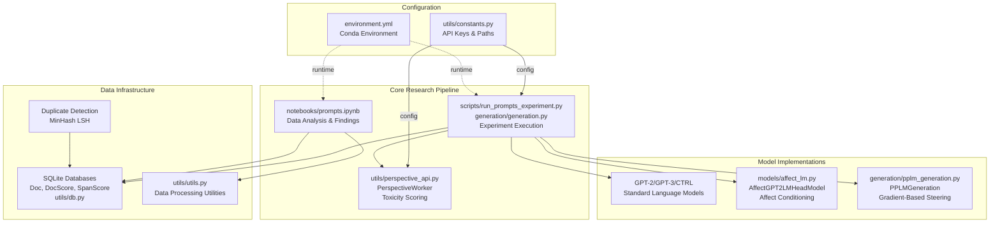
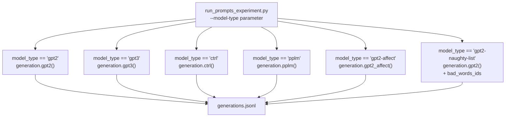
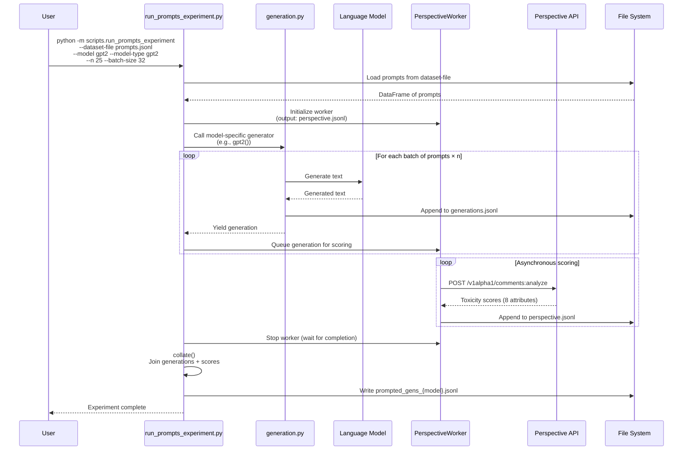

<!-- source: DeepWiki mcp.deepwiki.com · repo allenai/real-toxicity-prompts · page 1 Real Toxicity Prompts: Overview · fetched 2026-10-26 -->

# Real Toxicity Prompts: Overview

<details>
<summary>Relevant source files</summary>

The following files were used as context for generating this wiki page:

- [README.md](README.md)
- [environment.yml](environment.yml)
- [generation/generation.py](generation/generation.py)
- [generation/pplm_generation.py](generation/pplm_generation.py)
- [notebooks/prompts.ipynb](notebooks/prompts.ipynb)
- [notebooks/realtoxicityprompts_results.ipynb](notebooks/realtoxicityprompts_results.ipynb)
- [scripts/run_prompts_experiment.py](scripts/run_prompts_experiment.py)
- [utils/constants.py](utils/constants.py)

</details>


## Purpose and Scope

This document provides a comprehensive overview of the Real Toxicity Prompts (RTP) research system, introducing its goals, architecture, and major components. It serves as the entry point for understanding the codebase structure and research methodology.

For installation and setup instructions, see [Getting Started](#2). For detailed documentation on specific subsystems, refer to the respective sections: [Text Generation System](#3), [Toxicity Scoring System](#4), [Data Infrastructure](#5), and [Data Analysis](#7).

## Introduction

**Real Toxicity Prompts** is a research system designed to study toxicity in pretrained language models by evaluating how different prompts trigger toxic text generation. The system provides infrastructure for:

- Creating a curated dataset of **100,000 prompt-continuation pairs** extracted from web text, scored across 8 toxicity attributes
- Generating text completions using multiple language models (GPT-2, GPT-3, CTRL, PPLM, AffectGPT2)
- Scoring generated text for toxicity using Google's Perspective API
- Analyzing results to identify "adversarial prompts" that consistently trigger toxic outputs across all models

The research findings are published at https://arxiv.org/abs/2009.11462, with a public demo at https://toxicdegeneration.allenai.org/ and dataset available at https://allenai.org/data/real-toxicity-prompts.

**Sources:** [README.md:1-30]()

## System Architecture

The RTP system is organized into three architectural tiers that work together to execute the research pipeline:



**Sources:** [scripts/run_prompts_experiment.py:1-212](), [generation/generation.py:1-287](), [notebooks/prompts.ipynb:1-100](), [utils/perspective_api.py](), [utils/constants.py:1-51]()

### Core Research Pipeline

The research pipeline consists of three primary operations that execute in sequence:

| Component | Implementation | Purpose |
|-----------|---------------|---------|
| **Data Analysis** | [notebooks/prompts.ipynb:1-100]() | Load and analyze prompts, generations, and toxicity scores using pandas DataFrames with multi-level indexing |
| **Text Generation** | [scripts/run_prompts_experiment.py:44-212]() | Execute experiments that generate text from prompts using various language models |
| **Toxicity Scoring** | [utils/perspective_api.py]() | Score generated text asynchronously using Perspective API with rate limiting |

### Model Variants

The system supports two categories of language models:

**Standard Language Models:**
- GPT-2 (small, medium): [generation/generation.py:242-258]()
- GPT-3 (davinci): [generation/generation.py:261-286]()
- CTRL and CTRL-Wiki: [generation/generation.py:127-143]()
- OpenAI-GPT: [generation/generation.py:113-124]()

**Controllable Generation Models:**
- AffectGPT2: [models/affect_lm.py]() with β parameter for affect conditioning [generation/generation.py:217-239]()
- PPLM: [generation/pplm_generation.py:390-481]() with gradient-based perturbation
- GPT-2 with control codes: [generation/generation.py:186-214]()
- GPT-2 with naughty list filtering: [scripts/run_prompts_experiment.py:129-140]()

### Data Infrastructure

The data layer provides persistent storage and processing capabilities:

- **SQLite Database:** Stores documents (`Doc`), document-level scores (`DocScore`), and span-level scores (`SpanScore`)
- **Duplicate Detection:** MinHash LSH-based deduplication for corpus cleaning
- **Utilities:** Common functions in [utils/utils.py]() for batching, I/O operations, and corpus iteration

## Research Pipeline Stages

The RTP research methodology follows a five-stage pipeline that transforms raw text into scientific insights:

```mermaid
flowchart LR
    subgraph Stage1["Stage 1: Corpus Preparation"]
        A1["OpenWebText<br/>8M+ documents"]
        A2["MinHash LSH<br/>Duplicate Removal"]
        A3["SQLite Database<br/>Doc + Scores"]
        A1 --> A2 --> A3
    end
    
    subgraph Stage2["Stage 2: Prompt Creation"]
        B1["Query SpanScore<br/>Filter by toxicity"]
        B2["prompts.jsonl<br/>100K pairs"]
        A3 --> B1 --> B2
    end
    
    subgraph Stage3["Stage 3: Text Generation"]
        C1["run_prompts_experiment.py<br/>--model-type --n=25"]
        C2["GPT-2/GPT-3/CTRL<br/>PPLM/AffectGPT2"]
        C3["generations.jsonl<br/>2.5M completions"]
        B2 --> C1 --> C2 --> C3
    end
    
    subgraph Stage4["Stage 4: Toxicity Scoring"]
        D1["PerspectiveWorker<br/>Async batch processing"]
        D2["perspective.jsonl<br/>8 toxicity attributes"]
        C3 --> D1 --> D2
    end
    
    subgraph Stage5["Stage 5: Analysis"]
        E1["prompts.ipynb<br/>DataFrame analysis"]
        E2["Adversarial Prompts<br/>1,229 identified"]
        D2 --> E1 --> E2
    end
```



**Sources:** [scripts/run_prompts_experiment.py:44-212](), [generation/generation.py:1-287](), [notebooks/prompts.ipynb:46-94]()

### Stage 1: Corpus Preparation

Raw text from OpenWebText (8M+ documents) is processed through duplicate detection and stored in a SQLite database with pre-computed toxicity scores at both document and span levels.

**Key Files:**
- Database schema definition: [utils/db.py]()
- Perspective API integration for scoring: [utils/perspective_api.py]()

### Stage 2: Prompt Creation

The `prompts.jsonl` dataset contains 100,000 prompt-continuation pairs. Each pair consists of:
- **Prompt:** The first sentence(s) from a document span
- **Continuation:** The subsequent text that naturally follows

These pairs are extracted by querying the `SpanScore` table with specific toxicity criteria and processing with spaCy for sentence splitting. The dataset is loaded in analysis notebooks using the `load_prompts()` function: [notebooks/prompts.ipynb:62-79]()

### Stage 3: Text Generation

Text generation is orchestrated by [scripts/run_prompts_experiment.py:44-212](), which:

1. Loads prompts from `prompts.jsonl` via command-line argument `--dataset-file`
2. Dispatches to the appropriate model implementation based on `--model-type`
3. Generates `--n` completions per prompt (default: 25) with `--max-tokens` length (default: 20)
4. Writes generations incrementally to `generations.jsonl`

**Model Dispatcher Logic:**

The dispatcher in [scripts/run_prompts_experiment.py:106-195]() routes to different generation functions:



**Sources:** [scripts/run_prompts_experiment.py:15-16, 106-195](), [generation/generation.py:27-287]()

### Stage 4: Toxicity Scoring

The `PerspectiveWorker` class implements asynchronous toxicity scoring: [utils/perspective_api.py]()

Key characteristics:
- **Asynchronous Processing:** Queues requests and processes responses in a separate thread
- **Rate Limiting:** Respects `--perspective-rate-limit` (default: 25 requests/second)
- **Eight Attributes:** Scores each text for `TOXICITY`, `SEVERE_TOXICITY`, `IDENTITY_ATTACK`, `INSULT`, `THREAT`, `PROFANITY`, `SEXUALLY_EXPLICIT`, `FLIRTATION` [utils/constants.py:40-50]()
- **Output Format:** Writes scores to `perspective.jsonl`

The scoring process is triggered during generation: [scripts/run_prompts_experiment.py:100-102, 199-201]()

### Stage 5: Analysis

Analysis is performed in Jupyter notebooks, primarily [notebooks/prompts.ipynb:1-100](). The analysis workflow:

1. **Load Prompts:** [notebooks/prompts.ipynb:62-79]() creates a DataFrame with multi-level index `(filename, begin, end)`
2. **Load Generations:** [notebooks/prompts.ipynb:89-93]() loads model outputs with an additional index level for generation number
3. **Combine Data:** Creates a unified DataFrame with columns organized as `(model_name, attribute)`
4. **Identify Adversarial Prompts:** Finds prompts that consistently produce toxic outputs across all models

The DataFrame structure uses pandas multi-level indexing:

| Index Levels | Column Levels | Purpose |
|--------------|--------------|---------|
| `filename`, `begin`, `end` | `prompts`/`continuations`, then toxicity attributes | Original prompt-continuation pairs |
| `filename`, `begin`, `end`, `i` | Model name, then toxicity attributes | Generated completions (i=0..24) |

**Sources:** [notebooks/prompts.ipynb:46-94, 456-518]()

## Key Data Files and Formats

### Input: Prompts Dataset

**File:** `prompts.jsonl` (JSONL format, one prompt per line)

Each line contains:
```json
{
  "filename": "...",
  "begin": 123,
  "end": 456,
  "prompt": {
    "text": "...",
    "toxicity": 0.123,
    "severe_toxicity": 0.045,
    ...
  },
  "continuation": {
    "text": "...",
    "toxicity": 0.089,
    ...
  }
}
```

### Output: Generated Text with Scores

**File:** `prompted_gens_{model_type}.jsonl`

Each line corresponds to one prompt and contains:
```json
{
  "filename": "...",
  "begin": 123,
  "end": 456,
  "prompt": {...},
  "continuation": {...},
  "generations": [
    {
      "text": "generated text",
      "toxicity": 0.234,
      "severe_toxicity": 0.067,
      ...
    },
    ... // 24 more generations
  ]
}
```

**Sources:** [scripts/run_prompts_experiment.py:28-42](), [notebooks/prompts.ipynb:62-93]()

## Environment and Configuration

### Conda Environment

The system requires Python 3.8 with specific dependencies defined in [environment.yml:1-36]():

**Key Dependencies:**
- **Deep Learning:** pytorch, transformers (Hugging Face)
- **APIs:** google-api-python-client (Perspective), openai (GPT-3)
- **Data Processing:** pandas, numpy, sqlalchemy, datasketch (MinHash)
- **NLP:** spacy, nltk
- **Utilities:** tqdm, click, jupyter

**Installation:**
```bash
conda env create -f environment.yml
conda activate rtp
```

### API Configuration

API keys are loaded from `config.yml` by [utils/constants.py:9-18]():

```python
PERSPECTIVE_API_KEY = ''  # Google Perspective API
OPENAI_API_KEY = ''       # OpenAI GPT-3 API
```

**Data Paths:** [utils/constants.py:21-31]()
- `SHARED_DIR`: Base directory for all data (`/data/language-model-toxicity`)
- `DATA_DIR`: Raw data and databases
- `OUTPUT_DIR`: Experiment outputs

**Sources:** [environment.yml:1-36](), [utils/constants.py:1-51](), [README.md:8-24]()

## Experiment Execution Flow

The complete flow from command-line invocation to output generation:



**Sources:** [scripts/run_prompts_experiment.py:44-212](), [generation/generation.py:146-184](), [utils/perspective_api.py]()

## System Entry Points

The primary ways to interact with the RTP system:

### 1. Running Generation Experiments

**Command:** [scripts/run_prompts_experiment.py:44-58]()

```bash
python -m scripts.run_prompts_experiment output_dir/ \
  --dataset-file prompts.jsonl \
  --model gpt2 \
  --model-type gpt2 \
  --n 25 \
  --max-tokens 20 \
  --batch-size 32 \
  --perspective-rate-limit 25
```

**Supported Model Types:** [scripts/run_prompts_experiment.py:15-16]()
- `gpt2`, `gpt2-greedy`, `gpt2-naughty-list`, `gpt2-affect`, `gpt2-ctrl`
- `gpt3`
- `ctrl`, `openai-gpt`, `xlnet`
- `pplm`

### 2. Analysis in Notebooks

**Primary Notebook:** [notebooks/prompts.ipynb:1-100]()

Key functions for loading data:
- `load_prompts(file)`: [notebooks/prompts.ipynb:62-79]()
- `load_generations(file, index)`: [notebooks/prompts.ipynb:89-93]()

### 3. Model Evaluation

Evaluate model perplexity on WebText corpus (see [Model Evaluation on WebText](#6.2))

**Sources:** [scripts/run_prompts_experiment.py:44-212](), [notebooks/prompts.ipynb:46-94](), [README.md:16-29]()

## Next Steps

To get started with the Real Toxicity Prompts system:

1. **Installation:** Follow the setup instructions in [Installation and Environment Setup](#2.1)
2. **First Experiment:** Run your first generation experiment as described in [Running Your First Experiment](#2.2)
3. **Dive Deeper:** Explore specific subsystems:
   - Text generation: [Text Generation System](#3)
   - Toxicity scoring: [Toxicity Scoring System](#4)
   - Data processing: [Data Infrastructure](#5)
   - Analysis methods: [Data Analysis and Research Findings](#7)

For questions or issues, refer to the GitHub repository at https://github.com/allenai/real-toxicity-prompts.

**Sources:** [README.md:1-30]()

---

