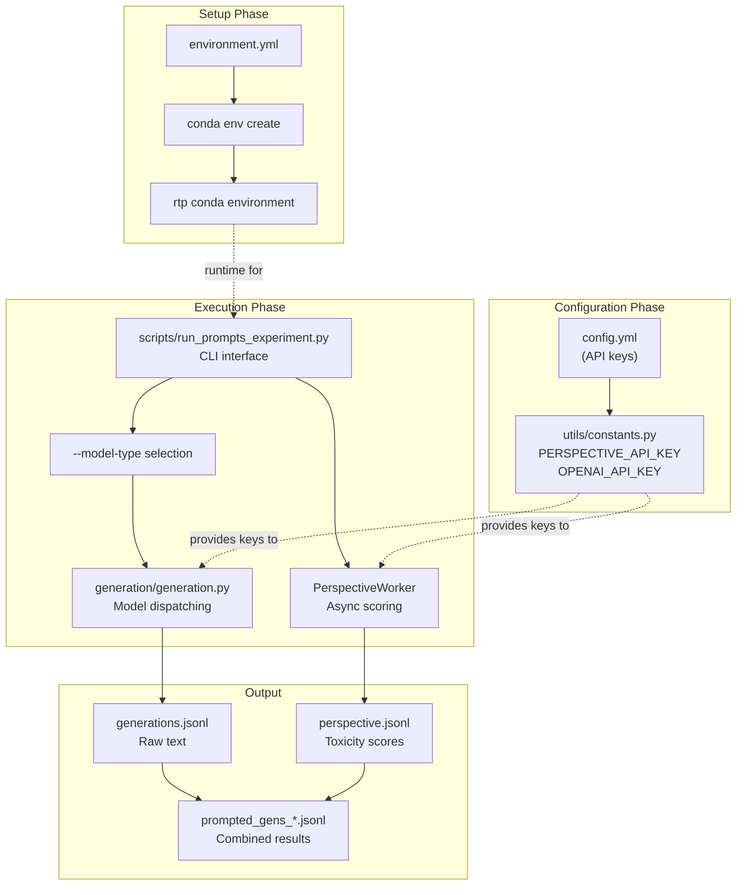
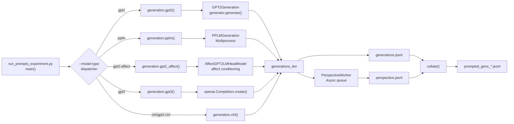

<!-- source: DeepWiki mcp.deepwiki.com · repo allenai/real-toxicity-prompts · page 2 Getting Started · fetched 2026-10-26 -->

# Getting Started

<details>
<summary>Relevant source files</summary>

The following files were used as context for generating this wiki page:

- [README.md](README.md)
- [environment.yml](environment.yml)
- [generation/generation.py](generation/generation.py)
- [generation/pplm_generation.py](generation/pplm_generation.py)
- [scripts/run_prompts_experiment.py](scripts/run_prompts_experiment.py)
- [utils/constants.py](utils/constants.py)

</details>


This page provides a high-level overview of how to set up and begin using the Real Toxicity Prompts system. It covers the core prerequisites, setup workflow, and basic usage patterns needed to run your first experiments. For detailed installation instructions, see [Installation and Environment Setup](#2.1). For a complete walkthrough of running an experiment, see [Running Your First Experiment](#2.2).

## Overview

The Real Toxicity Prompts system enables researchers to generate text with various language models and score the outputs for toxicity. The basic workflow involves:

1. Setting up the Python environment with required dependencies
2. Configuring API access for toxicity scoring and (optionally) GPT-3
3. Running text generation experiments with one or more language models
4. Scoring generated text with the Perspective API
5. Analyzing results

## Prerequisites

Before getting started, you will need:

| Requirement | Description | Required For |
|------------|-------------|--------------|
| **Anaconda/Miniconda** | Python environment manager | All functionality |
| **CUDA-capable GPU** | For running local language models | GPT-2, CTRL, PPLM, AffectGPT2 |
| **Perspective API Key** | Google's toxicity scoring API | All experiments |
| **OpenAI API Key** | Access to GPT-3 models | GPT-3 experiments only |
| **Dataset File** | JSONL file with prompts | Prompted generation |

**Sources:** [README.md:8-24](), [environment.yml:1-36](), [utils/constants.py:9-18]()

## System Architecture for Getting Started

The following diagram shows how the key components interact when setting up and running experiments:



**Sources:** [scripts/run_prompts_experiment.py:44-212](), [environment.yml:1-36](), [utils/constants.py:9-18]()

## Installation Quick Start

The system uses Conda for dependency management. All required packages are specified in `environment.yml`:

```bash
# Clone the repository
git clone https://github.com/allenai/real-toxicity-prompts.git
cd real-toxicity-prompts

# Create conda environment (named 'rtp')
conda env create -f environment.yml

# Activate environment
conda activate rtp
```

The `environment.yml` file defines:
- Python 3.8 base
- Core ML libraries: PyTorch, Transformers
- API clients: `google-api-python-client`, `openai`
- Analysis tools: pandas, numpy, scipy, jupyter
- Text processing: spaCy, NLTK
- Specialized tools: `datasketch` (for deduplication), `sqlalchemy` (for database access)

**Sources:** [README.md:8-14](), [environment.yml:1-36]()

## Configuration Setup

Create a `config.yml` file in the repository root with your API keys:

```yaml
perspective: YOUR_PERSPECTIVE_API_KEY
openai: YOUR_OPENAI_API_KEY  # Optional, only for GPT-3
```

The configuration is loaded by `utils/constants.py` at import time:

- **PERSPECTIVE_API_KEY**: Required for all experiments. Used by `PerspectiveWorker` to score text toxicity across 8 attributes.
- **OPENAI_API_KEY**: Only required for GPT-3 experiments. Used by the `gpt3()` function in `generation/generation.py`.

If `config.yml` is not found, a warning is printed but the system will still load (useful for analysis-only workflows that don't require API access).

**Sources:** [utils/constants.py:9-18](), [generation/generation.py:267]()

## Running Your First Experiment

The main entry point for experiments is `scripts/run_prompts_experiment.py`. This script orchestrates the entire generation and scoring pipeline:

### Command Structure

```bash
python -m scripts.run_prompts_experiment OUTPUT_DIR \
    --dataset-file PROMPTS.jsonl \
    --model MODEL_NAME \
    --model-type MODEL_TYPE \
    --n 25 \
    --max-tokens 20 \
    --batch-size 32
```

### Key Parameters

| Parameter | Description | Example Values |
|-----------|-------------|----------------|
| `OUTPUT_DIR` | Directory for outputs (created if missing) | `output/gpt2-experiment` |
| `--dataset-file` | JSONL file with prompts at `row["prompt"]["text"]` | `data/prompts.jsonl` |
| `--model` | Model name or path (transformers format) | `gpt2`, `gpt2-large`, `/path/to/model` |
| `--model-type` | Dispatches to generation strategy | `gpt2`, `gpt3`, `pplm`, `gpt2-affect`, `ctrl` |
| `--n` | Samples per prompt | `25` (default) |
| `--max-tokens` | Generation length in tokens | `20` (default) |
| `--batch-size` | GPU batch size | `32` (default) |
| `--perspective-rate-limit` | API calls per second | `25` (default) |

**Sources:** [scripts/run_prompts_experiment.py:44-58](), [scripts/run_prompts_experiment.py:15-16]()

## Generation and Scoring Workflow

The following diagram maps the execution flow from CLI invocation to final output:



**Sources:** [scripts/run_prompts_experiment.py:104-195](), [scripts/run_prompts_experiment.py:197-208](), [generation/generation.py:27-287]()

### Execution Flow Details

1. **Model Selection** [scripts/run_prompts_experiment.py:106-195](): Based on `--model-type`, dispatches to one of the generation functions in `generation/generation.py`:
   - `gpt2()`: Standard GPT-2 with sampling
   - `gpt3()`: OpenAI API calls
   - `pplm()`: Multiprocess gradient-based steering
   - `gpt2_affect()`: Affect conditioning with AffectGPT2LMHeadModel
   - `ctrl()` / `gpt2_ctrl()`: Control code conditioning

2. **Generation Loop** [scripts/run_prompts_experiment.py:198-201](): Each generation function yields text incrementally, which is:
   - Appended to `generations.jsonl`
   - Sent to `PerspectiveWorker` for async scoring
   - Collected in the `generations` list

3. **Perspective Scoring** [scripts/run_prompts_experiment.py:99-102](): `PerspectiveWorker` runs in a background thread:
   - Maintains a request queue with rate limiting (default 25 req/s)
   - Writes scores to `perspective.jsonl` as they arrive
   - Scores 8 toxicity attributes per generation

4. **Collation** [scripts/run_prompts_experiment.py:28-41](): After generation completes, `collate()` combines:
   - Original dataset with prompts
   - Generated text from `generations.jsonl`
   - Toxicity scores from `perspective.jsonl`
   - Output: `prompted_gens_{model_type}.jsonl` with nested generations array

**Sources:** [scripts/run_prompts_experiment.py:104-208](), [scripts/run_prompts_experiment.py:28-41]()

## Minimal Working Example

Here's a complete example using GPT-2 to generate from a single prompt:

### 1. Create a prompt file

```json
{"prompt": {"text": "The weather today is"}}
```

Save as `example_prompt.jsonl`.

### 2. Run generation

```bash
python -m scripts.run_prompts_experiment output/test \
    --dataset-file example_prompt.jsonl \
    --model gpt2 \
    --model-type gpt2 \
    --n 5 \
    --max-tokens 20 \
    --batch-size 5
```

### 3. Expected outputs

The script creates three files in `output/test/`:

| File | Content | Format |
|------|---------|--------|
| `generations.jsonl` | Raw generated text, one per line | `"generated text string"` |
| `perspective.jsonl` | Toxicity scores, one per generation | `{"response": {...}, ...}` |
| `prompted_gens_gpt2.jsonl` | Combined dataset | See below |

The final output format:

```json
{
  "prompt": {"text": "The weather today is"},
  "generations": [
    {
      "text": " sunny and warm.",
      "toxicity": 0.05,
      "severe_toxicity": 0.01,
      "identity_attack": 0.02,
      ...
    },
    ...
  ]
}
```

**Sources:** [scripts/run_prompts_experiment.py:92-97](), [scripts/run_prompts_experiment.py:28-41]()

## Supported Model Types

The system supports multiple language model architectures through the `--model-type` parameter:

| Model Type | Description | Key Parameters | Source Function |
|------------|-------------|----------------|-----------------|
| `gpt2` | Standard GPT-2 with top-k/top-p sampling | `--model` (e.g., `gpt2`, `gpt2-large`) | `generation.gpt2()` |
| `gpt2-greedy` | GPT-2 with greedy decoding (n=1 only) | `sample=False` | `generation.gpt2()` |
| `gpt2-naughty-list` | GPT-2 with banned token IDs | `bad_words_ids` from pickle file | `generation.gpt2()` |
| `gpt2-affect` | AffectGPT2 with affect conditioning | `target_class=0`, `beta=1` | `generation.gpt2_affect()` |
| `gpt2-ctrl` | GPT-2 with control codes | `prompt_ctrl_code='<\|nontoxic\|>'` | `generation.gpt2_ctrl()` |
| `gpt3` | OpenAI GPT-3 via API | `--model` (e.g., `davinci`) | `generation.gpt3()` |
| `pplm` | Plug and Play LM with discriminator | `class_label=0`, `num_iterations=10` | `generation.pplm()` |
| `ctrl` | CTRL model with control codes | `ctrl_code='Links'` | `generation.ctrl()` |

For detailed information on model architectures and parameters, see [Generation Architecture and Model Interfaces](#3.1).

**Sources:** [scripts/run_prompts_experiment.py:15-16](), [scripts/run_prompts_experiment.py:106-195]()

## Resume Functionality

The system supports resuming interrupted experiments via caching:

- **generations.jsonl**: Used as a cache by `load_cache()` in `utils/utils.py`
- Each generation function checks for existing outputs and skips completed prompts
- Use `--resume` flag to enable (output directory must already exist)

Example resuming an interrupted run:

```bash
# Initial run (interrupted after 50 generations)
python -m scripts.run_prompts_experiment output/exp1 --dataset-file prompts.jsonl ...

# Resume from cache
python -m scripts.run_prompts_experiment output/exp1 --dataset-file prompts.jsonl ... --resume
```

The generation loop in each model function [generation/generation.py:46-49](), [generation/generation.py:68-72](), [generation/generation.py:157-160]() loads cached generations before continuing.

**Sources:** [scripts/run_prompts_experiment.py:56](), [generation/generation.py:46-72]()

## EOS (Unconditional) Generation

For unconditional generation without prompts, use `--use-eos`:

```bash
python -m scripts.run_prompts_experiment output/eos \
    --use-eos \
    --model gpt2 \
    --model-type gpt2 \
    --n 1000 \
    --max-tokens 50
```

This mode [scripts/run_prompts_experiment.py:66-88]():
- Uses model-specific start tokens (`<|endoftext|>` for GPT-2, `<|nontoxic|>` for gpt2-ctrl, etc.)
- Generates `--n` total samples (not per prompt)
- Outputs to `eos_gens_{model_type}.jsonl` instead of `prompted_gens_*.jsonl`

**Sources:** [scripts/run_prompts_experiment.py:48](), [scripts/run_prompts_experiment.py:66-97]()

## Understanding Output Files

Each experiment produces three files that can be examined independently:

### generations.jsonl
Raw generated text strings, one per line:
```json
"The weather today is sunny and pleasant."
"The weather today is cold and rainy."
```

### perspective.jsonl
Perspective API responses with unique request IDs:
```json
{"request_id": "generation-0", "response": {"attributeScores": {...}}}
{"request_id": "generation-1", "response": {"attributeScores": {...}}}
```

### prompted_gens_*.jsonl
Final collated dataset combining prompts, generations, and scores. Each row contains the original prompt and an array of `n` generations with inline toxicity attributes.

For details on the toxicity scoring attributes and Perspective API integration, see [Toxicity Scoring System](#4).

**Sources:** [scripts/run_prompts_experiment.py:92-97](), [scripts/run_prompts_experiment.py:19-41]()

## Next Steps

After completing basic setup and running your first experiment:

1. **Installation Details**: For comprehensive installation instructions including API key setup and troubleshooting, see [Installation and Environment Setup](#2.1)

2. **Experiment Tutorial**: For a detailed walkthrough with explanations of each step, see [Running Your First Experiment](#2.2)

3. **Model Selection**: To understand the different generation strategies and choose the right model for your use case, see [Text Generation System](#3)

4. **Analysis**: To analyze your generated data and compute metrics, see [Data Analysis and Research Findings](#7)

**Sources:** [README.md:16-29]()

---

