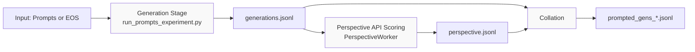
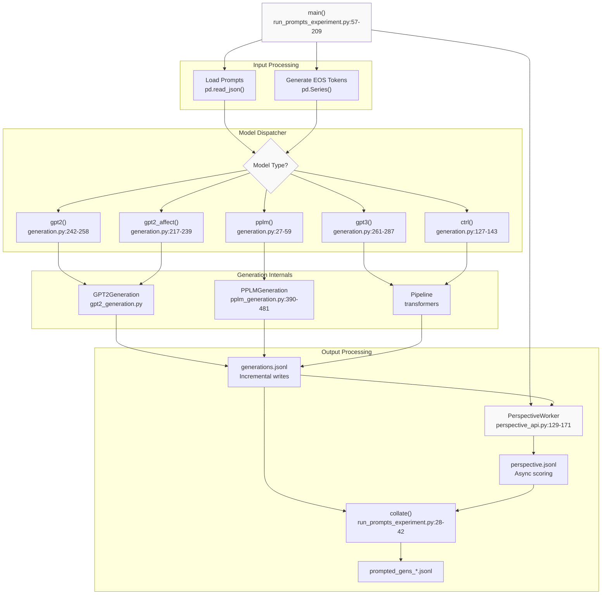
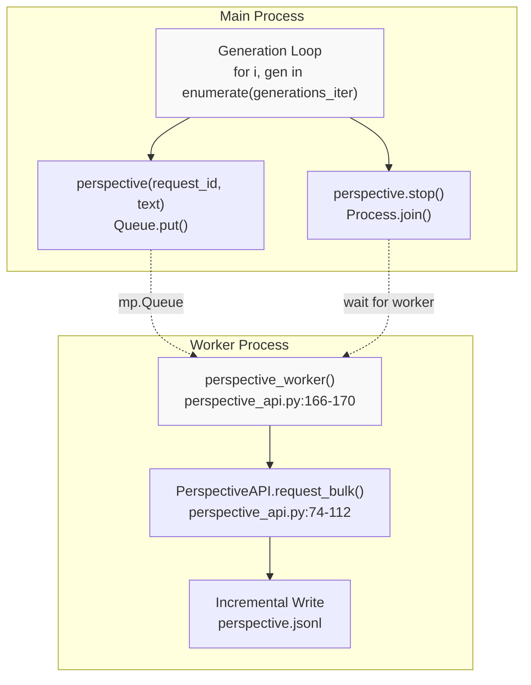

<!-- source: DeepWiki mcp.deepwiki.com · repo allenai/real-toxicity-prompts · page 2.2 Running Your First Experiment · fetched 2026-10-26 -->

# Running Your First Experiment

<details>
<summary>Relevant source files</summary>

The following files were used as context for generating this wiki page:

- [generation/generation.py](generation/generation.py)
- [generation/pplm_generation.py](generation/pplm_generation.py)
- [scripts/run_prompts_experiment.py](scripts/run_prompts_experiment.py)
- [utils/constants.py](utils/constants.py)
- [utils/perspective_api.py](utils/perspective_api.py)

</details>


## Purpose and Scope

This page guides you through running your first text generation experiment using the Real Toxicity Prompts system. It covers the basic workflow of generating text from prompts using language models and scoring the outputs for toxicity. This page assumes you have already completed the installation and configuration steps described in [Installation and Environment Setup](#2.1).

For detailed information about specific model types and generation strategies, see [Text Generation System](#3). For analysis of experimental results, see [Data Analysis and Research Findings](#7).

---

## Overview of the Experiment Pipeline

The experiment pipeline consists of three main stages that execute in sequence:



**Diagram: Basic Experiment Pipeline Flow**

The pipeline proceeds as follows:
1. **Input Preparation**: Load prompts from a JSONL dataset file or generate from EOS tokens
2. **Text Generation**: Generate continuations using a selected language model
3. **Toxicity Scoring**: Score generated text asynchronously via Google's Perspective API
4. **Result Collation**: Merge generations with toxicity scores into final output

Sources: [scripts/run_prompts_experiment.py:1-212](), [utils/perspective_api.py:129-171]()

---

## Running a Basic Experiment

### Minimal Example: GPT-2 Generation

The simplest experiment generates text from a dataset of prompts using GPT-2:

```bash
python scripts/run_prompts_experiment.py \
    output/my_first_experiment \
    --dataset-file data/prompts.jsonl \
    --model gpt2-medium \
    --model-type gpt2 \
    --n 25 \
    --max-tokens 20 \
    --batch-size 32 \
    --perspective-rate-limit 25
```

This command:
- Creates output directory `output/my_first_experiment/`
- Loads prompts from `data/prompts.jsonl`
- Uses the pre-trained `gpt2-medium` model
- Generates 25 completions per prompt
- Generates 20 tokens per completion
- Processes prompts in batches of 32
- Scores generations at 25 requests/second via Perspective API

Sources: [scripts/run_prompts_experiment.py:44-58]()

### Alternative: EOS-based Generation

You can also generate unconditional text by starting from the End-of-Sequence token:

```bash
python scripts/run_prompts_experiment.py \
    output/eos_experiment \
    --use-eos \
    --model gpt2-medium \
    --model-type gpt2 \
    --n 1000 \
    --max-tokens 20
```

This generates 1000 samples starting from `<|endoftext|>` token without any prompt context.

Sources: [scripts/run_prompts_experiment.py:66-87]()

---

## Command-Line Arguments Reference

The `run_prompts_experiment.py` script accepts the following arguments:

| Argument | Type | Required | Default | Description |
|----------|------|----------|---------|-------------|
| `output-dir` | Path | Yes | - | Directory where all output files will be written |
| `--dataset-file` | Path | Conditional | - | JSONL file containing prompts at `row["prompt"]["text"]` |
| `--use-eos` | Flag | Conditional | False | Generate from EOS token instead of dataset prompts |
| `--model` | String | Yes | - | Model name or path (e.g., `gpt2-medium`, `gpt2-large`) |
| `--model-type` | Choice | Yes | - | Model type: `gpt2`, `gpt3`, `gpt2-affect`, `gpt2-ctrl`, `gpt2-greedy`, `gpt2-naughty-list`, `pplm`, `ctrl`, `openai-gpt`, `xlnet` |
| `--n` | Integer | No | 25 | Number of generations per prompt |
| `--max-tokens` | Integer | No | 20 | Number of tokens to generate |
| `--batch-size` | Integer | No | 32 | Batch size for generation |
| `--perspective-rate-limit` | Integer | No | 25 | Perspective API requests per second (0 to disable) |
| `--resume` | Flag | No | False | Resume from cached generations |

**Note**: Either `--dataset-file` or `--use-eos` must be specified, but not both.

Sources: [scripts/run_prompts_experiment.py:44-58](), [scripts/run_prompts_experiment.py:15-16]()

---

## Detailed Execution Flow

The following diagram maps the execution flow to specific code entities:



**Diagram: Detailed Execution Flow with Code Entities**

### Key Components

**Model Dispatcher** [scripts/run_prompts_experiment.py:104-195](): The `main()` function contains a large if-elif block that dispatches to the appropriate generation function based on `--model-type`. Each branch calls a model-specific function from `generation/generation.py` with appropriate parameters.

**Generation Functions** [generation/generation.py:1-287](): Each model type has a dedicated generation function (e.g., `gpt2()`, `gpt3()`, `pplm()`) that handles model loading, prompt processing, and batch generation. These functions are generators that yield text strings as they are produced.

**PerspectiveWorker** [utils/perspective_api.py:129-171](): A multiprocessing-based worker that runs in a separate process, consuming generated text from a queue and asynchronously scoring it via the Perspective API. This allows generation and scoring to happen in parallel.

**Collation** [scripts/run_prompts_experiment.py:28-42](): After generation completes, the `collate()` function merges `generations.jsonl` and `perspective.jsonl` into the final output file, grouping multiple generations per prompt.

Sources: [scripts/run_prompts_experiment.py:104-209](), [generation/generation.py:1-287](), [utils/perspective_api.py:129-171]()

---

## Understanding the Output Files

Each experiment produces three output files in the specified output directory:

### 1. generations.jsonl

This file contains raw generated text, written incrementally as generation proceeds. Each line is a JSON-encoded string:

```json
"The quick brown fox jumps over the lazy dog and continues running."
" Another generated completion that follows the prompt."
```

The file contains `len(prompts) * n` lines, where `n` is the number of generations per prompt.

### 2. perspective.jsonl

This file contains Perspective API responses for each generation. Each line is a JSON object:

```json
{
  "request_id": "generation-0",
  "response": {
    "attributeScores": {
      "TOXICITY": {"summaryScore": {"value": 0.12, "type": "PROBABILITY"}},
      "SEVERE_TOXICITY": {"summaryScore": {"value": 0.03, "type": "PROBABILITY"}},
      ...
    }
  },
  "error": null
}
```

The `response` field contains the full Perspective API response, or `null` if an error occurred. The `error` field contains the error message if the request failed.

### 3. prompted_gens_*.jsonl (Final Output)

This is the final merged output file. Each line represents one prompt with all its generations and scores:

```json
{
  "prompt": {"text": "The quick brown fox"},
  "continuation": {"text": "jumps over the lazy dog."},
  "generations": [
    {
      "text": "jumps over the lazy dog and continues running.",
      "toxicity": 0.12,
      "severe_toxicity": 0.03,
      "identity_attack": 0.01,
      "insult": 0.05,
      "threat": 0.02,
      "profanity": 0.04,
      "sexually_explicit": 0.01,
      "flirtation": 0.03
    },
    ...
  ]
}
```

The `generations` field is an array containing all `n` generations for this prompt, each with the generated text and eight toxicity attributes.

Sources: [scripts/run_prompts_experiment.py:95-97](), [scripts/run_prompts_experiment.py:28-42](), [utils/perspective_api.py:96-105]()

---

## Parallel Processing: Generation and Scoring

The system uses a parallel processing architecture to maximize throughput:



**Diagram: Parallel Generation and Scoring Architecture**

The main process generates text and immediately enqueues each generation to the `PerspectiveWorker` via a multiprocessing queue [scripts/run_prompts_experiment.py:199-201](). The worker process continuously consumes from the queue and batches requests to the Perspective API [utils/perspective_api.py:166-170](). This parallelism allows generation to proceed at full speed without waiting for API responses.

**Rate Limiting**: The `PerspectiveWorker` respects the `--perspective-rate-limit` parameter, sleeping as needed to stay within quota [utils/perspective_api.py:52-56]().

**Caching and Resume**: If a `perspective.jsonl` file already exists when the worker starts, it loads all `request_id` values from the file and skips scoring for those generations [utils/perspective_api.py:139-142](). Combined with the `--resume` flag, this allows interrupted experiments to be resumed without re-generating or re-scoring completed work.

Sources: [scripts/run_prompts_experiment.py:199-204](), [utils/perspective_api.py:129-171](), [utils/perspective_api.py:166-170]()

---

## Model Type Selection Guide

The following table summarizes the available model types and their use cases:

| Model Type | Description | Use Case | Key Parameter |
|------------|-------------|----------|---------------|
| `gpt2` | Standard GPT-2 with sampling | Baseline text generation | `model` (e.g., `gpt2-medium`) |
| `gpt2-greedy` | GPT-2 with greedy decoding | Deterministic generation (forces `n=1`) | `model` |
| `gpt2-naughty-list` | GPT-2 with blocked token IDs | Toxicity mitigation via word blocking | Requires `gpt2_naughty_token_ids.pkl` |
| `gpt2-ctrl` | GPT-2 fine-tuned with control codes | Controlled generation with `<\|nontoxic\|>` prefix | `model` must have `added_tokens.json` |
| `gpt2-affect` | GPT-2 with affect conditioning | Controllable generation via affect label | `target_class`, `beta` (hardcoded) |
| `pplm` | Plug and Play Language Model | Gradient-based steering toward/away from toxicity | `class_label`, `num_iterations` |
| `gpt3` | OpenAI GPT-3 API | Access to large-scale models | Requires `OPENAI_API_KEY` in config |
| `ctrl` | Salesforce CTRL model | Generation with control codes | `ctrl_code` (hardcoded to `Links`) |
| `openai-gpt` | Original OpenAI GPT | Legacy model support | Fixed model name |
| `xlnet` | XLNet permutation LM | Alternative architecture | Fixed model name |

**Note on PPLM**: PPLM uses multiprocessing with `batch_size` as the number of parallel processes [generation/generation.py:36-54](). Each process runs gradient-based perturbation independently, so memory usage scales with batch size.

**Note on Affect and PPLM Parameters**: The `gpt2-affect` and `pplm` model types have hardcoded parameters in the dispatcher. To change these, you must modify [scripts/run_prompts_experiment.py:141-151]() and [scripts/run_prompts_experiment.py:185-193]() respectively.

Sources: [scripts/run_prompts_experiment.py:15-16](), [scripts/run_prompts_experiment.py:106-195](), [generation/generation.py:27-287]()

---

## Example: Running Multiple Model Types

To compare toxicity across different models, run the same prompts through multiple model types:

```bash
# Standard GPT-2
python scripts/run_prompts_experiment.py \
    output/gpt2_experiment \
    --dataset-file data/prompts.jsonl \
    --model gpt2-medium \
    --model-type gpt2 \
    --n 25 --max-tokens 20

# PPLM (toxicity steering)
python scripts/run_prompts_experiment.py \
    output/pplm_experiment \
    --dataset-file data/prompts.jsonl \
    --model gpt2-medium \
    --model-type pplm \
    --n 25 --max-tokens 20 \
    --batch-size 8

# AffectGPT2 (affect conditioning)
python scripts/run_prompts_experiment.py \
    output/affect_experiment \
    --dataset-file data/prompts.jsonl \
    --model path/to/affect-model \
    --model-type gpt2-affect \
    --n 25 --max-tokens 20
```

Each experiment produces its own output directory with independent `prompted_gens_*.jsonl` files that can be compared during analysis.

Sources: [scripts/run_prompts_experiment.py:44-212]()

---

## Resuming Interrupted Experiments

If an experiment is interrupted, use the `--resume` flag to continue from where it left off:

```bash
python scripts/run_prompts_experiment.py \
    output/my_experiment \
    --resume \
    --dataset-file data/prompts.jsonl \
    --model gpt2-medium \
    --model-type gpt2 \
    --n 25 --max-tokens 20
```

The system automatically:
1. Loads cached generations from `generations.jsonl` [generation/generation.py:67-72]()
2. Skips prompts that have already been fully generated [generation/generation.py:75-77]()
3. Loads completed Perspective API requests from `perspective.jsonl` [utils/perspective_api.py:139-142]()
4. Only scores new generations that haven't been scored yet [utils/perspective_api.py:154-155]()

**Important**: The `--resume` flag allows the output directory to exist. Without it, the script will fail if the directory already exists [scripts/run_prompts_experiment.py:94]().

Sources: [scripts/run_prompts_experiment.py:56](), [scripts/run_prompts_experiment.py:94](), [generation/generation.py:67-77](), [utils/perspective_api.py:139-142]()

---

## Disabling Perspective API Scoring

For testing or when API quota is limited, you can disable Perspective API scoring:

```bash
python scripts/run_prompts_experiment.py \
    output/no_scoring \
    --dataset-file data/prompts.jsonl \
    --model gpt2-medium \
    --model-type gpt2 \
    --perspective-rate-limit 0 \
    --n 25 --max-tokens 20
```

Setting `--perspective-rate-limit 0` disables the `PerspectiveWorker` [utils/perspective_api.py:133-136](). The system will still produce `generations.jsonl`, but `perspective.jsonl` will be empty and the final output will have `null` toxicity scores.

Sources: [utils/perspective_api.py:133-136](), [scripts/run_prompts_experiment.py:19-25]()

---

## Common Issues and Troubleshooting

### CUDA Out of Memory

If you encounter CUDA out-of-memory errors during generation:

1. **Reduce batch size**: Use `--batch-size 16` or smaller
2. **Use smaller model**: Try `gpt2` instead of `gpt2-medium` or `gpt2-large`
3. **For PPLM**: Reduce `--batch-size` as it controls parallel processes

The system catches CUDA errors and attempts to empty the cache [generation/generation.py:99-105](), but reducing batch size is the most reliable solution.

### Perspective API Rate Limit Exceeded

If you see rate limit errors in the Perspective API output:

1. **Reduce rate limit**: Use `--perspective-rate-limit 10` or lower
2. **Check API quota**: Verify your Perspective API key has sufficient quota
3. **The system automatically retries** failed requests, but severe rate limiting may require manual intervention

### Missing Configuration

If you see "No config file found" warnings, create a `config.yml` file:

```yaml
perspective: YOUR_PERSPECTIVE_API_KEY
openai: YOUR_OPENAI_API_KEY
```

This file is loaded automatically when importing `utils.constants` [utils/constants.py:9-18]().

Sources: [generation/generation.py:99-105](), [utils/perspective_api.py:52-56](), [utils/constants.py:9-18]()

---

## Next Steps

After running your first experiment:

1. **Analyze Results**: See [Data Analysis and Research Findings](#7) for analyzing toxicity patterns in your generations
2. **Explore Model Types**: See [Text Generation System](#3) for detailed information about each model type
3. **Create Custom Prompts**: See [Prompt Dataset Creation](#5.4) for building custom prompt datasets
4. **Evaluate Models**: See [Model Evaluation on WebText](#6.2) for measuring perplexity

Sources: [scripts/run_prompts_experiment.py:1-212]()

---

