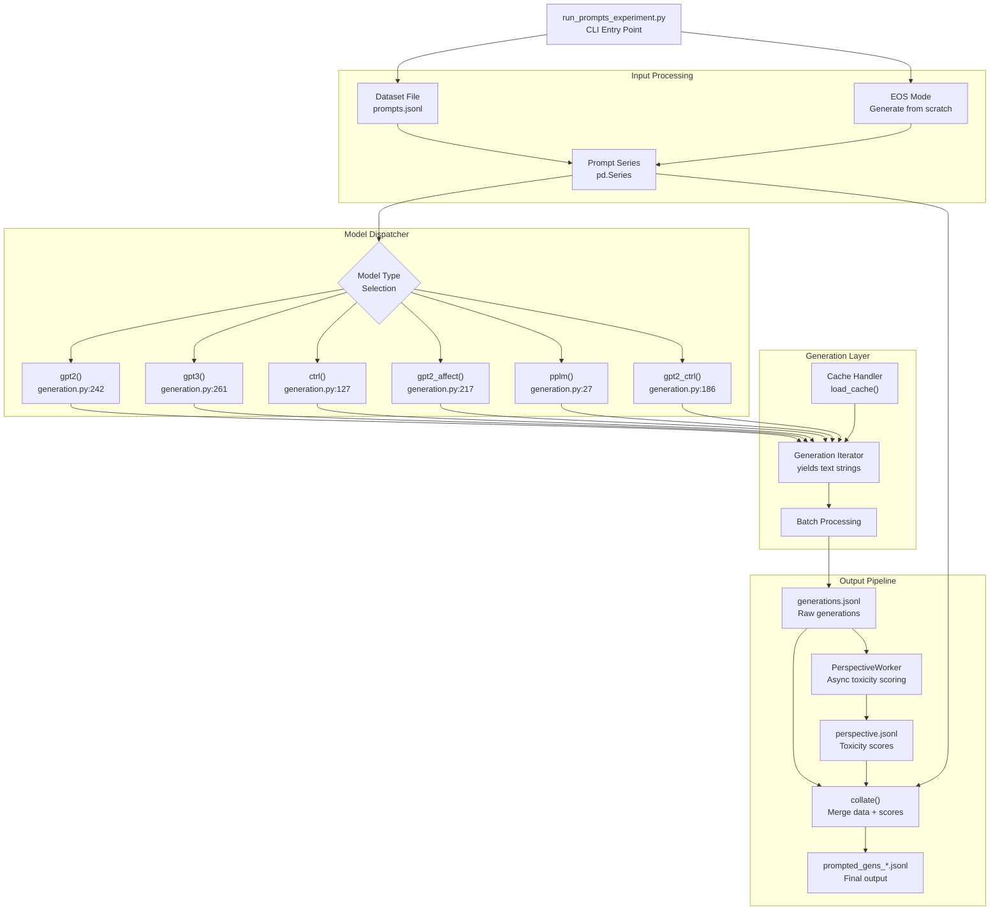
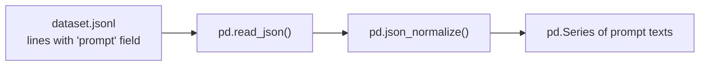
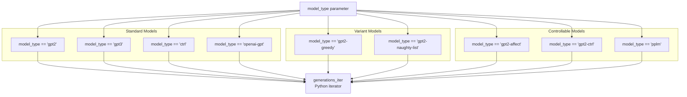
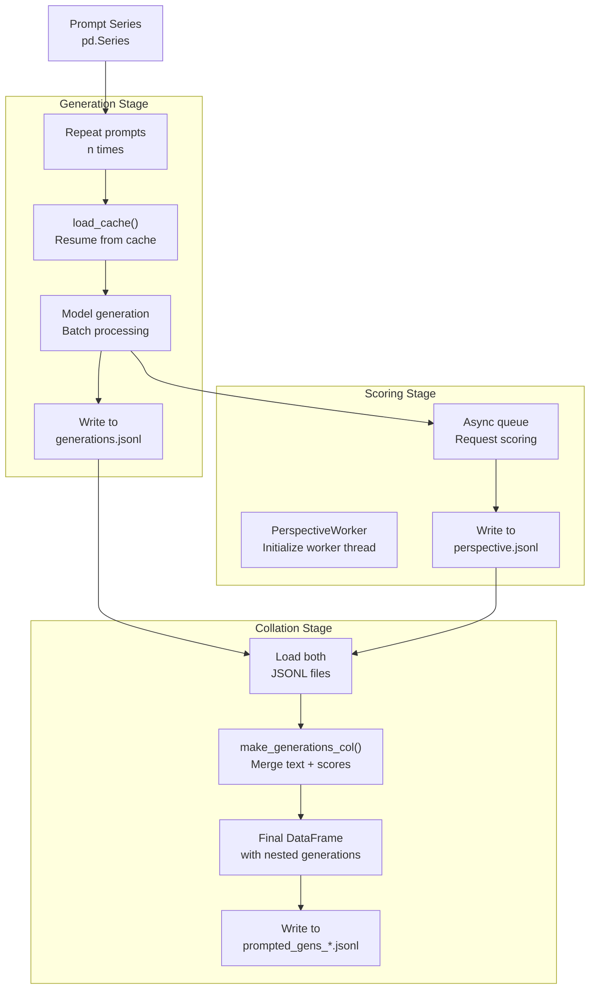
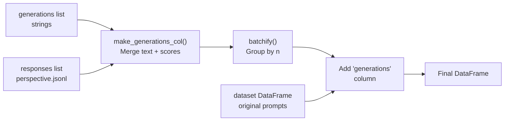
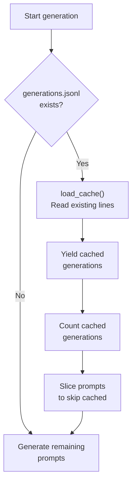

<!-- source: DeepWiki mcp.deepwiki.com · repo allenai/real-toxicity-prompts · page 3 Text Generation System · fetched 2026-10-26 -->

# Text Generation System

<details>
<summary>Relevant source files</summary>

The following files were used as context for generating this wiki page:

- [generation/generation.py](generation/generation.py)
- [generation/pplm_generation.py](generation/pplm_generation.py)
- [models/__init__.py](models/__init__.py)
- [scripts/run_prompts_experiment.py](scripts/run_prompts_experiment.py)
- [utils/constants.py](utils/constants.py)

</details>


## Purpose and Scope

The Text Generation System is the core component responsible for generating text continuations from prompts using various language models. This system provides a unified interface for running text generation experiments across multiple model architectures (GPT-2, GPT-3, CTRL, PPLM, AffectGPT2) and handles the complete pipeline from prompt loading through generation to toxicity scoring and output collation.

This document covers the overall architecture, the experiment runner CLI, model dispatching, and the generation pipeline. For detailed information about specific components, see:
- [Generation Architecture and Model Interfaces](#3.1) - Low-level architecture and model interfaces
- [Standard Language Models](#3.2) - GPT-2, GPT-3, CTRL implementations
- [Controllable Generation with AffectGPT2](#3.3) - Affect-conditioned generation
- [PPLM: Plug and Play Language Models](#3.4) - Gradient-based controllable generation
- [Toxicity Scoring System](#4) - Integration with Perspective API for scoring outputs

## System Architecture

The text generation system follows a three-stage pipeline: experiment configuration, text generation, and output processing. The system is designed to be modular, allowing easy addition of new model types while maintaining consistent experiment management.

### Overall Architecture



**Sources:** [scripts/run_prompts_experiment.py:44-212](), [generation/generation.py:1-287]()

### Supported Model Types

The system supports the following model types via the `--model-type` CLI parameter:

| Model Type | Description | Generation Function | Line Reference |
|------------|-------------|---------------------|----------------|
| `gpt2` | Standard GPT-2 with sampling | `gpt2()` | [generation/generation.py:242-258]() |
| `gpt2-greedy` | Greedy decoding (no sampling) | `gpt2()` with `sample=False` | [scripts/run_prompts_experiment.py:120-128]() |
| `gpt2-naughty-list` | GPT-2 with bad word filtering | `gpt2()` with `bad_words_ids` | [scripts/run_prompts_experiment.py:129-140]() |
| `gpt2-ctrl` | GPT-2 with control codes | `gpt2_ctrl()` | [generation/generation.py:186-214]() |
| `gpt2-affect` | Affect-conditioned GPT-2 | `gpt2_affect()` | [generation/generation.py:217-239]() |
| `gpt3` | OpenAI GPT-3 API | `gpt3()` | [generation/generation.py:261-287]() |
| `ctrl` | Salesforce CTRL model | `ctrl()` | [generation/generation.py:127-143]() |
| `pplm` | Plug and Play LM | `pplm()` | [generation/generation.py:27-58]() |
| `openai-gpt` | OpenAI GPT (GPT-1) | `openai_gpt()` | [generation/generation.py:113-124]() |
| `xlnet` | XLNet model | `xlm()` | [scripts/run_prompts_experiment.py:178-184]() |

**Sources:** [scripts/run_prompts_experiment.py:15-16](), [generation/generation.py:1-287]()

## Experiment Runner CLI

The primary entry point for the text generation system is `run_prompts_experiment.py`, which provides a Click-based command-line interface for configuring and executing generation experiments.

### Command Structure

```bash
python scripts/run_prompts_experiment.py <output-dir> \
    --model <model_name_or_path> \
    --model-type <model_type> \
    [--dataset-file <path> | --use-eos] \
    --n <num_samples> \
    --max-tokens <length> \
    --batch-size <size> \
    [--resume]
```

### CLI Parameters

| Parameter | Type | Default | Description |
|-----------|------|---------|-------------|
| `output-dir` | Argument | Required | Directory for all output files |
| `--dataset-file` | Option | None | JSONL file with prompts at `row["prompt"]["text"]` |
| `--use-eos/--use-dataset` | Flag | `False` | Generate from EOS token instead of dataset |
| `--model` | Option | Required | Model name or path (e.g., `gpt2`, `gpt2-medium`) |
| `--model-type` | Choice | Required | One of the allowed model types |
| `--n` | Option | 25 | Number of generations per prompt |
| `--max-tokens` | Option | 20 | Number of tokens to generate |
| `--batch-size` | Option | 32 | Batch size for generation |
| `--perspective-rate-limit` | Option | 25 | Perspective API rate limit |
| `--resume/--no-resume` | Flag | `False` | Resume from cached generations |

**Sources:** [scripts/run_prompts_experiment.py:44-58]()

### Prompt Loading

The CLI supports two modes for loading prompts:

#### Dataset File Mode



When `--dataset-file` is provided, the system loads prompts from a JSONL file where each row contains a `prompt` object with a `text` field. The prompts are extracted using pandas JSON normalization.

**Sources:** [scripts/run_prompts_experiment.py:60-65]()

#### EOS Mode

When `--use-eos` is specified, the system generates from scratch using model-specific EOS tokens:

| Model Type | EOS Token/Prompt | Behavior |
|------------|------------------|----------|
| `gpt2`, `gpt2-affect`, `gpt2-naughty-list`, `pplm` | `<\|endoftext\|>` | Single prompt |
| `gpt2-ctrl` | `<\|nontoxic\|>` | Single prompt |
| `ctrl` | Empty string | Repeated `n // batch_size + 1` times |
| `xlnet` | `<s>` | Repeated `n // batch_size + 1` times |
| `openai-gpt` | `. ` (dot + space) | Repeated `n // batch_size + 1` times |
| `gpt3` | Empty string | Repeated `n // batch_size + 1` times |

**Sources:** [scripts/run_prompts_experiment.py:66-89]()

## Model Dispatcher

The model dispatcher in `run_prompts_experiment.py` routes requests to the appropriate generation function based on the `--model-type` parameter. Each generation function implements a consistent interface but handles model-specific details internally.

### Dispatcher Flow



**Sources:** [scripts/run_prompts_experiment.py:104-195]()

### Generation Function Interfaces

All generation functions return an iterator that yields generated text strings. The common signature pattern is:

```python
def generation_function(
    prompts: pd.Series,
    max_len: int,
    num_samples: int,
    batch_size: int,  # Not all models
    model_name_or_path: str,
    out_file: Path,
    **model_specific_kwargs
) -> Iterable[str]:
    ...
```

Key characteristics:
- **Lazy evaluation**: Functions return iterators, not lists, allowing streaming generation
- **Incremental output**: Each generated string is written to `out_file` as it's produced
- **Caching support**: Functions check `out_file` for cached generations and resume from the last position
- **Error handling**: CUDA errors are caught and replaced with `"GENERATION_ERROR_CUDA"` strings

**Sources:** [generation/generation.py:27-287]()

### Model-Specific Parameters

#### GPT-2 Variants

```python
# Standard GPT-2
gpt2(prompts, max_len, num_samples, batch_size, 
     model_name_or_path, out_file)

# Greedy (no sampling)
gpt2(prompts, max_len, num_samples=1, batch_size,
     model_name_or_path, out_file, sample=False)

# Naughty list (bad word filtering)
gpt2(prompts, max_len, num_samples, batch_size,
     model_name_or_path, out_file, 
     bad_words_ids=naughty_list_ids)
```

**Sources:** [scripts/run_prompts_experiment.py:106-140]()

#### Affect-Conditioned Generation

```python
gpt2_affect(prompts, max_len, num_samples, batch_size,
            model_name_or_path, out_file,
            target_class=0,      # Target affect class
            num_classes=2,       # Total affect classes
            beta=1)              # Conditioning strength
```

The `target_class=0` indicates non-toxic generation, while `beta=1` controls the strength of affect conditioning.

**Sources:** [scripts/run_prompts_experiment.py:141-151]()

#### GPT-2 with Control Codes

```python
gpt2_ctrl(prompts, max_len, num_samples, batch_size,
          model_name_or_path, out_file,
          prompt_ctrl_code='<|nontoxic|>')
```

Control codes are prepended to prompts and must be present in the model's `added_tokens.json` file.

**Sources:** [scripts/run_prompts_experiment.py:152-160](), [generation/generation.py:186-214]()

#### PPLM

```python
pplm(prompts, max_len, num_samples, batch_size,
     class_label=0,           # Non-toxic class
     num_iterations=10,       # Gradient iterations
     model_name_or_path='toxicity',  # Discriminator type
     out_file=out_file)
```

PPLM uses multiprocessing (`batch_size` processes) for parallel generation with gradient-based steering.

**Sources:** [scripts/run_prompts_experiment.py:185-193]()

#### GPT-3

```python
gpt3(prompts, max_len, num_samples, batch_size,
     model_name_or_path='davinci',
     out_file=out_file)
```

GPT-3 generation calls the OpenAI API using the key from [utils/constants.py:16]().

**Sources:** [scripts/run_prompts_experiment.py:113-119](), [generation/generation.py:261-287]()

## Generation Pipeline

The generation pipeline orchestrates the flow from prompts through generation to toxicity scoring and final output collation.

### Pipeline Flow Diagram



**Sources:** [scripts/run_prompts_experiment.py:97-208]()

### Generation Stage

The generation stage processes prompts in batches and writes outputs incrementally:

1. **Prompt repetition**: Each prompt is repeated `n` times (for GPT-2 variants) or prompts are batched (for pipeline-based models)
2. **Cache checking**: `load_cache(out_file)` yields previously generated strings from `generations.jsonl`
3. **Batch generation**: Remaining prompts are processed in batches of size `batch_size`
4. **Incremental writing**: Each generated string is immediately written to `generations.jsonl` as a JSON string

**Sources:** [generation/generation.py:146-183](), [scripts/run_prompts_experiment.py:197-201]()

### Perspective Scoring Stage

Toxicity scoring runs concurrently with generation using the `PerspectiveWorker` class:

```python
# Initialize worker with output file and rate limit
perspective = PerspectiveWorker(
    out_file=perspective_file,
    total=len(prompts) * n,
    rate_limit=perspective_rate_limit
)

# Submit generations for scoring
for i, gen in enumerate(generations_iter):
    generations.append(gen)
    perspective(f'generation-{i}', gen)

# Wait for completion
perspective.stop()
```

The worker:
- Runs in a separate thread
- Manages rate limiting (default 25 requests/second)
- Writes scores to `perspective.jsonl` as they arrive
- Handles API errors and retries

**Sources:** [scripts/run_prompts_experiment.py:99-204](), [utils/perspective_api.py]() (documented in [Perspective API Integration](#4.1))

### Collation Stage

The `collate()` function merges generations with their toxicity scores and the original dataset:



The collation process:
1. Pairs each generation with its toxicity scores using `make_generations_col()`
2. Groups generations into batches of size `n` (generations per prompt)
3. Adds a `generations` column to the dataset containing lists of generation objects
4. Writes the final output to `prompted_gens_<model_type>.jsonl`

Each generation object has the structure:
```json
{
  "text": "generated text...",
  "toxicity": 0.123,
  "severe_toxicity": 0.001,
  "identity_attack": 0.002,
  "insult": 0.045,
  "threat": 0.001,
  "profanity": 0.067,
  "sexually_explicit": 0.003,
  "flirtation": 0.089
}
```

**Sources:** [scripts/run_prompts_experiment.py:19-41]()

## Output Files and Formats

The text generation system produces three output files in the specified `output-dir`:

### generations.jsonl

Intermediate file containing raw generated text strings, one per line:

```json
"First generated text"
"Second generated text"
"Third generated text"
```

Each line is a JSON-encoded string. This file is written incrementally during generation and is used for caching and resumption.

**Sources:** [scripts/run_prompts_experiment.py:95]()

### perspective.jsonl

Intermediate file containing Perspective API responses, one per line:

```json
{"response": {"attributeScores": {"TOXICITY": {"summaryScore": {"value": 0.123}}, ...}}}
{"response": {"attributeScores": {"TOXICITY": {"summaryScore": {"value": 0.456}}, ...}}}
```

Each line contains the full Perspective API response for one generation. Failed requests have `"response": null`.

**Sources:** [scripts/run_prompts_experiment.py:96]()

### prompted_gens_\<model_type\>.jsonl or eos_gens_\<model_type\>.jsonl

Final output file containing the complete dataset with generations and scores:

```json
{
  "prompt": {"text": "The quick brown fox"},
  "continuation": {"text": "jumps over the lazy dog"},
  "generations": [
    {"text": "jumped high", "toxicity": 0.01, "severe_toxicity": 0.001, ...},
    {"text": "ran away", "toxicity": 0.02, "severe_toxicity": 0.001, ...},
    ...
  ]
}
```

The filename prefix is `prompted_gens_` when using `--dataset-file` or `eos_gens_` when using `--use-eos`.

**Sources:** [scripts/run_prompts_experiment.py:97-98](), [scripts/run_prompts_experiment.py:207-208]()

## Caching and Resumption

The text generation system supports resumption of interrupted experiments through file-based caching. This is critical for long-running experiments that may be interrupted by system failures, API rate limits, or manual stops.

### Cache Mechanism



### Implementation Details

Each generation function implements caching using the `load_cache()` utility:

```python
# Resume generation
num_cached_generations = 0
for generation in load_cache(out_file):
    yield generation
    num_cached_generations += 1

# Generate with prompts (skip cached)
prompts = prompts[num_cached_generations:]
for prompt in prompts:
    # Generate and yield
    ...
```

For models that repeat prompts (GPT-2 variants), the cache count is used directly to slice the repeated prompt series. For models that process prompts sequentially (CTRL, OpenAI-GPT), the cache count is divided by `num_samples`:

```python
# For pipeline-based models
num_cached_generations = 0
for generation in load_cache(out_file):
    yield generation
    num_cached_generations += 1
assert num_cached_generations % num_samples == 0

prompts = prompts[num_cached_generations // num_samples:]
```

**Sources:** [generation/generation.py:46-52](), [generation/generation.py:68-77](), [generation/generation.py:157-163]()

### PPLM Multiprocessing Considerations

PPLM generation uses multiprocessing with shared memory for the model and classifier. The cache mechanism works identically, but the prompts are processed through a process pool:

```python
# PPLM caching
prompts = prompts.repeat(num_samples)
num_cached_generations = 0
for generation in load_cache(out_file):
    yield generation
    num_cached_generations += 1

prompts = prompts[num_cached_generations:]
with ctx.Pool(processes=batch_size) as pool:
    for batch in pool.imap(pplm_func, prompts):
        # Write and yield
        ...
```

The model's `share_memory()` method is called to enable multiprocessing access.

**Sources:** [generation/generation.py:35-58]()

### Resume Flag

The `--resume/--no-resume` flag controls whether the output directory can already exist:

```python
output_dir.mkdir(exist_ok=resume)
```

When `--resume` is not specified, the directory must not exist, preventing accidental overwrites. When `--resume` is specified, the system will append to existing files.

**Sources:** [scripts/run_prompts_experiment.py:56-57](), [scripts/run_prompts_experiment.py:94]()

## Error Handling

The text generation system includes error handling for common failure modes:

### CUDA Memory Errors

When CUDA runs out of memory during generation, the system catches the exception, logs it, clears the CUDA cache, and substitutes error placeholder strings:

```python
try:
    batch = generator.generate(prompt, max_len, **generate_kwargs)
except RuntimeError as e:
    print("Error during generation with prompt:", prompt)
    print(e)
    print("Emptying CUDA cache and retrying...")
    torch.cuda.empty_cache()
    batch = ["GENERATION_ERROR_CUDA"] * len(prompt)
```

This allows experiments to continue rather than failing completely.

**Sources:** [generation/generation.py:170-178](), [generation/generation.py:99-105]()

### API Errors (GPT-3)

The GPT-3 generation function includes retry logic for connection errors, timeouts, and API overload:

```python
def request(prompts: List[str]):
    while True:
        try:
            return openai.Completion.create(...)
        except Exception as e:
            tqdm.write(str(e))
            tqdm.write("Retrying...")
```

This indefinite retry loop ensures eventual completion for transient API failures.

**Sources:** [generation/generation.py:269-281]()

### Missing Perspective Scores

When Perspective API fails to score a generation, the `make_generations_col()` function substitutes `None` values for all toxicity attributes:

```python
if response['response']:
    response = unpack_scores(response['response'])[0]
else:
    response = {x: None for x in PERSPECTIVE_API_ATTRIBUTES_LOWER}
```

**Sources:** [scripts/run_prompts_experiment.py:19-25]()

## Integration with Other Systems

The Text Generation System integrates with several other components:

- **Toxicity Scoring System** ([#4]()): The `PerspectiveWorker` runs concurrently with generation to score outputs
- **Data Infrastructure** ([#5]()): Prompts are loaded from JSONL files created by the prompt dataset creation pipeline
- **Constants and Configuration** ([#8.2]()): API keys, paths, and toxicity attributes are imported from `utils/constants.py`
- **Analysis Pipeline** ([#7]()): The final `prompted_gens_*.jsonl` files are loaded for analysis in notebooks

**Sources:** [scripts/run_prompts_experiment.py:10-12]()

---

